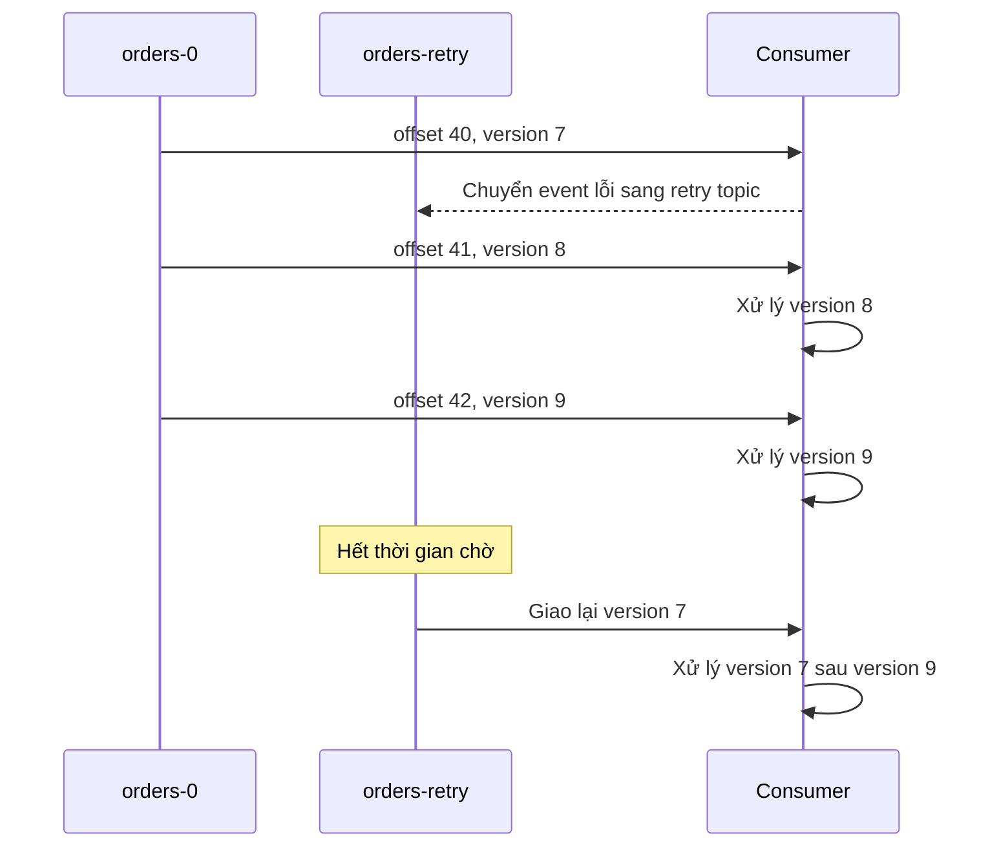

# Ordering bị ảnh hưởng thế nào

Non-blocking retry giúp consumer tiếp tục đọc các record phía sau khi một record gặp lỗi. Spring Kafka chuyển record lỗi sang retry topic, đợi đến thời điểm được cấu hình rồi giao lại cho consumer của retry topic. Cách làm này tăng khả năng xử lý song song và tránh để một lỗi tạm thời giữ cả partition nguồn.

Đổi lại, thứ tự xử lý ban đầu có thể thay đổi. Record cũ đang chờ retry có thể được xử lý sau những record mới hơn trong cùng partition. Đây là điểm cần hiểu rõ khi các event cùng cập nhật một đơn hàng, tài khoản hoặc aggregate mà kết quả phụ thuộc vào thứ tự.

## 1. Kafka bảo đảm thứ tự ở phạm vi nào?

Kafka duy trì thứ tự record trong một partition. Nếu producer ghi A rồi B vào cùng partition, consumer đọc partition đó sẽ nhận A trước B theo offset. Kafka không cung cấp một thứ tự tổng thể giữa nhiều partition, và cũng không tạo thứ tự chung giữa topic gốc với các retry topic.

Với non-blocking retry, record thất bại được publish sang một retry topic. Khi việc chuyển record và xử lý offset nguồn hoàn tất, consumer của topic gốc có thể tiếp tục với record tiếp theo. Retry topic được tiêu thụ qua luồng listener retry với lịch giao riêng, vì vậy luồng nguồn và luồng retry có thể tiến triển độc lập.

## 2. Một ví dụ record mới vượt qua record cũ

Giả sử partition `orders-0` nhận ba event của cùng một đơn hàng theo thứ tự:

| Offset | Event | Version | Kết quả lần đầu |
| ---: | --- | ---: | --- |
| 40 | `OrderAddressChanged` | 7 | Gọi dịch vụ địa chỉ thất bại |
| 41 | `OrderPaid` | 8 | Xử lý thành công |
| 42 | `OrderPacked` | 9 | Xử lý thành công |

Khi event ở offset 40 được chuyển sang retry topic, consumer nguồn có thể tiếp tục xử lý offset 41 và 42. Sau khoảng chờ, event version 7 mới được thử lại. Thứ tự hoàn tất nghiệp vụ có thể trở thành version 8, version 9, rồi version 7.



Nếu version 7 thay đổi địa chỉ giao hàng, còn version 8 và 9 tạo thanh toán và đóng gói dựa trên trạng thái trước đó, hệ thống có thể lưu trạng thái sai hoặc phát sinh side effect không hợp lệ. Vì vậy, non-blocking retry cần được đánh giá theo quy tắc thứ tự của nghiệp vụ, không chỉ theo throughput.

## 3. Giữ cùng key và partition có đủ không?

Dùng cùng key, chẳng hạn `orderId`, giúp các event của một đơn hàng được định tuyến ổn định vào một partition trong topic nguồn. Khi cấu hình retry topic giữ ánh xạ partition phù hợp, record retry cũng có thể đi vào partition tương ứng của retry topic.

Tuy nhiên, key và partition chỉ giữ affinity trong từng topic. Partition `orders-0` và partition `orders-retry-0` là hai log độc lập, được consumer xử lý theo tiến độ và lịch riêng. Việc cùng key hoặc cùng số partition không buộc event version 7 phải hoàn tất trước version 8 ở topic gốc.

Ngoài ra, các retry level có thể dùng những topic khác nhau theo thời gian chờ. Event cũ ở retry topic có delay dài có thể bị event mới hơn ở retry topic delay ngắn vượt qua. Concurrency, thời gian xử lý khác nhau và việc phát lại từ DLT cũng có thể làm thay đổi thứ tự hoàn tất.

## 4. Cấu hình non-blocking retry

Spring Kafka cung cấp `@RetryableTopic` để khai báo số lần giao, backoff và nhóm exception cần retry. Ví dụ sau cho phép tối đa bốn lần giao tính cả lần đầu, với khoảng chờ tăng dần:

```java
@RetryableTopic(
    attempts = "4",
    backoff = @Backoff(
        delay = 1_000,
        multiplier = 2.0,
        maxDelay = 10_000),
    include = {PartnerUnavailableException.class})
@KafkaListener(topics = "orders", groupId = "order-projection")
public void consume(OrderEvent event) {
    orderService.apply(event);
}
```

`attempts = "4"` gồm một lần xử lý ban đầu và tối đa ba lần giao lại. `@RetryableTopic` tạo luồng retry topic và DLT theo cấu hình; consumer nguồn có thể tiếp tục sau khi record lỗi được chuyển đi thành công. Chỉ những exception được đưa vào chính sách retry mới đi qua các retry topic; lỗi không retry có thể được chuyển thẳng đến DLT.

Cấu hình topic và partition phải tương thích với cách định tuyến record. Nếu resolver giữ partition nguồn, các retry topic cần có partition tương ứng. Hãy xác minh số partition, replication factor, retention và consumer group của retry/DLT topic trong môi trường triển khai.

Non-blocking retry qua `@RetryableTopic` dành cho record listener; cơ chế này không hỗ trợ batch listener và không kết hợp với container transactions. Nếu listener cần xử lý batch hoặc yêu cầu transaction do container quản lý, hãy chọn chiến lược xử lý lỗi tương thích với mô hình đó.

## 5. Khi nào thứ tự bị ảnh hưởng là chấp nhận được?

Non-blocking retry phù hợp khi event có thể được xử lý độc lập hoặc nghiệp vụ đã được thiết kế để chịu được việc đến sai thứ tự. Ví dụ:

- Gửi email hoặc thông báo: mỗi event có thể được xử lý độc lập; cần chống gửi trùng bằng event ID.
- Đồng bộ dữ liệu dạng snapshot: snapshot có version, consumer chỉ áp dụng snapshot mới hơn trạng thái hiện tại.
- Cập nhật số liệu cộng dồn: phép cập nhật có tính giao hoán hoặc có khóa chống trùng để event đến muộn không làm sai kết quả.
- Xử lý nhiều aggregate độc lập: thứ tự giữa hai đơn hàng khác nhau không quan trọng, miễn là mỗi đơn hàng có quy tắc version riêng.

Dù chấp nhận reordering, handler vẫn cần idempotent. Retry, restart, rebalance và DLT replay đều có thể làm cùng event xuất hiện nhiều lần. Event nên có `eventId` ổn định; thao tác ghi dữ liệu cần chống trùng và có thể kiểm tra version.

## 6. Dùng version hoặc sequence để bảo vệ trạng thái

Nếu event cùng aggregate phải tuân theo thứ tự, gắn số version tăng dần vào event. Consumer so sánh version nhận được với version đã áp dụng:

- Version nhỏ hơn hoặc bằng version hiện tại: event cũ hoặc trùng; có thể bỏ qua sau khi xác minh idempotency.
- Version đúng bằng version kế tiếp: áp dụng event và tăng version đã lưu.
- Version lớn hơn version kế tiếp: đang thiếu event đứng trước; lưu event vào vùng pending hoặc cơ chế buffer bền vững để xử lý sau.

Ví dụ minh họa cho phần kiểm tra version:

```java
@Transactional
public void apply(OrderEvent event) {
    long current = orderRepository.currentVersion(event.orderId());

    if (event.version() <= current) {
        return; // Event cũ hoặc đã được áp dụng.
    }

    if (event.version() > current + 1) {
        pendingEventRepository.saveIfAbsent(event.eventId(), event);
        return; // Đợi version còn thiếu.
    }

    orderRepository.apply(event);
    orderRepository.updateVersion(event.orderId(), event.version());
    pendingEventService.applyNextConsecutive(event.orderId());
}
```

Đây là phác thảo nghiệp vụ; thao tác cập nhật aggregate, version và pending event cần nằm trong transaction dữ liệu phù hợp. Khi event còn thiếu đến sau, hệ thống áp dụng event đó rồi lần lượt xử lý các event pending có version liên tiếp. Cần có cơ chế retry hoặc cảnh báo cho event pending bị kẹt quá lâu.

Không nên chỉ ném exception cho mọi event đến sai version rồi kỳ vọng retry topic tự khôi phục thứ tự. Retry có delay có thể làm event sau tiếp tục vượt qua event trước và tạo vòng lặp reordering. Buffer bền vững cùng quy tắc sequence giúp consumer chủ động điều phối.

## 7. Khi nào nên dùng blocking retry?

Nếu yêu cầu là record sau trong cùng partition tuyệt đối không được xử lý trước record đang lỗi, blocking retry thường phù hợp hơn. `DefaultErrorHandler` retry tại consumer bằng seek/backoff; record lỗi tiếp tục giữ vị trí đầu luồng của partition, nên các record phía sau trong partition phải chờ.

```java
@Bean
public DefaultErrorHandler kafkaErrorHandler(
        ConsumerRecordRecoverer recoverer) {
    return new DefaultErrorHandler(
        recoverer, new FixedBackOff(2_000L, 3L));
}
```

Cách này giữ thứ tự đọc trong partition trong thời gian retry, nhưng làm giảm throughput của partition đó và có thể kéo dài consumer lag. Nếu hết retry rồi recover record sang DLT, các record sau vẫn có thể tiếp tục; khi đó luồng nghiệp vụ vẫn có một khoảng trống. Với thứ tự nghiêm ngặt, cần quyết định rõ có dừng/pause partition để xử lý sự cố hay có quy trình sửa và replay trước khi cho phép tiến độ tiếp tục.

Nếu delay blocking dài, cân nhắc `ContainerPausingBackOffHandler` và kiểm tra `max.poll.interval.ms`. Không tăng concurrency để kỳ vọng xử lý song song các record cùng partition theo thứ tự; Kafka chỉ phân công một partition cho một consumer trong group tại một thời điểm.

## 8. Chọn chiến lược theo yêu cầu nghiệp vụ

| Yêu cầu | Chiến lược phù hợp | Đánh đổi chính |
| --- | --- | --- |
| Event độc lập, ưu tiên throughput | Non-blocking retry với `@RetryableTopic` | Có thể hoàn tất sai thứ tự; cần idempotency |
| Cần thứ tự trong partition khi retry | Blocking retry với `DefaultErrorHandler` | Partition chờ record lỗi, giảm throughput |
| Nhiều aggregate, chỉ cần đúng thứ tự trong từng aggregate | Partition theo aggregate key và kiểm tra version | Cần thiết kế sequence và chống trùng |
| Thứ tự nghiêm ngặt, không được bỏ qua event lỗi | Dừng/pause tiến độ hoặc buffer/resequencer bền vững | Tăng độ phức tạp vận hành và thời gian chờ |

Một consumer có thể dùng non-blocking retry cho event không phụ thuộc thứ tự và một luồng khác dùng blocking retry cho event yêu cầu thứ tự. Chính sách cần được thiết kế theo loại event và listener, không nên áp dụng cùng một retry strategy cho mọi topic.

## 9. DLT replay cũng có thể làm đảo thứ tự

Khi event bị chuyển sang DLT, các event mới hơn trong topic nguồn có thể đã được xử lý. Việc replay event cũ về topic nguồn không tự động khôi phục lịch sử ban đầu; nó thường tạo ra một lần xử lý mới ở thời điểm replay.

Trước khi replay, hãy kiểm tra version hiện tại của aggregate, xác định event có còn hợp lệ không và chọn cách xử lý: áp dụng có điều kiện, dựng lại projection từ một offset kiểm soát hoặc đưa event vào quy trình sửa dữ liệu. Ghi lại event ID và nguồn replay để tránh lặp vô hạn giữa DLT và retry topic.

## 10. Kiểm thử thứ tự và giám sát

Một bài kiểm thử tích hợp nên gửi ba event cùng key vào cùng partition. Cố ý làm event đầu thất bại trong lần đầu, để event sau xử lý thành công, rồi chờ retry hoàn tất. Xác minh thứ tự thực tế có thể khác thứ tự offset và kiểm tra version guard hoặc resequencer giữ trạng thái cuối cùng đúng.

Nên kiểm thử thêm:

- Hai event cùng aggregate nhưng nằm ở các retry level có delay khác nhau.
- Retry topic có nhiều partition và listener có concurrency lớn hơn một.
- Event trùng, event đến muộn và event có version bị thiếu.
- DLT replay sau khi aggregate đã nhận version mới hơn.
- Ứng dụng restart trong lúc event đang chờ ở retry topic.

Theo dõi consumer lag riêng cho topic gốc và retry topic, số event đang chờ retry, tuổi event cũ nhất, số event vào DLT, tỷ lệ event bị từ chối vì version cũ hoặc thiếu và thời gian hoàn tất theo từng aggregate. Những chỉ số này cho biết hệ thống đang đổi thứ tự ở đâu và có làm sai trạng thái nghiệp vụ hay không.

Non-blocking retry đổi cách xử lý lỗi bằng cách cho luồng nguồn tiếp tục chạy, nên thứ tự hoàn tất không còn được bảo đảm giữa topic gốc và retry topic. Hãy dùng nó khi nghiệp vụ chấp nhận reordering hoặc đã có version, buffer và idempotency để kiểm soát kết quả. Nếu thứ tự là điều kiện bắt buộc, chọn blocking retry hoặc một cơ chế điều phối thứ tự có trạng thái bền vững.
