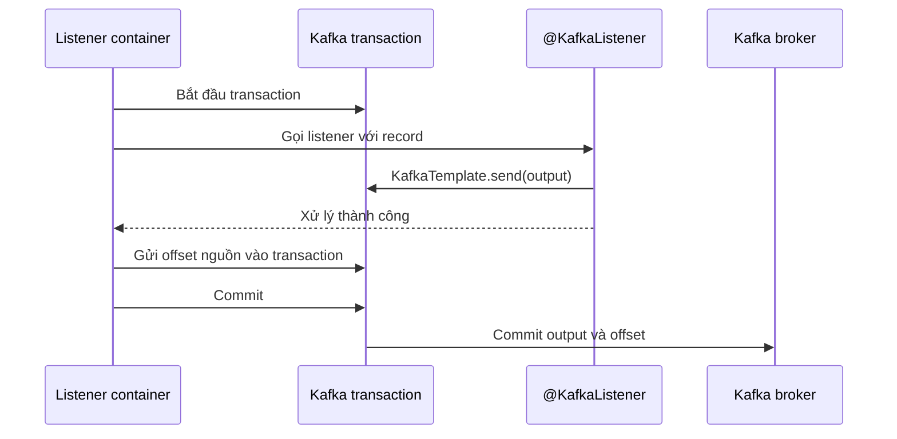
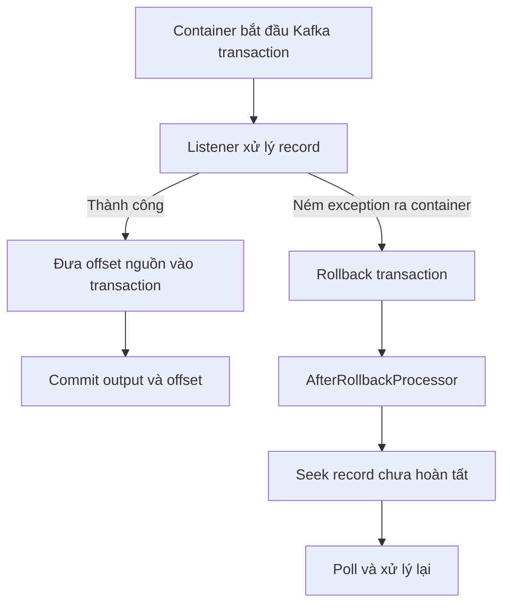
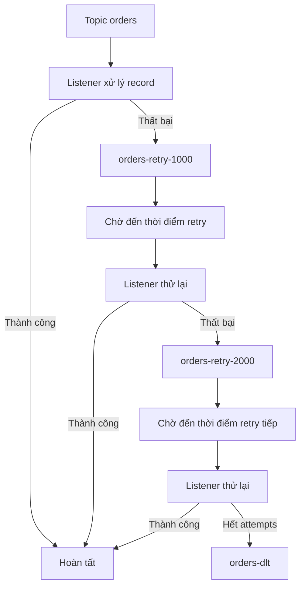

# Không kết hợp non-blocking retry với container transaction

Spring Kafka hỗ trợ hai cơ chế xử lý lỗi có mục tiêu khác nhau: container transaction dùng Kafka transaction để commit hoặc rollback thao tác xử lý cùng offset nguồn; non-blocking retry chuyển record lỗi sang retry topic để thử lại sau một khoảng trễ mà không giữ luồng consumer của topic chính chờ đợi. Hai cơ chế này không thể ghép trực tiếp với nhau bằng `@RetryableTopic` và Kafka transaction do listener container quản lý.

Điểm mấu chốt là cách framework xử lý exception. Với container transaction, exception cần thoát khỏi listener để transaction rollback và `AfterRollbackProcessor` xử lý việc đọc lại. Với non-blocking retry, exception được xử lý bằng cách chuyển record sang retry topic. Tài liệu Spring Kafka nêu rõ rằng khi listener ném exception trong cấu hình này, container transaction vẫn commit thành công và record được gửi sang retryable topic. Vì thế, không thể dựa vào exception đó để yêu cầu container rollback toàn bộ transaction như luồng transactional retry thông thường.

## 1. Container transaction bảo vệ điều gì?

Khi listener container được cấu hình với `KafkaAwareTransactionManager` (thường là `KafkaTransactionManager`), container bắt đầu Kafka transaction trước khi gọi listener. Các thao tác gửi Kafka bằng `KafkaTemplate` dùng cùng `ProducerFactory` sẽ tham gia transaction đang hoạt động. Khi listener xử lý thành công, container gửi offset của record đã xử lý vào transaction rồi commit.

Nếu listener ném exception và exception được truyền ra ngoài, transaction bị rollback. Các Kafka output trong transaction không được commit và offset nguồn cũng không được commit. Consumer được đưa về vị trí để đọc lại record chưa hoàn tất. Đây là cơ sở để xây dựng luồng read-process-write có exactly-once semantics trong Kafka.



Nếu listener thất bại, đường đi là rollback:



Để cơ chế này hoạt động, `KafkaTemplate` dùng trong listener phải được cấu hình với cùng `ProducerFactory` có hỗ trợ transaction như `KafkaTransactionManager`. Với Spring Boot, có thể cấu hình `spring.kafka.producer.transaction-id-prefix`; mỗi instance ứng dụng cần prefix riêng để tránh trùng `transactional.id`.

## 2. Non-blocking retry chuyển record sang retry topic như thế nào?

Non-blocking retry của Spring Kafka được hỗ trợ từ phiên bản 2.7 qua `@RetryableTopic` và `RetryTopicConfiguration`. Khi listener xử lý thất bại, framework chuyển record sang retry topic kèm thông tin thời điểm được phép thử lại. Consumer của retry topic kiểm tra timestamp. Nếu chưa đến hạn, partition retry được pause; khi đến hạn, partition được resume và record được gọi xử lý lại.

Nếu lần thử tiếp theo vẫn thất bại, record được chuyển sang retry topic kế tiếp. Quá trình lặp lại đến khi listener thành công hoặc hết số lần thử; khi đã hết, record được gửi tới Dead Letter Topic (DLT) nếu DLT được cấu hình.



Với cách này, consumer của topic chính có thể tiếp tục xử lý record tiếp theo trong khi record lỗi đang chờ ở retry topic. Đổi lại, Kafka không còn bảo đảm thứ tự xử lý giữa record đang retry và các record phía sau trong cùng luồng nghiệp vụ. Đây là trade-off quan trọng khi chọn non-blocking retry.

## 3. Vì sao hai cơ chế không kết hợp được?

`@RetryableTopic` cài đặt luồng xử lý exception để chuyển record sang retry topic. Nó cần hoàn tất việc chuyển tiếp record và cho consumer chính tiếp tục. Trong khi đó, container transaction mong muốn exception từ listener đi ra ngoài để container rollback transaction.

Khi dùng non-blocking retry với container transaction, Spring Kafka ghi nhận hành vi rằng container transaction commit thành công và record được gửi sang retryable topic sau khi listener ném exception. Exception đã được retry infrastructure xử lý theo luồng chuyển topic; nó không còn đóng vai trò yêu cầu container rollback như transactional listener thông thường.

Điều này làm thay đổi ý nghĩa của ranh giới transaction:

- Ứng dụng không thể kỳ vọng listener ném exception thì transaction container sẽ rollback.
- Các Kafka send đã tham gia transaction container không thể được giả định sẽ bị hủy chỉ vì listener ném exception trong luồng non-blocking retry này.
- Việc chuyển record sang retry topic không thay thế cơ chế `AfterRollbackProcessor`.
- Nếu cần tính nguyên tử giữa Kafka output và offset đầu vào, hãy để exception kích hoạt rollback rồi xử lý retry sau rollback.

Ví dụ, listener gửi một sự kiện `OrderPriced` rồi tiếp tục gọi một dịch vụ khác. Nếu dịch vụ sau đó ném exception, ứng dụng có thể mong đợi transaction rollback để `OrderPriced` không xuất hiện. Khi kết hợp `@RetryableTopic` với container transaction, không được dựa vào giả định rollback đó: tài liệu Spring Kafka nêu rõ transaction container commit thành công trên đường xử lý non-blocking retry. Vì vậy, phải chọn một mô hình xử lý lỗi nhất quán với yêu cầu commit/rollback.

Hạn chế này nói về **container transaction** do listener container quản lý. Nó không có nghĩa mọi ứng dụng có database transaction đều không thể dùng retry topic. Tuy nhiên, nếu listener còn cập nhật database hoặc hệ thống bên ngoài, việc chuyển record sang retry topic không tự tạo ra một transaction phân tán bao trùm các hệ thống đó. Cần thiết kế idempotency, outbox/inbox hoặc cơ chế phối hợp phù hợp.

## 4. Dùng `@RetryableTopic` khi không dùng container transaction

Nếu nghiệp vụ chấp nhận chuyển record lỗi sang retry topic và không cần container rollback Kafka output cùng offset, có thể dùng non-blocking retry trên một listener container không được cấu hình Kafka transaction:

```java
@RetryableTopic(
        attempts = "4",
        backoff = @BackOff(delay = 1_000, multiplier = 2.0, maxDelay = 5_000)
)
@KafkaListener(topics = "orders", groupId = "order-service")
public void consume(Order order) {
    orderService.process(order);
}

@DltHandler
public void handleDlt(Order order) {
    orderFailureService.storeForInvestigation(order);
}
```

Trong ví dụ, `attempts = "4"` là tổng số lần giao tối đa, bao gồm lần xử lý đầu tiên. Framework tạo retry infrastructure, các retry topic và DLT theo cấu hình. Một `KafkaTemplate` cần có sẵn để chuyển tiếp record; nếu không chỉ định tên template trong annotation, Spring Kafka tìm bean tên `defaultRetryTopicKafkaTemplate`.

Khi vận hành, cần kiểm tra:

- Retry topic và DLT có đủ partition. Mặc định record được chuyển đến partition tương ứng với partition gốc.
- Serializer của `KafkaTemplate` có thể publish payload thực tế, kể cả `byte[]` nếu cần xử lý lỗi deserialization.
- Consumer group của retry topic được tách hợp lý khỏi group chính để rebalance ở retry topic không gây rebalance không cần thiết ở topic chính.
- `@DltHandler` hoặc quy trình DLT có khả năng lưu trữ, cảnh báo và phát lại record sau khi nguyên nhân lỗi được sửa.
- Listener có tính idempotent vì record có thể được giao lại sau lỗi publish, restart hoặc sự cố commit offset.

Non-blocking retry không được hỗ trợ với batch listener. Nếu đang dùng batch listener hoặc cần transaction ở cấp container, hãy chọn cơ chế error handling phù hợp với transaction thay vì gắn `@RetryableTopic` vào listener đó.

## 5. Khi cần container transaction, dùng AfterRollbackProcessor

Với container transaction, Spring Kafka mặc định để exception thoát khỏi listener để transaction rollback. Sau rollback, `DefaultAfterRollbackProcessor` seek các partition về vị trí cần đọc lại; record lỗi và các record chưa hoàn tất được giao lại ở lần poll sau.

Nếu một record liên tục thất bại, có thể cấu hình `DefaultAfterRollbackProcessor` với `BackOff` hữu hạn và recoverer. Khi retry hết, recoverer có thể gửi record sang DLT. Từ Spring Kafka 2.2.5, processor có thể thực hiện recovery trong một transaction mới sau khi transaction xử lý ban đầu rollback. Khi đặt `commitRecovered = true` và cung cấp transactional `KafkaTemplate`, việc publish record phục hồi và commit offset nguồn có thể nằm trong cùng transaction recovery.

Ví dụ cấu hình processor:

```java
@Bean
DefaultAfterRollbackProcessor<String, Order> orderAfterRollbackProcessor(
        KafkaTemplate<Object, Object> transactionalKafkaTemplate) {

    var recoverer = new DeadLetterPublishingRecoverer(transactionalKafkaTemplate);

    return new DefaultAfterRollbackProcessor<>(
            (record, exception) -> recoverer.accept(record, exception),
            new FixedBackOff(1_000L, 2L),
            transactionalKafkaTemplate,
            true
    );
}
```

Gắn transaction manager và processor vào listener container factory:

```java
@Bean
ConcurrentKafkaListenerContainerFactory<String, Order> transactionalOrderFactory(
        ConsumerFactory<String, Order> consumerFactory,
        KafkaTransactionManager<String, Order> kafkaTransactionManager,
        DefaultAfterRollbackProcessor<String, Order> orderAfterRollbackProcessor) {

    var factory = new ConcurrentKafkaListenerContainerFactory<String, Order>();
    factory.setConsumerFactory(consumerFactory);
    factory.getContainerProperties()
            .setKafkaAwareTransactionManager(kafkaTransactionManager);
    factory.setAfterRollbackProcessor(orderAfterRollbackProcessor);
    return factory;
}
```

Trong ví dụ này:

- `KafkaTransactionManager` bắt đầu transaction trước khi listener được gọi.
- `transactionalKafkaTemplate` phải dùng cùng transaction-capable `ProducerFactory` với transaction manager.
- `FixedBackOff(1_000L, 2L)` chờ một giây giữa hai lần retry và cho phép hai lần retry sau lần giao đầu tiên.
- Tham số cuối `true` bật `commitRecovered`; processor dùng template để gửi offset của record đã recovery vào transaction recovery.
- Nếu recoverer thất bại và ném exception, record vẫn được đưa vào luồng đọc lại; không được xem offset là đã recovery thành công.

`setKafkaAwareTransactionManager()` là API được ưu tiên từ Spring Kafka 3.2; `ContainerProperties.setTransactionManager()` đã bị deprecated từ phiên bản này. Với các phiên bản cũ hơn, cần dùng API transaction manager tương ứng với phiên bản đang chạy.

## 6. So sánh lựa chọn theo yêu cầu nghiệp vụ

| Yêu cầu | Non-blocking retry (`@RetryableTopic`) | Container transaction + `AfterRollbackProcessor` |
|---|---|---|
| Mục tiêu | Chuyển record lỗi sang retry topic để xử lý sau | Rollback thao tác Kafka và offset khi listener thất bại |
| Cách retry | Chuyển topic theo backoff timestamp | Seek và đọc lại record sau rollback |
| Kafka output trong listener | Không có bảo đảm rollback theo exception của listener trong mô hình container transaction | Cùng transaction với offset; rollback khi listener thất bại |
| Thứ tự | Có thể xử lý record sau trước record đang retry | Giữ thứ tự đọc lại trong partition theo luồng retry blocking |
| Batch listener | Không hỗ trợ | Có hỗ trợ; mặc định rollback có thể làm phát lại toàn batch |
| DLT | Qua retry-topic infrastructure | Qua recoverer của `AfterRollbackProcessor`, có thể trong transaction recovery |
| Khi phù hợp | Chấp nhận thay đổi thứ tự, cần tránh chặn consumer chính | Cần atomic read-process-write trong Kafka và rollback rõ ràng |

## 7. Những lỗi thiết kế cần tránh

**Gắn `@RetryableTopic` vào listener transactional rồi mong exception rollback.** Đây là xung đột trực tiếp với cách retry topic xử lý exception. Hãy quyết định trước listener dùng container transaction hay non-blocking retry.

**Cho rằng retry topic làm thao tác database và Kafka trở thành nguyên tử.** Retry topic chỉ là cơ chế chuyển record giữa các Kafka topic. Một database transaction độc lập không tự động commit/rollback cùng việc publish retry record. Nếu cần phối hợp, cân nhắc outbox/inbox hoặc transaction synchronization phù hợp.

**Bỏ qua thứ tự record.** Khi record A được chuyển sang retry topic, record B phía sau có thể được consumer topic chính xử lý trước A. Với các sự kiện biểu diễn chuyển trạng thái của cùng một đơn hàng hoặc tài khoản, cần giữ blocking/transactional retry hoặc thiết kế lại partition và luồng nghiệp vụ.

**Dùng batch listener với `@RetryableTopic`.** Spring Kafka không hỗ trợ non-blocking retry cho batch listener. Với batch transaction, dùng `AfterRollbackProcessor`, hoặc cân nhắc `BatchToRecordAdapter` nếu muốn xử lý từng record trong batch.

**Không xử lý duplicate.** Sự cố xảy ra giữa thời điểm publish retry/DLT và commit offset có thể dẫn đến record được giao lại. Listener và DLT handler nên dùng event ID hoặc business key để bảo vệ các thao tác có tác dụng phụ.

## 8. Tình huống minh họa

Một listener đọc `orders`, cập nhật trạng thái đơn hàng và gửi sự kiện `OrderConfirmed` bằng `KafkaTemplate`. Hệ thống yêu cầu trạng thái đơn hàng và sự kiện đầu ra phải cùng commit trong Kafka transaction.

1. Container bắt đầu transaction trước khi gọi listener.
2. Listener thực hiện xử lý và gửi `OrderConfirmed` bằng transactional `KafkaTemplate`.
3. Nếu xử lý thành công, container đưa offset nguồn vào transaction và commit. Consumer đọc tiếp record kế tiếp.
4. Nếu listener ném exception, transaction rollback; `OrderConfirmed` chưa commit và offset nguồn chưa commit.
5. `AfterRollbackProcessor` retry record. Nếu hết số lần retry, processor gửi record lỗi sang DLT trong transaction recovery và commit offset nguồn cùng transaction đó.

Trong tình huống này, `@RetryableTopic` không phù hợp vì nó xử lý exception bằng cách chuyển record sang retry topic và container transaction commit thành công theo hành vi được Spring Kafka mô tả. Dùng `AfterRollbackProcessor` để giữ đúng yêu cầu rollback của luồng read-process-write.

## 9. Ghi nhớ

- Container transaction bắt đầu trước listener; Kafka output từ `KafkaTemplate` và offset nguồn có thể được commit trong cùng transaction.
- Khi listener ném exception ra container, transaction rollback và `AfterRollbackProcessor` xử lý việc đọc lại.
- Non-blocking retry chuyển record lỗi sang retry topic có timestamp; consumer retry chờ đến hạn rồi xử lý lại, cuối cùng có thể chuyển sang DLT.
- `@RetryableTopic` không kết hợp với container transaction. Trong đường xử lý này, Spring Kafka nêu rõ container transaction commit thành công và record được gửi sang retryable topic.
- Nếu cần transaction rollback và retry, dùng `DefaultAfterRollbackProcessor`; có thể cấu hình recovery trong transaction mới với `commitRecovered = true` và transactional `KafkaTemplate`.
- Non-blocking retry không hỗ trợ batch listener và không giữ thứ tự xử lý của topic chính.
- Chọn cơ chế retry theo ranh giới transaction và yêu cầu thứ tự của nghiệp vụ; không coi retry topic là transaction phân tán.

## Tài liệu tham khảo

- [Spring for Apache Kafka — Non-Blocking Retries](https://docs.spring.io/spring-kafka/reference/retrytopic.html)
- [Spring for Apache Kafka — How the Retry Topic Pattern Works](https://docs.spring.io/spring-kafka/reference/retrytopic/how-the-pattern-works.html)
- [Spring for Apache Kafka — Transactions](https://docs.spring.io/spring-kafka/reference/kafka/transactions.html)
- [Spring for Apache Kafka — Handling Exceptions, mục After Rollback Processor](https://docs.spring.io/spring-kafka/reference/kafka/annotation-error-handling.html)
- [Spring for Apache Kafka 3.2 API — DefaultAfterRollbackProcessor](https://docs.spring.io/spring-kafka/docs/3.2.10/api/org/springframework/kafka/listener/DefaultAfterRollbackProcessor.html)
