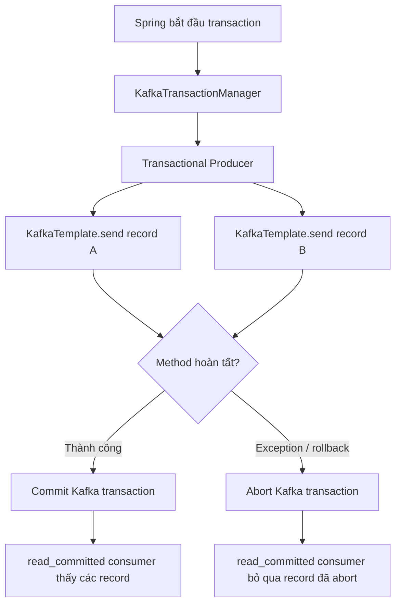
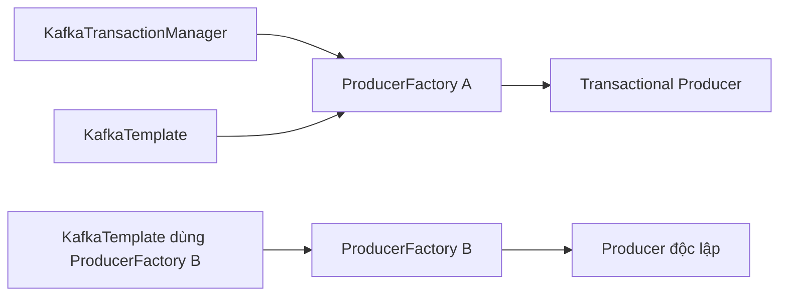
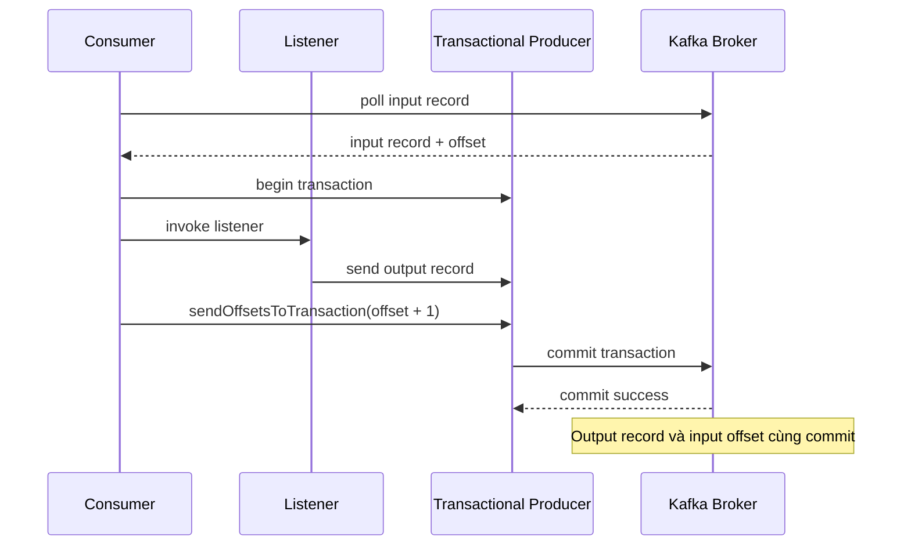

# KafkaTransactionManager

`KafkaTransactionManager` là implementation của Spring `PlatformTransactionManager` dành cho Kafka. Nó kết nối Spring transaction abstraction với transactional producer của Kafka, nhờ đó ứng dụng có thể dùng `@Transactional`, `TransactionTemplate` hoặc listener container để commit/rollback các lần gửi Kafka theo một transaction.

Điểm cốt lõi là producer factory phải hỗ trợ transaction và `KafkaTemplate` phải dùng cùng `ProducerFactory` với transaction manager. Khi transaction đang hoạt động, các lệnh `KafkaTemplate.send(...)` trên cùng thread sẽ dùng producer đã được gắn với transaction đó. Nếu xử lý thành công, transaction được commit; nếu exception làm transaction rollback, các record đã gửi trong transaction bị abort và consumer `read_committed` sẽ không nhìn thấy chúng.

## 1. KafkaTransactionManager giải quyết vấn đề gì?

Nếu gửi nhiều record độc lập, một số record có thể được ghi thành công trong khi một record khác thất bại. Điều này có thể để lại trạng thái không nhất quán trong một luồng event cần được công bố như một đơn vị.

Kafka transaction cho phép gom nhiều thao tác ghi thành một đơn vị commit/abort. `KafkaTransactionManager` đưa cơ chế đó vào Spring transaction:

- Bắt đầu Kafka transaction khi Spring bắt đầu transaction.
- Gắn transactional producer với thread hiện tại.
- Cho phép `KafkaTemplate` tham gia transaction đang hoạt động.
- Commit khi transaction hoàn tất thành công.
- Abort khi transaction bị rollback.



Kafka transaction cũng có thể kết hợp việc ghi output record với commit consumer offset trong cùng transaction. Đây là nền tảng cho consume-process-produce với exactly-once semantics trong phạm vi Kafka.

## 2. Điều kiện để bật Kafka transaction

Spring Kafka bật transaction bằng cách cấu hình `transactionIdPrefix` cho `DefaultKafkaProducerFactory`. Khi có prefix, factory quản lý một cache transactional producer thay vì chỉ dùng một producer dùng chung. Mỗi producer nhận `transactional.id` riêng được tạo từ prefix và suffix.

Với Spring Boot, cách ngắn gọn là khai báo `spring.kafka.producer.transaction-id-prefix`:

```yaml
spring:
  kafka:
    bootstrap-servers: localhost:9092
    producer:
      transaction-id-prefix: ${INSTANCE_ID:local}-orders-
      key-serializer: org.apache.kafka.common.serialization.StringSerializer
      value-serializer: org.springframework.kafka.support.serializer.JsonSerializer
```

Khi cấu hình property này, Spring Boot tự cấu hình transactional producer factory, tạo bean `KafkaTransactionManager` và gắn manager vào listener container mặc định. Nếu dùng nhiều application instance, `INSTANCE_ID` phải khác nhau trên từng instance. Không dùng cùng một prefix cố định cho mọi pod/replica vì các producer có thể fencing lẫn nhau.

`transactionIdPrefix` là tiền tố định danh transaction, không phải consumer group ID. Prefix phải ổn định trong vòng đời instance nhưng duy nhất giữa các instance đang chạy đồng thời.

### Tự cấu hình ProducerFactory

Nếu không dùng Spring Boot auto-configuration hoặc cần producer factory riêng, hãy đặt prefix trên `DefaultKafkaProducerFactory`:

```java
import java.util.HashMap;
import java.util.Map;

import org.apache.kafka.clients.producer.ProducerConfig;
import org.apache.kafka.common.serialization.StringSerializer;
import org.springframework.kafka.core.DefaultKafkaProducerFactory;
import org.springframework.kafka.core.ProducerFactory;
import org.springframework.kafka.support.serializer.JsonSerializer;

Map<String, Object> props = new HashMap<>();
props.put(ProducerConfig.BOOTSTRAP_SERVERS_CONFIG, "localhost:9092");
props.put(ProducerConfig.KEY_SERIALIZER_CLASS_CONFIG, StringSerializer.class);
props.put(ProducerConfig.VALUE_SERIALIZER_CLASS_CONFIG, JsonSerializer.class);

DefaultKafkaProducerFactory<String, OrderEvent> producerFactory =
        new DefaultKafkaProducerFactory<>(props);
producerFactory.setTransactionIdPrefix("orders-instance-01-");
```

Producer factory tùy chỉnh được truyền vào `KafkaTransactionManager` phải trả về `true` từ `transactionCapable()`. Nếu factory không hỗ trợ transaction, constructor của `KafkaTransactionManager` sẽ từ chối cấu hình đó.

## 3. Khai báo KafkaTransactionManager bean

Khi Spring Boot đã cấu hình `spring.kafka.producer.transaction-id-prefix`, Boot tự tạo manager. Không cần khai báo thêm một manager trùng lặp nếu bean auto-configured đáp ứng yêu cầu.

Nếu tự quản lý producer factory, tạo manager từ chính factory đó:

```java
import org.springframework.context.annotation.Bean;
import org.springframework.context.annotation.Configuration;
import org.springframework.kafka.core.ProducerFactory;
import org.springframework.kafka.transaction.KafkaTransactionManager;

@Configuration
public class KafkaTransactionConfiguration {

    @Bean
    KafkaTransactionManager<String, OrderEvent> kafkaTransactionManager(
            ProducerFactory<String, OrderEvent> producerFactory) {
        return new KafkaTransactionManager<>(producerFactory);
    }
}
```

`KafkaTransactionManager` nhận một `ProducerFactory` trong constructor. Factory này phải là transactional factory đã cấu hình prefix. `KafkaTemplate` được sử dụng trong transaction cũng phải dùng đúng factory đó; nếu template dùng factory khác, nó không tham gia cùng transaction.

Trong các ví dụ tiếp theo, `OrderCreatedEvent`, `OrderPaidEvent` và `OrderSummaryEvent` cùng triển khai một hợp đồng `OrderEvent` có phương thức `orderId()`:

```java
public interface OrderEvent {
    String orderId();
}
```

## 4. Dùng @Transactional cho producer

Khi muốn nhiều lần gửi Kafka cùng commit hoặc abort, đánh dấu service method bằng `@Transactional` và chọn `KafkaTransactionManager`:

```java
import org.springframework.kafka.core.KafkaTemplate;
import org.springframework.stereotype.Service;
import org.springframework.transaction.annotation.Transactional;

@Service
public class OrderEventPublisher {

    private final KafkaTemplate<String, OrderEvent> kafkaTemplate;

    public OrderEventPublisher(KafkaTemplate<String, OrderEvent> kafkaTemplate) {
        this.kafkaTemplate = kafkaTemplate;
    }

    @Transactional(transactionManager = "kafkaTransactionManager")
    public void publishOrder(OrderEvent created, OrderEvent paid) {
        kafkaTemplate.send("orders.events", created.orderId(), created);
        kafkaTemplate.send("orders.events", paid.orderId(), paid);

        // Nếu có RuntimeException tại đây, cả Kafka transaction bị rollback.
    }
}
```

Trong transaction:

1. Spring gọi `KafkaTransactionManager` để bắt đầu transaction.
2. Producer được gắn với thread hiện tại.
3. Hai lệnh `send()` sử dụng cùng transactional producer.
4. Nếu method hoàn tất, manager commit transaction.
5. Nếu method ném exception làm rollback, manager abort transaction.

Mặc định Spring rollback với `RuntimeException` và `Error`. Nếu muốn rollback cả checked exception, khai báo `rollbackFor`, ví dụ `@Transactional(transactionManager = "kafkaTransactionManager", rollbackFor = Exception.class)`.

Phương thức phải được gọi qua Spring transaction proxy. Tự gọi một method `@Transactional` từ method khác trong cùng instance (self-invocation) thường không đi qua proxy nên transaction annotation có thể không được áp dụng như mong muốn.

Không cần gọi `beginTransaction()`, `commitTransaction()` hoặc `abortTransaction()` trực tiếp trên Kafka producer khi đã dùng `KafkaTransactionManager`. Manager chịu trách nhiệm vòng đời transaction.

## 5. KafkaTemplate phải dùng cùng ProducerFactory

Đây là điều kiện cấu hình quan trọng. Transaction manager bind producer theo `ProducerFactory`; chỉ các thao tác `KafkaTemplate` dùng cùng factory mới tham gia transaction hiện hành.



Nếu `KafkaTemplate` dùng `ProducerFactory B` trong khi manager dùng `ProducerFactory A`, lệnh gửi có thể chạy ngoài transaction dự kiến hoặc phát sinh lỗi do template yêu cầu transaction nhưng không tìm thấy transaction phù hợp.

Khi ứng dụng có nhiều template, hãy kiểm tra từng template được inject vào service. Các template cần tham gia cùng một Kafka transaction phải chia sẻ đúng producer factory tương ứng.

## 6. Dùng TransactionTemplate

Nếu không muốn đặt annotation trên method, có thể dùng `TransactionTemplate` với `KafkaTransactionManager`:

```java
import org.springframework.kafka.core.KafkaTemplate;
import org.springframework.kafka.transaction.KafkaTransactionManager;
import org.springframework.transaction.support.TransactionTemplate;

public class OrderPublisher {

    private final KafkaTemplate<String, OrderEvent> kafkaTemplate;
    private final TransactionTemplate transactionTemplate;

    public OrderPublisher(
            KafkaTemplate<String, OrderEvent> kafkaTemplate,
            KafkaTransactionManager<String, OrderEvent> transactionManager) {
        this.kafkaTemplate = kafkaTemplate;
        this.transactionTemplate = new TransactionTemplate(transactionManager);
    }

    public void publish(OrderEvent first, OrderEvent second) {
        transactionTemplate.executeWithoutResult(status -> {
            kafkaTemplate.send("orders.events", first.orderId(), first);
            kafkaTemplate.send("orders.events", second.orderId(), second);
        });
    }
}
```

`TransactionTemplate` bắt đầu và kết thúc transaction quanh callback. Nếu callback ném runtime exception, transaction bị rollback; nếu callback hoàn tất bình thường, transaction commit.

## 7. Local transaction với KafkaTemplate.executeInTransaction

Nếu chỉ cần một transaction cục bộ quanh một nhóm lệnh gửi Kafka, có thể dùng `KafkaTemplate.executeInTransaction(...)`:

```java
boolean result = kafkaTemplate.executeInTransaction(template -> {
    template.send("orders.events", "O100", createdEvent);
    template.send("orders.audit", "O100", auditEvent);
    return true;
});
```

Nếu callback hoàn tất bình thường, transaction được commit và giá trị trả về của callback được trả cho caller. Nếu callback ném exception, transaction bị abort và exception được truyền ra ngoài.

Lưu ý: `executeInTransaction()` tạo một local transaction riêng. Nếu đã có transaction do `KafkaTransactionManager` hoặc transaction đồng bộ đang hoạt động, phương thức này không tham gia transaction hiện tại mà bắt đầu một transaction lồng độc lập. Vì vậy, không nên gọi nó bên trong `@Transactional` rồi giả định tất cả thao tác sẽ commit/rollback như một transaction duy nhất.

## 8. Transactional listener container

Với consumer cần đọc record, xử lý rồi gửi event mới, có thể cấu hình listener container dùng `KafkaTransactionManager`. Container bắt đầu Kafka transaction trước khi gọi listener.

Trong Spring Kafka 3.2 trở lên, cấu hình qua `setKafkaAwareTransactionManager(...)`:

```java
import org.springframework.context.annotation.Bean;
import org.springframework.context.annotation.Configuration;
import org.springframework.kafka.config.ConcurrentKafkaListenerContainerFactory;
import org.springframework.kafka.core.ConsumerFactory;
import org.springframework.kafka.transaction.KafkaTransactionManager;

@Configuration
public class KafkaListenerConfiguration {

    @Bean
    ConcurrentKafkaListenerContainerFactory<String, OrderEvent>
    transactionalKafkaListenerContainerFactory(
            ConsumerFactory<String, OrderEvent> consumerFactory,
            KafkaTransactionManager<String, OrderEvent> kafkaTransactionManager) {

        var factory =
                new ConcurrentKafkaListenerContainerFactory<String, OrderEvent>();
        factory.setConsumerFactory(consumerFactory);
        factory.getContainerProperties()
                .setKafkaAwareTransactionManager(kafkaTransactionManager);
        return factory;
    }
}
```

Với Spring Kafka trước 3.2, API cũ là `setTransactionManager(...)`; method này đã deprecated từ 3.2 để thay bằng `setKafkaAwareTransactionManager(...)`.

Factory trong ví dụ nhận manager được tạo từ `ProducerFactory<String, OrderEvent>` ở phần trước. `KafkaTemplate` của listener cũng phải dùng cùng producer factory; với Spring Boot auto-configuration, template mặc định đã dùng producer factory do Boot tạo. Nếu tự cấu hình template, tạo nó bằng `new KafkaTemplate<>(producerFactory)` với chính factory được truyền cho manager.

Listener có thể đọc một event và gửi event khác:

```java
import org.springframework.kafka.annotation.KafkaListener;
import org.springframework.kafka.core.KafkaTemplate;
import org.springframework.stereotype.Component;

@Component
public class OrderProjectionListener {

    private final KafkaTemplate<String, OrderEvent> kafkaTemplate;

    public OrderProjectionListener(
            KafkaTemplate<String, OrderEvent> kafkaTemplate) {
        this.kafkaTemplate = kafkaTemplate;
    }

    @KafkaListener(
            topics = "orders.events",
            groupId = "order-projection",
            containerFactory = "transactionalKafkaListenerContainerFactory"
    )
    public void onOrderEvent(OrderEvent event) {
        OrderSummaryEvent summary = OrderSummaryEvent.from(event);
        kafkaTemplate.send("orders.summary", event.orderId(), summary);
    }
}
```

Khi listener hoàn tất thành công, container gửi offset đã xử lý vào Kafka transaction bằng `sendOffsetsToTransaction()` rồi commit transaction. Output record và offset input vì thế được commit cùng nhau. Nếu listener ném exception, transaction rollback và record input được đọc lại theo cơ chế rollback/recovery của container.

Trong ví dụ này, `KafkaTransactionManager<String, OrderEvent>` và `KafkaTemplate<String, OrderEvent>` dùng chung producer factory. `ConsumerFactory<String, OrderEvent>` là factory phía consumer, được listener container dùng để đọc input record; producer factory và consumer factory là hai tài nguyên riêng.

## 9. Consume-process-produce và exactly-once semantics

Transactional listener container hỗ trợ luồng consume-process-produce:



Nếu process chết trước commit, Kafka transaction bị abort hoặc timeout và input offset chưa được commit cùng transaction; record có thể được xử lý lại. Nếu commit thành công, output record và input offset cùng được ghi nhận.

Để consumer chỉ đọc dữ liệu đã commit, cấu hình:

```yaml
spring:
  kafka:
    consumer:
      properties:
        isolation.level: read_committed
```

`read_committed` làm consumer chỉ trả về record thuộc transaction đã commit và bỏ qua record thuộc transaction bị abort. Nếu dùng `read_uncommitted`, consumer có thể nhìn thấy record từ transaction chưa commit hoặc đã abort.

Exactly-once semantics ở đây áp dụng cho chuỗi Kafka consume-process-produce và offset của consumer group. Nó không tự bao gồm database, HTTP API, email hoặc side effect ngoài Kafka. Nếu listener cập nhật database, vẫn cần idempotency, transaction DB và chiến lược phối hợp hai hệ thống.

## 10. Kết hợp Kafka transaction với database transaction

`KafkaTransactionManager` quản lý Kafka resource; nó không biến Kafka và database thành một XA transaction phân tán. Có hai tình huống phổ biến.

`KafkaTransactionManager` tắt transaction synchronization của chính nó theo mặc định vì nó có thể được dùng cùng một transaction manager khác; chỉ một manager được điều khiển synchronization tại một thời điểm. Trong mô hình producer-only bên dưới, transaction database là transaction chính và `KafkaTemplate` đăng ký Kafka transaction để đồng bộ commit.

### Producer-only: database transaction là transaction chính

Nếu method dùng `DataSourceTransactionManager` và gọi `KafkaTemplate.send(...)`, Spring Kafka có thể đồng bộ Kafka transaction với transaction database. Mặc định, database commit trước, sau đó Kafka transaction commit:

```java
@Transactional(transactionManager = "transactionManager")
public void updateOrderAndPublish(Order order) {
    orderRepository.save(order);
    kafkaTemplate.send("orders.events", order.id(), OrderEvent.from(order));
}
```

Nếu database commit thành công nhưng Kafka commit thất bại, dữ liệu DB đã thay đổi trong khi event chưa được publish. Spring có thể ném lỗi commit Kafka về caller, nhưng không thể tự rollback database đã commit. Ứng dụng cần có cách bù trừ hoặc dùng transactional outbox nếu không thể chấp nhận khoảng lệch này.

### Consumer-initiated: container mở Kafka transaction, listener mở DB transaction

Một mô hình khác là để container bắt đầu Kafka transaction và dùng `@Transactional` trên listener method để quản lý database:

```java
@KafkaListener(
        topics = "orders.events",
        groupId = "order-projection",
        containerFactory = "transactionalKafkaListenerContainerFactory"
)
@Transactional(transactionManager = "transactionManager")
public void onOrderEvent(OrderEvent event) {
    orderRepository.apply(event);
    kafkaTemplate.send("orders.audit", event.orderId(), OrderAuditEvent.from(event));
}
```

Database transaction hoàn tất khi listener method trả về; sau đó container đưa offset vào Kafka transaction và commit Kafka. Nếu database transaction thất bại, exception làm Kafka transaction rollback. Nếu database commit thành công nhưng Kafka commit thất bại, record input có thể được giao lại và database side effect có thể lặp. Vì vậy, DB handler vẫn phải idempotent, ví dụ dùng `eventId` cùng unique constraint hoặc inbox table.

`ChainedKafkaTransactionManager` đã deprecated từ Spring Kafka 2.7. Với consumer-initiated transaction, cách hiện hành là cấu hình `KafkaTransactionManager` trên listener container và dùng `@Transactional` cho transaction database trong listener khi cần.

## 11. Những giới hạn cần hiểu

| Giới hạn | Ý nghĩa vận hành |
|---|---|
| Một manager gắn với một `ProducerFactory` | Chỉ các template dùng đúng factory đó mới tham gia transaction. |
| Transaction gắn với thread | Lệnh gửi trên thread khác hoặc executor không tự tham gia transaction hiện tại. |
| Kafka không có isolation level như database | `KafkaTransactionManager` không hỗ trợ isolation level khác `ISOLATION_DEFAULT`. |
| Transaction manager không đặt transaction timeout kiểu database | `KafkaTransactionManager` không áp dụng timeout từ `TransactionDefinition`; giới hạn thời gian Kafka transaction được điều khiển bởi `transaction.timeout.ms` và broker policy. |
| Transaction không bao trùm database/HTTP tự động | Side effect ngoài Kafka cần transaction manager riêng, idempotency hoặc outbox. |
| Transactional ID phải duy nhất theo instance | Prefix trùng có thể gây `ProducerFencedException` khi nhiều instance hoạt động. |
| Transaction giữ tài nguyên broker | Transaction quá dài có thể timeout, giữ open transaction lâu và ảnh hưởng consumer `read_committed`. |
| Non-blocking retry không kết hợp container transaction | `@RetryableTopic` và container transaction có semantics không tương thích; lỗi listener có thể khiến container transaction commit trước khi record được chuyển sang retry topic. |

### Transaction timeout và producer idle

`transaction.timeout.ms` xác định giới hạn thời gian Kafka broker chờ transaction hoàn tất; giá trị này phải nằm trong giới hạn `transaction.max.timeout.ms` của broker. Không nên để listener thực hiện I/O chậm hoặc chờ người dùng trong một transaction đang mở.

Với transactional producer được cache và để idle lâu hơn `transactional.id.expiration.ms` của broker, producer có thể bị fencing khi được sử dụng lại. Spring Kafka hỗ trợ `maxAge` trên producer factory để refresh producer trước khi đạt giới hạn expiration; chọn `maxAge` thấp hơn broker expiration nếu workload có producer idle lâu.

## 12. Lỗi thường gặp

| Biểu hiện | Nguyên nhân | Cách xử lý |
|---|---|---|
| `KafkaTransactionManager` không khởi tạo | `ProducerFactory` không transaction-capable hoặc chưa có transaction ID prefix. | Cấu hình `transactionIdPrefix` trên `DefaultKafkaProducerFactory`. |
| `KafkaTemplate` báo không có transaction | Template dùng producer factory khác hoặc được gọi ngoài transaction trong khi transaction bắt buộc. | Dùng cùng factory và gọi trong `@Transactional`, `TransactionTemplate` hoặc container transaction. |
| Nhiều instance liên tục fencing nhau | Các instance dùng chung transaction ID prefix. | Tạo prefix duy nhất theo pod/instance. |
| Consumer đọc được record bị abort | Consumer đang dùng `read_uncommitted`. | Cấu hình `isolation.level=read_committed` cho consumer cần chỉ đọc record đã commit. |
| DB commit nhưng event Kafka không có | Hai resource commit tuần tự, Kafka commit xảy ra sau DB commit và bị lỗi. | Dùng outbox, idempotency và quy trình bù trừ phù hợp. |
| Record được xử lý lại sau Kafka commit failure | Input offset và output Kafka không được commit cùng nhau hoặc side effect ngoài Kafka đã commit trước. | Dùng container transaction cho Kafka flow và idempotency cho hệ thống ngoài Kafka. |
| Transaction timeout | Listener xử lý quá lâu hoặc broker timeout thấp. | Rút ngắn transaction, điều chỉnh timeout theo broker policy và loại bỏ I/O chậm trong transaction. |
| `NoProducerAvailableException` khi concurrency cao | Pool transactional producer suffix có `maxCache` nhỏ hơn số transaction đồng thời cần thiết. | Điều chỉnh `maxCache` theo concurrency và nested transaction nếu dùng suffix strategy có giới hạn. |
| Gọi `executeInTransaction()` nhưng không rollback transaction ngoài | API tạo transaction cục bộ độc lập thay vì tham gia transaction đang hoạt động. | Dùng trực tiếp `KafkaTemplate` trong transaction hiện tại nếu muốn join transaction đó. |

## 13. Kiểm thử KafkaTransactionManager

Nên kiểm thử cả nhánh commit và rollback với broker thật, Embedded Kafka hoặc Testcontainers có hỗ trợ transaction:

1. Gửi nhiều record trong một `@Transactional` method và xác minh tất cả xuất hiện khi commit.
2. Gửi record rồi ném exception; consumer `read_committed` không được nhìn thấy record của transaction bị abort.
3. Dùng consumer `read_uncommitted` trong test đối chiếu nếu muốn quan sát sự khác biệt của isolation level.
4. Với transactional listener container, xác minh output record và input offset được commit cùng nhau.
5. Ném exception trong listener để xác minh Kafka transaction rollback và record được redeliver theo cấu hình.
6. Nếu có database, kiểm tra tình huống DB commit thành công nhưng Kafka commit thất bại và xác minh idempotency/outbox.
7. Kiểm tra prefix khác nhau giữa các instance test nếu chạy nhiều application context song song.

Ví dụ assertion khái niệm cho nhánh rollback:

```java
assertThatThrownBy(() -> orderPublisher.publishAndFail(event))
        .isInstanceOf(IllegalStateException.class);

// Consumer test được cấu hình isolation.level=read_committed.
// Poll trong một khoảng timeout hữu hạn và xác minh không có record bị abort.
```

Đây là phần minh họa assertion; test hoàn chỉnh cần dùng topic riêng, group ID riêng, chờ consumer assignment và poll với timeout hữu hạn. Không dùng `Thread.sleep` cố định để đoán transaction đã commit hoặc abort.

## 14. Ghi nhớ

- `KafkaTransactionManager` triển khai Spring `PlatformTransactionManager` cho Kafka.
- Bật transaction bằng `transactionIdPrefix` trên `DefaultKafkaProducerFactory`; Spring Boot dùng `spring.kafka.producer.transaction-id-prefix`.
- Mỗi application instance cần transaction ID prefix riêng.
- `KafkaTemplate` phải dùng cùng `ProducerFactory` với transaction manager để tham gia transaction.
- Dùng `@Transactional`, `TransactionTemplate` hoặc `KafkaTemplate.executeInTransaction()` để quản lý producer transaction.
- `executeInTransaction()` tạo local transaction riêng, không join transaction hiện hành.
- Transactional listener container commit output record và input offset trong cùng Kafka transaction.
- Consumer cần `isolation.level=read_committed` để chỉ đọc transaction đã commit.
- Exactly-once trong Kafka không tự bao gồm database hoặc hệ thống bên ngoài; dùng outbox/idempotency khi cần.
- Từ Spring Kafka 3.2, dùng `setKafkaAwareTransactionManager()` cho listener container; `setTransactionManager()` cũ đã deprecated.
- Giữ transaction ngắn, theo dõi timeout, producer fencing và số transactional producer cần thiết.

`KafkaTransactionManager` là cầu nối giữa Spring transaction và Kafka transactional producer. Khi dùng đúng producer factory, transaction ID prefix duy nhất và cùng một thread thực thi, ứng dụng có thể gom nhiều lần gửi hoặc kết hợp output record với input offset thành một transaction Kafka. Với database hay dịch vụ ngoài Kafka, vẫn cần thiết kế đồng bộ và idempotency riêng vì Kafka transaction không phải transaction phân tán bao trùm mọi hệ thống.

## Tài liệu tham khảo

- [Spring for Apache Kafka — Transactions](https://docs.spring.io/spring-kafka/reference/kafka/transactions.html)
- [Spring Kafka — KafkaTransactionManager API](https://docs.spring.io/spring-kafka/api/org/springframework/kafka/transaction/KafkaTransactionManager.html)
- [Spring Kafka — ContainerProperties API](https://docs.spring.io/spring-kafka/api/org/springframework/kafka/listener/ContainerProperties.html)
- [Apache Kafka — Producer Configurations](https://kafka.apache.org/documentation/#producerconfigs)
