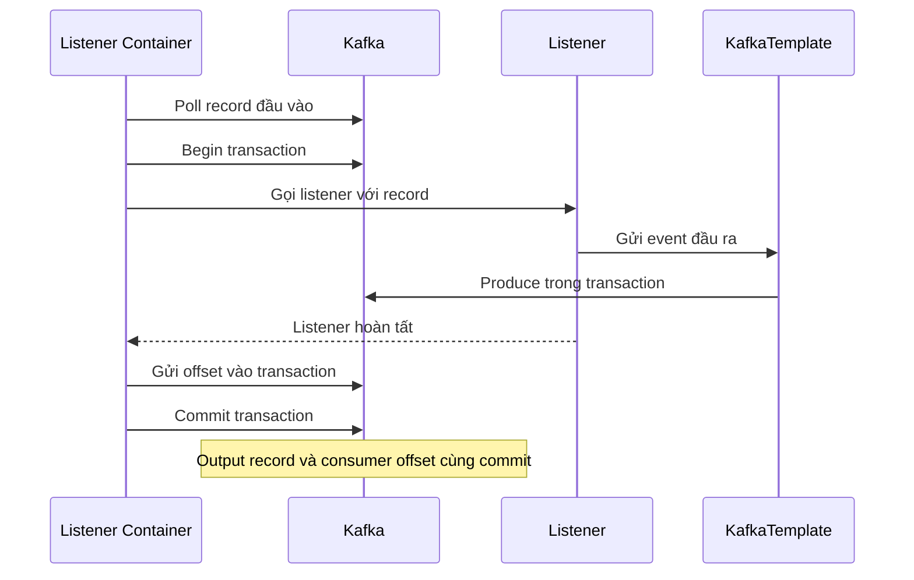

# Consumer-initiated transaction

Trong một luồng Kafka xử lý sự kiện, consumer thường đọc một record, thực hiện nghiệp vụ rồi có thể phát ra một event mới. Nếu consumer đã commit offset nhưng việc phát event đầu ra chưa thành công, hệ thống có thể mất kết quả cần phát. Nếu phát event trước rồi consumer bị dừng trước khi commit offset, record đầu vào có thể được xử lý lại và tạo event trùng.

Consumer-initiated transaction giải quyết khoảng hở này bằng cách để listener container bắt đầu Kafka transaction cho một lần xử lý. Các record được gửi bằng `KafkaTemplate` trong transaction đó và offset của record đã xử lý được gửi vào cùng transaction. Khi transaction commit, cả event đầu ra và offset đầu vào cùng được commit; nếu rollback, cả hai cùng không được xem là đã hoàn tất.

Cơ chế này là nền tảng cho luồng consume-transform-produce có semantics exactly-once trong Kafka. Nó chỉ bao phủ các thao tác Kafka tham gia transaction; database, HTTP API hoặc hệ thống ngoài Kafka cần chiến lược phối hợp riêng.

## 1. Consumer-initiated transaction là gì?

Trong Spring Kafka, listener container có thể quản lý transaction thay cho việc mỗi listener tự mở transaction. Khi được cấu hình với `KafkaTransactionManager`, container bắt đầu transaction trước khi gọi listener.

Trong thời gian listener chạy:

- Listener đọc record từ Kafka.
- `KafkaTemplate` dùng cùng `ProducerFactory` gửi event đầu ra vào transaction đang hoạt động.
- Khi listener kết thúc thành công, container đưa offset của record đã xử lý vào transaction.
- Container commit transaction. Kafka commit đồng thời các record đầu ra và offset consumer.
- Nếu listener ném exception, transaction rollback; các record đầu ra trong transaction bị abort và offset đầu vào không được commit bởi transaction đó.

Có thể hình dung luồng như sau:



Đây được gọi là consumer-initiated vì transaction bắt đầu từ quá trình tiêu thụ do listener container điều khiển. Listener chỉ tập trung xử lý nghiệp vụ và gửi các event đầu ra.

## 2. Phân biệt với producer-initiated transaction

Spring Kafka cũng cho phép ứng dụng chủ động bắt đầu transaction ở phía producer, ví dụ bằng `KafkaTemplate.executeInTransaction(...)`. Cách này phù hợp khi một đoạn code cần gửi nhiều record Kafka như một đơn vị nguyên tử, nhưng nó không tự kết hợp offset của consumer đang xử lý.

| Tiêu chí | Consumer-initiated | Producer-initiated |
|---|---|---|
| Ai bắt đầu transaction? | Listener container | Ứng dụng gọi API transaction của producer |
| Offset consumer | Container đưa offset vào transaction | Không tự động bao gồm offset của listener |
| Gửi event đầu ra | `KafkaTemplate` tham gia transaction container | Code gửi trong transaction do producer mở |
| Mục đích thường gặp | Consume-transform-produce | Gửi nhiều record Kafka nguyên tử |
| Rollback | Listener lỗi làm transaction container rollback | Code trong transaction producer ném lỗi hoặc rollback |

Ví dụ producer-initiated:

```java
kafkaTemplate.executeInTransaction(operations -> {
    operations.send("order-created", orderId, createdEvent);
    operations.send("audit-events", orderId, auditEvent);
    return true;
});
```

Hai record được gửi trong cùng transaction producer. Tuy nhiên, nếu đoạn code này chạy bên trong listener, offset của record đầu vào không tự động trở thành một phần của transaction vừa mở. Muốn gắn offset consumer với output, hãy cấu hình transaction cho listener container.

Trong listener đã có container transaction, thông thường chỉ cần gọi `kafkaTemplate.send(...)` trên cùng producer factory. Không mở một transaction độc lập bằng `executeInTransaction` nếu mục tiêu là để các record đầu ra tham gia transaction của container.

## 3. Cấu hình transactional producer

Kafka producer phải được cấu hình với transaction ID prefix. Với Spring Boot, có thể khai báo:

```yaml
spring:
  application:
    name: order-service
  kafka:
    producer:
      transaction-id-prefix: ${spring.application.name}-${INSTANCE_ID}-
    consumer:
      properties:
        isolation.level: read_committed
```

`transaction-id-prefix` khiến producer factory tạo các transactional producer. Phần `INSTANCE_ID` cần duy nhất giữa các instance đang chạy đồng thời. Nếu nhiều pod hoặc process dùng cùng prefix, chúng có thể xung đột transactional ID và fencing lẫn nhau.

Trong môi trường local chỉ chạy một instance, có thể đặt một giá trị cố định. Trong production, hãy dùng định danh instance ổn định và duy nhất theo cách triển khai, chẳng hạn pod identity.

Cấu hình `isolation.level: read_committed` khiến consumer chỉ đọc các record thuộc transaction đã commit. Nếu consumer dùng `read_uncommitted`, nó có thể nhìn thấy record của transaction sau đó bị abort. Với luồng cần quan sát kết quả exactly-once, consumer đọc output transactional nên dùng `read_committed`.

## 4. Khai báo KafkaTransactionManager

`KafkaTransactionManager` kết nối Spring transaction infrastructure với producer factory có transaction. Nó phải dùng cùng `ProducerFactory` với `KafkaTemplate` gửi event đầu ra.

```java
import org.springframework.context.annotation.Bean;
import org.springframework.context.annotation.Configuration;
import org.springframework.kafka.core.ProducerFactory;
import org.springframework.kafka.transaction.KafkaTransactionManager;

@Configuration
class KafkaTransactionConfiguration {

    @Bean
    KafkaTransactionManager<String, Object> kafkaTransactionManager(
            ProducerFactory<String, Object> producerFactory) {

        return new KafkaTransactionManager<>(producerFactory);
    }
}
```

Ví dụ giả định ứng dụng đã có transactional `ProducerFactory<String, Object>` được cấu hình từ `transaction-id-prefix`. Nếu tự tạo producer factory thay vì dùng Spring Boot auto-configuration, hãy gọi `setTransactionIdPrefix(...)` trên `DefaultKafkaProducerFactory`.

Đảm bảo `KafkaTemplate` cũng được tạo từ chính producer factory đó. Nếu template dùng một producer factory khác, các lần gửi có thể không tham gia transaction do listener container đang quản lý.

## 5. Gắn transaction manager vào listener container

Listener container cần biết transaction manager nào sẽ quản lý mỗi lần xử lý. Với Spring Boot, có thể dùng configurer để giữ các cấu hình consumer đã được bind:

```java
import org.springframework.boot.autoconfigure.kafka.ConcurrentKafkaListenerContainerFactoryConfigurer;
import org.springframework.context.annotation.Bean;
import org.springframework.kafka.config.ConcurrentKafkaListenerContainerFactory;
import org.springframework.kafka.core.ConsumerFactory;
import org.springframework.kafka.transaction.KafkaTransactionManager;

@Bean
ConcurrentKafkaListenerContainerFactory<String, OrderEvent>
orderListenerFactory(
        ConcurrentKafkaListenerContainerFactoryConfigurer configurer,
        ConsumerFactory<String, OrderEvent> consumerFactory,
        KafkaTransactionManager<String, Object> kafkaTransactionManager) {

    var factory =
            new ConcurrentKafkaListenerContainerFactory<String, OrderEvent>();

    configurer.configure(factory, consumerFactory);

    factory.getContainerProperties()
            .setKafkaAwareTransactionManager(kafkaTransactionManager);

    return factory;
}
```

Phương thức `setKafkaAwareTransactionManager(...)` là API được dùng ở các phiên bản Spring Kafka trước 3.2. Với Spring Kafka 3.2 trở lên, dùng `setTransactionManager(...)` trên `ContainerProperties` theo API của phiên bản đang dùng.

Sau đó chỉ định factory này trong listener:

```java
@KafkaListener(
        topics = "orders",
        groupId = "order-processor",
        containerFactory = "orderListenerFactory")
public void process(OrderEvent event) {
    // Xử lý trong transaction do container bắt đầu.
}
```

Khi listener factory được cấu hình transaction manager, container bắt đầu transaction cho từng lần gọi listener. Nếu dùng batch listener, ranh giới transaction thường bao phủ lần gọi xử lý batch; offset của batch được đưa vào transaction khi xử lý thành công.

## 6. Gửi event đầu ra trong cùng transaction

Một ví dụ consume-transform-produce:

```java
@Component
public class OrderProjectionListener {

    private final OrderService orderService;
    private final KafkaTemplate<String, Object> kafkaTemplate;

    public OrderProjectionListener(
            OrderService orderService,
            KafkaTemplate<String, Object> kafkaTemplate) {
        this.orderService = orderService;
        this.kafkaTemplate = kafkaTemplate;
    }

    @KafkaListener(
            topics = "orders",
            groupId = "order-projection",
            containerFactory = "orderListenerFactory")
    public void process(OrderEvent event) {
        OrderProjection projection =
                orderService.createProjection(event);

        kafkaTemplate.send(
                "order-projections",
                event.orderId(),
                projection
        );

        kafkaTemplate.send(
                "order-audit",
                event.orderId(),
                new OrderProcessed(event.orderId())
        );
    }
}
```

Hai lệnh gửi sử dụng `KafkaTemplate` đã được cấu hình với producer factory tham gia transaction container. Khi phương thức listener hoàn tất bình thường, container đưa offset của record đầu vào vào transaction rồi commit.

Kết quả có hai khả năng:

| Kết quả listener | Output records | Offset đầu vào |
|---|---|---|
| Hoàn tất và transaction commit | Cùng được commit | Được commit trong cùng transaction |
| Ném exception và transaction rollback | Bị abort | Không được commit bởi transaction đó |

Các thao tác gửi cần diễn ra trong luồng transaction đang hoạt động. Nếu đẩy công việc gửi sang executor hoặc thread khác, transaction context không tự truyền sang thread đó; các lệnh gửi có thể chạy ngoài transaction dự kiến.

## 7. Điều gì xảy ra khi listener thất bại?

Giả sử listener đã gửi một event đầu ra, sau đó phát hiện dữ liệu không hợp lệ và ném exception. Container rollback Kafka transaction.

Điều này có nghĩa:

- Output record đã gửi trong transaction bị abort và không được consumer `read_committed` nhìn thấy.
- Offset đầu vào chưa được commit trong transaction bị rollback.
- Record đầu vào có thể được giao lại sau khi container xử lý rollback.
- Lần xử lý lại có thể tạo một transaction mới.

Đường đi sau rollback được điều khiển bởi `AfterRollbackProcessor`. Spring Kafka có `DefaultAfterRollbackProcessor` để seek và giao lại record, kết hợp backoff và phục hồi sau một số lần thử. Với transactional listener, hãy thiết kế retry/recovery theo cơ chế rollback processor phù hợp; không giả định `DefaultErrorHandler` hoạt động giống hệt luồng listener không transaction.

Một lỗi trong quá trình commit transaction cũng cần được coi là kết quả chưa xác định cho phía ứng dụng cho đến khi producer/container xử lý xong. Kafka transaction protocol và producer fencing giúp bảo vệ trạng thái commit, nhưng nghiệp vụ bên ngoài Kafka vẫn cần khả năng xử lý lặp an toàn.

## 8. Consumer isolation và aborted records

Transactional producer có thể ghi record rồi rollback. Các record đó vẫn có thể tồn tại vật lý trong log Kafka với trạng thái transaction aborted.

Consumer quyết định cách nhìn các record này qua `isolation.level`:

| Giá trị | Hành vi |
|---|---|
| `read_uncommitted` | Có thể đọc cả record thuộc transaction chưa commit hoặc đã abort |
| `read_committed` | Chỉ trả về record thuộc transaction đã commit |

Với consumer đọc dữ liệu được tạo từ transactional listener, nên cấu hình `read_committed`. Nếu không, consumer downstream có thể xử lý record đầu ra sau đó bị rollback, làm mất ý nghĩa nguyên tử mà producer transaction tạo ra.

Khi dùng `read_committed`, consumer có thể bị giới hạn bởi Last Stable Offset (LSO). Một transaction còn mở ở partition có thể làm các record phía sau chưa được trả về cho đến khi transaction kết thúc. Vì vậy, transaction nên ngắn và không nên chứa các thao tác chờ lâu như gọi API ngoài hoặc chờ người dùng.

## 9. Consumer-initiated transaction và exactly-once

Với luồng consume-transform-produce, mục tiêu exactly-once là đảm bảo một record đầu vào đã được xử lý thì các output record tương ứng và offset đầu vào được commit nguyên tử trong Kafka.

Nếu transaction rollback, output không được đọc bởi consumer `read_committed` và offset đầu vào không được commit. Record có thể được xử lý lại. Nếu transaction commit, output và offset cùng hoàn tất. Điều này ngăn consumer đọc output bị tạo bởi một lần xử lý đã rollback.

Cần phân biệt:

- **Exactly-once trong Kafka:** output records và consumer offsets được commit trong cùng transaction.
- **Idempotent producer:** tránh duplicate do retry request ở tầng producer trong phạm vi Kafka producer.
- **Idempotent business operation:** bảo vệ database hoặc hệ thống ngoài Kafka khỏi tác dụng phụ trùng.
- **Exactly-once end-to-end:** không tự động đạt được chỉ bằng Kafka transaction nếu luồng còn cập nhật database, gọi HTTP API hoặc ghi sang hệ thống khác.

Nếu listener cập nhật database rồi gửi Kafka event, Kafka transaction không tự rollback database khi Kafka transaction thất bại. Với yêu cầu đồng bộ trạng thái database và event, hãy cân nhắc transactional outbox, CDC hoặc một thiết kế phối hợp phù hợp.

## 10. Ranh giới transaction và các thao tác bên ngoài Kafka

Một Kafka transaction chỉ quản lý tài nguyên Kafka tham gia transaction. Ví dụ:

```text
Kafka input record
       |
       v
Listener container starts Kafka transaction
       |
       +--> KafkaTemplate sends output record
       |
       +--> Container adds consumed offset
       |
       v
Kafka transaction commit / rollback
```

Nếu listener còn gọi database:

```text
Kafka transaction
       |
       +--> Send Kafka output
       |
       +--> Update relational database
```

Hai thao tác này không tự động trở thành một transaction phân tán. Có thể xảy ra trường hợp database commit nhưng Kafka transaction rollback, hoặc ngược lại tùy cách phối hợp transaction manager và thứ tự commit.

Với dữ liệu cần đồng bộ bền vững giữa database và Kafka, transactional outbox thường là lựa chọn rõ ràng: ghi thay đổi nghiệp vụ và outbox row trong cùng database transaction, sau đó một publisher/CDC chuyển outbox event sang Kafka. Consumer downstream vẫn nên idempotent để xử lý giao lại.

## 11. Cấu hình timeout và vận hành transaction

Transaction làm tăng yêu cầu về thời gian và tài nguyên. Một số cấu hình cần xem xét:

| Thành phần | Vai trò | Điều cần lưu ý |
|---|---|---|
| `transaction-id-prefix` | Sinh transactional ID cho producer | Phải duy nhất giữa các instance |
| `transaction.timeout.ms` | Giới hạn thời gian transaction Kafka | Đủ cho công việc nhưng không quá dài |
| `max.poll.interval.ms` | Giới hạn thời gian giữa các lần poll | Listener không được giữ consumer quá lâu |
| `isolation.level` | Quyết định consumer có đọc aborted records không | Dùng `read_committed` cho luồng transactional |
| Producer cache | Quản lý transactional producer được tái sử dụng | Cần phù hợp với concurrency và số transaction đồng thời |

Không nên thực hiện các tác vụ lâu trong transaction, chẳng hạn gọi API bên ngoài với timeout cao, chờ khóa phân tán hoặc xử lý file lớn. Transaction mở lâu giữ tài nguyên producer, có thể làm tăng độ trễ LSO của consumer `read_committed` và làm hệ thống khó phục hồi khi rebalance.

Hãy đo thời gian transaction, số lần rollback, producer fencing, lỗi commit và consumer lag. Khi tăng concurrency, kiểm tra producer factory có đủ transactional producer để phục vụ các listener container đồng thời.

## 12. Kiểm thử consumer-initiated transaction

Kiểm thử cần chứng minh output và offset cùng commit hoặc cùng rollback. Có thể dùng Embedded Kafka hoặc Testcontainers để chạy broker thật trong integration test.

Các kịch bản quan trọng:

1. Listener nhận input, gửi output và hoàn tất: consumer `read_committed` nhìn thấy output.
2. Listener gửi output rồi ném exception: consumer `read_committed` không nhìn thấy output đã abort.
3. Input được giao lại sau rollback: offset chưa được commit bởi transaction thất bại.
4. Listener retry thành công ở lần sau: output và offset cuối cùng được commit cùng nhau.
5. Consumer downstream dùng `read_committed`: không nhận record từ transaction bị abort.
6. Nhiều listener container chạy đồng thời: transactional ID không xung đột giữa instance.
7. Producer bị fencing hoặc transaction timeout: hệ thống ghi nhận lỗi và phục hồi theo chính sách.

Ví dụ kiểm thử logic listener bằng mock chỉ xác nhận lời gọi `KafkaTemplate`; nó không chứng minh transaction thực sự commit nguyên tử. Muốn kiểm tra semantics transaction, cần integration test với broker và consumer có `isolation.level=read_committed`.

## 13. Những lỗi thường gặp

| Hiện tượng | Nguyên nhân có thể | Cách xử lý |
|---|---|---|
| Producer báo transactional ID không hợp lệ | Producer factory chưa có transaction ID prefix | Cấu hình `transaction-id-prefix` |
| Các instance fencing lẫn nhau | Dùng cùng prefix/transactional ID | Tạo prefix duy nhất theo instance |
| Output xuất hiện dù listener rollback | Template không dùng producer factory của container hoặc consumer đọc `read_uncommitted` | Dùng chung producer factory và kiểm tra isolation |
| Offset đã commit dù output chưa có | Gửi output nằm ngoài container transaction | Dùng template tham gia transaction container |
| Transaction timeout | Listener xử lý quá lâu | Rút ngắn transaction và căn chỉnh timeout |
| Retry không như mong đợi | Dùng nhầm error handler thay cho rollback processor | Cấu hình `AfterRollbackProcessor` |
| Database và Kafka lệch trạng thái | Giả định Kafka transaction bao phủ database | Dùng outbox hoặc cơ chế phối hợp phù hợp |

## 14. Checklist triển khai

- [ ] Producer factory đã được bật transaction bằng `transaction-id-prefix`.
- [ ] Prefix duy nhất giữa các instance chạy đồng thời.
- [ ] `KafkaTransactionManager` dùng cùng producer factory với `KafkaTemplate`.
- [ ] Listener container đã được gắn transaction manager.
- [ ] `KafkaTemplate.send()` được gọi trong luồng listener để tham gia transaction.
- [ ] Offset được container đưa vào transaction khi listener thành công.
- [ ] Consumer downstream dùng `read_committed`.
- [ ] Rollback và retry được cấu hình qua `AfterRollbackProcessor` phù hợp.
- [ ] Transaction không chứa các thao tác chờ lâu ngoài Kafka.
- [ ] Database hoặc API ngoài Kafka có chiến lược phối hợp và idempotency riêng.
- [ ] Integration test xác nhận output và offset commit/rollback cùng nhau.

Consumer-initiated transaction giúp Spring Kafka gắn việc phát event đầu ra với offset của record đầu vào trong cùng một Kafka transaction. Khi listener thành công, cả hai cùng commit; khi listener thất bại, cả hai cùng rollback. Hãy dùng chung transactional producer factory, cấu hình listener container đúng và cho consumer downstream đọc `read_committed`. Với database hoặc hệ thống ngoài Kafka, cần thiết kế outbox hoặc cơ chế phối hợp riêng để bảo vệ tính nhất quán end-to-end.

