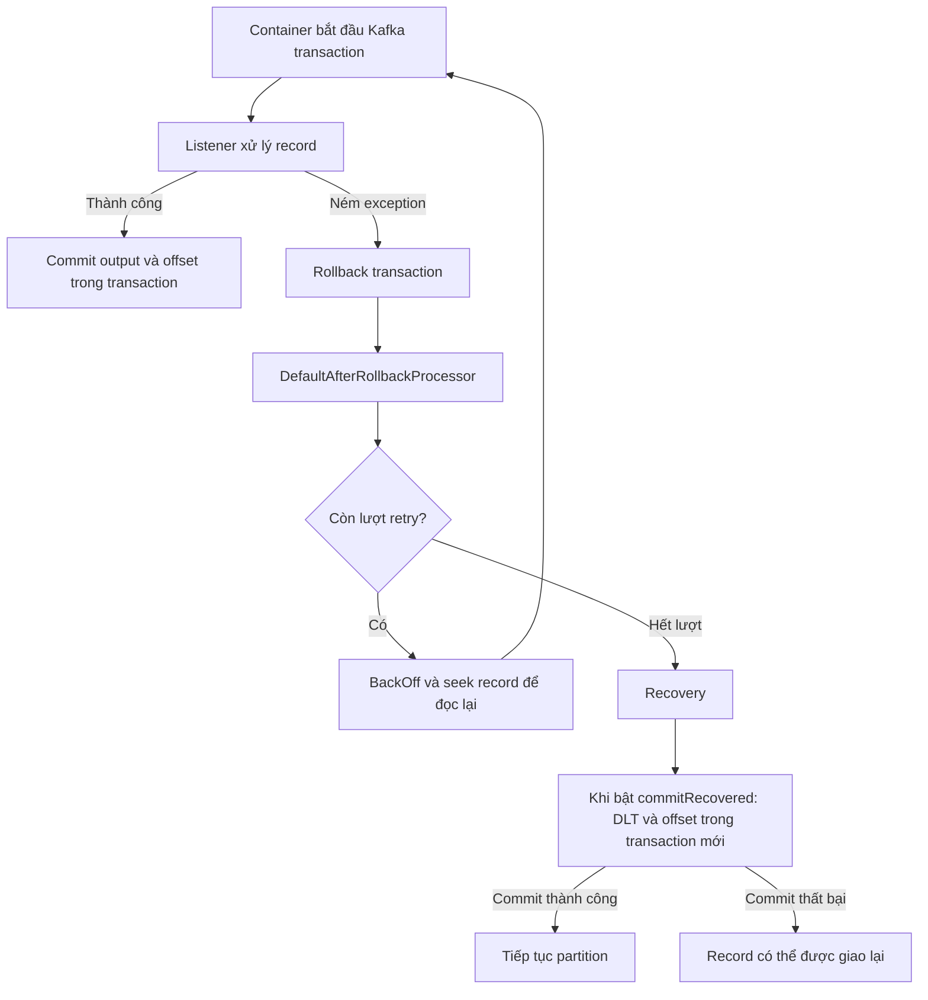

# AfterRollbackProcessor trong transaction

Khi listener container của Spring Kafka chạy trong Kafka transaction, mỗi lần xử lý record diễn ra trong một transaction do container quản lý. Nếu listener ném exception, transaction bị rollback: các record Kafka được publish trong transaction đó không được commit và offset của record đang xử lý cũng không được xác nhận. Container cần quyết định cách đọc lại record sau rollback.

`AfterRollbackProcessor` đảm nhiệm bước này. Implementation mặc định là `DefaultAfterRollbackProcessor`, có thể seek để giao lại record, áp dụng retry/backoff và gọi recoverer khi hết lượt. Với cấu hình phù hợp, nó còn có thể gửi record lỗi sang DLT và commit offset nguồn trong một transaction Kafka mới.

## 1. Luồng xử lý khi transaction rollback

Container bắt đầu Kafka transaction trước khi gọi listener. Nếu listener xử lý thành công, các record được gửi qua `KafkaTemplate` và offset consumer có thể được commit trong cùng transaction. Nếu listener ném exception, transaction hiện tại bị abort; sau đó container gọi after-rollback processor để xử lý record chưa hoàn tất.



Với record listener, processor mặc định seek về record thất bại và các record chưa được xử lý tiếp theo để chúng được giao lại. Với batch listener, phạm vi phát lại phụ thuộc semantics của batch và exception mà listener ném; cần kiểm thử đúng kiểu listener đang dùng.

## 2. Vai trò của DefaultAfterRollbackProcessor

`DefaultAfterRollbackProcessor` là implementation của `AfterRollbackProcessor` dành cho container transactional. Nó quản lý retry state sau rollback, áp dụng `BackOff` và quyết định khi nào gọi recoverer. Ví dụ, `FixedBackOff(1_000L, 2L)` cho phép hai lần retry sau lần xử lý đầu tiên; nếu các lần đó vẫn thất bại, recoverer được gọi.

```java
@Bean
public DefaultAfterRollbackProcessor<String, OrderCreated>
        afterRollbackProcessor(
            KafkaTemplate<Object, Object> kafkaTemplate) {
    DeadLetterPublishingRecoverer recoverer =
        new DeadLetterPublishingRecoverer(kafkaTemplate);

    DefaultAfterRollbackProcessor<String, OrderCreated> processor =
        new DefaultAfterRollbackProcessor<>(
            recoverer, new FixedBackOff(1_000L, 2L));
    return processor;
}
```

Recoverer chỉ được gọi sau khi retry đã hết hoặc exception thuộc nhóm không retry theo chính sách được cấu hình. Recoverer phải hoàn tất hành động recovery một cách rõ ràng. Nếu nó ném exception, recovery chưa thành công và record có thể được xử lý lại.

Nếu không cấu hình recoverer riêng, implementation mặc định dùng logging recoverer. Trong môi trường production, nên chọn hành động cụ thể như gửi DLT hoặc lưu audit có idempotency, để record không biến mất khỏi luồng mà không có dấu vết.

## 3. Gắn processor vào transactional listener container

Container phải được cấu hình với `KafkaTransactionManager`. Transaction manager và `KafkaTemplate` cần dùng cùng transactional `ProducerFactory`, được cấu hình `transactionIdPrefix` duy nhất cho các instance producer phù hợp. Khi listener gửi message bằng template gắn với transaction đang hoạt động, message được đưa vào transaction của container.

```java
@Bean
public ConcurrentKafkaListenerContainerFactory<String, OrderCreated>
        kafkaListenerContainerFactory(
            ConsumerFactory<String, OrderCreated> consumerFactory,
            KafkaTransactionManager<Object, Object> transactionManager,
            DefaultAfterRollbackProcessor<String, OrderCreated> afterRollbackProcessor) {
    var factory =
        new ConcurrentKafkaListenerContainerFactory<String, OrderCreated>();
    factory.setConsumerFactory(consumerFactory);
    factory.getContainerProperties()
        .setKafkaAwareTransactionManager(transactionManager);
    factory.setAfterRollbackProcessor(afterRollbackProcessor);
    return factory;
}
```

Trong Spring Kafka mới, container properties dùng `setKafkaAwareTransactionManager`. Một số phiên bản cũ dùng API `setTransactionManager`; hãy chọn đúng API theo phiên bản dependency của dự án. Quan trọng là transaction manager phải được gắn vào đúng factory mà `@KafkaListener` sử dụng.

Listener để exception thoát ra ngoài khi muốn rollback:

```java
@KafkaListener(
    topics = "orders",
    groupId = "order-processor",
    containerFactory = "kafkaListenerContainerFactory")
public void consume(OrderCreated event, Acknowledgment acknowledgment) {
    orderService.process(event);
    kafkaTemplate.send("order-events", event.orderId(),
        new OrderProcessed(event.orderId()));
    acknowledgment.acknowledge();
}
```

Ví dụ này dùng `AckMode.MANUAL_IMMEDIATE` như phần cấu hình recovery bên dưới; listener chỉ acknowledge sau khi xử lý nghiệp vụ và gửi output. Nếu `orderService.process` ném exception, lệnh gửi `OrderProcessed` trong cùng Kafka transaction cũng bị rollback. Nếu listener bắt exception rồi không ném lại, container có thể xem lần xử lý là thành công và commit transaction; vì vậy chỉ bắt lỗi khi có chủ đích xử lý và xác nhận nghiệp vụ.

## 4. Gửi DLT và commit offset trong transaction mới

Một yêu cầu quan trọng là không được mất record khi recovery. Nếu gửi DLT thành công nhưng offset nguồn chưa commit, record có thể được giao lại và xuất hiện trùng ở DLT. Nếu offset nguồn commit nhưng gửi DLT thất bại, record có thể bị mất. Ta muốn hai hành động này cùng thành công hoặc cùng rollback.

`DefaultAfterRollbackProcessor` hỗ trợ điều đó bằng `setCommitRecovered(true)` và `setKafkaTemplate(...)`. Khi đã hết retry, processor bắt đầu một Kafka transaction mới; recoverer gửi record sang DLT và offset của record nguồn được gửi vào cùng transaction. Nếu transaction commit, DLT record và offset nguồn cùng có hiệu lực. Nếu transaction abort, cả hai cùng không được commit. Dùng cấu hình dưới đây thay cho bean processor tối giản ở phần trước khi cần cơ chế commit này.

```java
@Bean
public DefaultAfterRollbackProcessor<String, OrderCreated>
        afterRollbackProcessor(
            KafkaTemplate<Object, Object> kafkaTemplate) {
    DeadLetterPublishingRecoverer recoverer =
        new DeadLetterPublishingRecoverer(kafkaTemplate);
    recoverer.setFailIfSendResultIsError(true);

    DefaultAfterRollbackProcessor<String, OrderCreated> processor =
        new DefaultAfterRollbackProcessor<>(
            recoverer, new FixedBackOff(1_000L, 2L));
    processor.setCommitRecovered(true);
    processor.setKafkaTemplate(kafkaTemplate);
    return processor;
}
```

Khi bật `commitRecovered`, cấu hình container cần dùng `AckMode.MANUAL_IMMEDIATE` theo yêu cầu của API. Ví dụ:

```java
factory.getContainerProperties()
    .setAckMode(ContainerProperties.AckMode.MANUAL_IMMEDIATE);
```

Nếu dùng `MANUAL_IMMEDIATE` cho listener, listener phải acknowledge record sau khi nghiệp vụ hoàn tất theo đúng quy tắc của ứng dụng. Phần offset của record được recover do after-rollback processor quản lý. Đừng bật `commitRecovered` nếu chưa hiểu rõ cách acknowledgement và transaction được phối hợp trong phiên bản đang dùng.

## 5. DLT cần serializer và routing phù hợp

`DeadLetterPublishingRecoverer` thường định tuyến record từ topic `orders` sang `orders.DLT` và giữ partition nguồn theo resolver mặc định. Topic đích cần tồn tại và có đủ partition tương ứng. `KafkaTemplate` phải có serializer tương thích với key và value; nếu xử lý lỗi deserialize, record có thể chứa byte array gốc thay vì object domain.

Recoverer bổ sung metadata nguồn như topic, partition, offset và exception vào header DLT. Consumer DLT nên lưu lại các header này để điều tra và replay. Với `setFailIfSendResultIsError(true)`, lỗi khi publish DLT được báo về processor để transaction recovery không commit nhầm.

## 6. Phân biệt DefaultAfterRollbackProcessor và DefaultErrorHandler

| Thành phần | Vai trò chính |
| --- | --- |
| `DefaultErrorHandler` | Xử lý lỗi của listener container trong luồng không dựa trên rollback transaction của container; điều khiển retry, seek và recovery. |
| `DefaultAfterRollbackProcessor` | Được gọi sau khi Kafka transaction của listener bị rollback; điều khiển redelivery và recovery sau rollback. |

Với transactional listener container, exception từ listener làm transaction rollback và after-rollback processor xử lý phần tiếp theo. Đừng cấu hình hai cơ chế với kỳ vọng chúng cùng retry một lỗi theo một chuỗi duy nhất; hãy xác định transaction manager và error strategy của container trước khi cấu hình.

## 7. Batch listener và phạm vi rollback

Với batch listener, transaction thường bao trùm lần gọi listener cho batch. Nếu một record làm listener ném exception, transaction của batch bị rollback, nên các output Kafka đã gửi trong transaction đó cũng bị hủy. Processor sẽ điều khiển việc phát lại theo batch semantics và cấu hình của nó.

Nếu ứng dụng cần xác định chính xác record lỗi trong batch, listener có thể dùng `BatchListenerFailedException` với index hợp lệ ở những cấu hình hỗ trợ semantics này. Hãy xác minh hành vi theo phiên bản Spring Kafka và kiểm thử cả record trước lỗi, record lỗi và record sau lỗi. Chỉ số batch là vị trí trong danh sách, không phải Kafka offset.

Non-blocking retry bằng `@RetryableTopic` không tương thích với batch listener hoặc container transactions. Nếu cần transactional batch processing, dùng after-rollback strategy và thiết kế retry phù hợp với rollback của cả batch.

## 8. Các tình huống cần kiểm soát

- **Listener bắt exception:** nếu exception không được ném ra ngoài, transaction có thể commit dù nghiệp vụ chưa thành công. Chỉ nuốt exception khi đã có quyết định rõ ràng.
- **Gửi DLT thất bại:** recoverer phải báo lỗi; transaction recovery không được commit offset nguồn.
- **Transaction recovery abort:** record có thể được giao lại; recoverer và thao tác phụ trợ phải idempotent.
- **Ứng dụng restart:** retry state trong bộ nhớ có thể bị reset tùy cấu hình; không dựa vào bộ đếm trong RAM làm lịch sử nghiệp vụ duy nhất.
- **DB side effect:** Kafka transaction không tự động bao trùm transaction của cơ sở dữ liệu quan hệ. Dùng outbox, inbox/idempotency hoặc cơ chế phối hợp phù hợp nếu cần tính nhất quán giữa DB và Kafka.

## 9. Kiểm thử AfterRollbackProcessor

Một kiểm thử tích hợp nên chạy listener trong transactional container và tạo một record làm listener thất bại hai lần rồi thành công. Xác minh transaction ở các lần thất bại bị rollback, output Kafka của lần thất bại không xuất hiện, và lần thành công mới commit output cùng offset.

Tiếp theo, kiểm thử hết retry: recoverer gửi record sang DLT trong transaction mới và offset nguồn chỉ được commit khi transaction recovery thành công. Cố ý làm producer DLT thất bại để xác minh offset không tiến lên như thể recovery đã xong.

Nên kiểm tra thêm listener ném exception sau khi đã gửi một output Kafka, listener bắt exception, ứng dụng restart giữa các lần retry và record được giao lại. Dùng Embedded Kafka hoặc Testcontainers cùng Awaitility để xác minh record DLT, header nguồn và offset thực tế.

## 10. Vận hành và quan sát

Theo dõi số lần rollback, retry, recovery, lỗi commit transaction, lỗi gửi DLT và consumer lag theo partition. Log topic, partition, offset, event ID và exception type để liên kết một lần rollback với record được recover. Cảnh báo khi retry kéo dài hoặc recovery transaction liên tục abort.

`DefaultAfterRollbackProcessor` giúp gắn retry và recovery với vòng đời Kafka transaction. Khi cấu hình transaction manager đúng, để exception truyền ra ngoài, và dùng transaction recovery để publish DLT cùng commit offset, hệ thống có thể xử lý record lỗi mà vẫn giữ tính nhất quán giữa dữ liệu Kafka được phát ra và tiến độ consumer.
