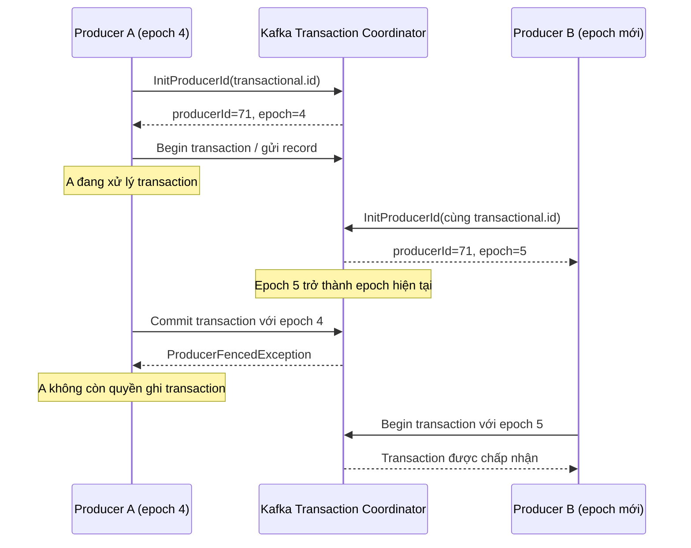

# Producer bị fence và cách phòng tránh

Trong Kafka transaction, **producer bị fence** nghĩa là broker từ chối các yêu cầu giao dịch của một producer vì producer đó đã mất quyền sở hữu `transactional.id`. Tình huống thường gặp nhất là một producer khác khởi tạo với cùng `transactional.id` và nhận epoch mới hơn. Producer cũ trở thành producer lỗi thời (zombie) và không thể tiếp tục commit transaction.

Fencing là cơ chế bảo vệ tính đúng đắn của giao dịch, không phải lỗi mạng thông thường. Nó ngăn một tiến trình cũ tiếp tục ghi dữ liệu sau khi tiến trình mới đã tiếp quản cùng danh tính giao dịch.

Bài học giải thích cơ chế producer ID/epoch, nguyên nhân `ProducerFencedException`, cách đặt `transactionIdPrefix` trong Spring Kafka, quản lý nhiều replica, làm mới producer nhàn rỗi và xử lý sự cố trong production.

## 1. Producer fencing là gì?

Kafka transaction dùng `transactional.id` để nhận diện một danh tính producer có thể tồn tại qua nhiều phiên chạy. Broker dùng danh tính này để theo dõi transaction và phân biệt producer hiện tại với producer cũ.

Khi một producer mới khởi tạo với cùng `transactional.id`, Kafka cấp hoặc cập nhật producer identity với epoch mới. Producer cũ mang epoch thấp hơn sẽ bị fence. Mọi yêu cầu transaction tiếp theo từ producer cũ bị broker từ chối.

Ví dụ:

- Producer A đang chạy với `transactional.id=orders-slot-0`.
- A bắt đầu transaction và ghi một số record.
- Một tiến trình B khởi tạo với cùng `transactional.id`.
- B nhận epoch mới hơn và trở thành producer hiện tại.
- A cố commit transaction cũ và nhận `ProducerFencedException`.

Broker bảo đảm chỉ producer sở hữu epoch hiện tại mới được tiếp tục thao tác transaction cho danh tính đó.

`ProducerFencedException` là lỗi fatal đối với producer đã bị fence. Kafka yêu cầu đóng producer instance đó. Không thể tiếp tục dùng cùng producer object và lặp lại `send()` hoặc `commitTransaction()` như thể đây là lỗi tạm thời.

## 2. Producer ID, epoch và transactional.id

Ba khái niệm cần phân biệt:

| Thành phần | Ý nghĩa |
|---|---|
| `transactional.id` | Danh tính ổn định của producer transaction do ứng dụng cấu hình |
| `producerId` | ID số do Kafka cấp cho producer |
| `producerEpoch` | Số thế hệ của producer ID; epoch mới hơn vô hiệu hóa yêu cầu từ epoch cũ |

`transactional.id` là tên logic mà ứng dụng chịu trách nhiệm quản lý. Kafka dùng nó để tìm transaction state và cấp producer ID/epoch tương ứng.

`producerId` và `producerEpoch` được gửi trong các yêu cầu giao thức. Broker kiểm tra epoch của yêu cầu với epoch hiện tại. Nếu epoch không khớp, yêu cầu bị từ chối.

Không dùng `client.id` thay cho `transactional.id`:

- `client.id` chủ yếu giúp nhận diện client trong log, metric và quota.
- `transactional.id` xác định quyền sở hữu transaction và tham gia cơ chế fencing.
- Hai producer có `client.id` giống nhau chưa chắc bị fence.
- Hai producer cùng dùng `transactional.id` có thể fence lẫn nhau dù `client.id` khác nhau.

## 3. Cơ chế fencing diễn ra như thế nào?

Sơ đồ dưới đây mô tả trường hợp một phiên producer mới tiếp quản cùng transactional ID:



Quá trình này bảo vệ hệ thống trước tình huống tiến trình cũ bị treo, mất kết nối hoặc không biết rằng nó đã bị thay thế. Khi tiến trình mới tiếp quản cùng danh tính, Kafka có thể từ chối các thao tác đến muộn từ tiến trình cũ.

Producer B không cần chờ A tự nhận ra rằng mình đã cũ. Chính broker thực thi quyền sở hữu bằng epoch.

## 4. Khi nào producer bị fence?

Các nguyên nhân thường gặp:

| Nguyên nhân | Diễn biến |
|---|---|
| Nhiều replica dùng cùng prefix | Các factory tạo ra cùng tập transactional ID; producer ở replica này có thể fence replica kia |
| Hai tiến trình cùng chạy một logical instance | Tiến trình mới tiếp quản ID của tiến trình cũ khi tiến trình cũ vẫn còn hoạt động |
| Rolling deployment có overlap | Pod mới dùng cùng transactional ID trong khi pod cũ chưa dừng hẳn |
| Producer cache giữ ID quá lâu | Broker đã hết hạn transactional ID do inactivity; producer cũ được lấy lại và bị fence khi dùng |
| Factory tùy chỉnh tự cấp suffix trùng | Hai producer được tạo với cùng transactional ID dù chúng thuộc hai factory khác nhau |
| Một producer thủ công và một producer Spring dùng cùng ID | Cả hai cùng tranh quyền sở hữu transaction |

Một số tình huống dễ bị nhầm:

- Transaction hết `transaction.timeout.ms` là transaction bị coordinator abort; điều này không đồng nghĩa với việc một producer khác đã fence producer.
- `NoProducerAvailableException` của Spring Kafka thường cho biết không lấy được transactional ID suffix từ cache strategy; đây là vấn đề dung lượng producer, không phải broker fencing.
- `FencedInstanceIdException` liên quan đến static consumer group member identity (`group.instance.id`); cần phân tích riêng với `ProducerFencedException`.
- Lỗi `OutOfOrderSequenceException` liên quan đến sequence của idempotent producer. Spring có thể loại producer lỗi khỏi cache, nhưng không nên gộp lỗi này thành nguyên nhân fencing do transactional ID.

## 5. Phân biệt fencing có chủ đích và fencing ngoài ý muốn

Fencing không phải lúc nào cũng là sự cố thiết kế. Nó là hành vi cần thiết khi một phiên chạy mới tiếp quản danh tính của phiên cũ.

**Fencing có chủ đích**

- Một instance logic được khởi động lại.
- Phiên mới dùng lại transactional ID của instance đó.
- Broker fence phiên cũ để zombie producer không thể commit transaction.
- Phiên mới tiếp tục hoạt động với epoch mới.

**Fencing ngoài ý muốn**

- Hai replica độc lập được cấp cùng transactional ID.
- Hai factory không liên quan vô tình tạo cùng suffix.
- Cấu hình môi trường dùng chung prefix cho toàn bộ deployment.
- Một pod mới bắt đầu ghi transaction trong khi pod cũ vẫn được coi là instance độc lập.

Câu hỏi quan trọng khi điều tra là: **Hai producer đang tranh cùng một transactional ID có phải là hai phiên của cùng một instance logic hay là hai instance độc lập?**

Nếu cùng một logical instance, fencing phiên cũ là hành vi mong muốn. Nếu hai replica độc lập, cấu hình ID đang sai.

## 6. Nhận diện ProducerFencedException

Kafka client ném `org.apache.kafka.common.errors.ProducerFencedException`. Tùy thời điểm và đường gọi, lỗi có thể xuất hiện khi:

- Khởi tạo hoặc bắt đầu transaction.
- Gửi record thuộc transaction.
- Gửi offset vào transaction.
- Commit transaction.
- Thao tác với transaction coordinator sau khi một producer khác đã tiếp quản ID.

Ví dụ xử lý với Kafka client thuần:

```java
import org.apache.kafka.clients.producer.KafkaProducer;
import org.apache.kafka.clients.producer.ProducerConfig;
import org.apache.kafka.clients.producer.ProducerRecord;
import org.apache.kafka.common.errors.ProducerFencedException;

String transactionalId = "orders-slot-0";
// producerProperties phải có bootstrap.servers, serializer và transactional.id.
producerProperties.put(ProducerConfig.TRANSACTIONAL_ID_CONFIG, transactionalId);
KafkaProducer<String, String> producer =
    new KafkaProducer<>(producerProperties);
ProducerRecord<String, String> record =
    new ProducerRecord<>("orders", "order-42", "order-created");

try {
    producer.initTransactions();
    producer.beginTransaction();
    producer.send(record);
    producer.commitTransaction();
}
catch (ProducerFencedException exception) {
    log.error(
        "Producer lost ownership of transactional.id={}",
        transactionalId,
        exception
    );

    throw exception;
}
finally {
    // Producer client thuần phải được đóng sau khi sử dụng.
    producer.close();
}
```

Với Spring Kafka, `KafkaTemplate` và `DefaultKafkaProducerFactory` quản lý producer lifecycle. Hãy để exception đi lên transaction boundary để transaction được rollback hoặc đánh dấu thất bại, đồng thời producer lỗi được factory loại khỏi cache khi đóng wrapper. Không giữ producer lấy từ factory rồi tự tái sử dụng sau `ProducerFencedException`.

Nếu ứng dụng bọc exception trong `KafkaException`, cần kiểm tra chuỗi `cause` để nhận diện `ProducerFencedException`. Log exception gốc cùng transactional ID và instance ID sẽ giúp xác định nguyên nhân.

Không bắt lỗi rồi chỉ ghi log và trả về thành công. Nếu transaction đã bị fence, việc che giấu lỗi có thể làm ứng dụng báo xử lý thành công trong khi transaction chưa commit.

## 7. Cấu hình transactional ID trong Spring Boot

Spring Kafka bật transaction khi `DefaultKafkaProducerFactory` có `transactionIdPrefix`. Spring Boot cho phép cấu hình qua:

```yaml
spring:
  kafka:
    bootstrap-servers: ${KAFKA_BOOTSTRAP_SERVERS}
    producer:
      transaction-id-prefix: ${KAFKA_TX_ID_PREFIX}
      properties:
        transaction.timeout.ms: 60000
```

`KAFKA_TX_ID_PREFIX` phải khác nhau giữa các application instance độc lập. Spring Kafka sẽ thêm suffix để tạo transactional ID cho từng producer do factory quản lý. Ví dụ, prefix `orders-slot-0-` có thể tạo các ID như `orders-slot-0-0`, `orders-slot-0-1` tùy producer được cấp.

Không cấu hình một giá trị `transactional.id` cố định dùng chung cho mọi producer hoặc mọi replica. Trong Spring, hãy dùng `transaction-id-prefix` để factory quản lý suffix.

Nếu có nhiều `DefaultKafkaProducerFactory` trong cùng một instance, mỗi factory cũng cần namespace prefix riêng. Hai factory cùng prefix có thể cùng tạo suffix đầu tiên và tranh cùng transactional ID.

## 8. Thiết kế prefix cho nhiều replica

Giả sử service `orders` có ba replica:

| Replica logic | Prefix ví dụ | Producer ID được factory cấp |
|---|---|---|
| Slot 0 | `orders-slot-0-` | `orders-slot-0-0`, `orders-slot-0-1`, ... |
| Slot 1 | `orders-slot-1-` | `orders-slot-1-0`, `orders-slot-1-1`, ... |
| Slot 2 | `orders-slot-2-` | `orders-slot-2-0`, `orders-slot-2-1`, ... |

Mỗi slot có một namespace riêng. Hai replica độc lập không dùng chung prefix.

### Dùng danh tính instance ổn định

Nếu cần fencing phiên cũ khi một instance được khởi động lại, hãy gắn prefix với **logical slot ổn định**:

- StatefulSet ordinal như `orders-0`, `orders-1`.
- Instance ID do hệ thống triển khai cấp và duy trì qua lần restart.
- Một slot được điều phối để chỉ có một owner hoạt động tại một thời điểm.

Ví dụ biến môi trường:

```yaml
env:
  - name: POD_NAME
    valueFrom:
      fieldRef:
        fieldPath: metadata.name
  - name: KAFKA_TX_ID_PREFIX
    value: "orders-$(POD_NAME)-"
```

Với StatefulSet, tên pod theo ordinal ổn định qua lần thay thế pod. Khi phiên mới của `orders-0` khởi động, nó có thể tiếp quản ID của phiên cũ `orders-0`.

Với Deployment tạo pod name ngẫu nhiên, tên pod mới thường khác tên pod cũ. Khi prefix thay đổi theo tên pod, Kafka xem đó là danh tính khác; producer cũ sẽ không tự động bị fence chỉ vì pod mới thay thế nó. Nếu cần bảo vệ trước zombie process, hãy thiết kế logical slot/lease ổn định hoặc bảo đảm tiến trình cũ đã dừng trước khi cấp một danh tính mới.

Không dùng UUID ngẫu nhiên mỗi lần ứng dụng khởi động nếu mục tiêu là để phiên mới fence phiên cũ của cùng logical instance. UUID mới tạo một transactional ID khác và không tiếp quản ID cũ.

### Rolling deployment

Khi triển khai phiên bản mới, xác định rõ chiến lược:

- Nếu phiên bản mới tiếp quản cùng logical slot, dùng lại prefix của slot đó. Phiên cũ có thể bị fence ngay khi producer mới khởi tạo transaction.
- Nếu hai phiên cần chạy song song như hai writer độc lập, cấp prefix khác nhau. Khi đó Kafka không fence chúng bằng transactional ID; ứng dụng phải bảo đảm chúng không cùng xử lý một công việc theo cách gây xung đột.
- Không để hệ thống triển khai vô tình tạo nhiều pod độc lập nhưng cùng nhận một biến `KAFKA_TX_ID_PREFIX` cố định.

Fencing sẽ làm transaction đang mở của producer cũ thất bại. Vì vậy, rollout phải chấp nhận khả năng transaction rollback và listener hoặc job được thực hiện lại theo cơ chế retry phù hợp.

## 9. Spring Kafka tạo suffix như thế nào?

Khi dùng `DefaultKafkaProducerFactory`, Spring Kafka duy trì cache transactional producer. Khi producer được đóng qua wrapper, producer có thể quay lại cache để tái sử dụng thay vì đóng vật lý.

Transactional ID được hình thành từ:

`transactionIdPrefix + suffix`

Factory cấp suffix để các producer đồng thời trong cùng factory có ID riêng. Từ Spring Kafka 3.2, `TransactionIdSuffixStrategy` quản lý việc cấp và tái sử dụng suffix; khi cấu hình `maxCache`, suffix có thể được tái sử dụng trong một phạm vi cố định.

Với Spring Kafka 3.0 trở lên, EOS V2 là chế độ duy nhất. Listener container không cần tự tạo transactional ID riêng theo group/topic/partition như một số ví dụ cũ của Spring Kafka 2.x. Hãy dùng prefix độc nhất cho từng application instance và để factory quản lý suffix.

Ví dụ về mặt khái niệm:

| Factory prefix | Suffix | Transactional ID |
|---|---:|---|
| `orders-slot-0-` | `0` | `orders-slot-0-0` |
| `orders-slot-0-` | `1` | `orders-slot-0-1` |
| `orders-slot-1-` | `0` | `orders-slot-1-0` |

Suffix chỉ bảo đảm phân biệt producer do cùng factory quản lý theo strategy. Nó không tự làm cho prefix của các replica trở nên độc nhất. Hai factory độc lập cùng prefix vẫn có thể tạo cùng suffix.

Nếu `maxCache` được cấu hình, số suffix cần đủ cho concurrency và nested transaction. Với `ConcurrentMessageListenerContainer` dùng `KafkaTransactionManager`, tài liệu Spring Kafka yêu cầu `maxCache` ít nhất bằng `concurrency`; nested transaction cần tính thêm producer đồng thời. Thiếu suffix khả dụng có thể gây `NoProducerAvailableException`, khác với `ProducerFencedException`.

## 10. Phòng tránh fencing do transactional ID hết hạn

Một producer transactional có thể được giữ trong cache rất lâu mà không sử dụng. Broker có cấu hình `transactional.id.expiration.ms` để hết hạn transactional ID khi không nhận cập nhật trạng thái transaction trong khoảng thời gian quy định.

Khi producer cũ được lấy lại sau khi ID đã hết hạn, Kafka client hiện đại có thể nhận `ProducerFencedException` dù không hề có consumer rebalance hoặc replica mới xuất hiện.

Spring Kafka cung cấp `maxAge` trên `DefaultKafkaProducerFactory` từ phiên bản 2.5.8. Factory sẽ làm mới producer đã vượt quá tuổi tối đa trước khi tái sử dụng.

Quy tắc:

`maxAge < transactional.id.expiration.ms`

Nên chọn khoảng an toàn nhỏ hơn đáng kể so với thời hạn broker. Không đặt hai giá trị bằng nhau vì lịch kiểm tra, cache và thời gian xử lý có thể khiến producer được dùng sát thời điểm broker hết hạn ID.

Ví dụ, nếu broker dùng mặc định 7 ngày, có thể đặt `maxAge` là 6 giờ hoặc 1 ngày tùy yêu cầu vận hành. Phải xác nhận giá trị thực tế của cluster trước khi chọn.

Cấu hình factory:

```java
import java.time.Duration;
import org.springframework.kafka.core.DefaultKafkaProducerFactory;

DefaultKafkaProducerFactory<String, OrderEvent> producerFactory =
    new DefaultKafkaProducerFactory<>(producerProperties);

producerFactory.setTransactionIdPrefix(transactionIdPrefix);
producerFactory.setMaxAge(Duration.ofHours(6));
```

`producerProperties` là map cấu hình Kafka producer đã có bootstrap server, serializer, security và các thiết lập cần thiết. `transactionIdPrefix` phải là prefix riêng của instance logic và factory này.

Nếu đang dùng Spring Boot auto-configuration, `spring.kafka.producer.transaction-id-prefix` có thể cấu hình transaction manager tự động. Khi cần `maxAge`, hãy cấu hình đúng `DefaultKafkaProducerFactory` đang được `KafkaTemplate` và `KafkaTransactionManager` sử dụng; tránh tạo thêm factory thứ hai chỉ để gọi `setMaxAge`.

`maxAge` giải quyết trường hợp producer cache nhàn rỗi quá lâu. Nó **không** sửa được lỗi hai replica đang dùng cùng prefix.

## 11. Phân biệt transaction timeout và transactional ID expiration

Hai cấu hình có ý nghĩa khác nhau:

| Cấu hình | Kiểm soát điều gì? | Hệ quả |
|---|---|---|
| `transaction.timeout.ms` | Thời gian tối đa transaction đang mở được phép tồn tại | Coordinator chủ động abort transaction quá hạn |
| `transactional.id.expiration.ms` | Thời gian không có cập nhật transaction trước khi coordinator hết hạn transactional ID | Producer cache quá cũ có thể bị fence khi tái sử dụng |
| `DefaultKafkaProducerFactory.maxAge` | Tuổi tối đa của producer do Spring cache quản lý | Factory làm mới producer trước khi ID bị broker hết hạn |

Không tăng `transaction.timeout.ms` để chữa `ProducerFencedException` do trùng transactional ID. Hai cấu hình xử lý hai vấn đề khác nhau.

Transaction timeout phải phù hợp với thời gian xử lý thực tế và giới hạn `transaction.max.timeout.ms` của broker. Transaction kéo dài quá lâu có thể bị abort, nhưng điều đó không chứng minh có producer thứ hai đang chiếm cùng ID.

## 12. Xử lý lỗi trong ứng dụng Spring

Với `KafkaTemplate` chạy trong transaction, exception cần đi lên transaction boundary. Ví dụ:

```java
import org.slf4j.Logger;
import org.slf4j.LoggerFactory;
import org.springframework.kafka.core.KafkaTemplate;
import org.springframework.kafka.KafkaException;

public class OrderPublisher {

    private static final Logger log =
        LoggerFactory.getLogger(OrderPublisher.class);

    private final KafkaTemplate<String, OrderEvent> kafkaTemplate;

    public OrderPublisher(
            KafkaTemplate<String, OrderEvent> kafkaTemplate) {
        this.kafkaTemplate = kafkaTemplate;
    }

    public void publish(OrderEvent event) {
        try {
            kafkaTemplate.executeInTransaction(operations -> {
                operations.send("order-events", event.orderId(), event);
                return null;
            });
        }
        catch (KafkaException exception) {
            log.error(
                "Kafka transaction failed while publishing eventId={}",
                event.eventId(),
                exception
            );

            // Không nuốt lỗi: caller phải biết transaction thất bại.
            throw exception;
        }
    }
}
```

Trong production, hãy kiểm tra cause chain để phân loại `ProducerFencedException` với các lỗi khác. Ví dụ trên cố ý để exception truyền lên caller; nó không giả định mọi `KafkaException` đều là fencing.

Khi xác định cause là `ProducerFencedException`:

1. Ghi log transactional ID, instance/slot ID, producer client ID nếu có, transaction boundary và exception gốc.
2. Để Spring Kafka kết thúc và loại producer lỗi khỏi cache theo lifecycle của factory.
3. Kiểm tra xem producer khác có đang dùng cùng transactional ID hay không.
4. Chỉ tiếp tục khi factory cấp producer hợp lệ và quyền sở hữu ID đã rõ ràng.
5. Nếu lỗi đến từ hai replica độc lập, sửa prefix/deployment identity trước khi retry công việc.

Không tự gọi `close()` trên producer do `KafkaTemplate` quản lý. Với Kafka client thuần do ứng dụng trực tiếp tạo, producer bị fence phải được đóng và thay bằng instance mới sau khi sửa nguyên nhân.

## 13. Vì sao retry ngay lập tức thường không giải quyết được?

`ProducerFencedException` không giống `TimeoutException` do broker tạm thời không phản hồi.

Nếu producer A bị fence vì producer B đã tiếp quản cùng ID:

- Gửi lại bằng A vẫn dùng epoch cũ.
- Commit lại bằng A vẫn bị từ chối.
- Chờ một khoảng backoff không làm epoch của A trở nên mới hơn.
- Chỉ tạo producer mới có danh tính hợp lệ mới có thể tiếp tục.

Nếu producer mới tiếp tục dùng cùng ID trong khi một replica khác vẫn đang hoạt động, producer mới lại có thể bị fence. Đây là vòng lặp fencing do cấu hình danh tính sai.

Retry chỉ có ý nghĩa sau khi quyền sở hữu transactional ID được giải quyết. Không cấu hình retry vô hạn cho `ProducerFencedException` mà không điều tra nguyên nhân.

## 14. Những anti-pattern thường gặp

| Anti-pattern | Hậu quả | Cách sửa |
|---|---|---|
| Dùng một prefix tĩnh cho mọi pod | Các replica fence lẫn nhau | Prefix theo logical instance |
| Sinh UUID mới mỗi lần restart | Không fence được zombie của phiên cũ | Dùng stable slot identity khi cần takeover |
| Dùng `client.id` làm transactional ID | Nhầm mục đích của hai thuộc tính | Dùng `transaction-id-prefix` |
| Tạo nhiều factory với cùng prefix | Các factory có thể cấp suffix trùng | Namespace riêng cho từng factory |
| Retry `ProducerFencedException` trên producer cũ | Lỗi lặp lại vì producer đã fatal | Đóng/loại producer lỗi và sửa ownership |
| Tăng transaction timeout để chữa fencing | Không giải quyết trùng ID hoặc epoch cũ | Kiểm tra prefix và broker expiration |
| Để producer cache lâu hơn broker expiration | Producer idle có thể bị fence khi tái sử dụng | Cấu hình `maxAge` thấp hơn expiration |
| Dùng `maxAge` thay cho prefix unique | Replica vẫn tranh cùng ID | Giải quyết uniqueness trước |
| Catch exception rồi trả success | Ứng dụng che giấu transaction rollback | Propagate lỗi tới caller/container |
| Rollout hai writer cùng slot mà không có kế hoạch | Transaction của phiên cũ bị abort bất ngờ | Thiết kế takeover/rollout có chủ đích |

## 15. Theo dõi và ghi log để điều tra

Khi producer bị fence, log cần giúp xác định ai đang tranh quyền sở hữu ID.

Nên ghi:

- Tên service và môi trường.
- Instance ID hoặc logical slot.
- `transactionIdPrefix` và transactional ID cụ thể nếu có thể truy cập.
- Producer `client.id`.
- Thời điểm transaction bắt đầu và thời điểm thất bại.
- Operation gây lỗi: `beginTransaction`, `send`, `sendOffsetsToTransaction` hay `commitTransaction`.
- Topic/partition và event ID nếu đã có record.
- Exception class, cause chain và stack trace.

Các logger hữu ích khi cần tăng mức chi tiết trong thời gian điều tra:

- `org.springframework.kafka.core.DefaultKafkaProducerFactory`
- `org.springframework.kafka.core.KafkaTemplate`
- `org.apache.kafka.clients.producer`

Chỉ bật DEBUG/TRACE trong khoảng thời gian cần thiết vì log transaction có thể tăng nhanh. Không log toàn bộ payload, token hoặc dữ liệu nhạy cảm để điều tra fencing.

Nên có metric/alert cho:

- Số lần `ProducerFencedException` theo service và instance.
- Số lần transaction rollback/abort.
- Số lần producer được tạo mới hoặc bị loại khỏi cache.
- Số lỗi `NoProducerAvailableException`.
- Số lần restart/rollout của instance.
- Số lần producer transaction thất bại theo operation.

`transactional.id` có cardinality cao; phù hợp làm field trong log hoặc trace, không nên biến mỗi ID thành một metric label nếu số instance lớn.

## 16. Kiểm thử fencing với Kafka thật

Integration test nên xác nhận broker thực sự fence producer cũ khi một producer mới dùng cùng transactional ID.

Ví dụ kiểm thử ở mức Kafka client:

```java
import static org.assertj.core.api.Assertions.assertThatThrownBy;

import java.util.HashMap;
import java.util.Map;

import org.apache.kafka.clients.producer.KafkaProducer;
import org.apache.kafka.clients.producer.Producer;
import org.apache.kafka.clients.producer.ProducerConfig;
import org.apache.kafka.clients.producer.ProducerRecord;
import org.apache.kafka.common.errors.ProducerFencedException;
import org.apache.kafka.common.serialization.StringSerializer;
import org.junit.jupiter.api.Test;

class ProducerFencingIntegrationTest {

    @Test
    void newerProducerFencesOlderProducer() {
        Map<String, Object> properties = transactionalProperties(
            "orders-test-slot-0"
        );

        Producer<String, String> oldProducer =
            new KafkaProducer<>(properties);

        Producer<String, String> newProducer =
            new KafkaProducer<>(properties);

        try {
            oldProducer.initTransactions();
            oldProducer.beginTransaction();
            oldProducer.send(
                new ProducerRecord<>("fencing-test", "key", "old-value")
            );
            oldProducer.flush();

            // Cùng transactional.id: producer mới nhận epoch mới.
            newProducer.initTransactions();
            newProducer.beginTransaction();

            assertThatThrownBy(oldProducer::commitTransaction)
                .isInstanceOf(ProducerFencedException.class);

            newProducer.abortTransaction();
        }
        finally {
            oldProducer.close();
            newProducer.close();
        }
    }

    private Map<String, Object> transactionalProperties(String id) {
        Map<String, Object> properties = new HashMap<>();
        properties.put(
            ProducerConfig.BOOTSTRAP_SERVERS_CONFIG,
            System.getProperty("spring.kafka.bootstrap-servers", "localhost:9092")
        );
        properties.put(ProducerConfig.KEY_SERIALIZER_CLASS_CONFIG, StringSerializer.class);
        properties.put(ProducerConfig.VALUE_SERIALIZER_CLASS_CONFIG, StringSerializer.class);
        properties.put(ProducerConfig.TRANSACTIONAL_ID_CONFIG, id);
        return properties;
    }
}
```

Test cần một Kafka broker có transaction state hoạt động và topic `fencing-test` đã được tạo (hoặc bật auto-create trong môi trường test). Có thể truyền địa chỉ broker qua system property `spring.kafka.bootstrap-servers`. Không dùng mock cho kiểm thử epoch vì fencing do broker/transaction coordinator thực hiện.

Bổ sung các test:

| Test | Kết quả mong đợi |
|---|---|
| Hai producer dùng cùng transactional ID | Producer mới fence producer cũ |
| Hai producer dùng ID khác nhau | Cả hai transaction hoạt động độc lập |
| Hai Spring factory dùng cùng prefix | Test phát hiện nguy cơ suffix collision |
| Mỗi replica dùng prefix riêng | Không có fencing giữa replica độc lập |
| Producer cache vượt `maxAge` | Factory tạo producer mới trước khi tái sử dụng |
| Transaction timeout | Transaction bị abort; phân biệt với fencing |
| Rolling deployment takeover cùng slot | Phiên mới tiếp quản, transaction cũ thất bại có kiểm soát |
| Replica cùng service nhưng slot khác nhau | Cả hai có thể commit transaction |

Đừng chỉ kiểm tra rằng ứng dụng đã khởi động. Cần kiểm tra cả transaction cũ bị từ chối và transaction mới vẫn commit được.

## 17. Quy trình xử lý sự cố production

Khi nhận cảnh báo `ProducerFencedException`, thực hiện theo trình tự:

1. Lấy transactional ID từ exception/log của producer factory.
2. Tìm tất cả instance, pod và factory đang cấu hình prefix liên quan.
3. Xác định các producer đó là replica độc lập hay các phiên của cùng logical slot.
4. Kiểm tra rollout, restart, autoscaling và việc pod cũ có thể còn hoạt động hay không.
5. Nếu trùng prefix giữa replica độc lập, sửa cấu hình và triển khai lại với prefix riêng.
6. Nếu producer cũ bị thay thế đúng chủ đích, xác nhận producer mới đã sở hữu ID và transaction mới hoạt động.
7. Kiểm tra transaction bị rollback có được retry/replay an toàn không.
8. Theo dõi fencing rate và transaction rollback sau khi khôi phục.

Không xóa transaction state hoặc thay đổi broker expiration để che giấu xung đột ID. Trước khi can thiệp cluster, cần xác định chính xác producer nào đang sở hữu danh tính giao dịch.

## 18. Checklist trước khi triển khai

- Mỗi logical instance độc lập có `transactionIdPrefix` riêng.
- Mỗi producer factory có namespace riêng trong instance.
- Prefix được lấy từ cấu hình triển khai, không dùng một hằng số chung cho toàn cluster.
- Nếu cần fence zombie sau restart, logical slot identity phải ổn định qua lần thay thế.
- Rolling deployment có kế hoạch cho transaction rollback khi phiên mới tiếp quản.
- Không dùng UUID ngẫu nhiên mỗi lần khởi động nếu cần fencing phiên cũ.
- `maxAge` nhỏ hơn `transactional.id.expiration.ms` của broker.
- `transaction.timeout.ms` được chọn theo thời gian xử lý và giới hạn broker.
- `maxCache` đủ cho concurrency và nested transaction nếu dùng suffix strategy cố định.
- Producer bị fence được loại khỏi lifecycle hiện tại; không retry trên producer cũ.
- Exception được propagate để caller/container biết transaction thất bại.
- Có integration test chứng minh producer mới fence producer cũ.
- Log có instance ID, prefix, transaction ID và operation gây lỗi.
- Alert phân biệt `ProducerFencedException`, transaction timeout và `NoProducerAvailableException`.

## 19. Bài tập thực hành

Tạo một integration test với hai producer transactional:

1. Tạo producer A và producer B cùng `transactional.id`.
2. Khởi tạo transaction ở A.
3. Khởi tạo producer B với cùng ID để nhận epoch mới.
4. Thử commit transaction của A và xác nhận A bị fence.
5. Commit một transaction mới bằng B.
6. Thay ID của B bằng một ID khác và xác nhận A/B không còn tranh cùng danh tính.
7. Tạo hai Spring application context dùng cùng `transactionIdPrefix` để tái hiện lỗi cấu hình nhiều replica.
8. Sửa prefix theo logical slot và xác nhận lỗi biến mất.
9. Cấu hình `maxAge` ngắn trong test factory và quan sát producer được làm mới khi lấy lại từ cache.

Khi hoàn thành, hãy giải thích được vì sao `client.id` khác nhau không ngăn fencing, vì sao `maxAge` không thay thế prefix unique và vì sao retry cùng producer đã bị fence không thể khôi phục transaction.

## 20. Ghi nhớ

- Fencing là cơ chế Kafka ngăn producer cũ tiếp tục transaction sau khi producer mới tiếp quản cùng `transactional.id`.
- `producerId` và `producerEpoch` giúp broker phân biệt phiên producer hiện tại với phiên cũ.
- `ProducerFencedException` là lỗi fatal đối với producer instance; phải loại bỏ producer đó và xử lý ownership trước khi retry.
- Spring Kafka tạo transactional ID từ `transactionIdPrefix` cộng suffix do factory quản lý.
- Prefix phải unique giữa các instance độc lập và giữa các producer factory có thể tạo ID trùng.
- Dùng stable logical instance ID khi muốn phiên mới fence zombie của cùng slot.
- `maxAge` làm mới producer cache nhàn rỗi trước `transactional.id.expiration.ms`; nó không sửa lỗi prefix trùng.
- `transaction.timeout.ms` điều khiển tuổi transaction đang mở, khác với expiration của transactional ID.
- `NoProducerAvailableException`, transaction timeout và `FencedInstanceIdException` là các tình huống khác nhau, cần phân loại riêng.
- Không nuốt lỗi fencing và không retry trên producer đã mất quyền sở hữu.

Producer fencing giúp Kafka giữ tính đúng đắn của transaction khi ứng dụng restart, triển khai phiên bản mới hoặc gặp tiến trình zombie. Khi quản lý transactional ID theo logical instance, cấu hình producer cache phù hợp và xử lý lỗi đúng lifecycle, hệ thống có thể thay thế producer an toàn mà không để hai phiên cùng ghi transaction dưới một danh tính.

## Tài liệu tham khảo

- [Spring Kafka – Transactions](https://docs.spring.io/spring-kafka/reference/kafka/transactions.html)
- [Apache Kafka – ProducerFencedException API](https://kafka.apache.org/44/javadoc/org/apache/kafka/common/errors/ProducerFencedException.html)
- [Apache Kafka – Protocol](https://kafka.apache.org/protocol.html)
- [Apache Kafka – Broker Configs](https://kafka.apache.org/44/configuration/broker-configs/)
- [Apache Kafka – Producer Configs](https://kafka.apache.org/44/configuration/producer-configs/)

