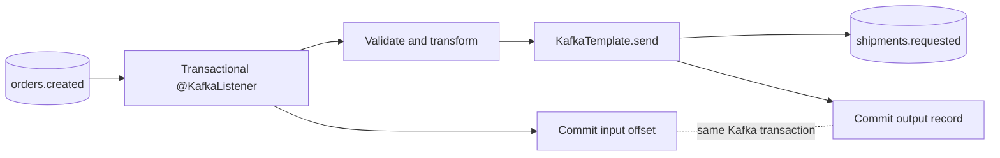
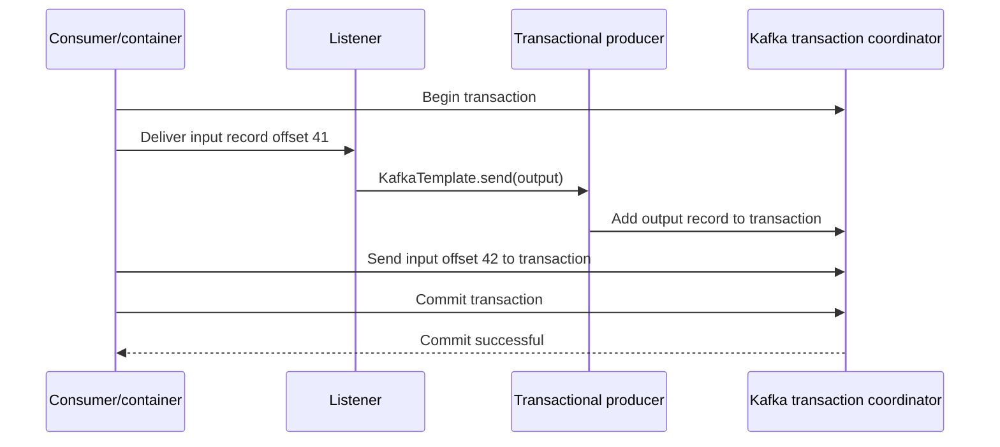

# Kafka read-process-write

Kafka read-process-write là luồng consumer đọc một record từ topic đầu vào, xử lý nghiệp vụ rồi phát record mới sang topic đầu ra. Nếu ứng dụng chỉ gửi output bằng producer idempotent, output có thể tránh một số bản ghi trùng do retry của producer, nhưng input offset và output record vẫn có thể được commit ở hai thời điểm khác nhau. Kafka transaction cho phép gộp việc publish output và commit input offset vào cùng một transaction, tạo semantics exactly-once cho luồng Kafka-to-Kafka.

Trong module `SPRING_KAFKA_MESSAGING`, producer dùng `KafkaTemplate`, consumer dùng `@KafkaListener`, còn listener container quản lý consumer offset. Với transactional listener, container bắt đầu Kafka transaction, listener xử lý record và gửi output bằng `KafkaTemplate` dùng cùng transactional `ProducerFactory`; khi listener thành công, output records và input offsets được commit cùng nhau. Nếu listener thất bại, transaction rollback và output chưa commit sẽ không được consumer downstream đọc khi dùng `read_committed`.

## 1. Read-process-write là gì?

Một ứng dụng read-process-write thường có ba bước:

1. Đọc input event từ một Kafka topic.
2. Chuyển đổi hoặc áp dụng nghiệp vụ lên event.
3. Gửi output event sang topic khác.

Ví dụ service nhận `OrderCreatedEvent`, kiểm tra điều kiện giao hàng rồi phát `ShipmentRequestedEvent`:



Điểm quan trọng là output record và input offset phải cùng thuộc một Kafka transaction. Nếu chỉ commit output rồi ứng dụng dừng trước khi commit input offset, input có thể được giao lại và output bị phát lần nữa. Nếu commit input trước rồi ứng dụng dừng trước khi gửi output, event đầu vào có thể bị bỏ qua mà không tạo output tương ứng.

## 2. Vì sao producer idempotence chưa đủ?

Kafka producer idempotence giúp broker nhận diện và loại bỏ duplicate do producer retry trong một producer session/sequence. Nó không tự liên kết việc gửi output với offset của input consumer.

| Cơ chế | Bảo vệ điều gì? | Có gộp output và input offset không? |
|---|---|---|
| Producer idempotence | Hạn chế duplicate do retry của cùng producer | Không |
| Consumer offset commit thông thường | Lưu tiến độ consumer group | Không |
| Kafka transaction cho read-process-write | Commit hoặc abort output records cùng input offsets | Có |

Để đạt exactly-once trong luồng Kafka-to-Kafka, ứng dụng cần transactional producer và consumer offset được gửi vào cùng transaction. Spring Kafka tích hợp việc này qua transactional listener container và `KafkaTransactionManager`.

## 3. Kafka transaction bao phủ phạm vi nào?

Với read-process-write được cấu hình đúng, transaction có thể bao gồm:

- Các output record được gửi bằng `KafkaTemplate` trong transaction hiện tại.
- Offset của record hoặc batch input mà listener đã xử lý.
- Các partition output được ghi bởi transactional producer.

Khi commit thành công, output record và offset input trở nên committed cùng nhau. Khi abort, output record không được consumer `read_committed` nhìn thấy và input offset không được tiến lên bởi transaction bị abort.

Kafka transaction không tự bao phủ database, HTTP API, email, filesystem hoặc side effect bên ngoài Kafka. Nếu listener cập nhật database rồi transaction Kafka rollback, database transaction độc lập có thể vẫn đã commit. Exactly-once ở đây là semantics cho các thao tác Kafka nằm trong cùng transaction.

## 4. Cấu hình producer transaction

Spring Kafka cần một transactional producer factory. Với Spring Boot, khai báo `spring.kafka.producer.transaction-id-prefix` để Boot cấu hình producer factory có transaction:

```yaml
spring:
  kafka:
    bootstrap-servers: ${KAFKA_BOOTSTRAP_SERVERS:localhost:9092}
    producer:
      transaction-id-prefix: ${INSTANCE_ID:orders-transformer-}
      acks: all
      key-serializer: org.apache.kafka.common.serialization.StringSerializer
      value-serializer: org.springframework.kafka.support.serializer.JsonSerializer
    consumer:
      group-id: orders-transformer
      enable-auto-commit: false
      key-deserializer: org.apache.kafka.common.serialization.StringDeserializer
      value-deserializer: org.springframework.kafka.support.serializer.JsonDeserializer
      properties:
        isolation.level: read_committed
        spring.json.use.type.headers: false
        spring.json.value.default.type: com.acme.orders.OrderCreatedEvent
        spring.json.trusted.packages: com.acme.orders
```

`transaction-id-prefix` phải duy nhất cho từng application instance đang chạy đồng thời. Hãy cấp `INSTANCE_ID` riêng cho mỗi pod/process; giá trị mặc định trong ví dụ chỉ tiện chạy local một instance và không được dùng chung nguyên trạng cho nhiều replica.

Khi dùng Spring Kafka transaction, factory quản lý transactional producer và transaction ID suffix. Không tự đặt cùng một `transactional.id` cố định cho mọi instance. Producer transaction cũng yêu cầu Kafka cluster có transaction coordinator và internal transaction state được cấu hình phù hợp.

`enable-auto-commit: false` để listener container quản lý input offset. `isolation.level: read_committed` giúp consumer chỉ đọc các record thuộc transaction đã commit nếu topic đầu vào cũng có transactional producer.

## 5. Cấu hình `KafkaTransactionManager` và listener container

`KafkaTransactionManager` sử dụng cùng `ProducerFactory` với `KafkaTemplate` phát output. Listener container dùng transaction manager này để bắt đầu transaction trước khi gọi listener và commit/rollback khi listener hoàn tất.

```java
import org.springframework.context.annotation.Bean;
import org.springframework.context.annotation.Configuration;
import org.springframework.kafka.config.ConcurrentKafkaListenerContainerFactory;
import org.springframework.kafka.core.ConsumerFactory;
import org.springframework.kafka.core.KafkaTemplate;
import org.springframework.kafka.core.ProducerFactory;
import org.springframework.kafka.transaction.KafkaTransactionManager;

@Configuration
public class ReadProcessWriteConfiguration {

    @Bean
    public KafkaTransactionManager<String, Object> kafkaTransactionManager(
            ProducerFactory<String, Object> transactionalProducerFactory) {
        return new KafkaTransactionManager<>(transactionalProducerFactory);
    }

    @Bean
    public KafkaTemplate<String, Object> transactionalKafkaTemplate(
            ProducerFactory<String, Object> transactionalProducerFactory) {
        return new KafkaTemplate<>(transactionalProducerFactory);
    }

    @Bean
    public ConcurrentKafkaListenerContainerFactory<String, OrderCreatedEvent>
            transactionalKafkaListenerContainerFactory(
                    ConsumerFactory<String, OrderCreatedEvent> consumerFactory,
                    KafkaTransactionManager<String, Object> kafkaTransactionManager) {

        var factory = new ConcurrentKafkaListenerContainerFactory<
                String, OrderCreatedEvent>();
        factory.setConsumerFactory(consumerFactory);
        factory.getContainerProperties().setKafkaAwareTransactionManager(
                kafkaTransactionManager
        );
        return factory;
    }
}
```

Trong ví dụ, `transactionalProducerFactory` phải là factory đã được cấu hình transaction ID prefix, `StringSerializer` cho key và serializer phù hợp với output value (ví dụ `JsonSerializer`). `KafkaTemplate` và `KafkaTransactionManager` cùng nhận đúng factory đó; đây là điều kiện để lệnh send trong listener tham gia transaction do container mở. `ConsumerFactory` vẫn là factory đọc `OrderCreatedEvent` từ topic đầu vào bằng deserializer tương ứng.

Nếu Spring Boot đã auto-configure producer factory/template/transaction manager, có thể dùng các bean đó thay vì khai báo lại. Khi tạo bean tùy chỉnh, đặt tên và dùng `@Qualifier` nếu có nhiều factory/template để tránh listener và template sử dụng nhầm producer factory.

Tên API cấu hình transaction manager có thể khác giữa các thế hệ Spring Kafka. Với phiên bản hiện đại, dùng `setKafkaAwareTransactionManager`; ở dự án cũ, kiểm tra API tương ứng trong version đang dùng và tránh copy cấu hình deprecated mà không xác minh.

## 6. Viết listener read-process-write

Event input và output:

```java
import java.math.BigDecimal;

public record OrderCreatedEvent(
        String eventId,
        String orderId,
        BigDecimal total
) {}

public record ShipmentRequestedEvent(
        String eventId,
        String orderId
) {}
```

Listener đọc event, xử lý và gửi output bằng transactional template:

```java
import org.springframework.kafka.annotation.KafkaListener;
import org.springframework.kafka.core.KafkaTemplate;
import org.springframework.stereotype.Component;

@Component
public class OrderToShipmentListener {

    private final KafkaTemplate<String, Object> kafkaTemplate;

    public OrderToShipmentListener(
            KafkaTemplate<String, Object> kafkaTemplate) {
        this.kafkaTemplate = kafkaTemplate;
    }

    @KafkaListener(
            topics = "orders.created",
            groupId = "orders-transformer",
            containerFactory = "transactionalKafkaListenerContainerFactory"
    )
    public void onOrderCreated(OrderCreatedEvent event) {
        if (event.total() == null || event.total().signum() <= 0) {
            throw new IllegalArgumentException("Order total must be positive");
        }

        ShipmentRequestedEvent output = new ShipmentRequestedEvent(
                event.eventId(),
                event.orderId()
        );

        kafkaTemplate.send("shipments.requested", event.orderId(), output);
    }
}
```

Không cần gọi `executeInTransaction()` bên trong listener khi container đã mở Kafka transaction và template dùng cùng producer factory. Lệnh `send()` tham gia transaction hiện tại. Khi method trả về bình thường, container commit transaction cùng input offset; nếu method ném exception, container rollback.

Nếu gửi nhiều output record, tất cả send được thực hiện trong cùng transaction của lần xử lý đó. Nếu bất kỳ bước nào thất bại và exception làm transaction rollback, toàn bộ output trong transaction đó không được commit.

## 7. Điều gì xảy ra khi listener thành công?

Luồng thành công của record listener:

1. Container poll input record.
2. Container bắt đầu Kafka transaction bằng transactional producer.
3. Listener xử lý event.
4. `KafkaTemplate` gửi output record vào transaction đang hoạt động.
5. Container đưa input offset kế tiếp vào transaction.
6. Kafka commit transaction.
7. Consumer downstream dùng `read_committed` nhìn thấy output đã commit.

Input offset được commit là offset kế tiếp cần đọc, không phải offset của record vừa xử lý. Nếu listener xử lý record offset `41`, transaction thường ghi offset `42` cho partition tương ứng.



## 8. Điều gì xảy ra khi listener thất bại?

Nếu listener ném exception trước khi transaction commit:

- Kafka transaction bị abort.
- Output records đã gửi trong transaction bị đánh dấu aborted.
- Input offset của transaction không được commit.
- Record input có thể được giao lại sau rollback theo cơ chế error handling/after-rollback processor.
- Consumer `read_committed` không thấy output của transaction đã abort.

Không nuốt exception nếu muốn container rollback. Ví dụ, nếu listener bắt exception rồi chỉ log và trả về bình thường, container có thể commit transaction và input offset, dù nghiệp vụ chưa hoàn thành.

Với transactional listener, retry/recovery sau rollback thường được điều phối bằng `DefaultAfterRollbackProcessor`. Cần cấu hình backoff và DLT recovery phù hợp; không nhầm cơ chế này với non-blocking retry vì non-blocking retry không được hỗ trợ kết hợp với container transactions theo cùng semantics.

## 9. `read_committed` ở consumer downstream

Consumer đọc topic output cần đặt `isolation.level=read_committed` nếu chỉ muốn nhìn thấy record thuộc transaction đã commit:

```yaml
spring:
  kafka:
    consumer:
      group-id: shipment-service
      properties:
        isolation.level: read_committed
```

Với `read_uncommitted`, consumer có thể đọc cả record thuộc transaction chưa commit hoặc đã abort. Khi mục tiêu là quan sát output theo exactly-once transaction boundary, downstream consumer cần `read_committed`.

`read_committed` chỉ kiểm soát visibility của transactional records. Nó không biến consumer handler thành exactly-once đối với database hoặc HTTP API, và không ngăn ứng dụng gọi lại logic khi record được giao lại theo một luồng khác.

## 10. Record listener và batch listener

Với record listener, container thường mở một transaction cho mỗi record được xử lý. Input offset tương ứng và output record từ lần xử lý đó được commit cùng nhau.

Với batch listener, container xử lý một batch trong một transaction theo cấu hình batch listener. Nếu batch thất bại và transaction rollback, output của batch bị abort cùng offsets của batch. Retry/recovery có thể cần xử lý lại batch hoặc xác định record lỗi theo cấu hình.

Chọn record hay batch listener dựa trên throughput, latency và yêu cầu lỗi. Batch tăng hiệu quả xử lý theo lô nhưng làm transaction lớn hơn; một lỗi có thể rollback nhiều output hơn và làm tăng chi phí retry.

## 11. Exactly-once không có nghĩa listener code chỉ chạy một lần

Exactly-once trong Kafka read-process-write nói về kết quả Kafka đã commit: input offset và output record được commit nguyên tử. Trong lúc có crash, fencing, rebalance hoặc rollback, listener code vẫn có thể được thực thi lại.

Ví dụ listener đã chạy một phần logic rồi process bị dừng trước transaction commit. Kafka transaction abort và input offset chưa tiến; record được giao lại và listener chạy lần nữa. Output từ transaction trước không visible với `read_committed`, nên kết quả Kafka đã commit không bị nhân đôi bởi lần thực thi dở dang đó.

Vì vậy:

- Không coi exactly-once là bảo đảm method Java chỉ được gọi một lần.
- Không thực hiện side effect bên ngoài Kafka trong listener mà không có idempotency/transaction strategy.
- Giữ các bước xử lý thuần hoặc deterministic khi có thể.
- Nếu có side effect ngoài Kafka, dùng inbox/idempotency key, transactional outbox hoặc cơ chế phối hợp phù hợp.

## 12. Giới hạn khi xử lý database hoặc hệ thống ngoài Kafka

Kafka transaction không tự commit cùng database transaction. Ví dụ listener cập nhật database rồi gửi Kafka output trong transaction:

```text
Database commit succeeds
        |
        v
Kafka transaction aborts
        |
        v
Input record is redelivered
        |
        v
Database update may run again
```

Để xử lý tình huống này:

- Dùng `eventId` ổn định và unique constraint để phát hiện event đã xử lý.
- Lưu inbox/idempotency record cùng database update trong một database transaction.
- Với database-to-Kafka publish, cân nhắc transactional outbox và relay/CDC.
- Với Kafka-to-Kafka, giữ output và offsets trong cùng Kafka transaction.
- Nếu cần phối hợp nhiều hệ thống, đánh giá Saga/compensation thay vì giả định một Kafka transaction bao trùm tất cả.

## 13. Transaction ID, producer fencing và vận hành nhiều instance

Mỗi application instance cần transaction ID prefix riêng. Spring Kafka producer factory tạo transactional producer ID từ prefix và suffix quản lý nội bộ. Nếu hai instance dùng cùng prefix, producer có thể fence nhau và một instance nhận lỗi transaction bị thay thế.

Khi triển khai nhiều pod:

- Cấp `INSTANCE_ID` duy nhất cho mỗi pod/process.
- Đảm bảo prefix ổn định trong vòng đời instance nhưng không trùng với instance chạy đồng thời.
- Theo dõi lỗi `ProducerFencedException`, transaction timeout và transaction abort rate.
- Chọn `transaction.timeout.ms` phù hợp với thời gian xử lý; giá trị này không được vượt giới hạn broker.
- Tránh giữ transaction mở trong lúc chờ API bên ngoài lâu.
- Kiểm tra `max.poll.interval.ms` để xử lý không kéo dài đến mức consumer rời group.

Khi instance chết và được thay thế, Kafka producer epoch/fencing giúp producer cũ không tiếp tục commit transaction như thể vẫn là owner hợp lệ. Đây là một phần quan trọng để duy trì transaction correctness khi restart và rebalance.

## 14. Kiểm thử read-process-write exactly-once

Integration test cần kiểm tra cả trường hợp commit và abort:

- **Success path:** gửi input event, xác minh output event xuất hiện với consumer `read_committed` và input offset được commit.
- **Failure after send:** listener gửi output rồi ném exception; xác minh output transaction bị abort và không xuất hiện với `read_committed`.
- **Redelivery:** sau rollback, xác minh input record có thể được giao lại và lần xử lý thành công sau đó tạo một output committed.
- **Downstream isolation:** so sánh `read_committed` với `read_uncommitted` để hiểu visibility của aborted records.
- **Restart/fencing:** dừng instance trong transaction và khởi động lại với prefix đúng; xác minh transaction dang dở không được coi là committed.
- **Multiple output records:** gửi nhiều output trong một lần listener và xác minh chúng cùng commit/abort.
- **Concurrent instances:** dùng transaction ID prefix khác nhau và xác minh không fencing lẫn nhau ngoài ý muốn.

Test nên dùng Embedded Kafka hoặc Testcontainers với broker hỗ trợ transaction. Tạo topic input/output riêng, group ID riêng và chờ điều kiện bằng Awaitility hoặc polling có timeout thay vì sleep cố định. Consumer kiểm tra output cần đặt `isolation.level=read_committed`.

## 15. Những lỗi thường gặp

- **Chỉ bật producer idempotence rồi gọi đó là EOS:** idempotence không gộp output và input offset.
- **KafkaTemplate dùng ProducerFactory khác transaction manager:** send không tham gia transaction của listener container.
- **Không cấu hình transaction ID prefix:** producer factory không được thiết lập để tạo transactional producer.
- **Dùng transaction ID prefix trùng giữa các instance:** producer fencing lẫn nhau.
- **Bật auto commit cho input consumer:** offset có thể tiến ngoài transaction do container quản lý.
- **Downstream dùng `read_uncommitted`:** có thể quan sát record của transaction bị abort.
- **Nuốt exception trong listener:** container có thể commit thay vì rollback.
- **Gọi `executeInTransaction()` không cần thiết bên trong transactional listener:** tạo transaction boundary lồng/riêng không như mong muốn; dùng template tham gia transaction hiện tại.
- **Cho rằng database side effect được Kafka rollback:** Kafka transaction chỉ bao phủ Kafka records và offsets.
- **Transaction giữ quá lâu:** có thể timeout, làm tăng abort/rebalance và ảnh hưởng throughput.
- **Dùng non-blocking retry cùng transactional listener:** hai cơ chế có giới hạn tương thích; thiết kế retry theo transactional after-rollback flow.

## 16. Checklist triển khai Kafka read-process-write

- [ ] Producer factory có transaction ID prefix.
- [ ] Prefix duy nhất cho từng instance chạy đồng thời.
- [ ] `KafkaTransactionManager` dùng đúng transactional `ProducerFactory`.
- [ ] `KafkaTemplate` gửi output dùng cùng `ProducerFactory` với transaction manager.
- [ ] Listener container được gắn Kafka transaction manager.
- [ ] Consumer auto commit bị tắt và container quản lý offsets.
- [ ] Output records và input offsets cùng nằm trong transaction.
- [ ] Consumer cần đọc kết quả transactional dùng `read_committed`.
- [ ] Listener để exception thoát ra khi cần rollback.
- [ ] Retry/recovery được cấu hình theo transactional listener semantics.
- [ ] Side effect ngoài Kafka có idempotency hoặc outbox/inbox strategy.
- [ ] Integration test xác minh success, abort, redelivery, isolation và restart.

Kafka read-process-write đạt exactly-once khi output records và input offsets được commit nguyên tử trong cùng Kafka transaction, với transactional producer factory được chia sẻ đúng giữa listener container và `KafkaTemplate`. Consumer downstream cần `read_committed` để chỉ nhìn thấy kết quả đã commit. Phạm vi này bảo vệ luồng Kafka-to-Kafka; database và hệ thống bên ngoài vẫn cần transaction boundary hoặc idempotency riêng.
