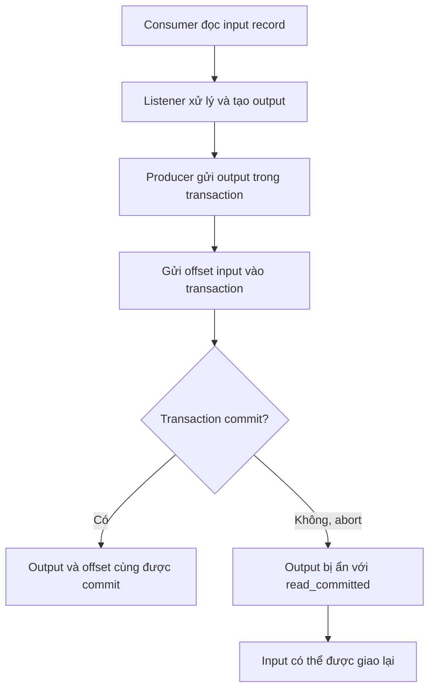

# Transactional producer và consumer

Trong một luồng messaging, consumer thường đọc một sự kiện, xử lý rồi phát ra sự kiện mới. Nếu ứng dụng gửi output thành công nhưng lỗi trước khi commit offset input, Kafka có thể giao lại input và ứng dụng phát output lần nữa. Nếu commit offset trước khi gửi output, lỗi ở giữa có thể làm mất output. Kafka transaction giải quyết khoảng hở này bằng cách đưa việc publish output và xác nhận offset input vào cùng một transaction Kafka.

Spring Kafka hỗ trợ transactional producer, `KafkaTransactionManager` và listener container transaction để xây dựng luồng consume-transform-produce có exactly-once semantics (EOS) trong phạm vi Kafka. Cần phân biệt transaction chỉ dùng để gửi nhiều record với transaction bao gồm cả offset consumer; đồng thời hiểu rõ giới hạn khi xử lý còn ghi database hoặc gọi dịch vụ bên ngoài.

## 1. Vì sao cần transaction giữa producer và consumer?

Giả sử service `order-projection` đọc sự kiện `OrderCreated` từ topic `orders`, cập nhật dữ liệu xử lý và gửi `OrderProjection` tới topic `order-projections`. Nếu output và offset input được xác nhận riêng rẽ, có hai tình huống lỗi:

- Output đã được ghi nhưng offset input chưa commit: sau restart, input được đọc lại và output có thể bị ghi trùng.
- Offset input đã commit nhưng output chưa được ghi: Kafka không giao lại input, nên output có thể bị mất.

Kafka transaction cho phép producer ghi output record và gửi offset input vào transaction. Khi transaction commit, cả output và offset được commit cùng nhau. Nếu transaction abort, output không hiển thị với consumer `read_committed` và offset input chưa được xác nhận trong transaction đó, vì vậy input có thể được xử lý lại.



Đây là bảo đảm nguyên tử giữa các thao tác Kafka thuộc cùng transaction và cùng cluster. Nó không tự bao gồm database, HTTP API, file system hoặc hệ thống ngoài Kafka.

## 2. Transactional producer và `transactional.id`

Một producer transactional cần `transactional.id` để Kafka quản lý trạng thái transaction và fencing producer cũ. Trong Spring Kafka, ứng dụng thường cấu hình `transactionIdPrefix` trên producer factory; factory tạo ID hoàn chỉnh bằng cách thêm suffix riêng cho producer được cấp.

Với Spring Boot, cấu hình prefix qua `spring.kafka.producer.transaction-id-prefix`:

```yaml
spring:
  kafka:
    bootstrap-servers: localhost:9092
    producer:
      transaction-id-prefix: ${HOSTNAME:local}-order-service-
      key-serializer: org.apache.kafka.common.serialization.StringSerializer
      value-serializer: org.springframework.kafka.support.serializer.JsonSerializer
    consumer:
      group-id: order-projection
      isolation-level: read_committed
```

`HOSTNAME` hoặc biến instance ID phải phân biệt các replica đang hoạt động đồng thời. Không dùng cùng prefix cố định cho nhiều pod, vì các producer có thể tạo cùng dải transactional ID và fencing lẫn nhau. Khi một logical instance được thay thế, việc dùng lại identity có thể giúp producer mới fencing producer cũ còn sót lại.

`transactional.id` và `transactionIdPrefix` không phải tên gọi thay thế cho nhau:

| Thuộc tính | Vai trò |
|---|---|
| `transactional.id` | ID thực tế Kafka gắn với một transactional producer. |
| `transactionIdPrefix` | Prefix Spring Kafka dùng để tạo các ID thực tế cho producer factory quản lý. |
| `group.id` | Định danh consumer group; được dùng khi commit offset, không phải transactional ID. |
| `eventId` | Định danh nghiệp vụ của sự kiện; ứng dụng dùng để truy vết hoặc chống xử lý trùng. |

Khi dùng Spring Boot auto-configuration, hãy bảo đảm `KafkaTemplate`, listener container và transaction manager dùng đúng producer factory đã bật transaction. Nếu tự tạo producer factory, gọi `setTransactionIdPrefix(...)` trên factory đó. Không đặt một `transactional.id` tĩnh trong properties khi factory đang tự quản lý suffix.

## 3. Transaction chỉ ở phía producer

Nếu một thao tác cần gửi nhiều record và muốn tất cả cùng commit hoặc cùng abort, có thể dùng `KafkaTemplate.executeInTransaction(...)`. Ví dụ:

```java
public void publishOrderEvents(
        OrderCreated created,
        OrderAuditRecorded audit) {

    kafkaTemplate.executeInTransaction(operations -> {
        operations.send("orders", created.orderId(), created);
        operations.send("order-audit", audit.orderId(), audit);
        return null;
    });
}
```

Hai record được gửi trong cùng một Kafka transaction. Nếu callback hoàn tất bình thường, transaction được commit; nếu exception thoát khỏi callback, transaction bị abort. Producer factory của `KafkaTemplate` phải được cấu hình transactional và hai topic phải thuộc cùng Kafka cluster.

Transaction producer-only hữu ích khi một nghiệp vụ phát nhiều sự kiện cần được nhìn thấy cùng nhau. Nhưng nếu thao tác bắt đầu từ một consumer, chỉ dùng `executeInTransaction` chưa tự động đưa offset input vào transaction đó. Để phối hợp consume-transform-produce, cần cấu hình listener container transaction với `KafkaTransactionManager`.

## 4. Cấu hình consumer tham gia Kafka transaction

`KafkaTransactionManager` quản lý transaction trên producer factory. Listener container dùng transaction manager này để bắt đầu transaction trước khi gọi listener. `KafkaTemplate` sử dụng cùng producer factory có thể tham gia transaction đang hoạt động. Khi listener hoàn tất, container gửi offset input vào transaction rồi commit.

Ví dụ tạo transaction manager:

```java
@Bean
public KafkaTransactionManager<String, Object> kafkaTransactionManager(
        ProducerFactory<String, Object> transactionalProducerFactory) {
    return new KafkaTransactionManager<>(transactionalProducerFactory);
}
```

Gắn transaction manager vào listener container factory:

```java
@Bean
public ConcurrentKafkaListenerContainerFactory<String, OrderCreated>
        orderListenerFactory(
                ConsumerFactory<String, OrderCreated> consumerFactory,
                KafkaTransactionManager<String, Object> kafkaTransactionManager) {

    ConcurrentKafkaListenerContainerFactory<String, OrderCreated> factory =
            new ConcurrentKafkaListenerContainerFactory<>();
    factory.setConsumerFactory(consumerFactory);
    factory.getContainerProperties()
            .setKafkaAwareTransactionManager(kafkaTransactionManager);
    return factory;
}
```

Phương thức `setKafkaAwareTransactionManager(...)` là API dùng trong các phiên bản Spring Kafka hiện đại. Nếu dự án dùng phiên bản cũ, hãy đối chiếu API `ContainerProperties` tương ứng phiên bản. `KafkaTemplate` được inject vào listener phải dùng chính `transactionalProducerFactory` mà `KafkaTransactionManager` quản lý; nếu dùng một factory khác, lệnh gửi có thể không tham gia transaction của container.

Listener đọc input, xử lý và gửi output:

```java
@KafkaListener(
        topics = "orders",
        groupId = "order-projection",
        containerFactory = "orderListenerFactory")
public void consume(OrderCreated event) {
    OrderProjection projection = projectionService.apply(event);
    kafkaTemplate.send(
            "order-projections",
            event.orderId(),
            projection);
}
```

Trong mô hình này, listener không cần tự gọi `beginTransaction()` hoặc `commitTransaction()`. Container mở transaction, `KafkaTemplate` gửi output vào transaction đó, rồi container thêm offset input vào transaction trước khi commit. Cấu hình consumer `isolation.level=read_committed` giúp consumer downstream chỉ nhìn thấy output của transaction đã commit.

## 5. Điều gì xảy ra khi listener thành công hoặc thất bại?

Với transactional listener container, kết quả của phương thức listener quyết định transaction:

| Tình huống | Kết quả transaction | Hành vi phía Kafka |
|---|---|---|
| Listener hoàn tất bình thường, các lệnh gửi thành công | Commit | Output và offset input được commit cùng nhau. |
| Listener ném exception trước commit | Abort | Output transaction không hiển thị với `read_committed`; input có thể được giao lại. |
| Producer gửi output thất bại | Transaction không thể commit như thành công | Container xử lý lỗi và transaction bị abort theo đường lỗi. |
| Producer bị fencing | Transaction không còn hợp lệ | Producer cũ không thể tiếp tục; cần kiểm tra transactional ID và vòng đời instance. |
| Transaction timeout | Broker abort transaction quá hạn | Input có thể được xử lý lại; cần kiểm tra thời gian xử lý và timeout. |

Ví dụ listener gửi output rồi ném exception:

```java
@KafkaListener(
        topics = "orders",
        groupId = "order-projection",
        containerFactory = "orderListenerFactory")
public void consume(OrderCreated event) {
    kafkaTemplate.send("order-projections", event.orderId(), toProjection(event));

    if (shouldFailForExample(event)) {
        throw new IllegalStateException("Force transaction rollback");
    }
}
```

Nếu exception thoát khỏi listener và transaction bị abort, record output được gửi trong transaction đó không xuất hiện với consumer `read_committed`. Offset input cũng không được commit trong transaction bị abort, nên record có thể được giao lại. Trong môi trường thật, error handler có thể retry hoặc recover record; cần cấu hình chính sách đó phù hợp với transaction.

## 6. Vai trò của `read_committed`

Consumer Kafka có hai mức isolation chính:

| `isolation.level` | Hành vi |
|---|---|
| `read_uncommitted` | Có thể đọc cả record thuộc transaction chưa commit hoặc đã abort. |
| `read_committed` | Chỉ trả record thuộc transaction đã commit và record không transactional theo quy tắc Kafka. |

Trong pipeline cần exactly-once visibility, consumer downstream nên dùng `read_committed`. Nếu dùng `read_uncommitted`, ứng dụng có thể nhìn thấy output của transaction sau đó bị abort và xử lý dữ liệu không thuộc kết quả đã commit.

`read_committed` có một tác động vận hành: consumer chỉ đọc tới last stable offset (LSO), là vị trí bị giới hạn bởi transaction chưa hoàn tất sớm nhất trong partition. Nếu một transaction mở quá lâu, các record nằm sau transaction đó có thể chưa được trả cho consumer `read_committed`, dù các record đã được ghi vào log. Vì vậy, giữ transaction ngắn và theo dõi transaction timeout là quan trọng.

## 7. Exactly-once semantics có giới hạn ở đâu?

Kafka EOS bảo đảm một luồng Kafka consume-transform-produce có thể commit output record và input offset như một đơn vị. Điều đó không đồng nghĩa toàn bộ code trong listener chỉ chạy đúng một lần.

Ví dụ, listener gọi một dịch vụ HTTP để gửi email rồi ném exception trước khi transaction commit. Kafka sẽ giao lại input và listener có thể gọi HTTP lần nữa. Kafka transaction không thể rollback email đã gửi. Tương tự, nếu listener cập nhật database rồi transaction Kafka abort, cập nhật database không tự rollback theo Kafka.

| Thành phần | Kafka transaction bao phủ? | Cách xử lý |
|---|---|---|
| Output record gửi bằng transactional producer cùng factory | Có | Gửi trong transaction của listener hoặc producer transaction. |
| Offset consumer group được gửi vào cùng transaction | Có, khi dùng transactional listener container hoặc API phối hợp offset phù hợp | Để container quản lý offset transaction. |
| Consumer downstream đọc output | Visibility được kiểm soát bằng `read_committed` | Cấu hình isolation level và xử lý retry phù hợp. |
| Database update | Không tự động | Dùng idempotency, inbox/outbox hoặc transaction coordination phù hợp. |
| HTTP, email, file hoặc side effect ngoài Kafka | Không | Dùng idempotency key, outbox hoặc quy trình bù trừ. |

Vì vậy, listener vẫn nên có logic idempotent. Một event ID ổn định, unique constraint hoặc bảng inbox có thể giúp tránh áp dụng cùng một nghiệp vụ nhiều lần khi input được giao lại. Nếu cần ghi database và phát sự kiện, transactional outbox thường là cách thiết kế phù hợp: database transaction lưu cả thay đổi nghiệp vụ và outbox record, sau đó một publisher phát outbox sang Kafka.

## 8. EOS V2 và các điều kiện vận hành

Kafka hỗ trợ exactly-once semantics V2 cho các phiên bản broker/client hiện đại. EOS V2 đơn giản hóa việc quản lý transaction theo consumer group và là chế độ phổ biến trong các phiên bản Kafka mới. Spring Kafka dùng transactional producer và phối hợp offset để thực hiện consume-transform-produce. Cần dùng phiên bản Kafka client, broker và Spring Kafka tương thích với nhau.

Các điều kiện quan trọng:

1. Producer factory được cấu hình transactional bằng `transactionIdPrefix` duy nhất giữa các instance đang chạy.
2. Listener container sử dụng đúng `KafkaTransactionManager` quản lý producer factory đó.
3. `KafkaTemplate` trong listener dùng cùng producer factory để output tham gia transaction container.
4. Consumer downstream dùng `read_committed` nếu chỉ được phép thấy dữ liệu đã commit.
5. Transaction phải hoàn tất trong giới hạn `transaction.timeout.ms` và thời gian xử lý consumer phải tương thích với `max.poll.interval.ms`.
6. Topic nguồn, topic đích và offset transaction phải thuộc cùng Kafka cluster; Kafka transaction không tạo atomic commit xuyên nhiều cluster độc lập.
7. Broker transaction state log phải được cấu hình replication và min ISR phù hợp để vận hành chịu lỗi.
8. Logic nghiệp vụ bên ngoài Kafka vẫn cần idempotency hoặc cơ chế phối hợp riêng.

Tránh đặt transaction bao quanh công việc quá dài như gọi nhiều dịch vụ HTTP tuần tự hoặc chờ người dùng. Transaction mở lâu làm giảm khả năng đọc của `read_committed`, tăng nguy cơ timeout và giữ tài nguyên producer. Chỉ đưa các thao tác Kafka cần commit nguyên tử vào transaction boundary.

## 9. Các lỗi thường gặp

| Triệu chứng | Nguyên nhân có thể | Hướng kiểm tra |
|---|---|---|
| `ProducerFencedException` | Nhiều instance dùng cùng transactional ID hoặc producer cũ bị thay thế | Kiểm tra prefix, instance ID và rolling deployment. |
| Output xuất hiện dù listener transaction abort | Consumer đang dùng `read_uncommitted` | Đặt `isolation.level=read_committed` cho consumer cần EOS visibility. |
| Input được giao lại sau khi output đã được gửi | Output không tham gia cùng transaction với offset input | Kiểm tra listener container transaction manager và producer factory của `KafkaTemplate`. |
| Transaction timeout | Listener xử lý quá lâu hoặc backoff giữ transaction mở | Rút ngắn transaction, điều chỉnh retry và kiểm tra `transaction.timeout.ms`. |
| Consumer lag tăng dù broker vẫn nhận record | Transaction mở lâu làm LSO bị giữ hoặc listener xử lý chậm | Theo dõi transaction duration, LSO và thời gian listener. |
| Database ghi trùng sau khi Kafka transaction abort | Database side effect nằm ngoài Kafka transaction | Dùng idempotency, inbox/outbox hoặc transaction coordination. |

Không khắc phục lỗi fencing bằng cách tăng retry vô hạn. Fencing thường chỉ ra xung đột định danh hoặc vòng đời producer; cần sửa prefix và cách quản lý instance. Khi transaction abort, hãy xác định liệu input có thể được giao lại và side effect nào đã xảy ra ngoài Kafka trước khi quyết định retry.

## 10. Kiểm thử transactional producer và consumer

Một bộ kiểm thử nên xác minh kết quả đọc được từ consumer, trạng thái offset và tác động nghiệp vụ:

- Khi listener hoàn tất, output xuất hiện đúng một lần với consumer `read_committed` và offset input được commit.
- Khi listener gửi output rồi ném exception, output transaction không hiển thị với `read_committed` và input được xử lý lại theo chính sách.
- Consumer `read_uncommitted` có thể nhìn thấy record thuộc transaction chưa commit; consumer `read_committed` không nhìn thấy chúng.
- Khi hai instance vô tình dùng chung prefix, kiểm thử phát hiện fencing; khi prefix khác nhau, hai instance có thể hoạt động đồng thời.
- Khi producer hoặc broker restart trong lúc transaction đang mở, xác minh transaction được phục hồi hoặc abort theo giao thức và input không bị mất.
- Khi database hoặc HTTP side effect được gọi trước khi transaction abort, xác minh idempotency ngăn tác động nghiệp vụ lặp.
- Khi transaction kéo dài, xác minh cảnh báo transaction duration, consumer lag và giới hạn poll hoạt động đúng.
- Khi publish nhiều output record, xác minh chúng cùng commit hoặc cùng abort trong một transaction.

Trong log và metric, theo dõi transaction commit/abort, transaction duration, producer fencing, timeout, listener failure, consumer lag và số lần giao lại. Ghi instance ID cùng transaction outcome để điều tra lỗi giữa các replica.

Transactional producer và consumer tạo nền tảng cho exactly-once semantics trong pipeline Kafka: output và offset input được commit như một đơn vị, còn `read_committed` kiểm soát dữ liệu downstream nhìn thấy. Bảo đảm này chỉ bao phủ các thao tác Kafka đã tham gia transaction; mọi database update và side effect bên ngoài vẫn cần thiết kế idempotent hoặc một cơ chế phối hợp riêng.
