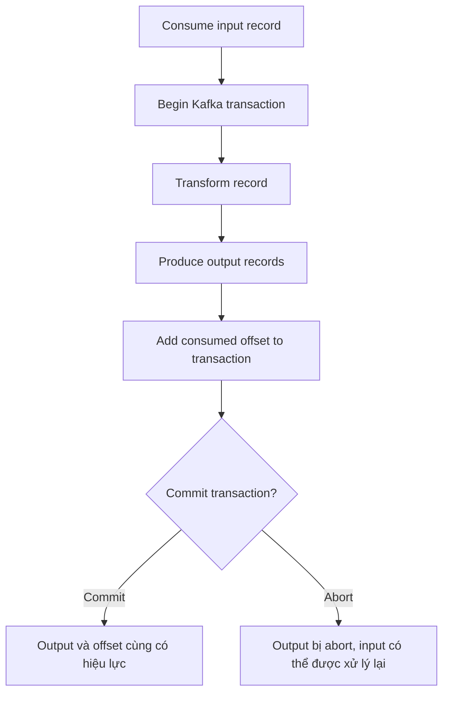
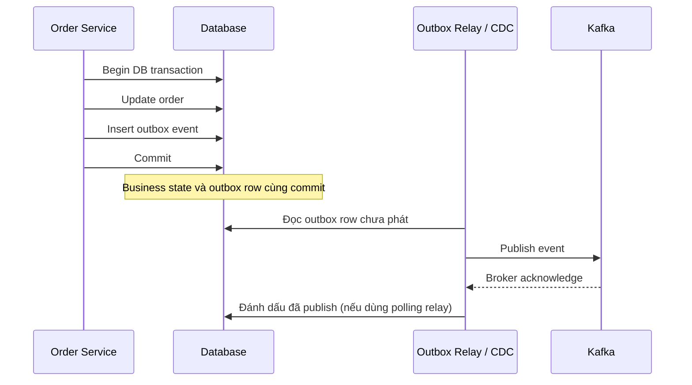

# Giới hạn của exactly-once ngoài Kafka

Kafka hỗ trợ transaction để một ứng dụng tiêu thụ record, xử lý và phát record mới sao cho output records cùng offset đầu vào được commit nguyên tử. Đây là nền tảng của exactly-once processing trong phạm vi Kafka. Tuy nhiên, một ứng dụng Spring Kafka thường còn cập nhật database, gọi HTTP API, gửi email hoặc thực hiện một tác vụ ở hệ thống khác. Các thao tác đó không tự động tham gia Kafka transaction.

Vì vậy, không nên hiểu exactly-once trong Kafka là cam kết toàn bộ nghiệp vụ chỉ xảy ra đúng một lần từ đầu đến cuối. Kafka có thể bảo vệ ranh giới dữ liệu Kafka; để giữ nhất quán với hệ thống ngoài Kafka, ứng dụng cần thiết kế thêm transactional outbox, inbox/idempotency, API idempotency hoặc Saga tùy trường hợp.

## 1. Exactly-once trong Kafka bảo vệ điều gì?

Với luồng consume-transform-produce, consumer đọc một record từ topic đầu vào, xử lý rồi gửi một hoặc nhiều record sang topic đầu ra. Nếu chỉ dùng commit offset và gửi producer độc lập, ứng dụng có thể gặp khoảng hở giữa hai thao tác:

- Gửi output thành công nhưng crash trước khi commit offset: input được giao lại và output có thể bị gửi lần nữa.
- Commit offset trước khi gửi output: nếu gửi thất bại sau đó, input đã được đánh dấu hoàn tất nhưng output bị thiếu.

Kafka transaction cho phép gửi output records và offset đầu vào trong cùng một transaction. Khi transaction commit, cả hai cùng có hiệu lực. Khi transaction abort, output không được consumer đọc theo chế độ `read_committed` nhìn thấy và offset không được commit bởi transaction đó.



Phạm vi bảo vệ ở đây là các thao tác Kafka tham gia transaction. Một câu lệnh SQL, một lệnh gọi HTTP hoặc một email gửi ra ngoài không tự trở thành thành phần của transaction đó.

## 2. Vì sao exactly-once không tự mở rộng ra database?

Giả sử một listener nhận `OrderCreated`, cập nhật bảng đơn hàng trong PostgreSQL rồi phát `OrderAccepted` lên Kafka. Database và Kafka là hai hệ thống có transaction manager riêng. Kafka transaction không thể tự rollback một commit đã hoàn tất trong PostgreSQL.

Nếu ứng dụng thực hiện hai thao tác độc lập, có hai thứ tự phổ biến và cả hai đều có cửa sổ lỗi.

**Ghi database trước, gửi Kafka sau:**

1. Database commit trạng thái đơn hàng.
2. Ứng dụng gửi event lên Kafka.
3. Ứng dụng bị dừng hoặc Kafka không khả dụng trước khi publish thành công.

Kết quả: database đã đổi trạng thái nhưng downstream không nhận được event.

**Gửi Kafka trước, ghi database sau:**

1. Kafka commit event đầu ra.
2. Ứng dụng ghi database.
3. Database lỗi hoặc ứng dụng bị dừng trước khi commit database.

Kết quả: downstream đã nhận event nhưng trạng thái database chưa được cập nhật.

Đây là bài toán *dual write*: một nghiệp vụ cần ghi vào hai hệ thống độc lập nhưng không có một transaction chung bao phủ cả hai.

| Thứ tự thao tác | Điểm lỗi | Hậu quả có thể xảy ra |
|---|---|---|
| Database rồi Kafka | DB commit, Kafka publish thất bại | Có trạng thái mới nhưng thiếu event |
| Kafka rồi database | Kafka commit, DB rollback | Có event nhưng trạng thái DB chưa đổi |
| Gửi Kafka, nhận timeout | Broker đã nhận nhưng producer không nhận được ack | Ứng dụng không biết chắc publish đã thành công hay chưa |
| DB commit rồi consumer crash | Offset chưa commit | Input được giao lại và DB có thể bị cập nhật lần nữa |

Chỉ đổi thứ tự hai lệnh không loại bỏ được cửa sổ lỗi. Cần một cơ chế để trạng thái nghiệp vụ và ý định phát event được lưu bền vững cùng nhau.

## 3. Transactional outbox giải quyết dual write

Transactional outbox lưu event cần phát vào một bảng trong cùng database transaction với thay đổi nghiệp vụ. Sau khi transaction database commit, một tiến trình relay đọc outbox và publish event sang Kafka.

Luồng hoạt động:



Điểm quan trọng là thay đổi nghiệp vụ và outbox row cùng nằm trong một transaction database. Do đó:

- Nếu transaction database rollback, cả thay đổi nghiệp vụ và outbox row đều không tồn tại.
- Nếu transaction database commit, cả thay đổi nghiệp vụ và ý định phát event đều được lưu.
- Relay có thể tiếp tục publish sau khi service khởi động lại.

Outbox không làm database và Kafka thành một transaction phân tán. Nó chuyển bài toán dual write thành một quy trình publish có thể retry và phục hồi.

### Ví dụ cấu trúc bảng outbox

Một bảng tối thiểu có thể gồm:

```sql
CREATE TABLE outbox_event (
    event_id       UUID PRIMARY KEY,
    aggregate_id   VARCHAR(100) NOT NULL,
    aggregate_type VARCHAR(100) NOT NULL,
    event_type     VARCHAR(200) NOT NULL,
    payload        JSONB NOT NULL,
    created_at     TIMESTAMP NOT NULL,
    published_at   TIMESTAMP NULL
);
```

Các cột có vai trò:

- `event_id`: định danh ổn định của event, dùng để deduplicate ở downstream.
- `aggregate_id`: ID của đối tượng nghiệp vụ, thường được dùng làm Kafka key.
- `aggregate_type` và `event_type`: xác định loại đối tượng và event.
- `payload`: nội dung event đã được tạo tại thời điểm nghiệp vụ commit.
- `created_at`: thời điểm tạo event.
- `published_at`: thời điểm relay đánh dấu đã publish nếu dùng polling relay.

Có thể bổ sung aggregate version, schema version, headers hoặc trạng thái xử lý tùy nhu cầu vận hành. Không nên lưu dữ liệu nhạy cảm vào payload nếu event sẽ được phân phối rộng.

### Ghi business data và outbox trong cùng transaction

Ví dụ service Spring quản lý transaction database:

```java
@Service
public class OrderApplicationService {

    private final OrderRepository orderRepository;
    private final OutboxRepository outboxRepository;

    public OrderApplicationService(
            OrderRepository orderRepository,
            OutboxRepository outboxRepository) {
        this.orderRepository = orderRepository;
        this.outboxRepository = outboxRepository;
    }

    @Transactional
    public void acceptOrder(UUID orderId) {
        Order order = orderRepository.findById(orderId)
                .orElseThrow();

        order.accept();

        OrderAccepted event = new OrderAccepted(
                UUID.randomUUID(),
                order.getId(),
                order.getVersion()
        );

        outboxRepository.save(OutboxEvent.from(event));
    }
}
```

Vì hai repository cùng dùng một database transaction manager, trạng thái đơn hàng và outbox row commit hoặc rollback cùng nhau. Service này không gửi Kafka trực tiếp trong transaction; relay sẽ đọc outbox sau khi commit.

Trong ví dụ, event ID được tạo một lần và lưu trong outbox. Khi relay thử publish lại cùng row, event ID vẫn giữ nguyên. Đây là điều kiện quan trọng để consumer nhận biết cùng một event qua nhiều lần giao.

## 4. Outbox relay có thể publish trùng

Polling relay thường thực hiện các bước:

1. Đọc các outbox row chưa publish.
2. Gửi từng event lên Kafka.
3. Khi nhận xác nhận publish thành công, đánh dấu row đã publish.
4. Lặp lại với các row còn lại.

Có một cửa sổ lỗi: Kafka đã nhận event nhưng relay crash trước khi đánh dấu `published_at`. Khi relay chạy lại, row vẫn được xem là chưa publish và được gửi lần nữa.

Vì vậy, transactional outbox thường cung cấp khả năng publish ít nhất một lần (*at-least-once*) trong điều kiện relay retry đến khi thành công. Nó không bảo đảm một event chỉ xuất hiện đúng một lần trong Kafka.

Đó là lý do event cần `event_id` ổn định và consumer cần idempotency. Hãy thiết kế downstream chịu được việc cùng một event được giao nhiều lần.

### Polling relay và CDC relay

Có hai cách phổ biến để chuyển outbox sang Kafka:

| Cách | Cách hoạt động | Điểm cần cân nhắc |
|---|---|---|
| Polling relay | Ứng dụng truy vấn row chưa publish rồi gửi Kafka | Cần quản lý lock, batch size, retry, đánh dấu publish và dọn dữ liệu |
| CDC relay | Công cụ đọc change log của database rồi phát thay đổi outbox sang Kafka | Cần vận hành connector, schema, offset CDC và xử lý phục hồi |

CDC (*Change Data Capture*) thường được triển khai bằng công cụ như Debezium. Connector đọc transaction log của database và chuyển outbox row thành Kafka record theo cấu hình outbox event router.

CDC giảm nhu cầu polling bảng liên tục, nhưng vẫn cần giám sát connector, replication slot hoặc log retention, schema và lag. Không nên xóa outbox/change log tùy tiện khi connector chưa xử lý đến vị trí tương ứng.

## 5. Giữ thứ tự event trong outbox

Một aggregate có thể phát nhiều event theo thứ tự nghiệp vụ: `OrderCreated`, `OrderPaid`, `OrderShipped`. Nếu relay publish đồng thời hoặc nhiều worker xử lý outbox không có quy tắc, event có thể đến Kafka sai thứ tự.

Có thể bổ sung version tăng dần cho mỗi aggregate:

```sql
ALTER TABLE outbox_event
ADD COLUMN aggregate_version BIGINT NOT NULL;
```

Sau đó:

- Tạo version trong cùng transaction cập nhật aggregate.
- Dùng `aggregate_id` làm Kafka key để các event của cùng aggregate vào cùng partition.
- Relay publish theo thứ tự version trong phạm vi aggregate.
- Consumer có thể kiểm tra version để phát hiện event thiếu, trùng hoặc đến sai thứ tự.

Kafka giữ thứ tự trong một partition, nhưng không tự sắp xếp các event đã được publish sai thứ tự trước đó. Nếu cần ordering, relay và consumer đều phải tham gia bảo vệ quy tắc đó.

## 6. Consumer idempotency và inbox pattern

Ngay cả khi producer hoặc relay gửi lại event, consumer vẫn có thể đảm bảo một tác dụng phụ database chỉ được áp dụng một lần bằng cách lưu dấu event đã xử lý.

Một bảng inbox/deduplication có thể dùng khóa duy nhất kết hợp tên consumer:

```sql
CREATE TABLE processed_message (
    consumer_name VARCHAR(150) NOT NULL,
    event_id      UUID NOT NULL,
    processed_at  TIMESTAMP NOT NULL,
    PRIMARY KEY (consumer_name, event_id)
);
```

Khi nhận event, consumer thực hiện hai việc trong cùng database transaction:

1. Ghi nhận `event_id` vào `processed_message`.
2. Chỉ khi event được ghi nhận lần đầu, áp dụng thay đổi nghiệp vụ.

Ví dụ với PostgreSQL:

```sql
BEGIN;

WITH inserted AS (
    INSERT INTO processed_message (
        consumer_name,
        event_id,
        processed_at
    )
    VALUES (
        'billing-projection',
        :event_id,
        CURRENT_TIMESTAMP
    )
    ON CONFLICT (consumer_name, event_id) DO NOTHING
    RETURNING event_id
)
UPDATE account_projection
SET paid_total = paid_total + :amount
WHERE account_id = :account_id
  AND EXISTS (SELECT 1 FROM inserted);

COMMIT;
```

CTE `inserted` chỉ trả về một row khi event ID được ghi nhận lần đầu. `UPDATE` chỉ chạy khi CTE có kết quả. Nếu event đã tồn tại, câu lệnh không đổi projection và transaction có thể kết thúc bình thường.

Nếu insert dấu dedup và update nghiệp vụ nằm trong hai transaction khác nhau, crash giữa hai bước có thể làm hệ thống đánh dấu event đã xử lý nhưng chưa áp dụng nghiệp vụ, hoặc áp dụng nghiệp vụ mà chưa ghi dấu. Hai thao tác cần commit cùng nhau.

### Ví dụ consumer với transaction database

Có thể tổ chức logic trong một service:

```java
@Service
public class BillingEventService {

    private final ProcessedMessageRepository processedMessages;
    private final AccountProjectionRepository projections;

    public BillingEventService(
            ProcessedMessageRepository processedMessages,
            AccountProjectionRepository projections) {
        this.processedMessages = processedMessages;
        this.projections = projections;
    }

    @Transactional
    public void apply(PaymentCaptured event) {
        boolean firstDelivery = processedMessages
                .insertIfAbsent("billing-projection", event.eventId());

        if (!firstDelivery) {
            return;
        }

        projections.addPaidAmount(
                event.accountId(),
                event.amount()
        );
    }
}
```

`insertIfAbsent` phải được triển khai bằng thao tác atomic dựa trên unique constraint, ví dụ `INSERT ... ON CONFLICT DO NOTHING` trong PostgreSQL. Không nên dùng cách đọc trước rồi insert sau mà không có ràng buộc duy nhất, vì hai consumer hoặc hai lần giao đồng thời có thể cùng thấy event chưa tồn tại.

Khi database transaction rollback, cả dấu inbox và thay đổi projection cùng rollback. Khi commit, cả hai cùng có hiệu lực. Nếu Kafka offset chưa commit và record được giao lại, lần xử lý sau thấy event ID đã tồn tại và không áp dụng tác dụng phụ lần nữa.

## 7. Idempotency khi gọi HTTP API hoặc dịch vụ thanh toán

Inbox pattern chỉ bảo vệ các thay đổi nằm trong cùng database transaction. Nếu consumer gọi một API ngoài Kafka, chẳng hạn dịch vụ thanh toán, thì API đó không tham gia transaction database của consumer.

Một ví dụ rủi ro:

1. Consumer gọi API tạo giao dịch thanh toán.
2. Nhà cung cấp đã tạo giao dịch và trả thành công.
3. Consumer crash trước khi commit offset.
4. Kafka giao lại event.
5. Consumer gọi API lần nữa và có thể tạo khoản thanh toán thứ hai.

Nếu API hỗ trợ idempotency key, hãy dùng một khóa ổn định cho cùng một ý định nghiệp vụ, thường dựa trên event ID hoặc payment request ID:

```http
POST /payments
Idempotency-Key: payment-request-8c2...
Content-Type: application/json
```

Khi nhận lại request với cùng key, nhà cung cấp cần trả lại kết quả đã ghi nhận thay vì thực hiện tác dụng phụ lần nữa. Hợp đồng idempotency cần được xác minh về phạm vi key, thời gian lưu key, xử lý request đồng thời và cách trả lại kết quả cũ.

Không tạo một idempotency key mới cho mỗi lần retry; như vậy mỗi request sẽ được xem là một yêu cầu mới. Cũng không dùng một key chung cho các giao dịch khác nhau, vì có thể khiến thao tác hợp lệ bị bỏ qua.

Nếu API bên ngoài không hỗ trợ idempotency, ứng dụng không thể tự bảo đảm exactly-once cho tác dụng phụ của API chỉ bằng Kafka transaction. Khi đó cần một trong các cách:

- Lưu trạng thái yêu cầu và đối chiếu với hệ thống đích.
- Dùng mã giao dịch nghiệp vụ duy nhất mà hệ thống đích có thể tra cứu.
- Xây dựng quy trình reconciliation để phát hiện và xử lý giao dịch chưa rõ kết quả.
- Dùng thao tác bù nếu nghiệp vụ cho phép, chẳng hạn hoàn tiền cho một khoản thu trùng.

## 8. Retry và DLT cũng có thể tạo lần xử lý lặp

Retry, consumer restart, rebalance, replay DLT hoặc thao tác vận hành thủ công đều có thể khiến một event được giao nhiều lần.

Ví dụ:

- Consumer đã cập nhật database, nhưng offset chưa được commit.
- Listener lỗi sau khi đã gọi API bên ngoài.
- Outbox relay publish thành công nhưng crash trước khi đánh dấu row.
- Nhân viên vận hành replay một record trong DLT sau khi event đã được xử lý một phần.

Do đó, idempotency nên là một phần của hợp đồng consumer, không chỉ là một nhánh xử lý lỗi hiếm gặp.

Một event nên có ID ổn định xuyên suốt producer, retry topic, DLT và replay. Khi replay, cần quyết định có giữ event ID cũ để deduplicate hay tạo một command mới với ID mới. Không tự ý thay event ID khi phát lại nếu mục tiêu là tránh áp dụng lại cùng một tác dụng phụ.

Nếu cần thực hiện lại nghiệp vụ có chủ ý, hãy tạo một yêu cầu replay có định danh riêng, liên kết với event gốc và ghi audit. Điều này giúp phân biệt giao lại kỹ thuật với một hành động nghiệp vụ mới.

## 9. Saga và compensating transaction

Một quy trình nghiệp vụ dài có thể đi qua nhiều service và nhiều database. Không thực tế khi giữ một transaction phân tán mở trong suốt quá trình gọi tất cả service.

Saga chia quy trình thành các local transaction. Mỗi service commit dữ liệu của mình và phát event hoặc command cho bước tiếp theo. Nếu một bước thất bại, quy trình có thể phát một hành động bù (*compensating action*) để đưa nghiệp vụ về trạng thái chấp nhận được.

Ví dụ đặt hàng:

| Bước | Local transaction | Hành động bù có thể có |
|---|---|---|
| 1 | Tạo đơn hàng ở trạng thái PENDING | Hủy đơn hàng |
| 2 | Giữ tồn kho | Giải phóng tồn kho |
| 3 | Thu tiền | Hoàn tiền |
| 4 | Xác nhận đơn hàng | Chuyển sang trạng thái cần xử lý |

Compensation không phải rollback vật lý như database transaction. Nếu đã gửi email hoặc đã giao hàng, không thể xóa sự kiện đó khỏi thế giới bên ngoài. Hành động bù là một nghiệp vụ mới nhằm sửa trạng thái hoặc giảm tác động.

Saga có thể được điều phối tập trung (*orchestration*) hoặc phối hợp qua event giữa các service (*choreography*). Cả hai cách đều cần:

- ID quy trình hoặc correlation ID ổn định.
- Trạng thái hiện tại và bước đã hoàn thành.
- Idempotency cho command/event.
- Timeout và chính sách retry.
- Hành động bù rõ ràng.
- Cơ chế xử lý quy trình bị kẹt và reconciliation.

Kafka transaction có thể bảo vệ từng bước consume-produce trong Kafka, nhưng không biến toàn bộ Saga thành một transaction nguyên tử.

## 10. Chọn chiến lược theo ranh giới tác dụng phụ

| Nhu cầu | Cơ chế phù hợp | Giới hạn cần nhớ |
|---|---|---|
| Consume và produce trong Kafka | Kafka transaction, offset cùng output | Chỉ bao phủ tài nguyên Kafka tham gia transaction |
| Ghi database và phát event | Transactional outbox | Relay có thể publish trùng |
| Consumer cập nhật database một lần theo event ID | Inbox/dedup table + unique constraint | Dấu dedup và business update phải cùng DB transaction |
| Gọi API ngoài | Idempotency key ở API đích | Phụ thuộc hợp đồng và thời gian lưu key của API |
| Quy trình nhiều service | Saga và compensating action | Compensation là nghiệp vụ mới, không phải rollback toàn cục |
| Phục hồi trạng thái chưa rõ | Reconciliation và audit | Cần lưu đủ định danh và trạng thái để đối chiếu |

Trong nhiều hệ thống, các cơ chế này được kết hợp. Một service có thể dùng Kafka transaction để đọc và phát event Kafka, transactional outbox để đồng bộ database, inbox để chống áp dụng lặp và idempotency key cho API thanh toán.

## 11. Kiểm thử các cửa sổ lỗi

Một thiết kế chỉ nên được tin cậy sau khi kiểm thử các thời điểm process có thể bị dừng. Không chỉ kiểm tra happy path.

| Điểm dừng giả lập | Điều cần xác minh |
|---|---|
| Trước DB commit | Không có business update và outbox row |
| Sau DB commit, trước relay publish | Outbox row còn và được relay publish sau khi khởi động lại |
| Sau Kafka publish, trước khi đánh dấu outbox | Relay có thể publish lại; consumer deduplicate được |
| Sau inbox insert, trước business update | Cùng DB transaction rollback cả hai |
| Sau business update, trước Kafka offset commit | Event giao lại nhưng inbox ngăn áp dụng lần nữa |
| Sau API thành công, trước offset commit | Cùng idempotency key trả lại kết quả cũ |
| Khi replay DLT | Event ID và chính sách replay ngăn tác dụng phụ trùng |

Integration test nên dùng broker Kafka thử nghiệm và database có hành vi transaction thực tế. Với outbox, kiểm tra cả polling relay/CDC và tình huống relay khởi động lại. Với inbox, kiểm tra hai lần giao cùng event ID và hai lần giao đồng thời. Với API, dùng mock server mô phỏng timeout sau khi server đã thực hiện tác dụng phụ.

Đừng chỉ assert rằng listener được gọi một lần. Kafka có thể gọi listener nhiều lần nhưng hệ thống vẫn giữ được một tác dụng phụ database nhờ idempotency. Điều cần kiểm chứng là trạng thái cuối và số tác dụng phụ thực tế.

## 12. Quan sát và vận hành

Để phát hiện các cửa sổ lỗi trong production, nên theo dõi:

- Số outbox row chưa publish và tuổi của row cũ nhất.
- Outbox relay publish lỗi, retry count và CDC lag.
- Số event bị deduplicate trong inbox.
- Số lần gọi API được retry với cùng idempotency key.
- Số giao dịch không rõ kết quả cần reconciliation.
- Số record retry/DLT và số lần replay.
- Tỷ lệ Saga bị timeout hoặc phải chạy compensation.

Event ID, aggregate ID, correlation ID và trace context giúp nối log giữa các service. Tuy nhiên, không nên đưa dữ liệu nhạy cảm vào Kafka headers, baggage hoặc log chỉ để thuận tiện điều tra.

Cần có quy trình dọn dữ liệu outbox/inbox. Chỉ xóa outbox row sau khi relay/CDC đã xử lý an toàn theo chính sách lưu trữ. Chỉ xóa inbox dedup record sau khoảng thời gian đủ dài để event cũ không còn được replay; nếu xóa quá sớm, event cũ có thể tạo tác dụng phụ lần nữa.

## 13. Những hiểu nhầm thường gặp

| Hiểu nhầm | Thực tế |
|---|---|
| Bật Kafka transaction là database cũng rollback | Kafka transaction không tự quản lý transaction database |
| Idempotent producer làm business operation chỉ chạy một lần | Nó bảo vệ việc publish ở tầng producer Kafka, không bảo vệ tác dụng phụ bên ngoài |
| Outbox bảo đảm event chỉ được publish một lần | Relay có thể publish lại sau crash; consumer vẫn cần dedup |
| Consumer commit offset sau khi cập nhật DB là đủ | Crash giữa DB commit và offset commit có thể khiến event được giao lại |
| Dùng HTTP retry là an toàn | Nếu API không có idempotency contract, retry có thể lặp tác dụng phụ |
| Saga rollback tất cả service như một DB transaction | Saga dùng các local transaction và hành động bù |
| Exactly-once nghĩa listener chỉ được gọi một lần | Listener có thể chạy lại; điều cần bảo vệ là kết quả được commit và tác dụng phụ không bị nhân đôi |

## 14. Checklist thiết kế

- [ ] Đã xác định chính xác ranh giới Kafka transaction và các hệ thống ngoài Kafka.
- [ ] Không dựa vào Kafka transaction để rollback database hoặc HTTP API.
- [ ] Nếu vừa ghi database vừa phát event, đã dùng transactional outbox hoặc cơ chế phối hợp tương đương.
- [ ] Outbox event có ID ổn định và relay chịu được publish lại.
- [ ] Consumer có inbox/dedup khi cần bảo vệ thay đổi database khỏi event trùng.
- [ ] Dấu dedup và thay đổi nghiệp vụ nằm trong cùng database transaction.
- [ ] API ngoài hỗ trợ idempotency key hoặc có quy trình reconciliation.
- [ ] Retry và DLT giữ được event ID gốc, có chính sách replay rõ.
- [ ] Quy trình nhiều service có Saga state, timeout và compensation phù hợp.
- [ ] Đã kiểm thử crash tại các điểm giữa commit, publish, offset và API call.
- [ ] Có metric, log và audit để phát hiện outbox backlog, duplicate và trạng thái chưa rõ.
- [ ] Chính sách lưu trữ outbox/inbox đủ dài so với thời gian retry và replay.

Exactly-once của Kafka bảo vệ việc commit output records và offset đầu vào trong cùng Kafka transaction. Khi nghiệp vụ vượt ra ngoài Kafka, database, API và các service khác có thể thất bại độc lập. Transactional outbox giúp lưu ý định phát event cùng business state; inbox và idempotency bảo vệ consumer khỏi tác dụng phụ lặp; Saga xử lý quy trình nhiều service. Thiết kế tin cậy cần xác định rõ từng ranh giới transaction, từng cửa sổ lỗi và cách phục hồi cho mỗi hệ thống tham gia.

