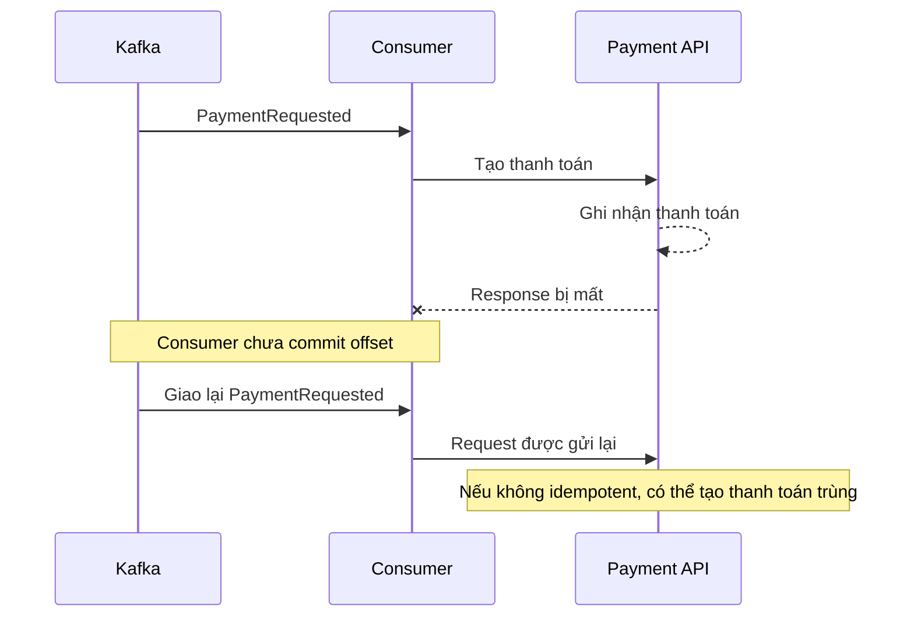
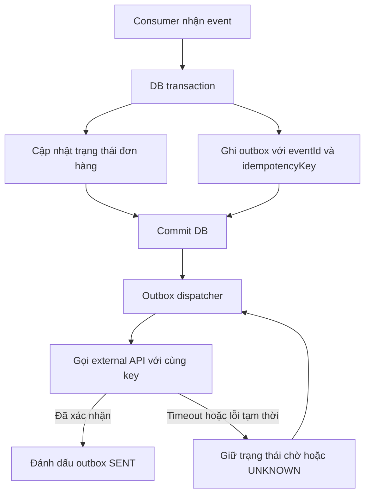

# Idempotency khi gọi hệ thống bên ngoài

Một consumer Kafka có thể xử lý event trong Kafka transaction rồi gọi HTTP API, gửi lệnh thanh toán hoặc ghi dữ liệu vào một hệ thống khác. Kafka transaction có thể bảo đảm các record Kafka được publish và offset consumer cùng commit hoặc cùng rollback. Transaction đó không bao trùm một request HTTP hay transaction của cơ sở dữ liệu bên ngoài.

Vì vậy, nếu consumer gọi dịch vụ bên ngoài thành công nhưng bị dừng trước khi commit offset, Kafka có thể giao lại event và consumer gọi dịch vụ lần nữa. Idempotency giúp lần gọi lặp lại không tạo thêm tác dụng phụ, chẳng hạn không thu tiền hai lần hoặc tạo hai yêu cầu giao hàng.

## 1. Vì sao exactly-once của Kafka chưa đủ?

Kafka exactly-once semantics (EOS) tập trung vào luồng đọc và ghi trong Kafka: consumer đọc record, xử lý, publish output và commit offset trong một Kafka transaction. Consumer dùng `isolation.level=read_committed` chỉ đọc các record thuộc transaction đã commit.

Một request HTTP nằm ngoài transaction Kafka. Hãy xét tình huống:

1. Consumer nhận event `PaymentRequested`.
2. Consumer gọi payment API; nhà cung cấp đã tạo khoản thanh toán.
3. Response bị mất trên mạng hoặc process dừng trước khi commit offset.
4. Consumer khởi động lại và nhận lại cùng event.
5. Nếu gọi API như một yêu cầu mới, khách hàng có thể bị tạo thanh toán lần thứ hai.



Không thể dùng Kafka transaction để rollback khoản thanh toán đã được hệ thống bên ngoài ghi nhận. Ranh giới này cần một giao thức idempotency hoặc quy trình đối soát riêng.

## 2. Dùng idempotency key ổn định

Idempotency key là mã định danh một thao tác nghiệp vụ. Client gửi cùng key cho mọi lần thử lại của cùng thao tác. Dịch vụ nhận request dùng key để nhận ra request lặp và trả lại kết quả đã lưu thay vì thực hiện side effect lần nữa.

Ví dụ, với event thanh toán, có thể tạo key từ event ID và loại thao tác:

```java
public Mono<PaymentResult> authorize(
        PaymentCommand command, String idempotencyKey) {
    return webClient.post()
        .uri("/payments/authorizations")
        .header("Idempotency-Key", idempotencyKey)
        .bodyValue(command)
        .retrieve()
        .bodyToMono(PaymentResult.class);
}

String key = event.eventId() + ":authorize-payment";
return paymentClient.authorize(command, key);
```

Trong ví dụ, mọi lần retry của cùng event đều phải tạo ra cùng `idempotencyKey`. Không tạo UUID mới bên trong mỗi lần gọi hoặc mỗi lần retry, vì như vậy nhà cung cấp sẽ xem mỗi request là một thao tác mới.

Key cần đại diện đúng phạm vi thao tác. Một event có thể kích hoạt nhiều hành động độc lập, ví dụ authorize và capture; mỗi hành động cần key riêng. Nếu hệ thống có nhiều tenant hoặc merchant, nhà cung cấp có thể yêu cầu key được scope theo tài khoản hoặc endpoint.

Ưu tiên event ID ổn định do producer tạo và giữ nguyên qua retry, replay và các lần chuyển topic. Không nên chỉ dùng Kafka offset làm business idempotency key: cùng một event được publish lại có thể có offset khác, dù đó vẫn là cùng thao tác nghiệp vụ.

## 3. Dịch vụ nhận request phải lưu key và side effect cùng nhau

Idempotency chỉ đáng tin cậy khi dịch vụ nhận request lưu dấu key một cách bền vững. Nếu dịch vụ chỉ kiểm tra key trong cache rồi thực hiện nghiệp vụ, hai request đồng thời có thể cùng vượt qua bước kiểm tra và tạo side effect trùng.

Một bảng idempotency có thể lưu phạm vi, key, hash của request, trạng thái và response đã tạo:

```sql
CREATE TABLE idempotency_record (
    scope         VARCHAR(120) NOT NULL,
    idempotency_key VARCHAR(200) NOT NULL,
    request_hash  VARCHAR(128) NOT NULL,
    status        VARCHAR(20) NOT NULL,
    response_body TEXT,
    created_at    TIMESTAMP NOT NULL,
    updated_at    TIMESTAMP NOT NULL,
    PRIMARY KEY (scope, idempotency_key)
);
```

Dịch vụ nhận request nên xử lý theo một transaction cơ sở dữ liệu:

1. Tạo bản ghi idempotency bằng unique key `(scope, idempotency_key)`.
2. Nếu key đã tồn tại, so sánh `request_hash`; nếu nội dung khác, trả lỗi xung đột thay vì tái sử dụng key cho lệnh khác.
3. Nếu key đã hoàn tất, trả lại response đã lưu.
4. Nếu key mới, thực hiện thay đổi nghiệp vụ trong cùng transaction.
5. Lưu response và trạng thái hoàn tất rồi commit transaction.

Unique constraint là lớp bảo vệ trước race condition khi nhiều request cùng key đến đồng thời. Khi insert bị xung đột, dịch vụ đọc bản ghi hiện có và trả kết quả đã lưu sau khi transaction ban đầu hoàn tất. Cách xử lý cụ thể cần phù hợp với database và isolation level đang dùng.

Điểm cốt lõi là bản ghi idempotency và side effect trong cùng cơ sở dữ liệu phải commit cùng nhau. Nếu một thao tác thành công nhưng dấu idempotency không được lưu, lần retry sau vẫn có thể thực hiện thao tác lần nữa.

## 4. Kiểm tra request hash và xử lý trạng thái đang chạy

Một key không được đại diện cho hai nội dung khác nhau. Ví dụ cùng key `evt-123:authorize-payment` nhưng lần đầu gửi 100.000 VND, lần sau gửi 500.000 VND. Dịch vụ phải phát hiện payload khác thông qua hash chuẩn hóa của các trường nghiệp vụ và trả lỗi conflict; không trả response cũ cho một lệnh có ý nghĩa khác.

Nếu API xử lý bất đồng bộ hoặc thao tác kéo dài, bản ghi có thể có trạng thái `PENDING`, `SUCCEEDED` hoặc `FAILED`. Request lặp khi trạng thái `PENDING` có thể nhận response đang xử lý hoặc mã tra cứu trạng thái. Request lặp khi `SUCCEEDED` nhận lại kết quả đã lưu. Chính sách với `FAILED` cần phân biệt lỗi có thể thử lại và lỗi kết thúc.

Không xóa key quá sớm. Thời gian lưu phải dài hơn cửa sổ retry, thời gian Kafka retention có thể replay event, và thời hạn mà client có thể gửi lại request. Nếu key hết hạn trong khi event cũ vẫn có thể được phát lại, thao tác trùng có thể xảy ra trở lại.

## 5. Điều gì xảy ra khi timeout và không biết request đã thành công chưa?

Timeout không chứng minh request thất bại. Server có thể đã commit thao tác nhưng response bị mất. Đây là trạng thái kết quả không xác định (ambiguous outcome). Consumer không nên tạo key mới để thử lại.

Quy trình phù hợp là:

- Ghi lại key và trạng thái thao tác trước khi gọi dịch vụ.
- Khi timeout, giữ nguyên key và thử lại theo chính sách của nhà cung cấp, hoặc truy vấn trạng thái bằng key/business reference.
- Nếu nhà cung cấp trả kết quả đã có, cập nhật trạng thái local bằng kết quả đó.
- Nếu chưa thể xác định, đánh dấu thao tác `UNKNOWN` và đưa vào quy trình reconciliation thay vì tự tạo một thao tác mới.

Nếu API hỗ trợ truy vấn bằng merchant reference hoặc idempotency key, dùng nó để đối soát. Nếu API không hỗ trợ, cần một business reference có tính duy nhất và quy trình kiểm tra thủ công/tự động trước khi retry thao tác có rủi ro.

## 6. Khi hệ thống bên ngoài không hỗ trợ idempotency key

Nếu dịch vụ nhận không hỗ trợ idempotency key, client không thể tự bảo đảm exactly-once cho một side effect không idempotent qua mạng. Có thể chọn một trong các hướng sau:

- Dùng API có thao tác idempotent theo hợp đồng, ví dụ `PUT` đặt một resource về trạng thái xác định hoặc API tra cứu theo business reference.
- Gửi một mã tham chiếu nghiệp vụ duy nhất mà nhà cung cấp có thể dùng để phát hiện lệnh trùng.
- Lưu lệnh vào outbox, retry có kiểm soát và đối soát kết quả trước khi gửi lại một thao tác có kết quả không xác định.
- Yêu cầu nhà cung cấp bổ sung idempotency hoặc cơ chế tra cứu trạng thái nếu side effect có giá trị cao.

HTTP method tự nó không đủ để kết luận nghiệp vụ idempotent. `PUT` được định nghĩa idempotent về hiệu ứng dự kiến của request, nhưng endpoint cụ thể vẫn phải thực hiện đúng hợp đồng. Một `POST` có thể idempotent nếu server hỗ trợ key; nếu không, gửi lại thường có thể tạo resource mới.

## 7. Kết hợp outbox và idempotency

Giả sử consumer nhận `OrderConfirmed`, cần lưu một lệnh gọi dịch vụ vận chuyển. Nếu ghi trạng thái đơn hàng vào database rồi gọi HTTP ngay, process có thể dừng giữa hai bước. Transactional outbox giúp lưu ý định gọi dịch vụ cùng thay đổi dữ liệu trong một transaction database.



Outbox bảo đảm lệnh gọi không bị mất giữa commit database và gửi request. Dispatcher có thể gửi lặp nếu process dừng sau khi nhà cung cấp xử lý nhưng trước khi outbox được đánh dấu `SENT`. Vì vậy, outbox phải đi cùng idempotency ở phía nhận hoặc quy trình reconciliation; riêng outbox không làm HTTP side effect trở thành exactly-once.

Nếu consumer nhận event Kafka và ghi dữ liệu vào database, có thể dùng inbox/dedup table để lưu event ID cùng thay đổi nghiệp vụ trong một transaction database. Khi Kafka giao lại event, inbox nhận ra event đã xử lý và consumer có thể xác nhận offset an toàn sau commit DB. Khi vừa cần cập nhật DB vừa phát event Kafka, kết hợp inbox và outbox để quản lý hai chiều.

## 8. Retry, circuit breaker và compensation

Idempotency cho phép retry cùng một thao tác an toàn trong giới hạn hợp đồng của API. Backoff giảm áp lực khi dịch vụ đang lỗi; circuit breaker ngăn gọi liên tục khi dependency mất khả năng phục vụ. Các cơ chế này giải quyết những vấn đề khác nhau và thường được kết hợp.

Compensation trong Saga cũng khác idempotency. Nếu bước đặt hàng đã thành công nhưng bước thanh toán thất bại, một lệnh compensation có thể hủy giữ hàng. Compensation là hành động nghiệp vụ đảo ngược hoặc bù trừ; nó không ngăn một request bị thực hiện hai lần. Lệnh compensation cũng cần idempotency key riêng.

## 9. Ví dụ luồng xử lý consumer an toàn

```java
public void handle(PaymentRequested event) {
    String key = event.eventId() + ":authorize-payment";

    paymentAttemptRepository.ensurePending(
        key, event.orderId(), event.amount(), event.currency());

    try {
        PaymentResult result = paymentClient.authorize(
            event.orderId(), event.amount(), event.currency(), key);
        paymentAttemptRepository.markSucceeded(key, result.reference());
    } catch (TimeoutException ex) {
        // Phải lưu trạng thái UNKNOWN bằng transaction bền vững độc lập
        // với transaction Kafka sẽ rollback khi exception được ném ra.
        paymentAttemptRepository.markUnknown(key);
        throw ex; // Kafka retry sẽ dùng lại cùng event ID và cùng key.
    }
}
```

Đây là phác thảo luồng điều phối. `ensurePending` và các cập nhật trạng thái phải có unique constraint/transaction phù hợp; khi retry, code phải đọc trạng thái hiện có và không tạo key khác. Với trạng thái `UNKNOWN`, implementation nên tra cứu nhà cung cấp trước hoặc gửi cùng key nếu hợp đồng API bảo đảm việc gửi lại an toàn.

Không nên giữ một transaction database mở trong suốt thời gian chờ HTTP dài. Lưu trạng thái thao tác trước, gọi dependency ngoài transaction ngắn đó, rồi cập nhật kết quả bằng một transaction khác. Outbox dispatcher là lựa chọn phù hợp khi cần bảo đảm lệnh gọi được lưu bền vững và thực hiện bất đồng bộ.

## 10. Kiểm thử idempotency và vận hành

Một kiểm thử quan trọng là gửi cùng một event nhiều lần và xác minh hệ thống bên ngoài chỉ tạo một side effect. Kiểm thử thêm hai request đồng thời có cùng key, cùng key nhưng payload khác, timeout sau khi server đã commit, response bị mất, process restart trước khi cập nhật trạng thái local và replay event sau thời gian dài.

Theo dõi số request bị deduplicate, conflict do cùng key khác payload, thao tác ở trạng thái `UNKNOWN`, tuổi outbox chưa gửi, số lần retry và thời gian reconciliation. Log idempotency key hoặc một dạng rút gọn an toàn cùng event ID để truy vết; không ghi thông tin thẻ, token hoặc dữ liệu nhạy cảm vào log.

Idempotency là ranh giới bảo vệ side effect bên ngoài khi Kafka giao lại event. Hãy dùng key ổn định cho cùng một thao tác, yêu cầu dịch vụ nhận lưu key và kết quả một cách nguyên tử, xử lý timeout như kết quả chưa xác định, và kết hợp outbox/inbox cùng reconciliation khi cần. Khi hệ thống ngoài không cung cấp cơ chế nhận diện request lặp, không thể tuyên bố side effect đó được bảo đảm exactly-once chỉ nhờ Kafka transaction.
