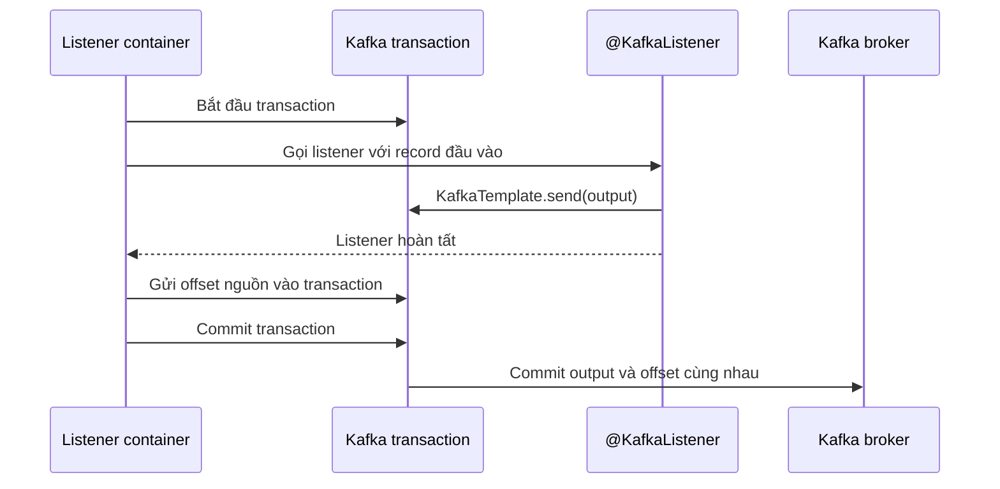
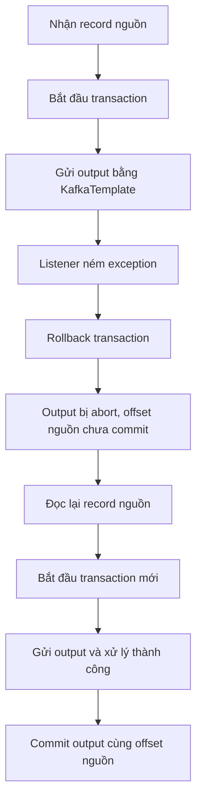

# Kiểm chứng exactly-once bằng thử nghiệm lỗi

Exactly-once semantics (EOS) trong Spring Kafka cần được kiểm chứng bằng cách chủ động làm listener thất bại tại những thời điểm khác nhau của một Kafka transaction. Một lần xử lý thành công bình thường chưa chứng minh được EOS: lỗi có thể xảy ra sau khi ứng dụng đã gửi output nhưng trước khi offset nguồn được commit. Khi đó, hệ thống phải bảo đảm output và offset cùng commit hoặc cùng rollback.

Với luồng `read → process → write` giữa các Kafka topic, Spring Kafka dùng Kafka transaction để đưa output do `KafkaTemplate` gửi và offset nguồn vào cùng một transaction. Listener có thể được gọi nhiều lần, nhưng consumer dùng `read_committed` chỉ nhìn thấy output thuộc transaction đã commit. Vì vậy, điều cần chứng minh là **hiệu ứng Kafka đã commit chỉ xuất hiện một lần**, không phải phương thức listener chỉ được gọi đúng một lần.

## 1. Exactly-once bảo đảm điều gì?

Khi listener container được cấu hình với `KafkaAwareTransactionManager`, container bắt đầu transaction trước khi gọi listener. Các lệnh gửi bằng `KafkaTemplate` dùng cùng `ProducerFactory` tham gia transaction đang hoạt động. Khi listener kết thúc thành công, container thêm offset nguồn bằng `sendOffsetsToTransaction()` rồi commit transaction. Nếu listener ném exception, transaction rollback và consumer được đưa về vị trí để đọc lại record.



Nếu listener thất bại sau khi gửi output:



Spring Kafka mô tả EOS cho chuỗi read-process-write trong Kafka: read và process có ngữ nghĩa at-least-once, còn output đã commit được bảo đảm exactly-once. Listener có thể chạy lại sau rollback, rebalance hoặc khởi động lại; transaction bảo vệ hiệu ứng Kafka được công bố.

EOS không tự động bao phủ một lệnh ghi database, gọi REST hoặc gửi email. Nếu listener thực hiện side effect bên ngoài Kafka, hệ thống đích cần tham gia một cơ chế phối hợp phù hợp hoặc xử lý idempotent bằng event ID/business key. Một Kafka transaction không thể tự rollback một lời gọi HTTP đã hoàn tất.

## 2. Điều kiện cấu hình trước khi thử nghiệm

**Bật transactional producer.** Spring Kafka cần `DefaultKafkaProducerFactory` có `transactionIdPrefix`. Với Spring Boot, cấu hình `spring.kafka.producer.transaction-id-prefix` sẽ khiến Boot tự cấu hình `KafkaTransactionManager` và gắn vào listener container.

```yaml
spring:
  kafka:
    producer:
      transaction-id-prefix: order-service-${INSTANCE_ID}-
    consumer:
      properties:
        isolation.level: read_committed
```

`INSTANCE_ID` phải tạo ra prefix khác nhau giữa các instance đang chạy đồng thời. Khi tự cấu hình Spring Kafka, `KafkaTemplate` và `KafkaTransactionManager` phải dùng cùng một transaction-capable `ProducerFactory`.

**Dùng consumer `read_committed` để kiểm tra output.** Kafka mặc định dùng `read_uncommitted`, chế độ này vẫn trả về các record thuộc transaction đã abort. `read_committed` chỉ trả về record không transactional và record transactional đã commit; record bị abort bị ẩn. Chế độ này cũng chỉ đọc đến Last Stable Offset (LSO), tức vị trí trước transaction đang mở đầu tiên. Vì vậy, consumer kiểm thử có thể phải đợi transaction kết thúc trước khi nhìn thấy dữ liệu tiếp theo.

**Dùng phiên bản broker tương thích.** Spring Kafka 3.0 trở lên chỉ hỗ trợ EOS V2; chế độ này yêu cầu Kafka broker từ 2.5 trở lên. Không cần tạo producer riêng cho từng `group.id/topic/partition` như cơ chế EOS cũ.

**Để container quản lý offset.** Với container transaction, container gửi offset vào Kafka transaction. Không tự commit offset độc lập trước khi transaction xử lý hoàn tất, vì điều đó phá vỡ tính nguyên tử giữa output và vị trí đọc nguồn.

## 3. Thiết kế bài thử lỗi có thể lặp lại

Một thử nghiệm cơ bản cần hai topic:

- `orders`: topic đầu vào chứa một đơn hàng.
- `order-events`: topic đầu ra chứa sự kiện được tạo bởi listener.

Listener gửi output trước, sau đó cố ý ném exception đúng một lần. Lần gọi tiếp theo xử lý thành công:

```java
@Component
class FaultInjectingOrderListener {

    private final KafkaTemplate<String, String> kafkaTemplate;
    private final AtomicBoolean failFirstAttempt = new AtomicBoolean(true);

    FaultInjectingOrderListener(KafkaTemplate<String, String> kafkaTemplate) {
        this.kafkaTemplate = kafkaTemplate;
    }

    @KafkaListener(topics = "orders", groupId = "order-eos-test")
    void consume(ConsumerRecord<String, String> record) throws Exception {
        kafkaTemplate.send(
                "order-events",
                record.key(),
                "processed:" + record.value()
        ).get(10, TimeUnit.SECONDS);

        if (this.failFirstAttempt.compareAndSet(true, false)) {
            throw new IllegalStateException("Injected failure after output send");
        }
    }
}
```

Trong lần đầu, `send()` đã được broker xác nhận nhưng listener ném exception trước khi container commit. Vì lệnh gửi tham gia transaction container, output đầu tiên bị abort cùng transaction. `AfterRollbackProcessor` đưa record nguồn trở lại để listener thử lại. Lần thứ hai gửi output mới và trả về bình thường; container commit output cùng offset nguồn.

Điểm kiểm soát lỗi phải nằm **bên trong transaction**, sau khi gửi output và trước khi listener trả về. Nếu ném exception trước lệnh `send()`, thử nghiệm chưa kiểm tra được trường hợp nguy hiểm nhất là output đã được gửi nhưng transaction chưa commit.

## 4. Tạo broker kiểm thử với Embedded Kafka

Thêm dependency kiểm thử `spring-kafka-test` hoặc `spring-boot-starter-kafka-test` nếu dùng Spring Boot. `@EmbeddedKafka` tạo broker cục bộ; `KafkaTestUtils` hỗ trợ tạo consumer và đọc record.

Ví dụ khai báo test:

```java
@SpringBootTest(properties = {
        "spring.kafka.producer.transaction-id-prefix=eos-test-${random.uuid}-",
        "spring.kafka.consumer.auto-offset-reset=earliest"
})
@EmbeddedKafka(
        partitions = 1,
        topics = {"orders", "order-events"},
        brokerProperties = {
                "offsets.topic.replication.factor=1",
                "transaction.state.log.replication.factor=1",
                "transaction.state.log.min.isr=1"
        }
)
class ExactlyOnceFailureTest {
    // Inject KafkaTemplate, EmbeddedKafkaBroker và listener ở đây.
}
```

Các replication factor bằng `1` phù hợp với broker đơn trong bài test. Trong môi trường thực, cần cấu hình replication factor và `min.insync.replicas` theo yêu cầu độ sẵn sàng của cluster. Dùng topic riêng cho mỗi test hoặc bảo đảm consumer seek đúng vị trí để tránh dữ liệu từ test trước làm sai kết quả.

Gửi record nguồn trong một transaction kiểm thử độc lập:

```java
kafkaTemplate.executeInTransaction(operations -> {
    operations.send("orders", "order-42", "created")
            .get(10, TimeUnit.SECONDS);
    return null;
});
```

Vì producer factory đang bật transaction, `executeInTransaction()` tạo transaction cục bộ cho record nguồn. Transaction này commit trước khi listener nhận record. `KafkaTemplate` được listener dùng sau đó sẽ tham gia transaction do listener container bắt đầu.

## 5. Kiểm tra output với read_committed và read_uncommitted

Tạo hai consumer kiểm thử với hai `group.id` riêng, cùng đọc topic `order-events` từ đầu. Consumer thứ nhất dùng `read_committed`; consumer thứ hai dùng `read_uncommitted`:

```java
private Consumer<String, String> outputConsumer(
        EmbeddedKafkaBroker broker,
        String groupId,
        String isolationLevel) {

    Map<String, Object> properties =
            KafkaTestUtils.consumerProps(groupId, "false", broker);
    properties.put(ConsumerConfig.ISOLATION_LEVEL_CONFIG, isolationLevel);
    properties.put(ConsumerConfig.KEY_DESERIALIZER_CLASS_CONFIG, StringDeserializer.class);
    properties.put(ConsumerConfig.VALUE_DESERIALIZER_CLASS_CONFIG, StringDeserializer.class);

    return new DefaultKafkaConsumerFactory<String, String>(properties).createConsumer();
}
```

Sau khi chờ listener đã được gọi lại và transaction thành công, đọc output:

```java
try (Consumer<String, String> committed =
             outputConsumer(broker, "verify-committed", "read_committed")) {

    broker.consumeFromAnEmbeddedTopic(committed, "order-events");
    ConsumerRecord<String, String> record =
            KafkaTestUtils.getSingleRecord(committed, "order-events");

    assertThat(record.key()).isEqualTo("order-42");
    assertThat(record.value()).isEqualTo("processed:created");
    assertThat(KafkaTestUtils.getRecords(committed).count()).isZero();
}
```

`getSingleRecord()` đòi hỏi đúng một record trong lần đọc. Lần poll tiếp theo xác nhận không có output committed thứ hai. Đây là assertion chính: dù listener đã chạy lại, consumer ứng dụng chỉ nhìn thấy một output đã commit.

Để quan sát record thuộc transaction bị abort, đọc cùng topic bằng `read_uncommitted`:

```java
try (Consumer<String, String> uncommitted =
             outputConsumer(broker, "verify-uncommitted", "read_uncommitted")) {

    broker.consumeFromAnEmbeddedTopic(uncommitted, "order-events");
    ConsumerRecords<String, String> records = KafkaTestUtils.getRecords(uncommitted);

    assertThat(records.count()).isEqualTo(2);
}
```

Trong thử nghiệm này, hai record vật lý đã được gửi: một record thuộc transaction abort và một record thuộc transaction commit. `read_uncommitted` nhìn thấy cả hai; `read_committed` chỉ nhìn thấy record của transaction commit. Điều đó chứng minh transaction đầu đã bị abort và output của nó không được công bố cho consumer tuân thủ isolation.

## 6. Kiểm tra offset nguồn đã commit cùng output

Chỉ kiểm tra topic đầu ra là chưa đủ. Cần kiểm tra consumer group của listener đã commit offset nguồn sau khi transaction thành công. Với một record ở partition `orders-0`, offset kế tiếp phải là `1`:

```java
try (AdminClient admin = AdminClient.create(Map.of(
        AdminClientConfig.BOOTSTRAP_SERVERS_CONFIG,
        broker.getBrokersAsString()))) {

    Map<TopicPartition, OffsetAndMetadata> offsets = admin
            .listConsumerGroupOffsets("order-eos-test")
            .partitionsToOffsetAndMetadata()
            .get(10, TimeUnit.SECONDS);

    assertThat(offsets.get(new TopicPartition("orders", 0)).offset())
            .isEqualTo(1L);
}
```

Trong bài test hoàn chỉnh, nên chờ có điều kiện đến khi listener đã chạy ít nhất hai lần và offset group đã xuất hiện trước khi assert. Không dùng `Thread.sleep()` cố định làm bằng chứng hoàn tất transaction; dùng Awaitility hoặc vòng poll có timeout để chờ trạng thái mong muốn.

Ba quan sát cần khớp nhau:

| Quan sát | Kết quả mong đợi | Ý nghĩa |
|---|---|---|
| Số lần listener được gọi | 2 | Lần đầu thất bại, lần sau thành công; xử lý có thể được lặp |
| Output với `read_committed` | 1 record | Chỉ output của transaction commit được công bố |
| Output với `read_uncommitted` | 2 record | Có một output thuộc transaction abort và một output thuộc transaction commit |
| Offset group của `orders-0` | `1` | Offset nguồn được commit sau lần xử lý thành công |

## 7. Ma trận thử nghiệm lỗi nên có

Một bài kiểm chứng tốt nên bao phủ nhiều điểm lỗi khác nhau. Không phải trường hợp nào cũng cần viết cùng một test; mỗi kịch bản nên có cách tiêm lỗi xác định và assertion riêng.

| Điểm tiêm lỗi | Trạng thái mong đợi | Điều cần xác nhận |
|---|---|---|
| Trước `KafkaTemplate.send()` | Transaction abort, chưa có output, offset chưa commit | Record nguồn được giao lại và xử lý thành công sau đó |
| Sau khi `send()` được xác nhận, trước khi listener trả về | Output đầu tiên bị abort cùng offset; lần retry tạo transaction mới | `read_committed` thấy đúng một output; group offset tiến lên sau commit |
| Listener trả về nhưng transaction chưa hoàn tất | Broker quyết định transaction commit hoặc abort; không có trạng thái nửa output/nửa offset | Sau khi khôi phục, output và offset phải cùng phản ánh một kết quả |
| Ứng dụng dừng khi transaction còn mở | Transaction chưa hoàn tất không được xem là committed; producer được khôi phục/fence theo transactional ID | Sau khi khởi động lại và transaction được giải quyết, không có output committed thiếu offset hoặc offset thiếu output |
| Ứng dụng dừng sau commit | Output và offset đã được commit | Khi consumer group khởi động lại, record nguồn không tạo thêm output committed |

Thử nghiệm exception sau `send()` thường là bước đầu tốt nhất vì nó tái hiện trực tiếp lỗi xảy ra giữa publish và commit. Thử nghiệm dừng tiến trình khi transaction mở hoặc ngay quanh commit cần điều khiển tiến trình và broker ở cấp integration/system test; một exception Java đơn thuần không mô phỏng đầy đủ lỗi mạng hoặc mất phản hồi commit.

## 8. Các tình huống làm bài test kết luận sai

**Chỉ đếm số lần listener chạy.** EOS không bảo đảm listener được gọi một lần. Trong ví dụ, listener chạy hai lần là kết quả mong đợi; lần đầu thuộc transaction abort.

**Dùng consumer `read_uncommitted` để kết luận output bị trùng.** Consumer này cố ý nhìn thấy record thuộc transaction đã abort. Khi kiểm chứng hiệu ứng đã công bố, phải dùng `read_committed`.

**Chỉ assert output mà không kiểm tra offset.** Một output đơn lẻ không chứng minh offset nguồn đã được commit cùng transaction. Hãy đọc group offset bằng AdminClient hoặc API kiểm thử tương đương.

**Đọc quá sớm khi transaction chưa kết thúc.** Consumer `read_committed` chỉ đọc đến LSO. Một transaction đang mở có thể tạm thời giữ các record phía sau chưa được trả về. Hãy chờ transaction commit/abort trước khi kết luận không có record.

**Tạo transaction ID prefix trùng giữa các instance.** Mỗi instance ứng dụng chạy đồng thời cần prefix riêng. Trùng transactional ID có thể gây fencing producer và khiến test hoặc ứng dụng thất bại không ổn định.

**Dùng broker đơn để suy luận về failover của cluster.** Embedded Kafka phù hợp kiểm tra luồng transaction cơ bản. Nó không chứng minh hành vi replication, mất leader hoặc lỗi đồng thời của nhiều broker. Các tình huống này cần Testcontainers hoặc cluster Kafka nhiều broker và kịch bản fault injection tương ứng.

**Đưa database vào assertion như thể Kafka transaction bảo vệ database.** Nếu listener cập nhật database rồi Kafka transaction abort, database update không tự rollback trừ khi có transaction manager/phối hợp riêng. Kiểm thử external side effect cần idempotency, outbox/inbox hoặc cơ chế phối hợp được thiết kế rõ ràng.

## 9. Checklist trước khi chấp nhận EOS

- Producer factory có `transactionIdPrefix`; prefix khác nhau giữa các instance đồng thời.
- Broker đáp ứng yêu cầu phiên bản cho EOS V2 (Kafka 2.5 trở lên với Spring Kafka 3.x+).
- `KafkaTemplate` trong listener dùng cùng transaction-capable `ProducerFactory` với `KafkaTransactionManager`.
- Listener container thực sự được cấu hình transaction manager.
- Consumer đọc output transactional dùng `isolation.level=read_committed`.
- Thử nghiệm tiêm lỗi sau khi gửi output nhưng trước khi listener trả về.
- Assertion kiểm tra cả số output committed lẫn offset group nguồn.
- Có thử nghiệm khởi động lại quanh thời điểm transaction mở/commit nếu yêu cầu vận hành đòi hỏi.
- Side effect ngoài Kafka có idempotency hoặc cơ chế phối hợp độc lập.

## 10. Ghi nhớ

- EOS cho read-process-write trong Kafka là tính nguyên tử giữa output Kafka và offset nguồn.
- Listener vẫn có thể được gọi nhiều lần; điều được bảo đảm là output của transaction abort không xuất hiện với consumer `read_committed`.
- Kiểm thử quan trọng nhất là tiêm lỗi sau `KafkaTemplate.send()` nhưng trước khi listener hoàn tất.
- Dùng `read_committed` để đếm output đã công bố; dùng `read_uncommitted` để quan sát cả output của transaction abort khi cần chẩn đoán.
- Kiểm tra committed offset của consumer group để xác nhận offset và output cùng hoàn tất.
- Embedded Kafka kiểm tra luồng transaction cơ bản; thử nghiệm broker failover cần cluster nhiều broker.
- Kafka EOS không tự mở rộng sang database hoặc dịch vụ ngoài Kafka.

## Tài liệu tham khảo

- [Spring for Apache Kafka — Exactly Once Semantics](https://docs.spring.io/spring-kafka/reference/kafka/exactly-once.html)
- [Spring for Apache Kafka — Transactions](https://docs.spring.io/spring-kafka/reference/kafka/transactions.html)
- [Spring for Apache Kafka — Testing Applications](https://docs.spring.io/spring-kafka/reference/testing.html)
- [Apache Kafka — Consumer Configuration: isolation.level](https://kafka.apache.org/documentation/#consumerconfigs_isolation.level)
- [Apache Kafka — Design: Message Delivery Semantics](https://kafka.apache.org/documentation/#semantics)
