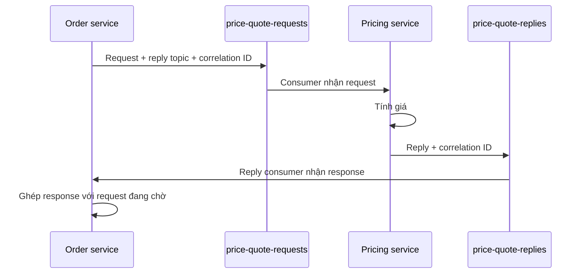

# Mô hình request-reply trên Kafka

Kafka được thiết kế chủ yếu cho trao đổi event bất đồng bộ, nhưng ứng dụng vẫn có thể xây dựng mô hình request-reply bằng cách kết hợp request topic, reply topic và correlation ID. Client gửi một request vào Kafka rồi chờ một reply có correlation ID tương ứng. Service xử lý request đọc record, thực hiện nghiệp vụ và publish response về reply destination mà client cung cấp.

Spring Kafka hỗ trợ mẫu này qua `ReplyingKafkaTemplate` ở phía client và `@KafkaListener` kết hợp `@SendTo` ở phía server. Client có thể chờ response bằng timeout hoặc tiếp tục xử lý bất đồng bộ qua future.

Request-reply trên Kafka là một quy ước ở tầng ứng dụng, không phải RPC đồng bộ do broker cung cấp. Request và reply đều là Kafka record; chúng có thể bị trễ, được giao lại hoặc đến sau timeout. Vì vậy, cần thiết kế correlation, timeout, idempotency và reply topic cẩn thận.

## 1. Request-reply là gì?

Trong mô hình request-reply, một phía gửi yêu cầu và mong nhận một response liên quan trực tiếp đến yêu cầu đó.

Ví dụ service Order cần hỏi Pricing service giá hiện tại của một SKU. Order service gửi `PriceQuoteRequest`; Pricing service đọc request, tính giá và trả `PriceQuoteReply`.



Luồng cơ bản gồm:

1. Client tạo request và gửi vào request topic.
2. Client đính kèm reply topic (và có thể reply partition) cùng correlation ID.
3. Server consume request, xử lý và tạo response.
4. Server publish response về reply destination trong request metadata.
5. Client consume reply và dùng correlation ID để tìm future đang chờ.
6. Nếu reply đến trước timeout, client nhận response; nếu hết thời gian, client xử lý timeout.

Kafka chỉ lưu và chuyển record. Việc ghép request với reply là trách nhiệm của ứng dụng và thư viện request-reply.

## 2. Khi nào nên dùng request-reply trên Kafka?

Request-reply phù hợp khi một service cần kết quả từ service khác nhưng vẫn muốn giao tiếp qua Kafka, tận dụng Kafka ACL, durability, consumer group và hạ tầng messaging hiện có.

Ví dụ phù hợp:

- Tra cứu thông tin hoặc tính toán có thời gian phản hồi tương đối ngắn.
- Yêu cầu một service xác nhận một quyết định nghiệp vụ.
- Tích hợp với hệ thống chỉ giao tiếp qua Kafka nhưng client cần kết quả tương ứng.

Không nên dùng request-reply như lựa chọn mặc định cho mọi giao tiếp:

- Nếu client không cần response ngay, publish event/command bất đồng bộ thường đơn giản hơn.
- Nếu thao tác kéo dài nhiều phút hoặc nhiều giờ, nên dùng workflow/status event thay vì giữ request chờ.
- Nếu cần latency thấp và giao tiếp trực tiếp giữa hai service, HTTP/gRPC có thể phù hợp hơn.
- Nếu cần broadcast một sự kiện cho nhiều service, event topic với nhiều consumer group phù hợp hơn request-reply.

Request-reply vẫn có độ trễ của Kafka, consumer scheduling, partition assignment và xử lý server. Không nên giả định nó có latency hoặc timeout behavior giống một lời gọi hàm nội bộ.

## 3. Ba thành phần quan trọng: request topic, reply topic và correlation ID

| Thành phần | Mục đích |
| --- | --- |
| Request topic | Nhận các yêu cầu từ client |
| Reply topic | Nhận response từ server |
| Correlation ID | Liên kết response với request đang chờ |

Client thường gửi thêm reply metadata trong Kafka headers:

- `KafkaHeaders.REPLY_TOPIC`: tên topic client muốn nhận response.
- `KafkaHeaders.REPLY_PARTITION`: partition đích của reply nếu dùng reply topic có định tuyến partition cụ thể.
- `KafkaHeaders.CORRELATION_ID`: định danh để ghép reply với request tương ứng.

`ReplyingKafkaTemplate` tự tạo correlation ID nếu request chưa có và quản lý bảng các request đang chờ. Nó cũng gắn reply topic/partition theo cấu hình reply container. Server cần giữ correlation ID khi gửi response; `@SendTo` của Spring Kafka thực hiện việc này trong luồng reply chuẩn.

Không nên nhầm correlation ID của Kafka với request ID nghiệp vụ. Correlation ID phục vụ ghép cặp request/reply trong lần gọi cụ thể; request ID có thể là khóa ổn định để deduplicate nghiệp vụ khi client gửi lại cùng một yêu cầu.

## 4. Thiết kế request và reply DTO

Ví dụ Pricing service nhận yêu cầu báo giá:

```java
package com.example.pricing.contract;

public record PriceQuoteRequest(
        String requestId,
        String sku,
        int quantity,
        String currency
) {}
```

Response nên thể hiện cả kết quả thành công và lỗi nghiệp vụ:

```java
package com.example.pricing.contract;

import java.math.BigDecimal;

public record PriceQuoteReply(
        String requestId,
        boolean success,
        BigDecimal total,
        String errorCode,
        String message
) {}
```

`requestId` là ID nghiệp vụ do client tạo. Khi client retry cùng một command vì timeout, nó có thể giữ nguyên request ID để server nhận biết đó là cùng yêu cầu. Correlation ID của Kafka vẫn được `ReplyingKafkaTemplate` quản lý riêng cho từng lần gửi/chờ response.

DTO request/reply nên là hợp đồng dữ liệu ổn định giữa các service. Tránh truyền trực tiếp entity JPA hoặc class nội bộ có nhiều dependency. Dùng schema version hoặc event envelope nếu nhiều service cần tiến hóa hợp đồng độc lập.

## 5. ReplyingKafkaTemplate ở phía client

`ReplyingKafkaTemplate<K,V,R>` mở rộng khả năng của `KafkaTemplate`: nó gửi request và chờ response có correlation ID khớp. Nó cần hai thành phần:

- `ProducerFactory<K,V>` để gửi request.
- `GenericMessageListenerContainer<K,R>` để consume reply topic.

Reply container phải subscribe đúng reply topic và có consumer factory deserialize response thành kiểu `R`.

### 5.1. Cấu hình reply consumer

Ví dụ cấu hình cho client Order service:

```yaml
spring:
  kafka:
    bootstrap-servers: ${KAFKA_BOOTSTRAP_SERVERS:localhost:9092}
    producer:
      key-serializer: org.apache.kafka.common.serialization.StringSerializer
      value-serializer: org.springframework.kafka.support.serializer.JsonSerializer
    consumer:
      group-id: ${KAFKA_REPLY_GROUP_ID:order-service-replies}
      enable-auto-commit: false
      key-deserializer: org.apache.kafka.common.serialization.StringDeserializer
      value-deserializer: org.springframework.kafka.support.serializer.JsonDeserializer
      properties:
        "[spring.json.trusted.packages]": com.example.pricing.contract
        "[spring.json.value.default.type]": com.example.pricing.contract.PriceQuoteReply

app:
  instance-id: ${HOSTNAME:local}
```

Consumer factory được dùng bởi reply container phải có value deserializer phù hợp với `PriceQuoteReply`. Producer factory của request template phải serialize `PriceQuoteRequest` tương thích với consumer của Pricing service.

### 5.2. Tạo reply container và template

```java
package com.example.order.config;

import java.time.Duration;
import com.example.pricing.contract.PriceQuoteReply;
import com.example.pricing.contract.PriceQuoteRequest;
import org.springframework.beans.factory.annotation.Value;
import org.springframework.context.annotation.Bean;
import org.springframework.context.annotation.Configuration;
import org.springframework.kafka.config.ConcurrentKafkaListenerContainerFactory;
import org.springframework.kafka.core.ProducerFactory;
import org.springframework.kafka.listener.ConcurrentMessageListenerContainer;
import org.springframework.kafka.requestreply.ReplyingKafkaTemplate;

@Configuration
public class KafkaRequestReplyConfiguration {

    @Bean
    public ConcurrentMessageListenerContainer<String, PriceQuoteReply>
            repliesContainer(
                    ConcurrentKafkaListenerContainerFactory<String, PriceQuoteReply>
                            replyContainerFactory,
                    @Value("${app.instance-id:local}") String instanceId
            ) {
        var container = replyContainerFactory.createContainer("price-quote-replies");
        container.getContainerProperties().setGroupId(
                "order-service-replies-" + instanceId
        );
        return container;
    }

    @Bean
    public ReplyingKafkaTemplate<String, PriceQuoteRequest, PriceQuoteReply>
            replyingKafkaTemplate(
                    ProducerFactory<String, PriceQuoteRequest> requestProducerFactory,
                    ConcurrentMessageListenerContainer<String, PriceQuoteReply>
                            repliesContainer
            ) {
        var template = new ReplyingKafkaTemplate<>(
                requestProducerFactory,
                repliesContainer
        );
        template.setDefaultReplyTimeout(Duration.ofSeconds(8));
        return template;
    }
}
```

Trong môi trường nhiều instance dùng chung reply topic, `app.instance-id` phải duy nhất cho từng instance (ví dụ tên pod). Mỗi instance cần group ID riêng để nhận được mọi reply rồi lọc bằng correlation ID. Nếu dùng reply topic riêng cho từng instance, có thể chọn group ID theo chính sách triển khai của topic đó.

`group-id` trong cấu hình consumer là giá trị mặc định của consumer factory; `setGroupId()` trên reply container ghi đè group ID cho container này. Khi triển khai nhiều instance, hãy bảo đảm `HOSTNAME` hoặc `app.instance-id` thực sự duy nhất.

Ở đây reply container subscribe topic `price-quote-replies`; group ID được đặt rõ để quản lý tiến độ đọc reply. `ReplyingKafkaTemplate` dùng container này để nhận response và hoàn tất future tương ứng.

Reply container phải được khởi động và nhận partition assignment trước khi client gửi request. Có thể chờ assignment khi ứng dụng khởi động hoặc trước khi bắt đầu nhận traffic:

```java
if (!replyingKafkaTemplate.waitForAssignment(Duration.ofSeconds(10))) {
    throw new IllegalStateException("Reply container chưa được assign partition");
}
```

Chỉ mở readiness cho chức năng request-reply sau khi reply container sẵn sàng. Nếu gửi request trước khi reply consumer hoạt động, server có thể trả response nhưng client chưa consume được nó.

Các bean factory trong ví dụ cần được cấu hình đúng generic/serializer cho request và reply. Nếu ứng dụng có nhiều kiểu request/reply, có thể tạo factory chuyên biệt hoặc dùng serializer/deserializer hỗ trợ envelope chung.

## 6. Gửi request và chờ reply

Client tạo `ProducerRecord` cho request topic rồi gọi `sendAndReceive()`:

```java
package com.example.order.service;

import java.util.concurrent.TimeUnit;
import com.example.pricing.contract.PriceQuoteReply;
import com.example.pricing.contract.PriceQuoteRequest;
import org.apache.kafka.clients.consumer.ConsumerRecord;
import org.apache.kafka.clients.producer.ProducerRecord;
import org.springframework.kafka.requestreply.ReplyingKafkaTemplate;
import org.springframework.kafka.requestreply.RequestReplyFuture;
import org.springframework.stereotype.Service;

@Service
public class PricingClient {

    private final ReplyingKafkaTemplate<String, PriceQuoteRequest, PriceQuoteReply>
            replyingKafkaTemplate;

    public PricingClient(
            ReplyingKafkaTemplate<String, PriceQuoteRequest, PriceQuoteReply>
                    replyingKafkaTemplate
    ) {
        this.replyingKafkaTemplate = replyingKafkaTemplate;
    }

    public PriceQuoteReply requestQuote(PriceQuoteRequest request) throws Exception {
        ProducerRecord<String, PriceQuoteRequest> record = new ProducerRecord<>(
                "price-quote-requests",
                request.sku(),
                request
        );

        RequestReplyFuture<String, PriceQuoteRequest, PriceQuoteReply> future =
                replyingKafkaTemplate.sendAndReceive(record);

        // Xác nhận request đã được broker acknowledge theo producer config.
        future.getSendFuture().get(5, TimeUnit.SECONDS);

        // Chờ response; template dùng default reply timeout đã cấu hình.
        ConsumerRecord<String, PriceQuoteReply> replyRecord =
                future.get(10, TimeUnit.SECONDS);

        return replyRecord.value();
    }
}
```

`sendAndReceive()` trả về `RequestReplyFuture`. Future có hai phần cần phân biệt:

- `getSendFuture()` hoàn tất khi request send hoàn tất theo producer acknowledgment.
- Future chính hoàn tất khi reply có correlation ID tương ứng được nhận; nếu quá reply timeout, future hoàn tất exceptionally.

Producer acknowledgment của request không có nghĩa server đã xử lý xong. Nó chỉ cho biết Kafka producer đã gửi request theo mức `acks` đã cấu hình. Client vẫn phải chờ response riêng.

Trong ví dụ, `future.get(10, TimeUnit.SECONDS)` là giới hạn chờ ở code gọi. `setDefaultReplyTimeout(Duration.ofSeconds(8))` đặt timeout mặc định của template; nên dùng một ngân sách timeout nhất quán giữa template, caller và API bên ngoài.

## 7. Xử lý bất đồng bộ thay vì block thread

`RequestReplyFuture` là future nên client không bắt buộc phải gọi `.get()`. Với ứng dụng web hoặc service có nhiều request đồng thời, giữ thread chờ đồng bộ quá lâu có thể làm cạn thread pool.

Có thể tiếp tục xử lý qua callback:

```java
public CompletableFuture<PriceQuoteReply> requestQuoteAsync(
        PriceQuoteRequest request
) {
    ProducerRecord<String, PriceQuoteRequest> record = new ProducerRecord<>(
            "price-quote-requests",
            request.sku(),
            request
    );

    return replyingKafkaTemplate.sendAndReceive(record)
            .thenApply(ConsumerRecord::value);
}
```

Trong thực tế nên xử lý riêng lỗi gửi request, timeout reply và exception từ server. Có thể dùng `exceptionally`, `handle` hoặc chuyển lỗi sang exception nghiệp vụ của API. Không nên biến mọi lỗi thành response thành công rỗng vì sẽ che khuất tình trạng service đích.

## 8. Server xử lý request và trả reply bằng @SendTo

Ở phía server, `@KafkaListener` nhận request. Method trả về response và `@SendTo` yêu cầu Spring Kafka publish kết quả. Khi client gửi reply topic trong header, có thể dùng `@SendTo` không ghi topic cố định để response quay về reply destination của request.

```java
package com.example.pricing.consumer;

import com.example.pricing.contract.PriceQuoteReply;
import com.example.pricing.contract.PriceQuoteRequest;
import com.example.pricing.service.PricingService;
import org.springframework.kafka.annotation.KafkaListener;
import org.springframework.messaging.handler.annotation.SendTo;
import org.springframework.stereotype.Component;

@Component
public class PriceQuoteListener {

    private final PricingService pricingService;

    public PriceQuoteListener(PricingService pricingService) {
        this.pricingService = pricingService;
    }

    @KafkaListener(
            topics = "price-quote-requests",
            groupId = "pricing-service"
    )
    @SendTo
    public PriceQuoteReply quote(PriceQuoteRequest request) {
        return pricingService.calculate(request);
    }
}
```

Spring Kafka sử dụng reply destination trong request header để gửi response và giữ correlation ID. Nếu dùng `@SendTo("price-quote-replies")` với topic cố định, server sẽ gửi mọi response vào topic đó; khi đó cần bảo đảm client reply consumer và correlation routing được thiết kế tương ứng.

Server cần deserialize request và serialize reply tương thích với DTO đã thống nhất. Ví dụ cấu hình Spring Boot ở Pricing service:

```yaml
spring:
  kafka:
    bootstrap-servers: ${KAFKA_BOOTSTRAP_SERVERS:localhost:9092}
    consumer:
      group-id: pricing-service
      key-deserializer: org.apache.kafka.common.serialization.StringDeserializer
      value-deserializer: org.springframework.kafka.support.serializer.JsonDeserializer
      properties:
        "[spring.json.trusted.packages]": com.example.pricing.contract
        "[spring.json.value.default.type]": com.example.pricing.contract.PriceQuoteRequest
    producer:
      key-serializer: org.apache.kafka.common.serialization.StringSerializer
      value-serializer: org.springframework.kafka.support.serializer.JsonSerializer
```

`@SendTo` dùng `KafkaTemplate` được gắn với listener container factory để gửi response. Nếu ứng dụng có factory tùy chỉnh, hãy bảo đảm factory đó có reply template/producer serializer hỗ trợ `PriceQuoteReply` và có quyền ghi các reply topic được phép.

Nếu không có reply topic header và `@SendTo` không chỉ định destination, server không có địa chỉ để gửi response. Hãy bảo đảm request luôn mang reply metadata hợp lệ hoặc cấu hình destination tĩnh có chủ đích.

## 9. Trả lỗi nghiệp vụ thay vì để client timeout

Không phải mọi lỗi xử lý đều nên làm server ném exception rồi để client chờ timeout. Với lỗi nghiệp vụ có thể diễn đạt thành kết quả, nên trả response có trạng thái rõ ràng:

```java
@KafkaListener(
        topics = "price-quote-requests",
        groupId = "pricing-service"
)
@SendTo
public PriceQuoteReply quote(PriceQuoteRequest request) {
    try {
        return pricingService.calculate(request);
    } catch (UnknownSkuException ex) {
        return new PriceQuoteReply(
                request.requestId(),
                false,
                null,
                "SKU_NOT_FOUND",
                "Không tìm thấy SKU"
        );
    }
}
```

Client nhận được response và phân biệt `success=false` với timeout hoặc lỗi transport. Với lỗi kỹ thuật tạm thời, server có thể ném exception để kích hoạt retry policy phù hợp. Cần thống nhất hợp đồng error response giữa hai service.

Không trả stack trace hoặc thông tin nội bộ trong response. Dùng error code ổn định và message an toàn cho caller; chi tiết kỹ thuật nên được ghi log có correlation ID.

## 10. Correlation ID được tạo và ghép như thế nào?

Correlation ID là khóa để `ReplyingKafkaTemplate` tìm đúng future khi reply đến. Khi dùng template, thư viện tự thêm correlation header vào request nếu cần. Server reply adapter sao chép correlation header từ request sang reply.

Không nên tự tạo một correlation ID khác cho reply. Nếu tự gửi reply bằng `KafkaTemplate`, phải sao chép đúng correlation header từ request; nếu không, client không ghép được response và sẽ timeout.

Có thể ghi log các giá trị sau để truy vết:

- Business `requestId` trong payload.
- Kafka correlation ID trong header.
- Request topic/partition/offset.
- Reply topic/partition/offset.
- Service instance xử lý request.
- Thời gian từ lúc gửi request đến lúc nhận reply.

Correlation ID và request ID có thể liên kết với nhau nhưng phục vụ hai mục đích khác nhau. Correlation ID của thư viện thường chỉ có vòng đời trong pending request của template; request ID nghiệp vụ có thể tồn tại lâu hơn trong database và log.

## 11. Reply topic và nhiều client instance

Reply topic cần được thiết kế theo cách client được triển khai. Có hai mô hình thường gặp.

### 11.1. Reply topic riêng cho mỗi client instance

Mỗi client instance có thể dùng reply topic riêng hoặc một reply partition được định tuyến riêng. Server đọc `KafkaHeaders.REPLY_TOPIC` và gửi response về đúng nơi. Mô hình này cô lập response tốt, nhưng số topic/partition có thể tăng theo số instance và cần quản lý vòng đời topic.

### 11.2. Dùng chung reply topic

Nhiều client instance có thể dùng chung reply topic nếu mỗi instance có consumer group riêng để nhận các response và `ReplyingKafkaTemplate` lọc theo correlation ID. Khi dùng shared reply topic, cấu hình template hỗ trợ shared topic:

```java
replyingKafkaTemplate.setSharedReplyTopic(true);
```

Mỗi client instance phải có group ID riêng. Nếu tất cả instance dùng cùng group ID, Kafka sẽ chia reply record giữa các instance; response có thể đến instance khác với nơi giữ pending future và request sẽ timeout.

Với shared reply topic, mỗi instance có thể đọc nhiều response không thuộc request của nó; template bỏ qua response không có correlation ID đang chờ. Điều này làm tăng lượng record mà mỗi instance đọc và cần tính đến chi phí consumer.

Không dùng cùng reply topic và cùng group ID cho nhiều client instance nếu mỗi instance chỉ giữ pending request trong memory của riêng nó.

## 12. Reply partition và định tuyến response

Khi reply topic có nhiều partition, client có thể cần response được gửi về partition mà reply container của nó đang đọc. `ReplyingKafkaTemplate` có thể đính kèm reply partition header dựa trên assignment của reply container. Server dùng metadata này để gửi response về đúng partition.

Các điều cần kiểm tra:

- Reply topic đã tồn tại và reply container được assign partition.
- Partition đích trong header nằm trong phạm vi reply topic.
- Server producer có quyền ghi reply topic.
- Nếu dùng shared reply topic, cấu hình `setSharedReplyTopic(true)` và group ID riêng cho mỗi client instance.
- Nếu tự xây dựng reply sender, phải tôn trọng cả reply topic và reply partition header nếu hợp đồng sử dụng chúng.

Đừng giả định mọi reply đều quay về partition có cùng số với request partition. Reply partition thuộc reply topic và được xác định bởi reply routing metadata, không phải tự động là partition của request topic.

## 13. Bảo vệ reply destination

Request header `KafkaHeaders.REPLY_TOPIC` chỉ là metadata do producer gửi. Nếu server tin cậy mọi giá trị mà client đặt và có quyền ghi nhiều topic, một producer có thể yêu cầu server gửi response đến topic ngoài dự kiến.

Trong môi trường nhiều tenant hoặc nhiều producer:

- Chỉ cho phép reply topic thuộc namespace đã quy định.
- Cấu hình ACL để server chỉ ghi được các topic reply cần thiết.
- Không để client không tin cậy tự chọn tùy ý topic đích.
- Kiểm tra reply partition nằm trong giới hạn hợp lệ.
- Không đưa dữ liệu nhạy cảm vào reply topic dùng chung nếu nhiều consumer group có thể đọc.

Reply topic và request topic đều cần ACL, retention, replication và monitoring phù hợp. Correlation ID không phải cơ chế xác thực; nó chỉ dùng để ghép cặp thông điệp.

## 14. Timeout và late reply

Timeout nghĩa là client không nhận được reply trong thời gian chờ. Nó không chứng minh server chưa xử lý request.

Một tình huống phổ biến:

1. Client gửi request thành công.
2. Server nhận request nhưng xử lý chậm.
3. Client hết timeout và trả lỗi cho caller.
4. Server vẫn hoàn tất xử lý và gửi reply.
5. Reply đến sau khi client đã loại pending correlation khỏi template.

Reply đến muộn không thể làm sống lại request future đã timeout. Template có thể ghi nhận/log late reply tùy cấu hình và phiên bản, nhưng caller đã nhận timeout.

Khi gặp timeout, client cần quyết định:

- Trả trạng thái `PENDING/UNKNOWN` cho caller và cho phép tra cứu kết quả sau.
- Gửi lại request với cùng business request ID nếu server có idempotency.
- Dùng một status event hoặc API tra cứu để lấy kết quả sau.
- Tăng timeout nếu thời gian xử lý bình thường dài hơn ngân sách hiện tại.

Không tự động retry request với một request ID mới khi chưa biết request cũ đã được thực hiện hay chưa; điều đó có thể tạo hai side effect nghiệp vụ.

## 15. Idempotency khi client retry request

Giả sử client gửi lệnh tạo invoice. Server tạo invoice thành công nhưng reply bị trễ hoặc mất. Client timeout và gửi lại request. Nếu server không kiểm tra request ID, invoice có thể được tạo hai lần.

Server nên dùng business `requestId` làm khóa idempotency:

```sql
CREATE TABLE handled_requests (
    request_id VARCHAR(100) PRIMARY KEY,
    response_json JSON NOT NULL,
    completed_at TIMESTAMP NOT NULL
);
```

Trong cùng database transaction, server kiểm tra request ID:

1. Nếu request ID đã hoàn tất, trả lại response đã lưu.
2. Nếu chưa có, thực hiện nghiệp vụ.
3. Lưu kết quả và request ID trong cùng transaction.
4. Commit transaction rồi mới gửi reply.

Nếu hai request cùng request ID đến đồng thời, unique constraint hoặc cơ chế khóa/claim nguyên tử phải bảo vệ việc thực thi. Không chỉ query rồi insert vì hai consumer có thể cùng thấy request chưa tồn tại.

Idempotency giúp xử lý duplicate request/reply an toàn hơn, nhưng cần đặt thời hạn lưu request ID phù hợp với cửa sổ retry/replay của client.

## 16. Request-reply không tạo transaction phân tán

Request, side effect của server và reply là các bước riêng. Nếu server cập nhật database xong nhưng publish reply thất bại, client có thể timeout dù nghiệp vụ đã thành công.

Nếu server publish reply trước khi database commit, client có thể nhận thành công trong khi transaction database sau đó rollback. Cần xác định ranh giới commit và thứ tự side effect rõ ràng.

Với nghiệp vụ quan trọng:

- Dùng idempotency key để xử lý request gửi lại.
- Lưu kết quả request cùng transaction database.
- Dùng outbox nếu cần bảo đảm response/event được publish sau commit.
- Cho phép client tra cứu trạng thái theo request ID khi timeout.
- Không tuyên bố exactly-once cho database chỉ vì dùng `ReplyingKafkaTemplate` hoặc Kafka transaction.

Kafka transaction có thể phối hợp các thao tác Kafka trong một transaction phù hợp, nhưng không tự bao gồm database hoặc HTTP call.

## 17. Xử lý lỗi ở hai phía

Request-reply có hai phía độc lập cần chính sách lỗi:

| Vị trí | Lỗi | Cách xử lý |
| --- | --- | --- |
| Client gửi request | Broker/producer send failure | Báo lỗi gửi, không chờ reply như request đã gửi thành công |
| Client chờ reply | Reply timeout | Trả timeout/unknown, tra cứu hoặc retry idempotent |
| Server deserialize request | Payload/schema không hợp lệ | Dùng error handling/DLT cho request topic |
| Server xử lý nghiệp vụ | Lỗi tạm thời | Retry phù hợp; không gửi response thành công giả |
| Server xử lý nghiệp vụ | Lỗi validation | Trả error reply nếu là lỗi nghiệp vụ có thể diễn đạt |
| Server publish reply | Producer/ACL/serialization failure | Ghi nhận lỗi, retry/recover theo chính sách; client có thể timeout |
| Client deserialize reply | Reply schema không tương thích | Ghi nhận lỗi consumer và kiểm tra hợp đồng DTO |

Nếu server ném exception và không tạo reply, client thường chỉ biết request không có response trước timeout. Nếu muốn client nhận lỗi ngay, hãy thiết kế error response envelope hoặc một error reply topic có correlation ID.

## 18. Request-reply với @SendTo tĩnh và động

`@SendTo("topic-name")` phù hợp khi mọi response đi đến một topic cố định. Nếu mỗi request có reply topic khác nhau, hãy dùng reply-to header và `@SendTo` không chỉ định topic cố định.

Ví dụ topic tĩnh:

```java
@KafkaListener(topics = "price-quote-requests", groupId = "pricing-service")
@SendTo("price-quote-responses")
public PriceQuoteReply quote(PriceQuoteRequest request) {
    return pricingService.calculate(request);
}
```

Ví dụ trên chỉ định destination tĩnh. Nếu nhiều client cùng đọc response topic, vẫn cần correlation ID và consumer group/reply routing đúng để response đến được client giữ pending request.

Khi dùng `ReplyingKafkaTemplate`, nên để request mang reply topic và dùng `@SendTo` không có destination cố định trong server listener để Spring Kafka phản hồi đúng request.

## 19. Kiểm thử request-reply

Integration test nên chạy broker thật qua Testcontainers hoặc `@EmbeddedKafka`, xác minh cả send, correlation và reply.

Một kịch bản cơ bản:

1. Tạo request topic và reply topic.
2. Khởi động reply container của client và chờ partition assignment.
3. Khởi động server listener với `@SendTo`.
4. Gửi request bằng `ReplyingKafkaTemplate`.
5. Xác minh request đến server và response được publish về reply topic.
6. Xác minh future hoàn tất với response có đúng business request ID.
7. Gửi nhiều request đồng thời và xác minh response được ghép đúng correlation ID, không phụ thuộc thứ tự trả lời.
8. Tạo server xử lý chậm để kiểm tra timeout và late reply.
9. Làm server trả error envelope để kiểm tra lỗi nghiệp vụ.
10. Kiểm tra client retry cùng request ID và server chỉ thực hiện side effect một lần.

Test cũng nên kiểm tra:

- Reply container chưa assignment thì client không nhận traffic.
- Reply topic không tồn tại hoặc không có ACL phù hợp.
- Shared reply topic với group ID riêng cho từng client instance.
- Reply không có correlation ID hoặc có correlation ID không khớp.
- Server publish reply thất bại.
- Request/reply schema thay đổi giữa hai service.

Dùng latch, future và assertion có timeout thay vì `Thread.sleep()` cố định. Khi kiểm tra nhiều request đồng thời, cố tình trả response theo thứ tự khác thứ tự request để chứng minh correlation ID hoạt động đúng.

## 20. Quan sát request-reply trong production

Nên theo dõi:

| Metric/log | Ý nghĩa |
| --- | --- |
| Request send rate | Tốc độ client gửi request |
| Request send failure | Lỗi producer khi gửi request |
| Reply success rate | Tỷ lệ request nhận được response |
| Reply timeout rate | Tỷ lệ caller không nhận reply đúng hạn |
| End-to-end latency | Thời gian từ gửi request đến nhận reply |
| Pending request count | Số future đang chờ response |
| Late reply count | Số response đến sau timeout/không còn pending request |
| Server processing latency | Thời gian xử lý ở service đích |
| Reply publish failure | Lỗi server gửi response |
| Consumer lag | Lag của request listener và reply container |

Log nên có business request ID, Kafka correlation ID, topic/partition/offset và service instance. Không log toàn bộ payload nếu chứa dữ liệu nhạy cảm.

Đặt alert khi timeout tăng, reply container mất assignment, request send failure tăng, server reply publish thất bại hoặc pending request tăng bất thường. Timeout tăng có thể đến từ server chậm, consumer lag, rebalance, reply routing sai hoặc client reply consumer không hoạt động.

## 21. Lỗi thường gặp

| Hiện tượng | Nguyên nhân thường gặp | Cách xử lý |
| --- | --- | --- |
| Client luôn timeout dù server đã xử lý | Reply topic/partition header thiếu hoặc reply container chưa chạy | Kiểm tra reply metadata, container startup và assignment |
| Response đến nhưng future không hoàn tất | Correlation ID bị mất hoặc bị thay đổi | Dùng `@SendTo` chuẩn hoặc copy đúng correlation header khi gửi thủ công |
| Nhiều client instance nhận reply sai | Dùng chung reply topic và cùng group ID | Dùng group ID riêng mỗi instance khi shared reply topic |
| Request gửi thành công nhưng không có reply | Server listener chưa chạy, lỗi xử lý hoặc publish reply thất bại | Kiểm tra request group, server logs và reply producer |
| Client timeout rồi gửi request gây duplicate | Server đã thực hiện side effect nhưng reply đến muộn | Dùng request ID ổn định và idempotency ở server |
| Reply đến sau timeout | Server xử lý lâu hơn timeout client | Điều chỉnh timeout hoặc cung cấp API tra cứu trạng thái |
| Reply không deserialize được | Producer/server và client không thống nhất serializer/schema | Đồng bộ DTO, type mapping và trusted packages |
| Reply partition không hợp lệ | Server không thể ghi partition được yêu cầu | Kiểm tra reply topic partition count và routing header |
| Request bị gửi tới reply topic không mong muốn | Server tin cậy reply topic header không giới hạn | Validate namespace và cấu hình Kafka ACL |
| Web thread bị cạn | Caller block `.get()` quá lâu trên thread xử lý request | Dùng future async, giới hạn concurrency và timeout |

## 22. Checklist thiết kế request-reply

Trước khi đưa mô hình request-reply vào production, hãy xác nhận:

1. Request topic và reply topic có naming, partition, replication và retention rõ ràng.
2. Client có reply container hoạt động trước khi gửi request.
3. `ReplyingKafkaTemplate` dùng producer factory và reply container đúng kiểu.
4. Correlation ID được tạo và giữ nguyên trong reply.
5. Business request ID tách biệt correlation ID và dùng cho idempotency.
6. Reply topic/group ID được thiết kế phù hợp khi chạy nhiều client instance.
7. Reply partition routing tương thích với partition assignment.
8. Timeout bao gồm thời gian chờ queue, consumer lag, xử lý server và publish reply.
9. Late reply được xem là tình huống bình thường và có cách quan sát.
10. Client retry request có kiểm soát và server idempotent.
11. Error response phân biệt lỗi nghiệp vụ, lỗi transport và timeout.
12. Reply destination được giới hạn bằng validation và Kafka ACL.
13. Có test cho nhiều request đồng thời, response sai thứ tự, timeout, late reply và duplicate request.
14. Có metric cho send failure, reply timeout, latency, pending request và reply publish failure.

Request-reply trên Kafka cho phép client gửi yêu cầu và nhận response qua hai luồng record bất đồng bộ. `ReplyingKafkaTemplate` quản lý correlation và future ở phía client; `@KafkaListener`/`@SendTo` giúp server trả response theo reply metadata. Để mô hình đáng tin cậy, cần thiết kế reply topic/group ID đúng, timeout thực tế, idempotency cho request gửi lại và khả năng quan sát late reply cùng lỗi publish.

## 23. Tự kiểm tra

1. Vì sao Kafka request-reply là quy ước ứng dụng thay vì RPC native của broker?
2. Request topic, reply topic và correlation ID có vai trò gì?
3. `ReplyingKafkaTemplate` cần những thành phần nào để hoạt động?
4. `getSendFuture()` khác future chính của `RequestReplyFuture` như thế nào?
5. `@SendTo` lấy reply destination từ đâu khi không khai báo topic cố định?
6. Vì sao correlation ID khác business request ID?
7. Khi nhiều client instance dùng chung reply topic, vì sao cần group ID riêng cho từng instance?
8. Timeout có chứng minh server chưa thực hiện request không?
9. Làm thế nào để tránh tạo side effect hai lần khi client gửi lại request sau timeout?
10. Những metric nào giúp phân biệt server xử lý chậm với reply routing sai?
