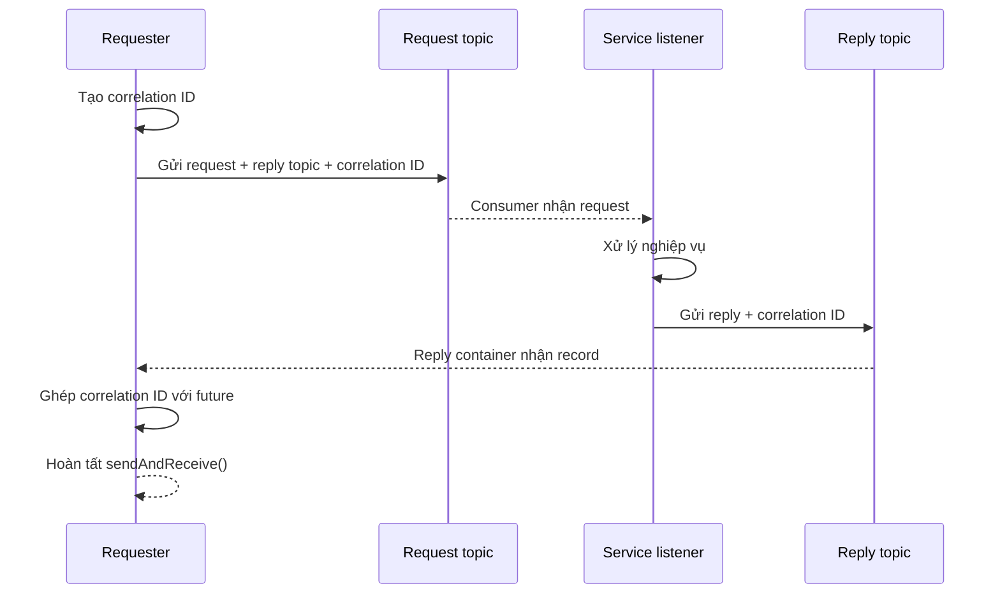

# ReplyingKafkaTemplate

`ReplyingKafkaTemplate` là biến thể của `KafkaTemplate` hỗ trợ mô hình request-reply trên Kafka. Ứng dụng gửi một request lên topic, chờ service xử lý và nhận reply từ một topic khác. Mỗi request được gắn **correlation ID** để template ghép reply đúng với future đang chờ, kể cả khi nhiều request chạy đồng thời.

Khác với `KafkaTemplate.send()` chỉ xác nhận kết quả gửi record, `ReplyingKafkaTemplate.sendAndReceive()` trả về một future hoàn tất khi nhận được reply tương ứng hoặc khi hết thời gian chờ. Phía server thường dùng `@KafkaListener` kết hợp `@SendTo` để gửi kết quả về địa chỉ reply do request cung cấp.

## 1. Request-reply trên Kafka hoạt động như thế nào?

Request-reply sử dụng hai luồng Kafka độc lập:

- **Request topic:** client gửi yêu cầu, server consumer đọc và xử lý.
- **Reply topic:** server gửi kết quả, client có một consumer container riêng để nhận reply.



Luồng tổng quát:

1. Requester gọi `sendAndReceive()`.
2. `ReplyingKafkaTemplate` tạo correlation ID duy nhất cho request và lưu future đang chờ.
3. Template thêm các header chỉ nơi nhận reply và gửi request đến request topic.
4. Service nhận request, xử lý rồi gửi reply về reply topic/partition.
5. Reply container của requester đọc reply, lấy correlation ID và hoàn tất đúng future.
6. Nếu không có reply trong thời hạn cấu hình, future kết thúc bằng timeout exception.

`ReplyingKafkaTemplate` được giới thiệu từ Spring Kafka 2.1.3. Các future trả về và `sendFuture` chuyển sang `CompletableFuture` từ Spring Kafka 3.0; dự án Spring Kafka 2.x cũ có thể dùng `ListenableFuture`.

## 2. Ba header quan trọng

Theo mặc định, `ReplyingKafkaTemplate` sử dụng ba header:

| Header | Vai trò |
|---|---|
| `KafkaHeaders.CORRELATION_ID` | Định danh request để ghép reply với future đang chờ. |
| `KafkaHeaders.REPLY_TOPIC` | Tên topic mà server phải gửi reply đến. |
| `KafkaHeaders.REPLY_PARTITION` | Partition đích của reply; tùy chọn khi requester cần định tuyến đến partition cụ thể. |

Header correlation là thành phần quan trọng nhất. Nếu server không echo correlation ID hoặc thay đổi giá trị của nó, requester không thể ghép reply với request ban đầu.

Trong luồng Spring `@KafkaListener` và `@SendTo`, framework tự echo correlation ID và đọc reply topic từ request header. Nếu server không dùng Spring Kafka, server phải tự đọc các header và gửi lại correlation ID trong reply.

Kafka header lưu giá trị dưới dạng `byte[]`. `REPLY_TOPIC` chứa byte của tên topic; `REPLY_PARTITION` là số nguyên 4 byte theo byte order big-endian. Khi tự xây dựng server không dùng Spring, cần tuân thủ encoding này.

## 3. Cấu hình reply container

`ReplyingKafkaTemplate` cần hai thành phần:

- `ProducerFactory` để gửi request.
- `GenericMessageListenerContainer` để nhận reply.

Ví dụ dùng cùng kiểu `String` cho request và reply:

```java
import java.time.Duration;

import org.springframework.context.annotation.Bean;
import org.springframework.context.annotation.Configuration;
import org.springframework.kafka.core.ProducerFactory;
import org.springframework.kafka.listener.ConcurrentMessageListenerContainer;
import org.springframework.kafka.config.ConcurrentKafkaListenerContainerFactory;
import org.springframework.kafka.requestreply.ReplyingKafkaTemplate;

@Configuration
public class RequestReplyConfiguration {

    @Bean
    ConcurrentMessageListenerContainer<String, String> repliesContainer(
            ConcurrentKafkaListenerContainerFactory<String, String> factory) {

        var container = factory.createContainer("orders.replies");
        container.getContainerProperties().setGroupId("orders-reply-client");
        return container;
    }

    @Bean
    ReplyingKafkaTemplate<String, String, String> replyingKafkaTemplate(
            ProducerFactory<String, String> producerFactory,
            ConcurrentMessageListenerContainer<String, String> repliesContainer) {

        var template = new ReplyingKafkaTemplate<>(producerFactory, repliesContainer);
        template.setDefaultReplyTimeout(Duration.ofSeconds(8));
        return template;
    }
}
```

Giải thích:

- `factory.createContainer("orders.replies")` tạo container chuyên đọc reply topic.
- `setGroupId(...)` đặt consumer group cho reply container.
- `ReplyingKafkaTemplate` dùng producer factory để gửi request và reply container để nhận response.
- `setDefaultReplyTimeout(...)` đặt thời gian chờ mặc định nếu lời gọi `sendAndReceive()` không truyền timeout riêng.

Container được quản lý vòng đời cùng template/Spring context. Có thể tạo reply container từ `ConcurrentKafkaListenerContainerFactory` đã được Spring Boot auto-configure. Nếu cấu hình consumer riêng cho reply, hãy bảo đảm deserializer của container tương thích với kiểu reply `R`.

## 4. Gửi request bằng sendAndReceive()

`sendAndReceive()` nhận `ProducerRecord<K,V>` và trả về `RequestReplyFuture<K,V,R>`. Future này đại diện cho reply, còn `getSendFuture()` cho biết request đã được gửi thành công hay thất bại.

```java
import java.util.concurrent.TimeUnit;

import org.apache.kafka.clients.consumer.ConsumerRecord;
import org.apache.kafka.clients.producer.ProducerRecord;
import org.springframework.kafka.requestreply.ReplyingKafkaTemplate;
import org.springframework.kafka.requestreply.RequestReplyFuture;
import org.springframework.kafka.support.SendResult;
import org.springframework.stereotype.Service;

@Service
public class OrderQueryClient {

    private final ReplyingKafkaTemplate<String, String, String> template;

    public OrderQueryClient(
            ReplyingKafkaTemplate<String, String, String> template) {
        this.template = template;
    }

    public String queryOrder(String orderId) throws Exception {
        ProducerRecord<String, String> request =
                new ProducerRecord<>("orders.requests", orderId, orderId);

        RequestReplyFuture<String, String, String> future =
                template.sendAndReceive(request);

        // Xác nhận request đã được broker nhận.
        SendResult<String, String> sendResult =
                future.getSendFuture().get(5, TimeUnit.SECONDS);
        System.out.println("Request stored at " + sendResult.getRecordMetadata());

        // Chờ reply tương ứng.
        ConsumerRecord<String, String> reply =
                future.get(10, TimeUnit.SECONDS);

        return reply.value();
    }
}
```

Hai future có ý nghĩa khác nhau:

- `future.getSendFuture()` hoàn tất khi producer gửi request thành công hoặc thất bại.
- `future.get(...)` hoàn tất khi nhận reply tương ứng hoặc xảy ra lỗi/timeout.

Không cần tự tạo correlation ID trong trường hợp thông thường; template quản lý correlation ID và thêm header vào request. Chỉ tùy chỉnh correlation strategy/header name khi cần tích hợp với hệ thống không dùng Spring hoặc một hợp đồng header đã tồn tại.

## 5. Xử lý request ở server bằng @KafkaListener và @SendTo

Ở phía service, method listener nhận request và trả về payload reply:

```java
import org.springframework.kafka.annotation.KafkaListener;
import org.springframework.kafka.annotation.SendTo;
import org.springframework.stereotype.Component;

@Component
public class OrderQueryListener {

    private final OrderQueryService orderQueryService;

    public OrderQueryListener(OrderQueryService orderQueryService) {
        this.orderQueryService = orderQueryService;
    }

    @KafkaListener(
            topics = "orders.requests",
            groupId = "order-query-service"
    )
    @SendTo
    public String handle(String request) {
        return orderQueryService.findOrder(request);
    }
}
```

`@SendTo` không có giá trị topic nghĩa là dùng `KafkaHeaders.REPLY_TOPIC` trong request. Spring Kafka listener infrastructure gửi reply đến topic đó và echo correlation ID để requester ghép kết quả.

Nếu muốn gửi reply đến một topic cố định, có thể dùng `@SendTo("orders.responses")`. Với request-reply, nên dùng reply topic header của request khi mỗi requester có reply destination riêng hoặc khi dùng chung reply topic/partition có correlation ID.

Khi dùng `@SendTo`, listener container factory phía server cần có `KafkaTemplate` trong thuộc tính `replyTemplate` để gửi kết quả. Spring Boot thường tự wire template auto-configured vào factory mặc định. Nếu tự tạo factory, phải gọi `factory.setReplyTemplate(kafkaTemplate)`.

Ví dụ factory tự cấu hình:

```java
import org.springframework.context.annotation.Bean;
import org.springframework.kafka.config.ConcurrentKafkaListenerContainerFactory;
import org.springframework.kafka.core.ConsumerFactory;
import org.springframework.kafka.core.KafkaTemplate;

@Bean
ConcurrentKafkaListenerContainerFactory<String, String> requestListenerFactory(
        ConsumerFactory<String, String> consumerFactory,
        KafkaTemplate<String, String> replyTemplate) {

    var factory = new ConcurrentKafkaListenerContainerFactory<String, String>();
    factory.setConsumerFactory(consumerFactory);
    factory.setReplyTemplate(replyTemplate);
    return factory;
}
```

`replyTemplate` ở đây là `KafkaTemplate` thông thường phía server để publish response. Không truyền `ReplyingKafkaTemplate` của requester vào thuộc tính này.

## 6. Khởi động reply container trước khi gửi request

Nếu reply container dùng `auto.offset.reset=latest`, cần chắc chắn container đã được assign partition trước khi gửi request đầu tiên. Nếu server trả lời trước khi reply consumer sẵn sàng, reply có thể nằm trước vị trí bắt đầu đọc của consumer mới và requester sẽ chờ đến timeout.

Từ Spring Kafka 2.8.8, `ReplyingKafkaTemplate` có `waitForAssignment(Duration)`. Method này có thể ném `InterruptedException`, vì vậy hãy xử lý hoặc khai báo exception:

```java
void awaitReplyContainer() throws InterruptedException {
    if (!replyingKafkaTemplate.waitForAssignment(Duration.ofSeconds(10))) {
        throw new IllegalStateException("Reply container chưa được assign partition");
    }
}
```

Gọi bước này sau khi application context khởi động và trước khi phát request đầu tiên, chẳng hạn trong `ApplicationRunner` hoặc readiness initialization. Không cần gọi trước từng request nếu container đã hoạt động ổn định.

Với manual partition assignment (không dùng Kafka group management), thời gian chờ truyền vào `waitForAssignment()` phải lớn hơn `pollTimeout` của container vì thông báo assignment chỉ xuất hiện sau lần poll đầu tiên.

## 7. Cấu hình reply topic và partition

Nếu reply container chỉ lắng nghe một topic hoặc một `TopicPartitionOffset`, template có thể tự suy ra reply topic/partition và đặt các header tương ứng. Nếu container lắng nghe nhiều topic hoặc pattern, requester cần chỉ rõ reply destination trong header.

Ví dụ đặt reply topic thủ công:

```java
import java.nio.charset.StandardCharsets;

import org.apache.kafka.common.header.internals.RecordHeader;
import org.apache.kafka.clients.producer.ProducerRecord;
import org.springframework.kafka.support.KafkaHeaders;

ProducerRecord<String, String> request =
        new ProducerRecord<>("orders.requests", "O100", "GET_ORDER");

request.headers().add(new RecordHeader(
        KafkaHeaders.REPLY_TOPIC,
        "orders.replies".getBytes(StandardCharsets.UTF_8)
));
```

Thông thường không cần tự đặt header correlation ID và reply topic nếu reply container đã cấu hình một destination rõ ràng. Chỉ đặt thủ công khi container không thể tự suy ra destination hoặc khi server dùng hợp đồng header riêng.

Nếu đặt `KafkaHeaders.REPLY_PARTITION`, server phải gửi reply đến đúng partition. Spring `@KafkaListener` hỗ trợ định tuyến theo header này. Với consumer reply được gán thủ công vào một partition cố định, reply container không dùng group management và phải được cấu hình bằng `TopicPartitionOffset`.

## 8. Nhiều requester instance và shared reply topic

Khi triển khai nhiều instance của requester, có ba mô hình phổ biến:

| Mô hình | Cách hoạt động | Đánh đổi |
|---|---|---|
| Reply topic riêng cho mỗi instance | Mỗi instance có topic riêng để nhận reply. | Dễ cô lập, nhưng cần quản lý nhiều topic. |
| Một reply topic, mỗi instance có group ID riêng | Mọi instance nhận mọi reply; chỉ instance có correlation ID tương ứng hoàn tất future, instance khác bỏ qua reply. | Dễ scale ngang, nhưng mỗi reply được broadcast đến các instance và tạo thêm network traffic. |
| Một reply topic với partition riêng cho mỗi instance | Mỗi instance consume partition cố định; server route reply theo `REPLY_PARTITION`. | Giảm việc nhận reply không liên quan, nhưng phải quản lý partition và manual assignment. |

Với shared reply topic, mỗi requester instance cần một `group.id` khác nhau. Nếu các instance dùng chung group ID, Kafka phân phối reply record giữa các consumer; reply có thể đến instance không giữ future tương ứng, khiến request ở instance khác timeout.

Khi dùng shared reply topic, có thể gọi:

```java
replyingKafkaTemplate.setSharedReplyTopic(true);
```

Thuộc tính này làm giảm log của các reply không có correlation ID đang chờ từ mức ERROR xuống DEBUG. Nó không thay đổi cơ chế phân phối record; mỗi instance vẫn nhận reply và tự bỏ qua reply không thuộc request của mình.

## 9. Timeout và xử lý reply đến muộn

Có thể đặt timeout mặc định trên template:

```java
replyingKafkaTemplate.setDefaultReplyTimeout(Duration.ofSeconds(8));
```

Hoặc đặt timeout riêng cho từng request:

```java
var future = replyingKafkaTemplate.sendAndReceive(request, Duration.ofSeconds(3));
```

Nếu không nhận reply trong thời gian đó, template hoàn tất future với `KafkaReplyTimeoutException`. Ngoài ra, nếu gọi `future.get(timeout, unit)` với thời hạn ngắn hơn reply timeout, caller có thể nhận `java.util.concurrent.TimeoutException` từ thao tác chờ của Java Future.

Timeout ở requester **không hủy request đã gửi**, không dừng listener server và không rollback side effect nghiệp vụ. Server vẫn có thể xử lý xong và gửi reply sau khi requester đã hết thời gian chờ. Reply muộn không còn future tương ứng; template bỏ qua và ghi log theo cấu hình.

Do đó:

- Đặt reply timeout dựa trên latency thực tế của service và SLA.
- Không retry request ngay lập tức nếu chưa biết server có thực hiện side effect hay không.
- Dùng `requestId`/`idempotencyKey` ổn định trong payload để server chống xử lý trùng khi client gửi lại.
- Ghi nhận timeout, late reply và tỷ lệ request không có response.
- Nếu cần deadline nghiệp vụ, truyền deadline/expiry trong payload và để server chủ động từ chối request đã hết hạn.

## 10. Phân biệt lỗi gửi request và lỗi nhận reply

`RequestReplyFuture` cung cấp `getSendFuture()` để tách lỗi publish request khỏi lỗi request-reply:

| Tình huống | Nơi phát hiện | Ý nghĩa |
|---|---|---|
| Producer không gửi được request | `getSendFuture()` hoàn tất exceptional; future reply cũng hoàn tất exceptional. | Broker, serializer, network hoặc producer gặp lỗi. |
| Request gửi thành công nhưng không có reply | Reply future hết hạn. | Server không nhận, không trả lời, reply bị mất/định tuyến sai hoặc xử lý lâu hơn timeout. |
| Reply deserialize thất bại | Reply future hoàn tất exceptional khi dùng `ErrorHandlingDeserializer`. | Byte reply không giải mã được theo cấu hình consumer. |
| Server trả lỗi nghiệp vụ | Tùy hợp đồng reply; có thể gửi error payload hoặc error header. | Client cần chuyển lỗi response thành exception/kiểu kết quả phù hợp. |

Ví dụ kiểm tra lỗi được server gửi trong header:

```java
import java.nio.charset.StandardCharsets;

replyingKafkaTemplate.setReplyErrorChecker(record -> {
    var errorHeader = record.headers().lastHeader("server-error");
    if (errorHeader == null) {
        return null;
    }

    String message = new String(errorHeader.value(), StandardCharsets.UTF_8);
    return new IllegalStateException(message);
});
```

`setReplyErrorChecker()` có từ Spring Kafka 2.6.7. Hàm nhận reply `ConsumerRecord` và trả về exception nếu reply biểu thị lỗi; trả `null` nếu reply hợp lệ. Đây là cơ chế chuyển lỗi theo hợp đồng header, không tự suy luận mọi lỗi nghiệp vụ từ payload.

Nếu reply dùng JSON hoặc format phức tạp, cấu hình `ErrorHandlingDeserializer` cho reply consumer. Khi deserialize thất bại, future có thể hoàn tất exceptional và cause chứa `DeserializationException`.

## 11. Dùng Message<?> và reply có kiểu generic

Từ Spring Kafka 2.7, `ReplyingKafkaTemplate` hỗ trợ request/reply bằng Spring `Message<?>`. Nếu converter/deserializer biết kiểu reply từ cấu hình hoặc metadata, có thể gọi:

```java
RequestReplyMessageFuture<String, String> future =
        template.sendAndReceive(message);
```

Nếu reply có kiểu generic hoặc không có type metadata, truyền `ParameterizedTypeReference`:

```java
import java.util.List;
import java.util.concurrent.TimeUnit;

import org.springframework.core.ParameterizedTypeReference;
import org.springframework.kafka.requestreply.RequestReplyTypedMessageFuture;

RequestReplyTypedMessageFuture<String, String, List<OrderView>> future =
        template.sendAndReceive(
                requestMessage,
                new ParameterizedTypeReference<List<OrderView>>() {}
        );

List<OrderView> orders = future.get(10, TimeUnit.SECONDS).getPayload();
```

Cách này hữu ích khi một template nhận nhiều kiểu response hoặc server không phải ứng dụng Spring và không gửi type headers theo quy ước của Spring.

Nếu listener server trả về `Message<?>`, hãy bảo đảm reply có đúng topic/key/correlation headers theo hợp đồng. Với Spring Kafka từ 2.5, framework có thể bổ sung reply topic và echo correlation/reply partition còn thiếu trong các trường hợp được hỗ trợ; với custom message/header mapper hoặc server không dùng Spring, cần kiểm tra header thực tế.

## 12. Tùy chỉnh correlation header

Mặc định template dùng `KafkaHeaders.CORRELATION_ID`. Có thể thay đổi tên header nếu tích hợp với server không dùng Spring Kafka:

```java
replyingKafkaTemplate.setCorrelationHeaderName("request-correlation-id");
replyingKafkaTemplate.setReplyTopicHeaderName("response-topic");
replyingKafkaTemplate.setReplyPartitionHeaderName("response-partition");
```

Các tên header tùy chỉnh được hỗ trợ từ Spring Kafka 2.3. Nếu requester không dùng Spring và gửi correlation header theo tên riêng, từ Spring Kafka 3.0 có thể cấu hình `correlationHeaderName` trên listener container factory phía server để framework echo đúng header đó. Trước 3.0, server cần tự echo custom correlation header.

Không dùng cùng một correlation ID cho nhiều request đang chờ trong cùng template. Correlation ID cần duy nhất trong phạm vi các request pending để tránh ghép nhầm reply.

## 13. Khi cần nhiều reply cho một request

`ReplyingKafkaTemplate` phù hợp khi mỗi request có một reply tương ứng. Nếu một request cần thu thập nhiều reply từ nhiều service/partition, Spring Kafka có `AggregatingReplyingKafkaTemplate` để gom nhiều reply cùng correlation ID.

Với mô hình nhiều reply, cần định nghĩa rõ:

- Điều kiện kết thúc aggregation: đủ số reply, đủ nhóm service hay hết timeout.
- Cách nhận diện từng responder để tránh tính trùng.
- Hành vi khi một responder lỗi hoặc không phản hồi.
- Thứ tự và cách merge kết quả.
- Kích thước tối đa của tập reply và giới hạn thời gian chờ.

Không dùng `ReplyingKafkaTemplate` rồi giả định một request sẽ tự đợi mọi service phản hồi; mặc định future hoàn tất khi nhận được reply khớp correlation ID.

## 14. Những giới hạn kiến trúc cần cân nhắc

Request-reply trên Kafka hữu ích cho truy vấn ngắn, có SLA rõ và cần tận dụng hạ tầng Kafka. Tuy nhiên, đây vẫn là giao tiếp bất đồng bộ qua log, không phải RPC đồng bộ có kết nối trực tiếp giữa hai service.

| Giới hạn | Hệ quả |
|---|---|
| Client phải duy trì reply consumer container | Tốn tài nguyên consumer, connection và group coordination. |
| Request và reply là hai lần publish độc lập | Server có thể xử lý request nhưng reply publish thất bại. |
| Timeout không hủy xử lý phía server | Client timeout nhưng side effect vẫn có thể xảy ra. |
| Reply đến muộn không còn future | Client không nhận kết quả từ future đã timeout. |
| Shared reply topic broadcast reply | Mỗi requester instance nhận và bỏ qua reply không liên quan. |
| Request-reply không tự tạo exactly-once business processing | Cần idempotency, deduplication và transaction phù hợp. |
| Kafka không bảo đảm deadline phản hồi | Consumer lag, rebalance, retry và broker load làm latency biến động. |

Nên cân nhắc HTTP/gRPC cho lời gọi ngắn cần latency thấp, deadline rõ hoặc cần truyền lỗi đồng bộ theo hợp đồng RPC. Dùng Kafka request-reply khi có lý do kiến trúc cụ thể như giao tiếp qua event backbone, requester có thể chịu timeout/bất đồng bộ và hai phía đã quản lý correlation, retry, idempotency.

## 15. Kiểm thử request-reply

Integration test nên xác minh toàn bộ đường đi request, server listener, reply topic và correlation:

1. Khởi động request topic và reply topic trước khi gửi.
2. Khởi động reply container và chờ `waitForAssignment()` thành công.
3. Gửi request và xác minh `getSendFuture()` hoàn tất thành công.
4. Xác minh server nhận đúng payload/key và gửi reply đến reply topic.
5. Xác minh reply có correlation ID tương ứng và future nhận đúng response.
6. Gửi nhiều request đồng thời và xác minh không ghép chéo reply.
7. Kiểm thử timeout khi server không trả lời.
8. Kiểm thử reply đến muộn sau timeout và xác minh không làm hoàn tất nhầm future khác.
9. Kiểm thử lỗi deserialize và `replyErrorChecker`.
10. Nếu chạy nhiều requester instance, kiểm thử shared reply topic với group ID riêng hoặc partition assignment riêng.

Ví dụ assertion khái niệm:

```java
RequestReplyFuture<String, String, String> future =
        replyingKafkaTemplate.sendAndReceive(request, Duration.ofSeconds(5));

assertThat(future.getSendFuture().get(5, TimeUnit.SECONDS)).isNotNull();
ConsumerRecord<String, String> reply = future.get(8, TimeUnit.SECONDS);
assertThat(reply.value()).isEqualTo("ORDER_FOUND");
```

Đây là đoạn assertion minh họa. Test hoàn chỉnh cần dùng topic/group ID riêng, chờ container assignment, poll/chờ future với timeout hữu hạn và dọn container sau test. Không dùng `Thread.sleep` cố định để đoán thời điểm reply đã đến.

## 16. Lỗi thường gặp

| Biểu hiện | Nguyên nhân | Cách xử lý |
|---|---|---|
| Request gửi thành công nhưng future timeout | Server không trả lời, reply topic sai hoặc reply container chưa được assign. | Kiểm tra `@SendTo`, reply headers, group ID và `waitForAssignment()`. |
| Future không hoàn tất dù reply đã vào topic | Correlation ID không được echo hoặc bị thay đổi. | Kiểm tra `KafkaHeaders.CORRELATION_ID` ở request và reply. |
| Không thấy reply container nhận record | Container chưa start, subscribe sai topic hoặc group offset đã ở cuối log. | Kiểm tra lifecycle, topic, assignment và `auto.offset.reset`. |
| Nhiều requester instance bị timeout ngẫu nhiên | Shared reply topic nhưng dùng chung group ID. | Mỗi instance dùng group ID riêng hoặc phân partition riêng. |
| Reply đến instance khác rồi bị bỏ qua | Các instance cùng nhận shared topic và correlation không thuộc instance hiện tại. | Đây là hành vi dự kiến; bật `sharedReplyTopic` để giảm log nhiễu. |
| Server không biết nơi gửi reply | Request thiếu `KafkaHeaders.REPLY_TOPIC` hoặc container nhiều topic khiến template không tự suy ra. | Đặt reply topic header hoặc dùng reply container nghe một topic rõ ràng. |
| Reply gửi sai partition | `REPLY_PARTITION` không hợp lệ hoặc server không dùng header partition. | Đồng bộ partition routing và manual assignment. |
| Reply JSON deserialize thất bại | Reply consumer dùng deserializer không tương thích. | Đồng bộ serializer/deserializer và dùng `ErrorHandlingDeserializer` nếu cần. |
| Client retry làm server thực hiện nghiệp vụ hai lần | Timeout không hủy request gốc; client gửi lại request mới. | Dùng idempotency key/request ID ổn định và deduplicate ở server. |

## 17. Ghi nhớ

- `ReplyingKafkaTemplate` cung cấp request-reply bằng `sendAndReceive()`.
- Requester cần producer factory và reply listener container.
- `RequestReplyFuture` có `getSendFuture()` để kiểm tra gửi request và future chính để chờ reply.
- `CORRELATION_ID` ghép reply với request; `REPLY_TOPIC` và `REPLY_PARTITION` định tuyến reply.
- `@KafkaListener` kết hợp `@SendTo` không có destination dùng reply topic header của request.
- Listener container factory phía server cần có `replyTemplate` để gửi kết quả.
- Chờ reply container assignment trước request đầu tiên nếu dùng `auto.offset.reset=latest`; `waitForAssignment()` có từ Spring Kafka 2.8.8.
- Shared reply topic cần group ID riêng cho từng requester instance hoặc dùng partition riêng.
- Timeout không hủy request/server processing; late reply không còn future tương ứng.
- Dùng `replyErrorChecker`, `ErrorHandlingDeserializer` và idempotency để xử lý lỗi an toàn.
- `AggregatingReplyingKafkaTemplate` dành cho trường hợp cần gom nhiều reply.
- Request-reply trên Kafka không tự tạo exactly-once business processing hay SLA latency như RPC.

`ReplyingKafkaTemplate` giúp xây dựng request-reply trên nền Kafka bằng cách kết hợp request producer, reply consumer và correlation ID. Để vận hành ổn định, cần cấu hình reply container đúng topic/group, để server echo correlation và định tuyến reply chính xác, đặt timeout có chủ đích, xử lý late reply và bảo vệ side effect bằng idempotency. Hãy dùng mô hình này cho các request có thời gian xử lý hữu hạn và hợp đồng phản hồi rõ ràng.

## Tài liệu tham khảo

- [Spring for Apache Kafka — Sending Messages and ReplyingKafkaTemplate](https://docs.spring.io/spring-kafka/reference/kafka/sending-messages.html)
- [Spring for Apache Kafka — Forwarding Listener Results using @SendTo](https://docs.spring.io/spring-kafka/reference/kafka/receiving-messages/annotation-send-to.html)
- [Spring Kafka — ReplyingKafkaTemplate API](https://docs.spring.io/spring-kafka/api/org/springframework/kafka/requestreply/ReplyingKafkaTemplate.html)
- [Spring Kafka — RequestReplyFuture API](https://docs.spring.io/spring-kafka/api/org/springframework/kafka/requestreply/RequestReplyFuture.html)
- [Spring Kafka — KafkaReplyTimeoutException API](https://docs.spring.io/spring-kafka/api/org/springframework/kafka/requestreply/KafkaReplyTimeoutException.html)
