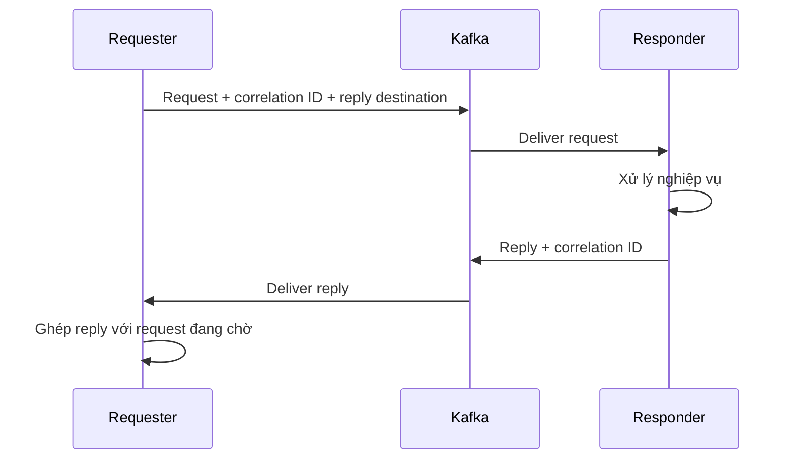

# Khi nào không nên dùng request-reply

Spring Kafka hỗ trợ mô hình request-reply: một ứng dụng gửi request lên Kafka, service khác xử lý rồi gửi reply về một topic phản hồi. Bên gửi ghép reply với request bằng correlation ID và có thể chờ kết quả qua `ReplyingKafkaTemplate`. Cách này hữu ích khi hai service cần trao đổi một yêu cầu có kết quả ngắn và có giới hạn thời gian.

Tuy nhiên, Kafka được thiết kế cho luồng sự kiện bất đồng bộ và lưu trữ log phân tán. Nếu mọi thao tác đều phải chờ reply, ứng dụng sẽ biến một luồng messaging thành RPC nhiều bước qua broker. Điều đó làm tăng độ trễ, phụ thuộc vào trạng thái của service phản hồi và tạo thêm các trường hợp timeout, reply đến muộn hoặc xử lý trùng. Bài học này giúp nhận biết khi nào không nên dùng request-reply và chọn mô hình giao tiếp phù hợp hơn.

## 1. Request-reply thực sự tạo ra điều gì?

Trong request-reply, phía gọi gửi một record request tới topic yêu cầu. Record thường chứa thông tin về nơi gửi reply và correlation ID. Service xử lý request rồi gửi record reply về topic được chỉ định. Phía gọi tiêu thụ reply, tìm correlation ID tương ứng và hoàn tất lời gọi đang chờ.



Với Spring Kafka, `ReplyingKafkaTemplate` quản lý việc gửi request và ghép reply bằng correlation ID. Phía gọi có thể dùng `RequestReplyFuture` để chờ kết quả. Phía xử lý có thể dùng `@KafkaListener` kết hợp `@SendTo` để gửi reply về địa chỉ phản hồi được chỉ định trong header.

Ví dụ phía requester:

```java
RequestReplyFuture<String, OrderRequest, OrderReply> future =
        replyingKafkaTemplate.sendAndReceive(
                new ProducerRecord<>("order-requests", request.orderId(), request));

ConsumerRecord<String, OrderReply> replyRecord =
        future.get(3, TimeUnit.SECONDS);

OrderReply reply = replyRecord.value();
```

Đoạn code gọi `get()` nên thread hiện tại sẽ chờ tối đa ba giây. API trả về future, vì vậy ứng dụng có thể kết hợp bất đồng bộ thay vì block thread. Phía responder có thể trả kết quả như sau:

```java
@KafkaListener(topics = "order-requests")
@SendTo
public OrderReply handle(OrderRequest request) {
    return orderService.createOrder(request);
}
```

Để ví dụ hoạt động, `ReplyingKafkaTemplate` cần được cấu hình cùng một reply listener container đang subscribe reply topic; responder phải đọc reply destination từ header và có quyền publish vào topic đó. Mẫu trên minh họa phần trao đổi chính, chưa bao gồm toàn bộ cấu hình bean, serializer, bảo mật và xử lý lỗi.

Request-reply không làm cho Kafka trở thành một kết nối đồng bộ trực tiếp giữa hai service. Request và reply vẫn là hai record độc lập được ghi, lưu, phân phối và tiêu thụ qua broker. Người gọi chỉ tạo cảm giác RPC khi giữ một lời gọi đang chờ correlation ID tương ứng.

## 2. Không dùng request-reply cho sự kiện không cần câu trả lời ngay

Nếu ứng dụng chỉ cần thông báo một sự kiện đã xảy ra, request-reply tạo ra một lượt trao đổi không cần thiết. Ví dụ `OrderCreated` được phát để nhiều service cập nhật projection, gửi email hoặc tính toán báo cáo. Các service này có thể xử lý độc lập; service tạo đơn không cần chờ tất cả phản hồi.

Trong trường hợp đó, dùng event notification bất đồng bộ:

```java
kafkaTemplate.send("order-events", order.id(),
        new OrderCreated(order.id(), order.createdAt()));
```

Producer xác nhận việc gửi theo cấu hình producer, sau đó tiếp tục công việc của nó. Các consumer xử lý khi có năng lực và theo consumer group riêng. Không cần một reply topic cho từng event consumer.

Request-reply không phù hợp khi:

- Sự kiện chỉ nhằm thông báo trạng thái hoặc sự kiện nghiệp vụ đã xảy ra.
- Có nhiều consumer độc lập cùng cần nhận sự kiện.
- Bên phát không cần biết từng consumer đã xử lý xong vào đúng thời điểm phát.
- Kết quả xử lý có thể đến sau vài phút hoặc vài giờ.

Nếu cần biết tiến độ, consumer có thể phát event trạng thái riêng như `OrderProcessingStarted`, `OrderReady` hoặc `OrderFailed`. Bên quan tâm subscribe các event đó và cập nhật trạng thái theo cách bất đồng bộ.

## 3. Không dùng cho công việc dài hoặc thời gian hoàn tất khó dự đoán

Request-reply phù hợp hơn với công việc ngắn, có giới hạn thời gian và kết quả nhỏ. Nếu responder phải chạy báo cáo lớn, xử lý video, chờ phê duyệt, gọi nhiều hệ thống hoặc thực hiện workflow nhiều bước, requester có thể phải giữ lời gọi chờ rất lâu.

Khi đó xuất hiện một số vấn đề:

- Thread của ứng dụng gọi bị giữ nếu code chờ bằng `Future.get()` hoặc cơ chế block tương tự.
- Requester phải quản lý timeout, hủy lời gọi, reconnect và trường hợp client đã ngắt nhưng công việc vẫn đang chạy.
- Reply có thể đến sau khi requester đã timeout hoặc restart.
- Responder có thể hoàn tất công việc nhưng reply bị mất hoặc chưa được requester nhận.
- Một lượng lớn lời gọi đang chờ chiếm bộ nhớ và tài nguyên quản lý correlation.

Một timeout chỉ có nghĩa requester không nhận được reply trong thời gian quy định. Nó không chứng minh responder chưa thực hiện nghiệp vụ. Nếu requester gửi lại request sau timeout, nghiệp vụ có thể chạy hai lần trừ khi có idempotency key và cơ chế chống xử lý trùng.

Với công việc dài, hãy dùng mô hình submit-and-track:

1. Client gửi command hoặc yêu cầu tạo job.
2. Service xác nhận đã tiếp nhận và trả về `jobId`.
3. Worker xử lý bất đồng bộ và phát event trạng thái.
4. Client truy vấn trạng thái hoặc nhận callback/webhook khi hoàn tất.

Mô hình này tách thời gian tiếp nhận khỏi thời gian hoàn tất. Kafka tiếp tục đảm nhiệm việc truyền command và event, còn trạng thái job được lưu trong một nơi có thể truy vấn.

## 4. Không dùng để thay thế API đồng bộ có yêu cầu độ trễ thấp

Nếu một giao diện người dùng cần câu trả lời ngay để hiển thị trang, xác thực thông tin hoặc trả kết quả cho thao tác tương tác, HTTP hoặc gRPC thường phù hợp hơn. Những giao thức này cung cấp mô hình request-response trực tiếp, deadline, status code, xác thực và quan sát lời gọi quen thuộc.

Đưa request-reply qua Kafka trong đường đi tương tác có thể thêm nhiều bước:

1. Ứng dụng gửi request tới broker.
2. Broker ghi và phân phối request.
3. Consumer nhận request theo lịch poll và xử lý.
4. Responder publish reply.
5. Broker ghi và phân phối reply.
6. Requester ghép correlation ID và trả kết quả cho caller.

Độ trễ còn phụ thuộc consumer lag, số partition, rebalance, tải broker và thời gian xử lý responder. Request-reply có thể vẫn phù hợp với tác vụ nội bộ có thời gian phản hồi không quá chặt, nhưng không nên mặc định dùng nó làm API đồng bộ cho mọi request.

| Nhu cầu | Lựa chọn thường phù hợp |
|---|---|
| Gọi lấy dữ liệu ngắn, cần phản hồi ngay | HTTP hoặc gRPC |
| Phát sự kiện để nhiều service xử lý độc lập | Kafka event notification |
| Gửi command và nhận trạng thái hoàn tất sau đó | Kafka command + event trạng thái/job ID |
| Workflow nhiều bước, có retry và chờ lâu | Workflow engine, saga hoặc orchestration bất đồng bộ |
| Request nội bộ ngắn, kết quả nhỏ, có timeout rõ ràng | Có thể cân nhắc Kafka request-reply |

Không có quy tắc rằng request-reply qua Kafka luôn sai. Điểm quyết định là độ trễ, thời gian xử lý, số lượng lời gọi đồng thời, khả năng chịu timeout và việc hai bên có thực sự cần một kết quả ngay hay không.

## 5. Không dùng khi cần fan-out hoặc nhiều phản hồi độc lập

Kafka consumer group phân phối record cho các consumer trong cùng group. Nếu nhiều service cần nhận cùng một sự kiện, mỗi service thường dùng consumer group riêng. Đây là fan-out tự nhiên của Kafka.

Request-reply lại tạo câu hỏi phức tạp hơn: requester chờ một reply hay nhiều reply? Nếu có nhiều responder, cần xác định:

- Bao nhiêu phản hồi được xem là đủ?
- Có chờ tất cả responder hay chỉ một responder?
- Làm sao phân biệt responder nào đã phản hồi?
- Điều gì xảy ra nếu một responder offline hoặc phản hồi muộn?
- Khi hết thời gian chờ, kết quả một phần có được chấp nhận không?

Nếu nghiệp vụ cần tổng hợp phản hồi từ nhiều service, thường nên mô hình hóa một workflow tổng hợp bất đồng bộ. Requester phát một event có `correlationId` hoặc `workflowId`; từng service phát kết quả riêng; một aggregator lưu trạng thái và hoàn tất khi đạt điều kiện đã định nghĩa. Cách này biểu diễn rõ kết quả một phần và timeout của từng nhánh.

## 6. Không dùng khi không thể chấp nhận coupling về thời gian hoạt động

Trong request-reply, bên gọi phụ thuộc vào responder đang tiêu thụ request và publish reply trong khoảng thời gian chờ. Nếu responder dừng, consumer lag tăng hoặc reply topic không hoạt động, lời gọi sẽ chậm hoặc timeout dù request đã được broker lưu bền vững.

Điều này tạo ra coupling về thời gian: caller muốn hoàn tất thao tác hiện tại, trong khi responder có thể chỉ xử lý khi khôi phục. Nếu mục tiêu là tiếp nhận công việc bền vững rồi xử lý khi có tài nguyên, command bất đồng bộ phù hợp hơn.

Các trường hợp nên tránh request-reply:

- Responder thường xuyên scale về zero hoặc có thời gian khởi động dài.
- Consumer group có thể rebalance trong lúc caller đang chờ.
- Hệ thống có thời gian bảo trì hoặc downtime không đồng bộ.
- Caller phải tiếp tục hoạt động ngay cả khi responder tạm thời offline.
- Có nhiều bước downstream và thời gian hoàn tất không ổn định.

Kafka giữ request trong topic theo retention, nhưng điều đó không đảm bảo requester sẽ nhận reply trong deadline. Nếu chấp nhận xử lý eventual, hãy xác nhận tiếp nhận request và theo dõi kết quả qua event hoặc trạng thái job.

## 7. Không dùng nếu chưa có chiến lược timeout, correlation và reply muộn

Request-reply đòi hỏi quản lý correlation ID và reply destination. Requester phải ghép đúng reply với request đang chờ; nếu correlation ID bị thiếu, trùng hoặc không còn trong bộ nhớ chờ, reply không thể hoàn tất lời gọi ban đầu.

Một số tình huống cần thiết kế rõ:

| Tình huống | Rủi ro | Cách xử lý cần có |
|---|---|---|
| Không có reply trước deadline | Caller timeout dù request có thể đã xử lý | Định nghĩa timeout, trạng thái kết quả chưa xác định và cách truy vấn lại. |
| Reply đến sau timeout | Reply không còn waiter tương ứng | Ghi nhận late reply, loại bỏ hoặc lưu để đối soát theo chính sách. |
| Request được gửi lại | Responder có thể thực hiện nghiệp vụ lần nữa | Dùng request ID/idempotency key ổn định. |
| Requester restart | Bộ nhớ correlation đang chờ bị mất | Không dựa vào waiter trong bộ nhớ làm trạng thái bền vững; dùng job/status store nếu cần phục hồi. |
| Reply topic không sẵn sàng | Responder không thể trả lời | Giám sát publish failure, retry có giới hạn và quy trình phục hồi. |
| Reply sai hoặc không xác thực | Có thể ghép nhầm hoặc nhận dữ liệu không đáng tin | Xác minh correlation, nguồn gửi, schema và quyền truy cập. |

Timeout của `ReplyingKafkaTemplate` giới hạn thời gian chờ reply ở phía requester. Nó không tự hủy việc xử lý đang chạy ở responder và cũng không rollback side effect đã thực hiện. Nếu caller timeout sau khi responder đã tạo đơn hàng, gửi lại request có thể tạo đơn hàng thứ hai nếu thiếu idempotency.

Với request-reply, correlation ID phải được tạo duy nhất cho từng request đang chờ. Reply container phải subscribe đúng reply topic và có topology phù hợp để reply được gửi về nơi requester nhận. Khi scale requester nhiều instance, cần kiểm tra cách phân phối reply và partition, tránh cấu hình reply destination khiến một instance không thể nhận reply của request do chính nó gửi.

## 8. Không dùng để tạo một reply topic cho mỗi request

Tạo topic tạm riêng cho từng request có thể khiến số lượng topic tăng nhanh, tạo tải cho controller/broker và làm vận hành phức tạp. Trong mô hình request-reply thông thường, nên dùng reply topic dùng chung hoặc một tập reply topic được quản lý, sau đó phân biệt request bằng correlation ID và metadata routing.

Một reply topic dùng chung cần được thiết kế về partition, consumer group và cách route reply. Nếu reply phải về đúng requester instance, cần có chiến lược routing rõ ràng. Không giả định rằng mọi instance cùng subscribe một reply topic trong cùng consumer group đều nhận được mọi reply; Kafka phân phối partition trong group, mỗi partition được gán cho một consumer tại một thời điểm.

Quản lý reply topic cũng cần retention phù hợp, ACL cho requester/responder, schema tương thích và cảnh báo khi reply backlog tăng. Nếu reply bị lưu lâu hơn thời gian correlation còn hiệu lực, cần quy trình xử lý record hết hạn.

## 9. Nếu vẫn dùng request-reply, giới hạn phạm vi thật rõ

Request-reply có thể là lựa chọn hợp lý khi tất cả điều kiện sau được đáp ứng:

- Request đại diện cho một thao tác ngắn, có thời gian hoàn tất tương đối ổn định.
- Chỉ cần một reply hoặc có quy tắc tổng hợp phản hồi rõ ràng.
- Kết quả nhỏ, không phải luồng dữ liệu lớn.
- Caller có deadline hữu hạn và chấp nhận trạng thái timeout chưa xác định.
- Requester và responder có chiến lược correlation, routing và xử lý reply muộn.
- Nghiệp vụ có idempotency để chống request gửi lại.
- Reply topic, partition, consumer group và quyền truy cập được thiết kế cho số instance thực tế.
- Có metric cho request rate, reply latency, timeout, late reply và pending correlation.

Một số nguyên tắc triển khai:

1. Dùng `ReplyingKafkaTemplate` với reply listener container được quản lý rõ ràng.
2. Đặt reply timeout theo SLA nghiệp vụ, không dùng một giá trị lớn để che giấu responder chậm.
3. Không block thread listener hoặc thread xử lý request nếu có thể xử lý future bất đồng bộ.
4. Giữ request ID ổn định khi retry cùng một thao tác và kiểm tra duplicate ở responder.
5. Thiết kế phản hồi lỗi có cấu trúc, phân biệt lỗi nghiệp vụ, lỗi tạm thời và timeout.
6. Giám sát late reply và dọn dẹp correlation state theo vòng đời phù hợp.

## 10. Quyết định nhanh theo tình huống

| Câu hỏi | Nếu câu trả lời là “có” | Hướng chọn |
|---|---|---|
| Có cần kết quả ngay trong một request tương tác? | Có, độ trễ thấp và deadline chặt | Ưu tiên HTTP/gRPC. |
| Chỉ cần thông báo sự kiện đã xảy ra? | Có | Phát event bất đồng bộ, không chờ reply. |
| Công việc có thể kéo dài hoặc chờ người phê duyệt? | Có | Dùng job ID, event trạng thái hoặc workflow. |
| Cần nhiều service phản hồi độc lập? | Có | Dùng fan-out và aggregator bất đồng bộ. |
| Caller phải hoạt động khi responder offline? | Có | Dùng command/event bất đồng bộ và theo dõi trạng thái. |
| Công việc ngắn, một reply, timeout rõ và có idempotency? | Có | Request-reply có thể phù hợp. |

Request-reply là một mẫu tích hợp có ích trong phạm vi hẹp: trao đổi request và một kết quả ngắn qua Kafka khi hai bên cần tương quan rõ ràng. Với event notification, workflow dài, fan-out, API tương tác độ trễ thấp hoặc hệ thống cần tiếp tục khi responder offline, mô hình bất đồng bộ hay HTTP/gRPC thường đơn giản và phù hợp hơn. Chọn đúng mẫu giao tiếp giúp Kafka phát huy vai trò truyền sự kiện bền vững mà không biến mỗi message thành một lời gọi đồng bộ phải chờ.
