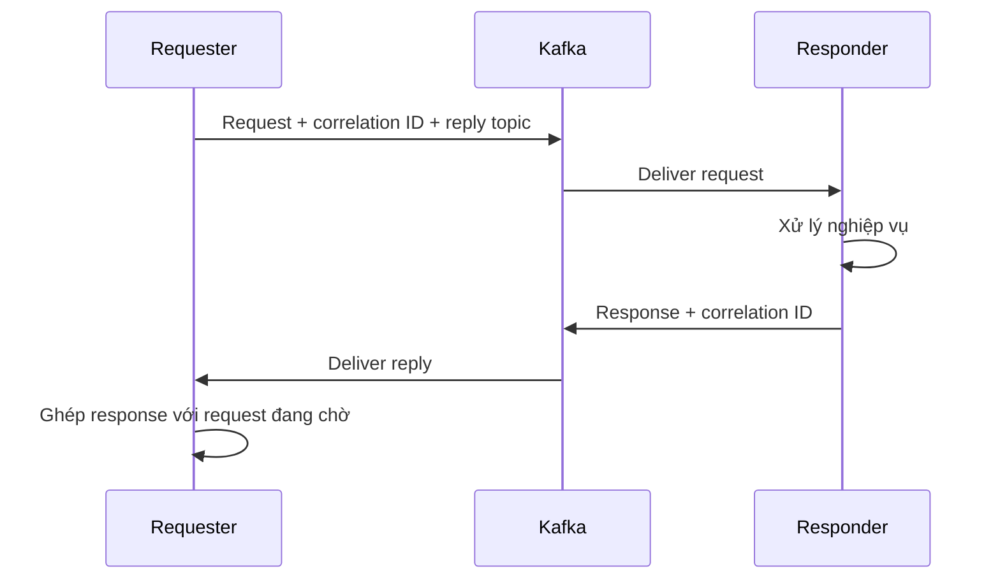
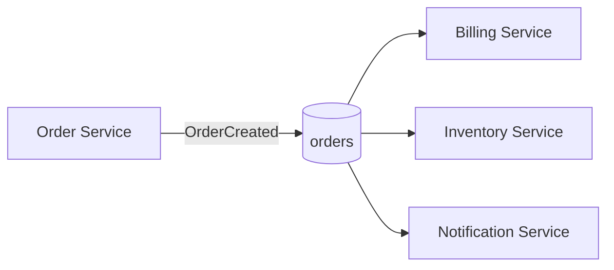

# So sánh request-reply với event-driven

Trong ứng dụng Spring Kafka, hai service có thể trao đổi thông tin theo nhiều cách. Một service có thể gửi request và chờ response tương ứng, hoặc phát một event để các service quan tâm tự tiêu thụ và xử lý. Cả hai cách đều dùng Kafka topic và record, nhưng tạo ra hợp đồng giao tiếp khác nhau.

Request-reply phù hợp khi bên gọi cần kết quả của một thao tác trước khi tiếp tục luồng hiện tại. Event-driven phù hợp khi bên phát chỉ cần công bố một sự kiện và không phụ thuộc vào một consumer cụ thể phản hồi ngay. Request-reply thường tạo cảm giác giống lời gọi hàm từ xa; event-driven tách bên phát khỏi bên nhận và phù hợp với xử lý bất đồng bộ.

Hai mô hình không loại trừ nhau. Một hệ thống có thể dùng request-reply cho truy vấn ngắn cần phản hồi, đồng thời dùng event-driven để thông báo những thay đổi nghiệp vụ cho nhiều service.

## 1. Hai mô hình giao tiếp

### Request-reply

Bên gọi gửi một request lên topic, kèm thông tin để server biết phải gửi response về đâu và response thuộc request nào. Server tiêu thụ request, xử lý rồi gửi response lên reply topic. Bên gọi lắng nghe reply topic và ghép response với request đang chờ.



Trong Spring Kafka, `ReplyingKafkaTemplate` hỗ trợ mẫu này. API `sendAndReceive(...)` gửi request và trả về một future đại diện cho response tương ứng.

### Event-driven

Bên phát công bố event mô tả điều đã xảy ra, chẳng hạn `OrderCreated`. Bên phát không cần biết consumer nào sẽ nhận event hoặc có bao nhiêu consumer đang quan tâm. Các service đăng ký consumer group riêng để xử lý event theo mục đích của mình.



Mỗi consumer group có offset và tiến độ xử lý riêng. Billing, Inventory và Notification có thể xử lý cùng một event độc lập, với tốc độ và thời điểm khác nhau.

## 2. So sánh request-reply với event-driven

| Tiêu chí | Request-reply | Event-driven |
|---|---|---|
| Mục tiêu | Nhận kết quả cho một request cụ thể | Thông báo một sự kiện đã xảy ra |
| Hướng giao tiếp | Request rồi response tương ứng | Producer phát event, consumer tự xử lý |
| Bên gửi có chờ không? | Thường chờ response trong một khoảng thời gian | Thường không chờ consumer xử lý |
| Liên kết giữa hai phía | Biết reply topic và correlation ID | Chỉ cần biết topic/event contract |
| Số bên nhận | Thường có một responder logic cho mỗi request | Có thể có nhiều consumer group |
| Thời gian phản hồi | Cần timeout rõ ràng | Xử lý có thể kéo dài và bất đồng bộ |
| Thứ tự | Response được ghép theo correlation ID, không nhất thiết theo thứ tự request | Thứ tự được bảo đảm trong một partition |
| Failure handling | Timeout, late reply, retry request | Retry consumer, DLT, replay event |
| Coupling | Cao hơn vì requester phụ thuộc response contract | Thấp hơn vì producer không phụ thuộc consumer cụ thể |
| Phù hợp | Tra cứu hoặc thao tác ngắn cần kết quả ngay | Thông báo nghiệp vụ, tích hợp nhiều service, workflow bất đồng bộ |

Một điểm cần phân biệt: request-reply có thể được triển khai bằng hai Kafka message, nhưng điều đó không biến nó thành event notification thuần túy. Request biểu đạt ý định cần được xử lý; response trả lời chính request đó. Event-driven thường công bố sự kiện đã xảy ra để nhiều bên tự phản ứng.

## 3. Request-reply không phải HTTP chạy trên Kafka

Request-reply qua Kafka có thể cung cấp API đồng bộ ở phía ứng dụng, nhưng vận chuyển vẫn bất đồng bộ:

- Request được ghi vào Kafka và được responder tiêu thụ theo lịch poll.
- Response được ghi vào reply topic và requester tiêu thụ bằng một listener container.
- Requester giữ một future chờ correlation ID tương ứng.
- Thời gian phản hồi phụ thuộc consumer lag, tải responder, partition và thời gian xử lý.

Vì vậy, không nên dùng request-reply để tạo chuỗi gọi service đồng bộ dài qua nhiều topic. Mỗi bước chờ response đều thêm độ trễ và tạo thêm phụ thuộc vào trạng thái của responder.

Nếu requester cần phản hồi trong vài trăm mili giây nhưng responder có thể mất vài giây, cần xem lại việc dùng Kafka cho đường gọi đó. HTTP/gRPC có thể phù hợp hơn cho truy vấn ngắn cần latency thấp; Kafka phù hợp với trao đổi dữ liệu bền vững, bất đồng bộ và chịu được độ trễ.

## 4. Request-reply trong Spring Kafka với ReplyingKafkaTemplate

Spring Kafka cung cấp `ReplyingKafkaTemplate` để triển khai request-reply. Template này kết hợp producer gửi request với một reply listener container nhận response.

Một cấu hình đơn giản dùng topic `price-requests` và `price-replies`:

```java
@Configuration
public class RequestReplyConfiguration {

    @Bean
    ConcurrentMessageListenerContainer<String, String> repliesContainer(
            ConsumerFactory<String, String> consumerFactory) {

        ContainerProperties properties =
                new ContainerProperties("price-replies");

        properties.setGroupId("price-requester");

        return new ConcurrentMessageListenerContainer<>(
                consumerFactory,
                properties
        );
    }

    @Bean
    ReplyingKafkaTemplate<String, String, String> replyingKafkaTemplate(
            ProducerFactory<String, String> producerFactory,
            ConcurrentMessageListenerContainer<String, String> repliesContainer) {

        return new ReplyingKafkaTemplate<>(
                producerFactory,
                repliesContainer
        );
    }
}
```

Trong ví dụ, producer factory gửi request và reply container tiêu thụ response bằng cùng kiểu key/value là String. Ứng dụng thực tế có thể dùng DTO và serializer tương ứng cho request và response.

Reply container phải được khởi động và được gán partition trước khi gửi request đầu tiên. Cấu hình `group.id` của reply consumer cũng cần được xem xét theo số instance requester đang chạy.

## 5. Server xử lý request và gửi reply

Server dùng `@KafkaListener` để nhận request. Phương thức có thể trả về một giá trị và dùng `@SendTo` để phát response:

```java
@Component
public class PriceRequestListener {

    private final PricingService pricingService;

    public PriceRequestListener(PricingService pricingService) {
        this.pricingService = pricingService;
    }

    @KafkaListener(
            topics = "price-requests",
            groupId = "pricing-service")
    @SendTo
    public String handle(String sku) {
        return pricingService.getPrice(sku).toString();
    }
}
```

Khi dùng `@SendTo` không chỉ định topic đích, Spring Kafka có thể sử dụng reply topic được truyền trong header của request. `ReplyingKafkaTemplate` thêm các header cần thiết để server biết nơi gửi response và cách liên kết response với request ban đầu.

Nếu dùng `@SendTo("price-replies")` để chỉ định topic cố định, hãy bảo đảm topic đó đúng với reply container mà requester đang lắng nghe. Với nhiều requester instance, một reply topic cố định cần chiến lược phân phối và consumer group phù hợp để response đến đúng requester.

Phương thức listener cũng có thể trả về object DTO thay vì String. Serializer/deserializer của request, response và reply container phải thống nhất với schema mà hai phía sử dụng.

## 6. Gửi request và chờ response

Phía requester tạo `ProducerRecord` rồi gọi `sendAndReceive`:

```java
@Service
public class PriceClient {

    private final ReplyingKafkaTemplate<String, String, String> template;

    public PriceClient(
            ReplyingKafkaTemplate<String, String, String> template) {
        this.template = template;
    }

    public String getPrice(String sku) throws Exception {
        ProducerRecord<String, String> request =
                new ProducerRecord<>("price-requests", sku, sku);

        RequestReplyFuture<String, String, String> future =
                template.sendAndReceive(request);

        SendResult<String, String> sendResult =
                future.getSendFuture().get(5, TimeUnit.SECONDS);

        ConsumerRecord<String, String> reply =
                future.get(5, TimeUnit.SECONDS);

        return reply.value();
    }
}
```

`sendAndReceive` trả về `RequestReplyFuture`. Future có hai phần cần quan tâm:

- `getSendFuture()` cho biết request đã được producer gửi thành công hay chưa.
- Future chính hoàn tất khi response có correlation ID tương ứng được nhận, hoặc kết thúc bằng timeout/lỗi.

Không nên chỉ chờ reply mà bỏ qua lỗi gửi request. Nếu producer không gửi được request, chờ response sẽ không giúp ích. Ví dụ dùng timeout 5 giây cho cả hai future chỉ để minh họa; ứng dụng nên cấu hình ngân sách thời gian phù hợp với SLA và thời gian xử lý thực tế.

API và kiểu generic có thể khác đôi chút giữa các phiên bản Spring Kafka. Hãy kiểm tra dependency đang dùng trước khi sao chép ví dụ vào ứng dụng.

## 7. Correlation ID, reply topic và reply partition

Request-reply cần metadata để response quay về đúng nơi và được ghép với đúng lời gọi.

Các header quan trọng gồm:

| Header | Vai trò |
|---|---|
| Correlation ID | Nhận diện request đang chờ response |
| Reply topic | Cho responder biết topic gửi response |
| Reply partition | Có thể chỉ định partition nhận response khi cấu hình dùng partition cụ thể |

`ReplyingKafkaTemplate` quản lý correlation ID và các header reply cần thiết. Khi response quay lại, template dùng correlation ID để tìm future đang chờ tương ứng.

Correlation ID không phải idempotency key. Correlation ID giúp ghép response với request; idempotency key giúp server nhận biết một yêu cầu nghiệp vụ đã được thực hiện để tránh tác dụng phụ lặp khi request được gửi lại.

Nếu tự xây dựng request-reply mà không dùng template, ứng dụng phải tự quản lý map correlation ID → future, timeout, dọn future đã hết hạn, xử lý reply đến muộn và bảo đảm correlation ID không bị tái sử dụng khi còn request đang chờ. Dùng `ReplyingKafkaTemplate` giúp tránh phải tự triển khai phần lớn cơ chế này.

## 8. Timeout và response đến muộn

Timeout không đồng nghĩa server đã hủy xử lý request. Ví dụ requester chờ 5 giây rồi timeout, nhưng server đang xử lý database và gửi reply ở giây thứ 7. Requester đã kết thúc lời gọi, còn server vẫn có thể hoàn tất nghiệp vụ.

Do đó, timeout cần được hiểu là giới hạn thời gian requester chờ response:

- Không kết luận rằng request chưa được xử lý.
- Không tự động gửi lại request ngay nếu chưa biết server có thể đã thực hiện tác dụng phụ.
- Ghi nhận request ID/correlation ID để điều tra response đến muộn.
- Thiết kế idempotency nếu retry request có thể tạo tác dụng phụ.
- Chọn timeout dựa trên latency của consumer, thời gian xử lý và SLA.

Khi request hết hạn, response đến sau có thể không còn future tương ứng. Cần theo dõi late reply và tránh coi nó như một response hợp lệ cho một request mới.

Có thể cấu hình timeout mặc định trên template bằng API của phiên bản đang dùng, hoặc dùng overload nhận timeout khi gọi `sendAndReceive` nếu phiên bản hỗ trợ. Dù cấu hình ở đâu, cần có một ngân sách thời gian rõ ràng cho toàn bộ luồng.

## 9. Nhiều requester instance và reply topic dùng chung

Khi chạy nhiều instance requester, cần đảm bảo response được tiêu thụ bởi instance đang giữ future tương ứng.

Giả sử instance A gửi request và chờ correlation ID A, instance B gửi request và chờ correlation ID B. Nếu hai reply container dùng cùng một consumer group trên cùng reply topic, Kafka sẽ chia partition giữa các consumer trong group. Reply của A có thể được giao cho B. B không có future tương ứng và không thể hoàn tất lời gọi của A.

Một số cách thiết kế:

- Mỗi requester instance dùng reply topic riêng.
- Dùng reply topic chung nhưng mỗi requester instance có consumer group riêng, để từng instance nhận được reply và template chỉ hoàn tất future có correlation ID khớp.
- Dùng chiến lược partition/routing rõ ràng để response được chuyển đến đúng requester instance.

Cách dùng group riêng cho từng requester làm mỗi instance đọc tất cả reply trên topic chung, sau đó bỏ qua reply không thuộc các future đang chờ. Cách này có thể tăng lượng dữ liệu tiêu thụ khi có nhiều instance. Hãy cân nhắc chi phí fan-out và retention của reply topic.

Không dùng một group ID cố định chung cho tất cả requester instance nếu không có cơ chế routing bảo đảm reply tới đúng instance đang giữ request.

## 10. Event-driven với @KafkaListener và consumer group

Trong event-driven, producer chỉ phát event:

```java
@Service
public class OrderPublisher {

    private final KafkaTemplate<String, OrderCreated> kafkaTemplate;

    public OrderPublisher(
            KafkaTemplate<String, OrderCreated> kafkaTemplate) {
        this.kafkaTemplate = kafkaTemplate;
    }

    public void publish(OrderCreated event) {
        kafkaTemplate.send(
                "orders",
                event.orderId().toString(),
                event
        );
    }
}
```

Các service quan tâm đăng ký listener độc lập:

```java
@KafkaListener(
        topics = "orders",
        groupId = "billing-service")
public void onOrderCreated(OrderCreated event) {
    billingService.createInvoice(event);
}

@KafkaListener(
        topics = "orders",
        groupId = "inventory-service")
public void reserveInventory(OrderCreated event) {
    inventoryService.reserve(event);
}

@KafkaListener(
        topics = "orders",
        groupId = "notification-service")
public void notifyCustomer(OrderCreated event) {
    notificationService.sendOrderConfirmation(event);
}
```

Ba consumer group có offset riêng nên mỗi service nhận được event và tiến độ xử lý độc lập. Nếu nhiều instance cùng thuộc một group, Kafka phân phối partition giữa các instance để chia tải; các instance trong cùng group không phải mỗi instance đều nhận mọi record.

Producer không cần biết ba service này tồn tại. Có thể thêm một consumer group mới để xây dựng analytics hoặc audit mà không cần sửa producer, miễn là event contract vẫn phù hợp.

## 11. Coupling và khả năng thay đổi hệ thống

Request-reply tạo coupling ở cấp giao thức:

- Requester phải biết request topic và định dạng request.
- Requester phải có reply container hoạt động.
- Responder phải hiểu reply routing header hoặc topic đích.
- Hai bên phải thống nhất schema response, lỗi và timeout.
- Requester phụ thuộc khả năng phục vụ của responder tại thời điểm gọi.

Event-driven giảm coupling về thời gian và danh tính consumer. Producer phát event mà không cần biết consumer đang chạy hay không. Consumer có thể xử lý sau, replay từ offset hoặc bổ sung group mới.

Tuy nhiên, event-driven không có nghĩa là không có coupling. Producer và consumer vẫn phụ thuộc event schema, ý nghĩa nghiệp vụ, key, partitioning và chính sách retention. Thay đổi schema cần có versioning và tương thích ngược để các consumer cũ không bị lỗi.

## 12. Lỗi và phản hồi nghiệp vụ

Request-reply cần quy ước cách biểu diễn thành công và thất bại. Không nên chỉ dùng exception khiến requester chờ đến timeout nếu server đã xác định được lỗi nghiệp vụ.

Một response envelope có thể gồm:

```java
public record PriceResponse(
        String requestId,
        boolean success,
        String errorCode,
        String message,
        BigDecimal price) {
}
```

Server trả response thành công hoặc response lỗi có cấu trúc. Ví dụ:

- `success = true`: có kết quả giá.
- `success = false`: SKU không tồn tại hoặc không được phép tra cứu.
- `errorCode`: mã lỗi ổn định để requester xử lý.
- `message`: nội dung phù hợp cho log hoặc hiển thị đã được kiểm soát.

Lỗi hạ tầng như server crash, không có consumer, lỗi publish reply hoặc timeout vẫn cần được xử lý riêng. Có thể kết hợp retry/DLT cho request listener, nhưng phải xác định requester sẽ nhận được gì khi request được đưa vào DLT mà không có response bình thường.

Với event-driven, consumer có thể retry riêng và đưa event lỗi vào DLT. Producer không cần nhận một response đồng bộ; kết quả xử lý có thể được công bố bằng event khác như `InvoiceCreated`, `InventoryReserved` hoặc `OrderRejected`.

## 13. Reliability, duplicate và idempotency

Kafka request-reply không tự bảo đảm toàn bộ request và response chỉ xảy ra đúng một lần. Các tình huống có thể tạo duplicate:

- Requester gửi lại request sau timeout dù server đã xử lý xong.
- Server hoàn tất nghiệp vụ nhưng crash trước khi gửi reply.
- Server gửi reply thành công nhưng requester restart trước khi nhận.
- Consumer xử lý lại request sau rebalance hoặc offset chưa commit.

Hãy đưa một `requestId` ổn định vào payload hoặc header nghiệp vụ. Server có thể lưu request ID đã xử lý và kết quả tương ứng để request gửi lại trả về cùng kết quả thay vì lặp tác dụng phụ.

Nếu response có giá trị nghiệp vụ quan trọng, hãy lưu trạng thái request và response trong database để có thể phục hồi sau restart. Không chỉ dựa vào future trong bộ nhớ, vì future đang chờ sẽ mất khi process requester dừng.

Với event-driven, consumer cũng cần idempotency vì Kafka có thể giao lại record theo semantics đang cấu hình. Consumer group và offset giúp quản lý tiến độ, nhưng không tự làm cho database update hoặc API call bên ngoài trở thành exactly-once.

## 14. Khi nào nên chọn mô hình nào?

| Tình huống | Nên cân nhắc | Lý do |
|---|---|---|
| Tra cứu dữ liệu ngắn và caller cần kết quả để tiếp tục | Request-reply | Có response tương ứng và timeout rõ |
| Phát thông báo đơn hàng đã tạo | Event-driven | Nhiều service có thể tự phản ứng |
| Gọi một service xử lý lâu | Event-driven với status/result event | Không giữ caller chờ trong thời gian dài |
| Tính giá hoặc kiểm tra điều kiện nhanh | Request-reply hoặc HTTP/gRPC | Cần quyết định ngay trong luồng gọi |
| Nhiều consumer độc lập cần cùng một sự kiện | Event-driven | Mỗi consumer group có tiến độ riêng |
| Workflow nhiều bước | Event-driven/Saga | Mỗi bước có thể chạy bất đồng bộ và phục hồi riêng |
| Cần response nhưng chấp nhận xử lý bất đồng bộ | Request-reply qua Kafka | Tách transport khỏi caller bằng future và correlation |

Một quy tắc thực tế: nếu caller cần kết quả để quyết định bước tiếp theo ngay, request-reply có thể phù hợp. Nếu caller chỉ cần công bố một sự kiện và các bên khác tự xử lý, event-driven thường đơn giản và ít coupling hơn.

## 15. Kiểm thử và quan sát

Với request-reply, integration test nên kiểm tra:

1. Request được gửi đúng topic và key.
2. Reply container đã nhận partition trước khi gửi.
3. Server nhận request và gửi response đúng reply topic.
4. Correlation ID ghép đúng response với future.
5. Nhiều request đồng thời không nhận nhầm response.
6. Timeout xảy ra khi server không trả lời.
7. Response đến muộn không làm hoàn tất một request khác.
8. Server lỗi hoặc DLT có chính sách rõ ràng.
9. Request gửi lại với cùng request ID không lặp tác dụng phụ.

Với event-driven, cần kiểm tra:

1. Producer phát event theo schema và key đúng.
2. Các consumer group độc lập đều nhận event.
3. Nhiều instance trong cùng group chia partition như mong đợi.
4. Retry/DLT không làm mất event.
5. Consumer idempotent khi nhận lại cùng event.
6. Schema evolution không làm hỏng consumer hiện có.

Nên theo dõi request rate, reply rate, latency p50/p95/p99, timeout rate, late reply, số future đang chờ, consumer lag, retry và DLT. Với event-driven, theo dõi lag theo từng consumer group để biết service nào đang chậm.

Không ghi payload nhạy cảm hoặc dữ liệu cá nhân vào correlation ID, headers hay log. Dùng ID ngẫu nhiên hoặc định danh kỹ thuật đã được kiểm soát.

## 16. Checklist lựa chọn và triển khai

- [ ] Đã xác định caller có thực sự cần response trước khi tiếp tục hay không.
- [ ] Request-reply có reply topic và reply container hoạt động.
- [ ] Correlation ID được dùng để ghép đúng request/response.
- [ ] Reply container có group ID và partition routing phù hợp với số requester instance.
- [ ] Timeout phản ánh SLA và không bị hiểu nhầm là server đã hủy request.
- [ ] Request ID/idempotency key ổn định khi retry.
- [ ] Server có quy ước response thành công và lỗi nghiệp vụ.
- [ ] Event-driven dùng consumer group riêng cho từng service cần nhận toàn bộ event.
- [ ] Event schema có versioning và tương thích ngược.
- [ ] Consumer xử lý idempotent và có retry/DLT phù hợp.
- [ ] Có integration test cho concurrent request, timeout, late reply và duplicate.
- [ ] Có metric cho latency, timeout, lag, retry và DLT.

Request-reply và event-driven đều có thể được triển khai bằng Spring Kafka, nhưng phục vụ hai hợp đồng giao tiếp khác nhau. `ReplyingKafkaTemplate` giúp gửi request và chờ response bằng correlation ID; event-driven cho phép producer công bố sự kiện để nhiều consumer group tự xử lý. Chọn request-reply khi caller cần kết quả có thời hạn rõ ràng, và chọn event-driven khi muốn tách các service theo thời gian, khả năng mở rộng và tiến độ xử lý độc lập.

