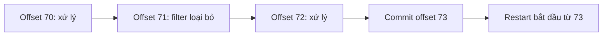

# ackDiscarded và offset của record bị lọc

Spring Kafka cho phép lọc record trước khi gọi phương thức `@KafkaListener` bằng `RecordFilterStrategy`. Khi chiến lược trả về `true`, record bị loại khỏi luồng gọi listener. Tuy nhiên, record vẫn tồn tại trong Kafka; điều cần quyết định là consumer có xác nhận đã xử lý record bị loại hay không.

`ackDiscarded` điều khiển việc xác nhận record bị lọc. Thuộc tính này đặc biệt quan trọng khi dùng acknowledgement thủ công: nếu adapter loại record mà không gọi listener, listener không có cơ hội gọi `Acknowledgment.acknowledge()`. Bật `ackDiscarded` cho phép adapter xác nhận record bị loại theo chính sách của container.

## 1. Lọc record diễn ra ở đâu?

`RecordFilterStrategy.filter(record)` trả về `true` khi muốn loại record và `false` khi muốn chuyển record đến listener. Spring Kafka bọc listener bằng filtering adapter; với record listener là `FilteringMessageListenerAdapter`, còn batch listener dùng adapter tương ứng để lọc danh sách record.

```java
@Bean
public ConcurrentKafkaListenerContainerFactory<String, OrderEvent>
        kafkaListenerContainerFactory(
            ConsumerFactory<String, OrderEvent> consumerFactory) {
    var factory =
        new ConcurrentKafkaListenerContainerFactory<String, OrderEvent>();
    factory.setConsumerFactory(consumerFactory);
    factory.setRecordFilterStrategy(record ->
        record.value() != null && record.value().isDuplicate());
    factory.setAckDiscarded(true);
    return factory;
}
```

Trong ví dụ, record được đánh dấu duplicate sẽ không đi vào phương thức listener. `setAckDiscarded(true)` yêu cầu adapter xác nhận record bị lọc. Listener sử dụng factory này:

```java
@KafkaListener(
    topics = "order-events",
    groupId = "order-projection",
    containerFactory = "kafkaListenerContainerFactory")
public void consume(OrderEvent event) {
    orderProjection.apply(event);
}
```

Hãy chỉ lọc khi quyết định bỏ qua là có chủ đích. Nếu payload sai định dạng, thiếu dữ liệu bắt buộc hoặc gặp lỗi tạm thời khi kiểm tra, thường cần đưa lỗi qua error handler hoặc DLT để điều tra thay vì trả `true` và loại record âm thầm.

## 2. ackDiscarded thay đổi điều gì?

`ackDiscarded` không xóa record khỏi Kafka và cũng không thay đổi offset của record trên broker. Nó quyết định adapter có acknowledge record bị loại hay không. Giá trị mặc định là `false`.

| Cấu hình | Hành vi của filtering adapter |
| --- | --- |
| `ackDiscarded = false` | Loại record khỏi lời gọi listener nhưng không chủ động acknowledge record đó qua `Acknowledgment`. |
| `ackDiscarded = true` | Loại record khỏi lời gọi listener và acknowledge record bị loại. |

Với các `AckMode` do container quản lý như `RECORD` hoặc `BATCH`, container vẫn điều khiển commit sau khi adapter trả về bình thường theo chế độ đã chọn. `ackDiscarded` trở nên đặc biệt hữu ích với `MANUAL` và `MANUAL_IMMEDIATE`, vì listener không được gọi cho record bị lọc nên không thể tự acknowledge record đó.

Nếu dùng manual acknowledgement và để `ackDiscarded` là `false`, record bị lọc có thể chưa được xác nhận. Khi offset chưa tiến qua record đó, consumer có thể đọc lại nó sau restart hoặc rebalance. Bật `ackDiscarded` thể hiện rõ rằng việc loại record là kết quả xử lý đã được chấp nhận.

## 3. Offset của record bị lọc được commit ra sao?

Kafka lưu offset riêng cho từng partition. Offset commit là vị trí record kế tiếp mà consumer group sẽ đọc, không phải số lượng record đã xử lý. Khi một record bị lọc và tiến độ được commit qua offset của nó, lần khởi động sau consumer sẽ tiếp tục từ offset kế tiếp; record đã lọc không được giao lại cho group đó.

Ví dụ partition `order-events-0` có ba record:

| Offset | Quyết định filter | Kết quả |
| ---: | --- | --- |
| 70 | Giữ lại | Listener xử lý |
| 71 | Loại bỏ | Không gọi listener |
| 72 | Giữ lại | Listener xử lý |

Nếu container commit offset `73` cho partition, consumer group đã xác nhận tiến độ qua offset 72. Khi restart, consumer bắt đầu từ offset 73; record 71 không được đọc lại. Nếu offset đã commit vẫn là `71`, consumer sẽ bắt đầu lại từ record ở offset 71 và filter có thể chạy lại.



Kafka offset có thể có khoảng trống do compaction hoặc các đặc tính khác của log. Vì vậy, không tính offset kế tiếp bằng số record nhìn thấy trong listener; hãy hiểu offset commit là vị trí tiếp tục đọc theo partition.

## 4. Ảnh hưởng của AckMode

`AckMode` quyết định container commit offset khi nào. Việc lọc record không tạo ra một cơ chế commit độc lập; record đã bị loại vẫn tham gia vào tiến độ của poll theo chính sách acknowledgement.

| AckMode | Ý nghĩa với record bị lọc |
| --- | --- |
| `RECORD` | Container commit sau khi xử lý từng record; adapter trả về bình thường sau khi lọc. |
| `BATCH` | Container commit offset của các partition sau khi xử lý xong batch từ một lần `poll()`. |
| `TIME`, `COUNT`, `COUNT_TIME` | Commit khi điều kiện thời gian hoặc số record đã xử lý đạt ngưỡng. |
| `MANUAL` | Listener chủ động acknowledge; record bị lọc cần được adapter acknowledge nếu muốn xác nhận riêng nó. |
| `MANUAL_IMMEDIATE` | Acknowledge có thể commit ngay trên consumer thread; `ackDiscarded` giúp xác nhận record bị loại dù listener không chạy. |

Với `MANUAL`, acknowledgement được gom theo semantics của container; một offset đã acknowledge ở vị trí sau có thể làm tiến độ commit vượt qua record trước đó trong cùng partition. Do Kafka commit offset theo vị trí kế tiếp, không nên suy luận rằng mỗi record có một cờ commit độc lập. Nếu cần xác nhận việc loại bỏ một cách tường minh, bật `ackDiscarded` và kiểm thử với đúng `AckMode` đang dùng.

Ví dụ cấu hình manual acknowledgement:

```java
factory.getContainerProperties()
    .setAckMode(ContainerProperties.AckMode.MANUAL_IMMEDIATE);
factory.setAckDiscarded(true);
```

Trong listener, chỉ acknowledge record mà listener thực sự nhận và xử lý:

```java
@KafkaListener(topics = "order-events",
               containerFactory = "kafkaListenerContainerFactory")
public void consume(OrderEvent event, Acknowledgment acknowledgment) {
    orderProjection.apply(event);
    acknowledgment.acknowledge();
}
```

Record bị filter loại trước khi vào method; filtering adapter chịu trách nhiệm acknowledge nó khi `ackDiscarded` được bật.

## 5. Khi dùng batch listener

Với batch listener, filtering adapter loại các record bị filter khỏi danh sách trước khi gọi listener. Listener nhận danh sách đã lọc, vì vậy kích thước batch mà listener thấy có thể nhỏ hơn số record consumer lấy từ Kafka.

Nếu tất cả record trong batch đều bị lọc, listener có thể không được gọi. Với manual acknowledgement, cần kiểm tra `ackDiscarded` để adapter xác nhận batch đã bị loại theo ý định. Với container-managed AckMode, container xử lý offset theo batch và chế độ commit đã cấu hình.

Không giả định index trong danh sách sau lọc tương ứng với offset hoặc vị trí ban đầu trong batch. Nếu cần audit từng record bị loại, hãy ghi metadata như topic, partition, offset và lý do filter trước khi bỏ record. Khi xử lý batch, kiểm thử cả trường hợp một phần record bị lọc và trường hợp toàn bộ batch bị lọc.

## 6. Filtering kết hợp với Kafka transaction

Nếu listener container dùng Kafka transaction, offset consumer được đưa vào transaction theo cấu hình của container. Record bị filter không gọi phương thức listener, nhưng quyết định lọc vẫn nằm trong lần xử lý poll hiện tại. Khi transaction commit, offset tương ứng có thể được xác nhận cùng transaction; nếu transaction rollback, tiến độ chưa commit có thể được đọc lại.

Không xem `ackDiscarded` là một transaction độc lập hoặc là bằng chứng rằng side effect bên ngoài đã hoàn tất. Nó chỉ điều khiển acknowledgement của record bị loại qua adapter. Nếu filter cần ghi audit hoặc cập nhật database, thao tác đó có ranh giới transaction riêng và cần idempotency nếu record có thể được giao lại.

## 7. Phân biệt loại bỏ có chủ đích và lỗi cần phục hồi

Filtering phù hợp với các trường hợp có quy tắc bỏ qua rõ ràng:

- Event trùng đã được xử lý và có dấu inbox/dedup bền vững.
- Snapshot cũ hơn version hiện tại nên không còn tác dụng.
- Event không thuộc loại mà consumer group này quan tâm.
- Event đã bị hủy theo trạng thái nghiệp vụ và quy tắc đó cho phép bỏ qua.

Không nên dùng filter để che lỗi hệ thống hoặc lỗi dữ liệu cần điều tra. Ví dụ, nếu kiểm tra duplicate phải gọi database nhưng database timeout, đừng coi timeout là duplicate. Hãy để exception đi qua error handler để retry hoặc recovery. Nếu payload không hợp lệ, có thể gửi sang DLT kèm lý do thay vì bỏ đi.

Với duplicate detection, thao tác ghi dấu event đã xử lý và cập nhật dữ liệu nghiệp vụ nên nằm trong cùng transaction database. Nếu chỉ đọc một cờ trong cache, hai consumer hoặc hai lần giao đồng thời có thể cùng quyết định record chưa tồn tại rồi tạo side effect trùng.

## 8. Audit và quan sát record bị lọc

Một record bị loại không đi vào listener nghiệp vụ, vì vậy log và metric là cách quan trọng để giải thích vì sao offset vẫn tiến lên. Có thể ghi topic, partition, offset, key hoặc event ID, filter rule và lý do loại bỏ. Tránh ghi payload nhạy cảm đầy đủ vào log.

Theo dõi số record bị lọc theo rule, tỷ lệ lọc trên tổng record, số lần filter lỗi, consumer lag và số record bị đọc lại sau restart. Nếu tỷ lệ lọc tăng đột biến, có thể producer phát event sai, rule filter thay đổi hoặc consumer đang loại nhầm dữ liệu hợp lệ.

Không nên thực hiện một HTTP call chậm trong filter để quyết định bỏ record. Filter chạy trên luồng consumer; thao tác chậm có thể làm giảm throughput và ảnh hưởng thời gian poll. Nếu quyết định lọc cần thông tin ngoài, ưu tiên dữ liệu đã có trong event hoặc một kho dữ liệu cục bộ có thời gian truy cập dự đoán được.

## 9. Kiểm thử ackDiscarded và offset

Một kiểm thử tích hợp nên gửi một record bị lọc và một record được giữ lại vào cùng partition. Dùng `MANUAL_IMMEDIATE` để xác minh record được giữ chỉ được acknowledge bởi listener, còn record bị loại được adapter acknowledge khi `ackDiscarded=true`. Sau đó khởi động lại consumer group hoặc tạo consumer mới với cùng group ID để xác minh offset đã commit và record bị lọc không được giao lại.

Kiểm thử thêm các tình huống:

- `ackDiscarded=false` trong manual mode và record bị lọc là record cuối cùng được poll.
- `ackDiscarded=true` với `MANUAL` và `MANUAL_IMMEDIATE`.
- `BATCH` mode khi một phần hoặc toàn bộ batch bị lọc.
- Transaction commit và rollback sau khi record bị filter loại.
- Filter ném exception do dependency lỗi; xác minh record đi qua error handler.
- Duplicate event được lọc nhưng không làm mất cập nhật nghiệp vụ chưa commit.

Dùng Embedded Kafka hoặc Testcontainers để kiểm tra offset thật thay vì chỉ kiểm tra filter trả về `true` hay `false`. Khi test commit, hãy kiểm tra committed offset theo từng partition; không dùng số lần listener được gọi làm đại diện duy nhất cho tiến độ Kafka.

## Kết luận

`ackDiscarded` quyết định filtering adapter có acknowledge record bị loại hay không. Record vẫn nằm trong Kafka; khi offset của partition được commit vượt qua nó, consumer group sẽ tiếp tục từ offset kế tiếp và không đọc lại record đó. Hãy kết hợp `ackDiscarded` với `AckMode` phù hợp, kiểm thử cả record và batch listener, đồng thời audit các quyết định loại bỏ để việc offset tiến lên luôn có thể giải thích.
