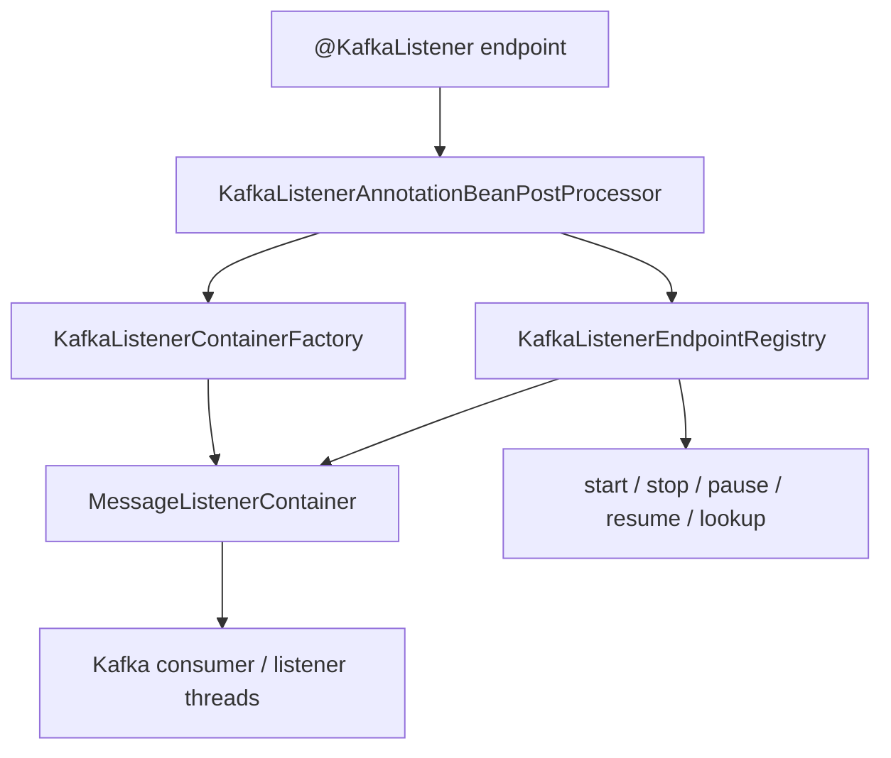

# KafkaListenerEndpointRegistry trong Spring Kafka

`KafkaListenerEndpointRegistry` là thành phần hạ tầng Spring Kafka quản lý vòng đời các listener container được tạo từ `@KafkaListener` hoặc đăng ký như một listener endpoint. Thông qua registry, ứng dụng có thể tìm container theo ID, start/stop listener, pause/resume consumer, liệt kê các container đang được quản lý và tạo listener động khi cần.

Một điểm cần hiểu đúng: phương thức được gắn `@KafkaListener` không trực tiếp là một Kafka consumer và listener container được tạo cho annotation không phải bean thông thường trong Spring ApplicationContext. Spring Kafka đăng ký container đó với `KafkaListenerEndpointRegistry` để quản lý lifecycle. Container được khai báo trực tiếp thành bean là trường hợp khác và không nằm trong tập container do registry quản lý.

## 1. Registry nằm ở đâu trong kiến trúc listener?

Khi ứng dụng bật Kafka listener infrastructure, Spring Kafka xử lý annotation `@KafkaListener`, tạo endpoint và dùng `KafkaListenerContainerFactory` để tạo listener container. Registry giữ các container này và điều phối vòng đời của chúng.



Các thành phần có vai trò khác nhau:

| Thành phần | Vai trò |
|---|---|
| `@KafkaListener` | Khai báo method nhận message và metadata endpoint như ID, topic, group |
| `KafkaListenerContainerFactory` | Tạo container, cấu hình consumer factory, concurrency, converter, error handler và container properties |
| `MessageListenerContainer` | Quản lý consumer, poll loop, listener invocation và lifecycle |
| `KafkaListenerEndpointRegistry` | Giữ tham chiếu các container được đăng ký và cung cấp thao tác lifecycle |
| `ConsumerFactory` | Tạo Kafka consumer theo cấu hình client |

Registry không thay thế container factory, consumer factory hoặc Kafka broker. Nó là điểm quản lý các container sau khi endpoint đã được chuyển thành container.

## 2. Registry được Spring Kafka tạo tự động

Trong ứng dụng dùng `@EnableKafka` hoặc Spring Boot auto-configuration phù hợp, Spring Kafka đăng ký bean `KafkaListenerEndpointRegistry`. Có thể inject bean này vào service quản trị listener:

```java
@Service
public class ListenerLifecycleService {

    private final KafkaListenerEndpointRegistry registry;

    public ListenerLifecycleService(KafkaListenerEndpointRegistry registry) {
        this.registry = registry;
    }
}
```

Không cần tự tạo một registry thứ hai để quản lý các listener annotation. Hãy inject registry infrastructure do Spring Kafka cung cấp, để các endpoint được annotation processor đăng ký vào cùng nơi.

Một listener cần có ID ổn định nếu ứng dụng muốn tìm container bằng registry:

```java
@Component
public class OrderListener {

    @KafkaListener(
            id = "orders-listener",
            topics = "orders",
            groupId = "orders-service"
    )
    public void onOrder(OrderCreated event) {
        // Xử lý order event.
    }
}
```

Giá trị `id` là ID của listener container trong registry. Nếu không khai báo ID rõ ràng, framework có thể tạo ID theo quy tắc mặc định; trong code quản trị lifecycle, ID tường minh giúp dễ đọc và ít phụ thuộc chi tiết triển khai.

## 3. Lấy container theo ID

Dùng `getListenerContainer(String id)` để lấy một container:

```java
public void startOrdersListener() {
    MessageListenerContainer container =
            registry.getListenerContainer("orders-listener");

    if (container == null) {
        throw new IllegalArgumentException(
                "Unknown listener: orders-listener");
    }

    if (!container.isRunning()) {
        container.start();
    }
}
```

Phương thức trả về `null` nếu ID không tồn tại. Vì vậy, luôn kiểm tra null trước khi gọi `start()`, `stop()`, `pause()` hoặc `resume()`.

Có thể kiểm tra trạng thái:

```java
MessageListenerContainer container =
        registry.getListenerContainer("orders-listener");

if (container != null) {
    boolean running = container.isRunning();
    boolean pauseRequested = container.isPauseRequested();
    boolean containerPaused = container.isContainerPaused();
}
```

`isRunning()` cho biết container đang chạy theo lifecycle. `isPauseRequested()` cho biết đã có yêu cầu pause; consumer có thể chưa thực sự pause. `isContainerPaused()` phản ánh trạng thái pause thực tế; với concurrent container, giá trị true chỉ khi tất cả consumer con đã pause.

## 4. Liệt kê container được registry quản lý

`getListenerContainers()` trả về các container được registry quản lý. `getListenerContainerIds()` trả về tập ID tương ứng:

```java
Set<String> listenerIds = registry.getListenerContainerIds();
Collection<MessageListenerContainer> containers =
        registry.getListenerContainers();

for (MessageListenerContainer container : containers) {
    log.info("listener running={}", container.isRunning());
}
```

Nếu cần chọn listener theo ID, có thể lọc danh sách ID:

```java
Set<String> orderListenerIds = registry.getListenerContainerIds()
        .stream()
        .filter(id -> id.startsWith("orders-"))
        .collect(Collectors.toSet());
```

Từ Spring Kafka 3.2, registry có hai overload `getListenerContainersMatching`:

```java
Collection<MessageListenerContainer> retryContainers =
        registry.getListenerContainersMatching(
                id -> id.startsWith("orders-retry-"));

Collection<MessageListenerContainer> runningContainers =
        registry.getListenerContainersMatching(
                (id, container) ->
                        id.startsWith("orders-") && container.isRunning());
```

Overload đầu nhận `Predicate<String>` để lọc theo ID. Overload thứ hai nhận `BiPredicate<String, MessageListenerContainer>` để kết hợp ID với trạng thái hoặc thuộc tính container. Nếu dự án dùng Spring Kafka trước 3.2, hãy lọc từ `getListenerContainers()` và `getListenerContainerIds()` thay cho API này.

## 5. getListenerContainers và getAllListenerContainers khác nhau

Không phải mọi listener container trong ApplicationContext đều do registry quản lý:

| API | Phạm vi |
|---|---|
| `getListenerContainers()` | Các container do registry quản lý, chủ yếu được tạo từ `@KafkaListener` hoặc đăng ký qua registry |
| `getAllListenerContainers()` | Các container do registry quản lý và container được khai báo thành bean trong ApplicationContext |
| `getListenerContainer(id)` | Tìm container theo ID trong registry |

`getAllListenerContainers()` được bổ sung từ Spring Kafka 2.2.5. Collection này bao gồm prototype container đã được khởi tạo, nhưng không khởi tạo các lazy bean chưa được tạo.

Container được khai báo trực tiếp bằng `@Bean` không tự động thuộc lifecycle của registry. Có thể lấy container bean từ ApplicationContext hoặc dùng `getAllListenerContainers()` để quan sát toàn bộ. Đừng giả định `registry.stop()` sẽ dừng mọi object container trong context nếu chúng không được registry quản lý.

## 6. Start và stop một listener

Có thể start hoặc stop một container riêng:

```java
public void enableOrders() {
    MessageListenerContainer container =
            requireContainer("orders-listener");
    container.start();
}

public void disableOrders() {
    MessageListenerContainer container =
            requireContainer("orders-listener");
    container.stop();
}

private MessageListenerContainer requireContainer(String id) {
    MessageListenerContainer container = registry.getListenerContainer(id);
    if (container == null) {
        throw new IllegalArgumentException("Listener not found: " + id);
    }
    return container;
}
```

`start()` khởi động container và consumer tham gia consumer group. `stop()` dừng container, đóng consumer và có thể làm group rebalance để partition được phân công lại cho các consumer còn lại.

Nếu cần biết khi nào container dừng xong, dùng overload callback:

```java
container.stop(() ->
        log.info("Listener {} stopped", container.getListenerId()));
```

Callback hữu ích khi cần thực hiện bước tiếp theo sau khi listener đã dừng. Không nên giả định lệnh stop luôn hoàn tất đồng bộ ngay tại thời điểm gọi.

## 7. Start và stop toàn bộ container qua registry

Registry triển khai lifecycle của Spring. Có thể start hoặc stop toàn bộ container do registry quản lý:

```java
registry.start();
registry.stop();
```

Có thể dùng callback khi dừng:

```java
registry.stop(() -> log.info("Registered Kafka listeners stopped"));
```

Đây là thao tác diện rộng. Trước khi gọi `registry.stop()`, hãy xác định có listener nào đang xử lý tác vụ cần hoàn tất hay không và có cần drain/backpressure trước shutdown hay không. Khi chỉ cần bảo trì một luồng, lấy container theo ID và dừng riêng container đó.

Tất cả container được tạo bởi các listener container factory trong cùng registry phải dùng cùng lifecycle phase. Khi có nhiều factory tùy chỉnh, kiểm tra phase của chúng để startup/shutdown order nhất quán.

## 8. Kiểm soát autoStartup

Mặc định, listener container có thể tự start khi ApplicationContext khởi tạo. Có thể tắt auto startup cho một listener:

```java
@KafkaListener(
        id = "orders-listener",
        topics = "orders",
        groupId = "orders-service",
        autoStartup = "false"
)
public void onOrder(OrderCreated event) {
    orderService.process(event);
}
```

Sau khi ứng dụng hoàn tất kiểm tra dependency hoặc load cấu hình tenant, có thể start listener:

```java
@Component
public class KafkaStartupCoordinator implements ApplicationRunner {

    private final KafkaListenerEndpointRegistry registry;

    public KafkaStartupCoordinator(KafkaListenerEndpointRegistry registry) {
        this.registry = registry;
    }

    @Override
    public void run(ApplicationArguments args) {
        // Kiểm tra dependency và readiness trước.
        registry.getListenerContainer("orders-listener").start();
    }
}
```

`autoStartup` trên annotation ghi đè giá trị mặc định của container factory cho endpoint đó. Đây là lựa chọn hữu ích khi ứng dụng phải chờ database, schema, secret hoặc cấu hình tenant sẵn sàng trước khi bắt đầu nhận message.

## 9. Đăng ký listener sau khi ApplicationContext đã refresh

Các endpoint được đăng ký sau khi ApplicationContext đã refresh thường được start ngay, bất kể thuộc tính `autoStartup` của endpoint. Hành vi này tuân theo contract `SmartLifecycle`, trong đó auto startup được xét ở giai đoạn context initialization.

Từ Spring Kafka 2.8.7, registry có thuộc tính `alwaysStartAfterRefresh`. Đặt thành `false` để `autoStartup` của container quyết định việc start đối với endpoint được đăng ký muộn:

```java
@Component
public class RegistryStartupPolicy implements SmartInitializingSingleton {

    private final KafkaListenerEndpointRegistry registry;

    public RegistryStartupPolicy(KafkaListenerEndpointRegistry registry) {
        this.registry = registry;
    }

    @Override
    public void afterSingletonsInstantiated() {
        registry.setAlwaysStartAfterRefresh(false);
    }
}
```

Ví dụ dùng callback sau khi các singleton được khởi tạo để cấu hình registry infrastructure hiện có trước khi ứng dụng đăng ký endpoint muộn. Import `org.springframework.beans.factory.SmartInitializingSingleton` và không khai báo thêm một bean `KafkaListenerEndpointRegistry` khác.

Nếu không thay đổi hành vi mặc định, hãy giả định listener tạo sau context refresh sẽ start ngay. Không dùng `autoStartup=false` như một bảo đảm trì hoãn start cho mọi dynamic registration.

## 10. Pause và resume khác stop và start

Pause phù hợp khi muốn tạm ngừng nhận record nhưng vẫn giữ consumer tham gia group. Stop phù hợp khi muốn kết thúc consumer container.

| Thao tác | Consumer | Group membership | Dùng khi |
|---|---|---|---|
| `pause()` | Tạm ngừng lấy record; tiếp tục poll | Vẫn giữ membership | Backpressure, bảo trì ngắn, downstream tạm quá tải |
| `resume()` | Tiếp tục lấy record | Vẫn giữ membership | Điều kiện xử lý đã phục hồi |
| `stop()` | Đóng consumer | Rời group, có thể rebalance | Tắt listener, thay đổi cấu hình hoặc shutdown |
| `start()` | Tạo/chạy consumer theo container | Tham gia group lại | Khởi động listener đã dừng |

Gọi qua registry:

```java
public void pauseOrders() {
    requireContainer("orders-listener").pause();
}

public void resumeOrders() {
    requireContainer("orders-listener").resume();
}
```

`pause()` có hiệu lực ngay trước lần poll tiếp theo; `resume()` có hiệu lực sau khi poll hiện tại trả về. Khi pause, container vẫn poll consumer để giữ group membership và tránh rebalance, nhưng không lấy thêm record để listener xử lý.

Từ Spring Kafka 2.9, thuộc tính `pauseImmediate` có thể làm pause có hiệu lực sau khi record hiện tại được xử lý, thay vì đợi xử lý hết các record đã nhận từ poll trước đó. Cần đánh giá batch/record listener và version đang dùng trước khi bật.

## 11. Pause state và sự kiện lifecycle

Hai trạng thái thường bị nhầm:

- `isPauseRequested()` trả về true khi có yêu cầu pause, dù consumer có thể chưa pause thực tế.
- `isContainerPaused()` trả về true khi tất cả consumer của container đã pause.

Spring Kafka phát các event `ConsumerPausedEvent` và `ConsumerResumedEvent` khi trạng thái consumer thay đổi:

```java
@Component
public class ListenerPauseEventLogger {

    @EventListener
    public void onConsumerPaused(ConsumerPausedEvent event) {
        log.info("Paused partitions: {}", event.getPartitions());
    }

    @EventListener
    public void onConsumerResumed(ConsumerResumedEvent event) {
        log.info("Resumed partitions: {}", event.getPartitions());
    }
}
```

Event có container làm source và chứa các partition liên quan. Có thể dùng chúng để cập nhật trạng thái vận hành hoặc metric. Không nên dựa vào một biến boolean tự quản lý mà bỏ qua trạng thái thực tế của container.

## 12. Tạo listener động bằng prototype bean

Một cách thuận tiện để tạo listener theo tenant hoặc cấu hình runtime là khai báo class có `@KafkaListener` với scope prototype. Mỗi instance có ID và topic riêng:

```java
public class TenantEventListener {

    private final String id;
    private final String topic;

    public TenantEventListener(String id, String topic) {
        this.id = id;
        this.topic = topic;
    }

    public String getId() {
        return id;
    }

    public String getTopic() {
        return topic;
    }

    @KafkaListener(
            id = "#{__listener.id}",
            topics = "#{__listener.topic}"
    )
    public void listen(String payload) {
        // Xử lý message của tenant.
    }
}
```

Đăng ký bean prototype:

```java
@Configuration
public class TenantListenerConfiguration {

    @Bean
    @Scope(ConfigurableBeanFactory.SCOPE_PROTOTYPE)
    TenantEventListener tenantEventListener(String id, String topic) {
        return new TenantEventListener(id, topic);
    }
}
```

Tạo instance theo cấu hình runtime:

```java
TenantEventListener listener = applicationContext.getBean(
        TenantEventListener.class,
        "tenant-a-listener",
        "tenant-a-events");
```

Khi instance prototype được tạo, Spring Kafka xử lý annotation và đăng ký container tương ứng vào registry. ID phải duy nhất. Nếu hai instance dùng cùng ID, việc đăng ký sẽ xung đột.

Prototype bean được tạo sau context refresh là late registration; theo mặc định container có thể start ngay. Nếu cần trì hoãn, cấu hình `alwaysStartAfterRefresh` như phần trước và xác định rõ lúc nào container được start.

## 13. Đăng ký endpoint trực tiếp qua registry

Ngoài prototype bean, API `registerListenerContainer(endpoint, factory, startImmediately)` cho phép đăng ký một `KafkaListenerEndpoint` trực tiếp. Cách này phù hợp khi ứng dụng xây endpoint bằng code hoặc có một registry cấu hình riêng.

Quy trình tổng quát:

1. Tạo endpoint với ID duy nhất, group ID, topic/pattern/partition và listener method hoặc listener adapter.
2. Chọn `KafkaListenerContainerFactory` phù hợp.
3. Gọi `registry.registerListenerContainer(endpoint, factory, true)` nếu muốn start ngay.
4. Dùng ID endpoint để tra cứu, pause, resume hoặc stop container sau đó.

Với method-based endpoint, Spring Kafka cung cấp `MethodKafkaListenerEndpoint` để gắn bean và method xử lý. Endpoint còn cần cấu hình message handler method factory tương thích với cách listener nhận payload/header. Đây là API mức thấp hơn prototype `@KafkaListener`; chỉ nên dùng khi cần kiểm soát quá trình tạo endpoint.

Không đăng ký một endpoint với ID trùng container đang có. Trước khi đăng ký lại ID đã dùng, cần dừng và unregister container cũ theo đúng trình tự.

## 14. Unregister container và giải phóng tài nguyên

Từ Spring Kafka 2.8.9, registry có `unregisterListenerContainer(String id)`. Phương thức này chỉ gỡ container khỏi registry; nó không tự gọi lifecycle hoặc destroy callback của container.

Trình tự cơ bản:

```java
public void removeListener(String id) {
    MessageListenerContainer container =
            registry.getListenerContainer(id);

    if (container == null) {
        return;
    }

    container.stop(() -> {
        MessageListenerContainer removed =
                registry.unregisterListenerContainer(id);

        if (removed != null) {
            log.info("Listener {} stopped and unregistered", id);
        }
    });
}
```

Ví dụ trên chờ container dừng rồi mới unregister. Nếu container implementation có tài nguyên cần destroy riêng, ứng dụng phải xử lý theo lifecycle contract của container đó; không giả định unregister tự giải phóng mọi tài nguyên.

Chỉ unregister mà không stop có thể để consumer vẫn chạy dù registry không còn quản lý container đó. Đây là lỗi vận hành dễ tạo listener mồ côi và làm ứng dụng khó shutdown đúng cách.

## 15. Dynamic listener theo tenant: quản lý ID và giới hạn tài nguyên

Khi mỗi tenant có một listener, cần quản lý vòng đời và số lượng endpoint:

- Tạo ID có namespace, ví dụ `tenant-a-orders`.
- Lưu mapping tenant → listener ID/topic/group.
- Kiểm tra ID đã tồn tại trước khi tạo.
- Dừng và unregister khi tenant bị vô hiệu hóa.
- Giới hạn số listener và concurrency theo tài nguyên JVM, số partition và năng lực downstream.
- Xử lý topic đã bị xóa, ACL thay đổi hoặc tenant config không còn hợp lệ.

Không nên tạo một listener cho mọi request hoặc mọi message. Container tạo consumer, thread, network connection và metadata state; số lượng listener không giới hạn có thể làm cạn tài nguyên. Với nhiều tenant, cân nhắc một listener subscribe nhiều topic hoặc một mô hình routing trong application thay vì tạo container riêng cho từng tenant.

## 16. Registry không phải công cụ thay đổi consumer config tùy ý

Registry chủ yếu quản lý lifecycle và truy xuất container. Nó không tự động sửa mọi Kafka consumer property khi ứng dụng thay đổi cấu hình runtime.

Ví dụ, thay đổi group ID, deserializer hoặc security settings thường cần tạo container mới với factory/endpoint được cấu hình lại. Không giả định gọi `start()` lần nữa sẽ reload toàn bộ property từ file cấu hình.

Khi thay đổi topic subscription hoặc concurrency:

1. Xác định container cần thay đổi.
2. Dừng container theo quy trình an toàn.
3. Tạo endpoint/factory mới hoặc cập nhật cấu hình được hỗ trợ.
4. Unregister container cũ nếu không còn dùng.
5. Đăng ký và start container mới.
6. Theo dõi rebalance, offset và consumer lag sau thay đổi.

Đổi concurrency hoặc subscription có thể làm group rebalance. Cần tính tới thời gian dừng nhận record, xử lý record đang chạy và khả năng redelivery.

## 17. Bảo mật API quản trị listener

Nếu cung cấp REST endpoint để start/stop/pause/resume listener, đó là thao tác quản trị có ảnh hưởng trực tiếp tới luồng message. Không expose registry tùy tiện ra endpoint public.

Nên áp dụng:

- Xác thực và phân quyền operator/admin.
- Allowlist ID listener được phép điều khiển.
- Audit ai đã pause/stop/start và thời điểm thực hiện.
- Chặn thao tác xung đột như unregister khi container chưa dừng.
- Trả trạng thái thực tế của container thay vì chỉ trả “request accepted”.
- Có timeout và cảnh báo khi stop callback không hoàn tất.

Không nhận trực tiếp tên bean, class name, topic tùy ý hoặc SpEL từ request bên ngoài để tạo endpoint. Topic subscription và listener ID phải được kiểm soát bởi cấu hình đáng tin cậy.

## 18. Monitoring listener container

Registry cung cấp danh sách container và trạng thái lifecycle; có thể kết hợp với Kafka consumer metrics và application metrics:

| Dữ liệu | Nguồn |
|---|---|
| Listener ID | `getListenerContainerIds()` |
| Container running | `isRunning()` |
| Pause requested/actual | `isPauseRequested()`, `isContainerPaused()` |
| Consumer group, assignment, lag | Kafka client/broker monitoring |
| Processing rate và latency | Listener instrumentation/application metrics |
| Pause/resume transition | `ConsumerPausedEvent`, `ConsumerResumedEvent` |
| Rebalance và lỗi consumer | Kafka client logs/events/metrics |

Registry không trực tiếp cung cấp consumer lag. Muốn theo dõi lag, cần dùng Kafka metrics, exporter hoặc công cụ monitoring broker phù hợp.

Một trang quản trị listener hữu ích nên hiển thị ID, group, topic, trạng thái running/paused, concurrency, partition assignment, lag và thời điểm thay đổi lifecycle.

## 19. Kiểm thử KafkaListenerEndpointRegistry

Có thể kiểm thử lifecycle với Spring context và Embedded Kafka hoặc Testcontainers:

- Container có ID được đăng ký sau khi context khởi tạo.
- `getListenerContainer(id)` trả về đúng container.
- `autoStartup=false` giữ listener chưa chạy trong giai đoạn context initialization.
- Gọi `start()` làm listener tham gia group và nhận message.
- Gọi `pause()` ngừng nhận record mới trong khi consumer vẫn giữ membership.
- Gọi `resume()` tiếp tục xử lý record.
- Gọi `stop()` làm container dừng và giải phóng consumer.
- `unregisterListenerContainer` chỉ xóa registry entry; test xác minh container đã stop trước đó.
- Dynamic prototype listener có ID riêng và không xung đột.
- `getListenerContainersMatching` chỉ kiểm thử khi Spring Kafka version từ 3.2.

Không nên chỉ mock registry rồi assert phương thức được gọi. Integration test nên xác minh listener thực sự nhận message, pause/resume ảnh hưởng tới việc nhận record và stop làm consumer rời group. Dùng event ID/topic riêng cho mỗi test và chờ điều kiện bằng polling có timeout.

## 20. Các lỗi thường gặp

**getListenerContainer trả về null:** ID không đúng, endpoint chưa được tạo hoặc container không thuộc registry. Kiểm tra `getListenerContainerIds()` và thời điểm context refresh.

**Không thấy container bean khai báo bằng @Bean:** `getListenerContainers()` chỉ trả container do registry quản lý. Dùng `getAllListenerContainers()` hoặc lấy trực tiếp bean từ ApplicationContext.

**registry.stop() không dừng container bean riêng:** container đó không được registry quản lý. Dừng qua lifecycle bean hoặc container reference riêng.

**autoStartup=false nhưng dynamic listener vẫn start:** endpoint được đăng ký sau context refresh và registry mặc định start ngay. Kiểm tra `alwaysStartAfterRefresh` từ Spring Kafka 2.8.7.

**Pause được yêu cầu nhưng consumer chưa pause:** `isPauseRequested()` không phải trạng thái thực tế. Kiểm tra `isContainerPaused()` hoặc chờ ConsumerPausedEvent.

**Dùng stop khi chỉ muốn backpressure:** stop làm consumer rời group và có thể gây rebalance. Dùng pause/resume nếu muốn giữ membership.

**Unregister nhưng listener vẫn tiêu thụ:** unregister không gọi stop. Dừng container trước khi gỡ khỏi registry.

**Trùng listener ID:** các endpoint phải có ID duy nhất. Sinh ID ổn định theo tenant/topic và kiểm tra trước khi đăng ký.

**Gọi API filtering trên version cũ:** `getListenerContainersMatching` có từ 3.2. Dùng vòng lặp trên collection container với version trước đó.

**Tạo quá nhiều dynamic containers:** mỗi container có consumer và tài nguyên riêng. Giới hạn số lượng và cân nhắc kiến trúc routing khác.

## 21. Checklist production

- Mỗi listener có ID rõ ràng và duy nhất.
- Đã phân biệt container do registry quản lý với container bean tự khai báo.
- Dùng `getListenerContainer(id)` có kiểm tra null.
- Chọn đúng API liệt kê: `getListenerContainers()` hoặc `getAllListenerContainers()`.
- Có chính sách `autoStartup` và readiness trước khi start listener.
- Hiểu hành vi late registration và `alwaysStartAfterRefresh`.
- Dùng pause/resume cho backpressure ngắn; dùng stop/start cho lifecycle thực sự.
- Kiểm tra trạng thái pause thực tế, không chỉ trạng thái request.
- Unregister chỉ sau khi container đã stop và xử lý tài nguyên cần thiết.
- Dynamic listener có ID, topic, group và concurrency được kiểm soát.
- Tính tới rebalance, offset và redelivery khi start/stop.
- API quản trị listener được xác thực, phân quyền và audit.
- Có metric consumer lag, processing latency, rebalance và lifecycle event.
- Có integration test cho lookup, start/stop, pause/resume và dynamic registration.

`KafkaListenerEndpointRegistry` là trung tâm quản lý lifecycle của các listener container được Spring Kafka đăng ký. Hãy dùng ID ổn định để truy xuất container, chọn pause/resume khi cần giữ consumer trong group, và stop/unregister theo đúng trình tự khi kết thúc listener động. Phân biệt container do registry quản lý với container bean thông thường giúp tránh listener mồ côi, shutdown sai và khó quan sát trạng thái tiêu thụ.

## Tài liệu tham khảo

- [Spring Kafka – @KafkaListener Lifecycle Management](https://docs.spring.io/spring-kafka/reference/kafka/receiving-messages/kafkalistener-lifecycle.html)
- [Spring Kafka – Pausing and Resuming Listener Containers](https://docs.spring.io/spring-kafka/reference/kafka/pause-resume.html)
- [Spring Kafka – Dynamically Creating Containers](https://docs.spring.io/spring-kafka/reference/kafka/dynamic-containers.html)
- [KafkaListenerEndpointRegistry API](https://docs.spring.io/spring-kafka/docs/current/api/org/springframework/kafka/config/KafkaListenerEndpointRegistry.html)
