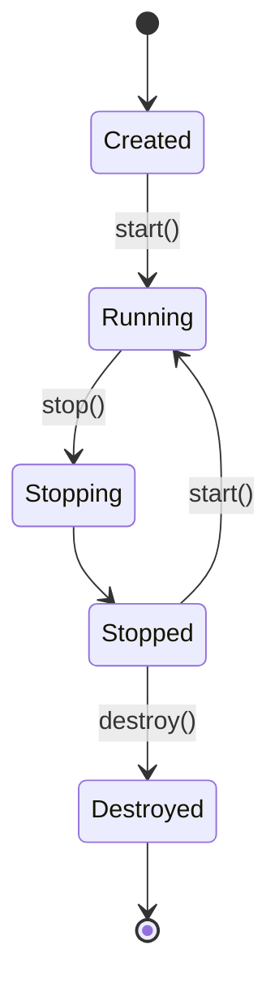

# Khởi động container động

Trong một ứng dụng Spring Kafka, listener container thường được tạo khi Spring ApplicationContext khởi động. Tuy nhiên, có những hệ thống cần bật hoặc tắt một luồng tiêu thụ theo cấu hình runtime: một tenant vừa được kích hoạt, một topic mới được đưa vào xử lý, một tác vụ bảo trì tạm dừng consumer hoặc một tính năng chỉ cần chạy trong một khoảng thời gian.

Spring Kafka hỗ trợ quản lý vòng đời listener container bằng `KafkaListenerEndpointRegistry` và cho phép tạo `ConcurrentMessageListenerContainer` trực tiếp khi cần. Hai cách này phục vụ hai tình huống khác nhau: điều khiển container đã khai báo bằng `@KafkaListener`, và tạo container mới với topic/group được xác định lúc runtime.

Khởi động container động cần đi kèm quản lý trạng thái, group ID, partition, concurrency và dọn dẹp tài nguyên. Chỉ gọi `start()` là chưa đủ để vận hành an toàn nếu ứng dụng không biết container nào đang chạy và ai chịu trách nhiệm dừng nó.

## 1. Listener container và vòng đời

`@KafkaListener` là cách khai báo phương thức xử lý message. Khi ứng dụng khởi động, Spring Kafka tạo listener endpoint và listener container tương ứng. Container quản lý Kafka consumer, poll record, gọi listener, xử lý ack/offset và đóng consumer khi dừng.

Vòng đời cơ bản:



Các trạng thái có ý nghĩa:

- **Created:** container đã được tạo và cấu hình nhưng chưa tiêu thụ record.
- **Running:** container đã được khởi động và quản lý consumer.
- **Stopping:** container đang dừng consumer theo quy trình lifecycle.
- **Stopped:** container đã dừng; có thể khởi động lại nếu chưa bị destroy.
- **Destroyed:** tài nguyên của container đã được giải phóng; không nên tái sử dụng instance đó.

Khi container khởi động, consumer cần kết nối broker, tham gia consumer group và nhận partition assignment. Vì vậy, lời gọi `start()` không có nghĩa là record sẽ được xử lý ngay lập tức; quá trình tham gia group và rebalance diễn ra bất đồng bộ.

## 2. Khởi động @KafkaListener theo yêu cầu

Nếu listener đã biết topic và group từ cấu hình, nhưng chỉ muốn bật nó khi có yêu cầu, hãy đặt `autoStartup = "false"`:

```java
@Component
public class OrderListener {

    @KafkaListener(
            id = "orders-listener",
            topics = "${app.kafka.orders-topic}",
            groupId = "orders-service",
            autoStartup = "false"
    )
    public void consume(OrderEvent event) {
        orderService.process(event);
    }
}
```

Khi ApplicationContext khởi động, endpoint vẫn được đăng ký nhưng container không tự start. Ứng dụng có thể lấy container theo ID từ `KafkaListenerEndpointRegistry`.

```java
@Service
public class ListenerLifecycleService {

    private final KafkaListenerEndpointRegistry registry;

    public ListenerLifecycleService(
            KafkaListenerEndpointRegistry registry) {
        this.registry = registry;
    }

    public void startOrdersListener() {
        MessageListenerContainer container =
                registry.getListenerContainer("orders-listener");

        if (container == null) {
            throw new IllegalArgumentException(
                    "Unknown listener id: orders-listener");
        }

        if (!container.isRunning()) {
            container.start();
        }
    }

    public void stopOrdersListener() {
        MessageListenerContainer container =
                registry.getListenerContainer("orders-listener");

        if (container != null && container.isRunning()) {
            container.stop();
        }
    }
}
```

`id` của `@KafkaListener` là khóa để tìm container trong registry. Hãy đặt ID rõ ràng và duy nhất trong application context. Nếu bỏ qua ID, framework có thể sinh ID mặc định, khiến việc điều khiển theo tên trở nên khó dự đoán.

`KafkaListenerEndpointRegistry` quản lý các container được tạo từ listener endpoint, chẳng hạn `@KafkaListener`. Nó không tự động quản lý các container mà ứng dụng tự khởi tạo bằng `new ConcurrentMessageListenerContainer(...)`; các container thủ công cần được lưu và quản lý vòng đời riêng.

## 3. Liệt kê và kiểm tra container trong registry

Registry cung cấp API để lấy container theo ID và liệt kê các ID đã đăng ký:

```java
public Collection<String> listenerIds(
        KafkaListenerEndpointRegistry registry) {

    return registry.getListenerContainerIds();
}
```

Có thể dùng registry để kiểm tra container nào đang chạy:

```java
public Map<String, Boolean> listenerStates(
        KafkaListenerEndpointRegistry registry) {

    Map<String, Boolean> states = new LinkedHashMap<>();

    for (String id : registry.getListenerContainerIds()) {
        MessageListenerContainer container =
                registry.getListenerContainer(id);

        states.put(id, container != null && container.isRunning());
    }

    return states;
}
```

Trạng thái `isRunning()` phản ánh lifecycle của container. Nó không chứng minh rằng consumer đã được gán partition hoặc đã xử lý thành công record. Nếu cần readiness chính xác hơn, hãy theo dõi sự kiện container/consumer, partition assignment, consumer lag và health indicator của ứng dụng.

Không nên dùng trạng thái running làm điều kiện duy nhất để thông báo rằng một tenant đã sẵn sàng nhận message.

## 4. Tạo ConcurrentMessageListenerContainer lúc runtime

Khi topic hoặc group ID chỉ được xác định trong lúc ứng dụng đang chạy, có thể tạo container trực tiếp bằng `ConsumerFactory` và `ContainerProperties`.

Ví dụ dưới đây tạo một container cho một tenant:

```java
ContainerProperties properties =
        new ContainerProperties("tenant-42-orders");

properties.setGroupId("tenant-42-order-worker");

ConcurrentMessageListenerContainer<String, OrderEvent> container =
        new ConcurrentMessageListenerContainer<>(
                consumerFactory,
                properties
        );

container.setConcurrency(2);

container.setupMessageListener(
        (MessageListener<String, OrderEvent>) record ->
                orderService.process(record.value())
);

container.start();
```

Các thành phần:

- `ConsumerFactory` tạo Kafka consumer theo cấu hình bootstrap server, deserializer, security và các thuộc tính khác.
- `ContainerProperties` khai báo topic hoặc partition, group ID và các tùy chọn xử lý.
- `ConcurrentMessageListenerContainer` quản lý một hoặc nhiều consumer con theo concurrency.
- `setupMessageListener(...)` gắn logic xử lý record.
- `start()` khởi động container và consumer.

Trong ví dụ, group ID có phạm vi tenant. Nếu nhiều instance ứng dụng cùng tạo container cho tenant đó với cùng group ID, Kafka phân phối partition giữa các instance. Nếu mỗi tenant cần nhận độc lập toàn bộ record, group ID của tenant phải khác nhau.

Đoạn code chỉ minh họa cách tạo container; trong ứng dụng thật cần giữ tham chiếu container để có thể dừng và giải phóng tài nguyên sau đó.

## 5. Quản lý container động bằng một service

Không nên tạo container rồi bỏ tham chiếu. Một manager có thể lưu container theo khóa nghiệp vụ và cung cấp API start/stop rõ ràng.

```java
@Service
public class DynamicOrderContainerManager {

    private final ConsumerFactory<String, OrderEvent> consumerFactory;
    private final OrderService orderService;

    private final Map<String,
            ConcurrentMessageListenerContainer<String, OrderEvent>>
            containers = new HashMap<>();

    public DynamicOrderContainerManager(
            ConsumerFactory<String, OrderEvent> consumerFactory,
            OrderService orderService) {
        this.consumerFactory = consumerFactory;
        this.orderService = orderService;
    }

    public synchronized void startTenant(
            String tenantId,
            String topic) {

        var existing = containers.get(tenantId);

        if (existing != null) {
            if (!existing.isRunning()) {
                existing.start();
            }
            return;
        }

        ContainerProperties properties =
                new ContainerProperties(topic);

        properties.setGroupId("tenant-orders-" + tenantId);

        var container =
                new ConcurrentMessageListenerContainer<>(
                        consumerFactory,
                        properties
                );

        container.setConcurrency(2);
        container.setupMessageListener(
                (MessageListener<String, OrderEvent>) record ->
                        orderService.process(record.value())
        );

        containers.put(tenantId, container);
        try {
            container.start();
        }
        catch (RuntimeException ex) {
            containers.remove(tenantId);
            container.destroy();
            throw ex;
        }
    }

    public synchronized void stopTenant(String tenantId) {
        var container = containers.remove(tenantId);

        if (container != null) {
            container.stop();
            container.destroy();
        }
    }

    @PreDestroy
    public synchronized void stopAll() {
        for (var container : containers.values()) {
            container.stop();
            container.destroy();
        }

        containers.clear();
    }
}
```

Manager giữ một container cho mỗi tenant. Từ khóa `synchronized` giúp hai request start cùng tenant không đồng thời tạo hai container trong cùng instance ứng dụng. Nếu hệ thống cần scale manager hoặc điều khiển từ nhiều node, phải bổ sung cơ chế điều phối phân tán; `synchronized` chỉ bảo vệ trong một JVM.

`stopTenant` lấy container ra khỏi map, dừng consumer rồi giải phóng tài nguyên. `stopAll` được gọi khi Spring bean bị hủy để không để consumer thread tồn tại sau khi ứng dụng shutdown.

Trong production, nên có thêm trạng thái lifecycle, timeout khi dừng, xử lý exception lúc start/stop và log định danh tenant/topic/group. Đoạn code loại bỏ container và giải phóng tài nguyên nếu lời gọi `start()` ném lỗi đồng bộ. Việc tạo consumer và nhận partition assignment còn diễn ra bất đồng bộ; hãy theo dõi application event/health để phát hiện lỗi xảy ra sau khi `start()` đã trả về.

## 6. Chọn giữa registry và container tạo thủ công

| Nhu cầu | Cách phù hợp |
|---|---|
| Listener đã khai báo bằng annotation, chỉ cần bật/tắt | `KafkaListenerEndpointRegistry` |
| Topic và group đã biết lúc build/deploy | `@KafkaListener` với `autoStartup` |
| Topic được chọn khi runtime | Tạo `ConcurrentMessageListenerContainer` thủ công |
| Cần thay đổi subscription theo tập topic runtime | Container thủ công hoặc cấu hình subscription bằng pattern |
| Cần quản lý nhiều listener endpoint khai báo sẵn | Registry và ID rõ ràng |
| Cần quản lý vòng đời container riêng theo tenant | Manager lưu container thủ công |

Nếu listener đã có sẵn trong code và chỉ cần start/stop, registry là lựa chọn đơn giản. Nếu cần tạo subscription mới khi ứng dụng đang chạy, container thủ công cung cấp quyền kiểm soát topic và group ID rõ ràng hơn.

## 7. Dynamic container khác với pause/resume

Không phải mọi tình huống tạm ngừng tiêu thụ đều cần stop container.

- `stop()` dừng container và đóng consumer; khi start lại, consumer tham gia group và có thể gây rebalance.
- `pause()` tạm ngừng việc lấy record từ partition nhưng giữ consumer hoạt động trong group.
- `resume()` tiếp tục lấy record sau khi đã pause.

Nếu cần backpressure ngắn hạn, chẳng hạn downstream đang đầy queue, pause/resume có thể phù hợp hơn. Nếu tenant bị vô hiệu hóa hoặc subscription không còn cần thiết trong thời gian dài, stop container sẽ giải phóng consumer và tài nguyên liên quan.

Pause không xóa subscription và không đồng nghĩa consumer đã rời group. Stop cũng không xóa offset đã commit. Khi container chạy lại, consumer tiếp tục từ offset theo chính sách commit và reset đã cấu hình.

## 8. Concurrency và partition assignment

`ConcurrentMessageListenerContainer` có thể chạy nhiều consumer con. `setConcurrency(n)` đặt số consumer tối đa mà container tạo ra cho listener.

Ví dụ topic có 4 partition:

| Concurrency | Số consumer hoạt động tối đa có thể được gán partition |
|---:|---:|
| 1 | 1 |
| 2 | 2 |
| 4 | 4 |
| 6 | Tối đa 4 có partition; consumer còn lại có thể idle |

Số consumer thực sự có việc phụ thuộc partition assignment và số consumer trong cùng group. Tăng concurrency vượt số partition không làm một partition được nhiều consumer trong cùng group xử lý song song.

Với container tiêu thụ nhiều topic, số partition và chiến lược assignor có thể ảnh hưởng cách phân phối. Hãy đo throughput, lag, CPU, kết nối và tải downstream thay vì tăng concurrency theo cảm tính.

Nếu mỗi tenant có container riêng và group ID riêng, mỗi tenant có thể nhận toàn bộ partition của topic tương ứng. Số consumer và kết nối broker có thể tăng nhanh theo số tenant. Cần đánh giá giới hạn tài nguyên trước khi chọn mô hình một container cho mỗi tenant.

## 9. Topic subscription và topic pattern

Container có thể subscribe một hoặc nhiều topic đã biết:

```java
ContainerProperties properties =
        new ContainerProperties("orders", "payments");
```

Nếu muốn subscribe các topic được tạo động theo quy tắc tên, có thể dùng topic pattern:

```java
ContainerProperties properties =
        new ContainerProperties(
                Pattern.compile("tenant-[0-9]+-events")
        );
```

Với pattern subscription, consumer có thể nhận các topic khớp pattern theo cơ chế metadata refresh của Kafka. Đây là cách một container theo dõi một tập topic biến động mà không cần tạo container riêng cho từng topic.

Pattern cần đủ hẹp để không vô tình subscribe topic ngoài phạm vi. Topic mới vẫn cần tồn tại và principal Kafka phải có quyền đọc. Hãy kiểm tra hành vi discovery và thời gian refresh metadata theo cấu hình Kafka client đang sử dụng.

## 10. Quản lý group ID và offset

Group ID xác định tiến độ tiêu thụ độc lập. Cần quyết định rõ container động đại diện cho một consumer logic hay một worker chia tải.

- Nếu các instance là bản sao của cùng một worker, chúng dùng cùng group ID để chia partition.
- Nếu mỗi tenant cần nhận cùng một luồng event độc lập, mỗi tenant cần group ID riêng.
- Nếu một tenant có nhiều worker để chia tải, các worker của tenant đó dùng cùng group ID.
- Không tạo group ID ngẫu nhiên mỗi lần start nếu muốn tiếp tục từ offset đã commit trước đó.

Khi group ID mới được tạo, Kafka chưa có committed offset cho group đó. Vị trí bắt đầu phụ thuộc `auto.offset.reset` và trạng thái topic. Nếu `earliest`, consumer có thể đọc lại dữ liệu còn retention; nếu `latest`, consumer bắt đầu từ cuối log tại thời điểm xác định theo cơ chế Kafka.

Do đó, tạo container với group ID mới có thể làm một lượng lớn event cũ được xử lý lại. Hãy xác định chính sách khởi tạo offset trước khi bật container cho tenant mới.

## 11. Start/stop và rebalance

Khi container start, consumer kết nối broker và tham gia group. Kafka có thể thực hiện rebalance để phân phối partition. Khi container stop, consumer rời group và partition được phân phối lại cho các consumer còn lại.

Các điểm cần lưu ý:

- Stop nhiều container cùng lúc có thể tạo nhiều rebalance liên tiếp.
- Start một nhóm lớn container có thể tạo tải đột biến lên broker và coordinator.
- Listener cần hoàn tất hoặc xử lý an toàn công việc đang chạy trước khi dừng.
- Offset commit phải theo đúng AckMode và transaction đang dùng.
- Không giả định record đang xử lý sẽ luôn hoàn tất nếu process bị kill cưỡng bức.

Nếu cần triển khai thay đổi cấu hình cho nhiều tenant, hãy giới hạn tốc độ start/stop và theo dõi thời gian rebalance, số partition được gán cùng consumer lag.

## 12. Bảo mật và kiểm soát đầu vào runtime

Nếu API cho phép yêu cầu start container theo tenant/topic, không dùng trực tiếp chuỗi topic do client gửi mà không kiểm tra.

Cần:

- Ánh xạ tenant ID sang topic/group từ cấu hình hoặc registry nghiệp vụ đã được kiểm soát.
- Kiểm tra tenant có quyền bật subscription tương ứng.
- Giới hạn số container tối đa và concurrency tối đa.
- Không cho client tự chọn group ID tùy ý.
- Xác minh ACL của principal Kafka chỉ cho phép đọc topic cần thiết.
- Ghi audit ai đã bật/tắt listener, tenant nào, thời điểm nào và lý do.
- Có cơ chế tự dừng hoặc thu hồi container khi tenant bị xóa.

Một endpoint quản trị container có thể ảnh hưởng trực tiếp đến tải broker và dữ liệu được tiêu thụ. Hãy đặt quyền quản trị phù hợp và không phơi bày endpoint này cho người dùng cuối nếu không có kiểm soát.

## 13. Theo dõi trạng thái container

Khi số lượng container tăng, cần theo dõi vòng đời thay vì chỉ ghi log lúc gọi start.

Các chỉ số nên quan sát:

| Tín hiệu | Ý nghĩa |
|---|---|
| Số container running/stopped | Phát hiện container bị dừng ngoài dự kiến |
| Consumer group và partition assignment | Biết container có thực sự nhận partition |
| Consumer lag | Biết tốc độ xử lý có theo kịp dữ liệu không |
| Thời gian start đến assignment | Phát hiện broker/coordinator hoặc rebalance chậm |
| Số lần start/stop | Phát hiện vòng lặp lifecycle bất thường |
| Lỗi tạo consumer/authentication | Phát hiện cấu hình hoặc ACL sai |
| Listener exception/retry/DLT | Phát hiện lỗi nghiệp vụ trong container |

Spring Kafka phát application event liên quan đến container và consumer lifecycle. Có thể lắng nghe các event đó để cập nhật trạng thái quản trị hoặc metric. Khi cần readiness, nên dựa vào partition assignment và health/lag, không chỉ dựa vào việc container đã nhận lệnh start.

## 14. Kiểm thử dynamic container

Integration test nên dùng broker thử nghiệm để xác minh lifecycle và hành vi tiêu thụ thực tế:

1. Khởi động ApplicationContext với `autoStartup = false`, xác nhận listener chưa tiêu thụ.
2. Gọi registry start theo ID, gửi record và xác nhận listener nhận được.
3. Gọi stop, gửi record mới và xác nhận container không tiếp tục xử lý trong lúc đã dừng.
4. Start lại cùng container và xác nhận xử lý tiếp theo offset đã commit.
5. Tạo container thủ công với topic/group runtime và xác nhận nhận record.
6. Dừng container thủ công và kiểm tra consumer được đóng.
7. Start hai container cùng group và xác nhận partition được chia, không phải mỗi container nhận mọi record.
8. Dùng group ID mới và xác nhận hành vi `auto.offset.reset` đúng dự kiến.
9. Kiểm tra shutdown ứng dụng dừng toàn bộ container đã tạo.
10. Kiểm tra start/stop lặp lại không tạo container hoặc consumer trùng ngoài ý muốn.

Không nên chỉ mock `KafkaListenerEndpointRegistry` rồi assert `start()` được gọi. Mock không kiểm chứng consumer đã join group, nhận partition hoặc xử lý record.

## 15. Những lỗi thường gặp

| Hiện tượng | Nguyên nhân có thể | Cách xử lý |
|---|---|---|
| Không tìm thấy container trong registry | ID sai hoặc listener endpoint chưa được đăng ký | Dùng ID tường minh và kiểm tra registry |
| Listener chạy ngay khi ứng dụng start | Chưa đặt `autoStartup = "false"` | Điều khiển lifecycle bằng registry |
| Container running nhưng chưa nhận record | Chưa có partition assignment, topic rỗng hoặc consumer lag/ACL | Kiểm tra assignment, topic và log consumer |
| Start lại nhưng đọc từ đầu | Group ID mới hoặc offset reset là earliest | Dùng group ID ổn định và xác định reset policy |
| Nhiều container cùng đọc toàn bộ event | Mỗi container dùng group ID khác nhau | Dùng chung group nếu muốn chia tải |
| Container thủ công không dừng khi shutdown | Không lưu tham chiếu hoặc không gọi stop/destroy | Quản lý tập trung và cleanup lifecycle |
| Broker bị quá tải khi bật tenant | Tạo quá nhiều consumer/container cùng lúc | Giới hạn số container và tốc độ khởi động |
| Topic mới không được phát hiện | Subscribe topic tĩnh hoặc pattern không khớp | Kiểm tra subscription và metadata refresh |

## 16. Checklist triển khai

- [ ] Đã chọn registry cho listener khai báo sẵn hoặc container thủ công cho subscription runtime.
- [ ] Listener có ID tường minh và duy nhất khi điều khiển qua registry.
- [ ] `autoStartup` được đặt đúng nếu cần trì hoãn khởi động.
- [ ] Container thủ công được lưu tham chiếu và có cleanup khi shutdown.
- [ ] Group ID ổn định và phản ánh đúng phạm vi consumer logic.
- [ ] Đã xác định hành vi offset khi group mới được tạo.
- [ ] Concurrency không vượt quá nhu cầu partition và tài nguyên.
- [ ] Topic runtime được kiểm tra quyền truy cập và nằm trong allowlist.
- [ ] Có giới hạn số container và tốc độ start/stop.
- [ ] Theo dõi partition assignment, lag, lỗi và lifecycle event.
- [ ] Đã kiểm thử start, stop, restart, rebalance và shutdown.

Khởi động container động cho phép Spring Kafka bật hoặc tạo consumer theo nhu cầu runtime. Dùng `KafkaListenerEndpointRegistry` khi cần điều khiển listener đã khai báo bằng annotation; dùng `ConcurrentMessageListenerContainer` khi topic và group chỉ được biết lúc chạy. Dù chọn cách nào, ứng dụng vẫn phải quản lý group ID, offset, partition assignment, concurrency và vòng đời dừng/giải phóng container để tránh tiêu thụ trùng hoặc làm cạn tài nguyên.

