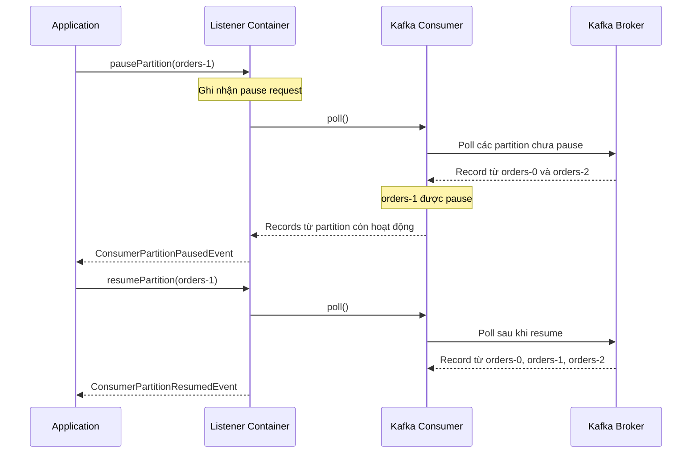
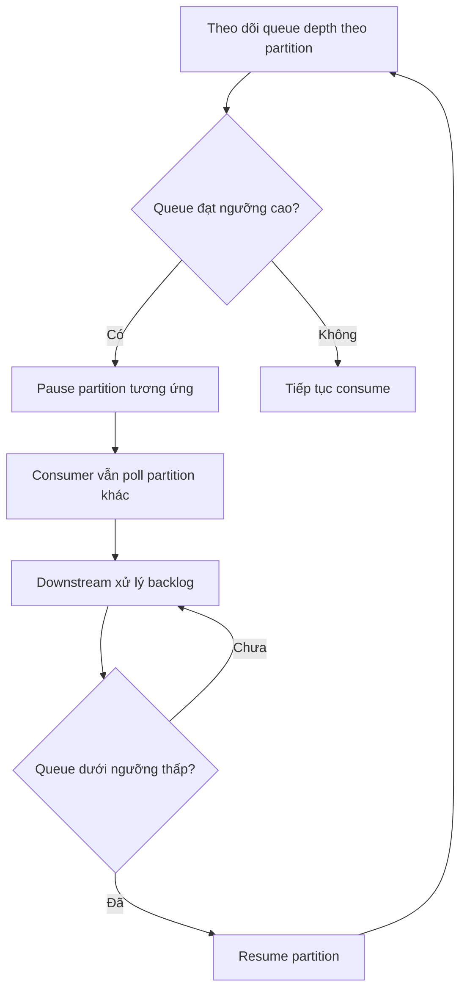

# Pause partition cụ thể

Trong một Kafka consumer group, đôi khi chỉ một partition cần tạm ngừng nhận record: dịch vụ downstream đang quá tải, một loại dữ liệu cần bảo trì, hoặc hàng đợi xử lý cục bộ của partition đã chạm ngưỡng. Dừng toàn bộ listener trong tình huống này sẽ làm các partition khỏe mạnh cũng ngừng hoạt động.

Spring Kafka hỗ trợ pause/resume theo `TopicPartition` từ phiên bản 2.7. Ứng dụng có thể yêu cầu listener container tạm dừng một partition, tiếp tục xử lý những partition khác và resume partition đó khi điều kiện đã ổn định.

Bài học tập trung vào cách điều khiển partition thông qua `KafkaListenerEndpointRegistry` và `MessageListenerContainer`, theo dõi trạng thái pause thực tế, xử lý concurrency/rebalance và xây dựng backpressure an toàn.

## 1. Pause partition giải quyết vấn đề gì?

Giả sử topic `orders` có ba partition:

| Partition | Tình trạng | Quyết định |
|---|---|---|
| `orders-0` | Dịch vụ thanh toán hoạt động bình thường | Tiếp tục consume |
| `orders-1` | Dịch vụ kiểm tra tồn kho đang quá tải | Pause tạm thời |
| `orders-2` | Xử lý bình thường | Tiếp tục consume |

Nếu pause cả listener container, partition 0 và 2 cũng ngừng nhận dữ liệu. Pause riêng `orders-1` cho phép consumer tiếp tục xử lý các partition còn lại.

Pause partition thường hữu ích khi:

- Downstream theo một loại dữ liệu hoặc một shard đang bị quá tải.
- Một partition có backlog xử lý cục bộ quá lớn.
- Cần bảo trì hoặc thay đổi cấu hình xử lý cho một partition.
- Hệ thống áp dụng backpressure theo partition.
- Muốn tạm dừng một luồng dữ liệu mà vẫn giữ các luồng khác hoạt động.

Pause chỉ ngừng lấy thêm record từ partition được chọn. Record vẫn được producer ghi vào Kafka và lag của partition có thể tăng trong thời gian pause.

## 2. Phân biệt pause container và pause partition

Spring Kafka cung cấp hai mức điều khiển:

| API | Phạm vi | Tác động |
|---|---|---|
| `pause()` | Toàn bộ listener container | Tạm ngừng lấy record từ mọi partition được container quản lý |
| `pausePartition(tp)` | Một `TopicPartition` | Tạm ngừng lấy record từ partition chỉ định |
| `resume()` | Toàn bộ listener container | Tiếp tục mọi partition đã pause ở mức container |
| `resumePartition(tp)` | Một `TopicPartition` | Tiếp tục partition chỉ định |

Ví dụ, nếu một container đang xử lý `orders-0`, `orders-1` và `orders-2`, gọi `pausePartition(orders-1)` chỉ yêu cầu dừng partition 1. Hai partition còn lại vẫn có thể được consume.

Pause không đồng nghĩa với:

- Stop listener container.
- Rời consumer group.
- Commit offset ngay lập tức.
- Reset offset về vị trí khác.
- Xóa record khỏi Kafka.
- Chuyển partition sang consumer khác.

Đây là điểm quan trọng khi thiết kế backpressure: pause giữ consumer hoạt động và partition vẫn thuộc assignment hiện tại trong khi consumer tiếp tục poll.

## 3. Cách pause/resume hoạt động trong listener container

Từ Spring Kafka 2.7, listener container cung cấp:

- `pausePartition(TopicPartition)`
- `resumePartition(TopicPartition)`
- `isPartitionPauseRequested(TopicPartition)`
- `isPartitionPaused(TopicPartition)`

Các phương thức pause/resume là thread-safe. Ứng dụng có thể gọi chúng từ thread HTTP, scheduler hoặc service quản lý backpressure; thao tác thực tế với Kafka consumer được thực hiện trên consumer thread.

Lệnh pause partition có hiệu lực trước lần `poll()` tiếp theo. Lệnh resume có hiệu lực sau khi lần `poll()` hiện tại trả về. Vì vậy, lời gọi method trả về không có nghĩa consumer đã hoàn tất việc pause/resume.

`isPartitionPauseRequested(tp)` cho biết yêu cầu pause đã được ghi nhận. `isPartitionPaused(tp)` cho biết partition đã thực sự được pause trên consumer.



Trong thời gian pause, consumer vẫn tiếp tục poll để duy trì hoạt động của consumer group, nhưng không lấy record từ partition đã pause. Điều này giúp tránh rebalance chỉ vì ứng dụng tạm thời ngừng tiêu thụ partition.

## 4. Khai báo listener có ID ổn định

Để điều khiển listener bằng registry, hãy khai báo `id` rõ ràng trong `@KafkaListener`:

```java
import org.springframework.kafka.annotation.KafkaListener;
import org.springframework.stereotype.Component;

@Component
public class OrderListener {

    @KafkaListener(
        id = "orders-listener",
        topics = "orders",
        groupId = "billing-service"
    )
    public void consume(OrderCreated event) {
        // Xử lý event.
    }
}
```

`id` là định danh listener được đăng ký trong `KafkaListenerEndpointRegistry`. Ứng dụng sẽ dùng chính ID này để tìm container.

Không nhầm `id` với `groupId`:

- `id` xác định listener container trong ứng dụng Spring.
- `groupId` xác định consumer group trên Kafka.
- Một consumer group có thể có nhiều listener/container theo thiết kế.
- ID listener phải duy nhất trong phạm vi registry.

## 5. Lấy container và pause một partition

`KafkaListenerEndpointRegistry` quản lý các listener container được tạo bởi `@KafkaListener`. Dùng `getListenerContainer(id)` để lấy container tương ứng.

Ví dụ một service điều khiển partition:

```java
import org.apache.kafka.common.TopicPartition;
import org.springframework.kafka.config.KafkaListenerEndpointRegistry;
import org.springframework.kafka.listener.MessageListenerContainer;
import org.springframework.stereotype.Service;

@Service
public class PartitionControlService {

    private final KafkaListenerEndpointRegistry registry;

    public PartitionControlService(
            KafkaListenerEndpointRegistry registry) {
        this.registry = registry;
    }

    public void pause(String listenerId, String topic, int partition) {
        MessageListenerContainer container =
            requireContainer(listenerId);

        TopicPartition topicPartition =
            new TopicPartition(topic, partition);

        container.pausePartition(topicPartition);
    }

    public void resume(String listenerId, String topic, int partition) {
        MessageListenerContainer container =
            requireContainer(listenerId);

        TopicPartition topicPartition =
            new TopicPartition(topic, partition);

        container.resumePartition(topicPartition);
    }

    private MessageListenerContainer requireContainer(String listenerId) {
        MessageListenerContainer container =
            registry.getListenerContainer(listenerId);

        if (container == null) {
            throw new IllegalArgumentException(
                "Listener container not found: " + listenerId
            );
        }

        return container;
    }
}
```

Cách gọi:

```java
partitionControlService.pause(
    "orders-listener",
    "orders",
    1
);

// Khi downstream đã phục hồi:
partitionControlService.resume(
    "orders-listener",
    "orders",
    1
);
```

Container cần đang hoạt động và partition phải thuộc subscription/assignment mà listener quản lý. Nếu ứng dụng gọi trước khi listener khởi động hoặc trước khi assignment hoàn tất, hãy kiểm tra trạng thái sau đó thay vì cho rằng partition đã pause ngay lập tức.

Với `ConcurrentMessageListenerContainer`, có thể gọi `pausePartition` trên container cha lấy từ registry. Spring Kafka chuyển yêu cầu đến các child container để trạng thái pause vẫn được áp dụng nếu partition được phân công lại cho child khác trong cùng container cha.

## 6. Kiểm tra pause request và trạng thái thực tế

Không nên chỉ gọi `pausePartition` rồi cập nhật trạng thái nghiệp vụ thành `PAUSED`. Yêu cầu và trạng thái thực tế có thể khác nhau trong một khoảng ngắn.

Ví dụ:

```java
TopicPartition partition = new TopicPartition("orders", 1);

container.pausePartition(partition);

boolean requested =
    container.isPartitionPauseRequested(partition);

boolean paused =
    container.isPartitionPaused(partition);

log.info(
    "Partition pause state topic={} partition={} requested={} paused={}",
    partition.topic(),
    partition.partition(),
    requested,
    paused
);
```

Diễn giải:

| requested | paused | Ý nghĩa |
|---|---|---|
| false | false | Chưa có yêu cầu pause hoặc partition đang chạy |
| true | false | Đã yêu cầu pause, đang chờ consumer thread thực hiện |
| true | true | Partition đã pause thực tế |
| false | false sau resume | Partition đã tiếp tục hoạt động |

Khi resume, trạng thái pause request sẽ được xóa sau khi container xử lý yêu cầu. Hãy dựa vào trạng thái và event tương ứng để xác nhận.

## 7. Resume partition sau khi điều kiện phục hồi

Pause partition chỉ hữu ích nếu ứng dụng có chính sách resume rõ ràng.

Ví dụ, downstream có hàng đợi giới hạn dung lượng:

- Khi số tác vụ chờ vượt ngưỡng cao, pause partition tương ứng.
- Khi hàng đợi giảm xuống dưới ngưỡng thấp, resume partition.
- Ghi nhận thời gian pause và số lần pause/resume.
- Có giới hạn thời gian pause để cảnh báo nếu partition bị giữ quá lâu.

Nên dùng hai ngưỡng khác nhau (hysteresis) để tránh trạng thái pause/resume liên tục khi queue depth dao động quanh một giá trị.

Ví dụ:

| Queue depth | Hành động |
|---:|---|
| `>= 800` | Pause partition |
| `500–799` | Giữ trạng thái hiện tại |
| `< 500` | Resume partition |

Không nên resume chỉ vì đã hết một khoảng thời gian cố định nếu downstream vẫn đang quá tải. Hãy kết hợp tín hiệu sức khỏe thực tế với timeout dự phòng và cảnh báo vận hành.

## 8. Lắng nghe event pause/resume

Spring Kafka phát các event để ứng dụng biết consumer đã thực hiện thao tác:

- `ConsumerPartitionPausedEvent`
- `ConsumerPartitionResumedEvent`

Các event này được bổ sung từ Spring Kafka 2.7. Chúng mang thông tin container và `TopicPartition` liên quan.

Ví dụ:

```java
import org.slf4j.Logger;
import org.slf4j.LoggerFactory;
import org.springframework.context.event.EventListener;
import org.springframework.kafka.event.ConsumerPartitionPausedEvent;
import org.springframework.kafka.event.ConsumerPartitionResumedEvent;
import org.springframework.stereotype.Component;

@Component
public class PartitionPauseEvents {

    private static final Logger log =
        LoggerFactory.getLogger(PartitionPauseEvents.class);

    @EventListener
    public void onPartitionPaused(
            ConsumerPartitionPausedEvent event) {

        log.info(
            "Kafka partition paused: {}",
            event.getPartition()
        );
    }

    @EventListener
    public void onPartitionResumed(
            ConsumerPartitionResumedEvent event) {

        log.info(
            "Kafka partition resumed: {}",
            event.getPartition()
        );
    }
}
```

Các event hữu ích cho:

- Cập nhật trạng thái giám sát.
- Ghi log thời điểm pause/resume thực tế.
- Tính thời gian một partition bị pause.
- Phát metric và cảnh báo.
- Đối chiếu quyết định backpressure với hành vi consumer.

Event được phát bởi consumer xử lý partition. Với concurrency, một container cha có thể quản lý nhiều consumer con; hãy dùng thông tin container/partition trong event để xác định đúng listener.

## 9. Pause partition trong ConcurrentMessageListenerContainer

Khi `concurrency > 1`, Spring Kafka tạo một `ConcurrentMessageListenerContainer` cha và nhiều `KafkaMessageListenerContainer` con. Mỗi consumer con có assignment riêng.

Ví dụ:

```java
@KafkaListener(
    id = "orders-listener",
    topics = "orders",
    groupId = "billing-service",
    concurrency = "3"
)
public void consume(OrderCreated event) {
    // Xử lý event.
}
```

Nếu topic có nhiều partition, các partition được phân phối cho consumer trong group. Một partition tại một thời điểm chỉ được một consumer trong group sở hữu.

Có thể lấy container cha từ registry:

```java
MessageListenerContainer container =
    registry.getListenerContainer("orders-listener");

TopicPartition partition = new TopicPartition("orders", 1);

container.pausePartition(partition);
```

Với concurrent container, Spring Kafka gửi pause request đến các child container. Điều này có ích khi assignment thay đổi giữa các child trong cùng container cha: partition vẫn được giữ ở trạng thái pause request khi được giao cho child khác.

Nếu cần biết child container nào hiện đang giữ partition, có thể dùng `getContainerFor(topic, partition)` trên `ConcurrentMessageListenerContainer`. Tuy nhiên, thao tác pause/resume thông thường có thể gọi trực tiếp trên container cha.

Đừng tự chọn child container theo index hoặc `client.id` rồi giữ reference lâu dài. Sau rebalance, assignment có thể thay đổi.

## 10. Pause và rebalance

Pause partition không làm partition rời khỏi consumer group. Consumer vẫn poll, duy trì membership và tiếp tục nhận dữ liệu từ partition khác.

Tuy nhiên, nếu xảy ra rebalance:

- Partition có thể được thu hồi khỏi consumer hiện tại.
- Partition có thể được giao cho consumer khác.
- Trạng thái pause ở một application instance không tự động trở thành chính sách toàn cluster.
- Ứng dụng cần quyết định có áp dụng lại pause ở consumer mới hay không.

Với `ConcurrentMessageListenerContainer`, Spring Kafka gửi yêu cầu pause đến các child container trong cùng container cha để trạng thái không bị mất khi partition chuyển giữa các child.

Nhưng nếu partition chuyển sang một pod khác thuộc cùng consumer group, pod mới không tự biết quyết định pause của pod cũ. Nếu muốn pause toàn cluster, cần lưu chính sách ở một nơi dùng chung như database, control topic hoặc hệ thống điều phối; các instance phải áp dụng chính sách khi nhận assignment.

Đối với subscription tự động theo topic hoặc pattern, nên lắng nghe sự kiện assignment/revocation hoặc dùng `ConsumerRebalanceListener` để đồng bộ lại chính sách pause khi partition được giao.

## 11. Pause không thay thế commit offset

Pause partition không tự commit offset và cũng không reset offset.

Offset vẫn được quản lý theo `AckMode` và cơ chế commit đã cấu hình cho listener container.

Ví dụ:

- Listener đã xử lý thành công record và commit offset theo `BATCH`.
- Ứng dụng pause partition.
- Record mới tiếp tục được ghi vào Kafka nhưng chưa được consumer lấy về.
- Khi resume, consumer tiếp tục từ vị trí đọc hiện tại/offset đã commit theo chính sách hiện có.

Nếu ứng dụng pause khi một poll đã trả về nhiều record, các record đã được fetch có thể vẫn đang chờ xử lý. Lệnh pause partition được áp dụng ở ranh giới poll tiếp theo; nó không hủy các record đã lấy về.

Với batch listener, cần đặc biệt chú ý vì một batch có thể chứa record từ nhiều partition. Pause partition không tự tách batch hiện tại thành các phần độc lập.

## 12. PauseImmediate và thời điểm dừng xử lý

Từ Spring Kafka 2.9, `ContainerProperties.pauseImmediate` cho phép container dừng xử lý sau record hiện tại khi **pause toàn bộ container** được yêu cầu. Mặc định, container xử lý hết các record từ poll trước rồi mới pause.

Cấu hình:

```java
factory.getContainerProperties().setPauseImmediate(true);
```

Khi bật, các record còn lại trong kết quả poll được giữ trong bộ nhớ và được chuyển tới listener khi container resume.

`pauseImmediate` là thuộc tính điều khiển hành vi pause ở mức container. Không coi nó là cơ chế ngắt tức thời chỉ một partition đang được xử lý trong batch hiện tại. Với bài toán cần kiểm soát từng partition, hãy thiết kế listener và batch boundary phù hợp.

Với batch listener, hãy kiểm tra cách listener nhận batch và cấu hình `subBatchPerPartition` nếu cần chia batch theo partition. Điều này giúp giới hạn phạm vi xử lý và làm rõ partition nào đang được xử lý.

## 13. Pause partition như một cơ chế backpressure

Một mô hình backpressure đơn giản có thể dùng queue depth của từng partition:



Ví dụ chính sách:

1. Theo dõi queue xử lý cục bộ cho từng partition.
2. Khi queue đạt high watermark, gọi `pausePartition`.
3. Consumer vẫn xử lý các partition khác.
4. Khi queue giảm xuống low watermark, gọi `resumePartition`.
5. Ghi nhận thời gian pause, lag và throughput sau resume.

Nếu listener dùng một consumer thread tuần tự, một record chậm vẫn có thể làm chậm các record khác trong cùng poll. Pause partition chỉ kiểm soát những lần poll tiếp theo; nó không làm cho việc xử lý record hiện tại trở nên song song.

Nếu listener chuyển công việc sang executor bất đồng bộ, cần quản lý offset/acknowledgment cẩn thận để không commit record trước khi công việc hoàn thành. Pause không thay thế cơ chế kiểm soát thứ tự hoặc commit an toàn.

## 14. Các giới hạn cần nhớ khi pause lâu

Pause partition không tạo thêm dung lượng lưu trữ. Producer vẫn có thể tiếp tục ghi record và consumer lag sẽ tăng.

Theo dõi:

- Consumer lag theo topic-partition.
- Thời gian partition ở trạng thái paused.
- Tốc độ producer ghi vào partition.
- Thời gian xử lý trung bình và p95/p99.
- Queue depth downstream.
- Tỷ lệ lỗi sau khi resume.

Nếu pause quá lâu, record cũ có thể hết thời hạn retention trước khi consumer resume. Hãy tính retention theo tốc độ tăng lag và thời gian dự kiến bảo trì.

Không pause tất cả partition trong thời gian dài nếu ứng dụng vẫn cần duy trì SLA hoặc consumer group có các yêu cầu tiến độ xử lý.

Nếu downstream lỗi toàn bộ, pause toàn bộ container hoặc dừng listener có thể là quyết định vận hành phù hợp hơn. Chọn phạm vi pause theo phạm vi lỗi thực tế.

## 15. Không gọi Kafka Consumer trực tiếp từ thread khác

Kafka `Consumer` không được thiết kế để ứng dụng gọi đồng thời từ nhiều thread. Không giữ reference consumer rồi gọi trực tiếp:

```java
// Không nên gọi từ HTTP thread hoặc scheduler:
consumer.pause(Set.of(topicPartition));
```

Thay vào đó, gọi API thread-safe của listener container:

```java
container.pausePartition(topicPartition);
container.resumePartition(topicPartition);
```

Container sẽ chuyển yêu cầu tới consumer thread và thực hiện đúng thời điểm trong vòng poll.

Cũng không nên dùng `Thread.sleep` trong listener để mô phỏng pause. Cách này giữ consumer thread bận, có thể làm poll bị trễ và ảnh hưởng `max.poll.interval.ms`. Pause container vẫn tiếp tục poll để duy trì group membership.

## 16. Kiểm thử pause partition với Embedded Kafka

Integration test nên chứng minh ba điều:

1. Partition được yêu cầu pause và trạng thái pause thực tế được xác nhận.
2. Partition khác vẫn tiếp tục được consume.
3. Sau resume, partition đã pause tiếp tục được consume.

Ví dụ cấu trúc test:

```java
import static org.assertj.core.api.Assertions.assertThat;

import java.util.concurrent.TimeUnit;

import org.apache.kafka.common.TopicPartition;
import org.junit.jupiter.api.Test;
import org.springframework.beans.factory.annotation.Autowired;
import org.springframework.kafka.config.KafkaListenerEndpointRegistry;
import org.springframework.kafka.core.KafkaTemplate;
import org.springframework.kafka.listener.MessageListenerContainer;
import org.springframework.kafka.test.utils.ContainerTestUtils;
import org.springframework.kafka.test.context.EmbeddedKafka;
import org.springframework.boot.test.context.SpringBootTest;

@SpringBootTest
@EmbeddedKafka(partitions = 2, topics = "orders")
class PartitionPauseIntegrationTest {

    @Autowired
    KafkaListenerEndpointRegistry registry;

    @Autowired
    KafkaTemplate<String, String> kafkaTemplate;

    @Autowired
    TestRecordSink sink;

    @Test
    void pausesOnePartitionAndKeepsOtherPartitionActive()
            throws Exception {

        MessageListenerContainer container =
            registry.getListenerContainer("orders-listener");

        ContainerTestUtils.waitForAssignment(container, 2);

        TopicPartition paused =
            new TopicPartition("orders", 0);

        container.pausePartition(paused);

        // Helper chờ isPartitionPaused(paused) trả về true.
        awaitPartitionPaused(container, paused);

        kafkaTemplate.send("orders", 0, "key-0", "paused-event").get();
        kafkaTemplate.send("orders", 1, "key-1", "active-event").get();

        assertThat(sink.await("active-event", 10, TimeUnit.SECONDS))
            .isTrue();

        assertThat(sink.contains("paused-event")).isFalse();

        container.resumePartition(paused);
        awaitPartitionResumed(container, paused);

        assertThat(sink.await("paused-event", 10, TimeUnit.SECONDS))
            .isTrue();
    }
}
```

Đây là cấu trúc test; `TestRecordSink`, `awaitPartitionPaused` và `awaitPartitionResumed` là helper của test cần triển khai bằng `BlockingQueue` và Awaitility. Cần chờ assignment trước khi gửi record để tránh kết quả phụ thuộc thời điểm khởi động listener.

Đừng dùng một khoảng `Thread.sleep` cố định làm bằng chứng partition đã pause. Hãy đợi `isPartitionPaused` trả về true trước khi gửi record kiểm thử.

Test bổ sung nên bao gồm:

| Test case | Kết quả mong đợi |
|---|---|
| Pause partition 0 | Partition 0 không nhận record mới sau khi pause có hiệu lực |
| Partition 1 không pause | Partition 1 vẫn được consume |
| Resume partition 0 | Record chờ được xử lý sau resume |
| Pause request trước khi consumer áp dụng | `isPartitionPauseRequested` true trước khi `isPartitionPaused` true |
| Concurrent container rebalance nội bộ | Partition vẫn pause khi chuyển sang child khác |
| Rebalance sang pod khác | Chính sách pause được áp dụng lại theo cơ chế điều phối |
| Pause lâu | Lag tăng và metric thời gian pause được cập nhật |

## 17. Lỗi thường gặp

| Hiện tượng | Nguyên nhân | Cách xử lý |
|---|---|---|
| Gọi pause nhưng partition vẫn nhận record | Consumer chưa tới poll boundary hoặc còn record đã fetch | Chờ `isPartitionPaused` và xét batch đang xử lý |
| Pause cả listener ngoài ý muốn | Gọi `pause()` thay cho `pausePartition()` | Dùng đúng `TopicPartition` |
| Không tìm thấy listener container | ID không khớp `@KafkaListener` | Khai báo ID ổn định và kiểm tra registry |
| Resume nhưng không có record mới | Partition vẫn chưa được resume thực tế hoặc topic không có record | Theo dõi event resume và trạng thái |
| Partition được pause ở pod cũ nhưng chạy ở pod mới | Rebalance sang application instance khác | Lưu chính sách pause dùng chung và áp dụng khi assignment |
| Các partition khác cũng chậm | Listener thread đang xử lý một record/batch chậm | Tối ưu xử lý hoặc tách workload |
| Consumer bị rebalance khi pause | Thread bị block, không tiếp tục poll | Dùng API container và tránh sleep/block consumer thread |
| Lag tăng quá cao | Partition bị pause quá lâu | Giám sát retention và có chính sách resume/escalation |

## 18. Checklist vận hành

- Listener có ID ổn định để registry tìm đúng container.
- Dùng `TopicPartition` gồm topic và partition chính xác.
- Gọi `pausePartition`/`resumePartition` qua listener container.
- Chờ `isPartitionPaused` để xác nhận trạng thái thực tế.
- Không gọi Kafka `Consumer` trực tiếp từ thread khác.
- Theo dõi `ConsumerPartitionPausedEvent` và `ConsumerPartitionResumedEvent`.
- Kiểm tra concurrency và assignment trước khi pause.
- Có chính sách áp dụng lại pause sau rebalance sang application instance khác.
- Có high/low watermark để tránh pause/resume liên tục.
- Theo dõi lag, retention và thời gian pause.
- Kiểm thử partition bị pause trong khi partition khác vẫn tiếp tục consume.
- Kiểm tra hành vi của batch listener và `pauseImmediate` theo version đang dùng.

## 19. Ghi nhớ

- `pausePartition(TopicPartition)` và `resumePartition(TopicPartition)` có từ Spring Kafka 2.7.
- Pause partition chỉ ngừng lấy record từ partition được chọn; các partition khác vẫn có thể hoạt động.
- Consumer tiếp tục poll trong thời gian pause để duy trì membership trong group.
- Pause request và pause thực tế là hai trạng thái khác nhau.
- `isPartitionPauseRequested` kiểm tra yêu cầu; `isPartitionPaused` kiểm tra trạng thái đã áp dụng.
- `ConcurrentMessageListenerContainer` phân phối pause request tới các child container.
- Pause không commit offset, reset offset hay rời consumer group.
- Pause là một công cụ backpressure; cần theo dõi lag, retention và thời gian pause.
- Nếu partition chuyển sang pod khác sau rebalance, chính sách pause phải được chia sẻ và áp dụng lại.
- Không gọi trực tiếp `Consumer.pause` từ thread ứng dụng khác.

Pause partition giúp hệ thống cô lập một luồng dữ liệu đang gặp vấn đề, giữ các partition còn lại hoạt động và tạo khoảng thời gian để downstream phục hồi. Khi kết hợp pause/resume với assignment awareness, trạng thái thực tế, queue watermark và monitoring, ứng dụng Spring Kafka có thể kiểm soát backpressure ở phạm vi partition mà vẫn giữ consumer group ổn định.

## Tài liệu tham khảo

- [Spring Kafka – Pausing and Resuming Partitions](https://docs.spring.io/spring-kafka/reference/kafka/pause-resume-partitions.html)
- [Spring Kafka – Pausing and Resuming Listener Containers](https://docs.spring.io/spring-kafka/reference/kafka/pause-resume.html)
- [Spring Kafka – Listener Container Properties](https://docs.spring.io/spring-kafka/reference/kafka/container-props.html)
- [Spring Kafka – Application Events](https://docs.spring.io/spring-kafka/reference/kafka/events.html)
- [Spring Kafka – MessageListenerContainer API](https://docs.spring.io/spring-kafka/docs/current/api/org/springframework/kafka/listener/MessageListenerContainer.html)
- [Spring Kafka – ConcurrentMessageListenerContainer API](https://docs.spring.io/spring-kafka/docs/current/api/org/springframework/kafka/listener/ConcurrentMessageListenerContainer.html)

