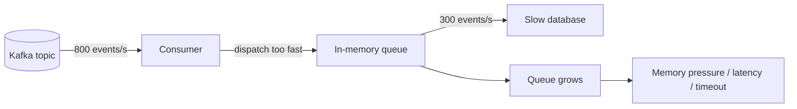

# Backpressure khi downstream chậm

Backpressure là cách điều tiết tốc độ nhận và xử lý record khi hệ thống phía sau Kafka không theo kịp. Ví dụ, consumer đọc event nhanh hơn tốc độ database ghi dữ liệu hoặc REST service xử lý request. Nếu ứng dụng tiếp tục nhận record rồi đẩy vào một hàng đợi trong bộ nhớ không giới hạn, queue sẽ tăng liên tục, gây tăng latency, thiếu bộ nhớ và cuối cùng làm service sập.

Với Spring Kafka, có thể điều tiết consumer bằng cách giới hạn concurrency và số record mỗi lần poll, dùng hàng đợi có giới hạn, theo dõi sức khỏe downstream, rồi pause/resume listener container hoặc từng partition khi cần. Kafka vẫn giữ record trong topic trong thời gian retention; consumer lag tăng lên trong lúc tạm dừng và được xử lý sau khi downstream phục hồi.

## 1. Backpressure xuất hiện khi nào?

Giả sử topic `orders.created` nhận trung bình 800 event/giây, trong khi database chỉ ghi ổn định 300 event/giây. Consumer đọc nhanh hơn khả năng xử lý của database. Phần chênh lệch tích tụ thành backlog.



Backpressure cần được xem xét khi có một hoặc nhiều dấu hiệu:

- Consumer lag tăng liên tục dù số consumer không đổi.
- Thời gian xử lý một record hoặc batch tăng.
- Queue nội bộ hoặc số request đang chờ downstream tăng.
- Database connection pool cạn, HTTP 429/503 tăng hoặc timeout nhiều.
- Heap tăng, GC thường xuyên hoặc xuất hiện `OutOfMemoryError`.
- Consumer thường xuyên vượt `max.poll.interval.ms` và bị rebalance.

Consumer lag tăng không phải lúc nào cũng là lỗi. Khi chủ động pause để bảo vệ downstream, lag là backlog được giữ an toàn trong Kafka. Cần phân biệt lag tăng có kiểm soát với lag tăng vì consumer bị treo hoặc không đủ năng lực xử lý.

Các ví dụ record listener trong bài dùng event và service contract sau:

```java
import java.math.BigDecimal;

public record OrderCreatedEvent(
        String eventId,
        String orderId,
        BigDecimal total
) {}

public interface OrderApplicationService {
    void handle(OrderCreatedEvent event);
}
```

## 2. Vì sao không nên dùng queue bộ nhớ không giới hạn?

Một cách triển khai dễ mắc lỗi là listener nhận record rồi submit tác vụ vào executor không giới hạn:

```java
@KafkaListener(topics = "orders.created", groupId = "orders-service")
public void listen(OrderCreatedEvent event) {
    unboundedExecutor.submit(() -> orderService.handle(event));
}
```

Listener trả về ngay sau khi submit, trong khi downstream xử lý chậm hơn tốc độ submit. Queue tăng không giới hạn, còn container có thể commit offset trước khi tác vụ nghiệp vụ thực sự hoàn tất. Nếu ứng dụng dừng, các tác vụ còn trong bộ nhớ có thể mất dù offset đã được commit.

Nếu cần xử lý bất đồng bộ, phải có queue bounded, giới hạn số tác vụ in-flight, cơ chế pause/resume và quy tắc xác nhận offset sau khi side effect hoàn tất. Với nhiều ứng dụng, xử lý đồng bộ trên listener thread cùng timeout hợp lý thường đơn giản và dễ bảo toàn semantics hơn.

## 3. Những lớp điều tiết tốc độ consumer

Backpressure nên được thiết kế theo nhiều lớp:

| Cơ chế | Tác động | Khi nào dùng |
|---|---|---|
| Giảm `concurrency` | Giảm số consumer thread trong group | Downstream có năng lực giới hạn hoặc cần giảm tải tổng |
| Giảm `max.poll.records` | Giảm số record trả về mỗi poll | Batch xử lý lâu hoặc tạo đỉnh tải quá lớn |
| Giới hạn in-flight/queue | Chặn số công việc chờ trong ứng dụng | Có bước xử lý bất đồng bộ hoặc dispatch sang worker |
| Pause/resume container | Tạm dừng nhận record từ các partition được gán | Downstream quá tải hoặc cần chờ phục hồi |
| Pause/resume partition | Tạm dừng một số partition | Tải hoặc lỗi chỉ tập trung ở một partition |
| Rate limit/circuit breaker | Giới hạn request hoặc ngắt gọi downstream đang lỗi | REST service, database hoặc dependency có quota/timeout |

Các cơ chế này bổ trợ nhau. Không nên dùng pause như giải pháp duy nhất nếu listener hiện tại đang block vô hạn trong một HTTP call; container chỉ có thể áp dụng pause khi consumer thread quay lại vòng poll.

## 4. Giảm `concurrency` và `max.poll.records`

`concurrency` trên `@KafkaListener` hoặc container factory quyết định số consumer child container được tạo cho listener. Trong cùng consumer group, số consumer đang được gán partition không thể vượt quá số partition được assign.

Ví dụ:

```java
@KafkaListener(
        id = "ordersListener",
        topics = "orders.created",
        groupId = "orders-service",
        concurrency = "2"
)
public void listen(OrderCreatedEvent event) {
    orderService.handle(event);
}
```

Nếu topic có 6 partition và concurrency bằng 2, tối đa hai consumer thread của listener xử lý song song. Giảm concurrency từ 6 xuống 2 có thể giảm áp lực lên downstream, đổi lại throughput tối đa cũng giảm.

`max.poll.records` giới hạn số record trả về trong một lần `poll()`. Ví dụ cấu hình:

```yaml
spring:
  kafka:
    consumer:
      properties:
        max.poll.records: 20
        max.poll.interval.ms: 300000
```

Batch nhỏ hơn giúp giảm thời gian xử lý mỗi poll và giảm số record đang nằm trong bộ nhớ của container. Tuy nhiên, nếu record xử lý rất nhanh và downstream đủ khỏe, giảm quá thấp có thể làm giảm throughput do tăng overhead poll.

## 5. Pause và resume listener container

Spring Kafka cung cấp API pause/resume trên `MessageListenerContainer`. Có thể lấy container theo `id` của `@KafkaListener` thông qua `KafkaListenerEndpointRegistry`.

```java
import org.springframework.kafka.config.KafkaListenerEndpointRegistry;
import org.springframework.kafka.listener.MessageListenerContainer;
import org.springframework.stereotype.Component;

@Component
public class OrdersConsumerFlowControl {

    private final KafkaListenerEndpointRegistry registry;

    public OrdersConsumerFlowControl(KafkaListenerEndpointRegistry registry) {
        this.registry = registry;
    }

    public void pause() {
        MessageListenerContainer container =
                registry.getListenerContainer("ordersListener");
        if (container != null) {
            container.pause();
        }
    }

    public void resume() {
        MessageListenerContainer container =
                registry.getListenerContainer("ordersListener");
        if (container != null) {
            container.resume();
        }
    }
}
```

`pause()` và `resume()` được thiết kế để có thể gọi từ thread khác; container điều phối thao tác với Kafka consumer trên consumer thread. Không gọi trực tiếp `KafkaConsumer.pause()` từ một thread quản lý health/monitor vì Kafka consumer không thread-safe.

Pause không dừng listener container hoàn toàn. Container vẫn tiếp tục gọi `poll()` trong trạng thái paused để duy trì hoạt động consumer group; các partition đã pause không trả record mới cho listener. Nhờ vậy, việc pause có thể kéo dài mà consumer vẫn tham gia group, miễn là consumer thread còn tiếp tục poll.

## 6. Pause có hiệu lực khi nào?

Lệnh `pause()` là một yêu cầu được container áp dụng ở vòng poll phù hợp tiếp theo, không ngắt ngang một listener đang chạy. Các record đã được poll có thể vẫn còn chờ xử lý trong container.

Với record listener, có thể bật `pauseImmediate` để container dừng dispatch sau record hiện tại thay vì xử lý hết các record còn lại đã lấy từ poll trước:

```java
factory.getContainerProperties().setPauseImmediate(true);
```

`pauseImmediate` hữu ích khi cần phản ứng nhanh với downstream saturation. Hãy xác minh API theo version Spring Kafka đang dùng. Nếu không bật, container có thể tiếp tục xử lý phần còn lại của batch đã poll trước khi pause hoàn toàn.

Pause cũng không hủy HTTP request/database call đang chạy. Cần timeout, circuit breaker hoặc cancellation ở tầng downstream để một lần xử lý không treo consumer thread quá lâu.

## 7. Pause/resume tự động theo ngưỡng tải

Một mô hình đơn giản là dùng high-watermark và low-watermark:

- Khi queue downstream hoặc số request in-flight vượt ngưỡng cao, pause container.
- Khi tải giảm xuống dưới ngưỡng thấp, resume container.
- Dùng hai ngưỡng khác nhau để tránh pause/resume liên tục khi tải dao động quanh một điểm.

Ví dụ controller có thể được gọi bởi một monitor theo dõi queue depth:

```java
import java.util.concurrent.atomic.AtomicBoolean;

import org.springframework.stereotype.Component;

@Component
public class OrdersBackpressurePolicy {

    private static final int HIGH_WATERMARK = 800;
    private static final int LOW_WATERMARK = 300;

    private final OrdersConsumerFlowControl flowControl;
    private final AtomicBoolean paused = new AtomicBoolean();

    public OrdersBackpressurePolicy(OrdersConsumerFlowControl flowControl) {
        this.flowControl = flowControl;
    }

    public void onQueueDepthChanged(int queueDepth) {
        if (queueDepth >= HIGH_WATERMARK
                && paused.compareAndSet(false, true)) {
            flowControl.pause();
        } else if (queueDepth <= LOW_WATERMARK
                && paused.compareAndSet(true, false)) {
            flowControl.resume();
        }
    }
}
```

Ví dụ giả định monitor gọi `onQueueDepthChanged()` mỗi khi có số liệu queue mới. `AtomicBoolean` tránh gửi lệnh pause/resume lặp lại ở mỗi lần lấy mẫu. Trong ứng dụng thực tế, high/low watermark cần được cấu hình theo capacity, thời gian xử lý và memory budget; không sao chép con số ví dụ như giá trị mặc định.

Nếu có nhiều replica, mỗi instance có consumer container riêng. Chính sách pause cục bộ chỉ điều khiển consumer trên instance đó; nếu muốn điều tiết tổng tải toàn service, cần chia sẻ tín hiệu capacity hoặc để mỗi instance tự quan sát cùng dependency với ngưỡng phù hợp.

## 8. Pause/resume từng partition

Khi chỉ một partition có vấn đề, có thể pause riêng partition đó thay vì dừng toàn bộ listener container:

```java
import org.apache.kafka.common.TopicPartition;
import org.springframework.kafka.config.KafkaListenerEndpointRegistry;
import org.springframework.kafka.listener.MessageListenerContainer;
import org.springframework.stereotype.Component;

@Component
public class PartitionFlowControl {

    private final KafkaListenerEndpointRegistry registry;

    public PartitionFlowControl(KafkaListenerEndpointRegistry registry) {
        this.registry = registry;
    }

    public void pausePartition(String topic, int partition) {
        MessageListenerContainer container =
                registry.getListenerContainer("ordersListener");
        if (container != null) {
            container.pausePartition(new TopicPartition(topic, partition));
        }
    }

    public void resumePartition(String topic, int partition) {
        MessageListenerContainer container =
                registry.getListenerContainer("ordersListener");
        if (container != null) {
            container.resumePartition(new TopicPartition(topic, partition));
        }
    }
}
```

Partition-level pause hữu ích khi downstream hoặc dữ liệu chỉ gây vấn đề cho một partition. Cần nhớ một partition chỉ được một consumer trong cùng group sở hữu tại một thời điểm; nếu rebalance chuyển partition sang consumer khác, việc pause phải được quan sát và áp dụng theo container assignment hiện tại. Các API partition pause phụ thuộc phiên bản Spring Kafka; xác minh trên version của dự án.

Không pause partition chỉ vì một record nghiệp vụ lỗi vĩnh viễn nếu chính sách mong muốn là đưa record đó vào retry/DLT. Pause kéo dài sẽ chặn mọi record phía sau trên partition, kể cả record hợp lệ.

## 9. Quan sát trạng thái pause

Có thể kiểm tra trạng thái yêu cầu pause và trạng thái consumer đã thực sự paused:

```java
MessageListenerContainer container =
        registry.getListenerContainer("ordersListener");

if (container != null) {
    boolean pauseRequested = container.isPauseRequested();
    boolean containerPaused = container.isContainerPaused();
}
```

Hai trạng thái không giống nhau:

- `isPauseRequested()` cho biết ứng dụng đã yêu cầu pause.
- `isContainerPaused()` cho biết container đã áp dụng pause cho các partition được gán.

Monitor không nên chỉ ghi nhận “đã pause” ngay khi gọi `pause()`. Nên quan sát trạng thái thực tế bằng `isContainerPaused()`, thời gian chờ áp dụng và lý do pause để dashboard phản ánh chính xác.

## 10. Giữ consumer poll đều trong lúc pause

Một điểm quan trọng của Spring Kafka là container tiếp tục poll khi listener container đã paused để giữ consumer group hoạt động. Vì vậy, pause consumer để giảm tải downstream không đồng nghĩa dừng toàn bộ consumer thread.

Tuy nhiên, nếu listener đang bị block trong một lời gọi database/HTTP không có timeout, consumer thread chưa quay lại poll. Khi khoảng thời gian giữa hai lần poll vượt `max.poll.interval.ms`, consumer có thể rời group và gây rebalance. Pause không thể cứu một thread đang bị kẹt trong listener.

Để giữ poll liveness:

- Đặt timeout rõ ràng cho HTTP client, database query và connection acquisition.
- Không chờ vô hạn trên `Future.get()` hoặc semaphore.
- Giữ thời gian xử lý batch trong giới hạn phù hợp với `max.poll.interval.ms`.
- Giảm `max.poll.records` khi mỗi record cần nhiều thời gian xử lý.
- Dùng circuit breaker để fail fast khi downstream liên tục lỗi.
- Nếu cần xử lý bất đồng bộ, phải quản lý in-flight work và offset semantics rõ ràng.

## 11. Backpressure và offset commit

Pause chỉ kiểm soát việc nhận record mới; nó không tự quyết định offset nào được commit. Offset vẫn tuân theo `AckMode`, transaction và listener processing.

- Với `AckMode.RECORD`, record đã xử lý thành công có thể được commit theo record semantics.
- Với `AckMode.BATCH`, commit gắn với batch poll đã xử lý.
- Với `MANUAL`/`MANUAL_IMMEDIATE`, listener điều khiển acknowledgment theo semantics đã cấu hình.
- Với transactional listener, offset được commit cùng Kafka transaction khi listener thành công.

Nếu listener đẩy tác vụ sang executor rồi trả về ngay, container có thể commit trước khi tác vụ hoàn tất. Khi đó pause/resume chỉ giảm số tác vụ được gửi tiếp, nhưng không khắc phục việc xác nhận offset quá sớm. Không ack/return thành công trước khi side effect đạt điểm an toàn theo thiết kế.

## 12. Retry, pause và circuit breaker

Backpressure và retry giải quyết hai vấn đề liên quan nhưng khác nhau:

| Cơ chế | Dùng khi | Hành vi |
|---|---|---|
| Retry ngắn có backoff | Lỗi tạm thời ở một record | Thử lại record sau khoảng nghỉ |
| Non-blocking retry topic | Muốn đưa record lỗi sang luồng retry và tiếp tục record khác | Retry theo topology topic riêng |
| Pause container | Downstream tổng thể quá tải | Tạm dừng nhận record mới từ container |
| Pause partition | Một partition cần điều tiết riêng | Tạm dừng nhận record từ partition đó |
| Circuit breaker | Dependency đang lỗi liên tục | Ngăn gọi thêm request và cho dependency thời gian phục hồi |

Không dùng pause toàn container như retry vô hạn cho một record lỗi đơn lẻ; điều đó có thể chặn mọi partition của listener. Ngược lại, nếu database đang quá tải trên toàn hệ thống, tiếp tục retry từng record có thể làm tăng thêm áp lực. Chọn cơ chế theo phạm vi lỗi.

## 13. Backpressure ở phía producer và downstream

Consumer pause không làm producer tự dừng gửi. Kafka tiếp tục nhận record nếu producer còn gửi và broker còn capacity. Khi consumer pause dài, cần theo dõi:

- Consumer lag và tuổi của record cũ nhất.
- Disk usage, retention và tốc độ tăng dữ liệu trên broker.
- Producer rate và quota của topic/cluster.
- Downstream recovery rate so với tốc độ phát sinh event mới.
- Thời gian dự kiến để backlog được xử lý hết sau khi resume.

Nếu backlog có thể vượt retention hoặc dung lượng broker, cần điều tiết upstream bằng rate limit, quota, admission control hoặc giảm tốc độ phát event. Không thể dựa vào pause consumer vô thời hạn nếu nguồn tiếp tục ghi dữ liệu.

## 14. Metrics cần theo dõi

Một dashboard backpressure hữu ích nên có:

| Metric | Ý nghĩa |
|---|---|
| Consumer lag theo partition | Backlog consumer chưa xử lý |
| Record processing duration | Thời gian xử lý mỗi record/batch |
| Downstream latency/error rate | Tình trạng database hoặc service đích |
| Queue depth/in-flight count | Lượng công việc đang chờ hoặc đang chạy |
| Pause requested/paused duration | Thời gian và trạng thái pause thực tế (`isPauseRequested()`/`isContainerPaused()`) |
| Pause/resume transition count | Tần suất policy thay đổi trạng thái |
| Rebalance count | Mức độ consumer group bị thay đổi assignment |
| DLT/retry rate | Số record chuyển sang retry hoặc dead-letter |
| Heap/GC/thread utilization | Áp lực tài nguyên trong ứng dụng |

Nên gắn log với `listenerId`, topic, partition và lý do pause/resume. Tránh dùng event ID làm metric label vì cardinality cao.

## 15. Kiểm thử backpressure

Integration test nên mô phỏng downstream chậm và xác minh consumer được điều tiết:

1. Tạo topic có nhiều partition và listener có concurrency xác định.
2. Dùng downstream giả lập xử lý chậm hoặc queue có giới hạn.
3. Gửi record nhanh hơn tốc độ xử lý downstream.
4. Khi queue vượt high-watermark, gọi pause và xác minh `isPauseRequested()`/`isContainerPaused()`.
5. Xác minh consumer không dispatch thêm record ngoài phạm vi pause đã chọn, tính đến record đã poll và `pauseImmediate`.
6. Khi queue xuống dưới low-watermark, resume và xác minh record tiếp tục được xử lý.
7. Xác minh committed offset chỉ tiến theo record thực sự hoàn tất theo AckMode.
8. Giữ pause trong một khoảng đủ dài và xác minh consumer group không rebalance chỉ vì pause, miễn consumer thread vẫn poll.
9. Làm downstream call treo có timeout để xác minh xử lý không vượt `max.poll.interval.ms`.
10. Kiểm tra lag tăng khi pause và giảm sau khi resume.

Dùng Embedded Kafka hoặc Testcontainers và chờ điều kiện bằng Awaitility/polling có timeout. Tránh dùng sleep cố định để giả định pause đã được áp dụng ngay sau lời gọi API.

## 16. Những lỗi thường gặp

- **Dùng queue không giới hạn:** memory tăng theo tốc độ producer trừ tốc độ downstream.
- **Submit async rồi trả listener thành công:** offset có thể commit trước khi side effect hoàn tất.
- **Gọi `KafkaConsumer.pause()` từ thread monitor:** Kafka consumer không thread-safe; dùng API container.
- **Cho rằng `pause()` ngắt listener hiện tại:** pause có hiệu lực ở vòng poll phù hợp tiếp theo và không hủy lời gọi đang chạy.
- **Không bật `pauseImmediate` khi cần dừng dispatch sớm:** các record còn lại trong poll có thể vẫn được xử lý.
- **Để listener block vô hạn:** consumer không poll, có thể vượt `max.poll.interval.ms` và rebalance.
- **Pause toàn container vì một partition lỗi:** có thể làm dừng các partition khỏe mạnh khác.
- **Resume theo một ngưỡng duy nhất:** tải dao động gây pause/resume liên tục; dùng high/low watermark.
- **Không theo dõi lag/retention:** backlog có thể vượt khả năng lưu trữ của cluster.
- **Nhầm pause với retry:** pause điều tiết consumer; retry xử lý record thất bại.

## 17. Checklist triển khai

- [ ] Đã đo tốc độ producer, throughput consumer và capacity downstream.
- [ ] Queue/in-flight work có giới hạn rõ ràng.
- [ ] `concurrency` và `max.poll.records` phù hợp năng lực downstream.
- [ ] Có high-watermark/low-watermark để tránh pause/resume liên tục.
- [ ] Dùng `KafkaListenerEndpointRegistry` và `MessageListenerContainer` để pause/resume.
- [ ] Không gọi trực tiếp KafkaConsumer từ thread khác.
- [ ] Đã quyết định pause toàn container hay từng partition.
- [ ] Đã đánh giá `pauseImmediate` và record còn lại trong poll.
- [ ] Downstream call có timeout và circuit breaker phù hợp.
- [ ] Listener không ack/return thành công trước khi xử lý an toàn.
- [ ] `max.poll.interval.ms` phù hợp thời gian xử lý thực tế.
- [ ] Theo dõi lag, pause duration, queue depth, downstream latency và rebalance.
- [ ] Có kế hoạch điều tiết producer nếu backlog có nguy cơ vượt retention/storage.
- [ ] Integration test bao gồm pause, resume, offset, poll liveness và recovery.

Backpressure giúp consumer thích nghi với tốc độ thực tế của downstream bằng cách giới hạn công việc đang chờ và tạm dừng nhận record khi cần. Kết hợp queue bounded, pause/resume có ngưỡng, timeout cho dependency và quan sát consumer lag giúp bảo vệ ứng dụng khỏi quá tải mà vẫn giữ record trong Kafka để xử lý sau khi downstream phục hồi.
