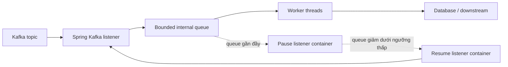

# Pause khi đầy hàng đợi nội bộ

Một consumer Spring Kafka đôi khi chuyển record vừa nhận vào hàng đợi nội bộ để worker thread xử lý ở phía sau. Cách tách nhận dữ liệu khỏi xử lý có thể giúp listener trả về nhanh và điều chỉnh số worker độc lập. Nhưng nếu tốc độ Kafka đưa record vào cao hơn tốc độ worker lấy record ra, hàng đợi sẽ tăng dần cho tới khi hết bộ nhớ hoặc không còn chỗ nhận thêm dữ liệu.

Backpressure là cơ chế điều tiết đầu vào khi hệ thống phía sau không theo kịp. Với Spring Kafka, có thể yêu cầu listener container pause khi hàng đợi đạt ngưỡng cao và resume khi hàng đợi giảm xuống ngưỡng thấp. Cách làm này giúp consumer tạm ngừng nhận record mới trong khi vẫn duy trì hoạt động poll cần thiết để tham gia consumer group.

## 1. Vì sao cần pause khi hàng đợi nội bộ gần đầy?

Giả sử listener nhận `OrderEvent` rồi đưa vào một `BlockingQueue`; một nhóm worker lấy event khỏi queue và ghi dữ liệu xuống database. Nếu producer phát 2.000 record/giây nhưng worker chỉ xử lý được 1.200 record/giây, backlog tăng khoảng 800 record mỗi giây. Một queue không giới hạn có thể làm heap tăng liên tục; queue có giới hạn sẽ đầy và buộc ứng dụng phải quyết định cách xử lý record tiếp theo.



Nếu không điều tiết, có thể gặp các vấn đề:

- Heap tăng do queue giữ nhiều payload và đối tượng trung gian.
- Garbage collection kéo dài, làm giảm thêm tốc độ xử lý.
- Queue đầy khiến listener không thể nhận thêm record.
- Nếu listener block quá lâu để chờ chỗ trống, consumer có thể không gọi `poll()` đúng hạn và rời consumer group.
- Nếu queue chỉ nằm trong RAM, record đã được commit offset nhưng worker chưa xử lý có thể mất khi ứng dụng restart.

Pause/resume điều tiết tốc độ nhận record ở consumer. Nó không giảm tốc độ producer và cũng không xóa backlog đã có trên Kafka; record chưa được lấy sẽ tiếp tục tích lũy trong topic theo retention và thể hiện qua consumer lag.

## 2. Cách pause/resume listener container hoạt động

Spring Kafka cung cấp `pause()` và `resume()` trên listener container. Có thể lấy container theo listener ID thông qua `KafkaListenerEndpointRegistry`:

```java
@KafkaListener(
        id = "ordersListener",
        topics = "orders",
        groupId = "order-service")
public void consume(OrderEvent event) {
    orderWorkQueue.submit(event);
}
```

Một bean khác có thể điều khiển container:

```java
@Component
public class OrderConsumerFlowControl {

    private final KafkaListenerEndpointRegistry registry;

    public OrderConsumerFlowControl(KafkaListenerEndpointRegistry registry) {
        this.registry = registry;
    }

    public void pauseOrders() {
        MessageListenerContainer container =
                registry.getListenerContainer("ordersListener");
        if (container != null) {
            container.pause();
        }
    }

    public void resumeOrders() {
        MessageListenerContainer container =
                registry.getListenerContainer("ordersListener");
        if (container != null) {
            container.resume();
        }
    }
}
```

Lệnh `pause()` và `resume()` có thể được gọi từ thread khác với consumer thread. Spring Kafka ghi nhận yêu cầu và thực hiện thao tác pause/resume Kafka consumer trên thread sở hữu consumer; không gọi trực tiếp `consumer.pause()` từ worker thread. Container vẫn tiếp tục gọi `poll()` khi đang pause để duy trì hoạt động group và heartbeat, nhưng các partition đã pause không giao thêm record cho listener.

Pause không đồng nghĩa stop container. `stop()` dừng container và có thể khiến consumer rời group; `pause()` tạm dừng việc nhận record trong khi container vẫn chạy. Khi hàng đợi được giải phóng, `resume()` cho phép nhận dữ liệu tiếp tục.

Với `ConcurrentMessageListenerContainer`, pause container thường áp dụng cho các consumer con do container quản lý. Nếu chỉ một partition có backlog bất thường, có thể cân nhắc pause/resume partition thay vì pause toàn bộ container; cần tính đến assignment và API của phiên bản Spring Kafka đang dùng.

## 3. Dùng high watermark và low watermark

Không nên pause ngay khi queue vừa tăng một phần nhỏ, rồi resume ngay khi queue giảm một record. Điều đó có thể làm container liên tục đổi trạng thái, gây dao động throughput. Hãy dùng hai ngưỡng khác nhau:

- **High watermark:** khi độ sâu queue đạt hoặc vượt ngưỡng này, yêu cầu pause.
- **Low watermark:** chỉ resume khi độ sâu queue giảm xuống bằng hoặc thấp hơn ngưỡng này.

Ví dụ queue có sức chứa 1.000 record, high watermark là 800 và low watermark là 400. Khi queue đạt 800, consumer tạm dừng. Worker tiếp tục xử lý phần backlog; khi queue giảm còn 400, consumer mới được resume.

```java
@Component
public class OrderQueueBackpressure {

    private static final int HIGH_WATERMARK = 800;
    private static final int LOW_WATERMARK = 400;

    private final BlockingQueue<OrderEvent> queue =
            new ArrayBlockingQueue<>(1_000);
    private final OrderConsumerFlowControl flowControl;
    private final Object stateLock = new Object();
    private boolean paused;

    public OrderQueueBackpressure(OrderConsumerFlowControl flowControl) {
        this.flowControl = flowControl;
    }

    public void submit(OrderEvent event) {
        if (!queue.offer(event)) {
            flowControl.pauseOrders();
            throw new QueueSaturatedException(
                    "Internal order queue is full");
        }
        updatePauseState();
    }

    public OrderEvent take() throws InterruptedException {
        OrderEvent event = queue.take();
        updatePauseState();
        return event;
    }

    private void updatePauseState() {
        synchronized (stateLock) {
            int depth = queue.size();
            if (!paused && depth >= HIGH_WATERMARK) {
                paused = true;
                flowControl.pauseOrders();
            }
            else if (paused && depth <= LOW_WATERMARK) {
                paused = false;
                flowControl.resumeOrders();
            }
        }
    }
}
```

Ví dụ tập trung vào cơ chế điều tiết; trong ứng dụng thực tế cần xử lý vòng đời worker, shutdown, metric và trường hợp queue đầy. Nếu `offer()` thất bại, không được bỏ record im lặng. Có thể chuyển sang lưu trữ bền vững, xử lý đồng bộ theo giới hạn hoặc ném exception để error handler thực hiện retry/recover theo chính sách. Retry phải có giới hạn và DLT phù hợp; nếu queue vẫn đầy, retry liên tục không làm tăng năng lực xử lý.

Khi dùng nhiều listener container hoặc nhiều instance ứng dụng, queue thường được chia theo process. Pause một container chỉ điều tiết consumer trong container đó; nó không tự pause các replica khác. Nếu downstream dùng chung đã quá tải, cần cân nhắc cơ chế điều tiết ở cấp service, quota hoặc giới hạn concurrency trên toàn hệ thống.

## 4. Chừa dung lượng cho record đã được poll

Pause không nhất thiết có hiệu lực ngay tại đúng thời điểm gọi. Consumer có thể đã poll một nhóm record từ broker trước khi yêu cầu pause được áp dụng. Với record listener, container có thể tiếp tục xử lý phần còn lại của poll hiện tại trước khi pause hoàn toàn, tùy cấu hình.

Vì vậy, high watermark phải thấp hơn sức chứa queue một khoảng dự phòng. Nếu có `N` consumer đang hoạt động, `max.poll.records = M`, một giới hạn bảo thủ cho lượng record có thể đã được poll là xấp xỉ `N × M`. Ví dụ 3 consumer với tối đa 100 record mỗi poll có thể có tới khoảng 300 record đã lấy về trong các poll hiện tại. Cần dành headroom tương ứng hoặc điều chỉnh `max.poll.records`, concurrency và batch size.

Trong các phiên bản Spring Kafka hỗ trợ `pauseImmediate`, có thể cấu hình container dừng xử lý sau record hiện tại thay vì đợi hết toàn bộ kết quả của poll trước đó:

```java
factory.getContainerProperties().setPauseImmediate(true);
```

Với batch listener, đơn vị xử lý hiện tại là batch; không giả định có thể dừng giữa batch nếu listener đang xử lý toàn bộ danh sách. `pauseImmediate` phụ thuộc phiên bản Spring Kafka, nên kiểm tra API của phiên bản dự án. Ngay cả khi bật chế độ này, vẫn nên chừa một phần dung lượng dự phòng cho record đang được xử lý và các consumer con.

Không đặt high watermark sát dung lượng tối đa. Nếu queue đầy trước khi pause có hiệu lực, listener vẫn cần một chính sách overflow an toàn.

## 5. Không block consumer thread để chờ queue trống

Một cách dễ nghĩ tới là gọi `queue.put(event)` trong listener. `put()` chờ cho đến khi có chỗ trống. Nhưng khi queue đầy, listener thread có thể bị block lâu và không quay lại vòng poll. Nếu khoảng cách giữa hai lần `poll()` vượt `max.poll.interval.ms`, Kafka có thể xem consumer là không hoạt động và thực hiện rebalance.

Thay vào đó:

1. Dùng bounded queue với `offer()` có kết quả rõ ràng.
2. Yêu cầu pause ngay khi đạt high watermark, trước khi queue đầy.
3. Worker tiếp tục rút backlog và kích hoạt resume khi queue xuống low watermark.
4. Nếu queue vẫn đầy do record đã poll hoặc do race, dùng overflow path có chủ đích; không drop record và không block consumer thread vô thời hạn.
5. Theo dõi thời gian xử lý và khoảng poll để bảo đảm container tiếp tục duy trì consumer group.

Pause/resume nên được điều khiển từ một thành phần có trạng thái rõ ràng. Tránh nhiều nơi gọi `pause()` và `resume()` độc lập mà không chia sẻ trạng thái, vì một worker có thể resume trong khi một điều kiện khác vẫn yêu cầu pause.

## 6. Bảo toàn offset khi handoff sang worker bất đồng bộ

Đây là điểm quan trọng nhất khi listener chỉ enqueue rồi trả về. Với acknowledgment tự động hoặc `AckMode` commit sau khi listener thành công, container có thể commit offset ngay sau khi listener đã đưa record vào queue. Nếu queue chỉ nằm trong RAM và ứng dụng restart trước khi worker xử lý xong, Kafka sẽ không giao lại record đã commit; công việc trong queue có thể bị mất.

Pause chỉ điều tiết tốc độ nhận record. Nó không biến queue trong RAM thành nơi lưu trữ bền vững và không tự liên kết việc hoàn tất worker với offset Kafka.

Các lựa chọn thiết kế:

| Cách làm | Đặc điểm | Điều kiện cần |
|---|---|---|
| Xử lý trong listener trước khi return | Listener chỉ hoàn tất khi công việc đã xử lý | Đơn giản về offset; cần giữ thời gian xử lý trong giới hạn poll và transaction. |
| Ghi vào durable work store rồi return | Record được lưu bền vững trước khi offset input được commit | Database/store phải xác nhận ghi thành công; cần idempotency và cơ chế worker đọc lại. |
| Handoff in-memory và xác nhận offset sau khi worker hoàn tất | Có thể tách nhận và xử lý | Cần manual acknowledgment/async acknowledgment đúng quy tắc thread, thứ tự partition và cấu hình container; phải xử lý restart và rebalance. |
| Dùng Kafka làm hàng đợi công việc | Consumer worker đọc trực tiếp từ topic và tự điều tiết bằng pause/resume | Tránh chuyển record sang queue RAM không bền vững; scale worker bằng consumer group và partition. |

Nếu dùng `AckMode.MANUAL` hoặc `MANUAL_IMMEDIATE`, phải xác minh cách gọi `Acknowledgment` theo thread và phiên bản Spring Kafka. Với xử lý bất đồng bộ, các acknowledgment có thể đến sai thứ tự; `asyncAcks` có thể hỗ trợ một số mô hình nhưng thay đổi hành vi commit và có thể làm consumer tạm pause cho tới khi đủ acknowledgment của poll. Không đưa acknowledgment vào worker thread một cách tùy tiện.

Đối với hệ thống cần độ tin cậy cao, durable handoff hoặc để Kafka tiếp tục làm queue thường dễ kiểm soát hơn việc giữ offset chưa commit trong thời gian dài. Dù chọn cách nào, phải bảo đảm một record chỉ được xác nhận sau khi công việc đã được lưu hoặc hoàn tất theo cam kết của ứng dụng.

## 7. Kết hợp pause với worker pool và downstream

Queue nội bộ thường là bộ đệm giữa listener và worker pool. Khi thiết kế, cần giới hạn cả queue lẫn số công việc đang chạy. Nếu queue giảm vì worker đã lấy record nhưng worker lại tạo thêm task vào một executor không giới hạn, backlog chỉ chuyển từ queue này sang queue khác.

Một số nguyên tắc:

- Dùng queue hữu hạn cho từng tầng handoff; không chuyển backlog sang executor không giới hạn.
- Giới hạn số worker theo năng lực CPU, database connection pool và dịch vụ downstream.
- Tính cả record đang xử lý (in-flight) khi ước lượng bộ nhớ và tải, không chỉ nhìn `queue.size()`.
- Khi worker lỗi, áp dụng retry có giới hạn và idempotency; không giữ một worker thread bận chờ vô hạn.
- Nếu downstream có rate limit, điều chỉnh số worker hoặc tốc độ lấy queue thay vì chỉ tăng dung lượng queue.
- Khi shutdown, dừng nhận record, chờ worker hoàn tất trong thời hạn cho phép và bảo đảm offset chỉ được xác nhận theo chính sách an toàn.

Nếu queue là tài nguyên dùng chung giữa nhiều listener container, pause/resume từng container có thể chưa đủ. Nên có một bộ điều phối chung theo dõi tải downstream và trạng thái của từng nguồn đầu vào. Tránh để một consumer liên tục resume trong khi queue dùng chung vẫn quá tải.

## 8. Theo dõi backpressure

Để biết pause có hoạt động đúng, cần quan sát cả hàng đợi nội bộ và Kafka:

| Chỉ số | Ý nghĩa |
|---|---|
| Queue depth và remaining capacity | Cho biết mức đầy của bộ đệm và headroom còn lại. |
| Số lần pause/resume và thời gian paused | Phát hiện ngưỡng dao động hoặc consumer bị pause quá lâu. |
| Consumer lag theo topic/partition | Cho biết backlog đang tích lũy ở Kafka khi consumer giảm tốc độ. |
| Worker throughput và processing latency | So sánh năng lực xử lý với tốc độ record đi vào. |
| Số record in-flight | Đo công việc đã rời queue nhưng chưa hoàn tất. |
| Queue overflow/rejected count | Phát hiện headroom không đủ hoặc pause chưa kịp có hiệu lực. |
| Heap, GC và downstream latency | Phát hiện nghẽn do bộ nhớ hoặc dịch vụ phụ thuộc. |
| Retry, DLT và processing failure | Theo dõi record không thể xử lý trong điều kiện quá tải. |

Một queue thường xuyên chạm high watermark có thể cho thấy worker pool hoặc downstream không đủ năng lực. Nếu thời gian paused tăng liên tục và consumer lag vượt ngưỡng, cần giảm tốc độ producer, tăng năng lực xử lý hoặc điều chỉnh partition/concurrency sau khi xác định đúng nút thắt. Chỉ tăng dung lượng queue sẽ trì hoãn thời điểm đầy chứ không giải quyết chênh lệch throughput.

## 9. Quy trình kiểm thử pause/resume

Nên kiểm thử với tải cao hơn năng lực worker để xác nhận hệ thống điều tiết đúng:

1. Đặt queue capacity, high watermark và low watermark nhỏ trong môi trường kiểm thử để dễ quan sát chuyển trạng thái.
2. Phát record nhanh hơn tốc độ worker xử lý; xác minh queue chạm high watermark thì container được pause.
3. Trong lúc pause, xác minh container vẫn hoạt động và consumer group không liên tục rebalance chỉ vì pause.
4. Cho worker xử lý backlog; khi queue giảm tới low watermark, xác minh container được resume.
5. Kiểm tra số record đã poll nhưng chưa được xử lý khi pause được yêu cầu; xác minh headroom đủ để không overflow.
6. Làm worker chậm hoặc dừng tạm thời; xác minh queue không vượt giới hạn và overflow path không drop record.
7. Restart ứng dụng khi queue còn record; xác minh durable handoff hoặc chính sách offset không làm mất công việc.
8. Kiểm thử nhiều consumer concurrency và nhiều instance cùng dùng downstream để xác minh bộ điều phối không resume quá sớm.
9. Theo dõi consumer lag, poll interval, pause duration, heap và retry/DLT trong suốt bài kiểm thử.

Pause khi hàng đợi nội bộ gần đầy là một cách backpressure hữu ích cho Spring Kafka: listener container tạm dừng nhận thêm record, worker có thời gian xử lý backlog rồi consumer tiếp tục khi queue xuống ngưỡng an toàn. Cơ chế này chỉ đáng tin cậy khi có bounded queue, hai ngưỡng pause/resume, dung lượng dự phòng cho record đã poll, overflow path rõ ràng và chính sách offset bảo đảm công việc không mất khi restart.
