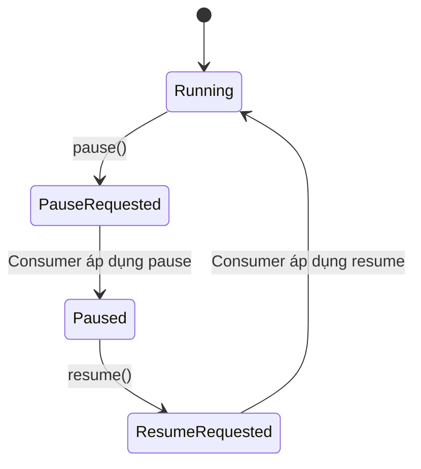

# Theo dõi trạng thái paused

Spring Kafka cho phép tạm dừng consumer khi hệ thống phía sau đang quá tải hoặc khi ứng dụng cần điều tiết tốc độ xử lý. Gọi `pause()` chỉ gửi yêu cầu tạm dừng; consumer thread áp dụng yêu cầu đó ở chu kỳ poll phù hợp. Vì vậy, trạng thái “đã yêu cầu pause” và trạng thái “consumer thực sự đang paused” là hai thời điểm khác nhau.

Để theo dõi chính xác, cần quan sát cả trạng thái yêu cầu lẫn trạng thái thực tế, kết hợp sự kiện pause/resume và số liệu backpressure như độ dài hàng đợi, consumer lag và thời gian paused.

## 1. Phân biệt pause requested và consumer paused

Với `MessageListenerContainer`, Spring Kafka cung cấp hai phương thức quan trọng:

- `isPauseRequested()`: cho biết ứng dụng đã yêu cầu container pause hay chưa.
- `isConsumerPaused()`: cho biết consumer đã thực sự ở trạng thái paused hay chưa.

Khi gọi `pause()`, container ghi nhận yêu cầu và áp dụng nó trên consumer thread khi thread đó xử lý chu kỳ poll tiếp theo. Các record đã được lấy từ poll hiện tại vẫn có thể được listener xử lý theo hành vi mặc định trước khi việc pause có hiệu lực. Vì vậy, `isPauseRequested()` có thể trả về `true` trong khi `isConsumerPaused()` vẫn là `false`.



Không nên xem kết quả `pause()` là bằng chứng rằng consumer đã dừng nhận record ngay tại thời điểm gọi. Nếu cần hiển thị trạng thái cho dashboard hoặc API quản trị, hãy biểu diễn riêng trạng thái yêu cầu và trạng thái đã áp dụng.

## 2. Đọc trạng thái của listener container

Với listener được khai báo bằng `@KafkaListener`, có thể lấy container qua `KafkaListenerEndpointRegistry`. ID trong `getListenerContainer()` phải trùng với `id` của annotation:

```java
@KafkaListener(
    id = "orders-listener",
    topics = "orders",
    groupId = "order-service")
public void consume(OrderEvent event) {
    orderService.process(event);
}
```

Một service quản trị có thể đọc và yêu cầu thay đổi trạng thái:

```java
@Service
public class ListenerPauseService {
    private final KafkaListenerEndpointRegistry registry;

    public ListenerPauseService(KafkaListenerEndpointRegistry registry) {
        this.registry = registry;
    }

    public PauseStatus status(String listenerId) {
        MessageListenerContainer container =
            registry.getListenerContainer(listenerId);
        if (container == null) {
            throw new IllegalArgumentException(
                "Unknown listener: " + listenerId);
        }

        return new PauseStatus(
            container.isPauseRequested(),
            container.isConsumerPaused());
    }

    public void pause(String listenerId) {
        MessageListenerContainer container = requireContainer(listenerId);
        container.pause();
    }

    public void resume(String listenerId) {
        MessageListenerContainer container = requireContainer(listenerId);
        container.resume();
    }
}
```

`PauseStatus` có thể là DTO chứa hai boolean `pauseRequested` và `consumerPaused`. Trong code production, nên xử lý listener ID không tồn tại và container chưa chạy theo một hợp đồng API rõ ràng. Trạng thái `false` của cả hai giá trị có nghĩa là không có yêu cầu pause đang chờ và consumer hiện không paused; nó không tự chứng minh listener đang xử lý record thành công.

Với `ConcurrentMessageListenerContainer`, có nhiều consumer con. Việc pause và resume được áp dụng trên các consumer thuộc container; khi giám sát, cần xem cả container/listener ID, partition được gán và trạng thái từng partition nếu ứng dụng dùng pause theo partition.

## 3. Theo dõi trạng thái của từng partition

Đôi khi chỉ một partition có dữ liệu nóng hoặc downstream xử lý riêng cho một nhóm key đang quá tải. Có thể pause partition cụ thể thay vì tạm dừng toàn bộ listener container.

```java
TopicPartition partition = new TopicPartition("orders", 2);

container.pausePartition(partition);
boolean paused = container.isPartitionPaused(partition);

// Khi hệ thống phía sau đã phục hồi:
container.resumePartition(partition);
```

Chỉ pause partition mà container đang sở hữu hoặc được cấu hình để xử lý. Trong concurrent container, một partition được gán cho một consumer con tại một thời điểm; việc theo dõi nên gắn với topic-partition và listener ID để tránh nhầm trạng thái giữa các consumer.

Pause toàn container khi mọi partition của listener cần giảm tải. Pause theo partition khi chỉ một phần luồng cần điều tiết. Cách chọn phạm vi ảnh hưởng trực tiếp đến throughput và thứ tự xử lý.

## 4. Dùng các sự kiện ConsumerPausedEvent và ConsumerResumedEvent

Trạng thái truy vấn cho biết tình hình hiện tại tại thời điểm đọc. Spring Kafka còn phát các application event khi consumer thực sự chuyển trạng thái. Có thể lắng nghe `ConsumerPausedEvent` và `ConsumerResumedEvent` để ghi log, cập nhật metric hoặc thông báo cho hệ thống giám sát.

```java
@Component
public class ConsumerPauseEventListener {
    private static final Logger log =
        LoggerFactory.getLogger(ConsumerPauseEventListener.class);

    @EventListener
    public void onPaused(ConsumerPausedEvent event) {
        log.info("Kafka consumer paused: {}", event);
    }

    @EventListener
    public void onResumed(ConsumerResumedEvent event) {
        log.info("Kafka consumer resumed: {}", event);
    }
}
```

Với pause/resume ở mức partition, Spring Kafka cũng cung cấp các event tương ứng như `ConsumerPartitionPausedEvent` và `ConsumerPartitionResumedEvent`. Các event này hữu ích để biết partition nào đã thực sự được pause hoặc resume.

Event được phát khi consumer thread áp dụng thay đổi, nên chúng giúp phân biệt thời điểm yêu cầu và thời điểm trạng thái thực tế thay đổi. Nếu application event multicaster được cấu hình chạy bất đồng bộ, handler sự kiện có thể được gọi trễ; không dùng thời điểm nhận event làm đồng hồ chính xác cho quyết định đồng bộ.

## 5. Kết hợp pause/resume với backpressure

Một cách phổ biến là đặt listener phía trước một hàng đợi có giới hạn. Worker phía sau lấy dữ liệu từ queue và gọi dịch vụ downstream. Khi queue gần đầy, ứng dụng pause consumer; khi queue giảm xuống mức an toàn, ứng dụng resume.

Nên dùng hai ngưỡng khác nhau để tránh pause/resume liên tục khi queue dao động quanh một giá trị:

| Ngưỡng | Hành động |
| --- | --- |
| High watermark | Yêu cầu pause khi queue đạt ngưỡng cao. |
| Low watermark | Yêu cầu resume khi queue giảm xuống ngưỡng thấp. |

```java
if (queue.size() >= HIGH_WATERMARK
        && !container.isPauseRequested()) {
    container.pause();
}

if (queue.size() <= LOW_WATERMARK
        && container.isPauseRequested()) {
    container.resume();
}
```

Đoạn code là logic điều khiển tối giản. Trong ứng dụng thực tế, cần bảo đảm các phép đọc queue và chuyển trạng thái được phối hợp an toàn giữa listener thread, worker thread và scheduler. Chỉ một thành phần nên làm chủ quyết định pause/resume để tránh hai luồng đưa ra yêu cầu trái ngược.

Đừng đợi đến khi queue đầy mới pause. Vì yêu cầu pause chỉ có hiệu lực ở chu kỳ poll phù hợp, các record còn lại trong poll hiện tại vẫn có thể đi vào xử lý. High watermark cần chừa dung lượng cho số record đang in-flight, số record tối đa trong một poll (`max.poll.records`) và concurrency của container.

Nếu queue đầy trước khi consumer dừng nhận record, `offer()` có thể thất bại. Hãy định nghĩa rõ cách xử lý trường hợp đó: giữ record trong luồng xử lý hiện tại, ném lỗi để retry theo chính sách, hoặc dùng một cơ chế lưu bền vững. Không âm thầm bỏ record chỉ vì queue đã đầy.

## 6. Pause không giống stop và không tự gây rebalance

Khi consumer pause các partition, nó vẫn tiếp tục gọi `poll()` để duy trì hoạt động và membership trong consumer group. Broker không giao record mới từ các partition đang paused, nhưng record vẫn được lưu trong Kafka. Khi resume, consumer tiếp tục đọc từ offset chưa được xử lý.

Điều này khác với `stop()`: stop đóng consumer và rời consumer group, có thể kích hoạt rebalance. Pause phù hợp với backpressure tạm thời; stop phù hợp khi kết thúc vòng đời container hoặc thay đổi cấu hình.

Pause cũng không giải quyết một listener đang bị block quá lâu. Nếu consumer thread không quay lại `poll()` vì listener xử lý chậm hoặc chờ một thao tác đồng bộ, `max.poll.interval.ms` vẫn có thể bị vượt quá. Pause chỉ có thể được áp dụng khi consumer thread có cơ hội xử lý yêu cầu; cần giới hạn thời gian xử lý và tránh chặn thread tiêu thụ.

## 7. Theo dõi trạng thái trong hệ thống nhiều consumer

Một listener có concurrency lớn hơn một sẽ có nhiều consumer con và nhiều partition assignment. Không nên chỉ ghi một metric boolean chung rồi kết luận mọi partition đều paused. Dashboard vận hành nên lưu các chiều:

- Listener/container ID và consumer group.
- Topic-partition được gán cho consumer.
- Pause requested và trạng thái paused thực tế.
- Thời điểm bắt đầu pause, thời gian paused và lần resume gần nhất.
- Queue depth, số record in-flight và consumer lag.

Nếu ứng dụng dùng pause theo partition, event và metric cần giữ thông tin topic-partition. Nếu pause cả container, nên tổng hợp trạng thái của các consumer con nhưng vẫn có thể tra cứu từng partition khi điều tra.

## 8. Kiểm thử pause và resume

Một kiểm thử tích hợp nên gửi nhiều record vào topic, gọi `pause()` và xác minh `isPauseRequested()` chuyển thành `true`. Sau đó chờ `isConsumerPaused()` hoặc `ConsumerPausedEvent` để xác nhận consumer đã áp dụng pause. Gửi thêm record trong thời gian paused và xác minh listener chưa nhận chúng; tiếp theo gọi `resume()` và xác minh các record được xử lý tiếp.

Kiểm thử thêm các trường hợp:

- Gọi pause hai lần và resume khi chưa paused.
- Pause ngay trong khi listener đang xử lý một poll có nhiều record.
- Pause/resume partition cụ thể trong concurrent container.
- Queue vượt high watermark rồi giảm dưới low watermark.
- Ứng dụng restart khi đang paused và hành vi khởi tạo lại.
- Listener bị block và ảnh hưởng của `max.poll.interval.ms`.

Dùng Embedded Kafka hoặc Testcontainers để xác minh hành vi poll, partition assignment và committed offset. Không chỉ kiểm tra phương thức pause đã được gọi; cần xác nhận consumer thực sự ngừng nhận record mới từ partition đã pause và tiếp tục sau resume.

## 9. Các metric nên có khi vận hành

Theo dõi số lần pause/resume, thời gian từ pause request đến trạng thái paused, thời gian paused, số partition đang paused, queue depth, số record in-flight, consumer lag và số lần queue offer thất bại. Cảnh báo khi consumer paused quá lâu, lag tăng nhanh hoặc queue không giảm sau khi downstream phục hồi.

Nên ghi lý do pause, chẳng hạn `DOWNSTREAM_OVERLOADED`, `QUEUE_HIGH_WATERMARK` hoặc `MAINTENANCE`. Khi resume, ghi nguyên nhân và thời gian pause để người vận hành biết điều kiện nào đã được giải quyết.

Theo dõi paused state có nghĩa là quan sát cả ý định điều khiển và trạng thái mà consumer thread đã áp dụng. Kết hợp `isPauseRequested()`, `isConsumerPaused()`, partition state, các consumer pause/resume event và metric backpressure giúp ứng dụng biết lúc nào nên chờ, lúc nào có thể tiếp tục, và liệu consumer có thực sự được bảo vệ khỏi downstream quá tải hay không.
