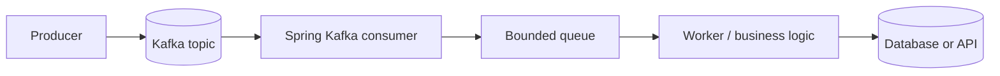

# Thiết kế graceful degradation

Một consumer Kafka có thể đọc record nhanh hơn tốc độ mà database, HTTP API hoặc hệ thống phía sau xử lý. Khi đó, tăng concurrency hoặc thêm consumer chưa chắc giải quyết được vấn đề; downstream có thể quá tải nặng hơn, hàng đợi trong ứng dụng phình to và độ trễ tăng liên tục.

Graceful degradation là cách ứng dụng giảm mức hoạt động có kiểm soát khi một thành phần bị quá tải hoặc suy giảm. Với Spring Kafka, ta có thể kết hợp giới hạn tài nguyên, pause/resume listener container, giảm tải công việc không thiết yếu, retry có giới hạn và fallback phù hợp. Mục tiêu là giữ hệ thống ổn định, bảo toàn message và khôi phục dần khi downstream sẵn sàng.

## 1. Nhận diện điểm nghẽn và tín hiệu quá tải

Một luồng messaging thường đi qua nhiều thành phần:



Nếu consumer lấy record nhanh hơn worker xử lý, queue tăng dần. Nếu worker xử lý nhanh nhưng database chậm, số request đang chờ hoặc connection pool bị sử dụng hết. Nếu database đã phục hồi nhưng consumer vẫn bị pause, throughput có thể không tự quay lại nếu thiếu cơ chế resume.

Một số tín hiệu nên quan sát:

| Tín hiệu | Điều có thể chỉ ra |
|---|---|
| Queue depth tăng liên tục | Tốc độ nhận lớn hơn tốc độ xử lý |
| Queue gần đầy hoặc remaining capacity thấp | Ứng dụng sắp hết chỗ đệm |
| Consumer lag tăng | Consumer không theo kịp tốc độ phát record hoặc đang pause |
| p95/p99 xử lý tăng | Downstream chậm hoặc có tranh chấp tài nguyên |
| Database connection pool gần cạn | Quá nhiều tác vụ đồng thời hoặc truy vấn kéo dài |
| HTTP 429/503 và timeout tăng | Dependency giới hạn tốc độ hoặc đang suy giảm |
| Retry/DLT tăng | Lỗi kéo dài hoặc chính sách retry không phù hợp |
| Heap và GC tăng | Giữ quá nhiều record hoặc tạo quá nhiều object/tác vụ đang chờ |

Không nên dùng một metric đơn lẻ để quyết định pause. Ví dụ consumer lag cao có thể do tốc độ producer tăng đột biến, trong khi downstream vẫn khỏe. Queue depth, thời gian xử lý và trạng thái dependency thường giúp xác định điểm nghẽn cụ thể hơn.

## 2. Graceful degradation là gì?

Khi một thành phần suy giảm, hệ thống có thể chuyển sang chế độ phục vụ thấp hơn nhưng vẫn kiểm soát được tài nguyên và dữ liệu.

Ví dụ với dịch vụ xử lý đơn hàng:

- Tiếp tục xử lý các thao tác quan trọng như xác nhận thanh toán.
- Tạm dừng hoặc trì hoãn tác vụ gửi thông báo không thiết yếu.
- Giảm số request đồng thời gửi tới database đang chậm.
- Dùng dữ liệu cache cũ có giới hạn cho một số truy vấn đọc nếu nghiệp vụ cho phép.
- Tạm dừng tiêu thụ một số partition khi queue gần đầy.
- Giữ record trong Kafka để xử lý sau, thay vì lấy về rồi giữ vô hạn trong heap.

Graceful degradation cần được định nghĩa theo nghiệp vụ. Không được tự ý bỏ qua event quan trọng, trả thành công giả hoặc commit offset khi tác dụng phụ cần thiết chưa hoàn tất.

## 3. Backpressure và pause/resume trong Spring Kafka

Backpressure là tín hiệu cho upstream biết downstream không thể tiếp nhận thêm công việc ở tốc độ hiện tại. Với Kafka, consumer có thể tạm ngừng lấy record từ broker trong khi record chưa xử lý vẫn nằm trong topic.

Spring Kafka cung cấp các thao tác pause/resume trên listener container:

- `pause()`: yêu cầu container tạm dừng tiêu thụ các partition đang được gán.
- `resume()`: yêu cầu container tiếp tục tiêu thụ.
- `pausePartition(...)`: tạm dừng một partition cụ thể khi cần điều tiết theo partition.
- `resumePartition(...)`: tiếp tục partition đã pause.

Ví dụ lấy container từ registry:

```java
@Service
public class OrderConsumerFlowControl {

    private final KafkaListenerEndpointRegistry registry;

    public OrderConsumerFlowControl(
            KafkaListenerEndpointRegistry registry) {
        this.registry = registry;
    }

    public void pauseOrders() {
        MessageListenerContainer container =
                registry.getListenerContainer("orders-listener");

        if (container != null && container.isRunning()) {
            container.pause();
        }
    }

    public void resumeOrders() {
        MessageListenerContainer container =
                registry.getListenerContainer("orders-listener");

        if (container != null && container.isRunning()) {
            container.resume();
        }
    }
}
```

Listener cần có ID rõ ràng:

```java
@KafkaListener(
        id = "orders-listener",
        topics = "orders",
        groupId = "order-service")
public void consume(OrderEvent event) {
    orderService.process(event);
}
```

`pause()` và `resume()` là yêu cầu điều khiển container. Việc pause thực tế được áp dụng ở chu kỳ poll của consumer. Container vẫn tiếp tục poll trong trạng thái paused để duy trì membership của consumer group; các partition đã pause không trả thêm record mới cho listener. Vì vậy, pause container khác với stop container: stop đóng consumer và khiến nó rời group, còn pause giữ consumer trong group.

Việc pause không xóa record khỏi Kafka và cũng không rollback công việc đã lấy về trong poll hiện tại. Hãy tính đến các record đã được fetch hoặc đang xử lý khi đặt ngưỡng pause.

## 4. Dùng high watermark và low watermark

Nếu pause ngay khi queue vượt một ngưỡng và resume ngay khi queue thấp hơn ngưỡng đó, hệ thống có thể liên tục chuyển qua lại giữa hai trạng thái. Đây là hiện tượng *flapping*.

Một cách ổn định hơn là dùng hai ngưỡng:

- **High watermark:** queue đạt mức này thì pause consumer.
- **Low watermark:** queue giảm xuống mức này thì resume consumer.

Ví dụ queue có sức chứa 1.000 phần tử:

| Mức queue | Hành động |
|---:|---|
| Dưới 600 | Tiếp tục hoạt động theo trạng thái hiện tại |
| Từ 600 trở lên | Pause consumer |
| Từ 250 trở xuống | Resume consumer |

Khoảng cách giữa hai ngưỡng tạo hysteresis, giúp tránh pause/resume liên tục khi queue dao động quanh một giá trị.

Ví dụ controller:

```java
@Component
public class QueueWatermarkController {

    private static final int HIGH_WATERMARK = 600;
    private static final int LOW_WATERMARK = 250;

    private final KafkaListenerEndpointRegistry registry;
    private boolean pauseRequested;

    public QueueWatermarkController(
            KafkaListenerEndpointRegistry registry) {
        this.registry = registry;
    }

    public synchronized void updateQueueDepth(int queueDepth) {
        MessageListenerContainer container =
                registry.getListenerContainer("orders-listener");

        if (container == null || !container.isRunning()) {
            return;
        }

        if (!pauseRequested && queueDepth >= HIGH_WATERMARK) {
            container.pause();
            pauseRequested = true;
        }
        else if (pauseRequested && queueDepth <= LOW_WATERMARK) {
            container.resume();
            pauseRequested = false;
        }
    }
}
```

Một queue monitor hoặc thành phần quản lý worker có thể gọi `updateQueueDepth(...)` khi queue thay đổi. Các ngưỡng trong ví dụ chỉ để minh họa; cần điều chỉnh theo dung lượng queue, tốc độ tiêu thụ, thời gian xử lý và lượng record có thể đã được fetch.

Trong ứng dụng chạy nhiều instance, biến `pauseRequested` chỉ phản ánh trạng thái của controller trong một JVM. Mỗi instance cần quản lý container của mình; nếu trạng thái pause được điều phối tập trung, cần lưu trạng thái điều khiển ở một cơ chế phù hợp và xử lý trường hợp instance khởi động lại.

## 5. Bounded queue và giới hạn công việc đang chờ

Pause consumer chỉ có ý nghĩa khi ứng dụng giới hạn lượng công việc đang chờ. Nếu listener đẩy record vào một queue không giới hạn, heap vẫn có thể tăng cho đến khi process bị OOM trước khi cơ chế backpressure có tác dụng.

Dùng queue có dung lượng cố định:

```java
private final BlockingQueue<OrderEvent> queue =
        new ArrayBlockingQueue<>(1_000);
```

Một queue bounded cho phép ứng dụng biết rõ số phần tử tối đa có thể giữ trong bộ nhớ. Khi queue đạt high watermark, controller yêu cầu pause. Worker xử lý queue và khi queue xuống low watermark, controller resume.

Tuy nhiên, record đã được consumer poll về có thể vẫn đang nằm trong bộ đệm nội bộ hoặc đang được xử lý. Vì vậy, high watermark nên thấp hơn sức chứa tối đa đủ nhiều để có khoảng đệm cho các record đã fetch và các request đang chạy.

Nếu dùng `queue.offer(event)` và offer thất bại, listener phải có chính sách rõ ràng. Không được bỏ qua event rồi trả về bình thường nếu offset sẽ được commit. Có thể ném exception để error handler xử lý, hoặc thiết kế listener chỉ nhận record khi còn capacity. Với xử lý bất đồng bộ, chỉ ack sau khi công việc đã hoàn tất theo đúng cơ chế offset đã chọn.

Không nên dùng queue unbounded rồi chỉ dựa vào consumer lag; lag tăng trên broker thường an toàn hơn việc đã kéo hàng triệu object vào heap.

## 6. Pause toàn container hay chỉ một partition?

Có hai phạm vi điều tiết thường gặp.

**Pause toàn container** phù hợp khi dependency phía sau phục vụ mọi partition đều đang quá tải. Container ngừng lấy record mới từ tất cả partition đang được gán.

**Pause theo partition** phù hợp khi chỉ một tenant, key range hoặc luồng dữ liệu đang gây áp lực. Nếu partition đó có thể tạm dừng độc lập, các partition còn lại vẫn tiếp tục xử lý.

Ví dụ khái niệm:

```java
TopicPartition partition =
        new TopicPartition("orders", 2);

container.pausePartition(partition);

// Khi downstream sẵn sàng:
container.resumePartition(partition);
```

Chỉ pause partition đang được gán cho consumer của container tương ứng. Khi rebalance xảy ra, assignment có thể thay đổi; bộ điều khiển cần theo dõi partition assignment và cập nhật quyết định pause cho consumer/container mới.

Pause theo partition không giải quyết được một dependency dùng chung đang quá tải toàn hệ thống. Trong trường hợp đó, pause toàn container hoặc giảm concurrency có thể phù hợp hơn.

## 7. Pause khác với stop, seek và retry

Các thao tác này có mục tiêu khác nhau:

| Cơ chế | Tác dụng | Khi phù hợp |
|---|---|---|
| Pause/resume | Tạm ngừng hoặc tiếp tục lấy record mới | Điều tiết tốc độ do downstream quá tải |
| Stop/start | Đóng consumer và tham gia group lại khi start | Tắt hẳn luồng tiêu thụ trong một khoảng thời gian |
| Seek | Thay đổi vị trí đọc của consumer | Điều khiển offset hoặc phát lại record theo chính sách |
| Retry | Thử xử lý lại record thất bại | Lỗi xử lý có khả năng phục hồi |
| Retry topic | Chuyển record sang luồng retry khác | Trì hoãn retry mà không giữ luồng chính chờ |

Không dùng seek để thay thế pause khi mục tiêu chỉ là giảm tốc độ. Seek có thể làm record được đọc lại và gây duplicate. Không dùng retry cho mọi trường hợp queue quá tải nếu lỗi thực chất là hệ thống đang nhận nhiều việc hơn khả năng xử lý; retry dồn dập có thể làm tăng tải.

## 8. Tác động đến poll, offset và consumer group

Khi container paused, Spring Kafka vẫn tiếp tục poll để duy trì consumer group membership. Điều này giúp tránh việc consumer rời group chỉ vì đang tạm dừng nhận record.

Một số điểm cần hiểu:

- Pause không commit offset của record chưa xử lý.
- Record đã xử lý thành công vẫn được commit theo AckMode/transaction đã cấu hình.
- Record đã được fetch trước khi pause có thể còn phải được xử lý.
- Stop container khiến consumer rời group và có thể gây rebalance.
- Khi resume, consumer tiếp tục từ offset đã commit hoặc vị trí hiện tại theo cơ chế của container.

Nếu listener bị block quá lâu trong một thao tác đồng bộ, consumer thread có thể không quay lại poll. Khi đó, `max.poll.interval.ms` vẫn là giới hạn quan trọng và consumer có thể bị loại khỏi group. Pause/resume không cứu được một listener thread đang bị treo trong lời gọi database hoặc HTTP không có timeout.

Vì vậy, hãy đặt timeout cho dependency, giới hạn thời gian xử lý và tránh giữ consumer thread chờ vô hạn.

## 9. Graceful degradation ở tầng nghiệp vụ

Backpressure điều tiết lượng công việc. Graceful degradation còn có thể giảm chất lượng hoặc phạm vi dịch vụ trong thời gian dependency suy giảm.

Ví dụ:

| Tình huống | Cách suy giảm có kiểm soát |
|---|---|
| API gửi email chậm | Tạm hoãn notification, giữ event để xử lý sau |
| Database gần hết connection | Giảm concurrency hoặc pause consumer |
| Cache không khả dụng | Dùng database với rate limit nếu còn khả năng |
| Một loại event không quan trọng gây tải | Hạ ưu tiên hoặc chuyển sang consumer group riêng |
| Downstream trả 429 | Tôn trọng rate limit, giảm tốc độ và retry có backoff |
| Dependency ngừng hoạt động lâu | Pause luồng liên quan, cảnh báo và chờ phục hồi |

Fallback phải phản ánh đúng tính chất nghiệp vụ. Ví dụ dùng cache cũ có thể chấp nhận cho màn hình báo cáo, nhưng không phù hợp cho quyết định trừ tiền hoặc kiểm tra tồn kho cần dữ liệu chính xác.

Nếu không thể xử lý an toàn, giữ record trong Kafka và trì hoãn xử lý thường tốt hơn việc ack rồi bỏ qua.

## 10. Kết hợp circuit breaker và rate limiter

Circuit breaker phát hiện dependency liên tục thất bại và chuyển sang trạng thái open để ngăn các lời gọi mới trong một khoảng thời gian. Rate limiter giới hạn số request trong một đơn vị thời gian.

Hai cơ chế này bổ sung cho pause/resume:

- **Circuit breaker:** bảo vệ dependency khỏi các lời gọi đang có khả năng thất bại.
- **Rate limiter:** giới hạn tốc độ gửi request tới dependency.
- **Pause/resume:** điều tiết việc consumer lấy thêm record từ Kafka.
- **Bounded queue:** giới hạn công việc đang giữ trong bộ nhớ.

Ví dụ, nếu API kho trả về nhiều lỗi 503, circuit breaker mở. Controller có thể pause consumer xử lý đơn hàng cần API kho. Khi circuit breaker chuyển sang half-open/closed và queue giảm xuống low watermark, controller resume.

Không nên resume chỉ vì circuit breaker vừa đóng nếu queue vẫn gần đầy. Cần kết hợp trạng thái dependency và capacity thực tế.

## 11. Tránh các cách xử lý gây quá tải nặng hơn

Một số cách tưởng như đơn giản nhưng làm hệ thống khó phục hồi:

- **Queue không giới hạn:** che giấu overload trong thời gian ngắn nhưng cuối cùng có thể làm đầy heap.
- **Retry không có backoff:** tạo request dồn dập tới dependency đang lỗi.
- **Tăng concurrency liên tục:** có thể làm database/API bị quá tải nặng hơn.
- **Sleep trong listener:** giữ consumer thread, giảm khả năng poll và kéo dài xử lý.
- **Ack trước khi xử lý xong:** có thể làm mất công việc nếu process dừng sau ack.
- **Pause rồi quên resume:** consumer lag tăng mãi dù dependency đã phục hồi.
- **Pause tất cả topic vì một dependency riêng lẻ:** làm các luồng độc lập bị ảnh hưởng không cần thiết.

Cần có ngưỡng, trạng thái, timeout và cơ chế phục hồi rõ ràng. Nếu một dependency chỉ phục vụ một nhóm event, hãy giới hạn backpressure trong nhóm đó khi kiến trúc cho phép.

## 12. Đặt ngưỡng và tính khoảng đệm

High/low watermark không nên chọn tùy ý. Có thể ước lượng lượng record sẽ còn đến sau khi gửi yêu cầu pause.

Giả sử:

- Consumer đang xử lý 400 record/giây.
- Thời gian từ lúc phát hiện high watermark đến khi pause có hiệu lực là 0,5 giây.
- Poll hiện tại có thể còn 100 record chưa xử lý.
- Queue còn 200 slot trống.

Lượng record có thể phát sinh thêm trước khi dừng hẳn xấp xỉ:

```text
400 * 0.5 + 100 = 300 records
```

Trong ví dụ, queue chỉ còn 200 slot trống, nên high watermark đặt quá muộn có thể khiến queue đầy trước khi pause có hiệu lực. Cần đặt high watermark thấp hơn và giữ khoảng đệm đủ cho record đã fetch, thời gian điều khiển và số tác vụ đang chạy.

Đây là ước lượng ban đầu. Hãy đo thời gian pause thực tế, kích thước poll, số partition, concurrency và throughput trong môi trường gần production để hiệu chỉnh.

## 13. Quan sát và cảnh báo

Nên có dashboard hoặc metric cho cả trạng thái consumer và downstream:

| Metric | Mục đích |
|---|---|
| Queue depth và remaining capacity | Phát hiện áp lực bộ nhớ |
| Pause duration | Phát hiện consumer bị pause quá lâu |
| Pause/resume count | Phát hiện flapping hoặc điều khiển sai |
| Consumer lag theo partition | Biết luồng nào đang tích backlog |
| Record processing latency | Theo dõi thời gian xử lý |
| Downstream latency/error rate | Xác định dependency gây nghẽn |
| In-flight requests | Giới hạn số request đồng thời |
| Retry/DLT rate | Phát hiện lỗi kéo dài hoặc retry storm |
| Heap/GC và thread pool saturation | Phát hiện tài nguyên JVM gần cạn |

Cảnh báo nên bao gồm thời gian pause vượt ngưỡng, queue không giảm dù đã pause, consumer lag tăng nhanh hoặc downstream không phục hồi. Một consumer paused trong vài giây có thể bình thường; paused trong nhiều phút mà không có cảnh báo là rủi ro vận hành.

## 14. Kiểm thử backpressure và graceful degradation

Integration test nên xác minh hành vi thực tế của container với broker thử nghiệm:

1. Gửi record liên tục và làm worker chậm để queue tăng.
2. Xác nhận controller pause container khi queue chạm high watermark.
3. Xác nhận queue không vượt dung lượng dự kiến do record đã fetch.
4. Tiếp tục cho worker xử lý queue và xác nhận resume khi queue xuống low watermark.
5. Kiểm tra không có vòng lặp pause/resume liên tục quanh một ngưỡng.
6. Pause một partition và xác nhận partition khác vẫn xử lý nếu được thiết kế độc lập.
7. Stop container và xác nhận consumer rời group; start lại và kiểm tra offset.
8. Làm downstream trả 429/503 và xác nhận rate limiter/circuit breaker hoạt động.
9. Kiểm tra listener không ack record khi công việc nghiệp vụ chưa hoàn tất.
10. Kiểm tra shutdown trong lúc paused và bảo đảm container được đóng đúng cách.

Không chỉ kiểm tra phương thức `pause()` được gọi. Cần xác nhận consumer ngừng nhận record mới, vẫn duy trì group khi paused và tiếp tục xử lý sau resume.

## 15. Checklist triển khai

- [ ] Đã xác định dependency hoặc queue nào đang gây backpressure.
- [ ] Queue và thread pool có giới hạn dung lượng.
- [ ] High watermark đủ thấp để chứa record đã fetch và công việc đang chạy.
- [ ] Low watermark thấp hơn high watermark để tránh flapping.
- [ ] Pause/resume được quản lý theo container hoặc partition phù hợp.
- [ ] Có trạng thái điều khiển và cơ chế tự resume khi downstream phục hồi.
- [ ] Timeout được đặt cho database/API; không block poll vô hạn.
- [ ] Retry có backoff và giới hạn, không tạo retry storm.
- [ ] Offset chỉ được ack/commit sau khi công việc cần thiết hoàn tất.
- [ ] Có metric cho queue, pause duration, lag, latency và lỗi downstream.
- [ ] Đã kiểm thử overload, recovery, pause/resume, rebalance và shutdown.
- [ ] Có cảnh báo khi pause kéo dài hoặc queue không giảm.

Graceful degradation trong Spring Kafka là sự phối hợp giữa giới hạn công việc đang chờ, điều tiết consumer và giảm mức phục vụ theo ưu tiên nghiệp vụ. Dùng pause/resume khi downstream cần thời gian phục hồi, bounded queue để bảo vệ heap, high/low watermark để tránh flapping và circuit breaker/rate limiter để kiểm soát lời gọi phụ thuộc. Quan trọng nhất là giữ nguyên tính an toàn của offset và message: chỉ xác nhận xử lý sau khi công việc cần thiết đã hoàn tất, đồng thời có cơ chế resume và phục hồi rõ ràng.

