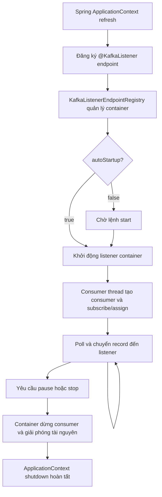

# Application event trong vòng đời container

Trong Spring Kafka, listener container không chỉ nhận và chuyển Kafka record đến phương thức `@KafkaListener`. Container còn phát ra các **Spring application event** để ứng dụng quan sát vòng đời consumer và trạng thái hoạt động của listener: consumer bắt đầu chạy, dừng, không nhận được dữ liệu trong một khoảng thời gian, tạm dừng hoặc có dấu hiệu không phản hồi.

Các event này giúp tích hợp vòng đời Kafka với cơ chế quản lý của Spring. Ứng dụng có thể ghi log, cập nhật metric, phát tín hiệu cảnh báo hoặc điều phối container thông qua `KafkaListenerEndpointRegistry`. Chúng đặc biệt hữu ích khi vận hành ứng dụng gửi nhận sự kiện bằng Spring Kafka, `KafkaTemplate` và `@KafkaListener`.

## 1. Spring application event và Kafka record là hai khái niệm khác nhau

Một Kafka record là dữ liệu được producer ghi vào topic. Record có key, value, timestamp, partition và offset; broker lưu trữ record để các consumer đọc theo consumer group. Ví dụ `OrderCreated` là một event nghiệp vụ có thể được gửi lên topic `orders`.

Spring application event là thông báo trong phạm vi một tiến trình Spring đang chạy. Listener container phát thông báo như `ConsumerStartedEvent` hoặc `ListenerContainerIdleEvent` thông qua cơ chế application event của Spring. Các bean trong cùng application context có thể đăng ký nhận những thông báo này bằng `@EventListener` hoặc `ApplicationListener`.

| Tiêu chí | Kafka record | Spring application event của container |
|---|---|---|
| Phạm vi | Được lưu trong Kafka topic và có thể được nhiều ứng dụng đọc | Trong tiến trình Spring đang chạy |
| Mục đích | Truyền dữ liệu hoặc sự kiện nghiệp vụ giữa các thành phần | Thông báo trạng thái và vòng đời của listener container |
| Cơ chế nhận | Kafka consumer, consumer group, offset | `@EventListener` hoặc `ApplicationListener` |
| Lưu trữ và phát lại | Có thể lưu giữ và đọc lại theo retention/offset | Không có log bền vững để phát lại sau khi ứng dụng khởi động lại |
| Ví dụ | `OrderCreated`, `PaymentCaptured` | `ConsumerStartedEvent`, `ListenerContainerIdleEvent` |

Vì application event không phải dữ liệu được ghi vào Kafka, không dùng chúng để thay thế event nghiệp vụ hoặc để giao tiếp giữa các service. Nếu một service khác cần biết đơn hàng đã được tạo, hãy gửi record lên topic. Nếu chính ứng dụng cần biết consumer vừa khởi động, application event là lựa chọn phù hợp.

## 2. Container được tạo và quản lý như thế nào?

Khi Spring xử lý bean có `@KafkaListener`, `KafkaListenerAnnotationBeanPostProcessor` phát hiện annotation và đăng ký listener endpoint. `KafkaListenerEndpointRegistry` quản lý các listener container tương ứng. Container chịu trách nhiệm tạo Kafka consumer, subscribe hoặc assign partition, chạy vòng lặp poll và chuyển record đến listener.

Một listener đơn giản có thể được khai báo như sau:

```java
import org.springframework.kafka.annotation.KafkaListener;
import org.springframework.stereotype.Component;

@Component
public class OrderListener {

    @KafkaListener(
            id = "ordersListener",
            topics = "orders",
            groupId = "orders-service"
    )
    public void onOrder(String message) {
        // Xử lý payload đã được deserialize.
    }
}
```

`id` là định danh listener endpoint; có thể dùng ID này để lấy container từ registry. Khi không cấu hình `autoStartup` khác đi, container thường được registry khởi động tự động theo vòng đời application context.

Trình tự tổng quát:



Container tham gia cơ chế lifecycle của Spring. Khi context khởi động, registry khởi động những listener được cấu hình tự động chạy. Khi context dừng, registry yêu cầu các container dừng và giải phóng consumer. Ứng dụng cũng có thể điều khiển container bằng registry trong thời gian chạy.

### 2.1. Container đơn và concurrency

Với một listener container đơn, một consumer thực hiện công việc poll và xử lý theo cấu hình listener. Khi đặt `concurrency` lớn hơn một trên `ConcurrentMessageListenerContainer`, Spring Kafka quản lý nhiều consumer container con. Mỗi consumer có thread và vòng đời riêng; vì thế một số event có thể được phát ra cho từng consumer/container con thay vì chỉ một lần cho toàn bộ listener logic.

Khi điều tra event, cần phân biệt ID listener endpoint với từng consumer/container con. Không giả định rằng một event khởi động hoặc dừng đại diện cho toàn bộ consumer group. Consumer group còn chịu sự điều phối của Kafka broker, chẳng hạn quá trình rebalance khi thành viên tham gia hoặc rời nhóm.

## 3. Các event trong vòng đời consumer

Spring Kafka cung cấp các event để theo dõi những mốc quan trọng trong quá trình consumer bắt đầu và kết thúc.

| Event | Thời điểm phát ra | Cách sử dụng thường gặp |
|---|---|---|
| `ConsumerStartingEvent` | Consumer thread chuẩn bị bắt đầu | Ghi nhận tiến trình khởi động |
| `ConsumerStartedEvent` | Consumer đã bắt đầu chạy | Cập nhật trạng thái hoặc metric consumer đã hoạt động |
| `ConsumerFailedToStartEvent` | Consumer không thể khởi động thành công | Ghi log lỗi và phát cảnh báo |
| `ConsumerStoppingEvent` | Consumer chuẩn bị dừng | Ghi nhận quá trình shutdown |
| `ConsumerStoppedEvent` | Consumer đã dừng | Cập nhật trạng thái, điều tra lý do dừng |

Các event startup và shutdown giúp phân biệt những trạng thái khác nhau. Ví dụ, một container đã được tạo trong application context chưa có nghĩa là consumer đã khởi động thành công. Tương tự, nhận được yêu cầu stop chưa có nghĩa consumer đã hoàn tất dừng và giải phóng tài nguyên.

Không nên dùng riêng `ConsumerStartedEvent` để kết luận consumer group đã nhận đủ partition. Việc phân công partition còn phụ thuộc subscription, broker và quá trình rebalance. Khi cần xác minh partition được giao, hãy quan sát assignment/metric phù hợp của container hoặc consumer.

## 4. Event phản ánh trạng thái hoạt động

Ngoài startup và shutdown, listener container phát các event giúp quan sát tình trạng xử lý trong lúc ứng dụng đang chạy.

| Event | Ý nghĩa | Lưu ý |
|---|---|---|
| `ListenerContainerIdleEvent` | Container không nhận được record trong khoảng idle đã cấu hình | Không đồng nghĩa consumer bị lỗi hoặc mất kết nối |
| `ListenerContainerNoLongerIdleEvent` | Container nhận record trở lại sau giai đoạn idle | Có thể dùng để kết thúc cảnh báo idle |
| `NonResponsiveConsumerEvent` | Consumer không có tiến triển poll trong khoảng thời gian được theo dõi | Cần kiểm tra listener xử lý lâu, thread bị block, broker hoặc mạng |
| `ConsumerPausedEvent` | Consumer/container đã chuyển sang trạng thái pause | Dùng để theo dõi điều tiết tiêu thụ |
| `ConsumerResumedEvent` | Consumer/container được resume | Cho biết quá trình tiếp tục tiêu thụ |
| `ConsumerPartitionPausedEvent` | Một hoặc nhiều partition được pause | Có ích khi chỉ tạm dừng một phần luồng dữ liệu |
| `ConsumerPartitionResumedEvent` | Partition được resume | Theo dõi trạng thái từng partition |

`ListenerContainerIdleEvent` chỉ có ích khi đã cấu hình khoảng thời gian phát idle event, ví dụ thông qua `ContainerProperties.setIdleEventInterval(...)`. Idle có thể đơn giản là topic đang không có dữ liệu mới hoặc partition được gán không phát sinh record. Không nên tự động restart container chỉ vì nhận được idle event.

`NonResponsiveConsumerEvent` là tín hiệu cần điều tra sâu hơn. Consumer có thể không quay lại poll đúng hạn vì listener đang xử lý quá lâu, một thao tác I/O bị treo, thread bị block hoặc kết nối Kafka có vấn đề. Hãy đối chiếu event với log xử lý, thời gian poll, độ trễ consumer và trạng thái broker trước khi thực hiện hành động khôi phục.

Pause và stop cũng có ngữ nghĩa khác nhau. Khi pause, container tạm ngừng chuyển record từ partition được pause đến listener nhưng consumer vẫn có thể tiếp tục poll để duy trì hoạt động và membership trong group. Khi stop, container kết thúc consumer và giải phóng tài nguyên. Vì vậy pause thường phù hợp để điều tiết tải tạm thời; stop dùng khi muốn kết thúc vòng đời container.

## 5. Lắng nghe application event bằng `@EventListener`

Có thể tạo một bean riêng để nhận event. Ví dụ sau ghi nhận các mốc startup, shutdown và idle:

```java
import org.slf4j.Logger;
import org.slf4j.LoggerFactory;
import org.springframework.context.event.EventListener;
import org.springframework.kafka.event.ConsumerFailedToStartEvent;
import org.springframework.kafka.event.ConsumerStartedEvent;
import org.springframework.kafka.event.ConsumerStartingEvent;
import org.springframework.kafka.event.ConsumerStoppedEvent;
import org.springframework.kafka.event.ConsumerStoppingEvent;
import org.springframework.kafka.event.ListenerContainerIdleEvent;
import org.springframework.kafka.event.ListenerContainerNoLongerIdleEvent;
import org.springframework.stereotype.Component;

@Component
public class KafkaContainerEventListener {

    private static final Logger log =
            LoggerFactory.getLogger(KafkaContainerEventListener.class);

    @EventListener
    public void onConsumerStarting(ConsumerStartingEvent event) {
        log.info("Kafka consumer is starting: {}", event.getSource());
    }

    @EventListener
    public void onConsumerStarted(ConsumerStartedEvent event) {
        log.info("Kafka consumer has started: {}", event.getSource());
    }

    @EventListener
    public void onConsumerFailedToStart(ConsumerFailedToStartEvent event) {
        log.error("Kafka consumer failed to start: {}", event.getSource());
    }

    @EventListener
    public void onConsumerStopping(ConsumerStoppingEvent event) {
        log.info("Kafka consumer is stopping: {}", event.getSource());
    }

    @EventListener
    public void onConsumerStopped(ConsumerStoppedEvent event) {
        log.info("Kafka consumer has stopped: {}", event.getSource());
    }

    @EventListener
    public void onContainerIdle(ListenerContainerIdleEvent event) {
        log.warn("Kafka listener container is idle: {}", event.getListenerId());
    }

    @EventListener
    public void onContainerActive(ListenerContainerNoLongerIdleEvent event) {
        log.info("Kafka listener container is active again: {}", event.getListenerId());
    }
}
```

Spring tìm các phương thức có `@EventListener` và gọi phương thức tương ứng khi application context nhận event có kiểu tương thích. Một phương thức có thể nhận một event cụ thể; cũng có thể dùng `ApplicationListener<E>` nếu muốn triển khai theo interface.

Trong ví dụ, `event.getSource()` là source do event kế thừa từ Spring `ApplicationEvent`. Với các event có thông tin chuyên biệt, hãy đọc các thuộc tính được cung cấp bởi đúng lớp event và phiên bản Spring Kafka của dự án. Ví dụ idle event cung cấp listener ID để xác định endpoint phát thông báo.

Nếu listener dùng concurrency, hãy kiểm tra thông tin container/consumer trong event trước khi gộp metric. Một event có thể chỉ phản ánh trạng thái của một consumer con.

## 6. Điều khiển container qua `KafkaListenerEndpointRegistry`

Application event có thể kích hoạt một quy trình điều phối, nhưng việc start, stop, pause hoặc resume nên thực hiện thông qua API của listener container. `KafkaListenerEndpointRegistry` cung cấp container theo ID khai báo trong `@KafkaListener`.

```java
import org.springframework.kafka.config.KafkaListenerEndpointRegistry;
import org.springframework.kafka.listener.MessageListenerContainer;
import org.springframework.stereotype.Service;

@Service
public class OrderListenerControl {

    private final KafkaListenerEndpointRegistry registry;

    public OrderListenerControl(KafkaListenerEndpointRegistry registry) {
        this.registry = registry;
    }

    public void pauseOrders() {
        MessageListenerContainer container =
                registry.getListenerContainer("ordersListener");
        if (container != null) {
            container.pause();
        }
    }

    public void resumeOrders() {
        MessageListenerContainer container =
                registry.getListenerContainer("ordersListener");
        if (container != null) {
            container.resume();
        }
    }

    public void stopOrders() {
        MessageListenerContainer container =
                registry.getListenerContainer("ordersListener");
        if (container != null && container.isRunning()) {
            container.stop();
        }
    }
}
```

Nếu listener cần được điều khiển thủ công từ đầu, có thể cấu hình `autoStartup = "false"` trên `@KafkaListener`, sau đó gọi `start()` trên container lấy từ registry khi ứng dụng đã sẵn sàng. Cần bảo đảm ID truyền vào registry trùng với `id` của listener endpoint.

Không nên gọi trực tiếp các phương thức của Kafka `Consumer` từ một thread tùy ý. Consumer không được thiết kế để nhiều thread cùng thao tác. Dùng API điều khiển container của Spring Kafka để pause/resume và quản lý lifecycle; để container thực hiện thao tác trên consumer thread theo đúng cơ chế của nó.

## 7. Threading và những lưu ý khi xử lý event

Theo mặc định, Spring application event được dispatch đồng bộ trong thread phát event. Các event của listener container thường được phát từ luồng thực thi consumer/container. Điều này tạo ra hai hệ quả:

1. Một event handler chạy lâu có thể làm chậm thread phát event và ảnh hưởng đến tiến trình poll hoặc lifecycle của container.
2. Nếu chuyển event sang executor hoặc dùng `@Async`, không được mang đối tượng Kafka `Consumer` sang thread khác rồi gọi các phương thức của nó.

Với handler chỉ ghi log hoặc cập nhật metric, xử lý nhanh ngay trong listener thường là đủ. Nếu cần gọi hệ thống bên ngoài, gửi thông báo hoặc chạy tác vụ tốn thời gian, hãy chuyển dữ liệu cần thiết sang một tác vụ bất đồng bộ. Chỉ truyền các giá trị bất biến như listener ID, tên event, thời điểm và thông tin đã được trích xuất an toàn; không truyền consumer để thread khác thao tác.

Một số nguyên tắc vận hành:

- Giữ event handler ngắn và có xử lý lỗi rõ ràng.
- Không thực hiện truy vấn mạng hoặc thao tác I/O kéo dài trực tiếp trong callback đồng bộ.
- Không dùng idle event làm bằng chứng duy nhất cho lỗi Kafka.
- Không restart container liên tục khi nhận nhiều event trạng thái; cần cơ chế chống lặp và giới hạn tần suất hành động.
- Không coi event startup là bằng chứng rằng mọi partition đã được assign hoặc consumer đã xử lý thành công record.
- Dùng metric, log và trạng thái consumer group để bổ sung cho event, đặc biệt khi điều tra rebalance, lag và lỗi deserialize.

## 8. Ứng dụng thực tế: theo dõi listener orders

Giả sử service xử lý topic `orders`. Một cách tổ chức đơn giản là:

| Thành phần | Trách nhiệm |
|---|---|
| `OrderListener` | Xử lý payload của từng record và thực hiện nghiệp vụ |
| `KafkaContainerEventListener` | Ghi nhận startup, shutdown, idle và trạng thái container |
| `OrderListenerControl` | Pause, resume hoặc stop listener khi có yêu cầu vận hành |
| Monitoring/alerting | Kết hợp log, metric, consumer lag và cảnh báo |

Một quy trình quan sát có thể diễn ra như sau:

1. Application context khởi động và registry start listener `ordersListener`.
2. `ConsumerStartingEvent` và sau đó `ConsumerStartedEvent` giúp ghi nhận tiến trình consumer bắt đầu hoạt động.
3. Khi topic không có record trong khoảng idle đã cấu hình, `ListenerContainerIdleEvent` được phát ra. Monitoring có thể ghi nhận trạng thái ít dữ liệu; không cần tự động restart.
4. Khi record xuất hiện trở lại, `ListenerContainerNoLongerIdleEvent` giúp đóng trạng thái idle.
5. Nếu consumer không poll trong khoảng thời gian được theo dõi, `NonResponsiveConsumerEvent` cung cấp tín hiệu để điều tra thread xử lý, mạng và broker.
6. Khi service shutdown, container phát event dừng và registry hoàn tất lifecycle của listener.

Các application event này hỗ trợ vận hành tại chỗ. Nếu cần theo dõi trạng thái service từ một hệ thống khác, hãy xuất metric, log hoặc health information qua hạ tầng observability; không mong đợi hệ thống bên ngoài nhận trực tiếp Spring application event trong bộ nhớ của service.

## 9. Những nhầm lẫn thường gặp

- **Nhầm application event với event nghiệp vụ:** application event của container chỉ mô tả trạng thái runtime trong một tiến trình; event nghiệp vụ cần được gửi qua Kafka khi các service khác phải nhận.
- **Cho rằng container đã tạo là consumer đã chạy:** cần phân biệt đăng ký endpoint, yêu cầu start và event consumer thực sự bắt đầu.
- **Coi idle là lỗi:** topic không có dữ liệu mới là trạng thái hợp lệ. Chỉ cảnh báo khi idle vượt ngưỡng nghiệp vụ mong muốn.
- **Dùng event để thay thế consumer lag:** event lifecycle không cung cấp đầy đủ mức backlog. Cần theo dõi lag và offset riêng.
- **Gọi consumer từ thread khác:** thao tác trực tiếp ngoài consumer thread có thể gây lỗi đồng thời. Điều khiển qua `MessageListenerContainer`.
- **Để event handler chạy lâu:** callback đồng bộ có thể cản trở thread phát event. Hãy giữ handler ngắn hoặc chuyển tác vụ đã tách dữ liệu sang executor.
- **Giả định một event cho toàn bộ listener khi concurrency lớn hơn một:** event có thể phát ra ở cấp consumer/container con; cần tổng hợp đúng phạm vi.

## 10. Checklist khi tích hợp application event

- [ ] Mỗi `@KafkaListener` quan trọng có ID ổn định để tra cứu trong registry.
- [ ] Đã xác định listener nào tự khởi động và listener nào cần `autoStartup` thủ công.
- [ ] Có handler cho các event startup/shutdown cần thiết.
- [ ] Chỉ cấu hình idle event khi có nhu cầu giám sát khoảng không có record.
- [ ] Có metric/log bổ sung để phân tích non-responsive consumer, lag và rebalance.
- [ ] Event handler đồng bộ không thực hiện công việc kéo dài.
- [ ] Không truy cập Kafka `Consumer` từ thread khác.
- [ ] Với concurrency, đã xác định event ở cấp consumer con hay listener endpoint.
- [ ] Application event không bị dùng thay cho Kafka record của nghiệp vụ.

Khi hiểu rõ application event trong vòng đời container, ứng dụng Spring Kafka có thể quan sát và điều phối consumer có chủ đích. `@KafkaListener` tiếp tục đảm nhiệm xử lý record; application event cung cấp tín hiệu về trạng thái container; còn `KafkaListenerEndpointRegistry` là điểm quản lý vòng đời listener trong application context.
