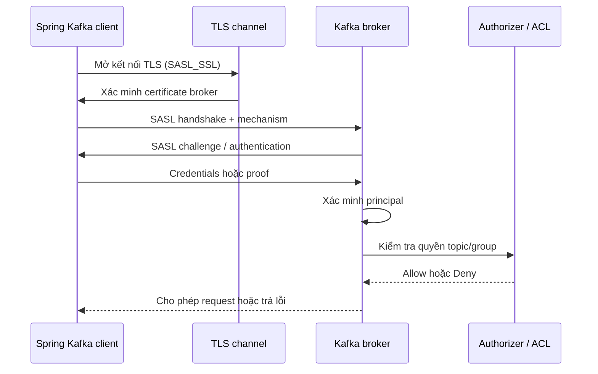

# SASL/PLAIN và SASL/SCRAM

Trong ứng dụng Spring Kafka, SASL/PLAIN và SASL/SCRAM là hai cơ chế xác thực client với Kafka broker. Chúng giúp broker xác định client đang kết nối là principal nào. Để triển khai an toàn, cần cấu hình đồng bộ ở broker, producer, consumer, KafkaAdmin và các client khác của ứng dụng.

Ba khái niệm cần phân biệt:

- **Authentication:** xác minh danh tính client bằng SASL/PLAIN hoặc SASL/SCRAM.
- **Transport encryption:** mã hóa dữ liệu truyền qua mạng bằng TLS. Với Kafka, client thường dùng protocol `SASL_SSL` để kết hợp SASL và TLS.
- **Authorization:** quyết định principal đã xác thực được phép đọc/ghi topic, sử dụng consumer group hoặc thao tác cluster nào thông qua ACL.

SASL thành công không có nghĩa client được phép đọc mọi topic. TLS cũng không thay thế xác thực hoặc ACL. Một cấu hình production cần thiết kế cả ba lớp.

## 1. Luồng xác thực SASL trong Kafka

Khi client kết nối tới broker, Kafka thực hiện các bước tổng quát:



SASL/PLAIN và SASL/SCRAM khác nhau ở cách xác minh thông tin đăng nhập. Sau khi xác thực, broker tạo principal tương ứng, thường có dạng `User:orders_app`. Authorizer dùng principal đó để kiểm tra ACL.

Với `SASL_PLAINTEXT`, SASL có xác thực nhưng dữ liệu mạng không được mã hóa bằng TLS. Với `SASL_SSL`, kết nối được bảo vệ bằng TLS. Trong môi trường production, hãy ưu tiên `SASL_SSL`, kể cả khi dùng SCRAM.

## 2. SASL/PLAIN hoạt động như thế nào?

SASL/PLAIN dùng username và password để xác thực. Client gửi thông tin xác thực trong SASL PLAIN response; broker đối chiếu username/password với dữ liệu credential mà server được cấu hình.

Điều này làm PLAIN dễ cấu hình và tương thích rộng, nhưng password không được cơ chế PLAIN tự mã hóa. Nếu kết nối không có TLS, thông tin đăng nhập có thể bị lộ khi lưu lượng mạng bị nghe trộm.

Vì vậy:

- Không dùng SASL/PLAIN qua mạng không tin cậy nếu không có TLS.
- Dùng `SASL_SSL` để bảo vệ username/password trên đường truyền.
- Dùng principal riêng cho từng ứng dụng hoặc workload.
- Không dùng chung tài khoản quản trị cho producer/consumer nghiệp vụ.
- Giới hạn quyền bằng ACL theo topic và consumer group.

PLAIN phù hợp với hệ thống cần cơ chế đơn giản, có TLS bảo vệ và có quy trình quản lý credential rõ ràng. PLAIN không phải lựa chọn an toàn nếu chỉ bật SASL mà bỏ qua mã hóa đường truyền.

## 3. Cấu hình broker cho SASL/PLAIN

Ví dụ broker có listener tên `SASL_SSL` và cho phép cơ chế PLAIN:

```properties
listeners=SASL_SSL://0.0.0.0:9093
advertised.listeners=SASL_SSL://broker-1.example.net:9093

sasl.enabled.mechanisms=PLAIN,SCRAM-SHA-256,SCRAM-SHA-512
sasl.mechanism.inter.broker.protocol=SCRAM-SHA-512

listener.name.sasl_ssl.plain.sasl.jaas.config=org.apache.kafka.common.security.plain.PlainLoginModule required user_admin="CHANGE_ME_ADMIN" user_orders_app="CHANGE_ME_APP";
listener.name.sasl_ssl.scram-sha-512.sasl.jaas.config=org.apache.kafka.common.security.scram.ScramLoginModule required username="broker_1" password="CHANGE_ME_BROKER";
```

Giải thích:

- `listeners` mở listener dùng protocol SASL_SSL.
- `advertised.listeners` công bố hostname/port mà client có thể truy cập.
- `sasl.enabled.mechanisms` liệt kê mechanism broker chấp nhận.
- `sasl.mechanism.inter.broker.protocol` chọn mechanism cho kết nối giữa broker; giá trị phải được hỗ trợ và cấu hình đồng nhất trong cluster.
- `listener.name.sasl_ssl.plain.sasl.jaas.config` khai báo JAAS server cho listener SASL_SSL và mechanism PLAIN.
- Các option `user_<username>` trong JAAS PLAIN server là credential mà broker dùng để xác minh client.
- Vì ví dụ chọn SCRAM-SHA-512 cho inter-broker traffic, broker cũng cần JAAS client credential SCRAM của chính nó. Mỗi broker nên dùng principal riêng; tạo credential tương ứng trong Kafka trước khi chuyển inter-broker listener sang SCRAM.

Tên listener trong property `listener.name.<listener>.<mechanism>.sasl.jaas.config` phải được viết thường. Với listener `SASL_SSL`, phần tên là `sasl_ssl`.

Ví dụ trên dùng placeholder. Không commit password thật vào file cấu hình hoặc repository. Trong triển khai thực tế, hãy đưa JAAS config vào secret store hoặc cơ chế cấu hình bảo mật của nền tảng vận hành.

## 4. Cấu hình client SASL/PLAIN

Client cần dùng đúng security protocol, mechanism và JAAS login module:

```properties
security.protocol=SASL_SSL
sasl.mechanism=PLAIN
sasl.jaas.config=org.apache.kafka.common.security.plain.PlainLoginModule required username="orders_app" password="CHANGE_ME";
```

Ba thuộc tính có vai trò khác nhau:

| Property | Giá trị ví dụ | Ý nghĩa |
|---|---|---|
| `security.protocol` | `SASL_SSL` | SASL kết hợp TLS |
| `sasl.mechanism` | `PLAIN` | Cơ chế xác thực |
| `sasl.jaas.config` | `PlainLoginModule ...` | Username/password của client |

Username phải khớp với credential broker đã khai báo. Cả hai phía phải dùng cùng mechanism. Nếu broker chỉ bật SCRAM mà client chọn PLAIN, kết nối sẽ thất bại ngay ở bước SASL handshake.

Với TLS dùng CA nội bộ, client cũng phải tin cậy CA đã ký certificate broker. Phần TLS được trình bày ở mục riêng.

## 5. SASL/SCRAM hoạt động như thế nào?

SCRAM là viết tắt của Salted Challenge Response Authentication Mechanism. Thay vì gửi password trực tiếp trong quá trình xác thực, client và broker thực hiện challenge-response dựa trên password, salt và số vòng lặp băm.

Kafka hỗ trợ hai mechanism phổ biến:

- `SCRAM-SHA-256`
- `SCRAM-SHA-512`

Broker lưu credential SCRAM đã được dẫn xuất từ password, gồm salt, số vòng lặp và các giá trị xác minh cần thiết. Khi client xác thực, hai phía chứng minh cùng biết password mà không gửi password dạng rõ qua SASL exchange.

SCRAM cải thiện cách xác thực so với PLAIN, nhưng không thay thế TLS. TLS vẫn bảo vệ metadata, payload, headers và toàn bộ lưu lượng Kafka; đồng thời giúp xác minh broker endpoint. Hãy dùng `SASL_SSL` cho SCRAM trong môi trường production.

## 6. So sánh PLAIN và SCRAM

| Tiêu chí | SASL/PLAIN | SASL/SCRAM |
|---|---|---|
| Cách xác thực | Username/password trong PLAIN response | Challenge-response dùng salt và proof |
| Password gửi trực tiếp qua SASL | Có | Không gửi password dạng rõ |
| Dữ liệu credential phía broker | Password verifier theo cấu hình JAAS PLAIN | Salted SCRAM credentials |
| Cấu hình ban đầu | Đơn giản | Cần tạo credential cho user |
| TLS | Bắt buộc nên dùng trong production | Vẫn nên dùng trong production |
| Mechanism | `PLAIN` | `SCRAM-SHA-256` hoặc `SCRAM-SHA-512` |
| Phù hợp | Hệ thống đơn giản, đã có TLS và secret management | Hệ thống cần cơ chế challenge-response và quản lý credential trên broker |

Nếu đang triển khai mới, SCRAM-SHA-512 thường là lựa chọn tốt khi toàn bộ broker/client hỗ trợ. Nếu cần tương thích với hệ thống đã chuẩn hóa SHA-256, có thể dùng SCRAM-SHA-256. Không chọn mechanism yếu hơn chỉ để che giấu lỗi cấu hình; hãy kiểm tra khả năng hỗ trợ của Kafka version và client library.

## 7. Cấu hình broker cho SASL/SCRAM

Broker phải bật mechanism SCRAM mà cluster cho phép:

```properties
listeners=SASL_SSL://0.0.0.0:9093
advertised.listeners=SASL_SSL://broker-1.example.net:9093

sasl.enabled.mechanisms=SCRAM-SHA-256,SCRAM-SHA-512
sasl.mechanism.inter.broker.protocol=SCRAM-SHA-512
listener.name.sasl_ssl.scram-sha-512.sasl.jaas.config=org.apache.kafka.common.security.scram.ScramLoginModule required username="broker_1" password="CHANGE_ME_BROKER";
```

Khác với PLAIN, broker không cần khai báo danh sách password người dùng trong một JAAS PLAIN login module. Credential SCRAM được quản lý trong Kafka metadata/credential store. Với cluster KRaft, user credentials được quản lý qua Kafka Admin API và công cụ `kafka-configs.sh` kết nối đến broker.

Property JAAS ở trên là credential client mà broker dùng khi nó kết nối tới broker khác. Trên mỗi broker, thay `broker_1` bằng principal riêng của broker đó và provision SCRAM-SHA-512 credential tương ứng. Phía server xác minh các credential này từ SCRAM credential store của Kafka; không tạo một PLAIN `user_<username>` entry cho SCRAM.

Ví dụ tạo credential SCRAM-SHA-512 cho principal `orders_app`:

```bash
kafka-configs.sh \
  --bootstrap-server broker-1.example.net:9093 \
  --command-config admin-client.properties \
  --alter \
  --add-config 'SCRAM-SHA-512=[iterations=8192,password=CHANGE_ME]' \
  --entity-type users \
  --entity-name orders_app
```

`admin-client.properties` phải chứa cấu hình kết nối bảo mật và credential của administrator có quyền thay đổi user configuration. Không đặt password thật trực tiếp trong lịch sử shell hoặc tài liệu dùng chung; dùng secret injection hoặc công cụ quản lý secret để cấp giá trị tại thời điểm chạy.

Có thể kiểm tra user configuration bằng lệnh `kafka-configs.sh --describe` với đúng bootstrap server và admin client config. Output có thể hiển thị thông tin credential metadata, nhưng không được coi đó là nơi để lấy lại password gốc.

## 8. Cấu hình client SASL/SCRAM

Client sử dụng mechanism tương ứng và login module SCRAM:

```properties
security.protocol=SASL_SSL
sasl.mechanism=SCRAM-SHA-512
sasl.jaas.config=org.apache.kafka.common.security.scram.ScramLoginModule required username="orders_app" password="CHANGE_ME";
```

Các điểm phải khớp:

- Broker bật `SCRAM-SHA-512` trong `sasl.enabled.mechanisms`.
- User `orders_app` đã được tạo credential SCRAM-SHA-512.
- Client chọn `sasl.mechanism=SCRAM-SHA-512`.
- Client dùng `ScramLoginModule` và đúng password.
- Client kết nối đúng listener có hỗ trợ SASL_SSL.

Nếu user chỉ có credential SHA-256 nhưng client chọn SHA-512, authentication sẽ không thành công. Một user có thể được cấu hình nhiều SCRAM mechanism; hãy quản lý từng mechanism có chủ đích và tránh để các client dùng cấu hình không đồng nhất.

## 9. Cấu hình Spring Boot cho Spring Kafka

Spring Boot truyền các thuộc tính Kafka client qua `spring.kafka.properties`. Ví dụ dùng SCRAM-SHA-512:

```yaml
spring:
  kafka:
    bootstrap-servers: broker-1.example.net:9093,broker-2.example.net:9093
    properties:
      "[security.protocol]": SASL_SSL
      "[sasl.mechanism]": SCRAM-SHA-512
      "[sasl.jaas.config]": 'org.apache.kafka.common.security.scram.ScramLoginModule required username="orders_app" password="CHANGE_ME";'
    consumer:
      group-id: orders-service
      enable-auto-commit: false
    producer:
      acks: all
```

Thay `CHANGE_ME` bằng secret được inject từ secret manager hoặc environment. Ví dụ minh họa ở trên dùng placeholder để không đưa credential thật vào source control.

Với SASL/PLAIN, giữ cấu trúc cấu hình và thay hai giá trị:

```yaml
spring:
  kafka:
    properties:
      "[security.protocol]": SASL_SSL
      "[sasl.mechanism]": PLAIN
      "[sasl.jaas.config]": 'org.apache.kafka.common.security.plain.PlainLoginModule required username="orders_app" password="CHANGE_ME";'
```

Không cấu hình PLAIN login module khi mechanism là SCRAM hoặc ngược lại. `sasl.mechanism` và class login module phải cùng một cơ chế.

Các property chung trong `spring.kafka.properties` thường được áp dụng cho producer, consumer và admin client do Spring Boot cấu hình. Nếu từng client cần principal hoặc security config khác nhau, hãy cấu hình producer/consumer/admin properties riêng hoặc tạo factory riêng với cấu hình tường minh. Không giả định đổi credential ở producer tự động đổi credential ở consumer nếu hai factory đã được cấu hình độc lập.

## 10. Cấu hình TLS khi dùng SASL_SSL

SASL xác thực principal; TLS mã hóa đường truyền và xác minh certificate broker. Với CA nội bộ, client cần truststore chứa CA certificate phù hợp.

Ví dụ cấu hình Kafka client:

```properties
security.protocol=SASL_SSL
ssl.truststore.location=/etc/kafka/secrets/client.truststore.p12
ssl.truststore.password=CHANGE_ME
ssl.truststore.type=PKCS12
ssl.endpoint.identification.algorithm=https
sasl.mechanism=SCRAM-SHA-512
sasl.jaas.config=org.apache.kafka.common.security.scram.ScramLoginModule required username="orders_app" password="CHANGE_ME";
```

Spring Boot có thể cấu hình truststore bằng các thuộc tính SSL chuyên biệt hoặc truyền Kafka SSL properties qua `spring.kafka.properties`, tùy phiên bản Boot đang dùng. Ví dụ dạng Kafka properties:

```yaml
spring:
  kafka:
    properties:
      "[security.protocol]": SASL_SSL
      "[ssl.truststore.location]": /etc/kafka/secrets/client.truststore.p12
      "[ssl.truststore.password]": CHANGE_ME
      "[ssl.truststore.type]": PKCS12
      "[ssl.endpoint.identification.algorithm]": https
```

Không tắt hostname verification để né lỗi certificate. Hostname trong `bootstrap.servers` và `advertised.listeners` phải khớp SAN của certificate broker. Nếu dùng mutual TLS, broker còn phải cấu hình yêu cầu client certificate và client cần keystore; SASL username/password không tự yêu cầu client certificate.

## 11. Authentication khác authorization: cấu hình ACL

Khi SASL xác thực thành công, Kafka biết principal của client, ví dụ `User:orders_app`. Authorizer tiếp tục kiểm tra principal có quyền thao tác hay không.

Với Kafka chạy KRaft, broker có thể bật StandardAuthorizer:

```properties
authorizer.class.name=org.apache.kafka.metadata.authorizer.StandardAuthorizer
allow.everyone.if.no.acl.found=false
super.users=User:admin
```

Cấu hình authorizer cần được triển khai nhất quán trên broker và có kế hoạch bootstrap administrator/super user. Nếu bật ACL enforcement mà không cấp quyền cho principal vận hành, client có thể xác thực thành công nhưng không đọc/ghi được topic.

Ví dụ cấp quyền producer cho `orders_app` ghi topic `orders.events`:

```bash
kafka-acls.sh \
  --bootstrap-server broker-1.example.net:9093 \
  --command-config admin-client.properties \
  --add \
  --allow-principal User:orders_app \
  --operation Write \
  --operation Describe \
  --topic orders.events
```

Cấp quyền consumer đọc topic và sử dụng consumer group:

```bash
kafka-acls.sh \
  --bootstrap-server broker-1.example.net:9093 \
  --command-config admin-client.properties \
  --add \
  --allow-principal User:orders_app \
  --operation Read \
  --operation Describe \
  --topic orders.events

kafka-acls.sh \
  --bootstrap-server broker-1.example.net:9093 \
  --command-config admin-client.properties \
  --add \
  --allow-principal User:orders_app \
  --operation Read \
  --group orders-service
```

Cấp đúng operation cần thiết theo workload. Producer thường cần Write trên topic; consumer cần Read trên topic và Read trên group; ứng dụng quản lý topic có thể cần thêm quyền Describe/Create tùy chức năng. Không cấp quyền wildcard hoặc quyền quản trị cho ứng dụng chỉ vì muốn tránh lỗi authorization.

## 12. Quản lý credential và xoay vòng secret

Credential Kafka là secret có khả năng mở quyền truy cập topic và dữ liệu. Không lưu password trong Git, Docker image, log, exception message hoặc file cấu hình chia sẻ.

Nên thực hiện:

- Dùng secret manager, Kubernetes Secret hoặc cơ chế bảo mật tương đương.
- Tách principal cho từng service, môi trường và workload.
- Cấp quyền tối thiểu bằng ACL.
- Hạn chế quyền đọc secret và audit thao tác truy cập.
- Tránh in toàn bộ JAAS config trong log khi debug.
- Xoay vòng credential định kỳ và khi có dấu hiệu lộ secret.
- Thu hồi principal cũ sau khi client đã chuyển sang credential mới.

Một cách xoay vòng giảm rủi ro là tạo principal mới, cấp ACL tương đương, cập nhật secret ở client, triển khai rolling và xác nhận client mới đã xác thực/hoạt động. Sau khi không còn client dùng principal cũ, thu hồi ACL và xóa credential cũ. Với PLAIN, cập nhật danh sách credential broker và client theo kế hoạch đồng bộ. Với SCRAM, tạo/đổi user credential bằng Kafka admin tooling; nếu cần tránh thời gian gián đoạn, dùng principal thay thế để chuyển đổi theo kiểu blue-green.

Không giả định đổi password trên broker sẽ tự cập nhật client đang chạy. Client vẫn giữ cấu hình cũ cho đến khi secret được cập nhật và client được reload/restart theo cơ chế của ứng dụng.

## 13. Lỗi thường gặp khi cấu hình SASL

| Lỗi/triệu chứng | Nguyên nhân có thể | Hướng kiểm tra |
|---|---|---|
| `SaslAuthenticationException: Authentication failed` | Username/password sai, user SCRAM chưa được tạo hoặc mechanism không khớp | Kiểm tra JAAS config, user credential và mechanism |
| `UnsupportedSaslMechanismException` | Broker chưa bật mechanism client yêu cầu | Kiểm tra `sasl.enabled.mechanisms` trên listener |
| `LoginException` hoặc lỗi JAAS module | Dùng nhầm `PlainLoginModule` và `ScramLoginModule` | Đối chiếu login module với `sasl.mechanism` |
| Kết nối TLS thất bại | CA không được tin cậy, certificate hết hạn hoặc SAN không khớp hostname | Kiểm tra truststore, certificate chain và advertised listener |
| `TopicAuthorizationException` | Authentication thành công nhưng ACL thiếu quyền | Kiểm tra principal và ACL topic |
| `GroupAuthorizationException` | Thiếu quyền Read trên consumer group | Kiểm tra ACL group |
| Producer gửi được metadata nhưng không ghi được | Có quyền Describe nhưng thiếu Write | Cấp ACL tối thiểu đúng operation |
| Chỉ một số broker kết nối được | Advertised listener hoặc certificate từng broker không đúng | Kiểm tra DNS, port, SAN và listener của từng broker |
| AdminClient không kết nối được | Security config chỉ áp dụng cho producer/consumer, không áp dụng admin | Kiểm tra `spring.kafka.properties` hoặc admin properties |
| SCRAM hoạt động trên một client nhưng không client khác | Khác mechanism, credential hoặc secret version | So sánh cấu hình đã deploy, không in password |

Phân biệt lỗi theo lớp giúp điều tra nhanh:

1. Không mở được TCP connection: kiểm tra DNS, firewall và port.
2. TLS handshake thất bại: kiểm tra CA, certificate chain, SAN và truststore.
3. SASL handshake thất bại: kiểm tra mechanism, JAAS login module, username/password và user credential.
4. SASL thành công nhưng request bị từ chối: kiểm tra ACL và principal.
5. Chỉ một loại client lỗi: kiểm tra security properties của đúng producer, consumer hoặc admin client.

## 14. Kiểm thử xác thực và quyền truy cập

Không nên chỉ kiểm tra ứng dụng khởi động thành công. Hãy kiểm thử kết nối thực tế và quyền của từng principal.

| Kiểm thử | Kết quả mong đợi |
|---|---|
| Client PLAIN với đúng credential qua SASL_SSL | Authentication thành công |
| Client PLAIN với password sai | Broker từ chối authentication |
| Client SCRAM-SHA-512 với đúng credential | Authentication thành công |
| Client SCRAM dùng sai mechanism | SASL handshake thất bại |
| Client dùng certificate không được tin cậy | TLS handshake thất bại trước khi xác thực SASL hoàn tất |
| Principal có ACL Write trên topic | Producer gửi được record |
| Principal không có ACL Write | Broker từ chối produce |
| Principal có ACL Read và group phù hợp | Consumer đọc được record |
| Principal thiếu ACL group | Consumer nhận authorization error |
| KafkaAdmin dùng credential riêng | Admin operation chỉ thành công khi principal có ACL tương ứng |

Với integration test, hãy chạy broker/container có listener SASL thật và cấu hình mechanism cần kiểm tra. Test chỉ mock `ProducerFactory` hoặc `ConsumerFactory` không chứng minh handshake, TLS hay ACL hoạt động đúng.

Kiểm tra cả producer, consumer, KafkaAdmin và listener container vì chúng có thể dùng các client config khác nhau. Với hệ thống production, thử credential sai và ACL thiếu quyền trong môi trường test để xác nhận lỗi được ghi nhận mà không làm lộ password.

## 15. Checklist triển khai production

1. Chọn rõ SASL/PLAIN hoặc SASL/SCRAM-SHA-256/512 cho từng listener.
2. Dùng `SASL_SSL` để mã hóa lưu lượng Kafka.
3. Cấu hình đúng `sasl.mechanism` và JAAS login module tương ứng.
4. Với PLAIN, bảo vệ server JAAS credentials và không dùng PLAIN trên mạng không mã hóa.
5. Với SCRAM, tạo credential cho đúng mechanism trước khi client kết nối.
6. Bảo đảm inter-broker mechanism và listener được cấu hình đồng nhất trong cluster.
7. Cấp principal riêng cho mỗi service và môi trường.
8. Bật authorizer và cấp ACL tối thiểu cho topic/group.
9. Cấu hình truststore và xác minh hostname certificate; không tắt endpoint identification.
10. Đưa password ra khỏi source control và log, dùng secret manager.
11. Có quy trình rotation/revocation và kiểm thử credential sai.
12. Xác minh producer, consumer, admin client và mọi broker endpoint.
13. Theo dõi authentication failure, authorization failure và TLS handshake failure.
14. Kiểm thử quyền từ chối cũng như quyền cho phép trước khi phát hành.

SASL/PLAIN dễ cấu hình nhưng cần TLS để bảo vệ password. SASL/SCRAM dùng challenge-response và credential đã được dẫn xuất, phù hợp khi muốn cơ chế xác thực mạnh hơn. Trong cả hai trường hợp, triển khai Spring Kafka an toàn cần kết hợp SASL, TLS, ACL, quản lý secret và kiểm thử trên broker thật.
