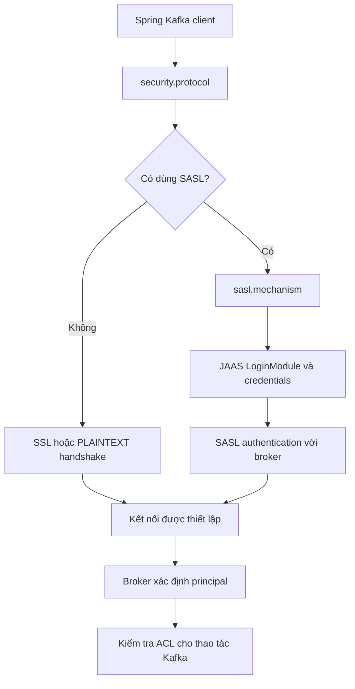

# JAAS configuration

JAAS (Java Authentication and Authorization Service) là cơ chế Java dùng để cấu hình các login module xác thực. Apache Kafka sử dụng JAAS khi client hoặc broker đăng nhập qua SASL. Trong ứng dụng Spring Kafka, JAAS thường xuất hiện khi cấu hình `SASL_SSL` hoặc `SASL_PLAINTEXT` cùng một cơ chế như `SCRAM-SHA-512`, `PLAIN` hoặc `GSSAPI` (Kerberos).

JAAS xác định **client đăng nhập bằng login module và thông tin xác thực nào**. Nó không tự cấp quyền đọc topic, ghi topic hay quản lý consumer group. Sau khi xác thực thành công, Kafka dùng principal của client để kiểm tra ACL. Vì vậy, cấu hình JAAS đúng là một phần của bảo mật messaging; ứng dụng vẫn cần TLS và ACL phù hợp.

## 1. JAAS nằm ở đâu trong quá trình kết nối Kafka?

Khi `KafkaProducer`, `KafkaConsumer`, `KafkaAdmin` hoặc Kafka Streams client kết nối tới broker, Kafka thực hiện các bước khái quát:

1. Client mở kết nối tới địa chỉ broker trong `bootstrap.servers`.
2. `security.protocol` xác định kết nối dùng PLAINTEXT, SSL, SASL_PLAINTEXT hay SASL_SSL.
3. Nếu dùng SASL, `sasl.mechanism` chọn cơ chế xác thực mà broker đã bật.
4. JAAS cung cấp login module và options cần thiết để tạo thông tin xác thực cho cơ chế đó.
5. Broker xác thực client và gắn một principal cho kết nối.
6. Với thao tác trên topic, partition hoặc consumer group, broker tiếp tục kiểm tra ACL của principal.



Các thành phần có vai trò riêng:

| Thành phần | Vai trò |
|---|---|
| `security.protocol` | Chọn giao thức truyền tải và có dùng SASL hay không |
| `sasl.mechanism` | Chọn PLAIN, SCRAM, GSSAPI hoặc OAUTHBEARER |
| JAAS LoginModule | Lấy hoặc tạo thông tin xác thực cho cơ chế SASL |
| TLS (`SSL`) | Mã hóa đường truyền và có thể xác minh chứng thư broker/client |
| ACL | Quyết định principal được phép làm gì với tài nguyên Kafka |

`SASL_PLAINTEXT` có xác thực SASL nhưng không mã hóa kết nối. `SASL_SSL` kết hợp SASL với TLS. Khi dùng mật khẩu qua PLAIN hoặc SCRAM, nên dùng `SASL_SSL` để bảo vệ dữ liệu xác thực trên đường truyền.

## 2. Cấu trúc một JAAS login entry

Một entry trong file JAAS có dạng:

```text
KafkaClient {
    org.apache.kafka.common.security.scram.ScramLoginModule required
    username="orders-consumer"
    password="RENDERED_SECRET_VALUE";
};
```

File JAAS tĩnh không phải file cấu hình Spring Boot nên không tự nội suy `${KAFKA_PASSWORD}`. Hãy để hệ thống triển khai render secret vào file khi cấp phát, mount file từ secret store hoặc dùng cơ chế cấp credentials tương đương; không commit secret thật vào repository.

Trong đó:

- `KafkaClient` là tên login context mà Kafka client tìm khi dùng JAAS file tĩnh.
- `ScramLoginModule` là lớp thực hiện đăng nhập cho cơ chế SCRAM.
- `required` là control flag, quyết định cách JAAS đánh giá kết quả của login module.
- `username` và `password` là options được login module sử dụng.
- Dấu `;` kết thúc khai báo module; `};` kết thúc entry trong file JAAS.

Các control flag của JAAS:

| Flag | Ý nghĩa |
|---|---|
| `REQUIRED` | Module phải thành công; JAAS vẫn chạy các module tiếp theo trước khi trả kết quả thất bại |
| `REQUISITE` | Module phải thành công; nếu thất bại, JAAS dừng ngay và trả thất bại |
| `SUFFICIENT` | Nếu module thành công và các module bắt buộc trước đó đã thành công, JAAS có thể kết thúc thành công ngay |
| `OPTIONAL` | Kết quả chỉ có ý nghĩa nếu không có module nào khác quyết định kết quả |

Trong cấu hình Kafka client thông thường chỉ có một login module, `required` là lựa chọn dễ hiểu và thường dùng nhất.

## 3. Cấu hình JAAS trực tiếp bằng `sasl.jaas.config`

Kafka cho phép khai báo JAAS ngay trong thuộc tính của từng client. Cách này không cần tạo file `.conf`, đồng thời cho phép producer và consumer trong cùng một JVM dùng credentials khác nhau.

Ví dụ client dùng SCRAM-SHA-512:

```properties
security.protocol=SASL_SSL
sasl.mechanism=SCRAM-SHA-512
sasl.jaas.config=org.apache.kafka.common.security.scram.ScramLoginModule required username="orders-consumer" password="RENDERED_SECRET_VALUE";
```

Đây là ví dụ cho Kafka client properties thuần; Kafka không tự thay `${ENV_VAR}` trong chuỗi JAAS. Hệ thống triển khai phải cấp giá trị secret vào cấu hình trước khi tạo client. Với Spring Boot, có thể dùng placeholder `${KAFKA_PASSWORD}` trong `application.yml` như ví dụ ở phần sau vì Spring Boot xử lý externalized configuration.

Trong thuộc tính `sasl.jaas.config`, chỉ ghi login module, control flag và options. Không bọc bằng `KafkaClient { ... };` như trong file JAAS tĩnh.

Với SASL/PLAIN, login module là `org.apache.kafka.common.security.plain.PlainLoginModule`:

```properties
security.protocol=SASL_SSL
sasl.mechanism=PLAIN
sasl.jaas.config=org.apache.kafka.common.security.plain.PlainLoginModule required username="orders-service" password="RENDERED_SECRET_VALUE";
```

Với SCRAM, login module là `org.apache.kafka.common.security.scram.ScramLoginModule`:

```properties
security.protocol=SASL_SSL
sasl.mechanism=SCRAM-SHA-256
sasl.jaas.config=org.apache.kafka.common.security.scram.ScramLoginModule required username="orders-service" password="RENDERED_SECRET_VALUE";
```

Broker phải bật đúng cơ chế SASL và có credentials cho user tương ứng. Ví dụ client chọn `SCRAM-SHA-512` nhưng broker chỉ bật `PLAIN` sẽ không thể xác thực, dù username và password chính xác.

Nếu một JVM kết nối nhiều cluster bằng tài khoản khác nhau, đặt `sasl.jaas.config` riêng cho từng Kafka client. Đây là lợi thế lớn của cấu hình JAAS theo client so với file JAAS tĩnh vốn thường cung cấp một login context chung cho các kết nối trong JVM.

## 4. Đưa `sasl.jaas.config` vào Spring Boot

Spring Boot đưa cấu hình Kafka qua namespace `spring.kafka.*`. Các thuộc tính Kafka chưa có property chuyên biệt vẫn có thể truyền qua `spring.kafka.properties`, `spring.kafka.producer.properties`, `spring.kafka.consumer.properties` hoặc `spring.kafka.admin.properties`.

Ví dụ dùng một tài khoản SCRAM cho producer, consumer và admin client:

```yaml
spring:
  kafka:
    bootstrap-servers: kafka.internal.example:9093
    properties:
      "[security.protocol]": SASL_SSL
      "[sasl.mechanism]": SCRAM-SHA-512
      "[sasl.jaas.config]": >-
        org.apache.kafka.common.security.scram.ScramLoginModule required
        username="${KAFKA_USERNAME}"
        password="${KAFKA_PASSWORD}";
```

Các key Kafka có dấu chấm được đặt trong ngoặc vuông và dấu nháy để Spring Boot giữ nguyên tên thuộc tính. `spring.kafka.properties` là cấu hình chung, áp dụng cho các client do Boot tạo, trừ khi một cấu hình theo loại client ghi đè.

Nếu producer và consumer cần tài khoản riêng, đặt cấu hình JAAS ở từng client:

```yaml
spring:
  kafka:
    bootstrap-servers: kafka.internal.example:9093
    properties:
      "[security.protocol]": SASL_SSL
      "[sasl.mechanism]": SCRAM-SHA-512
    producer:
      properties:
        "[sasl.jaas.config]": >-
          org.apache.kafka.common.security.scram.ScramLoginModule required
          username="${KAFKA_PRODUCER_USERNAME}"
          password="${KAFKA_PRODUCER_PASSWORD}";
    consumer:
      properties:
        "[sasl.jaas.config]": >-
          org.apache.kafka.common.security.scram.ScramLoginModule required
          username="${KAFKA_CONSUMER_USERNAME}"
          password="${KAFKA_CONSUMER_PASSWORD}";
```

Có thể cấu hình tương tự dưới `admin.properties` nếu ứng dụng dùng `KafkaAdmin` với tài khoản quản trị riêng. Khi dùng cấu hình riêng, hãy kiểm tra mọi client thực tế mà ứng dụng khởi tạo, không chỉ `KafkaTemplate` và listener consumer.

Không commit mật khẩu thật vào Git hoặc ghi trực tiếp trong `application.yml`. Dùng environment variable, secret manager, Kubernetes Secret hoặc hệ thống cấp phát secret của nền tảng. Đảm bảo log cấu hình không in giá trị `sasl.jaas.config` vì thuộc tính này chứa credentials.

## 5. Dùng JAAS file tĩnh cho Kafka client

Thay vì đặt JAAS trong `sasl.jaas.config`, có thể tạo file như `kafka_client_jaas.conf`:

```text
KafkaClient {
    org.apache.kafka.common.security.scram.ScramLoginModule required
    username="orders-consumer"
    password="RENDERED_SECRET_VALUE";
};
```

Khởi chạy JVM với system property trỏ đến file:

```bash
java \
  -Djava.security.auth.login.config=/etc/kafka/kafka_client_jaas.conf \
  -jar messaging-service.jar
```

Kafka client tìm login context tên `KafkaClient` trong file. File phải tồn tại trong container/host chạy ứng dụng và user hệ điều hành chạy JVM phải đọc được file.

Khi `java.security.auth.login.config` và `sasl.jaas.config` cùng được cấu hình, `sasl.jaas.config` ở client có độ ưu tiên cao hơn. Vì vậy, nếu đã đặt `sasl.jaas.config` sai hoặc thiếu options, Kafka có thể không dùng file JAAS mà bạn mong đợi.

JAAS file tĩnh phù hợp khi muốn quản lý cấu hình đăng nhập ở cấp JVM, ví dụ ứng dụng chỉ kết nối một cluster bằng một principal. Với nhiều cluster hoặc nhiều tài khoản trong cùng JVM, cấu hình `sasl.jaas.config` riêng cho từng client thường linh hoạt hơn.

## 6. Cấu hình Kerberos bằng JAAS và keytab

Kerberos dùng cơ chế SASL `GSSAPI`. Client thường xác thực bằng principal và keytab thay vì username/password thông thường. JAAS file cho Kafka client có thể khai báo:

```text
KafkaClient {
    com.sun.security.auth.module.Krb5LoginModule required
    useKeyTab=true
    storeKey=true
    keyTab="/etc/security/keytabs/kafka_client.keytab"
    principal="kafka-client@EXAMPLE.COM";
};
```

Kafka client cần thêm các thuộc tính:

```properties
security.protocol=SASL_SSL
sasl.mechanism=GSSAPI
sasl.kerberos.service.name=kafka
```

Khởi chạy ứng dụng với JAAS file và cấu hình Kerberos realm:

```bash
java \
  -Djava.security.auth.login.config=/etc/kafka/kafka_client_jaas.conf \
  -Djava.security.krb5.conf=/etc/krb5.conf \
  -jar messaging-service.jar
```

Các điều kiện quan trọng:

- Keytab phải chứa key của principal mà client sử dụng và chỉ user chạy JVM được phép đọc.
- Principal phải đúng realm và đúng với key được cấp trong Kerberos.
- Broker hostname phải phân giải DNS/FQDN đúng để Kerberos tạo service principal phù hợp.
- Đồng hồ giữa client, broker và KDC phải đồng bộ trong giới hạn Kerberos cho phép.
- `sasl.kerberos.service.name` phải khớp service principal mà broker dùng, thông thường là `kafka`.

### Dùng KafkaJaasLoginModuleInitializer của Spring Kafka

Spring Kafka cung cấp `KafkaJaasLoginModuleInitializer` để khai báo JAAS trong Spring context. Spring Boot cũng có các thuộc tính tương ứng dưới `spring.kafka.jaas.*`.

Ví dụ cấu hình bằng `application.yml`:

```yaml
spring:
  kafka:
    jaas:
      enabled: true
      login-module: com.sun.security.auth.module.Krb5LoginModule
      control-flag: required
      options:
        useKeyTab: true
        storeKey: true
        keyTab: ${KAFKA_KEYTAB_PATH:/etc/security/keytabs/kafka_client.keytab}
        principal: ${KAFKA_KERBEROS_PRINCIPAL}
    properties:
      "[security.protocol]": SASL_SSL
      "[sasl.mechanism]": GSSAPI
      "[sasl.kerberos.service.name]": kafka
```

`spring.kafka.jaas.enabled` mặc định là `false`; phải bật rõ ràng nếu muốn Boot tạo JAAS initializer từ các thuộc tính này. Cách này hữu ích khi một ứng dụng dùng một JAAS login context chung. Nếu mỗi producer/consumer cần principal khác nhau, cân nhắc cấu hình `sasl.jaas.config` riêng cho từng client.

Spring Kafka cũng cho phép tạo bean trực tiếp:

```java
@Bean
KafkaJaasLoginModuleInitializer kafkaJaasLoginModuleInitializer() throws IOException {
    KafkaJaasLoginModuleInitializer initializer =
            new KafkaJaasLoginModuleInitializer();
    initializer.setControlFlag("REQUIRED");

    Map<String, String> options = new HashMap<>();
    options.put("useKeyTab", "true");
    options.put("storeKey", "true");
    options.put("keyTab", "/etc/security/keytabs/kafka_client.keytab");
    options.put("principal", "kafka-client@EXAMPLE.COM");
    initializer.setOptions(options);
    return initializer;
}
```

Chọn một cách quản lý JAAS phù hợp với ứng dụng: Spring Boot properties, bean initializer hoặc file JAAS tĩnh. Tránh cấu hình nhiều nguồn toàn cục cùng lúc vì khó xác định login context nào đang được sử dụng.

## 7. JAAS phía client và JAAS phía broker khác nhau

JAAS file của client thường dùng section `KafkaClient`. Broker có cấu hình JAAS riêng, thường dùng section `KafkaServer`; section này phục vụ xác thực client kết nối vào broker và các kết nối SASL nội bộ mà broker khởi tạo.

Với broker dùng SASL/PLAIN, file JAAS phía broker có thể có dạng:

```text
KafkaServer {
    org.apache.kafka.common.security.plain.PlainLoginModule required
    username="broker-admin"
    password="BROKER_INTER_BROKER_SECRET"
    user_broker-admin="BROKER_INTER_BROKER_SECRET"
    user_orders-service="ORDERS_SERVICE_SECRET";
};
```

Ở cấu hình broker PLAIN mặc định, `username` và `password` là danh tính broker dùng cho kết nối broker-to-broker; các option `user_<username>` khai báo credentials mà broker chấp nhận cho client. Đây là file JAAS tĩnh nên các chuỗi `*_SECRET` phải được thay bằng giá trị do hệ thống triển khai cấp phát; JAAS không tự nội suy biến môi trường.

Broker cũng có thể cấu hình JAAS trực tiếp trong `server.properties` theo listener và SASL mechanism. Với SCRAM, credentials người dùng được provision trong metadata log; thuộc tính JAAS listener này cấu hình login module cho kết nối SASL mà broker tự khởi tạo, chẳng hạn kết nối inter-broker:

```properties
listener.name.sasl_ssl.scram-sha-512.sasl.jaas.config=org.apache.kafka.common.security.scram.ScramLoginModule required username="broker-admin" password="BROKER_INTER_BROKER_SECRET";
```

Tên property có cấu trúc `listener.name.{listenerName}.{saslMechanism}.sasl.jaas.config`. Nếu listener bật nhiều cơ chế, cần cấu hình riêng cho từng cơ chế. Cấu hình này thuộc broker; không đưa nó vào `spring.kafka.*` của ứng dụng client.

## 8. JAAS không thay thế TLS và ACL

Một kết nối SASL thành công chỉ chứng minh client đã xác thực. Client vẫn có thể nhận `TopicAuthorizationException` hoặc `GroupAuthorizationException` nếu principal chưa được cấp ACL phù hợp.

| Tầng bảo mật | Câu hỏi cần trả lời | Cấu hình chính |
|---|---|---|
| TLS | Dữ liệu có được mã hóa và broker có chứng thư hợp lệ không? | `SASL_SSL`, truststore, keystore nếu dùng mutual TLS |
| SASL + JAAS | Client là ai? | `sasl.mechanism`, `sasl.jaas.config` hoặc JAAS login context |
| ACL | Principal được phép làm gì? | ACL cho topic, group, transactional ID và cluster resource |

Ví dụ, consumer cần quyền `READ` trên topic `orders` và quyền `READ` trên group `order-service`. Producer cần quyền `WRITE` trên topic đích. Ứng dụng dùng transaction còn cần ACL trên transactional ID. Cấp quyền tối thiểu theo đúng vai trò của từng service; không dùng tài khoản admin chung cho tất cả producer và consumer.

## 9. Chẩn đoán lỗi JAAS và SASL

| Triệu chứng | Nguyên nhân thường gặp | Hướng kiểm tra |
|---|---|---|
| `LoginException: No LoginModule found` | Sai tên login module hoặc thiếu module trên classpath | Kiểm tra tên lớp và dependency Kafka client/JDK |
| `Could not find a 'KafkaClient' entry` | JAAS file thiếu section hoặc tên section sai | Kiểm tra section `KafkaClient` và đường dẫn system property |
| `SaslAuthenticationException` | Sai username/password, mechanism không khớp hoặc broker chưa bật mechanism | Đối chiếu credentials, `sasl.mechanism` và cấu hình listener broker |
| `UnsupportedSaslMechanismException` | Client yêu cầu mechanism broker không hỗ trợ | Chọn mechanism đã được bật trên listener |
| `SSLHandshakeException` | Truststore, CA, hostname hoặc chứng thư TLS không hợp lệ | Kiểm tra trust chain, SAN hostname, thời hạn chứng thư và protocol |
| `GSS initiate failed` | Keytab, principal, realm, DNS, đồng hồ hoặc Kerberos service name sai | Kiểm tra `klist -kte`, `krb5.conf`, FQDN và `sasl.kerberos.service.name` |
| `TopicAuthorizationException` | Xác thực thành công nhưng principal thiếu ACL | Kiểm tra principal và ACL của topic |
| `GroupAuthorizationException` | Principal thiếu quyền trên consumer group | Cấp ACL `READ` cho group đúng phạm vi |

Khi kiểm tra, xác định client nào đang lỗi: producer, consumer hay admin. Spring Boot có thể tạo nhiều Kafka client với cấu hình khác nhau; consumer thành công không chứng minh producer hoặc admin đang dùng cùng credentials và quyền.

## 10. Checklist triển khai

- Broker và client thống nhất `security.protocol` và `sasl.mechanism`.
- Login module đúng với cơ chế: `PlainLoginModule`, `ScramLoginModule` hoặc `Krb5LoginModule`.
- Nếu dùng file JAAS, có đúng section `KafkaClient` và JVM trỏ đúng `java.security.auth.login.config`.
- Nếu dùng `sasl.jaas.config`, giá trị có đúng cú pháp login module, control flag, options và dấu chấm phẩy kết thúc.
- Nếu dùng Spring Boot JAAS initializer, đã bật `spring.kafka.jaas.enabled=true`.
- Nếu dùng PLAIN hoặc SCRAM, đường truyền dùng TLS (`SASL_SSL`) trong môi trường thực.
- Credentials được lấy từ secret store hoặc environment, không commit vào repository và không xuất hiện trong log.
- Nếu dùng Kerberos, keytab, principal, `krb5.conf`, DNS và thời gian hệ thống đều đúng.
- Producer, consumer và admin client dùng credentials riêng khi cần phân quyền riêng.
- Principal sau xác thực có ACL tối thiểu cho topic, group và transactional ID cần thiết.

## 11. Ghi nhớ

- JAAS cấu hình login module và credentials cho SASL; Kafka dùng kết quả xác thực để tạo principal.
- `KafkaClient` là section thường dùng trong JAAS file phía client; `KafkaServer` thuộc cấu hình broker.
- `sasl.jaas.config` khai báo JAAS ngay trên từng Kafka client, không cần wrapper `KafkaClient {}` và có ưu tiên hơn JAAS file tĩnh.
- `java.security.auth.login.config` trỏ tới JAAS file; file tĩnh thường dùng chung login context trong JVM.
- Spring Boot hỗ trợ `spring.kafka.jaas.*` và truyền thuộc tính Kafka tùy chỉnh qua `spring.kafka.properties` hoặc cấu hình riêng theo producer/consumer/admin.
- PLAIN và SCRAM nên chạy trên `SASL_SSL`; Kerberos dùng `GSSAPI`, principal, keytab và `krb5.conf`.
- Xác thực thành công chưa có nghĩa được phép đọc/ghi; ACL vẫn quyết định quyền truy cập tài nguyên Kafka.

## Tài liệu tham khảo

- [Apache Kafka — Authentication using SASL](https://kafka.apache.org/documentation/#security_sasl)
- [Spring for Apache Kafka — JAAS and Kerberos](https://docs.spring.io/spring-kafka/reference/kafka/kerberos.html)
- [Spring Boot — Apache Kafka Support](https://docs.spring.io/spring-boot/reference/messaging/kafka.html)
- [Spring Boot — Common Application Properties (`spring.kafka.jaas.*`)](https://docs.spring.io/spring-boot/appendix/application-properties/index.html)
- [Apache Kafka — Authorization and ACLs](https://kafka.apache.org/documentation/#security_authz)
