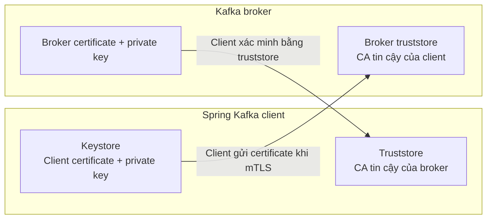

# Cấu hình truststore và keystore

Khi kết nối Kafka qua TLS, client cần xác minh broker đang kết nối là máy chủ đáng tin cậy. Để làm việc đó, Kafka client dùng **truststore** chứa chứng thư CA hoặc chứng thư được tin cậy. Nếu cluster yêu cầu mutual TLS (mTLS), client còn phải chứng minh danh tính của mình bằng **keystore** chứa private key và certificate chain của client.

Trong Spring Kafka, cấu hình TLS thường được đặt qua `spring.kafka.ssl.*` và `spring.kafka.properties[security.protocol]`. Spring Boot chuyển các thuộc tính này đến Kafka producer, consumer và admin client do auto-configuration quản lý. Nếu tự tạo `ProducerFactory` hoặc `ConsumerFactory`, cần bảo đảm các thuộc tính SSL cũng được đưa vào map cấu hình của Kafka client.

## 1. Truststore và keystore khác nhau thế nào?

Hai loại store có thể cùng dùng định dạng JKS hoặc PKCS12, nhưng mục đích khác nhau:

| Store | Nội dung thường chứa | Dùng để |
| --- | --- | --- |
| Truststore | CA certificate, intermediate CA hoặc certificate được tin cậy | Xác minh certificate broker gửi cho client |
| Keystore | Private key của client và certificate tương ứng, thường kèm certificate chain | Chứng minh danh tính client khi broker yêu cầu mTLS |

Truststore chứa public certificate, không cần chứa private key. Keystore phải bảo vệ private key vì bất kỳ ai có private key đều có thể giả danh client tương ứng.

Trong kết nối TLS một chiều (server-auth TLS), client xác minh certificate của broker bằng truststore; client thường không cần keystore. Trong mTLS, hai phía xác minh certificate của nhau: client dùng truststore để tin broker và gửi certificate/private key từ keystore; broker dùng truststore riêng để xác minh certificate client.



Lưu ý: truststore/keystore phía broker là cấu hình của Kafka broker và được quản trị ở cluster. Cấu hình `spring.kafka.ssl.*` chỉ cấu hình client Spring Kafka.

## 2. Hai chế độ kết nối phổ biến

### 2.1. TLS một chiều: client xác minh broker

Với TLS server authentication, broker trình certificate trong TLS handshake. Client kiểm tra certificate chain có được ký bởi CA trong truststore hay không, certificate còn hiệu lực không và hostname có khớp với SAN hay không.

Client chỉ cần truststore:

```text
Spring Kafka client
  └── truststore: CA certificate của Kafka cluster

Kafka broker
  └── broker certificate + private key
```

Đây là cấu hình phù hợp khi cluster dùng TLS để mã hóa và xác thực broker, còn việc xác thực ứng dụng được thực hiện bằng cơ chế khác như SASL/SCRAM hoặc SASL/PLAIN trên TLS.

### 2.2. Mutual TLS (mTLS): hai phía xác minh lẫn nhau

Với mTLS, broker yêu cầu client gửi certificate. Client phải có keystore chứa private key và certificate chain được CA mà broker tin cậy ký. Client vẫn cần truststore để xác minh certificate broker.

```text
Client:
  truststore -> tin broker CA
  keystore   -> client certificate + private key

Broker:
  keystore   -> broker certificate + private key
  truststore -> tin client CA
  client.auth -> required/requested theo chính sách
```

Việc đặt keystore ở client không tự bật mTLS. Kafka broker phải được cấu hình yêu cầu/xác minh client certificate và trust CA đã cấp certificate đó. Nếu broker không yêu cầu client certificate, client có keystore vẫn có thể kết nối theo TLS một chiều.

Ở phía broker, quản trị viên thường cấu hình `ssl.client.auth=required` (hoặc cấu hình tương ứng theo từng listener bằng prefix `listener.name.<listener>.ssl.client.auth`) để bắt buộc client certificate. Giá trị `requested` cho phép yêu cầu certificate nhưng có thể không bắt buộc trong mọi trường hợp; hãy theo chính sách bảo mật của cluster.

## 3. Chọn định dạng JKS hay PKCS12

Java hỗ trợ nhiều định dạng keystore/truststore. Hai định dạng thường gặp:

| Định dạng | Đặc điểm |
| --- | --- |
| JKS | Định dạng Java KeyStore truyền thống |
| PKCS12 (`.p12`, `.pfx`) | Định dạng chuẩn phổ biến, có thể trao đổi với nhiều công cụ TLS khác |

Với ứng dụng mới, PKCS12 thường là lựa chọn thuận tiện nếu hệ thống cấp certificate hỗ trợ. Hãy khai báo rõ store type để tránh phụ thuộc default của JDK hoặc Kafka client.

Đuôi file không phải bằng chứng chắc chắn về định dạng. Một file `.p12` cần được cấu hình `PKCS12`; một file `.jks` cần cấu hình `JKS`. Nếu khai báo sai type, Kafka client có thể báo lỗi không tải được keystore/truststore.

## 4. Chuẩn bị truststore cho TLS một chiều

Giả sử tổ chức cấp một CA certificate `kafka-ca.pem` dùng để ký certificate cho các broker. Client cần import CA certificate đó vào truststore.

```bash
keytool -importcert \
  -alias kafka-cluster-ca \
  -file kafka-ca.pem \
  -keystore client.truststore.p12 \
  -storetype PKCS12 \
  -storepass:env KAFKA_TRUSTSTORE_PASSWORD \
  -noprompt
```

Lệnh dùng biến môi trường `KAFKA_TRUSTSTORE_PASSWORD` (cú pháp `-storepass:env` có trên các JDK hiện đại). Không ghi mật khẩu thật vào source code hoặc commit script có chứa secret. Có thể để `keytool` hỏi mật khẩu tương tác nếu môi trường không hỗ trợ cách truyền qua biến môi trường.

Nếu broker dùng certificate do CA nội bộ ký, truststore thường chứa root CA và/hoặc intermediate CA cần thiết để xây dựng certificate chain. Nếu broker dùng self-signed certificate, có thể import trực tiếp certificate đó, nhưng việc xoay vòng certificate sẽ cần cập nhật truststore tương ứng.

Không nên import một certificate bất kỳ chỉ để làm cho handshake chạy được. Hãy xác nhận fingerprint và nguồn cấp certificate qua kênh đáng tin cậy trước khi tin cậy CA hoặc certificate đó.

## 5. Tạo keystore cho mTLS

Khi broker yêu cầu client certificate, mỗi ứng dụng hoặc workload cần một danh tính client riêng. Có thể tạo key pair và CSR bằng `keytool`, sau đó gửi CSR đến CA của tổ chức để ký.

Tạo keystore PKCS12 và key pair:

```bash
keytool -genkeypair \
  -alias orders-service \
  -keyalg RSA \
  -keysize 3072 \
  -validity 365 \
  -dname "CN=orders-service,OU=Applications,O=Example" \
  -keystore client.keystore.p12 \
  -storetype PKCS12 \
  -storepass:env KAFKA_KEYSTORE_PASSWORD \
  -keypass:env KAFKA_KEYSTORE_PASSWORD
```

Tạo certificate signing request:

```bash
keytool -certreq \
  -alias orders-service \
  -file orders-service.csr \
  -keystore client.keystore.p12 \
  -storetype PKCS12 \
  -storepass:env KAFKA_KEYSTORE_PASSWORD
```

CA ký CSR và trả về certificate của client cùng certificate chain cần thiết. Import certificate reply vào đúng alias đã tạo key pair:

```bash
keytool -importcert \
  -alias orders-service \
  -file orders-service-chain.pem \
  -keystore client.keystore.p12 \
  -storetype PKCS12 \
  -storepass:env KAFKA_KEYSTORE_PASSWORD
```

Certificate reply phải khớp public key trong alias `orders-service`; nếu import nhầm certificate hoặc alias, keytool sẽ không thể ghép certificate với private key tương ứng. Certificate chain cần chứa intermediate CA cần thiết để broker xác minh client certificate.

Khi cấp certificate, CA cần phát hành đúng mục đích sử dụng: certificate broker có Extended Key Usage phù hợp cho `serverAuth`; certificate client mTLS có `clientAuth`. Certificate đúng chain nhưng sai EKU vẫn có thể bị TLS peer từ chối.

Keystore PKCS12 thường dùng cùng mật khẩu cho store và private key; ví dụ trên dùng cùng biến môi trường cho cả hai. Với định dạng/provider hỗ trợ mật khẩu riêng cho private key, Kafka cũng có thể nhận `key-store-password` và `key-password` khác nhau. Hãy dùng đúng mật khẩu đã thiết lập khi tạo key pair.

## 6. Cấu hình TLS một chiều trong Spring Boot

Ví dụ client chỉ xác minh certificate broker, không gửi client certificate:

```yaml
spring:
  kafka:
    bootstrap-servers: ${KAFKA_BOOTSTRAP_SERVERS:broker-1.example.internal:9093}
    properties:
      "[security.protocol]": SSL
    ssl:
      trust-store-location: ${KAFKA_TRUSTSTORE_LOCATION:file:/etc/kafka/secrets/client.truststore.p12}
      trust-store-password: ${KAFKA_TRUSTSTORE_PASSWORD}
      trust-store-type: PKCS12
      protocol: TLSv1.3
      enabled-protocols:
        - TLSv1.3
        - TLSv1.2
      endpoint-identification-algorithm: HTTPS
```

Các thuộc tính quan trọng:

- `security.protocol: SSL`: yêu cầu Kafka client dùng TLS.
- `trust-store-location`: vị trí truststore mà process có thể đọc.
- `trust-store-password`: mật khẩu mở truststore.
- `trust-store-type`: định dạng truststore, ở đây là PKCS12.
- `protocol` và `enabled-protocols`: giao thức TLS được client sử dụng/cho phép.
- `endpoint-identification-algorithm`: bật kiểm tra hostname của broker certificate.

Nếu cluster dùng TLS một chiều, không cần khai báo `key-store-location` hoặc `key-store-password`. Không tạo keystore chỉ để điền đủ cấu hình.

`spring.kafka.ssl.*` là cấu hình SSL của Spring Boot KafkaProperties. `spring.kafka.properties[security.protocol]` chuyển thuộc tính Kafka client `security.protocol` xuống producer/consumer/admin client được Boot cấu hình.

## 7. Cấu hình mTLS trong Spring Boot

Khi broker yêu cầu client certificate, bổ sung keystore:

```yaml
spring:
  kafka:
    bootstrap-servers: ${KAFKA_BOOTSTRAP_SERVERS:broker-1.example.internal:9093}
    properties:
      "[security.protocol]": SSL
    ssl:
      trust-store-location: ${KAFKA_TRUSTSTORE_LOCATION:file:/etc/kafka/secrets/client.truststore.p12}
      trust-store-password: ${KAFKA_TRUSTSTORE_PASSWORD}
      trust-store-type: PKCS12
      key-store-location: ${KAFKA_KEYSTORE_LOCATION:file:/etc/kafka/secrets/client.keystore.p12}
      key-store-password: ${KAFKA_KEYSTORE_PASSWORD}
      key-password: ${KAFKA_KEYSTORE_PASSWORD}
      key-store-type: PKCS12
      protocol: TLSv1.3
      enabled-protocols:
        - TLSv1.3
        - TLSv1.2
      endpoint-identification-algorithm: HTTPS
```

Truststore giúp client xác minh broker. Keystore giúp client trình certificate và chứng minh quyền sở hữu private key trong TLS handshake. Mật khẩu được lấy từ environment/secret injection, không viết trực tiếp vào file cấu hình được commit.

PKCS12 thường dùng cùng mật khẩu cho store và private key; ví dụ này dùng chung biến môi trường. Với định dạng/provider hỗ trợ mật khẩu riêng cho private key, có thể đặt `key-password` khác `key-store-password`; hãy dùng đúng mật khẩu đã tạo key entry.

## 8. Dùng SASL_SSL khi cần cả TLS và SASL

TLS và SASL giải quyết các phần khác nhau:

- TLS mã hóa đường truyền và xác minh certificate của broker; có thể xác minh client certificate nếu dùng mTLS.
- SASL xác thực client ở tầng Kafka bằng cơ chế như SCRAM hoặc PLAIN.
- ACL của Kafka quyết định principal được phép đọc/ghi topic hoặc thao tác resource nào.

Nếu cluster dùng SASL trên TLS, `security.protocol` phải là `SASL_SSL`, không phải `SSL`:

```yaml
spring:
  kafka:
    properties:
      "[security.protocol]": SASL_SSL
      "[sasl.mechanism]": SCRAM-SHA-512
      "[sasl.jaas.config]": ${KAFKA_SASL_JAAS_CONFIG}
    ssl:
      trust-store-location: ${KAFKA_TRUSTSTORE_LOCATION:file:/etc/kafka/secrets/client.truststore.p12}
      trust-store-password: ${KAFKA_TRUSTSTORE_PASSWORD}
      trust-store-type: PKCS12
```

Đây là ví dụ TLS server-auth kết hợp SASL/SCRAM. Nếu cluster còn yêu cầu mTLS, bổ sung keystore properties như phần trước. Cấu hình SASL mechanism, JAAS và ACL phải khớp với chính sách cluster; không dùng ví dụ này nếu broker chỉ bật TLS thuần.

## 9. Đường dẫn certificate trong môi trường triển khai

`trust-store-location` và `key-store-location` phải trỏ đến file mà process Spring Boot có thể đọc. Trong container, nên mount certificate/keystore từ Kubernetes Secret, Docker secret hoặc secret manager vào đường dẫn chỉ đọc.

Ví dụ:

```text
/etc/kafka/secrets/
  client.truststore.p12
  client.keystore.p12
```

Quyền truy cập nên giới hạn cho user chạy ứng dụng. Keystore chứa private key nên cần bảo vệ nghiêm ngặt hơn truststore; tránh mount vào thư mục public hoặc đưa vào image/container layer.

Với Spring Boot, có thể dùng đường dẫn `file:/...` cho file được mount. `classpath:` có thể dùng trong một số cách đóng gói, nhưng keystore chứa private key thường nên được cung cấp ngoài artifact để có thể xoay vòng mà không rebuild ứng dụng.

## 10. Cấu hình SSL khi tự tạo ConsumerFactory hoặc ProducerFactory

Nếu dùng Spring Boot auto-configuration, `spring.kafka.ssl.*` được áp dụng cho các Kafka client mà Boot tạo. Nhưng khi tự tạo `DefaultKafkaConsumerFactory` hoặc `DefaultKafkaProducerFactory` bằng một map cấu hình riêng, đừng giả định các SSL properties từ `application.yml` tự động được chép vào map đó.

Ví dụ minh họa map cấu hình consumer thủ công:

```java
import java.util.HashMap;
import java.util.Map;
import org.apache.kafka.clients.CommonClientConfigs;
import org.apache.kafka.clients.consumer.ConsumerConfig;
import org.apache.kafka.common.config.SslConfigs;
import org.apache.kafka.common.serialization.StringDeserializer;
import org.springframework.kafka.core.ConsumerFactory;
import org.springframework.kafka.core.DefaultKafkaConsumerFactory;
import org.springframework.kafka.support.serializer.JsonDeserializer;

Map<String, Object> props = new HashMap<>();
props.put(ConsumerConfig.BOOTSTRAP_SERVERS_CONFIG, bootstrapServers);
props.put(ConsumerConfig.GROUP_ID_CONFIG, "orders-service");
props.put(CommonClientConfigs.SECURITY_PROTOCOL_CONFIG, "SSL");
props.put(SslConfigs.SSL_TRUSTSTORE_LOCATION_CONFIG, trustStoreLocation);
props.put(SslConfigs.SSL_TRUSTSTORE_PASSWORD_CONFIG, trustStorePassword);
props.put(SslConfigs.SSL_TRUSTSTORE_TYPE_CONFIG, "PKCS12");

// Chỉ thêm keystore nếu broker yêu cầu mTLS.
if (mtlsEnabled) {
    props.put(SslConfigs.SSL_KEYSTORE_LOCATION_CONFIG, keyStoreLocation);
    props.put(SslConfigs.SSL_KEYSTORE_PASSWORD_CONFIG, keyStorePassword);
    props.put(SslConfigs.SSL_KEY_PASSWORD_CONFIG, keyPassword);
    props.put(SslConfigs.SSL_KEYSTORE_TYPE_CONFIG, "PKCS12");
}

ConsumerFactory<String, OrderCreated> consumerFactory =
        new DefaultKafkaConsumerFactory<>(
                props,
                new StringDeserializer(),
                new JsonDeserializer<>(OrderCreated.class)
        );
```

Đoạn code là phần cấu hình SSL cốt lõi; cần bổ sung đầy đủ deserializer, group, offset, security và các client properties khác của ứng dụng. Nếu không dùng mTLS, bỏ các dòng `SSL_KEYSTORE_*` và `SSL_KEY_PASSWORD_CONFIG`. Khi tạo producer factory thủ công, áp dụng các SSL properties tương tự cho producer map.

Các import tương ứng nằm trong `org.apache.kafka.clients.consumer.ConsumerConfig`, `org.apache.kafka.clients.CommonClientConfigs` và `org.apache.kafka.common.config.SslConfigs`. Hãy dùng `KafkaProperties`/configuration properties hiện có nếu muốn tránh lặp lại cấu hình bảo mật giữa các factory.

## 11. Hostname verification và SAN của broker certificate

TLS certificate của broker phải chứa Subject Alternative Name (SAN) khớp hostname mà client dùng trong `bootstrap-servers` và metadata broker trả về. Ví dụ client kết nối `broker-1.example.internal`, certificate cần có DNS SAN tương ứng.

Nếu client kết nối bằng IP address, certificate cần có IP SAN phù hợp. Common Name (CN) đơn lẻ không thay thế SAN trong các client TLS hiện đại.

Giữ `endpoint-identification-algorithm: HTTPS` để Kafka client kiểm tra hostname. Không tắt hostname verification bằng cách đặt giá trị rỗng chỉ để bỏ qua lỗi certificate mismatch. Hãy sửa SAN hoặc cấu hình địa chỉ broker đúng với certificate.

Một cluster có nhiều broker cần certificate phù hợp cho từng broker hostname mà client có thể kết nối. Kết nối bootstrap thành công chưa đủ chứng minh mọi broker đều có certificate đúng; client sẽ kết nối tới các broker được metadata trả về trong quá trình produce/consume.

## 12. TLS protocol, cipher suite và certificate validity

Client và broker phải có ít nhất một TLS protocol và cipher suite tương thích. Nên ưu tiên TLS 1.2 hoặc TLS 1.3 theo chính sách bảo mật của tổ chức và phiên bản JDK/Kafka broker.

Các kiểm tra cần thực hiện:

- Certificate còn hiệu lực (`Not Before`/`Not After`).
- Máy chạy ứng dụng đồng bộ thời gian để kiểm tra validity chính xác.
- Certificate chain đầy đủ và được CA tin cậy ký.
- SAN khớp hostname broker.
- TLS protocol được client và broker cùng hỗ trợ.
- Cipher suite không bị loại bởi security policy của JDK.
- Certificate không bị revoke nếu tổ chức sử dụng CRL/OCSP validation.

Không hạ TLS xuống protocol cũ hoặc bật cipher yếu chỉ để kết nối được. Nếu handshake thất bại, xác định phần không tương thích trong certificate, protocol hoặc cipher trước khi thay đổi chính sách.

## 13. Kiểm tra truststore và keystore

Dùng `keytool -list` để xem nội dung store:

```bash
keytool -list -v \
  -keystore client.truststore.p12 \
  -storetype PKCS12 \
  -storepass:env KAFKA_TRUSTSTORE_PASSWORD
```

Truststore nên có trusted certificate entry cho CA/certificate được phép xác minh broker. Kiểm tra alias, subject, issuer, serial number, fingerprint và thời hạn hiệu lực.

Kiểm tra keystore:

```bash
keytool -list -v \
  -keystore client.keystore.p12 \
  -storetype PKCS12 \
  -storepass:env KAFKA_KEYSTORE_PASSWORD
```

Keystore mTLS cần có `PrivateKeyEntry` với certificate chain tương ứng, không chỉ có một `trustedCertEntry`. Nếu chỉ thấy trusted certificate entry, file đó không có private key client để thực hiện mTLS.

Có thể kiểm tra certificate broker bằng OpenSSL từ máy có thể truy cập broker:

```bash
openssl s_client \
  -connect broker-1.example.internal:9093 \
  -servername broker-1.example.internal \
  -verify_hostname broker-1.example.internal \
  -CAfile kafka-ca.pem \
  -verify_return_error \
  -showcerts
```

Lệnh giúp quan sát certificate chain và xác minh server certificate với CA file. Với mTLS, thêm `-cert client.crt` và `-key client.key` nếu cần kiểm tra handshake bằng PEM material; bảo vệ private key khi chạy lệnh và không đưa key vào log hoặc ticket.

## 14. Quản lý password và private key

Truststore password và keystore password bảo vệ file store; chúng không thay thế bảo vệ file ở hệ điều hành hoặc secret manager. Private key cần được bảo vệ như credential có quyền xác thực vào Kafka cluster.

Thực hành nên áp dụng:

- Không hardcode password trong Java, YAML đã commit, Dockerfile hoặc script dùng chung.
- Không ghi secret vào log, exception message hoặc command history.
- Cấp secret qua Kubernetes Secret, Docker secret hoặc secret manager phù hợp.
- Giới hạn quyền đọc file keystore cho user chạy ứng dụng.
- Không gửi keystore/private key qua chat hoặc ticket không được bảo vệ.
- Dùng certificate riêng theo application/workload để có thể revoke độc lập.
- Có quy trình thu hồi certificate khi instance hoặc private key bị lộ.

Environment variable là cách minh họa tiện lợi, nhưng trong hệ thống production nên cân nhắc secret manager hoặc cơ chế mount secret có rotation phù hợp. Không đưa giá trị secret thật vào `application.yml` mặc định.

## 15. Xoay vòng certificate và truststore

Certificate có thời hạn. Khi broker hoặc client certificate sắp hết hạn, cần thay certificate mà không gây gián đoạn ngoài dự kiến.

Một quy trình xoay vòng CA/broker certificate có thể gồm:

1. Phát hành CA/certificate mới và xác minh chain, SAN, validity.
2. Cập nhật truststore để tin cả CA cũ và CA mới trong giai đoạn chuyển tiếp.
3. Phân phối truststore mới đến ứng dụng và rollout/restart theo cách an toàn.
4. Cập nhật certificate broker sang certificate mới.
5. Xác minh producer, consumer và admin client kết nối được tới mọi broker.
6. Sau khi không còn broker dùng CA cũ, loại CA cũ khỏi truststore theo kế hoạch.

Với client mTLS, cấp certificate mới, triển khai keystore mới, xác minh broker tin CA mới rồi mới thu hồi certificate cũ. Không xóa CA cũ khỏi truststore của broker trước khi mọi client đã chuyển sang certificate mới.

Kafka client thường nạp store khi tạo SSL context/client. Thay file trên disk không bảo đảm client đang chạy tự reload. Hãy xác nhận khả năng reload của phiên bản/configuration đang dùng; nếu không có cơ chế reload được hỗ trợ, rollout/restart consumer/producer client để nạp certificate mới.

## 16. Phân biệt lỗi TLS và lỗi Kafka authorization

TLS handshake xảy ra trước khi Kafka xử lý request ở tầng protocol. Vì vậy, lỗi TLS và lỗi ACL có dấu hiệu khác nhau:

| Hiện tượng | Tầng lỗi có thể liên quan | Hướng kiểm tra |
| --- | --- | --- |
| `SSLHandshakeException` | TLS handshake, trust chain, client certificate hoặc protocol | Truststore, keystore, certificate validity, TLS protocol và broker log |
| `PKIX path building failed` | Client không xây dựng được chain tin cậy của broker | CA/intermediate trong truststore, chain broker gửi |
| `No subject alternative DNS name matching` | Hostname không khớp SAN | Bootstrap/broker hostname và SAN certificate |
| `Keystore was tampered with, or password was incorrect` | Store type/password không đúng hoặc file hỏng | Store password, type, file mount và integrity |
| `UnrecoverableKeyException` | Không mở được private key entry | `key-password`, alias và keystore |
| Broker báo client certificate required | Broker yêu cầu mTLS nhưng client không gửi certificate hợp lệ | Keystore, key entry, certificate chain và broker truststore |
| `TopicAuthorizationException` | TLS đã thiết lập nhưng principal không có quyền topic | Kafka ACL và principal mapping |
| `GroupAuthorizationException` | Principal không có quyền consumer group | ACL cho group resource |
| SASL authentication failed | Xác thực SASL, không nhất thiết là TLS trust | SASL mechanism, JAAS credential và broker config |

Kết nối TLS thành công không đồng nghĩa ứng dụng đã có quyền đọc/ghi topic. Xác thực principal và authorization ACL là các bước riêng sau khi transport đã được thiết lập.

## 17. Kiểm thử kết nối bảo mật

Nên kiểm thử từ đơn giản đến đầy đủ:

1. Dùng `keytool -list` xác minh đúng store type, alias, CA và private key entry.
2. Dùng OpenSSL kiểm tra broker certificate chain, SAN và validity từ môi trường mạng tương ứng.
3. Chạy một Kafka client nhỏ với cùng security properties để xác minh handshake.
4. Khởi động Spring Boot với đúng secret mount và cấu hình `spring.kafka.ssl.*`.
5. Kiểm tra producer gửi được record vào topic thử nghiệm.
6. Kiểm tra consumer đọc được record bằng group ID được cấp quyền.
7. Nếu dùng mTLS, xác minh broker log ghi nhận client principal/certificate đúng.
8. Kiểm tra ACL: principal chỉ đọc/ghi được resource cần thiết.
9. Kiểm tra certificate hết hạn, sai hostname hoặc thiếu CA để xác nhận lỗi được phát hiện.
10. Thực hiện thử nghiệm rotation trong môi trường staging trước khi đổi production.

Trong integration test, không commit keystore production hoặc password thật vào repository. Dùng certificate test và secret riêng cho môi trường CI; giới hạn thời hạn và quyền của certificate test.

## 18. Lỗi thường gặp

| Hiện tượng | Nguyên nhân thường gặp | Cách xử lý |
| --- | --- | --- |
| `PKIX path building failed` | Truststore thiếu CA/intermediate hoặc dùng nhầm truststore | Import CA đúng, kiểm tra chain broker gửi |
| `SSLHandshakeException` khi connect broker | Protocol/cipher không tương thích hoặc certificate không hợp lệ | Kiểm tra TLS protocol, validity và broker SSL log |
| Hostname verification thất bại | SAN không chứa hostname trong broker metadata | Cấp certificate có SAN đúng hoặc dùng advertised listener hostname đúng |
| `Keystore was tampered with` | Password hoặc store type không khớp | Xác nhận password, `PKCS12`/`JKS` và file |
| `UnrecoverableKeyException` | Key password sai hoặc alias không có private key | Kiểm tra `key-password` và `PrivateKeyEntry` |
| mTLS báo client certificate missing | Chưa cấu hình keystore hoặc broker yêu cầu cert | Cấu hình key store, chain và broker-side trust |
| Chỉ bootstrap broker kết nối được | Broker khác trong metadata có hostname/certificate khác | Kiểm tra SAN và certificate của tất cả broker |
| File store không đọc được trong container | Sai mount path, owner hoặc file permission | Kiểm tra volume mount và quyền đọc của process |
| Đổi certificate nhưng ứng dụng vẫn lỗi | Client đang giữ SSL context cũ hoặc broker/client rollout chưa đồng bộ | Kiểm tra reload support và rollout/restart |
| TLS thành công nhưng produce/consume bị từ chối | Principal thiếu ACL hoặc SASL identity sai | Kiểm tra ACL, principal mapping và SASL config |

## 19. Checklist triển khai

Trước khi bật TLS/mTLS cho Spring Kafka production, hãy xác nhận:

1. Xác định cluster dùng `SSL` hay `SASL_SSL`.
2. Xác định server-auth TLS hay mTLS.
3. Truststore chứa đúng CA/intermediate hoặc certificate được phê duyệt.
4. Keystore chỉ được cấu hình khi client cần trình certificate.
5. Store type khớp định dạng file, ví dụ `PKCS12`.
6. Password được cấp qua secret management và không commit vào source.
7. Private key file có quyền truy cập giới hạn.
8. Certificate broker có SAN khớp hostname mà client thực sự kết nối.
9. Hostname verification được giữ bật.
10. TLS protocol/cipher tương thích với JDK và broker.
11. Với mTLS, broker truststore tin CA client và broker thực sự yêu cầu client certificate.
12. Custom producer/consumer factories cũng nhận đầy đủ SSL properties.
13. Producer, consumer và admin client đều kết nối được theo security policy.
14. ACL chỉ cấp quyền cần thiết sau khi TLS/SASL authentication thành công.
15. Có quy trình theo dõi expiry, rotate và revoke certificate.
16. Đã thử nghiệm lỗi CA, hostname, password, client certificate và ACL ở staging.

Truststore cho client biết certificate broker nào được tin cậy; keystore giữ private key và certificate để client chứng minh danh tính khi mTLS được yêu cầu. Cấu hình Spring Kafka phải khớp với chế độ bảo mật của broker, định dạng store, hostname certificate và cách cấp secret. Khi kết hợp xác minh TLS, ACL tối thiểu và quy trình xoay vòng certificate, ứng dụng có thể kết nối Kafka an toàn mà vẫn vận hành được khi certificate thay đổi.

## 20. Tự kiểm tra

1. Truststore và keystore khác nhau về nội dung và mục đích như thế nào?
2. Khi nào client chỉ cần truststore và khi nào cần thêm keystore?
3. Vì sao cấu hình keystore ở client chưa đủ để bật mTLS?
4. `security.protocol=SSL` khác `SASL_SSL` ở điểm nào?
5. `trust-store-type` và `key-store-type` phải khớp với điều gì?
6. Vì sao cần giữ hostname verification và SAN của broker certificate?
7. `PrivateKeyEntry` trong keystore cho biết điều gì mà `trustedCertEntry` không có?
8. Tại sao custom `ConsumerFactory`/`ProducerFactory` cần được kiểm tra SSL properties riêng?
9. Làm thế nào để xoay vòng CA mà không làm gián đoạn mọi client cùng lúc?
10. TLS handshake thành công có đồng nghĩa principal được phép đọc topic không? Vì sao?
