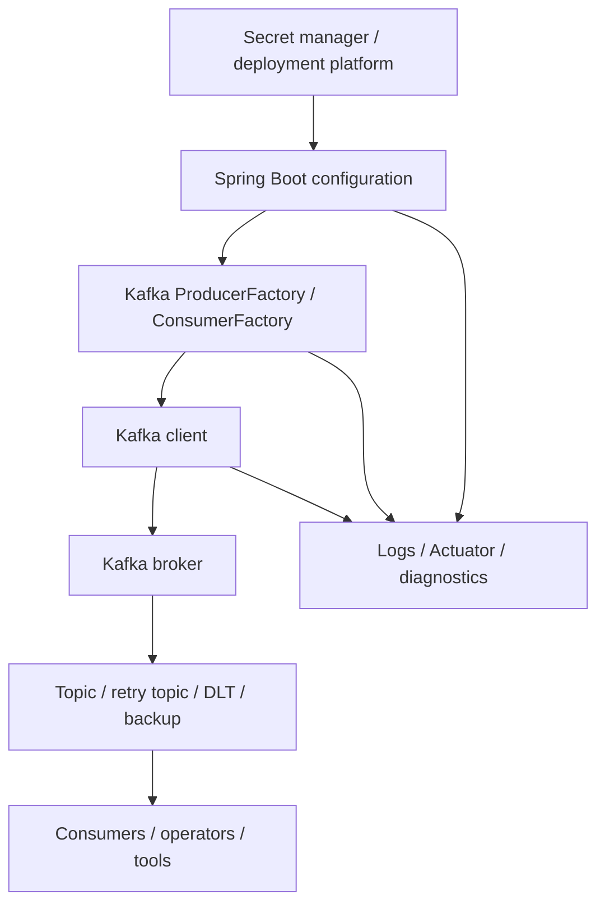

# Bảo vệ thông tin bí mật trong Spring Kafka

Ứng dụng Spring Kafka cần bảo vệ hai loại thông tin khác nhau: **secret dùng để kết nối và vận hành hệ thống** như SASL password, API key, private key, truststore password; và **dữ liệu nhạy cảm nằm trong message** như thông tin cá nhân, token, thông tin thanh toán hoặc dữ liệu kinh doanh. Hai loại này có vòng đời và biện pháp bảo vệ khác nhau.

TLS và SASL giúp bảo vệ kết nối tới Kafka và xác thực client. ACL giới hạn principal được phép đọc/ghi topic. Tuy nhiên, khi một consumer được cấp quyền đọc topic, payload mà producer đã gửi thường vẫn có thể được đọc dưới dạng plaintext. Nếu dữ liệu trong event cần được che khỏi broker operator hoặc các consumer không được phép xem một số trường, cần thêm mã hóa ở tầng ứng dụng hoặc tokenization.

## 1. Phân biệt secret và dữ liệu nhạy cảm

Không phải mọi thông tin nhạy cảm đều nên xử lý giống password:

| Loại thông tin | Ví dụ | Cách bảo vệ chính |
|---|---|---|
| Kafka credential | SASL username/password, OAuth client secret | Secret manager, config tree, rotation |
| TLS material | Private key, keystore/truststore password, client certificate | Secret mount, quyền file, certificate rotation |
| API credential | Schema Registry token, HTTP client secret | Secret manager, scope quyền nhỏ, rotation |
| Dữ liệu cá nhân | Email, số điện thoại, địa chỉ, định danh | Data minimization, phân quyền, masking hoặc field-level encryption |
| Dữ liệu thanh toán | PAN, bank account, payment token | Tokenization hoặc encryption theo chuẩn ngành |
| Dữ liệu xác thực người dùng | Password, refresh token, session token | Không đưa vào event nếu không cần; hash/tokenization phù hợp |
| Dữ liệu kinh doanh | Giá mua, hợp đồng, thông tin khách hàng | Topic ACL, retention, encryption và audit |

Secret thường cho phép một hệ thống hoặc người dùng truy cập tài nguyên khác. Nếu secret bị lộ, kẻ tấn công có thể sử dụng quyền đó. Dữ liệu nhạy cảm thường là nội dung cần giữ bí mật; việc lộ dữ liệu gây ảnh hưởng tới người dùng hoặc doanh nghiệp ngay cả khi không có quyền truy cập hệ thống khác.

Hãy phân loại dữ liệu trước khi thiết kế event schema. Nếu một trường không cần thiết cho consumer, không đưa trường đó vào message. Loại bỏ dữ liệu ngay từ nguồn thường hiệu quả hơn việc cố bảo vệ dữ liệu đã được sao chép qua nhiều topic.

## 2. Xác định các vị trí secret có thể bị lộ

Secret có thể xuất hiện ở nhiều nơi trong vòng đời ứng dụng:



Những vị trí cần kiểm tra:

- Source code, application.yml, profile file và file cấu hình mẫu.
- Git history, pull request, build log và CI/CD variables.
- Environment variables, command line, process dump và crash dump.
- Container image, mounted volume, Kubernetes Secret hoặc secret manager.
- Log, exception message, tracing baggage và diagnostic endpoint.
- Kafka message payload, header, retry topic, DLT, compacted topic và backup.
- Công cụ quản trị Kafka, Schema Registry, connector và dashboard monitoring.

Không chỉ tìm chuỗi password rõ ràng. Username, endpoint nội bộ, token, certificate private key và thông tin cấu hình JAAS cũng có thể giúp kẻ tấn công mở rộng quyền truy cập.

## 3. Không hard-code secret trong source code

Không đặt credential trực tiếp trong Java:

```java
// Không dùng cách này.
Map<String, Object> props = new HashMap<>();
props.put("sasl.jaas.config",
        "org.apache.kafka.common.security.scram.ScramLoginModule required " +
        "username=\"service-user\" password=\"my-real-password\";");
```

Không commit password vào application.yml, kể cả file chỉ dành cho profile production. File cấu hình trong repository phải chứa placeholder hoặc giá trị không bí mật:

```yaml
spring:
  kafka:
    bootstrap-servers: ${KAFKA_BOOTSTRAP_SERVERS}
    properties:
      "[security.protocol]": SASL_SSL
      "[sasl.mechanism]": SCRAM-SHA-512
```

Credential thực tế được cấp khi deploy qua secret manager, secret volume hoặc cơ chế quản lý secret của nền tảng. Không đưa secret thật vào ví dụ README, ticket, chat, log hoặc file test được commit.

Nếu secret đã bị commit vào Git, xóa dòng đó trong commit mới chưa đủ. Credential cần được rotate/revoke vì giá trị cũ vẫn có thể tồn tại trong history, fork, cache, artifact hoặc bản clone của repository.

## 4. Quản lý secret ngoài repository

Ưu tiên secret manager hoặc cơ chế secret được nền tảng vận hành cung cấp:

- Cloud secret manager hoặc Vault có policy cấp quyền theo workload identity.
- Kubernetes Secret được mount vào pod dưới dạng volume với RBAC chặt; cấu hình encryption at rest cho backing store (ví dụ etcd) vì mặc định không nên giả định dữ liệu Secret đã được mã hóa tại nơi lưu.
- Docker/Kubernetes secret mount hoặc file được cấp từ hệ thống triển khai.
- CI/CD secret store chỉ cấp secret cho job và environment cần dùng.

Secret nên được cấp theo nguyên tắc least privilege: mỗi service có credential riêng, chỉ truy cập đúng cluster/topic/group cần thiết và có thể revoke độc lập.

Environment variable là cách truyền cấu hình thuận tiện nhưng không phải secret manager. Giá trị có thể xuất hiện trong process environment, diagnostic dump hoặc công cụ quản trị máy tùy quyền hệ điều hành. Với workload production, ưu tiên workload identity và secret volume/secret manager khi nền tảng hỗ trợ.

Không lưu secret trong Docker image, build artifact, source map hoặc file cấu hình đã đóng gói. Image nên dùng được ở nhiều môi trường; secret chỉ được gắn vào lúc deploy.

## 5. Dùng Spring Boot config tree để đọc secret từ file mount

Spring Boot hỗ trợ config tree, trong đó tên file trở thành property key và nội dung file là property value. Cách này phù hợp khi nền tảng mount từng secret thành file chỉ đọc.

Ví dụ cấu trúc file được mount:

```text
/run/secrets/
  kafka.sasl.username
  kafka.sasl.password
```

Mỗi file chứa một giá trị secret, không chứa tên property hoặc YAML:

```yaml
spring:
  config:
    import: "configtree:/run/secrets/"
  kafka:
    bootstrap-servers: ${KAFKA_BOOTSTRAP_SERVERS}
    properties:
      "[security.protocol]": SASL_SSL
      "[sasl.mechanism]": SCRAM-SHA-512
      "[sasl.jaas.config]": 'org.apache.kafka.common.security.scram.ScramLoginModule required username="${kafka.sasl.username}" password="${kafka.sasl.password}";'
```

Với cấu hình trên, Spring Boot đọc kafka.sasl.username và kafka.sasl.password từ config tree rồi resolve placeholder trong sasl.jaas.config. Nếu secret là bắt buộc ở production, không dùng prefix optional: để ứng dụng fail fast khi file secret bị thiếu.

Đường dẫn mount và quyền file phải được giới hạn cho user chạy ứng dụng. Không copy file secret vào thư mục làm việc, image layer hoặc log khi startup.

## 6. Cấu hình SASL_SSL cho Kafka client

Kafka hỗ trợ tách mã hóa kết nối và xác thực client:

- SSL: mã hóa kết nối TLS; có thể dùng client certificate khi cấu hình mutual TLS.
- SASL_PLAINTEXT: xác thực SASL nhưng không mã hóa transport; không phù hợp cho đường truyền không tin cậy.
- SASL_SSL: xác thực SASL trên kết nối TLS; thường là lựa chọn cho Kafka cluster production.

Ví dụ dùng SCRAM-SHA-512 qua TLS:

```yaml
spring:
  kafka:
    bootstrap-servers: kafka-1.example.internal:9093,kafka-2.example.internal:9093
    properties:
      "[security.protocol]": SASL_SSL
      "[sasl.mechanism]": SCRAM-SHA-512
      "[sasl.jaas.config]": '${KAFKA_SASL_JAAS_CONFIG}'
```

KAFKA_SASL_JAAS_CONFIG phải được cấp từ secret store. Giá trị JAAS chứa username/password, do đó không log property này hoặc in toàn bộ Kafka client config khi debug.

Nếu producer và consumer cần identity khác nhau, đặt property trong spring.kafka.producer.properties và spring.kafka.consumer.properties thay vì dùng cấu hình chung. Điều này giúp tách quyền ghi và quyền đọc. Cần kiểm tra cấu hình hiệu lực của từng factory khi ứng dụng tự tạo ProducerFactory hoặc ConsumerFactory.

## 7. TLS truststore, keystore và certificate

Khi Kafka cluster yêu cầu TLS, client cần tin cậy CA ký certificate broker. Với mutual TLS, client còn cung cấp certificate và private key của chính nó.

Các property Kafka client thường dùng:

| Property | Ý nghĩa | Có thể chứa bí mật? |
|---|---|---|
| ssl.truststore.location | Đường dẫn truststore chứa CA tin cậy | Không nhất thiết |
| ssl.truststore.password | Password mở truststore | Có |
| ssl.keystore.location | Đường dẫn keystore chứa client certificate/private key | Không nhất thiết |
| ssl.keystore.password | Password mở keystore | Có |
| ssl.key.password | Password bảo vệ private key trong keystore | Có |
| ssl.endpoint.identification.algorithm | Cơ chế kiểm tra hostname broker | Không; không nên tắt tùy tiện |

Ví dụ:

```yaml
spring:
  kafka:
    properties:
      "[security.protocol]": SASL_SSL
      "[ssl.truststore.location]": /run/secrets/kafka-truststore.p12
      "[ssl.truststore.type]": PKCS12
      "[ssl.truststore.password]": ${KAFKA_TRUSTSTORE_PASSWORD}
```

File truststore và password cần được cấp qua secret mount/secret manager. Nếu dùng mTLS, bổ sung keystore và key password tương ứng. Không tắt hostname verification chỉ để bỏ qua lỗi certificate; sửa SAN, hostname hoặc trust chain cho đúng.

Private key phải có quyền đọc tối thiểu và không được đưa vào Git. Khi certificate hết hạn hoặc bị thu hồi, ứng dụng cần quy trình cấp mới và cập nhật Kafka client.

## 8. Phân quyền Kafka bằng ACL

Authentication trả lời “client là ai?”. Authorization/ACL trả lời “client được phép làm gì?”. Xác thực thành công không có nghĩa client được đọc hoặc ghi mọi topic.

Một service producer thường chỉ cần:

- WRITE trên topic đích.
- DESCRIBE trên topic nếu thao tác client cần metadata.

Một service consumer thường cần:

- READ và DESCRIBE trên topic được subscribe.
- READ trên consumer group của nó để join group và commit offset.

Nếu ứng dụng dùng retry topic và DLT, cần cấp quyền phù hợp trên các topic đó. Nếu ứng dụng tạo topic hoặc quản lý cấu hình topic, quyền quản trị nên được cấp riêng cho deployment/admin identity, không cấp rộng cho runtime service.

Không dùng một superuser credential chung cho tất cả microservice. Tạo principal riêng cho từng service và môi trường; khi một service bị xâm nhập, phạm vi thiệt hại sẽ nhỏ hơn.

Tên ACL operation và yêu cầu cụ thể có thể khác theo Kafka distribution, authorizer và phiên bản. Hãy kiểm tra quyền thực tế trên cluster, đặc biệt với group ID, retry/DLT topics và Schema Registry.

## 9. Tách identity producer, consumer và admin

Một ứng dụng Spring Kafka có thể khởi tạo nhiều loại Kafka client:

| Client | Nhiệm vụ | Quyền nên cấp |
|---|---|---|
| Producer | Ghi event | Chỉ WRITE vào topic cần thiết |
| Consumer | Đọc event và commit offset | READ topic và READ group cần thiết |
| AdminClient | Tạo/kiểm tra topic, partition, config | Chỉ cấp quyền quản trị khi thật sự cần |
| Retry/DLT publisher | Ghi retry/DLT record | WRITE vào retry/DLT topic |
| Retry/DLT consumer | Đọc retry/DLT record | READ topic và group tương ứng |

Nếu mọi client dùng cùng một credential, việc thu hồi hoặc điều tra quyền truy cập khó hơn. Khi cần tách identity, cấu hình Kafka properties riêng cho producer, consumer và admin client, sau đó kiểm tra các factory thực tế đang sử dụng.

## 10. Rotation secret và certificate

Secret cần có vòng đời: tạo, cấp phát, sử dụng, rotate, revoke và audit. Không đợi tới khi credential bị lộ mới xây quy trình rotation.

Một quy trình rotation có thể thực hiện:

1. Tạo credential/certificate mới với quyền tương đương hoặc hẹp hơn.
2. Cấu hình broker/identity provider chấp nhận credential mới trong giai đoạn chuyển tiếp nếu cơ chế hỗ trợ.
3. Cập nhật secret store và rollout ứng dụng để Kafka clients dùng credential mới.
4. Xác minh producer gửi được, consumer join group/đọc được và không có lỗi authentication.
5. Thu hồi credential cũ sau khi mọi instance đã chuyển đổi.
6. Theo dõi authentication failure và lưu audit record của lần rotation.

Không giả định đổi environment variable hoặc file secret sẽ tự cập nhật Kafka client đang chạy. Producer/consumer thường giữ cấu hình khi được tạo; cần restart/rollout hoặc chủ động tái tạo client/factory theo cách framework hỗ trợ.

Với certificate, cần theo dõi ngày hết hạn, CA rotation, trust chain và thời gian rollout. Nếu mọi instance chuyển đổi cùng lúc mà không có overlap phù hợp, có thể gây mất kết nối toàn hệ thống.

## 11. Không đưa dữ liệu nhạy cảm vào event nếu không cần

Event nên chứa dữ liệu cần thiết cho consumer thực hiện nghiệp vụ. Không gửi toàn bộ entity/database row chỉ vì producer đang có sẵn object.

Ví dụ event không nên chứa:

```json
{
  "eventId": "evt-1001",
  "orderId": "order-42",
  "customerEmail": "person@example.com",
  "customerPassword": "plaintext-password",
  "accessToken": "eyJhbGciOi...",
  "cardNumber": "4111111111111111",
  "cardCvv": "123"
}
```

Password, access token và CVV không nên được đưa vào event. Nếu consumer cần biết khách hàng nào, dùng customer ID/token nội bộ. Nếu cần liên hệ khách hàng, consumer có quyền phù hợp có thể truy vấn dịch vụ customer theo ID thay vì sao chép email và số điện thoại qua nhiều topic.

Áp dụng data minimization:

- Chỉ phát hành field cần thiết cho mục đích của event.
- Dùng ID tham chiếu hoặc token thay cho dữ liệu gốc khi phù hợp.
- Phân loại field public/internal/confidential/restricted.
- Đặt retention phù hợp với mục đích lưu trữ.
- Có chính sách xử lý dữ liệu khi user yêu cầu xóa hoặc khi hợp đồng hết hạn.

## 12. Mã hóa field nhạy cảm ở tầng ứng dụng

TLS bảo vệ dữ liệu trên đường truyền giữa client và broker. Mã hóa disk bảo vệ storage media trong một số kịch bản. Nhưng broker và consumer có quyền đọc topic vẫn có thể nhận payload plaintext nếu producer gửi plaintext.

Khi chỉ một nhóm consumer được phép đọc trường nhạy cảm, có thể mã hóa trường đó trước khi publish:

```json
{
  "eventId": "evt-1001",
  "orderId": "order-42",
  "customerId": "cust-91",
  "paymentReference": {
    "algorithm": "AES-256-GCM",
    "keyId": "payments-dek-2026-01",
    "nonce": "base64-encoded-nonce",
    "ciphertext": "base64-encoded-ciphertext-and-tag"
  }
}
```

Consumer không có quyền giải mã chỉ nhìn thấy ciphertext. Consumer được cấp quyền giải mã mới có thể gọi KMS hoặc key service để lấy/unwrap data key.

Chỉ mã hóa các trường thực sự cần bảo vệ. Nếu mã hóa toàn bộ payload, consumer không có key sẽ không thể lọc, validate hoặc xử lý event. Hãy thiết kế schema để metadata không nhạy cảm vẫn có thể dùng cho routing và observability.

## 13. Envelope encryption và quản lý key

Một mô hình phổ biến là envelope encryption:

1. Ứng dụng tạo Data Encryption Key (DEK) ngẫu nhiên.
2. Dùng DEK mã hóa dữ liệu bằng authenticated encryption như AES-GCM.
3. Gửi DEK tới KMS/HSM để wrap bằng Key Encryption Key (KEK).
4. Lưu ciphertext, nonce, authentication tag, wrapped DEK, key ID và algorithm version trong event.
5. Consumer có quyền gọi KMS để unwrap DEK rồi giải mã ciphertext.

Không đặt raw DEK hoặc KEK vào Kafka message. Wrapped DEK vẫn là metadata nhạy cảm và phải được bảo vệ theo policy. Key ID/version giúp xác định key cần dùng khi rotate.

Với AES-GCM:

- Nonce phải duy nhất cho mỗi lần mã hóa dưới cùng một key; không tái sử dụng nonce.
- Dùng authentication tag để phát hiện ciphertext bị sửa.
- Có thể dùng Additional Authenticated Data (AAD) như event ID, tenant ID hoặc schema version để ràng buộc ciphertext với ngữ cảnh.
- Không tự thiết kế thuật toán hoặc format mật mã; dùng thư viện đã được kiểm chứng và KMS/HSM phù hợp.

Key policy cần tách quyền encrypt, decrypt, wrap và unwrap. Producer có thể chỉ được quyền encrypt/wrap; chỉ consumer được phép xử lý field nhạy cảm mới có quyền decrypt/unwrap.

## 14. Hash, encryption và tokenization không giống nhau

Chọn kỹ thuật theo mục đích:

| Kỹ thuật | Có khôi phục dữ liệu gốc? | Trường hợp phù hợp |
|---|---|---|
| Hash mật mã | Không | Fingerprint, đối chiếu giá trị; không dùng hash thường để lưu password |
| Password hashing có salt | Không | Lưu password xác thực bằng Argon2id, bcrypt hoặc PBKDF2 theo policy |
| Encryption | Có key thì giải mã được | Dữ liệu cần phục hồi như địa chỉ giao hàng hoặc thông tin hợp đồng |
| Tokenization | Tra token qua hệ thống có kiểm soát | PAN, account number hoặc dữ liệu định danh có yêu cầu kiểm soát chặt |
| Masking | Chỉ hiển thị một phần | Log/UI cần hiển thị thông tin nhận diện giới hạn |

Không mã hóa password để lưu rồi giải mã khi đăng nhập. Password cần được hash bằng thuật toán password hashing chuyên dụng, có salt và work factor phù hợp. Token API hoặc refresh token thường nên lưu dạng hash nếu hệ thống chỉ cần so khớp token; nếu phải dùng lại giá trị gốc, lưu trong secret manager hoặc mã hóa bằng key được quản lý.

Hash email hoặc số điện thoại không tự động biến dữ liệu thành anonymous: không gian giá trị nhỏ hoặc có thể đoán được khiến attacker thử dictionary. Pseudonymization vẫn là dữ liệu cần bảo vệ nếu có thể liên kết lại với cá nhân.

## 15. Bảo vệ Kafka headers và tracing metadata

Kafka header thường được dùng cho correlation ID, trace context, event type và schema version. Không đưa password, bearer token, cookie, private key hoặc PII không cần thiết vào header.

Header cũng được lưu cùng record và có thể được copy qua retry topic/DLT. Người có quyền đọc topic có thể xem header bằng Kafka CLI hoặc công cụ quản trị. Vì vậy, không coi header là kênh bí mật.

Với tracing baggage:

- Chỉ truyền các field cần thiết để trace request.
- Không đưa email, access token, account number hoặc thông tin xác thực vào baggage.
- Cấu hình propagation allowlist thay vì truyền toàn bộ context tùy ý.
- Kiểm tra log exporter/APM không ghi raw baggage.

Nếu một header bắt buộc chứa giá trị nhạy cảm theo giao thức, hãy xem xét mã hóa/tokenization và xác định rõ consumer nào được phép giải mã. Tránh dùng header cho payload lớn hoặc secret lâu dài.

## 16. Không log payload và secret

Không log toàn bộ message theo mặc định:

```java
// Tránh log toàn bộ event.
log.info("Received order: {}", event);

// Ưu tiên log metadata không nhạy cảm.
log.info("Received order eventId={} orderId={}",
        event.eventId(),
        event.orderId());
```

Các nguyên tắc log:

- Không log SASL JAAS config, password, token, private key hoặc secret manager response.
- Không log raw payload/header nếu schema có field nhạy cảm.
- Mask hoặc hash identifier theo policy khi cần correlation.
- Sanitize dữ liệu do user kiểm soát để tránh log injection/CRLF.
- Giới hạn quyền truy cập log và retention của log platform.
- Kiểm tra APM, tracing, error reporting và crash dump có thu thập payload hay không.

Exception message đôi khi chứa URL, request body, SQL parameter hoặc giá trị đầu vào. Trước khi ghi stack trace ở môi trường production, hãy xác định các thư viện có thể đưa secret vào exception. Không log nguyên ProducerConfig hoặc ConsumerConfig nếu map có credential.

Spring Boot Actuator có thể cung cấp thông tin environment/configuration qua endpoint tùy cấu hình. Dù một số giá trị nhạy cảm được mask, vẫn cần giới hạn endpoint bằng authentication/authorization, network policy và allowlist. Masking không thay thế việc bảo vệ endpoint.

## 17. Retry topic và DLT cũng là nơi lưu dữ liệu

Non-blocking retry tạo thêm retry topics; dead-letter publishing tạo DLT. Những topic này có thể chứa cùng payload nhạy cảm với topic gốc, cộng thêm metadata exception và thông tin vị trí record.

Vì vậy:

- Cấp ACL riêng cho retry/DLT topics.
- Chỉ consumer/operator cần điều tra mới được đọc DLT.
- Không gửi credential hoặc PII vào exception message.
- Kiểm tra exception headers/stack trace được đính kèm bởi recoverer.
- Đặt retention cho retry/DLT phù hợp với quy trình xử lý lỗi.
- Bảo vệ export, replay tool và dashboard DLT như hệ thống dữ liệu production.

Nếu DLT chứa thông tin nhạy cảm, không cho mọi developer hoặc support user đọc mặc định. Tạo quy trình truy cập có audit và chỉ hiển thị field cần thiết.

## 18. Encryption at rest, replication và backup

Kafka lưu record trên log của broker. TLS bảo vệ đường truyền, còn encryption at rest thường phụ thuộc vào mã hóa disk/volume, cloud storage hoặc cơ chế mã hóa storage của nền tảng.

Phân biệt:

| Lớp bảo vệ | Bảo vệ trước | Không tự giải quyết |
|---|---|---|
| TLS/SASL_SSL | Nghe lén/sửa đổi traffic trên đường truyền và xác thực client | Consumer được cấp quyền vẫn đọc plaintext |
| Broker ACL | Client không được phép đọc/ghi topic | Principal được cấp quyền quá rộng |
| Disk/volume encryption | Mất cắp hoặc truy cập trái phép vào storage media | Broker process/admin có quyền đọc dữ liệu |
| Application field encryption | Broker/operator hoặc consumer không có key không đọc được field đã mã hóa | Lộ key hoặc consumer được cấp quyền decrypt bị xâm nhập |
| Backup encryption | Lộ dữ liệu trong bản sao lưu | Quyền restore/key access quá rộng |

Replication, retry topics, DLT, MirrorMaker/replication pipeline và backup có thể tạo thêm bản sao dữ liệu. Mọi bản sao phải nằm trong cùng data classification, retention và access policy.

Kafka retention và log compaction không phải cơ chế xóa an toàn tức thời. Record cũ có thể còn trong segment, replica, backup hoặc bản sao downstream cho tới khi được dọn theo cơ chế tương ứng. Nếu có yêu cầu xóa dữ liệu cá nhân, cần thiết kế từ đầu: lưu ít dữ liệu, tokenization, key-per-subject/tenant hoặc quy trình purge phù hợp. Không hứa rằng xóa record key hoặc giảm retention sẽ lập tức xóa mọi bản sao.

## 19. Schema Registry, connector và công cụ vận hành

Thông tin bí mật có thể nằm ngoài payload Kafka:

- Schema Registry có thể dùng Basic Auth, bearer token hoặc TLS client credentials.
- Kafka Connect source/sink connector có thể chứa database password, cloud access key hoặc HTTP token.
- MirrorMaker/replication tool cần credential đọc cluster nguồn và ghi cluster đích.
- UI quản trị Kafka có thể lưu credential và hiển thị payload/header.
- CI/CD và observability agent có thể giữ token truy cập cluster.

Quản lý các credential này như secret độc lập, không dùng lại SASL credential của runtime service nếu không cần. Cấp quyền tối thiểu cho từng connector, service account và operator; bảo vệ connector configuration endpoint và audit thay đổi cấu hình.

Nếu connector config lưu password, kiểm tra cơ chế config provider/secret provider của Kafka Connect và đảm bảo API trả configuration đã được redacted. Không copy connector config có secret vào ticket hoặc log.

## 20. Kiểm thử và rà soát bảo vệ secret

Kiểm thử bảo mật cần bao phủ source, cấu hình, runtime và dữ liệu:

1. Secret scanning trong source và Git history; kiểm tra credential thật bị commit.
2. Xác minh ứng dụng fail fast khi secret bắt buộc bị thiếu.
3. Xác minh log startup không in JAAS config, password hoặc private key.
4. Kiểm tra Kafka client dùng SASL_SSL hoặc TLS mode đã phê duyệt.
5. Kiểm tra hostname verification và trust chain; thử certificate không tin cậy phải thất bại.
6. Xác minh producer principal không đọc topic ngoài phạm vi và consumer không ghi topic không được cấp quyền.
7. Xác minh retry/DLT topics có ACL và retention riêng.
8. Gửi event mẫu rồi kiểm tra payload, headers, retry topic, DLT và log không chứa field bị cấm.
9. Kiểm tra consumer không có key không thể giải mã field được mã hóa.
10. Thử rotation credential/certificate trong môi trường staging và xác minh không tạo outage.
11. Kiểm tra Actuator, APM, dashboard và support tool không phơi bày secret.
12. Kiểm tra backup/restore và quy trình revoke key khi xảy ra sự cố.

Automated tests nên dùng credential tạm hoặc broker test riêng; không dùng secret production trong unit test, CI log hoặc test fixture. Nếu cần test encryption, dùng key test có thể rotate và không dùng chung với production.

## 21. Ứng phó khi secret bị lộ

Khi phát hiện secret xuất hiện trong Git, log, event hoặc ticket:

1. Xác định loại secret, principal, môi trường và tài nguyên có thể truy cập.
2. Revoke hoặc rotate credential ngay theo mức độ rủi ro; không chỉ xóa bản hiển thị.
3. Kiểm tra audit log của Kafka, secret manager, cloud IAM và hệ thống liên quan.
4. Xác định topic, partition, retry/DLT, backup và log có chứa dữ liệu bị lộ.
5. Giới hạn truy cập hoặc cô lập principal/consumer có dấu hiệu bị xâm nhập.
6. Xử lý bản sao theo retention/purge policy và nghĩa vụ thông báo sự cố.
7. Xóa secret khỏi repository/artifact/history theo quy trình; giá trị cũ vẫn phải được xem là đã lộ.
8. Tìm nguyên nhân gốc và bổ sung secret scanning, redaction hoặc policy ngăn tái diễn.

Không paste secret bị lộ vào chat, issue hoặc lệnh shell để minh họa. Khi báo cáo sự cố, ghi loại credential, phạm vi ảnh hưởng và ID rotation; không ghi lại giá trị secret.

## 22. Các lỗi thường gặp

**Đưa password vào application.yml rồi nghĩ file private là an toàn:** file có thể bị commit, copy vào image hoặc xuất hiện trong artifact. Đưa secret ra secret manager/config tree.

**Dùng SASL_PLAINTEXT qua mạng không tin cậy:** SASL xác thực nhưng không mã hóa transport. Dùng SASL_SSL hoặc TLS theo policy cluster.

**Dùng một superuser cho mọi service:** quyền quá rộng làm tăng blast radius. Tách principal và ACL theo workload.

**Cho rằng TLS che payload khỏi broker:** TLS chỉ bảo vệ đường truyền. Broker và consumer có quyền đọc topic vẫn có thể thấy plaintext.

**Đưa token/PII vào Kafka header:** header cũng được lưu, replicate và có thể copy sang retry/DLT. Không dùng header làm secret store.

**Log toàn bộ event khi debug:** payload và exception có thể chứa PII/credential. Log metadata allowlist và redact.

**Quên DLT và retry topic:** các topic phụ chứa bản sao dữ liệu gốc. Áp dụng ACL, retention và kiểm soát operator tương đương.

**Nghĩ environment variable là secret manager:** environment có thể xuất hiện trong process diagnostics. Ưu tiên secret manager hoặc mounted file khi có thể.

**Rotate secret nhưng không tái tạo Kafka client:** client hiện tại có thể tiếp tục dùng credential cũ. Rollout hoặc recreate client theo quy trình.

**Nghĩ log compaction xóa dữ liệu ngay:** dữ liệu có thể còn trong segment, replica, backup và downstream. Thiết kế data lifecycle từ đầu.

## 23. Checklist production

- Secret không nằm trong source, Git history, image hoặc build artifact.
- Credential được cấp qua secret manager, workload identity hoặc secret mount.
- Secret có owner, scope, expiry/rotation và quy trình revoke.
- Kafka client dùng TLS/SASL_SSL theo policy; certificate hostname verification được bật.
- Producer, consumer, admin và connector có principal/ACL riêng khi phù hợp.
- Runtime service chỉ có quyền trên topic/group cần thiết.
- Payload được tối thiểu hóa; password, access token và dữ liệu không cần thiết không vào event.
- Field nhạy cảm được token hóa hoặc mã hóa ở application layer khi cần.
- Key encryption được quản lý bằng KMS/HSM; raw key không nằm trong message.
- Header, trace baggage, exception và log không chứa secret ngoài policy.
- Retry topic, DLT, backup và replication được bảo vệ như topic gốc.
- Retention, compaction và yêu cầu xóa dữ liệu được thiết kế rõ.
- Actuator, APM, Kafka UI, Schema Registry và Kafka Connect được giới hạn quyền.
- Có test secret scanning, ACL, TLS, redaction, rotation và DLT.
- Có quy trình incident response cho credential/data exposure.

Bảo vệ thông tin bí mật trong Spring Kafka cần nhiều lớp: quản lý credential ngoài source, mã hóa và xác thực kết nối, ACL least privilege, giảm dữ liệu nhạy cảm trong event, mã hóa field khi cần, kiểm soát log/DLT và quản lý retention/backup. Không một property đơn lẻ nào thay thế được toàn bộ các lớp này.

## Tài liệu tham khảo

- [Spring Boot – Externalized Configuration](https://docs.spring.io/spring-boot/reference/features/external-config.html)
- [Spring for Apache Kafka – Connecting to Kafka](https://docs.spring.io/spring-kafka/reference/kafka/connecting.html)
- [Apache Kafka – Security Overview](https://kafka.apache.org/documentation/#security)
- [Apache Kafka – Encryption and Authentication using SSL](https://kafka.apache.org/documentation/#security_ssl)
- [Apache Kafka – Authentication using SASL](https://kafka.apache.org/documentation/#security_sasl)
