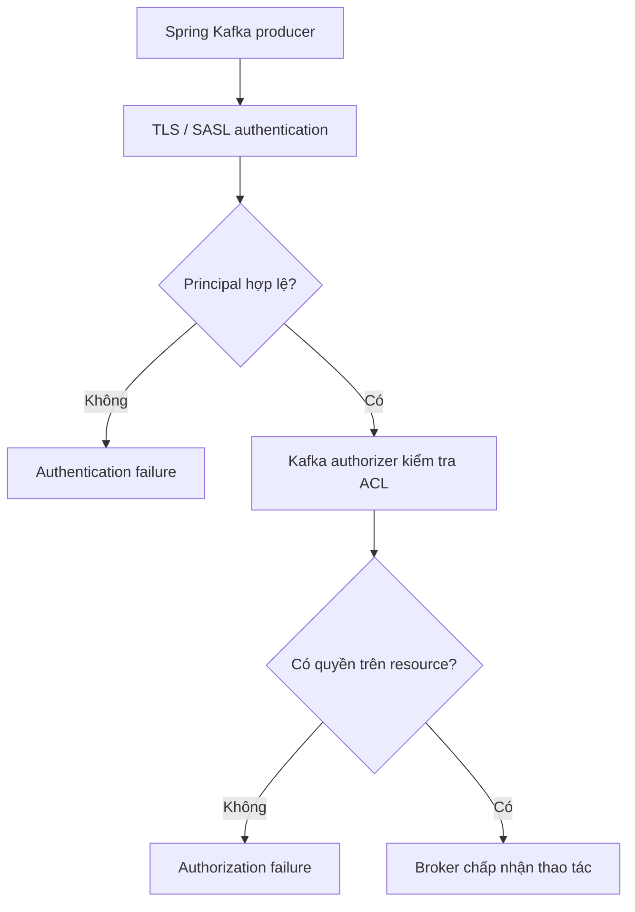

# Phân quyền ACL cho producer

Trong Kafka, xác thực cho biết producer là ai, còn ACL (Access Control List) quyết định producer được phép làm gì. Một ứng dụng Spring Kafka có thể kết nối broker thành công nhưng vẫn không gửi được record nếu principal của nó thiếu quyền trên topic hoặc transactional ID. Vì vậy, cấu hình bảo mật cần kết hợp thông tin xác thực với quyền truy cập đúng phạm vi.

Producer thường chỉ cần quyền ghi vào những topic mà nó phát sự kiện. Cấp quyền rộng như `super.users`, quyền quản trị cluster hoặc quyền ghi mọi topic sẽ làm tăng rủi ro khi thông tin đăng nhập bị lộ. Bài học này trình bày cách xác định principal, cấp ACL tối thiểu cho producer thường và producer transactional, cấu hình SASL trong Spring Boot và kiểm tra lỗi authorization.

## 1. Phân biệt authentication và authorization

Kafka bảo vệ kết nối theo hai bước:

- **Authentication:** broker xác minh danh tính client qua cơ chế như SASL/SCRAM, SASL/OAUTHBEARER hoặc TLS client authentication.
- **Authorization:** authorizer của broker kiểm tra ACL để quyết định principal được phép thực hiện thao tác trên resource nào, chẳng hạn topic, consumer group, transactional ID hoặc cluster.

Ví dụ, ứng dụng `order-producer` đăng nhập bằng SASL/SCRAM với username `order-producer`. Broker có thể ánh xạ danh tính đó thành principal `User:order-producer`. ACL sau đó cho phép principal này ghi topic `orders`.



Xác thực thành công không đồng nghĩa có quyền ghi topic. Ngược lại, tạo ACL cho `User:order-producer` cũng không giúp client đăng nhập nếu SASL credential hoặc chứng chỉ TLS không hợp lệ.

## 2. Xác định principal mà broker nhìn thấy

Trước khi tạo ACL, cần biết chính xác principal được broker nhận diện. Principal phụ thuộc cơ chế authentication và cấu hình mapping trên broker:

| Cơ chế | Principal thường gặp | Lưu ý |
|---|---|---|
| SASL/SCRAM | `User:<username>` | Username thường trở thành tên principal; kiểm tra log broker và quy tắc đặt tên thực tế. |
| SASL/PLAIN | `User:<username>` | Dùng TLS để bảo vệ credential khi truyền qua mạng; không dùng PLAIN trên kết nối không mã hóa. |
| TLS client authentication | Principal dựa trên subject của certificate | `ssl.principal.mapping.rules` có thể biến đổi tên principal. |
| SASL/OAUTHBEARER | Principal do token và callback/handler xác định | Kiểm tra claim hoặc mapping được broker sử dụng. |

Các ví dụ ACL trong bài dùng principal `User:order-producer`. Nếu broker ánh xạ certificate hoặc token thành tên khác, thay principal trong lệnh ACL bằng giá trị thực tế. Không đoán principal từ tên service trong code; hãy xác minh qua cấu hình authentication và log broker.

## 3. Quyền tối thiểu cho producer thông thường

Producer gửi record vào topic cần quyền `WRITE` trên topic. Kafka client cũng thường cần `DESCRIBE` để lấy metadata topic và partition. Một ACL phổ biến cho producer chỉ ghi topic `orders`:

```bash
bin/kafka-acls.sh \
  --bootstrap-server kafka.example.com:9093 \
  --command-config admin.properties \
  --add \
  --allow-principal User:order-producer \
  --operation Write \
  --operation Describe \
  --topic orders
```

Trong ví dụ:

- `--bootstrap-server` chỉ broker dùng để gửi yêu cầu quản trị ACL.
- `--command-config` trỏ tới file cấu hình bảo mật của tài khoản quản trị ACL; không phải credential của ứng dụng producer.
- `--allow-principal` xác định principal được cấp quyền.
- `--operation Write` cho phép ghi record.
- `--operation Describe` cho phép đọc metadata topic.
- `--topic orders` giới hạn quyền vào đúng topic `orders`.

Nếu producer cần ghi nhiều topic, cấp ACL riêng cho từng topic hoặc dùng resource pattern có phạm vi được kiểm soát. Không cấp `--topic '*'` chỉ để tránh phải quản lý danh sách topic. Producer thông thường không cần quyền `READ` trên topic, quyền `READ` trên consumer group hoặc quyền quản trị như `ALTER` và `DELETE`.

Nếu topic chưa tồn tại, nên để quy trình quản trị tạo topic trước. Không cấp quyền `CREATE` trên cluster cho producer chỉ để nó tự tạo topic; quyền tạo topic nên thuộc về quy trình provisioning riêng.

## 4. ACL cho idempotent producer

Các phiên bản Kafka hiện đại bật idempotence mặc định cho producer trong nhiều cấu hình chuẩn. Idempotence giúp Kafka nhận diện và loại bỏ bản gửi trùng phát sinh do producer retry trong phạm vi producer session. Khi broker dùng ACL authorizer, thao tác idempotent có thể cần quyền `IdempotentWrite` trên cluster.

Ví dụ cấp quyền này cho principal producer:

```bash
bin/kafka-acls.sh \
  --bootstrap-server kafka.example.com:9093 \
  --command-config admin.properties \
  --add \
  --allow-principal User:order-producer \
  --operation IdempotentWrite \
  --cluster
```

Đây là quyền ở phạm vi cluster, vì vậy chỉ cấp cho principal thực sự cần dùng idempotent producer. Nếu producer không dùng idempotence và cấu hình client/broker cho phép, quyền này có thể không cần; tuy nhiên không nên tắt idempotence chỉ để né ACL khi hệ thống cần độ tin cậy gửi record. Kiểm tra yêu cầu của phiên bản Kafka và authorizer đang vận hành.

## 5. ACL cho transactional producer

Transactional producer cần quyền trên cả topic đích và transactional ID. Ví dụ Spring Kafka dùng `transactionIdPrefix` là `order-service-pod-a-`; factory có thể tạo các transactional ID bắt đầu bằng prefix này rồi thêm suffix.

ACL trên topic vẫn cần `WRITE` và thường là `DESCRIBE`. Ngoài ra, cấp `WRITE` trên resource transactional ID với pattern `prefixed` để bao phủ các ID được factory tạo từ prefix:

```bash
bin/kafka-acls.sh \
  --bootstrap-server kafka.example.com:9093 \
  --command-config admin.properties \
  --add \
  --allow-principal User:order-producer \
  --operation Write \
  --transactional-id order-service-pod-a- \
  --resource-pattern-type prefixed
```

Nếu chỉ cấp ACL cho một transactional ID chính xác trong khi Spring Kafka tạo nhiều ID có suffix, producer có thể bị từ chối khi khởi tạo transaction. Resource pattern `prefixed` cho phép các ID bắt đầu bằng prefix được chỉ định. Hãy giới hạn prefix theo đúng service và instance, không dùng prefix quá rộng như chuỗi rỗng hoặc tên chung cho toàn cluster.

Với luồng consume-transform-produce có commit offset trong transaction, producer còn phối hợp offset của consumer group. Khi đó ứng dụng cần quyền phù hợp trên consumer group, thường gồm `READ` cho group. Đây là quyền bổ sung của luồng consumer/transactional listener, không phải quyền cần thiết cho producer chỉ gửi record.

## 6. Bật authorizer và quản lý ACL ở broker

ACL chỉ có hiệu lực khi Kafka broker được cấu hình authorizer. Với Kafka chạy KRaft ở các phiên bản hiện đại, authorizer thường dùng `org.apache.kafka.metadata.authorizer.StandardAuthorizer`. Các cluster ZooKeeper đời cũ có thể dùng authorizer khác; hãy chọn theo phiên bản và kiến trúc cluster.

Ví dụ cấu hình rút gọn cho broker KRaft:

```properties
authorizer.class.name=org.apache.kafka.metadata.authorizer.StandardAuthorizer
allow.everyone.if.no.acl.found=false
```

Trong production, cần cấu hình `super.users` cho tài khoản quản trị hoặc quy trình vận hành cần quyền quản trị, đồng thời bảo vệ credential của các principal đó. Không thêm principal ứng dụng vào `super.users` để giải quyết lỗi `TopicAuthorizationException`; hãy cấp ACL đúng resource và operation.

Khi authorizer đã bật, cần kiểm tra ACL cho cả topic, transactional ID, group và cluster operation mà ứng dụng thực sự dùng. Thay đổi authorizer hoặc chính sách mặc định trên cluster đang chạy có thể ảnh hưởng các client khác; triển khai theo quy trình quản trị Kafka của môi trường.

## 7. Cấu hình SASL_SSL/SCRAM trong Spring Boot

ACL dựa trên principal được broker xác định sau authentication. Ví dụ dưới đây cấu hình Spring Boot producer dùng SASL/SCRAM-SHA-512 qua TLS:

```yaml
spring:
  kafka:
    bootstrap-servers: ${KAFKA_BOOTSTRAP_SERVERS}
    properties:
      "[security.protocol]": SASL_SSL
      "[sasl.mechanism]": SCRAM-SHA-512
      "[sasl.jaas.config]": >-
        org.apache.kafka.common.security.scram.ScramLoginModule required
        username="${KAFKA_USERNAME}"
        password="${KAFKA_PASSWORD}";
    producer:
      key-serializer: org.apache.kafka.common.serialization.StringSerializer
      value-serializer: org.springframework.kafka.support.serializer.JsonSerializer
```

Các giá trị username/password nên được inject từ secret manager hoặc biến môi trường do nền tảng quản lý. Không commit credential thật vào `application.yml`, không ghi password vào log và không dùng cùng một tài khoản quản trị cho mọi service. `SASL_SSL` mã hóa kết nối và dùng SASL để xác thực; chứng chỉ CA của broker phải được client tin cậy.

`spring.kafka.properties` áp dụng các thuộc tính chung cho Kafka clients do Spring Boot tạo. Nếu producer có cấu hình authentication riêng, có thể đặt thuộc tính tương ứng trong `spring.kafka.producer.properties`; cần bảo đảm `KafkaTemplate` thực tế dùng producer factory nhận đúng cấu hình.

Nếu dùng mTLS thay cho SCRAM, cấu hình `security.protocol=SSL`, truststore và keystore theo yêu cầu môi trường. Principal thường được suy ra từ certificate subject và mapping rules của broker; ACL phải dùng principal sau mapping đó, không phải username SCRAM.

## 8. Kiểm tra ACL sau khi cấp quyền

Có thể liệt kê ACL trên topic để xác nhận principal và operation đã được tạo:

```bash
bin/kafka-acls.sh \
  --bootstrap-server kafka.example.com:9093 \
  --command-config admin.properties \
  --list \
  --topic orders
```

Với transactional ID, liệt kê resource tương ứng hoặc kiểm tra danh sách ACL theo pattern được dùng. Sau đó chạy producer bằng chính credential ứng dụng, không dùng file `admin.properties`:

1. Gửi một record vào topic được cấp quyền và xác nhận broker trả acknowledgment.
2. Thử gửi vào topic không được cấp quyền; producer phải nhận lỗi authorization.
3. Nếu dùng idempotence, xác minh producer khởi tạo và gửi được với quyền `IdempotentWrite` cần thiết.
4. Nếu dùng transaction, xác minh producer có thể khởi tạo transaction và commit; thử transactional ID ngoài prefix được cấp để xác nhận bị từ chối.
5. Kiểm tra log broker để xác định principal, resource và operation bị từ chối.

Không chỉ dựa vào việc ứng dụng khởi động thành công. Producer có thể tạo client mà chưa gửi record; authorization thường được kiểm tra khi thực hiện thao tác cụ thể.

## 9. Nhận biết lỗi authorization

Một số lỗi thường gặp:

| Lỗi | Nguyên nhân có thể | Hướng kiểm tra |
|---|---|---|
| Authentication failure | Sai username/password, cơ chế SASL không khớp hoặc TLS handshake lỗi | Kiểm tra credential, `sasl.mechanism`, CA và principal trong broker log. |
| `TopicAuthorizationException` | Thiếu `WRITE` hoặc `DESCRIBE` trên topic | Kiểm tra ACL đúng principal, topic và operation. |
| `ClusterAuthorizationException` | Thiếu quyền cluster như `IdempotentWrite` khi producer dùng idempotence | Kiểm tra ACL trên cluster resource và cấu hình idempotence. |
| `TransactionalIdAuthorizationException` | Thiếu `WRITE` trên transactional ID hoặc prefix ACL không khớp ID thực tế | Kiểm tra `transactionIdPrefix`, suffix và resource pattern. |
| Gửi được topic này nhưng không được topic khác | ACL chỉ cấp cho một tập topic cụ thể | Bổ sung quyền đúng topic cần thiết, không cấp wildcard toàn cluster. |
| Transaction producer khởi động được nhưng thao tác offset thất bại | Thiếu quyền trên consumer group trong luồng consume-transform-produce | Kiểm tra `group.id` và ACL `READ` tương ứng. |

Khi debug, đối chiếu ba thông tin: principal broker nhận diện, resource bị truy cập và operation bị từ chối. Từ đó sửa đúng ACL. Không xử lý bằng cách chuyển ứng dụng sang principal quản trị hoặc tắt authorizer.

## 10. Nguyên tắc least privilege cho producer

Một chính sách ACL an toàn nên tuân theo các nguyên tắc:

1. Tạo principal riêng cho từng ứng dụng hoặc workload có vòng đời và quyền khác nhau.
2. Chỉ cấp `WRITE` và quyền metadata cần thiết trên các topic producer thực sự phát.
3. Cấp `IdempotentWrite` trên cluster khi producer cần idempotence theo yêu cầu của broker authorizer.
4. Với transactional producer, cấp `WRITE` trên đúng prefix transactional ID; không dùng prefix chung cho nhiều ứng dụng không liên quan.
5. Không cấp `READ`, `ALTER`, `DELETE`, `CREATE` hoặc quyền quản trị nếu producer không cần.
6. Tạo topic bằng quy trình quản trị riêng thay vì cấp quyền tự tạo topic cho ứng dụng.
7. Quản lý credential trong secret store, xoay vòng định kỳ và thu hồi principal không còn sử dụng.
8. Kiểm tra ACL sau mỗi lần thay đổi deployment, prefix hoặc danh sách topic.

Producer chỉ nên có đủ quyền để phát sự kiện trong phạm vi trách nhiệm của nó. Khi kết hợp principal xác thực rõ ràng với ACL giới hạn theo topic và transactional ID, ứng dụng Spring Kafka có thể gửi record an toàn mà không cần quyền quản trị cluster.
