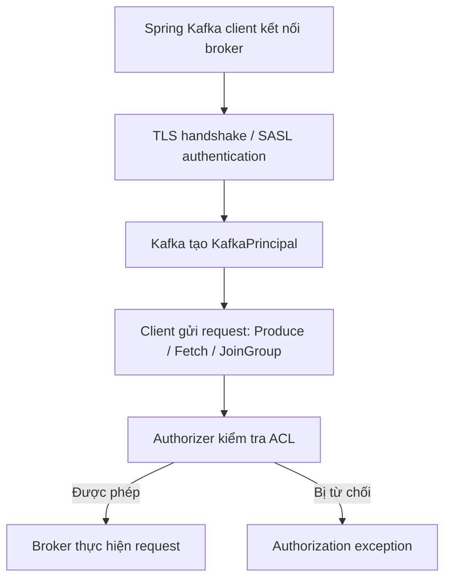

# Bảo vệ group và topic

Kafka topic chứa event của ứng dụng; consumer group đại diện cho một nhóm consumer cùng chia sẻ việc đọc topic và lưu committed offset. Nếu mọi client đều dùng chung một tài khoản có toàn quyền, một service bị lộ credential có thể đọc dữ liệu của service khác, ghi event vào topic không liên quan hoặc xóa dữ liệu. Kafka ACL (Access Control List) cho phép giới hạn từng principal theo resource và operation.

Trong Spring Kafka, ứng dụng thường không tự kiểm tra ACL. Kafka broker xác thực client, xác định principal, sau đó authorizer kiểm tra quyền trên topic, group hoặc resource khác. Vì vậy, bảo vệ group và topic cần cấu hình cả broker lẫn client: broker bật authorizer và tạo ACL; Spring Boot cung cấp credential và kết nối bằng TLS/SASL.

## 1. Authentication và authorization là hai bước khác nhau

**Authentication** xác định client là ai. **Authorization** quyết định client đó được làm gì.



Ví dụ, client đăng nhập thành công bằng SCRAM với username `orders-consumer`. Broker nhận diện principal `User:orders-consumer`. ACL sau đó có thể cho principal này đọc topic `orders.events` và tham gia group `order-projection`.

Chỉ bật SASL mà không cấu hình authorizer không tạo ra phân quyền theo topic. Theo security model của Kafka, nếu không có authorizer, các principal đã xác thực có toàn quyền. Tương tự, ACL không thay thế authentication: nếu mọi client cùng đăng nhập bằng một tài khoản, broker không thể phân biệt quyền của từng service.

## 2. Kafka ACL bảo vệ những resource nào?

ACL là tập quy tắc xác định principal được phép hoặc bị từ chối thực hiện operation từ host nào trên resource pattern nào.

| Thành phần ACL | Ý nghĩa | Ví dụ |
|---|---|---|
| Principal | Danh tính đã được authentication xác lập. | `User:orders-producer` |
| Resource type | Loại tài nguyên được bảo vệ. | `Topic`, `Group`, `Cluster`, `TransactionalId` |
| Resource name | Tên resource cụ thể. | `orders.events`, `order-projection` |
| Pattern type | Cách khớp tên resource. | `LITERAL`, `PREFIXED` |
| Operation | Hành động được phép hoặc từ chối. | `READ`, `WRITE`, `DESCRIBE` |
| Permission | Cho phép hoặc từ chối. | `ALLOW`, `DENY` |
| Host | Địa chỉ IP được phép hoặc từ chối. | `198.51.100.20` hoặc `*` |

Một principal có thể có nhiều ACL trên nhiều resource. Ví dụ `User:orders-consumer` có quyền `READ` trên `orders.events`, nhưng không có quyền đọc `payments.events` hoặc tham gia consumer group của service thanh toán.

## 3. Bật StandardAuthorizer trên Kafka KRaft

Với Kafka chạy KRaft, Kafka cung cấp `StandardAuthorizer`. Cấu hình authorizer phải được áp dụng trên tất cả node Kafka liên quan: broker, controller hoặc node kết hợp broker/controller.

Ví dụ các thuộc tính bảo vệ ACL trong `server.properties`:

```properties
authorizer.class.name=org.apache.kafka.metadata.authorizer.StandardAuthorizer

# Resource không có ACL khớp sẽ bị từ chối.
allow.everyone.if.no.acl.found=false

# Chỉ tài khoản quản trị cluster được bypass ACL.
super.users=User:kafka-admin
```

`allow.everyone.if.no.acl.found=false` thể hiện rõ chế độ default-deny. Đây cũng là hành vi mặc định khi authorizer hoạt động: nếu không có ACL nào khớp resource, chỉ super user được truy cập. Không bật `allow.everyone.if.no.acl.found=true` trong trạng thái vận hành ổn định vì resource chưa được cấp ACL sẽ mở cho mọi principal.

`super.users` là danh sách principal đặc quyền, phân tách bằng dấu chấm phẩy. Tài khoản trong danh sách này bỏ qua kiểm tra ACL, vì vậy chỉ dùng cho quản trị cluster và bảo vệ credential nghiêm ngặt. Nếu cluster có principal riêng cho broker/controller, cấu hình danh sách super user và quyền nội bộ theo topology thực tế; không sao chép một cấu hình demo vào production mà chưa đánh giá inter-broker và KRaft controller traffic.

Kafka ACL được lưu trong cluster metadata của KRaft. Công cụ chính để thêm, liệt kê và xóa ACL là `kafka-acls.sh`; có thể quản lý bằng Kafka `AdminClient` qua `createAcls()` và `deleteAcls()`.

## 4. Các operation thường dùng cho topic và group

| Operation | Ý nghĩa thường gặp |
|---|---|
| `READ` | Đọc record từ topic hoặc tham gia/commit offset cho consumer group. |
| `WRITE` | Ghi record vào topic. Với transactional producer, cũng cần quyền phù hợp trên transactional ID. |
| `DESCRIBE` | Đọc metadata của topic, group hoặc resource. Consumer thường cần describe topic để lấy metadata/offset. |
| `CREATE` | Tạo topic hoặc cho phép broker tự tạo topic theo cấu hình. |
| `DELETE` | Xóa topic hoặc group theo operation được hỗ trợ. |
| `ALTER` | Thay đổi resource hoặc thao tác cluster được bảo vệ bằng operation này. |
| `DESCRIBE_CONFIGS` | Xem cấu hình resource. |
| `ALTER_CONFIGS` | Thay đổi cấu hình resource. |
| `IDEMPOTENT_WRITE` | Cho phép producer idempotent thực hiện produce trên cluster. |
| `CLUSTER_ACTION` | Các hoạt động nội bộ/cluster-level, thường dành cho broker hoặc thành phần quản trị. |

Với ACL `ALLOW`, Kafka coi `READ`, `WRITE`, `DELETE` và `ALTER` là các operation cũng cho phép `DESCRIBE` trên resource tương ứng. Vì vậy, ACL `READ` trên topic/group hoặc `WRITE` trên topic đã bao gồm quyền mô tả cần thiết; không cần tạo ACL `DESCRIBE` riêng trừ khi muốn biểu diễn rõ trong chính sách.

Một consumer group không chỉ là tên cấu hình trong code. Khi consumer join group, heartbeat và commit offset, broker kiểm tra ACL trên resource type `Group`. Consumer thường cần:

- `READ` trên topic cần đọc (đồng thời bao gồm `DESCRIBE`).
- `READ` trên consumer group dùng để join group và commit offset.

Producer thông thường cần `WRITE` trên topic (đồng thời bao gồm `DESCRIBE`). Nếu ứng dụng tự tạo topic hoặc broker bật auto topic creation, cần thêm quyền `CREATE` phù hợp. Nếu producer dùng idempotence mà không có transactional ID, cần xem xét `IDEMPOTENT_WRITE` trên resource `Cluster`.

## 5. Ví dụ phân quyền cho một luồng Spring Kafka

Giả sử service order có các thành phần:

| Principal | Vai trò | Resource | Quyền cần có |
|---|---|---|---|
| `User:orders-producer` | Gửi event order | Topic `orders.events` | `WRITE` (bao gồm `DESCRIBE`) |
| `User:orders-consumer` | Đọc event order | Topic `orders.events` | `READ` (bao gồm `DESCRIBE`) |
| `User:orders-consumer` | Tham gia group | Group `order-projection` | `READ` |
| `User:kafka-admin` | Quản trị ACL/topic | Cluster và resource quản trị | Chỉ quyền quản trị cần thiết; ví dụ minh họa là super user |

Producer và consumer dùng principal riêng để khi một credential bị lộ, phạm vi truy cập vẫn giới hạn theo vai trò. Một service chỉ đọc không cần có quyền ghi topic; producer không cần quyền đọc topic hoặc join group.

## 6. Tạo ACL cho producer

Giả sử topic `orders.events` đã được quản trị viên tạo trước và broker tắt auto topic creation. Có thể cấp quyền cụ thể:

Các lệnh dùng `--command-config` để Kafka AdminClient đăng nhập bằng tài khoản quản trị. Ví dụ nội dung file `admin-client.properties`:

```properties
security.protocol=SASL_SSL
sasl.mechanism=SCRAM-SHA-512
sasl.jaas.config=org.apache.kafka.common.security.scram.ScramLoginModule required username="kafka-admin" password="${KAFKA_ADMIN_PASSWORD}";
ssl.truststore.location=/etc/secrets/kafka-admin.truststore.p12
ssl.truststore.type=PKCS12
ssl.truststore.password=${KAFKA_TRUSTSTORE_PASSWORD}
```

Đây là file chứa thông tin đặc quyền; đặt quyền đọc cho tài khoản vận hành cần thiết, lấy giá trị từ secret store và không commit file có credential thật. Placeholder `${KAFKA_ADMIN_PASSWORD}` phải được secret manager hoặc bước triển khai thay thế trước khi Kafka CLI đọc file; Java properties không tự mở rộng biến môi trường. Trên Windows, dùng script `bin/windows/kafka-acls.bat` với cùng các tham số thay cho `bin/kafka-acls.sh`.

```bash
bin/kafka-acls.sh \
  --bootstrap-server broker.example.com:9093 \
  --command-config admin-client.properties \
  --add \
  --allow-principal User:orders-producer \
  --operation Write \
  --topic orders.events \
  --resource-pattern-type literal
```

Nếu producer idempotent (thường được bật mặc định trong Kafka client hiện đại) và không sử dụng transactional ID, cấp thêm quyền cluster-level:

```bash
bin/kafka-acls.sh \
  --bootstrap-server broker.example.com:9093 \
  --command-config admin-client.properties \
  --add \
  --allow-principal User:orders-producer \
  --operation IdempotentWrite \
  --cluster
```

Nếu ứng dụng được phép tự tạo topic, cần bổ sung `CREATE` trên topic hoặc cluster theo cách tạo topic và chính sách broker. Trong hệ thống production, thường nên provision topic bằng quy trình hạ tầng và giữ quyền `CREATE` ở tài khoản quản trị. Khi đó producer chỉ có `WRITE`/`DESCRIBE`.

Kafka CLI có tùy chọn tiện ích `--producer`, tạo các ACL `WRITE`, `DESCRIBE` và `CREATE` trên topic. Tùy chọn này tiện cho môi trường thử nghiệm nhưng có thể cấp quyền `CREATE` rộng hơn nhu cầu của producer đã dùng topic được tạo sẵn. Hãy dùng operation cụ thể khi cần least privilege.

## 7. Tạo ACL cho consumer và consumer group

Consumer cần quyền trên cả topic và group. Có thể dùng tùy chọn tiện ích `--consumer`:

```bash
bin/kafka-acls.sh \
  --bootstrap-server broker.example.com:9093 \
  --command-config admin-client.properties \
  --add \
  --allow-principal User:orders-consumer \
  --consumer \
  --topic orders.events \
  --group order-projection
```

Tùy chọn `--consumer` tạo ACL `READ` và `DESCRIBE` trên topic, đồng thời `READ` trên consumer group được chỉ định. Có thể tạo riêng từng ACL nếu muốn thấy rõ từng quyền:

```bash
# Đọc và mô tả topic.
bin/kafka-acls.sh --bootstrap-server broker.example.com:9093 \
  --command-config admin-client.properties --add \
  --allow-principal User:orders-consumer \
  --operation Read \
  --topic orders.events

# Join group và commit offset.
bin/kafka-acls.sh --bootstrap-server broker.example.com:9093 \
  --command-config admin-client.properties --add \
  --allow-principal User:orders-consumer \
  --operation Read \
  --group order-projection
```

Tên group trong ACL phải khớp với group ID thực tế mà consumer sử dụng. Nếu `@KafkaListener(groupId = "order-projection")` ghi đè `spring.kafka.consumer.group-id`, hãy cấp ACL cho `order-projection`, không phải giá trị group ID cũ trong YAML.

Khi consumer sử dụng `@KafkaListener`, concurrency tạo nhiều consumer instance trong cùng group; không cần ACL riêng cho từng thread. Khi có nhiều listener dùng group ID khác nhau, mỗi group cần ACL tương ứng.

## 8. Resource pattern: LITERAL và PREFIXED

ACL có thể áp dụng cho một resource chính xác hoặc một nhóm resource theo prefix.

| Pattern | Ví dụ | Phạm vi |
|---|---|---|
| `LITERAL` | Topic `orders.events` | Chỉ topic có đúng tên `orders.events`. Đây là mặc định của CLI. |
| `PREFIXED` | Topic prefix `orders.` | Các topic bắt đầu bằng `orders.`, ví dụ `orders.events`, `orders.retry`, `orders.events-dlt`. |
| Wildcard literal | Resource `*` | Mọi resource cùng loại; cần kiểm soát rất chặt. |

Ví dụ cho phép consumer đọc mọi topic có prefix `orders.`:

```bash
bin/kafka-acls.sh \
  --bootstrap-server broker.example.com:9093 \
  --command-config admin-client.properties \
  --add \
  --allow-principal User:orders-consumer \
  --operation Read \
  --operation Describe \
  --topic orders. \
  --resource-pattern-type prefixed
```

Có thể tạo ACL prefix cho consumer group theo cách tương tự:

```bash
bin/kafka-acls.sh \
  --bootstrap-server broker.example.com:9093 \
  --command-config admin-client.properties \
  --add \
  --allow-principal User:orders-consumer \
  --operation Read \
  --group orders- \
  --resource-pattern-type prefixed
```

Prefix hữu ích khi service sở hữu một họ topic như retry và DLT, nhưng cần giới hạn prefix đủ hẹp. Không cấp `User:*` hoặc resource `*` cho ứng dụng thông thường nếu không có lý do rõ ràng.

## 9. Kiểm tra, liệt kê và thu hồi ACL

Liệt kê ACL trên một topic cụ thể:

```bash
bin/kafka-acls.sh \
  --bootstrap-server broker.example.com:9093 \
  --command-config admin-client.properties \
  --list --topic orders.events
```

Lệnh trên liệt kê ACL gắn với literal pattern có đúng tên đó. Các ACL wildcard hoặc prefix cũng có thể ảnh hưởng đến topic nhưng không xuất hiện trong kết quả literal. Để xem tất cả ACL khớp với resource:

```bash
bin/kafka-acls.sh \
  --bootstrap-server broker.example.com:9093 \
  --command-config admin-client.properties \
  --list --topic orders.events \
  --resource-pattern-type match
```

Liệt kê ACL cho consumer group:

```bash
bin/kafka-acls.sh \
  --bootstrap-server broker.example.com:9093 \
  --command-config admin-client.properties \
  --list --group order-projection \
  --resource-pattern-type match
```

Thu hồi quyền producer đã cấp:

```bash
bin/kafka-acls.sh \
  --bootstrap-server broker.example.com:9093 \
  --command-config admin-client.properties \
  --remove \
  --allow-principal User:orders-producer \
  --operation Write \
  --operation Describe \
  --topic orders.events
```

Khi xóa ACL, cần xác định đúng pattern type. Đặc biệt, `--resource-pattern-type match` kết hợp với `--remove` có thể xóa nhiều ACL đang ảnh hưởng đến resource; chỉ dùng sau khi xem trước kết quả và xác nhận phạm vi.

## 10. Cấu hình SASL_SSL cho Spring Boot

Ví dụ client dùng SCRAM-SHA-512 qua TLS. Broker cần có listener `SASL_SSL`, bật cơ chế SCRAM tương ứng và có chứng thư TLS hợp lệ. User SCRAM phải được tạo trên cluster trước khi ứng dụng kết nối.

```yaml
spring:
  kafka:
    bootstrap-servers: broker.example.com:9093
    security:
      protocol: SASL_SSL
    properties:
      sasl.mechanism: SCRAM-SHA-512
      sasl.jaas.config: >-
        org.apache.kafka.common.security.scram.ScramLoginModule required
        username="${KAFKA_USERNAME}"
        password="${KAFKA_PASSWORD}";
    ssl:
      trust-store-location: file:/etc/secrets/kafka-client.truststore.p12
      trust-store-type: PKCS12
      trust-store-password: ${KAFKA_TRUSTSTORE_PASSWORD}
    consumer:
      group-id: order-projection
```

Các điểm cần lưu ý:

- `spring.kafka.security.protocol` chọn protocol kết nối cho các client được cấu hình chung.
- `sasl.mechanism` chọn cơ chế SCRAM đã được broker bật.
- `sasl.jaas.config` cung cấp username/password của principal client.
- Truststore chứa CA/certificate mà client dùng để xác minh certificate của broker.
- Password lấy từ environment, secret store hoặc ConfigProvider; không commit credential vào Git.

Các key trong `spring.kafka.properties` phải là tên Kafka client property đầy đủ như `sasl.mechanism` và `sasl.jaas.config`; không lồng chúng thành object YAML `sasl: mechanism:` vì đây là map property dạng key/value.

Spring Boot có các thuộc tính SSL riêng như `spring.kafka.ssl.trust-store-location`, `spring.kafka.ssl.trust-store-password`, `spring.kafka.ssl.key-store-location` và `spring.kafka.ssl.key-store-password`. Nếu dùng mTLS, cấu hình thêm client keystore chứa certificate/private key và broker yêu cầu `ssl.client.auth=required` trên listener phù hợp.

Nếu producer, consumer và AdminClient cần principal khác nhau, cấu hình security property theo từng thành phần, ví dụ `spring.kafka.producer.properties.sasl.jaas.config` và `spring.kafka.consumer.properties.sasl.jaas.config`. Cần kiểm tra cả `KafkaAdmin` vì các thao tác tạo topic hoặc kiểm tra metadata của admin cũng đi qua broker và phải được cấp quyền tương ứng.

## 11. Tạo SASL user và xác định principal

Với SCRAM, credential được quản lý trong cluster metadata. Quản trị viên có thể tạo user bằng `kafka-configs.sh` theo cơ chế được broker bật. Ví dụ minh họa:

```bash
bin/kafka-configs.sh \
  --bootstrap-server broker.example.com:9093 \
  --command-config admin-client.properties \
  --alter \
  --entity-type users \
  --entity-name orders-consumer \
  --add-config 'SCRAM-SHA-512=[iterations=8192,password=<secret-from-secret-manager>]'
```

Không đưa password thật vào script được commit, shell history hoặc log CI. Dùng quy trình secret provisioning của tổ chức và giới hạn quyền đọc file cấu hình quản trị.

Với SASL/SCRAM, username thường trở thành principal `User:<username>` theo principal builder mặc định. Với TLS client authentication, principal mặc định được tạo từ distinguished name của certificate; có thể chuẩn hóa tên bằng `ssl.principal.mapping.rules`. Hãy xác nhận principal thực tế mà broker nhìn thấy trước khi tạo ACL vì sai tên principal sẽ khiến mọi ACL không khớp.

Tùy chọn `--allow-host` và `--deny-host` nhận địa chỉ IP, không nhận hostname. Nếu cần giới hạn nguồn kết nối, hãy dùng IP ổn định hoặc thực hiện giới hạn mạng bằng firewall/security group; đừng giả định tên DNS có thể dùng trực tiếp trong host ACL.

## 12. Chọn cơ chế authentication

| Cơ chế | Dùng khi | Lưu ý |
|---|---|---|
| SASL/SCRAM-SHA-256 hoặc SCRAM-SHA-512 | Dùng username/password có challenge-response. | Kết hợp TLS để mã hóa dữ liệu và credential trên đường truyền. |
| SASL/PLAIN | Tích hợp hệ thống username/password đơn giản. | Chỉ dùng trên `SASL_SSL`; không dùng `SASL_PLAINTEXT` trong môi trường production. |
| SASL/GSSAPI (Kerberos) | Tổ chức đã có Kerberos/KDC. | Quản lý principal, keytab và ticket theo hạ tầng identity hiện có. |
| SASL/OAUTHBEARER | Tích hợp OAuth 2.0/identity provider. | Cần validator/JWKS và cấu hình production; implementation token không bảo mật mặc định chỉ phù hợp thử nghiệm. |
| SSL client authentication (mTLS) | Mỗi client có certificate X.509. | Broker xác minh certificate; principal được ánh xạ từ distinguished name. |

`SASL_SSL` kết hợp SASL authentication và TLS encryption. `SSL` có thể dùng mTLS; `SASL_PLAINTEXT` có authentication nhưng không mã hóa dữ liệu truyền. Chọn cơ chế phù hợp với identity provider, quy trình cấp/thu hồi credential và khả năng rotate secret.

## 13. Cấp quyền cho retry topic và dead-letter topic

Spring Kafka non-blocking retry có thể tạo các topic retry và DLT. Những topic này là resource riêng nên ACL trên topic gốc không tự động cấp quyền cho tất cả topic retry/DLT, trừ khi dùng prefix pattern bao phủ chúng.

Ví dụ một luồng có:

- `orders.events`
- `orders.events-retry-1000`
- `orders.events-retry-2000`
- `orders.events-dlt`

Producer/recoverer cần quyền ghi vào topic đích tương ứng; consumer retry/DLT cần quyền đọc các topic mà nó subscribe và quyền trên group ID thực tế. Nếu retry infrastructure tự tạo topic, phần provisioning cần quyền `CREATE`/quyền Admin phù hợp. Có thể để platform team tạo topic trước rồi cấp ACL runtime hẹp cho ứng dụng.

Với các topic có chung prefix `orders.events`, có thể dùng `PREFIXED` pattern sau khi xác nhận không vô tình bao phủ topic của service khác. Với yêu cầu tách quyền nghiêm ngặt, tạo ACL literal cho từng retry/DLT topic.

## 14. Các resource bổ sung khi dùng transaction

Nếu Spring Kafka producer cấu hình `transaction-id-prefix`, ngoài quyền `WRITE` trên topic, transactional producer cần `WRITE` trên resource `TransactionalId`. Khi transaction gửi offset của consumer vào transaction, group cũng cần quyền tương ứng; transactional produce/consume có thêm kiểm tra ACL trên topic, group và transactional ID.

Ví dụ cấp quyền cho một transactional ID prefix:

```bash
bin/kafka-acls.sh \
  --bootstrap-server broker.example.com:9093 \
  --command-config admin-client.properties \
  --add \
  --allow-principal User:orders-processor \
  --operation Write \
  --transactional-id orders-processor-
```

Nếu producer sinh transactional ID theo suffix từ prefix, resource pattern cần bao phủ các ID thực tế. Dùng `PREFIXED` nếu tên transaction ID được thiết kế theo prefix ổn định:

```bash
bin/kafka-acls.sh \
  --bootstrap-server broker.example.com:9093 \
  --command-config admin-client.properties \
  --add \
  --allow-principal User:orders-processor \
  --operation Write \
  --transactional-id orders-processor- \
  --resource-pattern-type prefixed
```

Không cấp `WRITE` trên mọi transactional ID nếu service chỉ dùng một nhóm ID riêng. Nếu producer idempotent nhưng không transactional, kiểm tra thêm quyền `IdempotentWrite` trên Cluster như phần producer ACL.

## 15. Phân biệt quyền runtime và quyền quản trị

Không nên dùng cùng một principal cho ứng dụng và thao tác quản trị cluster. Có thể tách như sau:

| Principal | Trách nhiệm | Ví dụ quyền |
|---|---|---|
| `User:orders-producer` | Gửi event order | Topic `orders.events`: `WRITE` (bao gồm `DESCRIBE`); cluster `IDEMPOTENT_WRITE` nếu cần. |
| `User:orders-consumer` | Đọc event order | Topic: `READ` (bao gồm `DESCRIBE`); Group `order-projection`: `READ`. |
| `User:orders-admin` | Provision topic/ACL cho service | `CREATE`/`ALTER`/`DESCRIBE_CONFIGS` ở phạm vi resource được giao; `ALTER` trên Cluster khi quản lý ACL. |
| `User:kafka-admin` | Quản trị cluster toàn cục | Super user hoặc quyền cluster-level được kiểm soát nghiêm ngặt. |

Thao tác thêm/xóa ACL yêu cầu quyền `ALTER` trên resource `Cluster`; liệt kê ACL yêu cầu `DESCRIBE` trên `Cluster`. Tài khoản runtime không nên giữ các quyền này. Nếu Spring Boot tự tạo `NewTopic` bean, `KafkaAdmin` thực hiện thao tác tạo topic và cần quyền quản trị tương ứng; cân nhắc tắt auto creation trong runtime hoặc cấp quyền hẹp theo quy trình.

## 16. Lỗi authorization thường gặp

| Lỗi | Nguyên nhân thường gặp | Cách kiểm tra |
|---|---|---|
| `TopicAuthorizationException` / `TOPIC_AUTHORIZATION_FAILED` | Thiếu `READ`, `WRITE` hoặc `DESCRIBE` trên topic. | Liệt kê ACL của topic với `--resource-pattern-type match`; xác nhận principal và topic name. |
| `GroupAuthorizationException` / `GROUP_AUTHORIZATION_FAILED` | Thiếu `READ` trên consumer group. | So sánh `group.id` thực tế với resource Group trong ACL. |
| `ClusterAuthorizationException` | Client gọi API cluster/admin mà principal không có quyền. | Xem operation và Cluster ACL; tách AdminClient khỏi runtime principal. |
| `TransactionalIdAuthorizationException` | Thiếu `WRITE` trên transactional ID. | Kiểm tra `transaction-id-prefix` và ACL `TransactionalId`. |
| Authentication failed | Sai username/password, mechanism hoặc JAAS config. | Xác minh SCRAM user, `sasl.mechanism`, `sasl.jaas.config` và broker listener. |
| SSL handshake/certificate error | Truststore không tin CA, certificate hết hạn hoặc hostname không khớp. | Kiểm tra truststore, SAN/hostname, thời hạn certificate và TLS protocol. |
| Consumer không đọc được sau khi join group | Có quyền group nhưng thiếu `READ`/`DESCRIBE` trên topic hoặc ACL áp dụng sai pattern. | Kiểm tra cả Topic ACL lẫn Group ACL. |
| Producer chạy được ở dev nhưng bị từ chối ở production | Dev không bật authorizer hoặc principal khác môi trường. | Xác minh `authorizer.class.name`, principal thực tế và ACL trên cluster production. |

Kafka authorizer có logger `kafka.authorizer.logger`. Có thể ghi log các quyết định bị từ chối để điều tra; trong môi trường cần audit, chuyển log sang hệ thống lưu trữ tập trung và có retention phù hợp. Tránh bật log mọi request được cho phép ở mức quá chi tiết nếu lưu lượng lớn.

## 17. Kiểm thử ACL theo nguyên tắc least privilege

Nên kiểm tra cả quyền được cấp và quyền bị từ chối. Một test chỉ xác minh consumer đọc được topic không chứng minh ACL đã giới hạn đúng phạm vi.

| Principal | Thao tác | Kết quả mong đợi |
|---|---|---|
| `orders-producer` | Gửi vào `orders.events` | Thành công. |
| `orders-producer` | Đọc `orders.events` | Bị từ chối. |
| `orders-producer` | Ghi `payments.events` | Bị từ chối. |
| `orders-consumer` | Đọc `orders.events` trong group `order-projection` | Thành công. |
| `orders-consumer` | Tham gia group `payments-projection` | Bị từ chối. |
| `orders-consumer` | Đọc `payments.events` | Bị từ chối. |
| Runtime principal | Tạo hoặc xóa topic | Bị từ chối nếu không có nhiệm vụ quản trị. |

Quy trình kiểm thử:

1. Tạo topic/group bằng tài khoản quản trị hoặc fixture test.
2. Cấp credential riêng cho producer và consumer test.
3. Dùng cùng `security.protocol`, SASL mechanism và TLS truststore như production.
4. Chạy producer/consumer thực tế với đúng `group.id`.
5. Thử truy cập topic/group ngoài phạm vi và xác nhận authorization failure.
6. Liệt kê ACL với pattern `match` để phát hiện wildcard/prefix đang mở rộng quyền.
7. Thu hồi ACL test sau khi hoàn tất.

Đừng kiểm thử bằng super user vì super user bỏ qua ACL. Dùng principal runtime riêng để xác nhận quyền thực sự.

## 18. Checklist triển khai

- Broker bật `StandardAuthorizer` (KRaft) và default-deny.
- Chỉ principal quản trị cần thiết có trong `super.users`.
- Client kết nối qua listener có authentication và TLS phù hợp.
- Mỗi service có principal riêng; không dùng credential chung cho mọi producer/consumer.
- Producer chỉ có `WRITE` trên topic cần gửi (`WRITE` bao gồm `DESCRIBE`).
- Consumer chỉ có `READ` trên topic cần đọc và `READ` trên group cần tham gia (`READ` bao gồm `DESCRIBE`).
- `group.id` trong Spring Kafka khớp với ACL Group.
- Topic retry/DLT có ACL tương ứng hoặc được bao phủ bởi prefix hẹp.
- Topic được provision bởi tài khoản quản trị nếu runtime không cần quyền `CREATE`.
- Transactional producer có ACL `WRITE` trên transactional ID; idempotent producer có quyền cần thiết.
- Secret không nằm trong source control; có kế hoạch rotate password/certificate.
- Có test cho cả thao tác được phép và bị từ chối.
- Có audit log và quy trình rà soát ACL định kỳ.

## 19. Ghi nhớ

- Authentication xác định principal; authorization quyết định principal được thao tác trên resource nào.
- KRaft dùng `org.apache.kafka.metadata.authorizer.StandardAuthorizer` để thực thi ACL.
- Không có authorizer nghĩa là authenticated client có toàn quyền; có authorizer và không có ACL khớp thì mặc định bị từ chối, trừ super user.
- Consumer cần `READ` trên topic và `READ` trên group; `READ` bao gồm `DESCRIBE`.
- Producer cần `WRITE` trên topic; `WRITE` bao gồm `DESCRIBE`. Quyền `CREATE` chỉ cấp khi cần tạo topic.
- `group.id` thực tế của `@KafkaListener` phải khớp resource Group được cấp ACL.
- `PREFIXED` pattern tiện cho retry/DLT nhưng phải giới hạn phạm vi; tránh wildcard rộng.
- SASL/SCRAM hoặc mTLS xác thực principal; kết hợp TLS để mã hóa dữ liệu trên đường truyền.
- Runtime principal không nên có quyền quản trị topic/ACL hoặc nằm trong `super.users`.
- Kiểm thử cả quyền cho phép và quyền bị từ chối bằng đúng principal runtime.

Bảo vệ topic và group hiệu quả bắt đầu từ việc tách principal theo service, sau đó cấp đúng operation trên từng resource. Khi broker bật authorizer với default-deny, Spring Kafka kết nối qua SASL_SSL hoặc mTLS và dùng credential riêng, mỗi service chỉ đọc/ghi những luồng event đã được giao. Cần kiểm tra cả topic, group, retry/DLT và transactional ID để quyền tối thiểu vẫn đủ cho toàn bộ vòng đời messaging.

## Tài liệu tham khảo

- [Apache Kafka — Authorization and ACLs](https://kafka.apache.org/44/security/authorization-and-acls/)
- [Apache Kafka — Security Model](https://kafka.apache.org/44/security/security-model/)
- [Apache Kafka — Authentication using SASL](https://kafka.apache.org/44/security/authentication-using-sasl/)
- [Apache Kafka — Encryption and Authentication using SSL](https://kafka.apache.org/44/security/encryption-and-authentication-using-ssl/)
- [Spring Boot — Common Application Properties (Kafka)](https://docs.spring.io/spring-boot/appendix/application-properties/)
