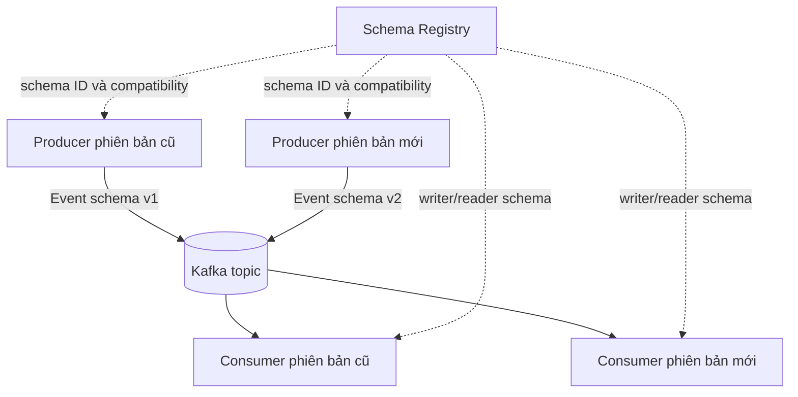

# Optional field và default value

Schema của một Kafka event thường thay đổi theo thời gian. Một phiên bản event có thể chỉ chứa `orderId`, trong khi phiên bản sau bổ sung `couponCode`, `currency` hoặc thông tin nguồn tạo đơn hàng. Consumer cũ và mới có thể cùng tồn tại trong lúc rolling deployment; dữ liệu cũ cũng có thể được đọc lại nhiều ngày sau khi producer đã phát schema mới.

Optional field và default value giúp thiết kế những thay đổi này tương thích hơn. Tuy nhiên, hai khái niệm không giống nhau. Optional mô tả việc một field có thể vắng mặt hoặc không có giá trị theo quy tắc của format. Default mô tả giá trị được dùng khi field không được cung cấp trong một ngữ cảnh cụ thể. Ý nghĩa chính xác phụ thuộc Avro, Protobuf, JSON Schema và cách Java application ánh xạ dữ liệu.

## 1. Phân biệt missing, null và giá trị mặc định

Trước khi thay đổi schema, cần phân biệt ba trạng thái:

| Trạng thái | Ý nghĩa | Ví dụ JSON |
|---|---|---|
| Missing | Field không xuất hiện trong payload | `{"orderId":"O-100"}` |
| Null | Field có xuất hiện nhưng giá trị là null | `{"orderId":"O-100","couponCode":null}` |
| Có giá trị | Field xuất hiện với dữ liệu cụ thể | `{"orderId":"O-100","couponCode":"WELCOME"}` |

Ba trạng thái này có thể mang ý nghĩa nghiệp vụ khác nhau:

- Missing có thể có nghĩa producer chưa biết field hoặc schema cũ chưa định nghĩa field.
- Null có thể có nghĩa producer biết field nhưng chủ động biểu đạt rằng không có giá trị.
- Giá trị cụ thể biểu đạt dữ liệu đã được cung cấp.

Default value là quy tắc dùng khi field không được cung cấp trong một ngữ cảnh. Nó không tự động đồng nghĩa với null và cũng không luôn được áp dụng bởi serializer hoặc deserializer.

Ví dụ, nếu `currency` có default là `VND`, ứng dụng có thể hiểu event cũ không có field currency là dùng VND. Nhưng nếu producer gửi rõ `currency = null`, ứng dụng cần quyết định null có được chấp nhận hay phải báo lỗi. Không nên âm thầm coi mọi null là missing.

## 2. Optional field và default value khác nhau thế nào?

Optional field trả lời câu hỏi: *Field có bắt buộc phải hiện diện hoặc có giá trị hay không?*

Default value trả lời câu hỏi: *Nếu field không có dữ liệu trong trường hợp được định nghĩa, hệ thống sẽ dùng giá trị nào?*

| Khái niệm | Mục đích | Điều không tự bảo đảm |
|---|---|---|
| Optional field | Cho phép field vắng mặt hoặc không có giá trị theo format | Không tự chọn giá trị nghiệp vụ thay thế |
| Nullable field | Cho phép giá trị null | Không có nghĩa field được phép vắng mặt trong mọi schema |
| Default value | Cung cấp giá trị thay thế khi format/runtime áp dụng quy tắc default | Không nhất thiết làm field trở thành optional |
| Required field | Bắt buộc field phải xuất hiện theo schema | Không bảo đảm giá trị hợp lệ về nghiệp vụ |

Ví dụ, một field `couponCode` có thể optional và nullable vì đơn hàng có thể không dùng coupon. Field `currency` có thể có default `VND` nếu hệ thống quy định currency mặc định cho dữ liệu cũ. Nhưng nếu producer mới phải luôn gửi currency rõ ràng, không nên dùng default để che giấu lỗi producer.

## 3. Vì sao optional field quan trọng với Kafka?

Kafka lưu record dưới dạng bytes và không tự hiểu field nào là optional. Quy tắc schema được áp dụng ở tầng serializer, deserializer và schema registry nếu ứng dụng sử dụng.

Trong một hệ thống Spring Kafka, các phiên bản producer và consumer có thể được triển khai lệch thời điểm:



Ví dụ:

- Producer v1 chỉ gửi `orderId`.
- Producer v2 bổ sung `couponCode`.
- Consumer v1 vẫn đang chạy trong lúc deploy.
- Consumer v2 cần đọc được cả event v1 đã lưu trong Kafka và event v2 mới phát.

Nếu field mới được thiết kế có default phù hợp với format, consumer mới có thể đọc event cũ mà không cần producer cũ phát lại dữ liệu theo schema mới.

Điều này đặc biệt quan trọng khi consumer replay dữ liệu từ offset cũ, khi retry topic giữ record lâu hoặc khi một consumer group mới bắt đầu đọc từ `earliest`.

## 4. Optional field và default trong Avro

Avro biểu diễn optional field thường bằng union giữa kiểu dữ liệu và `null`. Nếu default là null, nhánh null phải đứng đầu union.

Ví dụ schema v1:

```json
{
  "type": "record",
  "name": "OrderCreated",
  "namespace": "com.example.events",
  "fields": [
    { "name": "orderId", "type": "string" }
  ]
}
```

Schema v2 bổ sung hai field:

```json
{
  "type": "record",
  "name": "OrderCreated",
  "namespace": "com.example.events",
  "fields": [
    { "name": "orderId", "type": "string" },
    {
      "name": "couponCode",
      "type": ["null", "string"],
      "default": null
    },
    {
      "name": "currency",
      "type": "string",
      "default": "VND"
    }
  ]
}
```

Ý nghĩa:

- `couponCode` có thể là null hoặc string.
- `currency` có kiểu string và default là `VND`.
- Consumer dùng schema v2 để đọc record được ghi bằng schema v1 có thể nhận default cho các field chưa tồn tại trong writer schema.

**Lưu ý quan trọng:** trong Avro, default là một phần của schema resolution khi reader đọc dữ liệu mà writer schema không có field tương ứng. Default không phải chỉ thị chung rằng serializer được phép bỏ field khi ghi record. Khi ghi bằng schema v2, record vẫn được encode theo writer schema v2; ứng dụng cần cung cấp hoặc khởi tạo field theo cách phù hợp với generated class/record đang dùng.

Default cũng không làm field trở thành nullable. Nếu muốn field chấp nhận null, kiểu của field phải là union có nhánh null. Một field có kiểu `string` và default `"VND"` vẫn không chấp nhận null trong schema Avro đó.

### 4.1. Union và thứ tự nhánh

Với Avro, default phải phù hợp với nhánh đầu tiên của union theo quy tắc Avro. Cách khai báo phổ biến:

```json
{
  "name": "couponCode",
  "type": ["null", "string"],
  "default": null
}
```

Nếu đổi thành:

```json
{
  "name": "couponCode",
  "type": ["string", "null"],
  "default": null
}
```

schema không hợp lệ theo quy tắc default của union vì nhánh đầu tiên là string trong khi default lại là null.

Đừng chỉ thêm `default: null` mà quên thêm nhánh null vào type. Hai phần này giải quyết hai việc khác nhau: union cho phép kiểu null; default cung cấp giá trị cho reader khi field vắng mặt trong writer schema.

## 5. Avro schema evolution và compatibility

Khi dùng schema registry, compatibility mode quyết định schema mới có được chấp nhận so với schema đã đăng ký hay không. Các tên chế độ phổ biến gồm BACKWARD, FORWARD, FULL và các biến thể transitive.

| Chế độ | Câu hỏi chính | Ý nghĩa trong rollout |
|---|---|---|
| BACKWARD | Consumer dùng schema mới có đọc được dữ liệu theo schema cũ không? | Có thể triển khai consumer mới trước producer mới |
| FORWARD | Consumer dùng schema cũ có đọc được dữ liệu theo schema mới không? | Có thể triển khai producer mới trong khi consumer cũ còn chạy |
| FULL | Hai chiều backward và forward đều đáp ứng? | Linh hoạt hơn khi producer/consumer rollout lệch nhau |
| Transitive | Có kiểm tra với tất cả phiên bản trước hay chỉ phiên bản gần nhất? | Quan trọng khi dữ liệu cũ vẫn còn trong retention hoặc được replay |

Với Avro:

- Thêm field mới vào reader schema thường cần default để reader đọc được record cũ không có field đó.
- Reader schema cũ thường bỏ qua field mới được writer schema gửi thêm.
- Xóa field có thể ảnh hưởng reader cũ nếu reader schema đó không có default để xử lý field không còn trong writer schema.
- Đổi tên field không tự động được hiểu là cùng một field; có thể cần alias và kiểm tra compatibility theo registry đang dùng.

Compatibility kiểm tra cấu trúc schema, không bảo đảm ý nghĩa nghiệp vụ. Ví dụ default currency `VND` có thể giúp đọc được record cũ về mặt kỹ thuật, nhưng nếu dữ liệu cũ thực tế là USD thì kết quả vẫn sai nghiệp vụ.

## 6. Generated Avro class trong Spring Kafka

Khi dùng Avro SpecificRecord, class Java thường được sinh từ schema. Ví dụ code tạo event v2 có thể trông như sau:

```java
OrderCreated event = OrderCreated.newBuilder()
        .setOrderId("O-100")
        .setCouponCode(null)
        .setCurrency("VND")
        .build();

kafkaTemplate.send(
        "orders",
        event.getOrderId(),
        event
);
```

Generated builder có thể khởi tạo field theo default của schema, nhưng cần kiểm tra code được sinh từ đúng phiên bản schema và cách build project. Việc set rõ field trong application mapping giúp hành vi producer dễ hiểu hơn, đặc biệt khi field có ý nghĩa nghiệp vụ.

Consumer Spring Kafka có thể nhận SpecificRecord:

```java
@KafkaListener(
        topics = "orders",
        groupId = "order-projection")
public void consume(OrderCreated event) {
    String currency = event.getCurrency();
    String couponCode = event.getCouponCode();

    orderProjectionService.apply(
            event.getOrderId(),
            couponCode,
            currency
    );
}
```

Nếu event được deserialize bằng schema reader phù hợp, consumer mới có thể đọc record cũ và nhận default do Avro schema resolution áp dụng. Hãy phân biệt default ở schema với default trong mapping Java: chúng có thể cùng tồn tại nhưng hoạt động ở những tầng khác nhau.

## 7. Cấu hình Avro serializer/deserializer cho Spring Kafka

Nếu dùng Confluent Schema Registry, producer và consumer có thể cấu hình như sau:

```yaml
spring:
  kafka:
    producer:
      key-serializer: org.apache.kafka.common.serialization.StringSerializer
      value-serializer: io.confluent.kafka.serializers.KafkaAvroSerializer
      properties:
        schema.registry.url: http://schema-registry:8081
    consumer:
      key-deserializer: org.apache.kafka.common.serialization.StringDeserializer
      value-deserializer: io.confluent.kafka.serializers.KafkaAvroDeserializer
      properties:
        schema.registry.url: http://schema-registry:8081
        specific.avro.reader: true
```

Đây là cấu hình minh họa cho Confluent serializer; nếu dùng registry hoặc serializer khác, class và thuộc tính cấu hình sẽ khác.

Producer serializer đăng ký hoặc tra cứu schema và ghi schema ID cùng payload theo wire format của serializer. Consumer deserializer dùng schema ID để lấy writer schema, sau đó có thể áp dụng reader schema và schema resolution để tạo object Java.

Với `specific.avro.reader: true`, deserializer hướng tới generated SpecificRecord class. Hãy bảo đảm class tương ứng có trong classpath và tương thích với schema được dùng để đọc.

Không nên cho producer và consumer tự chọn schema không kiểm soát. Compatibility policy cần được cấu hình ở registry và được kiểm tra trong quy trình phát hành schema.

## 8. Optional field và default trong Protobuf

Protobuf có cách biểu diễn presence khác Avro. Với proto3, scalar field không khai báo `optional` có thể có implicit default value, nhưng ứng dụng không phân biệt được rõ ràng field bị thiếu với field được gửi bằng giá trị mặc định.

Ví dụ:

```proto
syntax = "proto3";

message OrderCreated {
  string order_id = 1;
  optional string coupon_code = 5;
  string currency = 6;
}
```

Ý nghĩa:

- `order_id` có giá trị mặc định là chuỗi rỗng nếu không có mặt.
- `coupon_code` dùng `optional` để theo dõi presence; code sinh ra hỗ trợ kiểm tra field có được set hay không.
- `currency` là scalar string không optional nên giá trị đọc được khi vắng mặt là chuỗi rỗng theo implicit default của proto3.

Với generated Java API, field optional có thể có phương thức presence như `hasCouponCode()`. Nhờ vậy, ứng dụng phân biệt được chưa set với đã set giá trị rỗng, trong phạm vi presence được hỗ trợ.

### 8.1. Quy tắc khi thay đổi Protobuf schema

Khi tiến hóa message Protobuf:

- Thêm field mới bằng một field number chưa từng dùng.
- Không đổi field number của field hiện có.
- Không tái sử dụng field number đã xóa.
- Dùng `reserved` để đánh dấu số hoặc tên field đã ngừng sử dụng.
- Chỉ dùng `optional` khi ứng dụng cần phân biệt presence với implicit default.
- Kiểm tra enum mới và cách consumer cũ xử lý giá trị enum chưa biết.

Ví dụ đánh dấu field đã xóa:

```proto
message OrderCreated {
  reserved 3, 4;
  reserved "legacy_note";

  string order_id = 1;
  optional string coupon_code = 5;
  string currency = 6;
}
```

Không được dùng lại số 3, 4 hoặc tên `legacy_note` cho field mới. Protobuf wire format dựa trên field number; tái sử dụng số cũ có thể khiến consumer diễn giải bytes theo nghĩa sai.

## 9. Optional và default trong JSON Schema

JSON Schema sử dụng `required` để chỉ ra các property bắt buộc. Một property không nằm trong danh sách `required` có thể bị thiếu. Để cho phép null, schema của property cũng phải chấp nhận kiểu null.

Ví dụ theo cú pháp JSON Schema hiện đại:

```json
{
  "$schema": "https://json-schema.org/draft/2020-12/schema",
  "type": "object",
  "properties": {
    "orderId": {
      "type": "string"
    },
    "couponCode": {
      "type": ["string", "null"],
      "default": null
    },
    "currency": {
      "type": "string",
      "default": "VND"
    }
  },
  "required": ["orderId"],
  "additionalProperties": false
}
```

Trong ví dụ:

- `orderId` bắt buộc.
- `couponCode` không bắt buộc và chấp nhận null hoặc string.
- `currency` không bắt buộc, có metadata default là VND.
- `additionalProperties: false` từ chối property không được khai báo.

**Khác biệt quan trọng:** trong JSON Schema, keyword `default` chủ yếu là annotation mô tả giá trị mặc định. Validator thông thường không tự sửa payload để thêm property còn thiếu. Ứng dụng cần chủ động áp dụng default bằng mapper, constructor, custom deserializer hoặc một bước chuẩn hóa dữ liệu.

Nếu consumer nhận:

```json
{"orderId":"O-100"}
```

thì validator không nhất thiết biến payload thành:

```json
{"orderId":"O-100","couponCode":null,"currency":"VND"}
```

Muốn có hành vi đó, application mapping phải thực hiện rõ ràng. Cú pháp cho null và cách cấu hình compatibility có thể phụ thuộc JSON Schema draft và sản phẩm Schema Registry đang dùng.

## 10. Áp dụng default ở tầng Java

Schema default và Java default là hai lớp khác nhau. Khi dùng JSON deserialization, một property bị thiếu có thể được ánh xạ thành null đối với reference type hoặc giá trị mặc định của primitive. Điều đó không có nghĩa JSON Schema đã tự chèn default vào payload.

Ví dụ DTO:

```java
public record OrderPayload(
        String orderId,
        String couponCode,
        String currency) {
}
```

Có thể áp dụng default trong application mapper:

```java
public OrderCommand toCommand(OrderPayload payload) {
    String currency = payload.currency() == null
            ? "VND"
            : payload.currency();

    return new OrderCommand(
            payload.orderId(),
            payload.couponCode(),
            currency
    );
}
```

Ví dụ này coi null và missing cùng một cách vì DTO record nhận cả hai thành null trong cấu hình Jackson thông thường. Nếu nghiệp vụ cần phân biệt missing với explicit null, hãy giữ thông tin presence bằng `JsonNode`, custom deserializer hoặc DTO có cơ chế presence riêng.

Không nên dùng `@JsonProperty(defaultValue = "...")` như thể đó là lệnh tự động gán default của Jackson databind; thuộc tính này chủ yếu cung cấp metadata và không tự bảo đảm giá trị được điền khi deserialize.

Default nên được áp dụng ở một tầng có chủ đích. Nếu nhiều service cùng đọc event, nên thống nhất quy tắc mapping hoặc đưa default có ý nghĩa ổn định vào schema format hỗ trợ resolution để tránh mỗi consumer tự hiểu khác nhau.

## 11. Chọn default có ý nghĩa nghiệp vụ

Một default sai có thể nguy hiểm hơn việc từ chối event.

Ví dụ:

| Field | Default có thể phù hợp | Điều cần xác nhận |
|---|---|---|
| `currency` | `VND` nếu toàn bộ dữ liệu cũ chắc chắn dùng VND | Không áp dụng nếu dữ liệu cũ có nhiều loại tiền |
| `source` | `LEGACY` cho event phát từ hệ thống trước đây | Không nhầm với nguồn thật đã biết |
| `isGift` | `false` nếu nghiệp vụ xác định đơn cũ không có quà tặng | Không dùng false nếu thiếu dữ liệu không đồng nghĩa không |
| `couponCode` | null nếu không có coupon là trạng thái hợp lệ | Phân biệt chưa biết với không dùng coupon nếu nghiệp vụ cần |
| `shippingAddress` | Thường không nên tự tạo địa chỉ giả | Có thể là dữ liệu bắt buộc để giao hàng |

Hãy hỏi ba câu trước khi đặt default:

1. Giá trị này có đúng với mọi event cũ thiếu field không?
2. Default có làm mất khả năng phân biệt dữ liệu chưa biết và dữ liệu không có không?
3. Nếu default sai, hệ thống có thể gây tác dụng phụ như tính sai tiền, giao sai hàng hoặc báo cáo sai không?

Nếu không có câu trả lời chắc chắn, có thể giữ trạng thái unknown/absent và yêu cầu xử lý riêng thay vì gán một giá trị có vẻ hợp lệ.

## 12. Quy trình rollout producer và consumer

Optional field và default giúp triển khai phiên bản mới theo từng bước. Trình tự cụ thể phụ thuộc compatibility mode.

Với thay đổi backward-compatible như thêm field có default trong Avro:

1. Đăng ký schema mới và kiểm tra compatibility.
2. Triển khai consumer mới có khả năng đọc cả event cũ lẫn mới.
3. Chờ consumer mới hoạt động ổn định.
4. Triển khai producer mới bắt đầu gửi field bổ sung.
5. Theo dõi lỗi deserialization, mapping và dữ liệu default.
6. Chỉ loại bỏ logic tương thích cũ sau khi dữ liệu cũ không còn cần được đọc hoặc replay.

Nếu yêu cầu forward compatibility để producer mới có thể phát dữ liệu trong lúc consumer cũ còn chạy, cần kiểm tra schema mới có thể được reader cũ hiểu hay không. Consumer cũ có thể bỏ qua field mới trong các format hỗ trợ quy tắc đó, nhưng enum mới, kiểu dữ liệu thay đổi hoặc thay đổi semantics vẫn có thể gây lỗi.

Không triển khai schema mới chỉ vì đăng ký thành công. Hãy kiểm thử với cả payload đã lưu từ phiên bản cũ và payload mới.

## 13. Những thay đổi field thường gặp

| Thay đổi | Rủi ro | Hướng xử lý |
|---|---|---|
| Thêm field optional | Consumer cũ hoặc mới không hiểu quy tắc presence | Chọn default và compatibility theo format |
| Thêm field required | Event cũ không có field | Tránh nếu cần đọc dữ liệu cũ; cân nhắc default hoặc rollout nhiều bước |
| Đổi kiểu dữ liệu | Bytes/JSON value có thể không tương thích | Thêm field mới, chuyển đổi dần và deprecate field cũ |
| Đổi tên field | Reader có thể coi là xóa field cũ và thêm field mới | Dùng alias nếu format hỗ trợ hoặc migration hai bước |
| Xóa field | Consumer cũ có thể còn phụ thuộc field | Deprecate trước, kiểm tra consumer và retention |
| Đổi default | Event cũ có thể được diễn giải khác khi replay | Đánh giá tác động lịch sử và version semantics |
| Thêm enum value | Consumer cũ có thể không xử lý giá trị mới | Có fallback/unknown handling hoặc rollout theo compatibility |
| Thay đổi nullability | Consumer có thể gặp null ngoài dự kiến | Kiểm tra payload cũ, generated code và validation |

Một thay đổi cấu trúc có thể tương thích nhưng vẫn làm thay đổi nghĩa nghiệp vụ. Ví dụ đổi default từ `VND` sang `USD` không làm payload cũ sai cú pháp, nhưng replay event cũ có thể cho kết quả tính toán khác. Default là một phần của hợp đồng dữ liệu và cần được xem xét như logic nghiệp vụ.

## 14. Kiểm thử schema evolution

Nên lưu một tập payload/schema đại diện cho các phiên bản đã phát hành và kiểm tra reader mới với dữ liệu cũ.

Các kiểm thử quan trọng:

1. Consumer mới đọc event được ghi bằng schema cũ.
2. Consumer mới đọc event mới có field được cung cấp.
3. Consumer xử lý đúng field null.
4. Consumer áp dụng default đúng khi field bị thiếu theo quy tắc format.
5. Consumer không nhầm explicit null với missing nếu nghiệp vụ phân biệt hai trạng thái.
6. Producer mới không phát giá trị không hợp lệ so với schema đã đăng ký.
7. Schema mới được registry chấp nhận theo compatibility mode dự kiến.
8. Replay dữ liệu cũ cho kết quả nghiệp vụ đúng.
9. Consumer cũ đọc event mới nếu rollout yêu cầu forward compatibility.
10. Dữ liệu lỗi được xử lý qua error handler/DLT có thể điều tra.

Với Avro, hãy test schema resolution bằng writer schema cũ và reader schema mới. Với Protobuf, test field presence và reserved numbers. Với JSON Schema, test cả validation lẫn application mapping vì default annotation không tự chèn giá trị.

Có thể dùng contract test trong CI để chặn thay đổi schema không tương thích trước khi deploy producer.

## 15. Theo dõi sau khi triển khai

Sau khi bổ sung optional field/default, hãy quan sát:

- Tỷ lệ event thiếu field mới.
- Tỷ lệ field null so với có giá trị.
- Số lần default được áp dụng ở application mapping.
- Lỗi schema registry hoặc serializer/deserializer.
- Consumer error, retry và DLT theo phiên bản schema.
- Số event cũ được replay.
- Chênh lệch kết quả nghiệp vụ giữa event có field và event dùng default.

Nếu default được áp dụng quá nhiều sau thời gian rollout, có thể producer mới chưa phát field như dự kiến. Nếu tỷ lệ null tăng đột biến, có thể mapping producer hoặc nguồn dữ liệu đang có vấn đề. Hãy biến việc áp dụng default thành metric có thể quan sát, thay vì để nó diễn ra âm thầm.

## 16. Checklist thiết kế optional field và default

- [ ] Đã phân biệt missing, null và giá trị cụ thể.
- [ ] Đã xác định field có thực sự được phép vắng mặt hay không.
- [ ] Đã chọn default dựa trên ý nghĩa dữ liệu cũ, không dựa trên tiện lợi code.
- [ ] Đã kiểm tra semantics default của Avro, Protobuf hoặc JSON Schema đang dùng.
- [ ] Với Avro union có default null, nhánh null đứng đầu và type cho phép null.
- [ ] Đã hiểu Avro default dùng trong schema resolution, không phải cơ chế tự bỏ field khi ghi.
- [ ] Với Protobuf, không tái sử dụng field number/name đã xóa và dùng optional khi cần presence.
- [ ] Với JSON Schema, không giả định validator tự chèn default.
- [ ] Java mapper xử lý rõ missing/null và không che giấu dữ liệu không hợp lệ.
- [ ] Schema Registry compatibility mode phù hợp với thứ tự rollout.
- [ ] Đã kiểm thử reader mới với payload cũ và consumer cũ với payload mới nếu cần.
- [ ] Đã theo dõi tỷ lệ missing/null/default và lỗi DLT sau triển khai.

Optional field giúp schema có thể mở rộng mà không buộc mọi producer cũ phải gửi dữ liệu mới ngay lập tức. Default value giúp consumer diễn giải dữ liệu thiếu theo một quy tắc đã thống nhất. Trong Spring Kafka, hai khái niệm này chỉ phát huy tác dụng khi serializer, deserializer, schema registry và Java mapping cùng tuân theo semantics của format. Hãy phân biệt missing với null, chọn default đúng nghiệp vụ và kiểm thử cả dữ liệu lịch sử trước khi triển khai schema mới.

