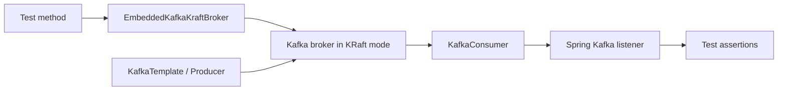

# EmbeddedKafkaKraftBroker

Kiểm thử ứng dụng Spring Kafka cần một broker thật để xác minh producer gửi record, consumer nhận đúng dữ liệu, listener xử lý và offset hoạt động như mong đợi. Mock `KafkaTemplate` hoặc mock listener có thể kiểm tra lời gọi giữa các lớp Java, nhưng không xác minh được serialization, partition, consumer group, broker acknowledgment hay hành vi poll thực tế.

`EmbeddedKafkaKraftBroker` cung cấp Kafka broker nhúng chạy bằng chế độ KRaft để dùng trong kiểm thử. Có thể khởi tạo broker trực tiếp bằng Java hoặc dùng annotation `@EmbeddedKafka` để Spring Test quản lý vòng đời. Bài học này trình bày cách thêm dependency, cấu hình broker, tích hợp với Spring Boot và viết kiểm thử producer/consumer có tính lặp lại.

## 1. Embedded Kafka và KRaft là gì?

Embedded Kafka khởi chạy một Kafka broker trong tiến trình kiểm thử, thường dùng port động và thư mục log tạm. Test có thể kết nối tới broker này bằng Kafka client thông thường, vì vậy có thể kiểm tra đường đi thực tế qua producer, broker và consumer mà không cần một Kafka cluster cài riêng.

`EmbeddedKafkaKraftBroker` là implementation của Spring Kafka Test cho embedded broker chạy KRaft. KRaft dùng metadata quorum của Kafka thay cho ZooKeeper. Với Spring Kafka 3.1 trở lên, KRaft là chế độ mặc định của embedded broker; các phiên bản cũ hơn có thể có lựa chọn hoặc implementation khác, vì vậy cần đối chiếu phiên bản `spring-kafka-test` trong dự án.



Embedded broker phù hợp với integration test và component test. Nó giúp xác minh giao tiếp Kafka thật ở quy mô nhỏ, nhưng không mô phỏng đầy đủ đặc tính vận hành của production cluster như phân tán qua nhiều máy, network partition, tải lớn, security infrastructure hoặc broker failure phức tạp.

## 2. Thêm dependency `spring-kafka-test`

`EmbeddedKafkaKraftBroker`, `@EmbeddedKafka` và các tiện ích `KafkaTestUtils` nằm trong artifact `spring-kafka-test`. Đưa dependency vào test scope, đồng thời giữ phiên bản tương thích với Spring Kafka mà ứng dụng đang dùng.

Với Gradle:

```groovy
dependencies {
    implementation 'org.springframework.kafka:spring-kafka'
    testImplementation 'org.springframework.kafka:spring-kafka-test'
    testImplementation 'org.springframework.boot:spring-boot-starter-test'
}
```

Với Maven:

```xml
<dependency>
    <groupId>org.springframework.kafka</groupId>
    <artifactId>spring-kafka-test</artifactId>
    <scope>test</scope>
</dependency>
```

Nếu dự án dùng Spring Boot dependency management, để BOM quản lý phiên bản Spring Kafka và `spring-kafka-test` tương ứng. Tránh ghép `spring-kafka-test` của một phiên bản khác với `spring-kafka` runtime, vì API test và cách khởi chạy embedded broker có thể không tương thích.

## 3. Khởi tạo bằng `@EmbeddedKafka`

Trong đa số integration test dùng Spring Test, `@EmbeddedKafka` là cách khai báo gọn nhất. Annotation yêu cầu Spring tạo broker nhúng, tạo topic và đóng broker theo vòng đời test context.

Ví dụ kiểm thử một ứng dụng Spring Boot:

```java
@SpringBootTest
@EmbeddedKafka(
        partitions = 1,
        topics = "orders",
        bootstrapServersProperty = "spring.kafka.bootstrap-servers")
class OrderKafkaIntegrationTest {

    @Autowired
    private KafkaTemplate<String, String> kafkaTemplate;

    @Autowired
    private EmbeddedKafkaBroker embeddedKafka;

    @Test
    void publishesOrderEvent() throws Exception {
        kafkaTemplate.send("orders", "order-42", "ORDER_CREATED")
                .get(10, TimeUnit.SECONDS);

        // Tạo consumer kiểm thử và xác minh record đã vào broker.
    }
}
```

Các thuộc tính quan trọng:

| Thuộc tính | Ý nghĩa |
|---|---|
| `topics` | Khai báo topic cần tạo trước khi test chạy. |
| `partitions` | Số partition cho các topic được khai báo trong annotation. |
| `bootstrapServersProperty` | Tên property nhận địa chỉ broker nhúng. |
| `brokerProperties` | Các thuộc tính cấu hình broker phục vụ test. |
| `count` | Số broker nhúng được khởi chạy. |

Khi đặt `bootstrapServersProperty = "spring.kafka.bootstrap-servers"`, Spring Boot auto-configuration dùng địa chỉ broker nhúng để tạo `ProducerFactory`, `ConsumerFactory` và `KafkaTemplate`. Nếu property không được ánh xạ, ứng dụng có thể vẫn cố kết nối tới địa chỉ Kafka mặc định hoặc broker cấu hình ở môi trường khác.

Trong các phiên bản hiện đại dùng KRaft mặc định, `@EmbeddedKafka` sử dụng embedded KRaft broker. Nếu dự án đang dùng phiên bản cũ, hãy kiểm tra thuộc tính `kraft` hoặc lựa chọn broker tương ứng của phiên bản đó; không sao chép cấu hình của phiên bản mới vào dự án cũ mà chưa xác minh API.

## 4. Khởi tạo trực tiếp `EmbeddedKafkaKraftBroker`

Khi không dùng Spring Test context hoặc muốn kiểm soát vòng đời broker rõ ràng, có thể tạo implementation trực tiếp:

```java
class EmbeddedBrokerLifecycleTest {

    private EmbeddedKafkaKraftBroker broker;

    @BeforeEach
    void startBroker() {
        broker = new EmbeddedKafkaKraftBroker(1, 1, "orders");
        broker.afterPropertiesSet();
    }

    @AfterEach
    void stopBroker() {
        if (broker != null) {
            broker.destroy();
        }
    }

    @Test
    void brokerHasExpectedTopic() {
        assertTrue(broker.getTopics().contains("orders"));
        assertNotNull(broker.getBrokersAsString());
    }
}
```

Constructor nhận số broker, số partition mặc định cho topic và danh sách topic cần tạo. `afterPropertiesSet()` khởi chạy broker và `destroy()` giải phóng tài nguyên. Nếu khởi tạo thất bại giữa chừng, vẫn cần bảo đảm cleanup trong lifecycle của test hoặc dùng `try/finally` phù hợp.

`EmbeddedKafkaKraftBroker` triển khai contract `EmbeddedKafkaBroker`, vì vậy có thể giữ reference theo interface nếu test chỉ cần các thao tác chung như lấy bootstrap servers, topic hoặc thêm topic. Dùng kiểu implementation trực tiếp khi test cần khởi tạo rõ chế độ KRaft hoặc muốn kiểm soát broker lifecycle.

Không khởi chạy một broker mới cho từng test method nếu cả test class có thể dùng chung broker an toàn. Khởi động broker là thao tác tương đối tốn thời gian; chia sẻ broker theo test context giúp suite chạy nhanh hơn. Ngược lại, test cần trạng thái broker cô lập thì phải quản lý topic, group ID và dữ liệu giữa các test để tránh phụ thuộc thứ tự chạy.

## 5. Viết test producer gửi record và consumer đọc lại

Một integration test cơ bản nên xác minh cả hai chiều: producer nhận acknowledgment từ broker và consumer đọc được đúng key/value. Có thể dùng `KafkaTestUtils` để tạo properties hoặc lấy thông tin bootstrap từ `EmbeddedKafkaBroker`.

Ví dụ độc lập với Spring Boot context:

```java
@EmbeddedKafka(
        partitions = 1,
        topics = "orders",
        bootstrapServersProperty = "spring.kafka.bootstrap-servers")
class KafkaRoundTripTest {

    @Autowired
    private EmbeddedKafkaBroker embeddedKafka;

    @Test
    void producerRecordCanBeConsumed() throws Exception {
        String topic = "orders";

        Map<String, Object> producerProps = new HashMap<>();
        producerProps.put(ProducerConfig.BOOTSTRAP_SERVERS_CONFIG,
                embeddedKafka.getBrokersAsString());

        try (Producer<String, String> producer = new KafkaProducer<>(
                producerProps,
                new StringSerializer(),
                new StringSerializer())) {
            producer.send(new ProducerRecord<>(topic, "order-42", "CREATED"))
                    .get(10, TimeUnit.SECONDS);
        }

        Map<String, Object> consumerProps = new HashMap<>();
        consumerProps.put(ConsumerConfig.BOOTSTRAP_SERVERS_CONFIG,
                embeddedKafka.getBrokersAsString());
        consumerProps.put(ConsumerConfig.GROUP_ID_CONFIG, "orders-test-group");
        consumerProps.put(ConsumerConfig.AUTO_OFFSET_RESET_CONFIG, "earliest");
        consumerProps.put(ConsumerConfig.ENABLE_AUTO_COMMIT_CONFIG, false);

        try (Consumer<String, String> consumer = new KafkaConsumer<>(
                consumerProps,
                new StringDeserializer(),
                new StringDeserializer())) {

            embeddedKafka.consumeFromAnEmbeddedTopic(consumer, topic);
            ConsumerRecords<String, String> records =
                    consumer.poll(Duration.ofSeconds(10));

            assertFalse(records.isEmpty());
            ConsumerRecord<String, String> record = records.iterator().next();
            assertEquals("order-42", record.key());
            assertEquals("CREATED", record.value());
        }
    }
}
```

Ví dụ tạo consumer sau khi producer gửi record rồi gọi `consumeFromAnEmbeddedTopic(...)`, helper này gán consumer vào topic và đưa vị trí đọc về đầu topic. Với topic có nhiều record hoặc nhiều partition, không nên chỉ kiểm tra record đầu tiên; hãy đọc tới khi đủ điều kiện hoặc dùng helper test phù hợp với số lượng record mong đợi.

Trong code thực tế, có thể dùng `KafkaTestUtils.consumerProps(...)` và `KafkaTestUtils.producerProps(...)` để giảm cấu hình lặp. Dù dùng helper nào, cần đặt deserializer đúng với kiểu dữ liệu, group ID riêng cho test và `auto.offset.reset` phù hợp.

## 6. Kiểm thử `@KafkaListener` trong Spring context

Round-trip test chỉ xác minh broker nhận và trả record. Để kiểm tra listener Spring Kafka, hãy khởi động application context, gửi record bằng `KafkaTemplate` rồi chờ side effect hoặc kết quả được ghi nhận.

Ví dụ listener:

```java
@Component
public class OrderListener {

    private final OrderEventStore store;

    public OrderListener(OrderEventStore store) {
        this.store = store;
    }

    @KafkaListener(topics = "orders", groupId = "order-listener-test")
    public void consume(OrderEvent event) {
        store.save(event);
    }
}
```

Test có thể dùng `Awaitility` để chờ kết quả bất đồng bộ:

```java
@SpringBootTest
@EmbeddedKafka(
        partitions = 1,
        topics = "orders",
        bootstrapServersProperty = "spring.kafka.bootstrap-servers")
class OrderListenerIntegrationTest {

    @Autowired
    private KafkaTemplate<String, OrderEvent> kafkaTemplate;

    @Autowired
    private OrderEventStore store;

    @Test
    void listenerStoresReceivedEvent() throws Exception {
        OrderEvent event = new OrderEvent("evt-42", "order-42");
        kafkaTemplate.send("orders", event.orderId(), event)
                .get(10, TimeUnit.SECONDS);

        await().atMost(Duration.ofSeconds(10)).untilAsserted(() ->
                assertTrue(store.contains("evt-42")));
    }
}
```

Không dùng `Thread.sleep()` cố định để giả định listener đã xử lý xong. Consumer xử lý bất đồng bộ; tốc độ test phụ thuộc scheduler, poll và tải máy. Awaitility hoặc cơ chế đồng bộ hóa trong test giúp chờ điều kiện thực tế với timeout hữu hạn.

Nếu listener ghi database, dùng test database hoặc repository test phù hợp và xác minh dữ liệu đã được commit. Nếu listener gọi service bên ngoài, mock service đó nhưng vẫn giữ broker thật để kiểm tra đường đi Kafka. Mục tiêu là cô lập dependency không liên quan trong khi vẫn kiểm tra integration Kafka thật.

## 7. Topic, partition và consumer group trong test

Embedded broker cho phép khai báo nhiều topic và partition để kiểm tra các hành vi khác nhau:

```java
@EmbeddedKafka(
        partitions = 3,
        topics = {"orders", "orders.DLT"},
        bootstrapServersProperty = "spring.kafka.bootstrap-servers")
class OrderPartitionTest {
    // Integration tests
}
```

Một số trường hợp nên kiểm tra:

- Record có key được định tuyến tới partition phù hợp với partitioner đang dùng.
- Consumer group nhận record theo assignment và không có hai consumer trong cùng group đồng thời sở hữu cùng partition.
- Hai consumer group khác nhau đều có thể nhận cùng một record độc lập.
- Offset được commit theo `AckMode` và record chưa commit có thể được giao lại sau restart.
- Topic DLT có partition tương thích với cách `DeadLetterPublishingRecoverer` định tuyến.
- Listener batch nhận đúng số record trong một lần poll và xử lý lỗi theo error handler.

Test nên dùng group ID riêng hoặc duy nhất cho từng trường hợp để tránh offset của test trước làm thay đổi kết quả test sau. Nếu test tái sử dụng group, cần chủ động reset hoặc tạo topic/group cô lập thay vì phụ thuộc offset cũ.

## 8. Cấu hình broker và tính lặp lại của test

`EmbeddedKafkaKraftBroker` hỗ trợ cấu hình broker properties để kiểm thử một số điều kiện cụ thể. Chỉ đặt những thuộc tính cần cho kịch bản; không cố biến embedded broker thành bản sao production đầy đủ.

Ví dụ annotation khai báo broker properties:

```java
@EmbeddedKafka(
        partitions = 1,
        topics = "orders",
        brokerProperties = {
                "auto.create.topics.enable=false",
                "num.partitions=1"
        },
        bootstrapServersProperty = "spring.kafka.bootstrap-servers")
class OrderBrokerConfigurationTest {
}
```

Các nguyên tắc để test ổn định:

1. Dùng port động hoặc bootstrap address do embedded broker cung cấp; tránh hard-code port có thể bị tiến trình khác chiếm.
2. Tạo topic tường minh để test không phụ thuộc auto-create topic.
3. Dùng group ID riêng cho từng test class hoặc test case khi cần cô lập offset.
4. Chờ acknowledgment producer và điều kiện consumer bằng timeout hữu hạn.
5. Đóng producer/consumer tạo thủ công trong `try-with-resources`.
6. Để Spring Test quản lý broker khi dùng `@EmbeddedKafka`; nếu khởi tạo trực tiếp, luôn gọi `destroy()`.
7. Tránh nhiều test cùng ghi vào một topic và cùng dùng một group nếu không kiểm soát thứ tự và dữ liệu.
8. Không phụ thuộc vào thứ tự test hoặc offset được giữ lại từ lần chạy trước.

Với test suite lớn, Spring context có thể được cache và broker được chia sẻ theo context. Nếu cần trạng thái hoàn toàn mới, có thể đóng context hoặc dùng topic/group riêng. `@DirtiesContext` có thể buộc Spring đóng và tạo lại context, nhưng làm tăng thời gian chạy; chỉ dùng khi test thực sự làm thay đổi trạng thái context không thể dọn bằng cách khác.

## 9. Giới hạn của EmbeddedKafkaKraftBroker

Embedded broker hữu ích nhưng không thay thế kiểm thử trên cluster gần production. Một broker nhúng không thể chứng minh đầy đủ hành vi replication, leader election giữa các máy, network partition, rack awareness, bảo mật thực tế hoặc hiệu năng dưới tải production.

| Có thể kiểm tra tốt | Cần môi trường khác để kiểm tra đầy đủ |
|---|---|
| Producer gửi và consumer nhận record | Throughput và latency ở tải lớn, nhiều broker và network thật |
| Serialization/deserialization và header | Tương thích schema registry, ACL và identity production nếu chưa cấu hình tương ứng |
| Listener container, group assignment cơ bản, offset | Rebalance và failover phức tạp giữa nhiều broker/máy |
| Retry, DLT và transaction ở phạm vi test | Độ bền transaction state log và khả năng chịu lỗi của cluster production |
| Topic/partition và key routing | Replication factor, ISR, leader movement và rack placement thực tế |

Nếu cần kiểm tra security, có thể cấu hình SASL/SSL và ACL cho embedded broker theo khả năng phiên bản, nhưng vẫn cần một test environment gần production để xác nhận certificate, secret rotation, broker policy và quyền truy cập thực tế. Không dùng kết quả embedded test để kết luận cluster production đã cấu hình đúng.

## 10. Lỗi thường gặp khi dùng embedded KRaft broker

| Triệu chứng | Nguyên nhân có thể | Hướng xử lý |
|---|---|---|
| Application kết nối nhầm `localhost:9092` | `spring.kafka.bootstrap-servers` chưa được ánh xạ sang embedded broker | Đặt `bootstrapServersProperty` đúng property mà Spring Boot sử dụng. |
| Test không thấy record vừa gửi | Consumer bắt đầu ở offset mới, group ID đã có offset hoặc chưa subscribe đúng topic | Dùng group ID riêng, `auto.offset.reset=earliest` và gán consumer theo helper phù hợp. |
| Port đã được sử dụng | Test cấu hình port cố định hoặc nhiều suite chạy đồng thời | Dùng port động do embedded broker cấp. |
| Topic không tồn tại | Annotation chưa khai báo topic hoặc test dùng sai tên | Khai báo `topics` hoặc gọi API thêm topic trước khi gửi. |
| Lỗi class/method khi khởi tạo broker | Phiên bản `spring-kafka-test` không khớp Spring Kafka hoặc code dùng API khác phiên bản | Đồng bộ dependency và kiểm tra API đúng phiên bản. |
| Test treo khi chờ listener | Listener không khởi động, sai deserializer hoặc exception bị bỏ qua | Kiểm tra context/log và dùng timeout hữu hạn với assertion rõ ràng. |
| Tài nguyên broker còn tồn tại sau test | Broker khởi tạo thủ công nhưng không gọi `destroy()` | Đặt cleanup trong `@AfterEach`, `@AfterAll` hoặc lifecycle quản lý phù hợp. |

Khi debug, kiểm tra địa chỉ bootstrap thực tế, topic, group ID, serializer/deserializer và log broker trước. Những thông tin này thường xác định nhanh test đang kết nối sai broker, đọc sai offset hay listener chưa xử lý record.

## 11. Checklist thiết kế integration test

- Thêm đúng phiên bản `spring-kafka-test` trong test scope.
- Chọn `@EmbeddedKafka` cho test tích hợp Spring context hoặc `EmbeddedKafkaKraftBroker` khi cần quản lý thủ công.
- Khai báo topic và partition cần thiết trước khi test chạy.
- Ánh xạ bootstrap servers của Spring Boot tới broker nhúng.
- Dùng serializer/deserializer khớp với kiểu key/value của test.
- Tạo group ID riêng và đặt offset reset theo mục tiêu test.
- Xác minh cả producer acknowledgment lẫn dữ liệu consumer thực sự đọc được.
- Với listener bất đồng bộ, chờ điều kiện bằng Awaitility hoặc cơ chế đồng bộ hóa có timeout.
- Đóng tài nguyên và cô lập dữ liệu để test có thể chạy lặp lại theo thứ tự bất kỳ.
- Dùng cluster test riêng cho các kịch bản replication, failover, security hoặc performance gần production.

`EmbeddedKafkaKraftBroker` giúp kiểm thử Spring Kafka qua một broker KRaft thật trong tiến trình test. Khi cấu hình đúng dependency, bootstrap servers, topic, partition và vòng đời broker, integration test có thể xác minh producer, consumer và listener hoạt động cùng nhau. Kết hợp embedded test với các bài kiểm thử trên cluster chuyên dụng sẽ tạo độ tin cậy tốt hơn cho luồng messaging trước khi triển khai.
