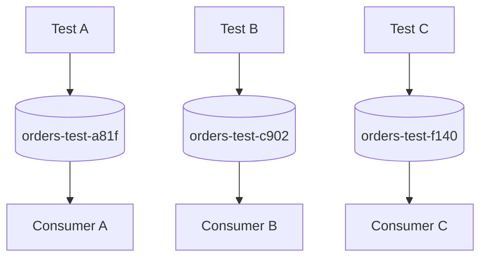

# Topic riêng cho từng test

Kiểm thử Kafka dễ bị ảnh hưởng bởi trạng thái còn sót lại từ lần chạy trước. Nếu nhiều test cùng gửi và đọc một topic, một test có thể nhận record do test khác tạo ra, consumer group có thể tiếp tục từ offset đã commit, hoặc hai test chạy song song có thể cạnh tranh partition.

Một cách cô lập rõ ràng là tạo topic riêng cho từng test. Mỗi test có tên topic duy nhất, consumer group riêng và dữ liệu độc lập. Khi test kết thúc, ứng dụng dừng consumer rồi xóa topic đã tạo. Cách này giúp kiểm thử producer, consumer, listener container, retry hoặc request-reply có kết quả ổn định hơn.

## 1. Vì sao nên dùng topic riêng cho từng test?

Giả sử hai test cùng dùng topic `orders-test`:

- Test A gửi event `OrderCreated`.
- Test B cũng gửi event `OrderCancelled`.
- Cả hai consumer có thể đọc record của nhau nếu cùng subscription và offset chưa được cô lập.
- Khi test chạy song song, thứ tự record và thời điểm poll có thể thay đổi kết quả.

Topic riêng tạo ranh giới dữ liệu cho từng test:



Tên topic có thể được tạo từ test class, test method và một UUID. UUID giúp tránh trùng tên khi chạy song song, chạy lại test hoặc chạy nhiều JVM trên cùng broker.

Ví dụ:

```java
String topic = "orders-test-" +
        UUID.randomUUID().toString().replace("-", "");
```

Topic name của Kafka chỉ nên dùng các ký tự được Kafka hỗ trợ; tiền tố cố định kết hợp UUID dạng hex là một cách đặt tên dễ kiểm soát.

## 2. Cô lập topic, consumer group và offset

Chỉ tạo topic riêng chưa đủ nếu test còn dùng chung consumer group hoặc dùng lại cùng một container. Nên cô lập các thành phần sau:

| Thành phần | Cách cô lập | Lý do |
|---|---|---|
| Topic | Tên riêng cho từng test | Không đọc nhầm record của test khác |
| Consumer group | Group ID riêng cho từng test | Không chia partition hoặc dùng chung committed offset |
| Consumer instance | Tạo và đóng trong phạm vi test | Không giữ subscription qua test tiếp theo |
| Offset | Group mới và chính sách reset rõ ràng | Không phụ thuộc trạng thái commit cũ |
| Dữ liệu downstream | Database/schema hoặc key riêng | Không để kết quả nghiệp vụ giao thoa |
| Retry/DLT topic | Tên riêng hoặc cấu hình namespace riêng | Không nhận retry record của test khác |

Một group ID riêng thường có thể tạo tương tự topic:

```java
String groupId = "orders-test-group-" +
        UUID.randomUUID().toString().replace("-", "");
```

Không nên tạo group ID mới trong mọi lần khởi động consumer production nếu mục tiêu là tiếp tục tiến độ đã commit. Group ID ngẫu nhiên phù hợp cho test vì mỗi test cần một tiến độ đọc độc lập.

## 3. Dùng @EmbeddedKafka làm broker cho test

Spring Kafka cung cấp module `spring-kafka-test` với annotation `@EmbeddedKafka`. Embedded broker chạy trong tiến trình test, giúp kiểm tra producer, consumer và listener container mà không cần kết nối đến Kafka bên ngoài.

Ví dụ dependency Maven:

```xml
<dependency>
    <groupId>org.springframework.kafka</groupId>
    <artifactId>spring-kafka-test</artifactId>
    <scope>test</scope>
</dependency>
```

Khai báo broker trong integration test:

```java
@SpringBootTest
@EmbeddedKafka(
        partitions = 1,
        bootstrapServersProperty = "spring.kafka.bootstrap-servers"
)
class OrderKafkaIntegrationTest {
    // Test code
}
```

`bootstrapServersProperty` liên kết địa chỉ broker nhúng với cấu hình Spring Boot. Với các phiên bản Spring Kafka cũ hơn, cách cấu hình property có thể khác; hãy kiểm tra API của dependency đang dùng.

Một embedded broker thường được dùng chung trong phạm vi test context để giảm thời gian khởi động. Topic riêng cho từng test vẫn có thể được tạo trên broker đó. Không cần tạo một broker process mới cho mỗi phương thức test nếu topic và group đã được cô lập.

## 4. Tạo topic runtime bằng AdminClient

Annotation `@EmbeddedKafka(topics = ...)` thuận tiện khi tập topic được biết trước lúc test context khởi động. Nếu cần topic mới cho từng test method, hãy tạo topic lúc runtime bằng Kafka `AdminClient`.

Ví dụ helper tạo topic:

```java
private String createTestTopic(
        AdminClient adminClient) throws Exception {

    String topic = "orders-test-" +
            UUID.randomUUID().toString().replace("-", "");

    NewTopic newTopic = new NewTopic(topic, 1, (short) 1);

    adminClient.createTopics(List.of(newTopic))
            .all()
            .get(10, TimeUnit.SECONDS);

    return topic;
}
```

Trong đó:

- `topic` là tên duy nhất của test.
- `numPartitions = 1` giúp ví dụ đơn giản và dễ kiểm soát assignment.
- `replicationFactor = 1` phù hợp với embedded broker đơn lẻ.
- `all().get(...)` chờ thao tác tạo topic hoàn tất trước khi consumer subscribe.

Tạo AdminClient từ broker nhúng:

```java
AdminClient adminClient = AdminClient.create(
        Map.of(
                AdminClientConfig.BOOTSTRAP_SERVERS_CONFIG,
                embeddedKafka.getBrokersAsString()
        )
);
```

Trong ví dụ đầy đủ, nên tạo AdminClient trong `@BeforeEach` hoặc một helper quản lý lifecycle, rồi đóng bằng `close()` sau test. Không để AdminClient hoặc consumer tồn tại sau khi ApplicationContext đã kết thúc.

## 5. Ví dụ integration test với topic riêng cho mỗi test

Ví dụ dưới đây tạo topic trong `@BeforeEach`, tạo một listener container chỉ subscribe topic đó, gửi một record và xác nhận listener nhận đúng payload.

```java
@SpringBootTest
@EmbeddedKafka(
        partitions = 1,
        bootstrapServersProperty = "spring.kafka.bootstrap-servers"
)
class OrderKafkaIntegrationTest {

    @Autowired
    private EmbeddedKafkaBroker embeddedKafka;

    @Autowired
    private ConsumerFactory<String, String> consumerFactory;

    @Autowired
    private KafkaTemplate<String, String> kafkaTemplate;

    private AdminClient adminClient;
    private String topic;

    @BeforeEach
    void setUp() throws Exception {
        adminClient = AdminClient.create(
                Map.of(
                        AdminClientConfig.BOOTSTRAP_SERVERS_CONFIG,
                        embeddedKafka.getBrokersAsString()
                )
        );

        topic = "orders-test-" +
                UUID.randomUUID().toString().replace("-", "");

        NewTopic newTopic = new NewTopic(topic, 1, (short) 1);

        adminClient.createTopics(List.of(newTopic))
                .all()
                .get(10, TimeUnit.SECONDS);
    }

    @Test
    void listenerConsumesFromItsOwnTopic() throws Exception {
        BlockingQueue<String> received = new LinkedBlockingQueue<>();

        ContainerProperties properties =
                new ContainerProperties(topic);

        properties.setGroupId(
                "orders-test-group-" +
                UUID.randomUUID().toString().replace("-", "")
        );

        ConcurrentMessageListenerContainer<String, String> container =
                new ConcurrentMessageListenerContainer<>(
                        consumerFactory,
                        properties
                );

        container.setupMessageListener(
                (MessageListener<String, String>) record ->
                        received.offer(record.value())
        );

        try {
            container.start();

            ContainerTestUtils.waitForAssignment(container, 1);

            kafkaTemplate.send(
                    topic,
                    "order-100",
                    "ORDER_CREATED"
            ).get(10, TimeUnit.SECONDS);

            String value = received.poll(10, TimeUnit.SECONDS);

            assertEquals("ORDER_CREATED", value);
        }
        finally {
            container.stop();
        }
    }

    @AfterEach
    void tearDown() throws Exception {
        try {
            if (adminClient != null && topic != null) {
                adminClient.deleteTopics(List.of(topic))
                        .all()
                        .get(10, TimeUnit.SECONDS);
            }
        }
        finally {
            if (adminClient != null) {
                adminClient.close();
            }
        }
    }
}
```

Ví dụ giả định Spring Boot đã cấu hình `ConsumerFactory<String, String>` và `KafkaTemplate<String, String>` với bootstrap server của embedded broker. Các import và generic type cần khớp serializer/deserializer trong ứng dụng.

Điểm quan trọng trong test:

1. Topic được tạo trước khi container bắt đầu subscribe.
2. Group ID là duy nhất cho lần chạy test.
3. `waitForAssignment(...)` đợi consumer nhận partition trước khi gửi record.
4. Producer chờ future hoàn tất để biết request gửi đã được broker xác nhận.
5. Queue nhận record có timeout, tránh test treo vô hạn.
6. Container được dừng trong `finally`, kể cả khi assertion thất bại.
7. Topic được xóa sau khi consumer đã dừng.

`ContainerTestUtils.waitForAssignment` giúp tránh race condition phổ biến: test gửi record ngay sau `start()` trong khi consumer chưa join group và chưa được gán partition.

## 6. Test với @KafkaListener đã khai báo bằng annotation

Trong nhiều ứng dụng, mục tiêu là kiểm thử chính phương thức `@KafkaListener` chứ không phải tạo listener container thủ công. Có thể khai báo topic test qua property của test context:

```java
@EmbeddedKafka(
        partitions = 1,
        topics = "orders-listener-test",
        bootstrapServersProperty = "spring.kafka.bootstrap-servers"
)
@SpringBootTest(properties = {
        "app.kafka.orders-topic=orders-listener-test",
        "spring.kafka.consumer.group-id=orders-listener-test-group"
})
class AnnotatedOrderListenerTest {
    // Gửi event vào topic và xác minh tác dụng của listener.
}
```

Cách này cô lập theo test class hoặc test context. Nếu mỗi test method cần topic khác nhau, một `@KafkaListener` được tạo từ ApplicationContext không tự đổi subscription chỉ vì biến topic trong test thay đổi. Có ba lựa chọn:

- Dùng một topic riêng cho cả test class và làm sạch dữ liệu giữa các test.
- Tạo listener container theo chương trình cho từng test method như ví dụ trước.
- Tạo ApplicationContext riêng cho từng test với property topic khác nhau, chấp nhận chi phí khởi động context.

Không nên thay property trong một test method rồi giả định listener container đã được tạo trước đó sẽ tự subscribe topic mới.

## 7. Chọn số partition phù hợp với test

Một topic test thường chỉ cần một partition nếu test không kiểm tra concurrency hoặc partition assignment. Nhiều partition chỉ cần thiết khi test một trong các tình huống:

- Consumer concurrency lớn hơn một.
- Phân phối key vào partition.
- Thứ tự record trong cùng partition.
- Rebalance khi số consumer thay đổi.
- Pause/resume theo partition.
- Một consumer group chia partition giữa nhiều instance.

Ví dụ tạo topic ba partition:

```java
NewTopic topic = new NewTopic(topicName, 3, (short) 1);
```

Không dùng nhiều partition chỉ để làm test có vẻ giống production. Nhiều partition làm tăng độ phức tạp của assignment và khiến assertion về thứ tự toàn cục không hợp lệ. Kafka chỉ bảo đảm thứ tự trong từng partition.

Nếu test cần chứng minh các record cùng key đi cùng partition, hãy gửi nhiều record có cùng key và kiểm tra `record.partition()`. Đừng giả định record không có key sẽ luôn vào cùng một partition.

## 8. Offset reset và thời điểm bắt đầu đọc

Consumer group mới chưa có committed offset. Vị trí bắt đầu đọc được quyết định bởi `auto.offset.reset` khi không tìm thấy offset hợp lệ:

| Giá trị | Hành vi |
|---|---|
| `earliest` | Đọc từ offset sớm nhất còn được giữ |
| `latest` | Bắt đầu từ cuối log theo thời điểm xác định khi consumer cần reset |
| `none` | Ném lỗi nếu không có committed offset |

Với test, `earliest` thường hữu ích khi producer gửi record trước khi consumer bắt đầu poll. Tuy nhiên, nếu test tạo container, chờ assignment rồi mới gửi record, `latest` cũng có thể phù hợp.

Cấu hình trong test có thể đặt:

```java
Map<String, Object> consumerProps =
        KafkaTestUtils.consumerProps(
                "orders-test-group",
                "false",
                embeddedKafka
        );

consumerProps.put(
        ConsumerConfig.AUTO_OFFSET_RESET_CONFIG,
        "earliest"
);
```

Chữ ký helper có thể thay đổi giữa các phiên bản Spring Kafka. Hãy dùng API tương ứng với version trong project. Điều quan trọng là test phải chủ động chọn group ID và offset reset thay vì phụ thuộc cấu hình từ máy developer.

## 9. Xóa topic sau test và giới hạn của cleanup

Xóa topic giúp giảm trạng thái còn lại trên broker nhúng. Tuy nhiên, cleanup cần thực hiện đúng thứ tự:

1. Dừng listener container hoặc đóng consumer.
2. Chờ container hoàn tất quá trình stop.
3. Xóa topic bằng AdminClient.
4. Chờ thao tác delete hoàn tất.
5. Đóng AdminClient và các client test.

Không xóa topic khi consumer vẫn đang hoạt động hoặc đang giữ assignment. Việc xóa topic có thể bất đồng bộ ở broker; nếu tái sử dụng cùng tên quá sớm, test có thể gặp lỗi topic đang bị xóa hoặc metadata chưa ổn định.

UUID cho mỗi test làm giảm phụ thuộc vào việc xóa topic tức thì. Cleanup vẫn cần thiết để tránh broker nhúng tích lũy nhiều topic trong một suite chạy lâu.

Với broker dùng chung lâu dài ngoài test, không nên cho test tự do tạo/xóa topic trên môi trường tích hợp mà không có namespace và quyền riêng. Tốt nhất dùng broker nhúng hoặc broker Testcontainers dành riêng cho test.

## 10. Chạy test song song

JUnit có thể chạy test song song. Khi đó, topic riêng và group ID riêng giúp giảm cạnh tranh giữa các test, nhưng vẫn cần cô lập các tài nguyên khác:

- Tên topic phải duy nhất trên toàn bộ test process, không chỉ trong một class.
- Group ID cũng phải duy nhất.
- Không dùng chung một biến `topic` static rồi ghi đè giữa các test.
- Mỗi test cần container và AdminClient riêng hoặc một manager có quản lý concurrency an toàn.
- Database fixture phải có key/schema riêng hoặc được reset an toàn.
- Không dùng `@DirtiesContext` như cách mặc định cho mọi test vì có thể làm suite chậm đáng kể.

Nếu test chạy trên nhiều JVM hoặc nhiều agent cùng dùng một broker, UUID vẫn giúp tránh va chạm. Có thể thêm build ID hoặc test run ID vào prefix để việc điều tra log dễ hơn.

Không nên chạy test song song trên một embedded broker nếu các test còn thay đổi cấu hình broker toàn cục hoặc dùng chung tài nguyên không thread-safe. Topic riêng là một phần của isolation, không thay thế isolation cho toàn bộ test fixture.

## 11. Topic riêng cho retry và dead-letter test

Các test retry thường tạo thêm retry topic và DLT. Nếu topic gốc của nhiều test dùng chung tên, retry record có thể đi vào cùng topic và làm assertion của test khác bị nhiễu.

Hãy tạo namespace theo test:

```java
String baseTopic = "orders-retry-test-" + testRunId;

String retryTopic = baseTopic + "-retry";
String dltTopic = baseTopic + "-dlt";
```

Nếu dùng `@RetryableTopic`, tên topic retry/DLT được Spring Kafka tạo theo suffix và chiến lược đặt tên. Cần bảo đảm tên gốc của mỗi test đủ duy nhất và các topic phụ trợ không trùng nhau.

Với retry test, nên kiểm tra:

- Record được publish sang retry topic dự kiến.
- Số lần thử đúng với cấu hình.
- DLT chỉ nhận record khi retry hết hoặc theo chính sách recoverer.
- Header nguồn gốc và exception được giữ để điều tra.
- Cleanup xóa cả topic gốc, retry topic và DLT sau khi container dừng.

Không hardcode tên retry topic nếu framework đang áp dụng suffix strategy khác. Có thể kiểm tra topic thực tế qua metadata hoặc cấu hình rõ suffix để test dễ dự đoán.

## 12. Test request-reply với topic riêng

Request-reply cũng cần topic riêng để tránh reply của test trước hoàn tất future của test sau hoặc làm nhiễu correlation.

Mỗi test nên cô lập:

- Request topic.
- Reply topic hoặc reply routing tương ứng.
- Consumer group của responder.
- Reply listener container.
- Correlation ID/request ID.

Nếu nhiều test dùng chung reply topic và reply consumer group, response có thể được giao cho consumer khác đang không giữ future tương ứng. Với test song song, dùng reply topic riêng theo test thường đơn giản hơn.

Cũng cần xác nhận reply container đã được gán partition trước khi gửi request đầu tiên. Timeout test nên đủ dài để chịu được tải CI nhưng vẫn có giới hạn, và response đến muộn không được làm test sau nhận nhầm kết quả.

## 13. Embedded Kafka hay Testcontainers?

Hai lựa chọn đều hữu ích, tùy phạm vi kiểm thử:

| Tiêu chí | Embedded Kafka | Testcontainers Kafka |
|---|---|---|
| Cách chạy | Broker nhúng trong tiến trình test | Broker chạy trong container |
| Tốc độ khởi động | Thường nhanh hơn cho test tập trung | Có chi phí container startup |
| Môi trường | JVM và thư viện test | Gần với môi trường broker đóng gói |
| Cấu hình broker | Phù hợp cấu hình test gọn | Linh hoạt với image và cấu hình container |
| Phù hợp | Listener, serializer, producer/consumer integration test | Kiểm thử tích hợp gần production, networking và image |
| Yêu cầu | Dependency spring-kafka-test | Docker hoặc runtime container tương thích |

Dù chọn cách nào, nguyên tắc topic riêng cho từng test vẫn giữ nguyên. Broker riêng cho mỗi test method thường tốn thời gian; có thể dùng broker cho cả test class hoặc suite, rồi tạo topic riêng theo test.

Không nên dùng embedded broker để kết luận hành vi production cluster như replication, leader election hoặc rack awareness. Những tình huống đó cần môi trường test có nhiều broker hoặc một cluster phù hợp.

## 14. Những lỗi thường gặp

| Hiện tượng | Nguyên nhân có thể | Cách xử lý |
|---|---|---|
| Test nhận record của test khác | Dùng chung topic và group | Topic/group riêng cho từng test |
| Test lúc pass lúc fail | Gửi record trước khi consumer được assignment | Chờ assignment hoặc dùng consumer setup đúng thứ tự |
| Consumer không nhận record đã gửi | Group mới dùng `latest` và record được gửi trước khi subscribe | Chọn `earliest` hoặc chờ assignment rồi gửi |
| Tạo topic báo đã tồn tại | Tên topic không duy nhất hoặc cleanup chưa xong | Dùng UUID và chờ delete hoàn tất |
| Test suite chậm dần | Tích lũy topic, consumer hoặc ApplicationContext | Dọn tài nguyên và tái sử dụng broker có kiểm soát |
| Test song song bị nhiễu | Chia sẻ group, topic, queue hoặc fixture | Cô lập toàn bộ tài nguyên theo test |
| DLT nhận record không thuộc test | Retry/DLT topic dùng suffix từ topic gốc chung | Topic gốc duy nhất và cleanup topic phụ |
| Container không dừng | Cleanup không nằm trong finally/teardown | Dừng container trước khi xóa topic |

## 15. Checklist thiết kế test topic

- [ ] Mỗi test có tên topic duy nhất, tạo từ prefix và UUID/test ID.
- [ ] Mỗi test dùng consumer group riêng nếu cần offset độc lập.
- [ ] Số partition phù hợp với mục tiêu kiểm thử.
- [ ] Topic được tạo xong trước khi consumer subscribe.
- [ ] Test chờ partition assignment trước khi gửi record nếu cần.
- [ ] `auto.offset.reset` được cấu hình có chủ đích.
- [ ] Consumer/listener container được dừng trong teardown/finally.
- [ ] Topic được xóa sau khi consumer dừng và thao tác xóa đã hoàn tất.
- [ ] Retry topic và DLT có namespace riêng.
- [ ] Request topic và reply topic không dùng chung giữa test song song.
- [ ] AdminClient, producer và consumer được đóng đúng lifecycle.
- [ ] Test song song không chia sẻ mutable fixture hoặc group ID.
- [ ] Đã phân biệt kiểm thử logic với kiểm thử broker/cluster thực tế.

Topic riêng cho từng test giúp kiểm soát dữ liệu và offset, giảm phụ thuộc vào thứ tự chạy và cho phép chạy song song ổn định hơn. Trong Spring Kafka, hãy kết hợp topic duy nhất, group ID riêng, chờ partition assignment và cleanup đúng vòng đời. Có thể dùng một embedded broker cho cả test context, nhưng mỗi test nên sở hữu namespace Kafka riêng để record, retry, DLT và reply không ảnh hưởng lẫn nhau.

