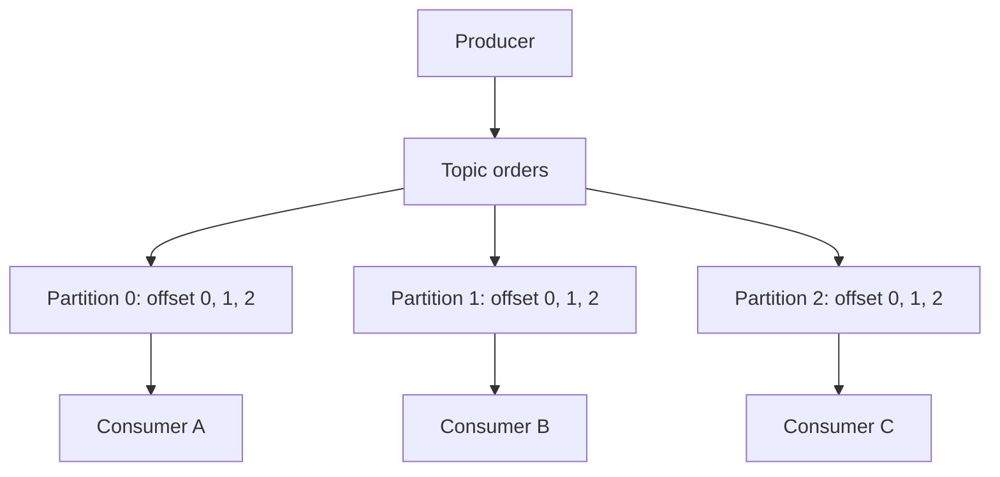

# Kiểm thử nhiều partition và ordering

Kafka lưu record theo partition. Thứ tự được bảo đảm trong từng partition theo offset, nhưng không có một thứ tự toàn cục giữa các partition của cùng topic. Vì vậy, kiểm thử một topic nhiều partition cần xác minh đúng điều kiện ordering của nghiệp vụ: record cùng partition phải giữ thứ tự mong đợi, còn record ở partition khác có thể được tiêu thụ song song và hoàn tất theo thứ tự khác.

Với Spring Kafka, có thể dùng embedded broker để tạo topic nhiều partition, gửi record có key hoặc chỉ định partition, rồi kiểm tra partition, offset và kết quả listener. Bài học này trình bày cách thiết kế dữ liệu test xác định, kiểm tra thứ tự theo partition, kiểm tra consumer concurrency và nhận biết các trường hợp ứng dụng tự làm mất ordering sau khi Kafka đã giao record.

## 1. Kafka bảo đảm ordering ở phạm vi nào?

Mỗi partition là một log có thứ tự. Broker gán offset tăng dần cho record được append vào partition đó. Consumer đọc partition theo thứ tự offset; một consumer group không gán cùng một partition cho hai consumer khác nhau tại cùng một thời điểm.



Ví dụ topic `orders` có ba partition:

| Partition | Record theo thứ tự offset |
|---|---|
| 0 | `OrderCreated-1` → `OrderPaid-1` → `OrderShipped-1` |
| 1 | `OrderCreated-2` → `OrderPaid-2` → `OrderShipped-2` |
| 2 | `OrderCreated-3` → `OrderPaid-3` → `OrderShipped-3` |

Kafka giữ thứ tự trong từng hàng. Không thể kết luận `OrderPaid-1` luôn được xử lý trước `OrderCreated-2`, vì hai record thuộc hai partition khác nhau và có thể được tiêu thụ song song.

Khi nói “ordering”, cần xác định rõ đang nói tới thứ tự nào:

- **Append order:** thứ tự record được ghi vào một partition, thể hiện qua offset.
- **Delivery order:** thứ tự consumer nhận record từ partition.
- **Processing completion order:** thứ tự logic nghiệp vụ hoàn tất xử lý record.
- **Side-effect order:** thứ tự cập nhật database hoặc gọi dịch vụ bên ngoài được quan sát.

Kafka bảo đảm thứ tự log và consumer đọc theo offset trong partition. Nếu listener chuyển record sang executor nhiều thread, xử lý bất đồng bộ hoặc gọi downstream song song, completion order và side-effect order có thể khác delivery order. Test cần quan sát đúng tầng mà nghiệp vụ yêu cầu.

## 2. Dùng key để giữ các sự kiện liên quan cùng partition

Producer thường dùng key để các sự kiện cùng một aggregate được định tuyến tới cùng partition. Ví dụ, các sự kiện của một đơn hàng dùng `orderId` làm key:

```java
kafkaTemplate.send("orders", orderId, new OrderCreated(orderId));
kafkaTemplate.send("orders", orderId, new OrderPaid(orderId));
kafkaTemplate.send("orders", orderId, new OrderShipped(orderId));
```

Với partitioner mặc định và số partition không thay đổi, cùng một key thường được ánh xạ tới cùng partition. Nhờ đó, consumer có thể xử lý tuần tự các thay đổi của cùng một đơn hàng.

Không nên kiểm thử bằng giả định hai key khác nhau chắc chắn vào hai partition khác nhau. Hash của hai key có thể trùng partition. Nếu cần kiểm tra chính xác từng partition, chỉ định partition tường minh trong test hoặc kiểm tra metadata thực tế trả về từ producer.

Ví dụ xác minh cùng key được định tuyến tới cùng partition:

```java
SendResult<String, String> first = kafkaTemplate
        .send("orders", "order-42", "CREATED")
        .get(10, TimeUnit.SECONDS);

SendResult<String, String> second = kafkaTemplate
        .send("orders", "order-42", "PAID")
        .get(10, TimeUnit.SECONDS);

assertEquals(
        first.getRecordMetadata().partition(),
        second.getRecordMetadata().partition());
assertTrue(
        second.getRecordMetadata().offset()
                > first.getRecordMetadata().offset());
```

Đợi từng future hoàn tất giúp test đọc được metadata của từng lần gửi. Test này xác minh key được định tuyến nhất quán và offset tăng trên partition đó. Trong production, nếu dùng custom partitioner hoặc thay đổi partition count, cần kiểm tra lại quy tắc định tuyến.

## 3. Tạo topic nhiều partition với Embedded Kafka

Với Spring Kafka Test, khai báo số partition trong `@EmbeddedKafka`:

```java
@SpringBootTest
@EmbeddedKafka(
        partitions = 3,
        topics = "orders",
        bootstrapServersProperty = "spring.kafka.bootstrap-servers")
class OrderPartitionOrderingTest {

    @Autowired
    private KafkaTemplate<String, String> kafkaTemplate;

    @Autowired
    private EmbeddedKafkaBroker embeddedKafka;
}
```

Topic `orders` được tạo với ba partition. `bootstrapServersProperty` ánh xạ broker nhúng tới Spring Boot để `KafkaTemplate`, producer factory và consumer factory kết nối đúng broker test.

Để test lặp lại ổn định:

- Dùng topic riêng cho test hoặc bảo đảm test không chia sẻ dữ liệu ngoài ý muốn.
- Dùng group ID mới cho consumer test để offset cũ không ảnh hưởng kết quả.
- Đặt timeout hữu hạn cho send và poll.
- Chờ broker acknowledgment trước khi bắt đầu xác minh dữ liệu nếu test cần thứ tự gửi xác định.
- Không dựa vào thứ tự record được trả về giữa các partition.

## 4. Kiểm tra ordering độc lập cho từng partition

Một cách test xác định là gửi các record trực tiếp vào partition được chọn. Sau đó consumer gán assignment cho cả ba partition và gom record theo partition để so sánh thứ tự từng nhóm.

Ví dụ gửi hai record vào mỗi partition:

```java
@Test
void preservesOrderWithinEachPartition() throws Exception {
    for (int partition = 0; partition < 3; partition++) {
        kafkaTemplate.send("orders", partition, "key-" + partition,
                "p" + partition + "-first").get(10, TimeUnit.SECONDS);
        kafkaTemplate.send("orders", partition, "key-" + partition,
                "p" + partition + "-second").get(10, TimeUnit.SECONDS);
    }

    Map<Integer, List<String>> actual = consumeByPartition(3, 6);

    assertEquals(List.of("p0-first", "p0-second"), actual.get(0));
    assertEquals(List.of("p1-first", "p1-second"), actual.get(1));
    assertEquals(List.of("p2-first", "p2-second"), actual.get(2));
}
```

Hàm `consumeByPartition` dưới đây minh họa consumer đọc trực tiếp embedded broker. Trong code test cần import các lớp Kafka client và collection tương ứng:

```java
private Map<Integer, List<String>> consumeByPartition(
        int partitionCount,
        int expectedCount) {

    Properties props = new Properties();
    props.put(ConsumerConfig.BOOTSTRAP_SERVERS_CONFIG,
            embeddedKafka.getBrokersAsString());
    props.put(ConsumerConfig.GROUP_ID_CONFIG, "ordering-test-" + UUID.randomUUID());
    props.put(ConsumerConfig.AUTO_OFFSET_RESET_CONFIG, "earliest");
    props.put(ConsumerConfig.ENABLE_AUTO_COMMIT_CONFIG, false);

    Map<Integer, List<String>> result = new HashMap<>();
    List<TopicPartition> assignments = IntStream.range(0, partitionCount)
            .mapToObj(partition -> new TopicPartition("orders", partition))
            .toList();

    try (KafkaConsumer<String, String> consumer = new KafkaConsumer<>(
            props, new StringDeserializer(), new StringDeserializer())) {

        consumer.assign(assignments);
        consumer.seekToBeginning(assignments);

        long deadline = System.nanoTime() + TimeUnit.SECONDS.toNanos(10);
        int received = 0;
        while (received < expectedCount && System.nanoTime() < deadline) {
            ConsumerRecords<String, String> records =
                    consumer.poll(Duration.ofMillis(200));
            for (ConsumerRecord<String, String> record : records) {
                result.computeIfAbsent(record.partition(), ignored -> new ArrayList<>())
                        .add(record.value());
                received++;
            }
        }
    }

    assertEquals(expectedCount, result.values().stream()
            .mapToInt(List::size).sum());
    return result;
}
```

Consumer dùng `assign()` để đọc trực tiếp các partition đã chọn thay vì chờ group assignment. `seekToBeginning()` đặt vị trí đọc về đầu các partition. Deadline giúp test thất bại rõ ràng nếu thiếu record thay vì chờ vô hạn.

Điểm quan trọng là assertion gom record theo partition. Không viết một assertion kiểu `p0-first, p1-first, p2-first, p0-second, ...` trên toàn bộ kết quả, vì Kafka không quy định thứ tự toàn cục giữa partition 0, 1 và 2.

## 5. Kiểm tra offset tăng và không bị đảo thứ tự

Offset là bằng chứng trực tiếp cho thứ tự trong một partition. Với các record cùng partition, offset của record sau phải lớn hơn offset của record trước. Có thể ghi lại metadata khi gửi:

```java
List<RecordMetadata> metadata = new ArrayList<>();

for (String state : List.of("CREATED", "PAID", "SHIPPED")) {
    SendResult<String, String> result = kafkaTemplate
            .send("orders", 0, "order-42", state)
            .get(10, TimeUnit.SECONDS);
    metadata.add(result.getRecordMetadata());
}

assertEquals(0, metadata.get(0).partition());
assertEquals(0, metadata.get(1).partition());
assertEquals(0, metadata.get(2).partition());
assertTrue(metadata.get(0).offset() < metadata.get(1).offset());
assertTrue(metadata.get(1).offset() < metadata.get(2).offset());
```

Test này chỉ kiểm tra ba lần gửi tuần tự vào partition 0. Trong ứng dụng thực tế, offset có thể có khoảng trống do record khác, transaction bị abort hoặc dữ liệu khác cùng ghi vào partition; không yêu cầu offset liên tiếp, chỉ yêu cầu thứ tự tăng khi so sánh các record mục tiêu.

Khi consumer commit offset, giá trị commit biểu thị vị trí tiếp theo cần đọc, không phải số offset của record vừa xử lý. Nếu test kiểm tra commit, cần hiểu `AckMode` và commit semantics thay vì so sánh trực tiếp giá trị committed offset với offset record mà không cộng vị trí tiếp theo.

## 6. Kiểm tra nhiều consumer và partition assignment

Spring Kafka `ConcurrentMessageListenerContainer` tạo các consumer con theo cấu hình concurrency. Nếu topic có ba partition và listener container có concurrency bằng ba, ba consumer có thể nhận partition song song.

Ví dụ cấu hình factory:

```java
@Bean
ConcurrentKafkaListenerContainerFactory<String, OrderEvent>
        orderListenerFactory(ConsumerFactory<String, OrderEvent> consumerFactory) {

    var factory = new ConcurrentKafkaListenerContainerFactory<String, OrderEvent>();
    factory.setConsumerFactory(consumerFactory);
    factory.setConcurrency(3);
    return factory;
}
```

Listener test có thể ghi nhận partition và offset đã nhận:

```java
@Component
public class OrderPartitionProbe {

    private final BlockingQueue<ReceivedOrder> received = new LinkedBlockingQueue<>();

    @KafkaListener(
            id = "ordersProbe",
            topics = "orders",
            groupId = "orders-probe-group",
            containerFactory = "orderListenerFactory")
    public void consume(ConsumerRecord<String, OrderEvent> record) {
        received.add(new ReceivedOrder(
                record.partition(), record.offset(), record.value().eventId()));
    }

    public BlockingQueue<ReceivedOrder> received() {
        return received;
    }
}
```

Test có thể chờ container nhận đủ partition assignment:

```java
MessageListenerContainer container = registry.getListenerContainer("ordersProbe");
ContainerTestUtils.waitForAssignment(container, 3);
```

`ContainerTestUtils.waitForAssignment` thuộc `spring-kafka-test`; nó chờ tới khi listener container được gán số partition mong đợi hoặc hết timeout. Sau đó gửi record vào từng partition và xác minh probe nhận được record từ các partition đó.

Không khẳng định consumer số 1 luôn nhận partition 0, consumer số 2 nhận partition 1. Assignment phụ thuộc partition assignor, số consumer, số partition và các thành viên group hiện tại. Hãy kiểm tra tập partition được gán, không phụ thuộc một mapping cố định trừ khi test chủ động cấu hình assignor và topology xác định.

Nếu concurrency lớn hơn số partition, một số consumer sẽ không được gán partition và không nhận record. Đây là hành vi bình thường, không phải lỗi test.

## 7. Kiểm thử ordering khi listener xử lý đồng thời

Kafka có thể giao record trong đúng thứ tự partition nhưng ứng dụng vẫn hoàn tất xử lý sai thứ tự nếu listener đẩy công việc vào thread pool nhiều worker.

Ví dụ listener nhận `OrderCreated` trước `OrderPaid`, nhưng submit hai tác vụ vào executor:

```java
@KafkaListener(topics = "orders")
public void consume(OrderEvent event) {
    workerPool.submit(() -> orderService.process(event));
}
```

Tác vụ `OrderPaid` có thể hoàn tất trước `OrderCreated` nếu worker xử lý khác tốc độ. Test cần xác minh completion order hoặc trạng thái cuối cùng, không chỉ thứ tự record đã poll.

Nếu nghiệp vụ yêu cầu tuần tự theo order ID, có thể dùng một trong các cách:

- Xử lý đồng bộ trong listener để record cùng partition được xử lý tuần tự.
- Dùng worker lane riêng theo key/aggregate để mọi event cùng key đi vào cùng một hàng đợi tuần tự.
- Dùng sequence/version nghiệp vụ và từ chối hoặc trì hoãn event đến sai thứ tự.
- Thiết kế thao tác idempotent và có thể áp dụng lại khi event đến muộn.

Khi kiểm thử worker pool, gửi nhiều event cùng key với sequence tăng dần và ghi lại thứ tự hoàn tất trong store kiểm thử. Assert sequence cuối cùng đúng yêu cầu nghiệp vụ. Đồng thời gửi event của nhiều key để xác minh các lane khác nhau vẫn có thể xử lý song song.

## 8. Producer retry và cấu hình ảnh hưởng ordering

Producer có thể retry khi broker tạm thời lỗi. Nếu idempotence được bật, Kafka producer bảo toàn thứ tự record trong các điều kiện cấu hình được hỗ trợ. Với producer không idempotent, khi retry và cho phép nhiều request in-flight, một batch gửi sau có thể được broker ghi trước batch trước đó bị retry.

Các điểm cần kiểm tra:

- Bật idempotence khi ứng dụng cần bảo toàn thứ tự trong tình huống retry producer.
- Không cấu hình `max.in.flight.requests.per.connection` vượt giới hạn mà idempotent producer hỗ trợ ở phiên bản Kafka đang dùng.
- Nếu tắt idempotence, hiểu rõ tác động của retry và số request in-flight tới ordering.
- Nếu nhiều thread gọi producer đồng thời, thứ tự mong muốn phải được định nghĩa bằng key, partition hoặc sequence nghiệp vụ; không giả định thứ tự giữa các thread luôn theo thứ tự tạo event ở nơi khác.
- Với transaction, chỉ consumer `read_committed` mới bỏ qua record thuộc transaction bị abort; test cần dùng đúng `isolation.level` khi xác minh output.

Không chỉ kiểm tra đường đi thành công. Một test ordering có giá trị nên mô phỏng retry hoặc lỗi gửi có thể tái hiện, rồi xác minh thứ tự record trong partition vẫn đáp ứng yêu cầu.

## 9. Thay đổi số partition có thể ảnh hưởng key ordering

Với partitioner mặc định, partition thường được chọn dựa trên hash của key và số partition hiện có. Khi tăng partition count, cùng một key có thể được ánh xạ sang partition khác. Record cũ của key nằm ở partition cũ, còn record mới có thể đi vào partition mới.

Khi đó, Kafka vẫn giữ thứ tự trong từng partition nhưng không tạo một thứ tự chung giữa hai partition. Nếu nghiệp vụ cần thứ tự liên tục cho cùng aggregate qua thời điểm mở rộng topic, cần có kế hoạch migration hoặc dùng sequence/version để consumer kiểm tra.

Test có thể kiểm tra hai giai đoạn bằng topic được tạo lại với partition count khác nhau hoặc dùng partitioner test có thể điều khiển. Tuy nhiên, không nên dựa vào một giá trị hash cụ thể của key như một contract lâu dài; hãy kiểm tra hành vi định tuyến theo partitioner thực tế và phiên bản client.

## 10. Những assertion ordering nên và không nên viết

| Assertion | Có hợp lệ? | Lý do |
|---|---|---|
| Các record cùng partition có offset tăng dần | Có | Offset thể hiện thứ tự log trong partition. |
| Các event cùng key vào cùng partition khi partition count và partitioner ổn định | Có | Đây là mục tiêu của key-based partitioning thông thường. |
| Record ở partition 0 luôn được xử lý trước partition 1 | Không | Không có global ordering giữa partition. |
| Consumer cụ thể luôn nhận một partition cố định | Không mặc định | Assignment phụ thuộc group membership và assignor. |
| Completion order của thread pool giống delivery order | Không mặc định | Worker có thể hoàn tất tác vụ khác tốc độ. |
| Event cùng aggregate có sequence đúng thứ tự sau xử lý | Có, nếu đó là yêu cầu nghiệp vụ | Cần test ở tầng service/side effect, không chỉ ở Kafka record. |
| Offset của các record phải liên tiếp | Không | Có thể có record khác hoặc khoảng trống trong log. |

## 11. Checklist kiểm thử nhiều partition

1. Tạo topic test với số partition rõ ràng và kiểm tra metadata topic.
2. Gửi record với key ổn định cho các sự kiện cùng aggregate.
3. Dùng explicit partition trong test cần kiểm tra từng partition một cách xác định.
4. Xác minh record cùng partition có offset tăng và payload đúng thứ tự.
5. Gom kết quả theo partition; không assert một thứ tự toàn cục giữa partition.
6. Dùng group ID riêng và chờ assignment hoàn tất trước khi kiểm tra consumer concurrency.
7. Kiểm tra trường hợp concurrency bằng, nhỏ hơn và lớn hơn số partition.
8. Nếu listener dùng executor, kiểm tra completion order và trạng thái nghiệp vụ cuối cùng.
9. Kiểm thử producer retry/idempotence nếu ordering phải được giữ qua lỗi gửi.
10. Đánh giá tác động khi partition count thay đổi và key có thể được remap.

Kiểm thử nhiều partition cần phân biệt thứ tự log với thứ tự hoàn tất nghiệp vụ. Kafka bảo đảm record được lưu và đọc theo offset trong từng partition; key giúp gom các sự kiện liên quan vào cùng partition để xử lý tuần tự. Khi test xác minh riêng từng partition, assignment và completion order, nhóm phát triển có thể phát hiện cả lỗi cấu hình Kafka lẫn lỗi do ứng dụng xử lý song song làm đảo thứ tự.
