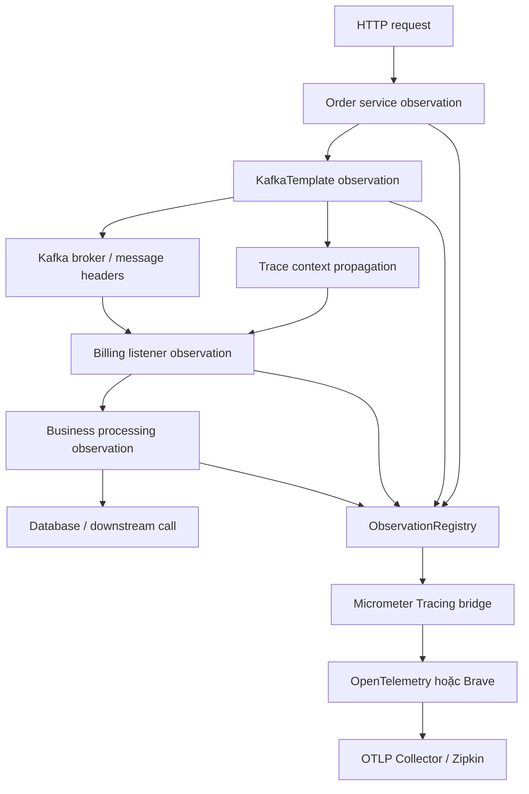

# Observation và tracing

Trong một hệ thống Spring Kafka, một event có thể bắt đầu từ HTTP request, được publish qua `KafkaTemplate`, đi qua broker, được một hoặc nhiều `@KafkaListener` xử lý rồi gọi database hoặc service khác. Khi một bước chậm hoặc lỗi, log riêng lẻ của từng service thường không đủ để nhìn thấy toàn bộ hành trình.

**Micrometer Observation** cung cấp một API chung để mô tả một thao tác đang diễn ra. Khi kết hợp với **Micrometer Tracing** và một tracer như OpenTelemetry hoặc Brave, các observation có thể tạo span và nối thành distributed trace. Spring Kafka hỗ trợ observation cho `KafkaTemplate` và listener container từ Spring Kafka 3.0.

Mục tiêu là theo dõi được một event đi từ producer đến consumer, biết service nào xử lý, mất bao lâu, lỗi ở đâu và log nào thuộc cùng trace. Observation/tracing bổ sung cho metrics và logs; chúng không thay thế các tín hiệu đó.

## 1. Phân biệt Observation, Span, Trace và Correlation ID

| Khái niệm | Ý nghĩa | Ví dụ |
| --- | --- | --- |
| Observation | Mô tả một operation trong ứng dụng; có thể tạo metrics và tracing tùy handler đã đăng ký | Gửi event `OrderCreated` |
| Span | Một đơn vị công việc có thời điểm bắt đầu/kết thúc, duration, status và attributes | Producer gửi record vào `orders.events` |
| Trace | Tập các span liên quan, biểu diễn hành trình qua nhiều process/service | HTTP → Order service → Kafka → Billing service |
| Trace ID | ID chung để nhóm các span thuộc cùng trace | `4bf92f3577b34da6a3ce929d0e0e4736` |
| Span ID | ID của một span cụ thể | `00f067aa0ba902b7` |
| Correlation ID | Khóa tương quan do ứng dụng/nghiệp vụ định nghĩa | `orderId`, `requestId` |
| Baggage | Dữ liệu ngữ cảnh nhỏ được propagation cùng trace theo cấu hình | `tenant-tier=gold` |

Trace ID và business correlation ID không phải một. Trace ID phục vụ quan sát kỹ thuật và có thể thay đổi khi bắt đầu một trace mới; correlation ID thường gắn với nghiệp vụ và có thể tồn tại qua nhiều lần retry hoặc nhiều trace. Không nên dùng `orderId` thay cho trace ID.

## 2. Observation và tracing hoạt động cùng nhau như thế nào?

`ObservationRegistry` là điểm đăng ký và điều phối observation handlers. Một observation được tạo khi operation bắt đầu và kết thúc. Nếu registry có metrics handler, observation có thể tạo timer; nếu có tracing handler, observation có thể tạo span.

Với Spring Boot Actuator và Micrometer Tracing được cấu hình đúng, tracing handler được gắn vào `ObservationRegistry`. Ứng dụng có thể dùng cùng API Observation để tạo metrics và spans, thay vì viết riêng logic cho từng backend.



Một observation có thể tạo cả metric và span, nhưng chỉ khi có handler tương ứng. Chỉ thêm `spring-boot-starter-actuator` chưa chắc đã có trace exporter; cần chọn tracer bridge và exporter phù hợp.

## 3. Observation của Spring Kafka

Spring Kafka hỗ trợ hai điểm instrumentation chính:

| Thành phần | Operation được quan sát | Observation mặc định |
| --- | --- | --- |
| `KafkaTemplate` | Gửi record đến Kafka | `spring.kafka.template` |
| Listener container | Nhận và gọi listener để xử lý record | `spring.kafka.listener` |

Observation mặc định đưa các thuộc tính messaging như destination/topic, operation, consumer group, partition, offset và listener/template identity vào context/span theo convention của phiên bản Spring Kafka.

Các tag cụ thể có thể thay đổi theo phiên bản. Có thể xem danh sách convention và low/high-cardinality keys trong tài liệu Micrometer Observation của đúng phiên bản Spring Kafka đang dùng.

Observation cho `KafkaTemplate`/listener container có từ Spring Kafka 3.0. Khi bật observation, Spring Kafka tắt các Micrometer legacy timers cho cùng operation vì timer được quản lý thông qua observation. Không bật hai cơ chế chỉ để nhân đôi số liệu.

## 4. Dependency để bật tracing

Với Spring Boot 3.x, cấu hình phổ biến dùng Actuator, Micrometer Tracing bridge và exporter. Ví dụ OpenTelemetry với OTLP:

```xml
<dependencies>
    <dependency>
        <groupId>org.springframework.boot</groupId>
        <artifactId>spring-boot-starter-actuator</artifactId>
    </dependency>

    <dependency>
        <groupId>io.micrometer</groupId>
        <artifactId>micrometer-tracing-bridge-otel</artifactId>
    </dependency>

    <dependency>
        <groupId>io.opentelemetry</groupId>
        <artifactId>opentelemetry-exporter-otlp</artifactId>
    </dependency>
</dependencies>
```

Với Spring Boot 4.x, starter OpenTelemetry do Spring Boot cung cấp có thể gom cấu hình auto-configuration cần thiết:

```xml
<dependency>
    <groupId>org.springframework.boot</groupId>
    <artifactId>spring-boot-starter-opentelemetry</artifactId>
</dependency>
```

Các ví dụ trên là hai hướng dependency theo major version; không thêm cả hai một cách máy móc. Dùng Spring Boot dependency management/BOM để giữ phiên bản Micrometer, Micrometer Tracing và OpenTelemetry tương thích.

Một lựa chọn khác là Micrometer Tracing bridge cho Brave và Zipkin. Chọn một tracer implementation phù hợp với hệ thống observability của tổ chức. OpenTelemetry thường gửi trace qua OTLP đến collector, còn Zipkin là backend có giao diện xem trace.

## 5. Bật observation cho KafkaTemplate và listener

Trong Spring Boot, có thể bật observation bằng cấu hình:

```yaml
spring:
  kafka:
    template:
      observation-enabled: true
    listener:
      observation-enabled: true

management:
  tracing:
    sampling:
      probability: 0.1
    propagation:
      type: w3c
```

`observation-enabled` bật observation cho các `KafkaTemplate` và listener container được cấu hình qua Spring Boot. `sampling.probability` điều khiển tỷ lệ trace được ghi/export; ví dụ `0.1` tương đương khoảng 10% trace mới nếu sampler sử dụng tỷ lệ này. Môi trường phát triển có thể tạm dùng `1.0` để quan sát mọi trace, nhưng production cần cân nhắc tải và chi phí backend.

`propagation.type: w3c` chọn chuẩn W3C Trace Context. Nếu tổ chức dùng B3, cấu hình propagation type tương ứng và bảo đảm các service trong luồng hiểu cùng định dạng.

Nếu tự tạo `KafkaTemplate` hoặc container factory, bật observation trên object đó:

```java
import io.micrometer.observation.ObservationRegistry;
import org.springframework.kafka.core.KafkaTemplate;
import org.springframework.kafka.core.ProducerFactory;

@Bean
KafkaTemplate<String, OrderCreated> orderTemplate(
        ProducerFactory<String, OrderCreated> producerFactory,
        ObservationRegistry observationRegistry
) {
    KafkaTemplate<String, OrderCreated> template =
            new KafkaTemplate<>(producerFactory);
    template.setObservationRegistry(observationRegistry); // Spring Kafka 3.3.1+
    template.setObservationEnabled(true);
    return template;
}
```

Với listener container factory:

```java
import io.micrometer.observation.ObservationRegistry;
import org.springframework.kafka.config.ConcurrentKafkaListenerContainerFactory;
import org.springframework.kafka.core.ConsumerFactory;

@Bean
ConcurrentKafkaListenerContainerFactory<String, OrderCreated> orderFactory(
        ConsumerFactory<String, OrderCreated> consumerFactory,
        ObservationRegistry observationRegistry
) {
    var factory =
            new ConcurrentKafkaListenerContainerFactory<String, OrderCreated>();
    factory.setConsumerFactory(consumerFactory);
    factory.getContainerProperties().setObservationRegistry(observationRegistry); // 3.3.1+
    factory.getContainerProperties().setObservationEnabled(true);
    return factory;
}
```

`setObservationRegistry()` có từ Spring Kafka 3.3.1. Với phiên bản cũ hơn, dùng cách cấu hình registry được hỗ trợ bởi version đó hoặc để Spring Boot auto-configuration kết nối registry; không copy setter vào API chưa có. Trong ứng dụng Spring Boot, ưu tiên cấu hình qua properties nếu auto-configuration đã tạo template/factory. Với bean tự tạo, cần kiểm tra registry được gắn đúng và observation được bật trên đúng bean mà listener đang sử dụng.

## 6. Cấu hình exporter và collector

Spring Boot 3.4/3.5 với OTLP exporter thường dùng nhóm thuộc tính `management.otlp.tracing.*`. Ví dụ HTTP OTLP endpoint:

```yaml
management:
  otlp:
    tracing:
      endpoint: ${OTEL_EXPORTER_OTLP_TRACES_ENDPOINT:http://otel-collector:4318/v1/traces}
      transport: http
      timeout: 10s
```

Với Spring Boot 4.x, nhóm thuộc tính tracing OTLP được đặt dưới `management.opentelemetry.tracing.export.otlp.*`:

```yaml
management:
  opentelemetry:
    tracing:
      export:
        otlp:
          endpoint: ${OTEL_EXPORTER_OTLP_TRACES_ENDPOINT:http://otel-collector:4318/v1/traces}
          transport: http
```

Tên property exporter thay đổi theo major version Spring Boot. Kiểm tra application properties appendix của đúng phiên bản trước khi copy cấu hình giữa các dự án.

OTLP Collector thường nhận spans từ service rồi xử lý/export tiếp đến backend như Tempo, Jaeger hoặc hệ thống observability của tổ chức. Ứng dụng không nhất thiết phải gửi trực tiếp đến UI/backend cuối.

## 7. Trace context đi qua Kafka headers

Producer và consumer là hai process độc lập; thread-local context trong producer không thể tự xuất hiện ở consumer. Để nối trace qua Kafka, tracing propagator inject trace context vào message headers khi publish. Khi listener nhận record, instrumentation extract context từ headers và tạo observation/span cho consumer.

Với W3C Trace Context, các header phổ biến gồm:

| Header | Vai trò |
| --- | --- |
| `traceparent` | Chứa trace ID, parent span ID và trace flags |
| `tracestate` | Mang thông tin vendor-specific theo chuẩn W3C |
| `baggage` | Mang các baggage item được phép propagation |

Với B3, tên header và định dạng khác. Header thực tế phụ thuộc propagator được cấu hình. Không hardcode `traceparent`/B3 headers trong business producer nếu framework đã quản lý propagation; việc tự tạo hoặc ghi đè có thể làm đứt trace hoặc tạo context giả.

Luồng khái quát:

```text
HTTP span (traceId=T, spanId=A)
       |
       v
Kafka producer span (traceId=T, spanId=B)
       |
       | inject trace context into Kafka headers
       v
Kafka record: traceparent / tracestate / baggage
       |
       | extract context at listener
       v
Kafka consumer span (traceId=T, spanId=C)
       |
       v
Business/database spans
```

Mô hình parent/child hoặc span link có thể phụ thuộc messaging convention, batch processing và phiên bản instrumentation. Điều quan trọng là context được propagation và backend có thể liên kết các operation theo cùng trace context.

## 8. Đảm bảo producer và consumer cùng hỗ trợ propagation

Để trace không bị đứt ở Kafka boundary, kiểm tra các điều kiện:

1. Producer có `KafkaTemplate` observation enabled.
2. Producer có `ObservationRegistry` với tracing handler/bridge phù hợp.
3. Consumer listener container observation enabled.
4. Consumer dùng propagator tương thích với producer.
5. Kafka headers được giữ nguyên qua serializer, interceptor, retry và republish path.
6. Các service dùng cùng trace context format hoặc có cấu hình chuyển đổi tương thích.

Nếu producer gửi record bằng Kafka client thuần hoặc một `KafkaTemplate` không bật observation, không có gì bảo đảm trace context được inject tự động. Nếu một service trung gian đọc rồi publish record mới, service đó cần tiếp tục propagation trong operation publish mới.

Không xóa toàn bộ headers khi mapping message hoặc chuyển record sang retry/DLT nếu muốn giữ trace context. Nếu chủ động tạo message mới, dùng cơ chế propagation của framework để tạo context phù hợp cho operation mới.

## 9. Quan sát operation nghiệp vụ riêng

Instrumentation mặc định cho biết thời gian gửi/nhận Kafka, nhưng không thể tự biết từng bước nghiệp vụ. Có thể tạo observation riêng để đo một operation như tính giá, ghi đơn hàng hoặc cập nhật tồn kho.

```java
package com.example.orders.service;

import io.micrometer.observation.Observation;
import io.micrometer.observation.ObservationRegistry;
import org.springframework.stereotype.Service;

@Service
public class OrderProcessingService {

    private final ObservationRegistry observationRegistry;
    private final OrderRepository orderRepository;

    public OrderProcessingService(
            ObservationRegistry observationRegistry,
            OrderRepository orderRepository
    ) {
        this.observationRegistry = observationRegistry;
        this.orderRepository = orderRepository;
    }

    public void process(OrderCreated event) {
        Observation.createNotStarted(
                        "orders.business.process",
                        observationRegistry
                )
                .lowCardinalityKeyValue("event.type", "order-created")
                .observe(() -> orderRepository.apply(event));
    }
}
```

`Observation.observe(...)` quản lý lifecycle start/stop và scope cho operation. Khi có tracing handler, observation có thể tạo span; khi có metrics handler, nó có thể tạo timer. Không cần tự gọi `start()`/`stop()` trong ví dụ này.

Chỉ thêm low-cardinality key có tập giá trị nhỏ và ổn định. Nếu muốn ghi `orderId` hoặc `eventId`, dùng high-cardinality span attribute khi thực sự cần và có chính sách dữ liệu phù hợp; không đưa chúng thành metric label.

## 10. Custom ObservationConvention cho Kafka

Spring Kafka cung cấp các convention mặc định cho template và listener. Khi cần thêm tag như loại event hoặc luồng nghiệp vụ, có thể cấu hình custom `KafkaTemplateObservationConvention` hoặc `KafkaListenerObservationConvention`.

Convention giúp chuẩn hóa cách đặt tên observation và key-value. Nên ưu tiên các thuộc tính có tập giá trị hữu hạn, ví dụ `event.type=order-created`, `event.type=payment-authorized` hoặc `listener.role=billing`.

Ví dụ gắn convention vào template (API cụ thể có thể khác theo phiên bản Spring Kafka):

```java
template.setObservationConvention(orderTemplateObservationConvention);
```

Với listener container, cấu hình convention trên `ContainerProperties` tương ứng. Có thể kế thừa `DefaultKafkaTemplateObservationConvention` hoặc `DefaultKafkaListenerObservationConvention` rồi bổ sung key-value cần thiết.

Không thêm `orderId`, `customerId`, `email`, `correlationId` hoặc exception message vào low-cardinality tags. Các giá trị này tạo ra rất nhiều tổ hợp và có thể làm metrics backend tăng cardinality mất kiểm soát.

## 11. Low-cardinality và high-cardinality attributes

Micrometer Observation phân biệt hai loại key-value:

| Loại | Đi vào đâu | Ví dụ |
| --- | --- | --- |
| Low cardinality | Metrics và traces | `topic=orders.events`, `operation=publish`, `result=success` |
| High cardinality | Chỉ traces | `event.id=evt-123`, `order.id=ord-456` |

Low-cardinality values phải có số lượng hữu hạn và được kiểm soát. Nếu dùng ID duy nhất làm metric tag, mỗi record có thể tạo một time series mới.

High-cardinality attributes có thể hữu ích khi điều tra một trace cụ thể, nhưng vẫn cần cân nhắc dung lượng lưu trữ, giới hạn span attributes và dữ liệu nhạy cảm. Không đưa token, password, thông tin thanh toán hoặc dữ liệu cá nhân vào span.

## 12. Baggage dùng khi nào?

Baggage là dữ liệu ngữ cảnh nhỏ có thể được propagation cùng trace qua nhiều service. Ví dụ có thể dùng tenant tier hoặc một mã phân vùng nghiệp vụ đã được phê duyệt.

Ví dụ tạo baggage với Micrometer Tracer:

```java
import io.micrometer.tracing.BaggageInScope;
import io.micrometer.tracing.Tracer;
import org.springframework.stereotype.Component;

@Component
public class TenantContext {

    private final Tracer tracer;

    public TenantContext(Tracer tracer) {
        this.tracer = tracer;
    }

    public void runForTenant(String tier) {
        try (BaggageInScope baggage =
                     tracer.createBaggageInScope("tenant-tier", tier)) {
            // Các operation được instrument trong scope này có thể thấy baggage.
        }
    }
}
```

Để propagation baggage, cấu hình remote fields nếu cần:

```yaml
management:
  tracing:
    baggage:
      remote-fields:
        - tenant-tier
      correlation:
        fields:
          - tenant-tier
```

W3C propagation có thể tự truyền baggage theo chuẩn. Với B3, baggage không tự được truyền trong mọi cấu hình; cần khai báo remote fields. Hãy xác nhận cấu hình propagator của tất cả service.

Baggage không phải nơi truyền payload nghiệp vụ hoặc secret. Giá trị được propagation có thể đi qua nhiều hệ thống, được ghi trong trace hoặc log; chỉ đưa dữ liệu nhỏ, không nhạy cảm và thực sự cần thiết.

## 13. Correlation ID trong log

Spring Boot kết hợp Micrometer Tracing có thể thêm `traceId` và `spanId` vào MDC. Log của producer và consumer nhờ vậy có thể được tìm theo trace context.

Ví dụ cấu hình pattern:

```yaml
logging:
  pattern:
    correlation: "[%X{traceId:-},%X{spanId:-}] "
```

Một log có thể xuất hiện như:

```text
[4bf92f3577b34da6a3ce929d0e0e4736,00f067aa0ba902b7] Processing order event
```

Giữ thêm business correlation ID trong log khi cần tìm theo đơn hàng hoặc request. Không nhất thiết phải đưa business ID thành metric tag.

Nếu log chạy trong thread khác, MDC và trace context chỉ được khôi phục khi context propagation được cấu hình. Nếu không, log có thể mất trace ID hoặc vô tình giữ context của task trước trong thread pool nếu ứng dụng tự quản lý ThreadLocal sai cách.

## 14. Context propagation khi chuyển thread

Observation scope thường gắn với execution context hiện tại. Khi listener chuyển xử lý sang `@Async`, executor hoặc reactive pipeline, ThreadLocal của thread listener không tự động xuất hiện ở thread khác trong mọi cấu hình.

Với Spring Boot và `@Async`, có thể bật context propagation cho auto-configured executor:

```yaml
spring:
  task:
    execution:
      propagate-context: true
```

Nếu tự tạo `AsyncTaskExecutor`, đăng ký `ContextPropagatingTaskDecorator`:

```java
import org.springframework.context.annotation.Bean;
import org.springframework.context.annotation.Configuration;
import org.springframework.core.task.support.ContextPropagatingTaskDecorator;

@Configuration
public class AsyncConfiguration {

    @Bean
    ContextPropagatingTaskDecorator contextPropagatingTaskDecorator() {
        return new ContextPropagatingTaskDecorator();
    }
}
```

Executor tự cấu hình cần gắn decorator vào executor đó. Với Reactor, kiểm tra `spring.reactor.context-propagation` và phiên bản Spring Boot/Reactor. Không giả định context tự truyền qua mọi `CompletableFuture`, executor hoặc scheduler.

Hãy kiểm thử log/trace ở cả thread gốc và thread async. Nếu context propagation không được bật, trace có thể bị tách thành trace mới hoặc mất parent context.

## 15. Batch listener và giới hạn observation

Batch listener nhận nhiều record trong một lần poll. Một observation gắn với thread invocation không nhất thiết tương ứng một-một với từng record trong batch.

Hành vi hỗ trợ phụ thuộc phiên bản Spring Kafka:

- Tài liệu Spring Kafka 3.1 mô tả Observation không hỗ trợ batch listener theo cách thông thường; listener batch tiếp tục dùng Micrometer timers.
- Tài liệu Spring Kafka mới hơn có `recordObservationsInBatch` để tạo observation cho từng record trong batch. Khi bật, observation được tạo cho mỗi record nhưng không được propagate vào listener method như một observation duy nhất của batch.
- Nếu không bật per-record mode, không có observation record-level mặc định cho batch listener trong các phiên bản áp dụng cơ chế mới.

Ví dụ cấu hình per-record observation ở phiên bản hỗ trợ thuộc tính này:

```java
factory.getContainerProperties().setRecordObservationsInBatch(true);
```

Kiểm tra reference documentation của đúng phiên bản Spring Kafka trước khi dùng. Nếu batch listener xử lý cả danh sách trong một transaction nghiệp vụ, có thể tạo thêm một business observation bao quanh toàn bộ batch để đo thời gian batch-level.

## 16. Sampling và chi phí tracing

Sampling quyết định trace nào được ghi/export. Spring Boot mặc định thường lấy mẫu 10% trace để hạn chế chi phí. Tỷ lệ có thể cấu hình bằng `management.tracing.sampling.probability`.

| Môi trường | Gợi ý |
| --- | --- |
| Local development | Có thể đặt `1.0` để dễ quan sát toàn bộ trace |
| Integration test | Chọn sampling phù hợp để test trace propagation ổn định |
| Staging | Dùng tỷ lệ đủ cao để tìm lỗi nhưng gần với production |
| Production | Chọn tỷ lệ theo throughput, retention, backend capacity và yêu cầu điều tra |

Sampling thấp có thể khiến một request cụ thể không xuất hiện trong trace backend dù instrumentation vẫn chạy. Không dùng sự vắng mặt của một trace đơn lẻ làm bằng chứng rằng producer/consumer không thực thi.

OpenTelemetry hỗ trợ các sampler như `always-on`, `always-off`, `trace-id-ratio` và parent-based sampler. Parent-based sampling giúp quyết định span con theo sampled state của trace cha trong các trường hợp tương ứng.

## 17. Kiểm tra trace end-to-end

Một kịch bản kiểm tra thực tế:

1. Gửi HTTP request tạo đơn hàng vào Order service.
2. Order service tạo business observation và publish `OrderCreated` bằng `KafkaTemplate` đã bật observation.
3. Xác minh record có trace propagation headers theo propagator đang dùng.
4. Billing service consume record qua listener container đã bật observation.
5. Billing service tạo business observation khi xử lý event và ghi database.
6. Mở trace backend, tìm theo trace ID hoặc service name.
7. Kiểm tra producer span, consumer span và downstream spans có cùng trace context hoặc liên kết theo messaging convention.
8. So sánh duration của publish, thời gian chờ Kafka và listener processing.
9. Kiểm tra log producer/consumer có `traceId` và `spanId` tương ứng.

Không nên chỉ kiểm tra `traceparent` có trong headers rồi kết luận tracing hoàn tất. Cần xác minh cả span đã được export và backend hiển thị được quan hệ giữa producer/consumer.

## 18. Kiểm thử Observation và tracing

Có thể chia test thành nhiều lớp:

**Unit test business observation:** dùng `TestObservationRegistry` (thuộc Micrometer observation test support) hoặc một registry kiểm thử để xác minh observation được tạo, tên đúng và low/high-cardinality key-value phù hợp.

**Integration test Kafka:** chạy broker test bằng Embedded Kafka hoặc Testcontainers, bật observation trên producer/consumer, gửi event rồi xác minh listener được gọi và headers cần propagation được giữ nguyên.

**Tracing integration test:** dùng tracer/exporter test hoặc backend test để kiểm tra trace ID, span và propagation. Khi dùng `@SpringBootTest`, tracing exporter không nhất thiết được auto-configure như khi chạy ứng dụng thật; cần cấu hình test tracer/exporter tường minh.

Các assertion nên tập trung vào:

- Producer và listener observations được tạo khi bật đúng cấu hình.
- Trace context được inject vào Kafka headers.
- Consumer extract được context tương thích.
- Business observation nằm trong execution context phù hợp.
- Error path ghi nhận span/error status theo cấu hình.
- Baggage chỉ propagation các field được cho phép.
- Context không bị mất khi chạy qua executor đã cấu hình propagation.
- Attributes không chứa secret hoặc dữ liệu nhạy cảm.

Tránh assert duration chính xác hoặc dựa vào sampling ngẫu nhiên. Trong test cần xác minh đầy đủ trace, cấu hình sampler `always-on` hoặc xác định test exporter phù hợp.

## 19. Troubleshooting

| Hiện tượng | Nguyên nhân thường gặp | Cách xử lý |
| --- | --- | --- |
| Không có Kafka span | Chưa bật observation trên template/container | Kiểm tra `spring.kafka.*.observation-enabled` hoặc setter |
| Có observation nhưng không có trace | Chưa có tracing bridge/handler hoặc exporter | Kiểm tra Actuator, tracer dependency và exporter config |
| Producer có trace, consumer không nối được | Consumer không bật observation hoặc propagator không tương thích | Kiểm tra listener config và propagation type |
| Header trace bị mất | Code tạo message mới hoặc filter headers trong pipeline | Giữ headers cần thiết và dùng framework propagation |
| Trace không xuất hiện mỗi lần | Sampling probability nhỏ hơn 1 | Kiểm tra sampling và trace flags |
| Log thiếu trace ID trong async task | Context chưa được propagate qua executor | Cấu hình `ContextPropagatingTaskDecorator` hoặc context propagation tương ứng |
| Trace bị tách khi gọi downstream HTTP | HTTP client tự tạo không dùng auto-configured builder | Dùng builder do Spring Boot cung cấp hoặc cấu hình instrumentation |
| Metrics bị nhân đôi sau khi bật observation | Legacy Micrometer timers vẫn được bật/custom timer đo cùng operation | Kiểm tra instrumentation; observation thay legacy timers của operation đó |
| Baggage không đến consumer | B3 hoặc remote fields chưa được cấu hình | Kiểm tra propagator và `management.tracing.baggage.remote-fields` |
| Span có quá nhiều attributes | Đưa ID động hoặc dữ liệu payload vào span | Giảm attributes, giới hạn span và bỏ dữ liệu nhạy cảm |
| Batch listener không có per-record span | Phiên bản chưa hỗ trợ hoặc chưa bật batch record observations | Kiểm tra `recordObservationsInBatch` theo version |
| Backend không nhận spans | Sai OTLP endpoint, transport, auth hoặc network | Kiểm tra collector logs, exporter properties và connectivity |

## 20. Checklist production

Trước khi triển khai tracing cho Spring Kafka, xác nhận:

1. Spring Boot, Spring Kafka, Micrometer và tracer bridge có phiên bản tương thích.
2. Chỉ chọn một tracer implementation và exporter theo kiến trúc observability.
3. `ObservationRegistry` có tracing handler phù hợp.
4. `KafkaTemplate` bật observation.
5. Listener container bật observation.
6. Producer và consumer dùng cùng propagation format hoặc cấu hình chuyển đổi rõ ràng.
7. Kafka headers được giữ qua retry, republish và DLT flow theo chính sách.
8. Sampling probability phù hợp throughput và ngân sách trace backend.
9. Low-cardinality tags có tập giá trị hữu hạn.
10. High-cardinality span attributes không chứa secret/PII và có giới hạn.
11. Baggage chỉ mang dữ liệu nhỏ, không nhạy cảm và được allowlist.
12. Async executor/reactive pipeline có context propagation nếu cần.
13. Batch listener được cấu hình theo khả năng của phiên bản.
14. Log có trace ID/span ID để điều tra liên kết.
15. Exporter/collector có timeout, retry và network policy phù hợp.
16. Integration test xác minh trace propagation xuyên producer-consumer.
17. Dashboard/backend có thể tìm trace theo service, operation và trace ID.

Observation tạo một mô hình chung để đo và theo dõi operation; Micrometer Tracing chuyển các observation thành spans; Kafka headers mang trace context qua ranh giới process. Khi bật observation đúng trên cả `KafkaTemplate` và listener container, cấu hình propagator nhất quán và kiểm soát sampling/attributes, một event có thể được theo dõi xuyên suốt từ producer đến consumer và các service downstream.

## 21. Tự kiểm tra

1. Observation khác Span và Trace ở điểm nào?
2. Vì sao chỉ bật Actuator chưa đủ để export distributed traces?
3. Spring Kafka hỗ trợ Observation cho `KafkaTemplate` và listener container từ phiên bản nào?
4. Vì sao phải bật observation ở cả producer và consumer?
5. Trace context được truyền qua Kafka bằng cơ chế nào?
6. `traceparent`, `tracestate` và `baggage` có vai trò gì?
7. Low-cardinality và high-cardinality key-value khác nhau thế nào?
8. Vì sao không nên đưa `orderId` hoặc email vào metric tags?
9. Baggage nên chứa loại dữ liệu nào và cần tránh dữ liệu nào?
10. Vì sao context propagation cần được cấu hình khi listener chuyển xử lý sang executor khác?
11. Sampling ảnh hưởng thế nào đến khả năng tìm trace trong backend?
12. Cần kiểm thử những gì để xác nhận trace đi xuyên producer, Kafka và consumer?

## Tài liệu tham khảo

- [Spring Kafka – Monitoring and Micrometer Observation](https://docs.spring.io/spring-kafka/reference/kafka/micrometer.html)
- [Spring Kafka – Micrometer Observation Documentation](https://docs.spring.io/spring-kafka/reference/appendix/micrometer.html)
- [Spring Boot – Tracing](https://docs.spring.io/spring-boot/reference/actuator/tracing.html)
- [Spring Boot – Observability and Context Propagation](https://docs.spring.io/spring-boot/reference/actuator/observability.html)
