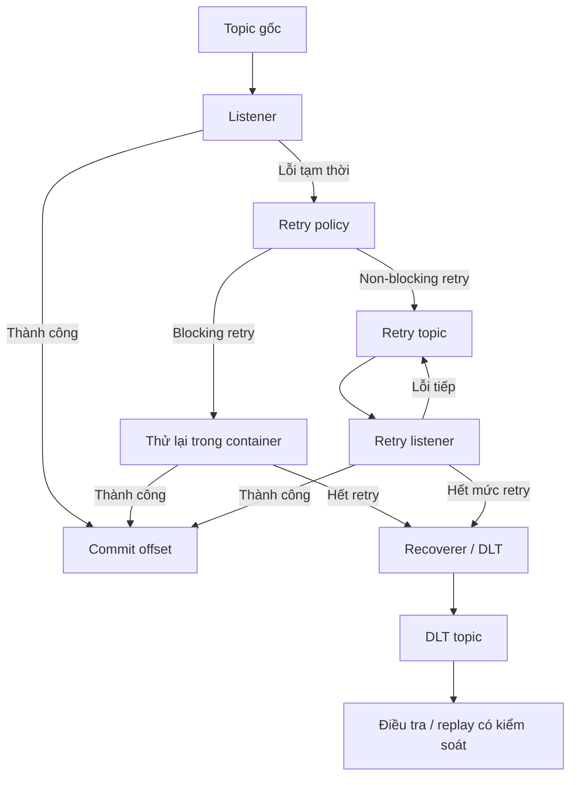

# Theo dõi retry và dead letter

Retry giúp consumer phục hồi khi gặp lỗi tạm thời. Dead-letter topic (DLT) giữ lại record không thể xử lý sau khi chính sách retry kết thúc hoặc khi lỗi được phân loại là không thể retry. Nhưng chỉ cấu hình retry và DLT chưa đủ để vận hành an toàn: đội ngũ cần biết record đang ở lần thử nào, retry có đang tăng bất thường không, topic retry có bị tồn đọng không và DLT có đang tích lũy dữ liệu cần điều tra hay không.

Trong Spring Kafka, observability cho retry và dead letter cần kết hợp metric của listener/container, metric của Kafka consumer, log có cấu trúc, trace context và quy trình xử lý DLT. Mỗi tín hiệu trả lời một câu hỏi khác nhau: metric cho biết xu hướng, log cho biết record cụ thể gặp chuyện gì, trace cho biết luồng đi qua các service, còn DLT lưu dữ liệu để phân tích và phục hồi.

## 1. Nhìn toàn bộ vòng đời của một record

Với blocking retry, record thường được thử lại trong luồng xử lý của listener container. Nếu hết retry, recoverer có thể ghi record sang DLT. Với non-blocking retry, Spring Kafka chuyển record qua các retry topic theo lịch backoff; khi hết các mức retry, record được chuyển tới DLT.



Khi thiết kế observability, hãy tách các sự kiện sau:

- Một lần listener được gọi.
- Một lần xử lý thất bại.
- Một lần retry được thực hiện.
- Một lần publish sang retry topic.
- Một lần record được đưa vào DLT.
- Một lần record được đọc và xử lý từ DLT.
- Một lần replay record từ DLT trở lại luồng xử lý.

Các con số này không giống nhau. Ví dụ, counter trong listener tăng mỗi khi listener thất bại không nhất thiết bằng số lần retry đã thực hiện: lần thất bại đầu tiên có thể chưa phải retry, còn một record có thể được chuyển sang retry topic mà không gọi lại listener gốc.

## 2. Những metric quan trọng cần theo dõi

Một dashboard retry/DLT nên có các nhóm metric sau:

| Nhóm | Metric gợi ý | Câu hỏi cần trả lời |
|---|---|---|
| Listener | Số lần xử lý, success/failure, processing duration | Listener có đang lỗi hoặc chậm hơn bình thường? |
| Retry | Số lần retry, retry rate, số lần publish retry | Bao nhiêu record cần thử lại và xu hướng có tăng không? |
| Retry topic | Consumer lag, số record chờ, tuổi record cũ nhất | Retry có bị ùn hoặc chậm hơn lịch dự kiến? |
| DLT | Số record mới vào DLT, backlog, tuổi record cũ nhất | Có record không xử lý được cần can thiệp? |
| Consumer | Lag theo group/partition, rebalance, poll duration | Consumer có theo kịp topic gốc và retry topic? |
| Dependency | DB/API latency, timeout, 429/5xx, connection pool | Lỗi retry có bắt nguồn từ downstream? |
| JVM | Heap, GC pause, thread pool, CPU | Retry hoặc backlog có làm cạn tài nguyên? |

Không chỉ theo dõi tổng số record. Một DLT có 10 record mới trong một phút có thể nghiêm trọng hơn 10.000 record cũ đã được phân loại và chờ xử lý theo kế hoạch. Cần xem cả tốc độ phát sinh, tuổi tồn đọng và mức độ ảnh hưởng nghiệp vụ.

## 3. Đo lỗi và thời gian xử lý của listener

Spring Kafka hỗ trợ metric/observation cho listener container và KafkaTemplate tùy phiên bản. Ngoài metric framework cung cấp, ứng dụng nên đo thời gian xử lý nghiệp vụ riêng để phân biệt thời gian listener với thời gian gọi database hoặc API.

Ví dụ dùng Micrometer `Timer` để đo service xử lý event:

```java
@Service
public class OrderProcessingService {

    private final MeterRegistry registry;
    private final OrderRepository repository;

    public OrderProcessingService(
            MeterRegistry registry,
            OrderRepository repository) {
        this.registry = registry;
        this.repository = repository;
    }

    public void process(OrderEvent event) {
        Timer.Sample sample = Timer.start(registry);
        String outcome = "success";

        try {
            repository.apply(event);
        }
        catch (RuntimeException ex) {
            outcome = "failure";
            throw ex;
        }
        finally {
            sample.stop(
                    Timer.builder("app.kafka.order.processing")
                            .description("Business processing time for order events")
                            .tag("outcome", outcome)
                            .register(registry)
            );
        }
    }
}
```

Timer trên ghi nhận thời gian xử lý nghiệp vụ theo kết quả thành công/thất bại. Nếu listener retry record, mỗi lần gọi service sẽ tạo một observation riêng. Khi phân tích latency, hãy xác định muốn đo một lần attempt hay tổng thời gian từ lần nhận đầu tiên đến khi hoàn tất.

Nên bổ sung counter cho số lần thất bại và số event hoàn tất. Với retry, đừng đặt tên một counter là `retry.count` nếu thực tế nó đang đếm mọi exception từ listener; tên metric phải phản ánh đúng sự kiện đã đo.

## 4. Đếm retry chính xác

Để đếm retry, cần xác định điểm ghi nhận. Có thể dùng delivery-attempt metadata của container, instrumentation quanh error handler hoặc metadata/header do retry-topic flow cung cấp. Cách triển khai phụ thuộc cơ chế blocking hay non-blocking và phiên bản Spring Kafka.

Với blocking retry, container có thể được cấu hình để đưa delivery attempt vào header:

```java
@Bean
ConcurrentKafkaListenerContainerFactory<String, OrderEvent>
orderListenerFactory(
        ConsumerFactory<String, OrderEvent> consumerFactory) {

    var factory =
            new ConcurrentKafkaListenerContainerFactory<String, OrderEvent>();

    factory.setConsumerFactory(consumerFactory);
    factory.getContainerProperties().setDeliveryAttemptHeader(true);

    return factory;
}
```

Khi bật tính năng này, listener có thể đọc delivery attempt từ message header theo API Spring Kafka của phiên bản đang dùng. Giá trị này mô tả lần giao/attempt của record trong container; hãy kiểm tra cách đánh số của phiên bản cụ thể trước khi quy đổi thành số lần retry.

Với non-blocking retry, record đi qua các retry topic và header retry được framework quản lý. Khi cần hiển thị số lần thử, hãy đọc metadata retry theo contract của phiên bản Spring Kafka, hoặc phát metric tại nơi ứng dụng kiểm soát việc chuyển tiếp. Không tự đoán tên header hay giả định một header của blocking retry cũng có cùng semantics trong retry-topic flow.

Nên phân biệt tối thiểu:

- `listener.failures`: số lần listener ném lỗi.
- `retry.scheduled`: số lần record được lên lịch/chuyển sang retry.
- `retry.attempts`: số lần xử lý lại thực sự diễn ra.
- `retry.exhausted`: số record hết chính sách retry.

Nếu không thể đo từng loại chính xác, hãy ghi rõ định nghĩa metric trong dashboard và tài liệu vận hành thay vì gộp chúng thành một con số chung.

## 5. Theo dõi retry topic và consumer lag

Với non-blocking retry, mỗi retry topic là một topic Kafka thực. Vì vậy, cần theo dõi consumer group của retry listener giống như topic gốc:

- Lag theo từng retry topic và partition.
- Số record đang chờ xử lý.
- Tuổi của record cũ nhất.
- Throughput vào/ra mỗi retry topic.
- Thời gian từ lúc record được chuyển sang retry topic đến lúc được xử lý lại.
- Lỗi của retry listener và lỗi publish sang mức retry tiếp theo.

Consumer lag cao không tự động có nghĩa retry policy bị lỗi. Có thể retry topic đang nhận record nhanh hơn khả năng xử lý, consumer group bị thiếu instance, dependency phía sau đang hỏng hoặc backoff khiến record chưa đến thời điểm xử lý. Hãy kết hợp lag với tuổi record và trạng thái dependency.

Đối với blocking retry, không có retry topic riêng để đo lag. Thay vào đó, theo dõi thời gian listener, số lần giao lại, poll duration, consumer lag của topic gốc và thời gian container bị giữ trong xử lý lỗi.

## 6. Theo dõi DLT như một luồng nghiệp vụ riêng

DLT không phải nơi lưu rác để bỏ quên. Mỗi record trong DLT cần có thông tin đủ để trả lời:

- Record đến từ topic, partition và offset nào?
- Consumer group nào đã xử lý record?
- Exception thuộc loại nào và xảy ra ở bước nào?
- Record đã retry bao nhiêu lần hoặc đi qua những retry topic nào?
- Event ID/correlation ID nào liên kết với nghiệp vụ gốc?
- Có thể replay an toàn sau khi sửa lỗi hay cần thao tác bù?

Các metric DLT nên bao gồm:

| Metric | Ý nghĩa |
|---|---|
| DLT ingress rate | Tốc độ record mới được gửi vào DLT |
| DLT backlog | Số record chưa được xử lý/điều tra |
| DLT oldest age | Tuổi của record cũ nhất đang tồn |
| DLT handler failures | Số lần xử lý DLT handler thất bại |
| DLT replay count | Số record đã được replay |
| DLT replay failures | Số lần replay thất bại |

DLT ingress và DLT handler throughput là hai chỉ số khác nhau. Một topic có thể nhận record đều đặn nhưng không có consumer điều tra, khiến backlog tăng mãi. Ngược lại, DLT handler có thể đọc record nhưng lưu vào hệ thống quản lý lỗi thất bại.

## 7. Ghi log có cấu trúc cho retry và DLT

Log nên chứa metadata đủ để điều tra mà không cần ghi toàn bộ payload. Một log entry hữu ích thường có:

| Trường | Mục đích |
|---|---|
| `eventId` | Tìm cùng event qua producer, retry và DLT |
| `topic` | Topic hiện tại |
| `originalTopic` | Topic nguồn ban đầu |
| `partition`, `offset` | Định vị record trong Kafka |
| `consumerGroup`, `listenerId` | Xác định luồng xử lý |
| `attempt` | Lần giao/thử xử lý nếu metadata đáng tin cậy |
| `exceptionClass` | Phân loại lỗi |
| `outcome` | success, retry, recovered hoặc dlt |
| `correlationId`, `traceId` | Liên kết log giữa các service |
| `durationMs` | Thời gian xử lý |

Ví dụ log có cấu trúc bằng SLF4J:

```java
log.warn(
        "Kafka record processing failed eventId={} topic={} partition={} offset={} listener={} exceptionClass={}",
        event.eventId(),
        record.topic(),
        record.partition(),
        record.offset(),
        "orders-listener",
        ex.getClass().getSimpleName(),
        ex
);
```

Ví dụ này giả định listener nhận `ConsumerRecord` để lấy metadata và event có `eventId()`. Nếu listener nhận payload trực tiếp, có thể dùng các header Spring Kafka hoặc nhận thêm `ConsumerRecordMetadata` theo chữ ký listener phù hợp.

Không nên đưa event ID, order ID, customer ID, exception message hoặc trace ID thành metric tag có cardinality cao. Chúng phù hợp với log/tracing; metric nên dùng nhãn có tập giá trị giới hạn như listener, topic, outcome và exception class đã chuẩn hóa.

Tránh ghi payload nhạy cảm hoặc thông tin xác thực vào log. Với lỗi lặp nhiều lần, có thể ghi log chi tiết ở lần đầu và lần cuối, còn các lần giữa dùng metric hoặc log sampling để tránh log storm.

## 8. Đọc metadata của record trong DLT

Spring Kafka bổ sung headers khi chuyển record sang DLT để giữ nguồn gốc và thông tin exception. Các header này có thể bao gồm topic/partition/offset ban đầu và thông tin exception tùy cơ chế recoverer, phiên bản và cấu hình.

Có thể nhận toàn bộ `ConsumerRecord` trong DLT handler để kiểm tra:

```java
@Component
public class OrderDltListener {

    private final MeterRegistry registry;
    private final DltCaseService dltCaseService;

    public OrderDltListener(
            MeterRegistry registry,
            DltCaseService dltCaseService) {
        this.registry = registry;
        this.dltCaseService = dltCaseService;
    }

    @DltHandler
    public void handle(ConsumerRecord<String, OrderEvent> record) {
        Counter.builder("app.kafka.dlt.received")
                .tag("topic", record.topic())
                .register(registry)
                .increment();

        dltCaseService.save(
                record.key(),
                record.value(),
                record.topic(),
                record.partition(),
                record.offset(),
                record.headers()
        );
    }
}
```

Counter trên đếm record được DLT handler nhận, không nhất thiết là số lần publish DLT thành công ở phía recoverer. Nếu cần đo riêng publish success/failure, hãy instrument quanh recoverer hoặc callback gửi DLT để ghi nhận đúng thời điểm publish được xác nhận.

Khi lưu headers, hãy giữ lại các metadata cần điều tra và loại bỏ dữ liệu không cần thiết hoặc nhạy cảm. Không serialize toàn bộ header một cách mù quáng nếu có header nội bộ, thông tin xác thực hoặc payload quá lớn.

## 9. Correlation ID và distributed tracing

Một event có thể đi qua nhiều service, retry topic và DLT. Correlation ID giúp tìm tất cả log liên quan đến một nghiệp vụ; trace ID giúp nối các span trong một trace phân tán.

Hai ID có mục đích khác nhau:

- **Correlation ID:** định danh luồng nghiệp vụ hoặc request, có thể tồn tại lâu hơn một trace.
- **Trace ID:** định danh một distributed trace; một workflow dài có thể tạo nhiều trace hoặc span tùy cách instrument.

Spring Kafka có hỗ trợ Micrometer Observation cho producer và listener ở các phiên bản tương ứng. Khi bật observation và tích hợp Micrometer Tracing/OpenTelemetry bridge phù hợp, trace context có thể được truyền qua Kafka headers.

Ví dụ bật observation trên listener container và template trong các phiên bản Spring Kafka hỗ trợ API này:

```java
@Bean
ConcurrentKafkaListenerContainerFactory<String, OrderEvent>
orderListenerFactory(
        ConsumerFactory<String, OrderEvent> consumerFactory) {

    var factory =
            new ConcurrentKafkaListenerContainerFactory<String, OrderEvent>();

    factory.setConsumerFactory(consumerFactory);
    factory.getContainerProperties().setObservationEnabled(true);

    return factory;
}

@Bean
KafkaTemplate<String, OrderEvent> orderKafkaTemplate(
        ProducerFactory<String, OrderEvent> producerFactory) {

    KafkaTemplate<String, OrderEvent> template =
            new KafkaTemplate<>(producerFactory);

    template.setObservationEnabled(true);
    return template;
}
```

API observation và cấu hình auto-configuration phụ thuộc phiên bản Spring Kafka/Spring Boot. Hãy kiểm tra phiên bản trong project và bảo đảm ObservationRegistry/Tracing bridge đã được cấu hình. Bật observation mà không có exporter hoặc tracing bridge phù hợp có thể chỉ tạo observation nội bộ, chưa đưa trace lên hệ thống quan sát.

Khi record chuyển sang retry topic, trace có thể tiếp tục hoặc được tạo thành một span/trace khác tùy instrumentation và thời điểm xử lý. Đừng giả định trace luôn tồn tại xuyên suốt nhiều giờ chờ retry. Hãy giữ correlation ID ổn định trong event/header để vẫn nối được nghiệp vụ khi trace đã kết thúc.

## 10. Phân biệt lỗi tạm thời và lỗi không thể retry

Metric theo exception class giúp xác định lỗi nào đang gây retry. Tuy nhiên, tên exception cần được chuẩn hóa thành nhóm ổn định:

| Nhóm lỗi | Ví dụ | Quan sát cần tập trung |
|---|---|---|
| Dependency tạm thời | Timeout DB, HTTP 503 | Retry rate, dependency latency, recovery time |
| Rate limit | HTTP 429 | Retry delay, số request bị giới hạn |
| Dữ liệu không hợp lệ | Thiếu field bắt buộc, sai schema | Non-retryable count, DLT ingress |
| Lỗi nghiệp vụ | Trạng thái đơn hàng không hợp lệ | DLT theo error code và business type |
| Lỗi cấu hình/quyền | ACL, authentication, serializer | Error rate, broker/client logs, DLT nếu record được recover |

Nếu mọi exception đều được retry, metric retry có thể tăng mạnh mà không giúp phục hồi. Với lỗi dữ liệu không thể tự sửa, retry chỉ trì hoãn thời điểm record đi vào DLT và tăng tải.

Hãy theo dõi tỷ lệ lỗi theo nhóm, đồng thời kiểm tra classification trong error handler hoặc `@RetryableTopic` để bảo đảm lỗi được định tuyến đúng.

## 11. Dashboard retry và DLT

Một dashboard thực tế nên chia thành bốn khu vực:

**Tình trạng luồng chính**

- Record vào topic gốc mỗi phút.
- Listener success/failure rate.
- p50/p95/p99 processing duration.
- Consumer lag theo group và partition.

**Tình trạng retry**

- Retry attempts và retry scheduled theo listener/topic.
- Throughput từng retry topic.
- Lag và tuổi record cũ nhất trong retry topic.
- Số lần retry exhausted.

**Tình trạng DLT**

- DLT ingress rate.
- DLT backlog và oldest age.
- Phân bố exception class/error code.
- Số record đã được điều tra, replay hoặc đánh dấu không thể phục hồi.

**Tình trạng dependency**

- Database/API latency và error rate.
- Connection pool usage.
- Circuit breaker state.
- Thread pool saturation, heap và GC.

Đặt biến thể dashboard theo môi trường, service, consumer group và topic. Khi xem một metric, người vận hành cần drill down được tới log/trace có event ID hoặc correlation ID tương ứng.

## 12. Thiết kế alert có ích

Không nên cảnh báo chỉ vì một record retry một lần. Retry là hành vi bình thường trong hệ thống phân tán. Alert nên dựa trên tỷ lệ, thời gian kéo dài, backlog và tác động nghiệp vụ.

Ví dụ chính sách cảnh báo:

| Điều kiện | Mức cảnh báo gợi ý | Hành động |
|---|---|---|
| Retry failure rate tăng liên tục trong nhiều phút | Warning | Kiểm tra dependency và loại exception |
| Retry topic oldest age vượt SLA | Warning/Critical | Kiểm tra consumer lag và backoff |
| DLT ingress lớn hơn 0 trong luồng thanh toán quan trọng | Warning hoặc Critical theo SLO | Điều tra record và lỗi gốc |
| DLT backlog tăng liên tục | Critical | Phân công xử lý DLT và kiểm tra khả năng replay |
| DLT handler liên tục thất bại | Critical | Kiểm tra storage/consumer của DLT |
| Consumer lag tăng cùng với downstream 5xx | Warning | Điều tiết consumer và phục hồi dependency |
| Pause duration vượt giới hạn vận hành | Warning | Kiểm tra backpressure và điều kiện resume |

Ngưỡng cụ thể phải dựa trên SLO và đặc điểm nghiệp vụ. Với một topic telemetry có thể chấp nhận DLT nhỏ; với event ghi nhận thanh toán, một record vào DLT có thể cần được điều tra ngay.

Alert cần có owner và runbook. Cảnh báo không có người xử lý hoặc không nêu bước đầu tiên chỉ làm tăng noise.

## 13. Quy trình điều tra một record trong DLT

Khi có record mới vào DLT, quy trình nên thống nhất:

1. Xác định topic gốc, partition, offset, consumer group và event ID.
2. Đọc exception class, error code và metadata retry.
3. Kiểm tra log/trace theo correlation ID.
4. Xác định lỗi thuộc dữ liệu, nghiệp vụ, dependency hay cấu hình.
5. Quyết định sửa dữ liệu, sửa code, chờ dependency hoặc đánh dấu không thể phục hồi.
6. Kiểm tra event có tác dụng phụ nào đã được thực hiện trước khi lỗi xảy ra.
7. Chọn cách replay phù hợp và ghi audit.
8. Theo dõi kết quả sau replay và xác nhận backlog giảm.

Không sửa payload trong DLT mà không lưu lại bản gốc và audit. Nếu cần biến đổi event, hãy ghi rõ phiên bản dữ liệu, người thực hiện và lý do. Với lỗi nghiệp vụ không thể tự sửa, có thể cần command bù hoặc thao tác vận hành thay vì replay nguyên record.

## 14. Replay DLT an toàn

Replay là một thao tác phát lại record, không phải xóa lỗi khỏi hệ thống. Khi replay, consumer có thể thực hiện lại tác dụng phụ đã xảy ra một phần trước khi record vào DLT. Vì vậy, cần:

- Giữ event ID ổn định để consumer idempotent nhận diện record đã xử lý.
- Kiểm tra database/API trước khi replay nếu lần xử lý cũ có kết quả không rõ.
- Replay vào topic gốc hoặc topic phục hồi riêng theo runbook đã định.
- Giới hạn tốc độ replay để không làm downstream quá tải.
- Ghi nhận người thực hiện, thời gian, số lượng record và kết quả.
- Không tạo vòng lặp DLT → replay → DLT liên tục mà không có giới hạn.

Nếu replay một batch lớn, nên chia thành các lô nhỏ và theo dõi lag, error rate, DLT ingress trong khi chạy. Dừng replay nếu tỷ lệ lỗi tăng hoặc downstream không còn capacity.

## 15. Giới hạn cardinality và bảo vệ dữ liệu

Metric backend thường hoạt động kém khi mỗi giá trị tag tạo một time series mới. Không dùng các giá trị sau làm tag metric:

- Event ID, order ID, customer ID.
- Correlation ID hoặc trace ID.
- Exception message chứa nội dung động.
- Kafka key không giới hạn.
- URL có path parameter hoặc payload field.

Dùng log hoặc trace để lưu định danh chi tiết. Metric chỉ nên dùng nhãn có tập giá trị giới hạn như service, listener ID, topic thuộc danh sách kiểm soát, outcome hoặc exception class đã chuẩn hóa.

Không ghi payload đầy đủ vào log khi event chứa thông tin cá nhân, token, dữ liệu thanh toán hoặc bí mật nghiệp vụ. DLT cũng có thể giữ payload lâu hơn topic chính; retention và quyền truy cập DLT cần được xem xét như dữ liệu nhạy cảm.

## 16. Kiểm thử observability cho retry và DLT

Kiểm thử không chỉ xác nhận record được retry hoặc gửi vào DLT. Cần xác minh tín hiệu quan sát được tạo đúng:

1. Listener thành công làm tăng success count và ghi nhận processing duration.
2. Listener thất bại làm tăng failure count với outcome phù hợp.
3. Retry counter phản ánh đúng attempt theo semantics đã định nghĩa.
4. Record chuyển sang retry topic xuất hiện ở topic và consumer group dự kiến.
5. Retry-topic lag/oldest age có thể quan sát.
6. Khi hết retry, DLT ingress được ghi nhận.
7. DLT handler ghi được metadata nguồn gốc và exception.
8. Trace/correlation ID được giữ hoặc liên kết qua các bước.
9. Replay tăng replay count và không nhân đôi tác dụng phụ.
10. Metric không tạo cardinality cao khi event ID thay đổi.
11. Alert rule kích hoạt với backlog/age vượt ngưỡng và tự hồi phục khi xử lý xong.

Với metric custom, có thể dùng `SimpleMeterRegistry` để kiểm tra counter/timer trong unit test. Với listener, retry topic và DLT thật, dùng Embedded Kafka hoặc Testcontainers để kiểm tra integration. Không nên chỉ mock recoverer rồi kết luận DLT publish đã hoạt động trên broker.

## 17. Checklist vận hành

- [ ] Đã định nghĩa rõ listener failure, retry attempt, retry scheduled và DLT ingress.
- [ ] Có metric xử lý thành công/thất bại và processing duration.
- [ ] Có retry rate, retry exhausted và consumer lag theo retry topic nếu dùng non-blocking retry.
- [ ] Có DLT ingress, backlog, oldest age và DLT handler failure.
- [ ] Log có event ID, topic, partition, offset, listener và exception class.
- [ ] Correlation ID được giữ ổn định qua retry và replay.
- [ ] Trace context được instrument nếu hệ thống có distributed tracing.
- [ ] Metric tags có cardinality giới hạn, không chứa ID động.
- [ ] Payload và headers nhạy cảm không bị ghi log tùy tiện.
- [ ] Dashboard phân biệt topic gốc, retry topic và DLT.
- [ ] Alert có ngưỡng theo SLO, owner và runbook.
- [ ] Quy trình điều tra và replay có audit, rate limit và idempotency.
- [ ] Đã kiểm thử metric, log, trace, DLT và replay trên broker thử nghiệm.

Theo dõi retry và dead letter giúp biến cơ chế phục hồi thành một luồng có thể quan sát và vận hành. Hãy đo đúng từng sự kiện, theo dõi lag và tuổi record ở retry topic, coi DLT là hàng đợi cần điều tra, đồng thời liên kết metric với log và trace qua event/correlation ID. Khi có dashboard, alert và quy trình replay an toàn, đội ngũ có thể phát hiện dependency suy giảm sớm, xử lý record lỗi có trách nhiệm và phục hồi luồng messaging mà không làm mất hoặc nhân đôi tác dụng phụ nghiệp vụ.

