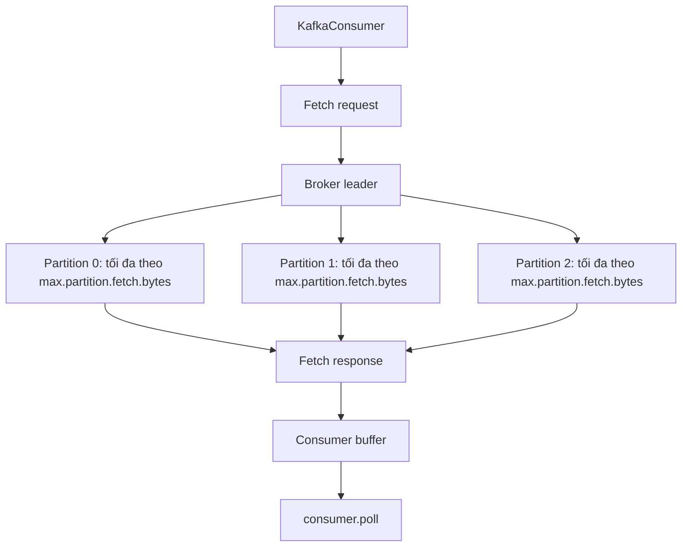

# `max.partition.fetch.bytes`

Kafka consumer lấy dữ liệu từ broker bằng các fetch request. Một request có thể yêu cầu dữ liệu từ nhiều partition, và mỗi partition có giới hạn lượng dữ liệu broker trả về. `max.partition.fetch.bytes` điều khiển giới hạn theo từng partition trong một fetch response. Tham số này ảnh hưởng trực tiếp tới khả năng tiêu thụ record lớn, throughput, độ trễ và lượng bộ nhớ mà consumer cần dự phòng.

Trong Spring Kafka, tham số được truyền tới Kafka consumer thông qua `ConsumerFactory` hoặc cấu hình `spring.kafka.consumer.properties`. Muốn điều chỉnh đúng, cần phân biệt nó với `fetch.max.bytes` (giới hạn tổng response), `fetch.min.bytes` (ngưỡng dữ liệu để broker cân nhắc trả response) và `max.poll.records` (giới hạn số record trả về từ một lần `poll()`).

## 1. `max.partition.fetch.bytes` giới hạn điều gì?

Kafka consumer gửi fetch request tới broker đang giữ leader của các partition được gán. Trong request, consumer chỉ định lượng dữ liệu tối đa mong muốn nhận cho mỗi partition. `max.partition.fetch.bytes` là giới hạn byte cho dữ liệu trả về từ một partition trong một fetch response.

Ví dụ, consumer đang được gán 4 partition và cấu hình `max.partition.fetch.bytes` bằng 2 MiB. Mỗi partition có thể đóng góp tối đa khoảng 2 MiB dữ liệu vào response theo giới hạn này, tùy lượng dữ liệu sẵn có và giới hạn tổng `fetch.max.bytes`. Broker không nhất thiết trả đủ 2 MiB cho mọi partition; nếu partition ít record hoặc chưa có dữ liệu, response có thể nhỏ hơn.



Tham số này là giới hạn theo partition, không phải giới hạn tổng bộ nhớ của cả consumer và cũng không phải giới hạn số record. Nó thường cần được xem cùng số partition mà consumer nhận, kích thước record batch, số consumer trong ứng dụng và cấu hình fetch tổng.

## 2. Phân biệt các tham số fetch và poll

Các tham số có tên gần nhau nhưng điều khiển những phần khác nhau của luồng nhận dữ liệu:

| Tham số | Phạm vi | Tác động |
|---|---|---|
| `max.partition.fetch.bytes` | Mỗi partition trong fetch response | Giới hạn byte dữ liệu broker trả về cho một partition trong một response. |
| `fetch.max.bytes` | Tổng fetch response | Giới hạn tổng byte dữ liệu broker trả về trong một fetch response. |
| `fetch.min.bytes` | Điều kiện trả fetch response | Broker có thể chờ thêm dữ liệu cho tới khi đạt ngưỡng byte tối thiểu hoặc hết thời gian chờ. |
| `fetch.max.wait.ms` | Thời gian chờ fetch | Giới hạn thời gian broker chờ để đáp ứng `fetch.min.bytes` trước khi trả response. |
| `max.poll.records` | Một lần `poll()` | Giới hạn số record tối đa trả về cho ứng dụng trong một lần poll; không phải giới hạn byte của fetch response. |
| `max.poll.interval.ms` | Khoảng cách giữa hai lần poll | Giới hạn thời gian consumer có thể xử lý giữa hai lần poll trước khi bị xem là không còn tiến triển. |

Hai giới hạn byte thường được điều chỉnh cùng nhau. Nếu `max.partition.fetch.bytes` lớn nhưng `fetch.max.bytes` quá thấp, tổng response vẫn bị giới hạn bởi `fetch.max.bytes` trong điều kiện thông thường. Nếu `fetch.max.bytes` lớn nhưng giới hạn mỗi partition thấp, một partition có thể không đóng góp nhiều dữ liệu như mong muốn.

`fetch.min.bytes` và `fetch.max.wait.ms` là công cụ gom dữ liệu. Khi lưu lượng lớn, broker có thể nhanh chóng đạt ngưỡng byte tối thiểu. Khi lưu lượng thấp, broker có thể chờ tới `fetch.max.wait.ms`, làm tăng độ trễ. Hai tham số này không làm tăng kích thước tối đa của một record batch.

`max.poll.records` giới hạn số record mà ứng dụng nhận trong một lần poll. Consumer có thể đã fetch dữ liệu vào buffer nhưng chỉ trả một phần record trong lần poll hiện tại; phần còn lại có thể được trả trong các lần poll tiếp theo. Vì vậy, tăng `max.partition.fetch.bytes` không đồng nghĩa listener luôn nhận nhiều record hơn trong một lần gọi.

## 3. Ngoại lệ để consumer vẫn có thể tiến triển

Giới hạn `max.partition.fetch.bytes` không phải một hàng rào tuyệt đối đối với record batch đầu tiên. Nếu batch đầu tiên trong partition đầu tiên không rỗng của fetch response lớn hơn giới hạn đã cấu hình, Kafka vẫn có thể trả batch đó để consumer không bị mắc kẹt và có thể tiếp tục đọc log.

`fetch.max.bytes` cũng có ngoại lệ tương tự: nếu batch đầu tiên cần thiết để tiến triển lớn hơn giới hạn tổng response, broker vẫn có thể trả batch đó. Do đó:

- Không nên xem `max.partition.fetch.bytes` là cơ chế từ chối message quá lớn.
- Consumer vẫn có thể nhận một batch vượt cấu hình khi cần bảo đảm tiến triển.
- Bộ nhớ thực tế có thể tăng vượt ước lượng đơn giản dựa trên các giới hạn fetch.
- Producer và broker vẫn cần giới hạn kích thước message phù hợp để tránh payload quá lớn.

Nếu một record batch lớn hơn khả năng xử lý của ứng dụng, hãy giải quyết ở thiết kế payload và giới hạn producer/broker, không trông chờ consumer fetch limit loại bỏ nó. Ví dụ, có thể lưu file lớn ở object storage rồi chỉ gửi URI, checksum và metadata qua Kafka.

## 4. Cấu hình trong Spring Boot

Spring Boot chuyển các thuộc tính trong `spring.kafka.consumer.properties` tới Kafka consumer. Với các thuộc tính Kafka có dấu chấm, có thể dùng map key dạng bracket trong YAML để giữ nguyên tên:

```yaml
spring:
  kafka:
    bootstrap-servers: ${KAFKA_BOOTSTRAP_SERVERS:localhost:9092}
    consumer:
      group-id: order-consumer
      max-poll-records: 300
      properties:
        "[max.partition.fetch.bytes]": 2097152
        "[fetch.max.bytes]": 52428800
        "[fetch.min.bytes]": 65536
        "[fetch.max.wait.ms]": 100
```

Trong ví dụ, giới hạn theo partition là 2 MiB, tổng fetch response là 50 MiB, broker được yêu cầu gom ít nhất 64 KiB dữ liệu và chờ tối đa 100 ms để đáp ứng ngưỡng đó. Đây chỉ là cấu hình minh họa; giá trị production cần dựa trên kích thước record, số partition, độ trễ mục tiêu và bộ nhớ thực tế.

Nếu tạo `ConsumerFactory` thủ công, có thể đặt thuộc tính trực tiếp bằng Kafka client constant:

```java
Map<String, Object> props = new HashMap<>();
props.put(ConsumerConfig.BOOTSTRAP_SERVERS_CONFIG, bootstrapServers);
props.put(ConsumerConfig.GROUP_ID_CONFIG, "order-consumer");
props.put(ConsumerConfig.KEY_DESERIALIZER_CLASS_CONFIG, StringDeserializer.class);
props.put(ConsumerConfig.VALUE_DESERIALIZER_CLASS_CONFIG, OrderEventDeserializer.class);
props.put(ConsumerConfig.MAX_PARTITION_FETCH_BYTES_CONFIG, 2 * 1024 * 1024);
props.put(ConsumerConfig.FETCH_MAX_BYTES_CONFIG, 50 * 1024 * 1024);

ConsumerFactory<String, OrderEvent> consumerFactory =
        new DefaultKafkaConsumerFactory<>(props);
```

Hãy bảo đảm listener container thực sự sử dụng `ConsumerFactory` đã cấu hình. Nếu ứng dụng có nhiều factory cho các nhóm listener khác nhau, mỗi factory có thể cần giới hạn fetch riêng theo kích thước message và đặc điểm tải của topic.

## 5. Chọn giá trị theo kích thước record batch

Để chọn `max.partition.fetch.bytes`, trước hết cần biết kích thước record batch thực tế mà consumer phải đọc. Kafka lưu record theo batch; kích thước trên wire có thể khác kích thước payload sau giải nén và deserialize.

Một quy trình chọn giá trị:

1. Đo kích thước record batch p50, p95, p99 và kích thước lớn nhất hợp lệ.
2. Xác định batch lớn nhất mà consumer phải xử lý bình thường, kể cả khi record có header hoặc schema metadata.
3. Chọn giới hạn theo partition đủ để fetch hiệu quả với kích thước batch dự kiến.
4. Chọn `fetch.max.bytes` đủ cho tổng dữ liệu cần nhận trong một response khi có nhiều partition.
5. Tính số partition được gán cho mỗi consumer và số consumer chạy đồng thời trong một instance.
6. Đo heap, GC, fetch latency và consumer lag dưới tải đại diện trước khi tăng thêm giới hạn.

Ví dụ, nếu phần lớn record batch dưới 256 KiB và p99 dưới 1 MiB, đặt `max.partition.fetch.bytes` bằng 2 MiB có thể tạo headroom hợp lý. Nếu có batch hợp lệ cỡ 8 MiB, cấu hình 1 MiB không nên được xem là cách chặn batch đó; consumer có ngoại lệ cho batch đầu tiên. Hãy quyết định rõ ứng dụng có thực sự cần hỗ trợ batch 8 MiB hay nên thay đổi cách biểu diễn payload.

Không nên đặt giá trị rất lớn chỉ để tránh phải đo kích thước. Fetch response lớn có thể làm tăng lượng dữ liệu buffer, thời gian deserialize, thời gian xử lý batch và áp lực GC. Một consumer có nhiều partition được gán có thể giữ dữ liệu từ nhiều partition cùng lúc.

## 6. Ước lượng ảnh hưởng tới bộ nhớ

`max.partition.fetch.bytes` không phải giới hạn heap cứng. Nó chỉ là một phần của cơ chế giới hạn dữ liệu fetch. Để lập kế hoạch, có thể dùng ước lượng thận trọng ban đầu:

\[
M_{fetch} \approx P_{assigned} \times F_{partition}
\]

Trong đó:

- `P_assigned` là số partition được gán cho một consumer.
- `F_partition` là giá trị `max.partition.fetch.bytes`.
- `M_fetch` là ước lượng thô lượng dữ liệu fetch theo giới hạn từng partition, không phải cam kết lượng heap tối đa.

Giới hạn tổng `fetch.max.bytes` thường làm giảm tổng response so với tích trên, nhưng các ngoại lệ batch đầu tiên và các fetch đang diễn ra khiến đây không phải công thức bảo đảm. Ngoài dữ liệu fetch, ứng dụng còn giữ object sau deserialize, record đang được listener xử lý, batch trung gian và dữ liệu trong queue nội bộ.

Nếu payload nén, byte truyền qua mạng có thể nhỏ hơn đáng kể so với dữ liệu sau giải nén. Vì vậy, cần đo heap sau deserialize và số record in-flight, không chỉ nhìn kích thước fetch response. Nhiều consumer trong cùng JVM cũng nhân lượng buffer và object đang hoạt động.

Ví dụ một instance có 4 consumer, mỗi consumer được gán 12 partition, giới hạn mỗi partition 2 MiB. Phép nhân thô cho ra 24 MiB mỗi consumer, tương đương 96 MiB cho 4 consumer trước khi tính overhead, giải nén, object Java và công việc downstream. Đây là cảnh báo quy mô để lập kế hoạch, không phải dự báo heap chính xác.

## 7. Quan hệ với giới hạn producer và broker

Consumer fetch chỉ là một phần của chuỗi giới hạn kích thước. Một record batch phải được producer tạo ra, broker chấp nhận và replica có thể sao chép trước khi consumer đọc.

| Thành phần | Thuộc tính liên quan | Vai trò |
|---|---|---|
| Producer | `max.request.size` | Giới hạn kích thước request mà producer gửi; cần phù hợp với batch và request thực tế. |
| Broker | `message.max.bytes` | Giới hạn kích thước record batch broker chấp nhận ở cấp broker. |
| Topic | `max.message.bytes` | Có thể ghi đè giới hạn batch cho một topic. |
| Broker replica | `replica.fetch.max.bytes` | Giới hạn fetch dữ liệu cho replication giữa leader và follower. |
| Consumer | `max.partition.fetch.bytes` | Giới hạn dữ liệu mong muốn cho mỗi partition trong fetch response. |
| Consumer | `fetch.max.bytes` | Giới hạn tổng dữ liệu mong muốn trong một fetch response. |

Nếu producer gửi batch vượt giới hạn broker/topic, broker có thể từ chối trước khi consumer có cơ hội đọc. Nếu replica không thể fetch batch theo cấu hình phù hợp, khả năng replication và ISR có thể bị ảnh hưởng. Nếu consumer có fetch limit nhỏ, Kafka vẫn có ngoại lệ cho batch đầu tiên để tiến triển, nhưng cấu hình quá thấp có thể làm fetch không hiệu quả và tạo bất ngờ về bộ nhớ.

Khi hỗ trợ message lớn, hãy thống nhất giới hạn giữa producer, broker, topic, replication và consumer. Kiểm thử cả record lớn nhất hợp lệ, không chỉ record trung bình. Cũng nên đặt giới hạn nghiệp vụ cho payload để tránh một producer gửi dữ liệu không kiểm soát.

## 8. Tuning theo tình huống tải

| Tình huống | Dấu hiệu | Hướng điều chỉnh |
|---|---|---|
| Record nhỏ, throughput cao | Consumer thường xuyên fetch nhiều lần, broker luôn có dữ liệu | Cân nhắc tăng `fetch.min.bytes` hoặc `fetch.max.bytes` nếu CPU/network round trip là nút thắt; đo độ trễ trước và sau. |
| Record batch lớn | Fetch bị chia nhỏ hoặc consumer cần hỗ trợ batch lớn | Tăng `max.partition.fetch.bytes` và kiểm tra `fetch.max.bytes`, broker/topic và producer limit đồng bộ. |
| Topic ít lưu lượng, ưu tiên latency | Consumer chờ fetch đủ ngưỡng byte | Giảm `fetch.min.bytes` hoặc `fetch.max.wait.ms` để phản hồi sớm hơn. |
| Heap hoặc GC tăng | Nhiều partition và consumer giữ payload lớn cùng lúc | Giảm fetch limits, concurrency hoặc batch size; xem xét payload lớn và queue nội bộ. |
| Consumer lag tăng dù fetch response lớn | Nút thắt nằm ở deserialize, listener hoặc downstream | Tối ưu xử lý, điều chỉnh concurrency/partition và kiểm tra dịch vụ phụ thuộc; không tiếp tục tăng fetch limit một cách mù quáng. |

Hãy thay đổi từng nhóm tham số có liên quan và đo kết quả. Tăng `max.partition.fetch.bytes` không giúp nếu listener xử lý chậm hoặc database đã bão hòa. Ngược lại, giảm giới hạn quá thấp có thể làm consumer cần nhiều fetch round trip hơn để lấy cùng lượng dữ liệu.

## 9. Quan hệ với `max.poll.records` và thời gian xử lý

Fetch byte limit điều khiển lượng dữ liệu client nhận từ broker; `max.poll.records` điều khiển số record tối đa trả cho ứng dụng mỗi lần poll. Hai giới hạn hoạt động cùng nhau nhưng không thay thế nhau.

Ví dụ, consumer fetch được 10 MiB dữ liệu từ broker nhưng `max.poll.records` chỉ là 100. Một lần `poll()` trả tối đa 100 record; dữ liệu còn lại có thể nằm trong buffer cho những lần poll tiếp theo. Ngược lại, `max.poll.records` bằng 1.000 không buộc broker trả đủ 1.000 record nếu giới hạn byte, lượng dữ liệu sẵn có hoặc fetch timing không cho phép.

Nếu listener xử lý tuần tự, batch nhiều record hoặc payload lớn có thể kéo dài thời gian xử lý. Hãy theo dõi p95/p99 của thời gian listener và bảo đảm khoảng cách giữa hai lần poll không vượt `max.poll.interval.ms`. Khi dùng batch listener, đánh giá cả số record lẫn tổng byte của batch vì 100 record nhỏ và 100 record lớn có chi phí rất khác nhau.

## 10. Theo dõi hiệu năng fetch

Không đánh giá `max.partition.fetch.bytes` chỉ bằng giá trị cấu hình. Hãy quan sát:

- Fetch size và fetch latency theo consumer.
- Số record và số byte nhận trong mỗi lần poll.
- Consumer lag theo partition.
- Thời gian deserialize và listener processing latency.
- Heap usage, allocation rate và garbage collection.
- Số partition được gán trên mỗi consumer và số consumer hoạt động.
- Tỷ lệ record batch lớn, lỗi kích thước message và lỗi broker request.
- Tốc độ xử lý của database hoặc dịch vụ downstream.

Nếu fetch size thường xuyên chạm giới hạn trong khi consumer còn năng lực xử lý, có thể thử tăng fetch limits. Nếu fetch size đã lớn nhưng lag vẫn tăng, tìm nút thắt sau fetch. Nếu heap tăng theo số partition và concurrency, cần giảm buffer hoặc giới hạn số consumer/partition trên mỗi instance.

## 11. Kiểm thử giới hạn fetch

Integration test với Embedded Kafka có thể kiểm tra consumer đọc được record lớn và cấu hình fetch thực tế. Nên tạo record có kích thước gần giới hạn ứng dụng chấp nhận, gửi qua producer, rồi xác minh consumer nhận được payload đầy đủ.

Các trường hợp nên kiểm tra:

1. Record batch nhỏ hơn `max.partition.fetch.bytes` được đọc bình thường.
2. Record batch lớn hơn giới hạn cấu hình nhưng được broker chấp nhận vẫn có thể được consumer đọc nhờ ngoại lệ batch đầu tiên; xác minh hành vi đúng với phiên bản Kafka đang dùng.
3. Record vượt giới hạn producer hoặc broker/topic bị từ chối ở tầng gửi, không nhầm thành lỗi consumer fetch.
4. Nhiều partition cùng có dữ liệu lớn không làm heap vượt ngân sách đã đặt.
5. `max.poll.records` giới hạn số record trả về dù fetch buffer có thể chứa nhiều dữ liệu hơn.
6. Consumer lag và listener latency được đo khi tăng hoặc giảm fetch limits.
7. Payload nén được kiểm tra cả kích thước truyền và bộ nhớ sau deserialize.

Embedded broker phù hợp để kiểm tra hành vi cơ bản. Để đánh giá throughput, heap và GC ở tải production, cần test trên cluster và kích thước dữ liệu đại diện; một broker nhúng không mô phỏng đầy đủ replication, network và tải phân tán.

`max.partition.fetch.bytes` là giới hạn fetch theo từng partition, cần được điều chỉnh cùng `fetch.max.bytes`, `max.poll.records`, giới hạn message ở producer/broker và ngân sách bộ nhớ. Chọn giá trị theo kích thước batch thực tế và số partition mỗi consumer, sau đó đo fetch latency, consumer lag, listener latency và heap để tìm điểm cân bằng giữa throughput, độ trễ và độ ổn định.
