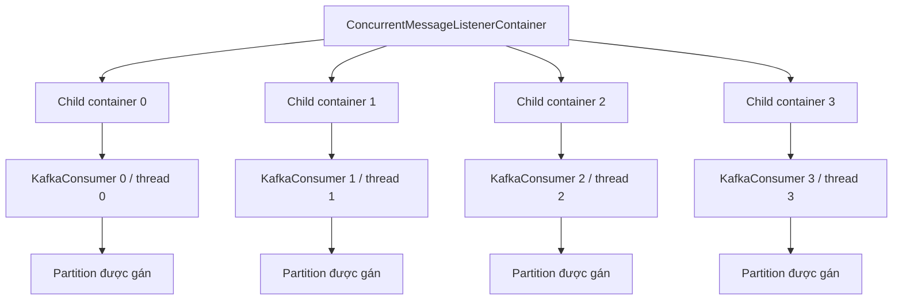

# Tối ưu concurrency

Trong Spring Kafka, `concurrency` quyết định số consumer worker mà một listener container tạo ra để đọc và xử lý record song song. Tăng concurrency có thể tăng throughput khi topic có đủ partition và ứng dụng còn tài nguyên. Nếu số worker vượt số partition có thể được gán, một phần worker sẽ nhàn rỗi; nếu tăng quá nhanh khi database, CPU hoặc dịch vụ phụ thuộc đã bão hòa, độ trễ và rebalance có thể tăng mà throughput không cải thiện.

Vì vậy, tối ưu concurrency bắt đầu từ ba câu hỏi: topic có bao nhiêu partition, toàn bộ consumer group có bao nhiêu consumer instance, và bottleneck hiện nằm ở đâu. `concurrency` là một núm điều chỉnh phía consumer; nó không tự tăng số partition và cũng không làm một partition được xử lý đồng thời bởi nhiều consumer trong cùng group.

## 1. Spring Kafka tạo consumer worker như thế nào?

Spring Kafka cung cấp hai listener container chính:

- `KafkaMessageListenerContainer` dùng một `KafkaConsumer` và xử lý trên một consumer thread.
- `ConcurrentMessageListenerContainer` quản lý nhiều `KafkaMessageListenerContainer` con để tiêu thụ song song.

Khi đặt `concurrency = 4`, container concurrent tạo bốn container con, mỗi container con có consumer riêng và thread riêng. Kafka group coordinator phân phối các partition cho những consumer này khi listener đăng ký theo topic hoặc topic pattern.



Mỗi consumer thread có thể nhận nhiều partition. Tuy nhiên, trong một consumer group thông thường, một partition tại một thời điểm chỉ được gán cho tối đa một consumer member. Các record của cùng partition vì thế tiếp tục được đọc theo offset và xử lý tuần tự trong luồng listener mặc định. Concurrency tạo song song giữa các partition; nó không biến một partition thành nhiều luồng xử lý độc lập.

## 2. Giới hạn concurrency theo số partition

Với một topic có `P` partition và một consumer group có `C` consumer member, số consumer có thể nhận dữ liệu chủ động bị giới hạn bởi số partition:

```text
consumer members = số application instance × concurrency mỗi instance
consumer hoạt động tối đa ≤ min(consumer members, số partition)
```

Ví dụ topic `orders` có 12 partition:

| Application instance | Concurrency mỗi instance | Tổng consumer member | Consumer có partition |
|---:|---:|---:|---:|
| 1 | 1 | 1 | 1 |
| 1 | 4 | 4 | 4 |
| 3 | 4 | 12 | 12 |
| 3 | 8 | 24 | Tối đa 12; phần còn lại nhàn rỗi |

Khi chỉ có một partition, tăng concurrency từ 1 lên 8 không làm tám thread cùng xử lý partition đó. Muốn tăng khả năng xử lý song song cho một consumer group, cần có đủ partition và dữ liệu được phân bố hợp lý giữa các partition.

Nếu một consumer nhận nhiều partition, nó xử lý các record của những partition đó trên cùng consumer thread. Vì thế, khi concurrency thấp hơn số partition, mỗi consumer thường phụ trách nhiều partition. Điều này vẫn có thể đạt throughput tốt nếu tốc độ record vừa phải và listener không bị nghẽn.

## 3. Cấu hình concurrency trong Spring Boot

Với listener container mặc định do Spring Boot auto-configure, có thể đặt concurrency bằng `spring.kafka.listener.concurrency`:

```yaml
spring:
  kafka:
    bootstrap-servers: localhost:9092
    consumer:
      group-id: order-service
      max-poll-records: 100
    listener:
      concurrency: 4
```

Giá trị này là concurrency mặc định cho listener container do Boot tạo. Nếu ứng dụng tự khai báo `ConcurrentKafkaListenerContainerFactory`, có thể cấu hình trực tiếp:

```java
@Bean
ConcurrentKafkaListenerContainerFactory<String, Order> ordersFactory(
        ConsumerFactory<String, Order> consumerFactory) {

    var factory = new ConcurrentKafkaListenerContainerFactory<String, Order>();
    factory.setConsumerFactory(consumerFactory);
    factory.setConcurrency(4);
    factory.getContainerProperties().setPollTimeout(1_000L);
    return factory;
}
```

Sau đó chọn factory cho listener:

```java
@KafkaListener(
        id = "ordersListener",
        topics = "orders",
        groupId = "order-service",
        containerFactory = "ordersFactory"
)
public void consume(Order order) {
    orderService.process(order);
}
```

Nếu chỉ một listener cần concurrency khác, có thể override ngay trên annotation:

```java
@KafkaListener(
        id = "priorityOrdersListener",
        topics = "priority-orders",
        groupId = "order-service",
        concurrency = "6"
)
public void consumePriority(Order order) {
    priorityOrderService.process(order);
}
```

`@KafkaListener(concurrency = "...")` cho phép dùng giá trị literal, property placeholder hoặc SpEL. Khi đã đặt trên annotation, giá trị đó override concurrency mặc định của factory cho endpoint tương ứng.

## 4. Tính tổng consumer khi chạy nhiều application instance

Concurrency được tính trên từng listener container của từng application instance. Nếu triển khai ba pod và mỗi pod có concurrency bằng bốn cho cùng `group.id`, Kafka nhìn thấy tổng cộng 12 consumer member trong group.

Ví dụ:

```text
order-service pod-1: concurrency=4 -> consumer 1, 2, 3, 4
order-service pod-2: concurrency=4 -> consumer 5, 6, 7, 8
order-service pod-3: concurrency=4 -> consumer 9, 10, 11, 12

Tổng consumer member của group = 3 × 4 = 12
```

Nếu topic có 12 partition, các member có thể nhận mỗi người một partition. Nếu topic chỉ có sáu partition, tối đa sáu member nhận partition; sáu member còn lại không có dữ liệu để xử lý. Khi autoscaling pod, cần tính concurrency nhân với số replica tối đa, không chỉ nhìn cấu hình của một pod.

Các listener dùng group ID khác nhau có phân phối partition độc lập. Không cộng concurrency của hai group để so với số partition như thể chúng cùng chia sẻ một nhóm consumer; mỗi group có thể đọc toàn bộ topic riêng biệt.

## 5. Chọn partition assignment strategy phù hợp

Khi subscribe theo topic, Kafka dùng `ConsumerPartitionAssignor` để phân phối partition cho consumer member. Chiến lược mặc định `RangeAssignor` phân phối theo từng topic. Với nhiều topic có cùng số partition, điều này có thể tạo ra nhiều consumer nhàn rỗi dù tổng số partition đủ lớn.

Ví dụ có ba topic, mỗi topic có năm partition và listener concurrency bằng 15:

```text
RangeAssignor:
  consumer 0..4: mỗi consumer nhận 1 partition từ cả 3 topic
  consumer 5..14: không được gán partition

RoundRobinAssignor:
  partition của 3 topic được luân phiên phân phối trên 15 consumer
  có thể sử dụng cả 15 consumer
```

Đây là trường hợp nên xem xét `RoundRobinAssignor`:

```yaml
spring:
  kafka:
    consumer:
      properties:
        "[partition.assignment.strategy]": org.apache.kafka.clients.consumer.RoundRobinAssignor
```

Một số assignor khác:

| Assignor | Đặc điểm | Khi cân nhắc |
|---|---|---|
| `RangeAssignor` | Chia partition theo từng topic và theo dải | Một topic hoặc muốn phân phối theo từng topic |
| `RoundRobinAssignor` | Luân phiên partition giữa các consumer member | Nhiều topic, muốn tận dụng nhiều member hơn |
| `StickyAssignor` | Cố gắng cân bằng và giữ assignment cũ khi có thể | Muốn giảm xáo trộn partition khi group thay đổi |
| `CooperativeStickyAssignor` | Sticky assignment với cooperative rebalance từng phần | Muốn giảm việc thu hồi toàn bộ partition trong rebalance |

Đổi assignor không làm tăng số partition và không bảo đảm mọi consumer đều bận trong mọi topology. Hãy kiểm tra assignment thực tế sau rebalance. Các consumer trong cùng group vẫn không xử lý đồng thời cùng một partition.

## 6. Trường hợp khai báo partition thủ công

Khi listener dùng `TopicPartitionOffset` hoặc `@KafkaListener(topicPartitions = ...)`, container được yêu cầu gán partition trực tiếp thay vì để group coordinator phân phối theo subscription thông thường.

Ví dụ:

```java
@KafkaListener(
        id = "fixedOrdersListener",
        topicPartitions = {
                @TopicPartition(topic = "orders", partitions = {"0", "1", "2", "3"})
        },
        concurrency = "2"
)
public void consumeFixed(Order order) {
    orderService.process(order);
}
```

Với bốn `TopicPartitionOffset` và concurrency bằng hai, Spring Kafka phân phối các assignment cho hai container con. Nếu concurrency lớn hơn số partition được khai báo, Spring Kafka giảm concurrency để mỗi container có ít nhất một partition; ví dụ hai partition không tạo ra tám consumer con hoạt động.

Manual assignment cần được thiết kế cẩn thận khi chạy nhiều application instance. Nếu nhiều instance cùng khai báo cùng một tập partition thủ công, chúng có thể cùng đọc các partition đó vì không dựa vào group assignment để loại trừ nhau. Chỉ dùng manual assignment khi ứng dụng tự quản lý việc chia partition giữa các instance hoặc có một cơ chế điều phối riêng.

## 7. Concurrency và thứ tự xử lý

Kafka bảo đảm thứ tự record trong một partition. Trong consumer group truyền thống, một partition được gán cho một consumer member tại một thời điểm; do đó tăng concurrency vẫn giữ thứ tự xử lý mặc định trong partition đó.

Ví dụ topic `orders` có bốn partition:

```text
partition 0: order A -> order B -> order C
partition 1: order D -> order E
partition 2: order F -> order G
partition 3: order H -> order I
```

Với concurrency bằng bốn, bốn consumer có thể xử lý bốn partition song song. Trong từng partition, record vẫn được xử lý theo thứ tự. Nếu nghiệp vụ yêu cầu mọi đơn hàng toàn hệ thống theo một thứ tự duy nhất, tăng concurrency giữa các partition sẽ không giữ được thứ tự toàn cục.

Partition key cũng ảnh hưởng độ cân bằng. Nếu mọi sự kiện của một khách hàng nóng đều dùng cùng key, chúng đi vào cùng partition và tạo hot partition. Tăng consumer thread không chia nhỏ luồng của key đó. Cần xem xét phân vùng key theo nghiệp vụ, tách workload hoặc thiết kế lại luồng xử lý nếu yêu cầu thứ tự cho phép.

Tăng số partition có thể mở thêm khả năng song song cho consumer group, nhưng thay đổi số partition có thể làm thay đổi ánh xạ key sang partition đối với record mới theo partitioner mặc định. Nếu cần thứ tự lâu dài theo key, phải đánh giá tác động trước khi tăng partition.

## 8. Cân bằng concurrency với max.poll.records và max.poll.interval.ms

Consumer gọi `poll()` để lấy record. `max.poll.records` giới hạn số record tối đa trả về trong một lần poll; nó không trực tiếp giới hạn lượng dữ liệu mà client fetch từ broker vì consumer có thể cache record và trả dần qua các lần poll.

Sau khi poll, container xử lý record trước khi gọi poll tiếp. Nếu tổng thời gian xử lý batch quá dài, khoảng cách giữa hai lần poll có thể vượt `max.poll.interval.ms`; consumer có thể bị xem là không còn hoạt động và group rebalance.

Có thể ước lượng ngân sách xử lý một poll:

```text
T_poll_cycle ≈ N_records × T_process_per_record + T_commit + T_overhead

Điều kiện vận hành:
T_poll_cycle < max.poll.interval.ms
```

Đây là ước lượng cho listener xử lý tuần tự. Hãy dùng thời gian xử lý p95/p99 và trường hợp tải cao để đánh giá, không chỉ dùng trung bình. Nếu listener xử lý batch, đo thời gian cho cả batch.

Ví dụ cấu hình:

```yaml
spring:
  kafka:
    consumer:
      max-poll-records: 100
      properties:
        "[max.poll.interval.ms]": 300000
    listener:
      concurrency: 4
```

Nếu một record mất 200 ms ở p99 và mỗi poll có thể trả 100 record, riêng thời gian xử lý tuần tự ước tính đã là 20 giây, chưa tính commit và overhead. Nếu p99 tăng lên hai giây, cùng batch có thể cần khoảng 200 giây. Khi đó, giảm `max.poll.records`, tối ưu listener hoặc điều chỉnh ngân sách poll sau khi đo tải thực tế.

Tăng concurrency tạo thêm consumer thread nhưng không rút ngắn thời gian xử lý tuần tự của batch trên một consumer. Hai cấu hình này giải quyết hai vấn đề khác nhau: concurrency phân phối partition qua nhiều consumer; `max.poll.records` điều chỉnh số record một consumer nhận trong một lần poll.

## 9. Chọn concurrency theo bottleneck

Không có một con số concurrency đúng cho mọi ứng dụng. Hãy xác định listener chủ yếu dùng CPU hay chờ I/O:

| Loại workload | Dấu hiệu | Cách điều chỉnh |
|---|---|---|
| CPU-bound | CPU cao, xử lý tính toán chiếm phần lớn thời gian | Tăng thread chỉ đến mức CPU còn đáp ứng; tối ưu code và cân nhắc scale instance |
| I/O-bound | Nhiều thời gian chờ database/HTTP | Có thể tăng consumer song song nếu connection pool và hệ thống đích chịu được tải |
| Database-bound | Pool connection cạn, query latency tăng | Tối ưu query/pool và giới hạn concurrency theo năng lực database |
| Hot partition | Một partition lag cao trong khi partition khác thấp | Kiểm tra key distribution và partitioning; tăng concurrency tổng không giải quyết partition nóng |
| Broker/network-bound | Fetch latency cao, throughput mạng chạm giới hạn | Kiểm tra broker, network, fetch settings và kích thước record |

Listener bean thường là singleton nhưng được nhiều consumer thread gọi đồng thời. Vì vậy, không giữ trạng thái mutable dùng chung trong field nếu không có đồng bộ phù hợp. Service, repository và client được inject phải an toàn khi được gọi đồng thời; các cache hoặc bộ đếm dùng chung cần thread-safe. Với database, concurrency của listener cũng phải phù hợp với connection pool và giới hạn kết nối của database.

## 10. Quy trình tối ưu concurrency theo số liệu

Thực hiện theo từng bước để biết thay đổi nào tạo ra kết quả:

1. **Đo baseline:** ghi throughput, consumer lag theo partition, listener duration p95/p99, CPU, heap, database pool, downstream latency và số lần rebalance.
2. **Kiểm tra partition:** xác nhận topic có đủ partition cho số consumer muốn chạy và key có phân bố đều không.
3. **Tính tổng member:** lấy số replica tối đa nhân concurrency mỗi instance cho từng listener group.
4. **Bắt đầu với concurrency nhỏ:** chọn một giá trị phù hợp số partition và tài nguyên, sau đó tăng từng bước.
5. **Theo dõi assignment:** kiểm tra consumer nào nhận partition, consumer nào idle và có hiện tượng lệch tải giữa partition không.
6. **Đo lại sau mỗi lần thay đổi:** so sánh throughput, lag, latency và tài nguyên. Giữ cấu hình mới khi throughput cải thiện mà latency, lỗi và tài nguyên vẫn trong giới hạn.
7. **Kiểm tra rebalance:** tăng/giảm replica hoặc concurrency đều có thể làm thay đổi group membership. Theo dõi thời gian rebalance và lượng công việc bị gián đoạn.

`ConcurrentMessageListenerContainer.metrics()` cung cấp metrics của các consumer con, được nhóm theo `client-id`. Có thể dùng chúng để so sánh fetch rate, records consumed và các metric Kafka client giữa consumer thread. Kết hợp với Spring Kafka listener timer để phân biệt thời gian listener xử lý với thời gian consumer fetch/chờ dữ liệu.

## 11. Ví dụ tính toán cho dịch vụ đơn hàng

Giả sử topic `orders` có 16 partition, ứng dụng triển khai tối đa bốn pod, mỗi pod chạy listener concurrency bằng hai:

```text
4 pod × 2 consumer/pod = 8 consumer member
16 partition / 8 consumer = trung bình 2 partition mỗi consumer
```

Nếu tăng concurrency lên bốn:

```text
4 pod × 4 consumer/pod = 16 consumer member
16 partition / 16 consumer = trung bình 1 partition mỗi consumer
```

Trường hợp thứ hai có thể tăng song song nếu listener và database còn khả năng xử lý. Nhưng nếu database chỉ chịu được tám transaction đồng thời, 16 listener có thể tạo contention và làm latency tăng. Cần giới hạn concurrency theo năng lực của dependency hoặc tăng năng lực database trước khi mở thêm consumer.

Nếu số pod tăng lên sáu trong autoscaling mà concurrency vẫn bằng bốn:

```text
6 pod × 4 consumer/pod = 24 consumer member
16 partition -> tối đa 16 member có partition
8 member có thể idle
```

Do đó, concurrency nên được tính cùng giới hạn replica của autoscaler và partition count, thay vì chỉ cấu hình độc lập trong từng pod.

## 12. Các lỗi thường gặp khi tăng concurrency

| Triệu chứng | Nguyên nhân có thể | Hướng xử lý |
|---|---|---|
| Tăng concurrency nhưng throughput không tăng | Số partition ít, consumer idle hoặc bottleneck nằm ở dependency | Kiểm tra assignment, lag và database/network metrics |
| Nhiều consumer idle khi nghe nhiều topic | `RangeAssignor` phân phối theo từng topic | Thử `RoundRobinAssignor` và xác nhận assignment |
| Một partition lag cao | Key skew hoặc hot key | Kiểm tra phân bố key, xử lý riêng workload nóng |
| Rebalance liên tục | Poll cycle quá dài, thay đổi replica/concurrency hoặc lỗi consumer | Kiểm tra `max.poll.interval.ms`, processing time và group events |
| Database timeout sau khi tăng thread | Connection pool hoặc database đã bão hòa | Giới hạn concurrency, điều chỉnh pool và tối ưu query |
| Listener gặp lỗi race condition | Listener singleton bị gọi đồng thời và dùng state mutable không an toàn | Làm listener stateless hoặc dùng cấu trúc thread-safe |
| Consumer tăng nhưng vẫn không giữ được thứ tự nghiệp vụ | Các record liên quan nằm ở partition khác nhau | Chọn key phù hợp và xác định phạm vi thứ tự cần bảo đảm |

## 13. Ghi nhớ

- `ConcurrentMessageListenerContainer` tạo nhiều `KafkaMessageListenerContainer` con; mỗi container con có consumer và thread riêng.
- Với consumer group truyền thống, một partition chỉ được gán cho tối đa một consumer member tại một thời điểm; concurrency hữu ích khi có đủ partition.
- Tổng consumer member của một listener group bằng số application instance nhân concurrency mỗi instance.
- `@KafkaListener(concurrency = "...")` có thể override concurrency mặc định của factory; Spring Boot hỗ trợ `spring.kafka.listener.concurrency`.
- Khi nghe nhiều topic, `RangeAssignor` có thể để consumer idle; kiểm tra `RoundRobinAssignor`, `StickyAssignor` hoặc `CooperativeStickyAssignor` theo topology.
- Manual partition assignment cần tự điều phối giữa các application instance; tăng concurrency vượt số partition được gán không tạo thêm consumer hoạt động.
- Concurrency giữ xử lý tuần tự trong từng partition; hot key và hot partition không được giải quyết chỉ bằng tăng thread.
- Chọn concurrency cùng `max.poll.records`, `max.poll.interval.ms`, CPU, database pool và năng lực hệ thống phụ thuộc.
- Tăng concurrency theo từng bước, đo throughput, lag, latency, rebalance và tài nguyên sau mỗi thay đổi.

## Tài liệu tham khảo

- [Spring for Apache Kafka — Message Listener Containers](https://docs.spring.io/spring-kafka/reference/kafka/receiving-messages/message-listener-container.html)
- [Spring for Apache Kafka — `@KafkaListener` Annotation](https://docs.spring.io/spring-kafka/reference/kafka/receiving-messages/listener-annotation.html)
- [Spring Boot — Apache Kafka Support](https://docs.spring.io/spring-boot/reference/messaging/kafka.html)
- [Spring Boot — Common Application Properties (`spring.kafka.listener.concurrency`)](https://docs.spring.io/spring-boot/appendix/application-properties/index.html)
- [Apache Kafka — Consumer Configurations](https://kafka.apache.org/41/generated/consumer_config.html)
