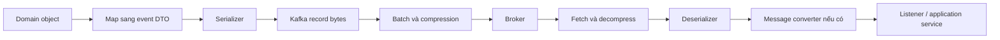

# Giảm chi phí serialize và deserialize

Trong một luồng Spring Kafka, object nghiệp vụ phải được chuyển thành bytes trước khi producer gửi record; consumer nhận bytes rồi chuyển chúng về kiểu dữ liệu mà ứng dụng hiểu. Hai bước này tiêu thụ CPU, cấp phát bộ nhớ và có thể trở thành nút thắt khi lưu lượng tăng. Một pipeline còn có thể chuyển đổi cùng payload nhiều lần: entity sang DTO, DTO sang JSON `String`, `String` sang `byte[]`, rồi lại parse qua converter. Những bước thừa này làm tăng latency và áp lực garbage collection.

Tối ưu serialization/deserialization bắt đầu bằng việc xác định mỗi lần chuyển đổi xảy ra ở đâu. Chọn một wire format phù hợp, cấu hình serializer/deserializer đúng với payload, tái sử dụng mapper đã cấu hình, tránh chuyển đổi lặp và đo chi phí trên dữ liệu thật. JSON vẫn có thể là lựa chọn tốt; Avro hoặc Protobuf cũng không tự động nhanh hơn nếu schema, object mapping hoặc Registry lookup được thiết kế chưa phù hợp.

## 1. Chi phí xuất hiện ở đâu trong Kafka pipeline?

Producer và consumer có các bước xử lý chính:



Ở phía producer, chi phí thường gồm:

- Mapping object nghiệp vụ sang event DTO.
- Đọc field, reflection hoặc accessor trong serializer.
- Chuyển số, thời gian, enum, collection và object lồng nhau thành wire representation.
- Cấp phát buffer, `String`, `byte[]` và object trung gian.
- Thêm type/header metadata.
- Nén batch trước khi gửi broker.

Ở phía consumer, chi phí thường gồm:

- Giải nén batch Kafka nếu producer đã nén.
- Parse bytes thành JSON/token hoặc giải mã binary schema.
- Tạo object graph, collection và giá trị field.
- Resolve Java type từ target type hoặc type header.
- Chuyển payload qua message converter nếu listener cần kiểu khác.
- Validate và map sang domain object.

Serializer được gọi trong quá trình producer xử lý `send()` trước khi record được đưa vào accumulator để gửi. Vì vậy, serialization nặng có thể chiếm CPU của thread gọi producer. Deserializer chạy trong luồng consumer `poll()`; parse payload chậm có thể kéo dài thời gian poll và làm giảm tốc độ nhận record. Compression là bước riêng trên batch, không thay thế serializer.

## 2. Đếm số lần chuyển đổi trước khi tối ưu

Một luồng gửi event thường chỉ cần một lần mapping nghiệp vụ và một lần serialization:

```text
Order entity
  -> OrderCreatedEvent
  -> JSON bytes
  -> Kafka
```

Pipeline dư thừa thường trông như sau:

```text
Order entity
  -> JSON String để ghi log
  -> parse String thành OrderCreatedEvent
  -> JsonSerializer chuyển thành JSON bytes
  -> Kafka
```

Hoặc ứng dụng tự tạo bytes rồi lại đưa qua serializer JSON:

```java
byte[] jsonBytes = objectMapper.writeValueAsBytes(event);

// Sai: JsonSerializer sẽ coi byte[] là object và serialize mảng byte thành JSON.
kafkaTemplate.send("orders.events", jsonBytes);
```

Nếu đã tạo JSON bytes, dùng `KafkaTemplate<String, byte[]>` với `ByteArraySerializer`. Nếu đang gửi object Java, để `JacksonJsonSerializer` thực hiện serialization một lần. Không trộn hai cách trong cùng đường đi của payload.

Tương tự ở consumer, chọn một trong hai hướng:

- `JacksonJsonDeserializer` chuyển bytes thành POJO; listener nhận POJO trực tiếp.
- `ByteArrayDeserializer` chuyển bytes thành `byte[]`, sau đó `JacksonJsonMessageConverter` chuyển thành payload listener.

Tên class JSON trong các ví dụ phụ thuộc phiên bản: Spring Kafka 2.x/3.x dùng `JsonSerializer`, `JsonDeserializer`, `ByteArrayJsonMessageConverter`; Spring Kafka 4.x dùng `JacksonJsonSerializer`, `JacksonJsonDeserializer`, `ByteArrayJacksonJsonMessageConverter`.

Không deserialize bytes thành POJO rồi lại chuyển POJO thành JSON để converter parse ngược thành cùng POJO. Một lần chuyển đổi có chủ đích ở mỗi ranh giới thường đủ.

## 3. Chọn wire format theo nhu cầu thực tế

| Wire format | Điểm mạnh | Chi phí/cân nhắc | Phù hợp khi |
|---|---|---|---|
| JSON | Dễ đọc, dễ debug, hỗ trợ nhiều ngôn ngữ và schema evolution nếu thiết kế tốt. | Text có thể lớn hơn binary; parse token và tạo object tốn CPU. | Event integration, API giữa service, cần quan sát trực tiếp payload. |
| Avro | Binary compact, schema rõ và hỗ trợ evolution. | Cần schema, generated/GenericRecord model và thường cần Schema Registry. | Nhiều service chia sẻ schema, volume cao, cần quản trị compatibility. |
| Protobuf | Binary compact, generated code và contract rõ. | Cần `.proto`, code generation và quản lý tương thích field number. | Hệ thống đa ngôn ngữ, contract ổn định và thông lượng lớn. |
| CBOR/MessagePack hoặc format binary khác | Có thể nhỏ hơn JSON và không cần cùng Java class. | Cần thư viện, contract và tooling debug riêng. | Có benchmark chứng minh lợi ích và toàn hệ thống hỗ trợ format. |
| `byte[]` opaque | Không yêu cầu serialize lại trong Kafka client khi bytes đã được tạo. | Ứng dụng phải quản lý wire format, version, validation và khả năng đọc dữ liệu. | Payload đã được encode ở upstream hoặc cần relay bytes nguyên trạng. |

Không chọn binary chỉ vì payload nhỏ hơn. Tổng chi phí gồm encode/decode, mapping, schema lookup/cache, nén, network, CPU broker/client và chi phí vận hành. Một JSON serializer được cấu hình tốt có thể đáp ứng throughput mục tiêu với độ phức tạp thấp hơn.

### Quy tắc thiết kế schema

- Giữ event có cấu trúc phẳng vừa đủ; tránh object graph rất sâu hoặc collection lồng nhau không cần thiết.
- Không nhúng toàn bộ entity/database aggregate nếu consumer chỉ cần một số field.
- Tránh lặp lại cùng dữ liệu trong nhiều field; dùng một identifier tham chiếu khi phù hợp.
- Chọn kiểu số có ý nghĩa rõ ràng. Ví dụ tiền có thể biểu diễn bằng minor unit dạng `long` hoặc decimal string theo contract; không đổi kiểu chỉ để giảm vài byte nếu làm mất độ chính xác.
- Thống nhất định dạng thời gian, timezone và enum giữa producer/consumer.
- Chỉ bỏ field `null` hoặc default khi semantics của event cho phép. Với patch/update event, phân biệt “không có field” với “field có giá trị null” có thể rất quan trọng.
- Duy trì field number và compatibility rules khi dùng Protobuf; duy trì schema compatibility khi dùng Avro/JSON Schema.

## 4. Tái sử dụng ObjectMapper và serializer/deserializer

Không tạo `ObjectMapper`, `JsonMapper`, serializer hoặc deserializer mới cho mỗi record. Mapper cần được cấu hình một lần, sau đó dùng lại. Jackson mapper (`ObjectMapper` ở Jackson 2, `JsonMapper` ở Jackson 3) thread-safe cho thao tác đọc/ghi khi mọi cấu hình đã hoàn tất trước lần sử dụng đầu tiên; không thay đổi module, serializer hoặc feature trên mapper đang được nhiều thread dùng.

Spring Kafka cung cấp JSON serializer/deserializer dựa trên Jackson và cho phép truyền mapper đã cấu hình. Các JSON-aware component mặc định dùng enhanced mapper với một số module phổ biến như Java Time và Kotlin. Hãy tận dụng mapper mặc định nếu không có yêu cầu đặc biệt, hoặc inject mapper đã cấu hình từ Spring thay vì tự tạo mapper riêng lẻ.

API phụ thuộc phiên bản Spring Kafka: ví dụ đầu tiên bên dưới dùng Spring Kafka 2.x/3.x với Jackson 2 (`com.fasterxml.jackson.databind.ObjectMapper`, `JsonSerializer`, `JsonDeserializer`). Từ Spring Kafka 4.x, các class JSON mới là `JacksonJsonSerializer`/`JacksonJsonDeserializer` và dùng Jackson 3 `JsonMapper` (`tools.jackson.databind.json.JsonMapper`). Không truyền Jackson 2 `ObjectMapper` vào constructor yêu cầu Jackson 3 `JsonMapper`.

Ví dụ cấu hình factory dùng mapper chung:

```java
import java.util.HashMap;
import java.util.Map;

import com.fasterxml.jackson.databind.ObjectMapper;
import org.apache.kafka.common.serialization.StringSerializer;
import org.springframework.context.annotation.Bean;
import org.springframework.kafka.core.DefaultKafkaProducerFactory;
import org.springframework.kafka.core.ProducerFactory;
import org.springframework.kafka.support.serializer.JsonSerializer;

@Bean
ProducerFactory<String, OrderCreatedEvent> orderProducerFactory(
        ObjectMapper objectMapper) {

    Map<String, Object> properties = new HashMap<>();
    properties.put("bootstrap.servers", "localhost:9092");

    var valueSerializer = new JsonSerializer<OrderCreatedEvent>(objectMapper)
            .noTypeInfo();

    return new DefaultKafkaProducerFactory<>(
            properties,
            new StringSerializer(),
            valueSerializer);
}
```

Ở đây `ObjectMapper` được inject một lần và serializer được giữ trong `ProducerFactory`. Nếu dự án dùng Spring Kafka 2.x/3.x, dùng `JsonSerializer`/`JsonDeserializer` như ví dụ; Spring Kafka 4.x chuyển sang các class `JacksonJsonSerializer`/`JacksonJsonDeserializer`. Kiểm tra API theo phiên bản đang chạy. Không cấu hình mapper bằng `registerModule()` sau khi đã bắt đầu gửi/nhận record.

Consumer factory cũng dùng mapper đã cấu hình:

```java
import java.util.Map;

import com.fasterxml.jackson.databind.ObjectMapper;
import org.apache.kafka.common.serialization.StringDeserializer;
import org.springframework.context.annotation.Bean;
import org.springframework.kafka.core.ConsumerFactory;
import org.springframework.kafka.core.DefaultKafkaConsumerFactory;
import org.springframework.kafka.support.serializer.JsonDeserializer;

@Bean
ConsumerFactory<String, OrderCreatedEvent> orderConsumerFactory(
        ObjectMapper objectMapper,
        Map<String, Object> consumerProperties) {

    var valueDeserializer = new JsonDeserializer<>(
            OrderCreatedEvent.class, objectMapper, false);

    return new DefaultKafkaConsumerFactory<>(
            consumerProperties,
            new StringDeserializer(),
            valueDeserializer);
}
```

Với Spring Kafka 4.x, dùng Jackson 3 mapper và serializer/deserializer mới:

```java
import tools.jackson.databind.json.JsonMapper;
import org.springframework.kafka.support.serializer.JacksonJsonSerializer;
import org.springframework.kafka.support.serializer.JacksonJsonDeserializer;

JsonMapper jsonMapper = JsonMapper.builder().build();

var valueSerializer = new JacksonJsonSerializer<OrderCreatedEvent>(jsonMapper)
        .noTypeInfo();
var valueDeserializer = new JacksonJsonDeserializer<>(
        OrderCreatedEvent.class, jsonMapper)
        .ignoreTypeHeaders();
```

Nếu ứng dụng không cần tùy chỉnh mapper, dùng serializer/deserializer mặc định của Spring Kafka thường là đủ; đừng tạo mapper mới chỉ để truyền vào constructor.

Khi topic chỉ chứa một kiểu event, target type cố định giúp tránh resolve class động từ từng record header. Nếu topic có nhiều loại event, cần type mapping hoặc type resolver có contract rõ; không tắt type header một cách máy móc.

## 5. Chọn một chiến lược type metadata

Spring Kafka JSON serializer có thể ghi type information vào Kafka record headers. Type header hữu ích khi một topic chứa nhiều event type hoặc producer và consumer dùng class Java khác nhau. Tuy nhiên, nếu topic chỉ có một kiểu event đã biết, việc truyền FQCN và resolve type trên mọi record có thể là công việc không cần thiết.

Với topic một kiểu event:

```java
var serializer = new JsonSerializer<OrderCreatedEvent>(objectMapper)
        .noTypeInfo();

var deserializer = new JsonDeserializer<>(
        OrderCreatedEvent.class, objectMapper, false);
```

Đoạn code trên dùng Spring Kafka 2.x/3.x. Với Spring Kafka 4.x, thay bằng `JacksonJsonSerializer`/`JacksonJsonDeserializer` và Jackson 3 `JsonMapper` như mục trước.

Với topic nhiều kiểu event, dùng token mapping ổn định:

```yaml
spring:
  kafka:
    producer:
      properties:
        spring.json.type.mapping: order-created:com.example.events.OrderCreatedEvent,order-cancelled:com.example.events.OrderCancelledEvent
    consumer:
      properties:
        spring.json.type.mapping: order-created:com.example.projection.OrderCreated,order-cancelled:com.example.projection.OrderCancelled
```

Token giúp tránh gắn contract vào tên package Java và cho phép mỗi service dùng class riêng tương thích về payload. Đừng tắt type headers nếu consumer thực sự cần phân biệt nhiều kiểu event trong cùng topic.

Type header chỉ là metadata nhỏ so với payload lớn; lợi ích chính của việc chọn target type cố định là giảm logic resolve và giảm coupling với tên class. Hãy ưu tiên contract ổn định trước khi tối ưu vài byte header.

## 6. Tránh chuỗi String và byte[] không cần thiết

JSON thường được truyền dưới dạng UTF-8 bytes. Nếu ứng dụng đã có bytes, giữ nguyên `byte[]` qua producer/consumer giúp tránh bước chuyển đổi `byte[] -> String -> byte[]`.

Ví dụ khi ứng dụng cần tự serialize trước khi gửi:

```java
import com.fasterxml.jackson.databind.ObjectMapper;
import org.apache.kafka.clients.producer.ProducerRecord;
import org.springframework.kafka.core.KafkaTemplate;

public class RawJsonPublisher {

    private final ObjectMapper objectMapper;
    private final KafkaTemplate<String, byte[]> kafkaTemplate;

    public RawJsonPublisher(ObjectMapper objectMapper,
            KafkaTemplate<String, byte[]> kafkaTemplate) {
        this.objectMapper = objectMapper;
        this.kafkaTemplate = kafkaTemplate;
    }

    public void publish(OrderCreatedEvent event) throws Exception {
        byte[] payload = objectMapper.writeValueAsBytes(event);
        var record = new ProducerRecord<>(
                "orders.events", event.orderId(), payload);
        kafkaTemplate.send(record);
    }
}
```

`KafkaTemplate<String, byte[]>` phải dùng `StringSerializer` cho key và `ByteArraySerializer` cho value. Không truyền `payload` này vào template có `JacksonJsonSerializer` vì serializer sẽ encode mảng bytes như một object JSON khác.

Ở consumer, nếu cần converter để biến JSON thành object, có thể nhận bytes trực tiếp:

```java
import org.springframework.context.annotation.Bean;
import org.springframework.kafka.annotation.KafkaListener;
import org.springframework.kafka.config.ConcurrentKafkaListenerContainerFactory;
import org.springframework.kafka.core.ConsumerFactory;
import org.springframework.kafka.support.converter.ByteArrayJsonMessageConverter;

@Bean
ConcurrentKafkaListenerContainerFactory<String, byte[]> rawJsonListenerFactory(
        ConsumerFactory<String, byte[]> consumerFactory) {

    var factory = new ConcurrentKafkaListenerContainerFactory<String, byte[]>();
    factory.setConsumerFactory(consumerFactory);
    factory.setRecordMessageConverter(new ByteArrayJsonMessageConverter());
    return factory;
}

@KafkaListener(topics = "orders.events", containerFactory = "rawJsonListenerFactory")
public void listen(OrderCreatedEvent event) {
    orderService.handle(event);
}
```

`ByteArrayJsonMessageConverter` trong Spring Kafka 2.x/3.x (hoặc `ByteArrayJacksonJsonMessageConverter` trong 4.x) có thể chuyển `byte[]` sang payload method-level listener. Nếu dùng JSON deserializer để tạo `OrderCreatedEvent` trước, không cần thêm JSON message converter cho cùng payload. Chọn đúng một nơi thực hiện JSON parsing.

Trong Spring Kafka 2.x/3.x, class converter tương ứng là `ByteArrayJsonMessageConverter`; Spring Kafka 4.x dùng `ByteArrayJacksonJsonMessageConverter`. Cả hai hướng đều cần `ByteArrayDeserializer` ở consumer và `ByteArraySerializer` ở producer.

### Khi nào nên giữ String?

- Payload thực sự là text như command, CSV hoặc plain text.
- Hệ thống downstream yêu cầu UTF-8 string.
- Cần xử lý text theo cách mà serializer/deserializer hiện tại hỗ trợ.

Nếu payload là JSON bytes và không cần thao tác text, `byte[]` hoặc `Bytes` tránh thêm bước chuyển byte thành String. Đổi sang `byte[]` không tự làm JSON parse nhanh hơn; lợi ích nằm ở việc loại bỏ chuyển đổi trung gian.

## 7. Dùng message converter đúng chỗ

Spring Kafka có hai lớp chuyển đổi cần phân biệt:

- Kafka `Serializer`/`Deserializer`: chuyển Java object sang Kafka bytes và ngược lại.
- Spring `MessageConverter`: chuyển payload của `Message<?>`/listener theo abstraction Spring Messaging.

Một số cách kết hợp hợp lệ:

Tên converter trong bảng là API Spring Kafka 4.x. Với Spring Kafka 2.x/3.x, dùng `ByteArrayJsonMessageConverter` và `StringJsonMessageConverter` tương ứng.

| Producer serializer | Consumer deserializer | Message converter | Luồng dữ liệu |
|---|---|---|---|
| `JacksonJsonSerializer` | `JacksonJsonDeserializer<OrderEvent>` | Không cần JSON converter | POJO → JSON bytes → POJO. |
| `ByteArraySerializer` | `ByteArrayDeserializer` | `ByteArrayJacksonJsonMessageConverter` | POJO/Message → JSON bytes → POJO. |
| `StringSerializer` | `StringDeserializer` | `StringJacksonJsonMessageConverter` | POJO/Message → JSON String → UTF-8 bytes → String → POJO. |
| `ByteArraySerializer` | `ByteArrayDeserializer` | Không có converter | Ứng dụng tự xử lý raw bytes. |

Không cấu hình `JacksonJsonDeserializer` và `JacksonJsonMessageConverter` để cùng parse một JSON payload. Cũng không dùng `StringSerializer` nếu `MessageConverter` đã tạo `byte[]` mà không có serializer tương thích. Serializer và converter phải đồng bộ kiểu dữ liệu đầu ra.

Khi dùng `KafkaTemplate.send(Message<?>)`, converter tạo `ProducerRecord` từ Spring Message; Kafka serializer tiếp tục encode payload thành bytes. Kiểm tra kiểu payload sau converter để tránh một lần JSON encode nữa.

## 8. Giảm allocation và object graph

Allocation lớn làm tăng tần suất GC và có thể làm latency p95/p99 dao động. Một số cách giảm allocation:

- Tạo event DTO một lần và không map qua nhiều lớp trung gian nếu không cần.
- Không tạo `ObjectMapper`, `DateTimeFormatter`, `TypeFactory` hoặc serializer trong từng lần publish.
- Tránh gọi `writeValueAsString()` chỉ để log rồi tiếp tục serialize object lần nữa.
- Không tạo nhiều bản sao `byte[]` khi chỉ cần đọc hoặc truyền tiếp dữ liệu.
- Tránh build JSON thủ công bằng nối chuỗi; cách này dễ sai escaping và thường tạo nhiều String trung gian.
- Dùng DTO có cấu trúc rõ, field kiểu primitive/value object phù hợp, tránh graph quá sâu.
- Chỉ tạo bản copy mutable khi cần bảo vệ ownership; không copy toàn bộ payload nhiều lần theo thói quen.
- Tránh lưu payload JSON khổng lồ trong nhiều log/exception/context object cùng lúc.

Không tối ưu bằng cách tái sử dụng một `byte[]` mutable cho nhiều record nếu serializer/producer có thể xử lý bất đồng bộ. Mỗi record phải sở hữu bytes ổn định cho tới khi producer đã hoàn tất việc sử dụng buffer. Nếu dùng direct buffer hoặc pooled buffer, phải tuân thủ ownership và lifecycle rõ ràng.

### Không serialize chỉ để ghi log

Tránh:

```java
log.debug("Publishing event {}", objectMapper.writeValueAsString(event));
kafkaTemplate.send("orders.events", event);
```

Ngay cả khi log level debug bị tắt, cách viết này có thể vẫn serialize trước khi logger kiểm tra level. Nếu cần log:

```java
if (log.isDebugEnabled()) {
    log.debug("Publishing order event id={}, orderId={}",
            event.eventId(), event.orderId());
}
kafkaTemplate.send("orders.events", event);
```

Log field định danh và metadata cần thiết thay vì encode lại toàn payload. Nếu cần payload snapshot để audit, tạo snapshot có chủ đích và tính chi phí riêng.

## 9. Tối ưu payload JSON có kiểm soát

JSON field name, số lượng field và cấu trúc lồng nhau ảnh hưởng kích thước payload. Có thể cân nhắc:

- Loại bỏ field không cần thiết khỏi event contract.
- Dùng enum/token ngắn khi contract cho phép, nhưng vẫn giữ ý nghĩa rõ.
- Dùng `@JsonInclude(JsonInclude.Include.NON_NULL)` nếu việc bỏ field null không làm thay đổi semantics.
- Dùng timestamp số hoặc chuỗi ISO-8601 theo contract; đo kích thước và chi phí parse trước khi đổi.
- Không serialize dữ liệu computed hoặc cache có thể tính lại ở consumer.
- Dùng identifier thay cho object lồng đầy đủ khi consumer có thể lookup an toàn và việc lookup không tạo bottleneck mới.

Ví dụ:

```java
import java.time.Instant;
import java.util.UUID;

public record OrderCreatedEvent(
        UUID eventId,
        String orderId,
        long amountMinor,
        String currency,
        Instant occurredAt
) {}
```

Event chỉ mang dữ liệu cần cho consumer. `amountMinor` biểu diễn số tiền bằng đơn vị nhỏ nhất của currency (ví dụ cents), tránh sai số floating-point; contract phải xác định scale/currency. Nếu dùng decimal, chọn biểu diễn có độ chính xác và quy tắc scale rõ ràng.

Không rút ngắn tên field hoặc bỏ thông tin chỉ để giảm vài byte khi nó làm giảm khả năng đọc, debug hoặc tương thích. Compression có thể giảm đáng kể JSON lặp lại trong batch mà không phải làm schema khó hiểu.

## 10. Batching và compression ảnh hưởng chi phí tổng thể

Kafka producer gom record theo partition thành batch. `batch.size` đặt giới hạn batch; `linger.ms` cho producer thêm thời gian chờ record khác để batch đầy hơn. Batching giảm số request và giúp compression hiệu quả hơn, nhưng không loại bỏ việc serialize từng record.

Ví dụ cấu hình thử nghiệm trong Spring Boot:

```yaml
spring:
  kafka:
    producer:
      properties:
        batch.size: 32768
        linger.ms: 5
        compression.type: lz4
```

Giải thích:

- `batch.size: 32768` cho phép batch tới khoảng 32 KiB cho mỗi partition.
- `linger.ms: 5` cho producer chờ tối đa khoảng 5 ms để gom thêm record nếu batch chưa đầy.
- `compression.type: lz4` nén từng batch trước khi gửi.

Các giá trị trên chỉ là điểm bắt đầu để benchmark, không phải cấu hình tối ưu cho mọi workload. Tăng `batch.size` có thể tăng bộ nhớ đệm; tăng `linger.ms` có thể thêm latency cho traffic thấp. Nén giảm bytes truyền/lưu nhưng tiêu thụ CPU ở producer và consumer.

Kafka hỗ trợ `none`, `gzip`, `snappy`, `lz4` và `zstd`. Chọn thuật toán theo tỷ lệ nén, CPU, latency và khả năng của broker/client. `gzip` có thể tiết kiệm băng thông tốt nhưng tốn CPU hơn trong một số workload; `lz4`/`snappy` thường được thử khi cần tốc độ; `zstd` có nhiều mức compression level để cân bằng. Phải benchmark với payload và batch thật.

Từ Kafka 4.0, mặc định `linger.ms` đổi từ `0` sang `5` ms; `batch.size` mặc định là 16 KiB. Nếu hệ thống dùng Kafka client khác phiên bản, đừng giả định default giống nhau. Kiểm tra effective configuration và chỉ override khi có số đo.

## 11. Compression không thay thế serialization tốt

Compression hoạt động trên batch bytes sau serialization. Nếu mỗi record chứa nhiều JSON field lặp lại, batch có thể nén tốt; nếu payload đã là ảnh, zip hoặc binary đã nén, nén lần nữa có thể tiêu tốn CPU mà giảm rất ít bytes.

| Đặc điểm payload | Hướng thử |
|---|---|
| JSON text nhiều field name lặp lại, record nhỏ và traffic đều | Thử `lz4` hoặc `zstd` cùng batch lớn hơn. |
| Payload lớn, băng thông hạn chế, CPU còn dư | Benchmark `zstd` và `gzip` ở nhiều level. |
| Payload đã nén hoặc dữ liệu entropy cao | So sánh với `compression.type=none`. |
| Traffic thấp, yêu cầu latency rất thấp | Giữ `linger.ms` nhỏ và đo compression theo batch thực tế. |
| Nhiều partition nhưng mỗi partition ít record | Kiểm tra batch utilization theo partition; tổng traffic cao không bảo đảm mỗi batch đầy. |

Đo bytes trước/sau compression, producer CPU, consumer CPU và end-to-end latency. Không đánh giá compression chỉ bằng kích thước log trên broker.

## 12. Schema Registry và cache

Avro/Protobuf/JSON Schema serializer thường cần schema ID hoặc schema version để encode/decode. Client có thể cache schema và mapping để không gọi Registry cho mọi record, nhưng lần đầu dùng schema hoặc khi cache miss có thể phát sinh network call.

Để tránh latency đột biến:

- Khởi tạo và warm-up serializer/deserializer nếu workload có yêu cầu latency nghiêm ngặt.
- Dùng schema subject/version ổn định và tránh đăng ký schema mới không cần thiết.
- Giữ kết nối Registry và credential ổn định; đo cache hit/miss nếu client hỗ trợ metric.
- Không tự gọi Registry hoặc lookup schema bằng HTTP trong listener cho từng record.
- Theo dõi timeout, retry và lỗi Registry tách biệt với thời gian parse payload.
- Kiểm tra compatibility trước khi publish schema mới.

Binary schema có thể giảm kích thước payload và parse cost, nhưng generated object vẫn cần allocation. Generic record có thể linh hoạt nhưng có thể tạo chi phí lookup field. Hãy benchmark generated class và generic model trên cùng dữ liệu, cùng schema cache state.

## 13. Không làm type resolution quá phức tạp

Nếu consumer có một topic chứa một event type, target type cố định thường đơn giản và rẻ hơn việc inspect payload/header để quyết định class ở từng record. Với topic nhiều event type, dùng type mapping token hoặc type resolver nhỏ, deterministic.

Tránh:

- Reflection scan classpath mỗi record.
- Tìm class bằng `Class.forName()` từ tên bất kỳ trong payload mà không có allowlist.
- Parse JSON lần đầu để đoán type rồi parse lần thứ hai thành object.
- Gọi service discovery hoặc schema registry tùy biến trong type resolver cho từng message.
- Tạo `ObjectMapper`/`JavaType` mới trong method resolver mỗi lần.

Nếu phải phân loại event theo discriminator trong JSON, đọc discriminator một lần bằng parser/streaming API hoặc dùng type header có contract rõ. Không deserialize toàn bộ JSON thành `Map` rồi lại deserialize cùng bytes thành DTO nếu có thể chọn target type trước.

## 14. Khi nào dùng streaming parser?

Jackson data binding tạo object graph đầy đủ. Với payload rất lớn nhưng ứng dụng chỉ cần vài field, streaming parser như Jackson `JsonParser` có thể đọc tuần tự và chỉ lấy field cần thiết, giảm allocation của object graph.

Streaming parser phù hợp khi:

- Payload lớn và cấu trúc có thể xử lý tuần tự.
- Consumer không cần giữ toàn bộ object trong memory.
- Chỉ cần trích một số field để routing hoặc validation.
- Benchmark cho thấy allocation/object binding là bottleneck.

Không dùng streaming parser cho mọi event nhỏ. Code thủ công có thể khó bảo trì, dễ xử lý sai field lồng nhau và không tự tạo domain object. Nếu listener cần toàn bộ event, data binding vào DTO thường dễ hiểu hơn và có thể đủ nhanh.

## 15. Đo lường serializer và deserializer

Đừng chọn giải pháp chỉ dựa trên số byte hoặc cảm giác code. Tách benchmark thành hai lớp:

### Microbenchmark

Đo riêng:

- Mapping domain object sang event DTO.
- `serialize()` với cùng serializer và payload.
- `deserialize()` với cùng bytes và target type.
- Allocation bytes/op và GC activity.
- Payload size trước compression.

JMH có thể dùng để warm-up JVM, chạy nhiều fork và tránh kết luận từ một lần đo ngắn. Dùng cùng dữ liệu đại diện: payload nhỏ/lớn, field null, collection, nested object và các event type khác nhau.

Khi chạy JMH, có thể bật GC profiler (`-prof gc`) để xem allocation bytes/op và số lần GC. So sánh kết quả sau warm-up, cùng JVM flags và cùng payload; không lấy một lượt chạy đơn lẻ làm kết luận.

Ví dụ skeleton JMH:

```java
import java.util.Map;
import java.util.concurrent.TimeUnit;

import org.openjdk.jmh.annotations.Benchmark;
import org.openjdk.jmh.annotations.OutputTimeUnit;
import org.openjdk.jmh.annotations.Scope;
import org.openjdk.jmh.annotations.State;
import org.openjdk.jmh.annotations.Setup;
import org.openjdk.jmh.annotations.TearDown;
import org.springframework.kafka.support.serializer.JacksonJsonSerializer;

@State(Scope.Benchmark)
@OutputTimeUnit(TimeUnit.MICROSECONDS)
public class EventSerializationBenchmark {

    private JacksonJsonSerializer<OrderCreatedEvent> serializer;
    private OrderCreatedEvent event;

    @Setup
    public void setup() {
        serializer = new JacksonJsonSerializer<>();
        serializer.configure(Map.of(), false);
        event = TestEvents.orderCreated();
    }

    @Benchmark
    public byte[] serialize() {
        return serializer.serialize("orders.events", event);
    }

    @TearDown
    public void tearDown() {
        serializer.close();
    }
}
```

Skeleton cần được bổ sung `Serializer.configure()`/lifecycle phù hợp với phiên bản Kafka client và setup benchmark thực tế. Không gọi `new ObjectMapper()` trong method benchmark; nếu làm vậy, kết quả sẽ đo chi phí tạo mapper chứ không phải serialization bình thường.

### Integration/load test

Microbenchmark không đo được batching, compression, network, broker replication, deserialization trên consumer thread và listener overhead. Chạy integration/load test với Kafka thật hoặc Testcontainers và đo:

| Chỉ số | Mục tiêu |
|---|---|
| Records/sec | Throughput producer/consumer đạt được. |
| p50/p95/p99 end-to-end latency | Thời gian từ publish tới listener hoàn tất. |
| Producer CPU | Chi phí mapping, serialization, compression. |
| Consumer CPU | Chi phí decompression, deserialization và listener. |
| Allocation rate / GC pause | Áp lực bộ nhớ do object graph và buffer. |
| Average record/batch size | Hiệu quả batching và compression. |
| Bytes in/out | Băng thông trước/sau compression. |
| Consumer lag | Consumer có theo kịp producer khi tăng tải không. |

So sánh ít nhất các cấu hình:

1. JSON serializer/deserializer mặc định.
2. JSON với mapper đã cấu hình và reuse.
3. JSON bytes với `ByteArraySerializer`/`ByteArrayDeserializer` hoặc message converter phù hợp.
4. Avro/Protobuf nếu hệ thống có schema contract.
5. Các compression type và batch settings khác nhau.

Giữ cùng event semantics, partition count, key distribution, replication factor, `acks`, idempotence và listener workload. Nếu thay nhiều yếu tố cùng lúc, không thể biết yếu tố nào tạo ra khác biệt.

## 16. Lỗi tối ưu thường gặp

| Cách làm | Vấn đề | Cách sửa |
|---|---|---|
| Tạo `ObjectMapper` mỗi lần gửi | Tốn khởi tạo mapper, module và cache metadata. | Inject/reuse mapper đã cấu hình. |
| Serialize JSON để log rồi serialize object lần nữa | Parse/encode và allocation trùng lặp. | Log event ID/field cần thiết. |
| Gọi `writeValueAsBytes()` rồi gửi qua JSON serializer | Byte array có thể bị encode lần nữa thành JSON. | Dùng `ByteArraySerializer` cho bytes đã encode. |
| Dùng `StringSerializer` cho JSON bytes | Thêm byte[] ↔ String conversion. | Dùng byte[]/Bytes nếu không cần text. |
| Dùng cả JSON deserializer và JSON message converter | Payload bị parse/convert hai lần. | Chọn một tầng parse JSON. |
| Resolve class động cho mọi record trong topic đơn kiểu | Thêm header/reflection/type lookup không cần thiết. | Cấu hình target type cố định. |
| Tắt type header ở topic đa kiểu | Consumer có thể deserialize sai class. | Dùng type mapping/token rõ ràng. |
| Chuyển sang Avro/Protobuf không benchmark | Thêm schema/codegen/Registry complexity mà không chắc nhanh hơn. | Đo CPU, allocation, bytes và latency toàn pipeline. |
| Tăng batch và linger quá cao | Tăng memory và latency ở traffic thấp. | Tune theo partition throughput và latency SLA. |
| Bật compression mức cao cho payload đã nén | Tốn CPU nhưng giảm rất ít bytes. | Benchmark compression none và các thuật toán. |
| Tạo bản sao payload nhiều lần | Allocation và GC tăng. | Giữ ownership rõ, truyền bytes ổn định. |
| Parse JSON thành Map rồi DTO | Tạo object graph trung gian. | Deserialize trực tiếp target DTO hoặc dùng streaming parser. |

## 17. Quy trình tối ưu từng bước

1. **Đo baseline:** throughput, p95/p99, CPU, allocation, GC, bytes/record và lag.
2. **Vẽ conversion path:** ghi rõ entity → DTO → serializer → bytes → deserializer/converter → listener.
3. **Loại bỏ conversion trùng:** xóa serialize để log, JSON string trung gian và mapping không cần thiết.
4. **Reuse mapper và serializer:** cấu hình một lần, inject qua factory, không tạo mới theo record.
5. **Chọn type strategy:** target type cố định cho topic đơn kiểu; type mapping cho topic đa kiểu.
6. **Tối ưu payload:** bỏ dữ liệu thừa nhưng giữ semantics và compatibility.
7. **Benchmark binary format:** chỉ thử Avro/Protobuf khi số liệu JSON chưa đáp ứng mục tiêu.
8. **Tune batching/compression:** điều chỉnh `batch.size`, `linger.ms`, `compression.type` dựa trên tải thật.
9. **Chạy lại integration test:** giữ nguyên workload và môi trường để so sánh công bằng.
10. **Theo dõi sau triển khai:** xác nhận CPU, latency, lag và lỗi deserialize không xấu đi.

## 18. Ghi nhớ

- Serialization/deserialization tiêu thụ CPU và tạo allocation; cần xác định chúng nằm ở đâu trong pipeline.
- Mỗi event chỉ nên đi qua một lần encode và một lần decode tại ranh giới wire format.
- Không serialize để log rồi serialize lần nữa để gửi.
- Tái sử dụng `ObjectMapper` đã cấu hình; không thay đổi mapper sau khi đã dùng.
- JSON, Avro và Protobuf đều có trade-off; chọn theo benchmark và nhu cầu contract.
- Dùng target type cố định khi topic chỉ chứa một event type; dùng type mapping khi topic có nhiều kiểu.
- `byte[]`/`Bytes` tránh chuyển đổi String trung gian khi payload đã là bytes.
- `MessageConverter` và Kafka `Serializer` là hai tầng khác nhau; không parse/encode cùng payload hai lần.
- Batching giúp giảm request và cải thiện compression; vẫn phải serialize từng record.
- Compression nén batch và đánh đổi CPU với network/storage; đo trên payload thật.
- Giảm object graph và bản sao mutable để giảm allocation/GC, nhưng giữ ownership buffer an toàn.
- Dùng JMH cho microbenchmark và load test Kafka để đo end-to-end.

Giảm chi phí serialize và deserialize không phải là cuộc đua chọn format có ít byte nhất. Cần loại bỏ bước chuyển đổi dư thừa trước, tái sử dụng mapper/serializer, chọn target type phù hợp và giữ payload gọn theo contract. Sau đó mới tune batching, compression hoặc chuyển sang binary schema khi benchmark chứng minh lợi ích. Cách tiếp cận theo số liệu giúp tăng throughput và giảm GC mà vẫn giữ khả năng tương thích, quan sát và vận hành luồng event.

## Tài liệu tham khảo

- [Spring for Apache Kafka — Serialization, Deserialization, and Message Conversion](https://docs.spring.io/spring-kafka/reference/kafka/serdes.html)
- [Spring for Apache Kafka — Jackson JSON Serializer and Deserializer](https://docs.spring.io/spring-kafka/reference/kafka/serdes.html)
- [Spring Kafka 3.3 — JsonSerializer API](https://docs.spring.io/spring-kafka/docs/3.3.x/api/org/springframework/kafka/support/serializer/JsonSerializer.html)
- [Spring Kafka 3.3 — ByteArrayJsonMessageConverter API](https://docs.spring.io/spring-kafka/docs/3.3.x/api/org/springframework/kafka/support/converter/ByteArrayJsonMessageConverter.html)
- [Apache Kafka 4.4 — Producer Configs](https://kafka.apache.org/44/configuration/producer-configs/)
- [Apache Kafka — Producer and Consumer APIs](https://kafka.apache.org/documentation/)
- [OpenJDK JMH — Java Microbenchmark Harness](https://github.com/openjdk/jmh)
