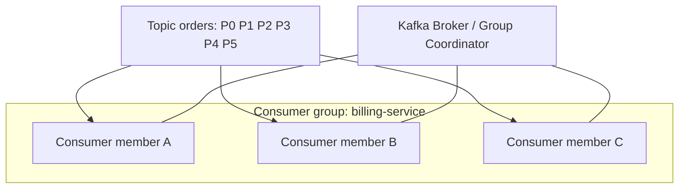

# Kiểm tra member trong group

Một consumer group có thể gồm nhiều consumer instance cùng đọc dữ liệu từ một hoặc nhiều topic. Khi vận hành Spring Kafka, cần biết instance nào đang tham gia group, broker nhìn thấy client từ host nào, mỗi member đang giữ những partition nào và group có đang ổn định hay đang rebalance.

Kiểm tra member giúp trả lời những câu hỏi như: ứng dụng có đủ consumer instance đang chạy không, một pod có đang giữ quá nhiều partition không, vì sao một consumer không nhận partition nào, có member cũ còn tham gia group không, và group đang rebalance hay đã ổn định.

Bài học sử dụng Kafka command-line tools và `AdminClient` để quan sát membership. Nội dung tập trung vào consumer group dùng Kafka Consumer API, thường gặp khi Spring Kafka chạy `@KafkaListener`.

## 1. Member trong consumer group là gì?

Consumer group là tập hợp các consumer cùng dùng một `group.id`. Kafka phối hợp các member trong group để phân phối partition của những topic mà chúng subscribe.

Ví dụ dịch vụ thanh toán có:

- Group ID: `billing-service`.
- Topic: `orders` có 6 partition.
- 3 application instance, mỗi instance chạy một Kafka listener container.
- Mỗi container tạo một Kafka consumer tham gia cùng group.

Khi group ổn định, các partition được chia giữa các member. Một partition của consumer group thông thường chỉ được giao cho một member tại một thời điểm.



Trong Spring Kafka, một application instance có thể có nhiều listener container hoặc một concurrent listener container có nhiều consumer con. Vì vậy, số member trong Kafka group không nhất thiết bằng số pod.

Ví dụ `concurrency = 3` trên một `@KafkaListener` có thể tạo ba consumer member trong cùng application instance, nếu cả ba consumer cùng dùng một `group.id`.

## 2. Phân biệt group, member, client và instance

Khi xem thông tin group, cần phân biệt các định danh:

| Khái niệm | Ý nghĩa | Ví dụ |
|---|---|---|
| `group.id` | Định danh consumer group | `billing-service` |
| `member.id` | ID do Kafka coordinator gán cho member đang tham gia | `consumer-...-uuid` |
| `client.id` | Tên client do ứng dụng cấu hình để nhận diện client trong log/metric | `billing-consumer-1` |
| `group.instance.id` | Định danh instance ổn định do ứng dụng cấp khi dùng static membership | `billing-pod-2` |
| `host` | Địa chỉ client mà broker nhìn thấy | `/10.2.1.15` |

`member.id` thường được tạo động và có thể thay đổi sau khi consumer rời group rồi tham gia lại. Không dùng nó làm ID bền vững cho pod hoặc service instance.

`client.id` có thể được cấu hình qua Kafka consumer properties. Với Spring Boot, có thể dùng `spring.kafka.consumer.client-id`; khi container chạy concurrency, Spring Kafka có thể thêm hậu tố để phân biệt các consumer con.

`group.instance.id` được dùng cho static membership. Khi ứng dụng cấu hình giá trị duy nhất cho mỗi consumer instance, Kafka có thể giữ membership qua một số lần khởi động lại ngắn và giảm rebalance không cần thiết. Giá trị này phải duy nhất trong cùng group. Không dùng cùng một giá trị cho nhiều pod đang chạy đồng thời.

`host` là địa chỉ mà broker quan sát được. Trong Kubernetes hoặc môi trường NAT/proxy, địa chỉ này có thể là IP container hoặc địa chỉ mạng đã dịch; nó không nhất thiết là hostname dễ đọc của pod.

## 3. Member có những thông tin nào?

Thông tin member thường cần kiểm tra gồm:

- Member ID và client ID.
- Host/IP mà broker nhìn thấy.
- Số partition được giao.
- Danh sách topic-partition assignment.
- Group instance ID nếu có static membership.
- Group state và partition assignor ở cấp group.
- Coordinator đang quản lý group.

Ví dụ minh họa:

| Member | Client ID | Host | Số partition | Assignment |
|---|---|---|---:|---|
| `consumer-A` | `billing-1` | `10.2.1.15` | 2 | `orders-0`, `orders-3` |
| `consumer-B` | `billing-2` | `10.2.1.16` | 2 | `orders-1`, `orders-4` |
| `consumer-C` | `billing-3` | `10.2.1.17` | 2 | `orders-2`, `orders-5` |

Assignment cho biết partition hiện được giao cho member nào. Nó không cho biết member xử lý nhanh hay chậm, cũng không trực tiếp cho biết consumer lag.

Để kiểm tra hiệu suất, phải kết hợp membership với offset, lag, throughput và thời gian xử lý record.

## 4. Liệt kê consumer group bằng Kafka CLI

Kafka phân phối script `kafka-consumer-groups.sh` trong thư mục `bin`. Trên Windows, bản phân phối Kafka có thể cung cấp script `kafka-consumer-groups.bat` trong thư mục `bin/windows`.

Liệt kê consumer group:

```bash
bin/kafka-consumer-groups.sh --bootstrap-server kafka-1:9092 --list
```

Trên Windows:

```powershell
.\bin\windows\kafka-consumer-groups.bat --bootstrap-server kafka-1:9092 --list
```

Nếu cần truyền cấu hình bảo mật cho CLI, dùng `--command-config` trỏ đến file client properties đã được cấp quyền truy cập:

```bash
bin/kafka-consumer-groups.sh --bootstrap-server kafka-1:9092 --command-config client.properties --list
```

Không ghi username, password, private key hoặc secret trực tiếp vào command history. Hãy bảo vệ file cấu hình và quyền đọc của nó.

Từ Kafka 4.2, `kafka-groups.sh` là công cụ tổng quát để liệt kê nhiều loại group như consumer, share và streams. Khi vận hành consumer group thông thường, `kafka-consumer-groups.sh` vẫn là công cụ trực tiếp và dễ dùng.

## 5. Xem danh sách member đang hoạt động

Dùng `--describe --members` để liệt kê các member đang hoạt động của một consumer group:

```bash
bin/kafka-consumer-groups.sh --bootstrap-server kafka-1:9092 --describe --group billing-service --members
```

Kết quả thường có các cột:

| Cột | Ý nghĩa |
|---|---|
| `CONSUMER-ID` | Member ID do Kafka cấp |
| `HOST` | Host/IP của client |
| `CLIENT-ID` | Client ID của consumer |
| `#PARTITIONS` | Số partition đang được giao cho member |

Ví dụ:

```text
CONSUMER-ID       HOST          CLIENT-ID       #PARTITIONS
consumer-A        /10.2.1.15    billing-1       2
consumer-B        /10.2.1.16    billing-2       2
consumer-C        /10.2.1.17    billing-3       2
```

Lệnh này chỉ hiển thị member đang hoạt động tại thời điểm broker trả lời. Nếu group tồn tại nhưng không có consumer đang tham gia, danh sách member có thể rỗng.

Không suy luận rằng group không tồn tại chỉ vì không thấy member. Hãy kiểm tra group state và offset riêng.

## 6. Xem partition được giao cho từng member

Thêm `--verbose` để xem assignment:

```bash
bin/kafka-consumer-groups.sh --bootstrap-server kafka-1:9092 --describe --group billing-service --members --verbose
```

Kết quả có thêm cột `ASSIGNMENT`:

```text
CONSUMER-ID   HOST          CLIENT-ID   #PARTITIONS   ASSIGNMENT
consumer-A    /10.2.1.15    billing-1   2             orders(0,3)
consumer-B    /10.2.1.16    billing-2   2             orders(1,4)
consumer-C    /10.2.1.17    billing-3   2             orders(2,5)
```

Có thể dùng output này để:

- Xác định member đang sở hữu một partition cụ thể.
- Kiểm tra assignment có cân bằng về số lượng partition hay không.
- Kiểm tra consumer mới đã nhận partition sau khi scale out.
- Phát hiện member có assignment rỗng.
- Đối chiếu assignment trước và sau khi rebalance.

Assignment không nhất thiết phải chia đều tuyệt đối trong mọi trường hợp. Consumer có thể subscribe nhiều topic với số partition khác nhau; assignor có thể tối ưu theo chiến lược riêng.

Một member có `#PARTITIONS = 0` vẫn có thể đang tham gia group hợp lệ. Điều này thường xuất hiện khi số consumer lớn hơn số partition có thể phân phối, hoặc khi member đang trong quá trình rebalance.

## 7. Kiểm tra trạng thái group, coordinator và assignor

Dùng `--state` để xem trạng thái tổng thể của group:

```bash
bin/kafka-consumer-groups.sh --bootstrap-server kafka-1:9092 --describe --group billing-service --state
```

Kết quả có thể gồm:

```text
COORDINATOR (ID)    ASSIGNMENT-STRATEGY   STATE    #MEMBERS
kafka-2:9092 (2)    range                 Stable   3
```

Các trường:

- `COORDINATOR`: broker đang làm group coordinator.
- `ASSIGNMENT-STRATEGY`: chiến lược phân phối partition được sử dụng.
- `STATE`: trạng thái hiện tại của group.
- `#MEMBERS`: số member hiện được ghi nhận trong group.

Một số trạng thái thường gặp:

| State | Ý nghĩa vận hành |
|---|---|
| `Stable` | Group đã ổn định và assignment hiện hành đã được áp dụng |
| `PreparingRebalance` | Group đang chuẩn bị rebalance |
| `CompletingRebalance` | Group đang hoàn tất quá trình rebalance |
| `Empty` | Group không có member đang hoạt động |
| `Dead` | Group đã bị xóa hoặc không còn trạng thái hoạt động |
| `Unknown` | Client không nhận diện được state do khác phiên bản hoặc dữ liệu trả về |

Với consumer group protocol mới, Kafka còn có thể hiển thị các state như `Assigning` hoặc `Reconciling`. Tên state và trường output phụ thuộc phiên bản broker và protocol đang sử dụng.

Không kết luận group bị lỗi chỉ vì quan sát thấy `PreparingRebalance` trong một lần chụp. Rebalance có thể diễn ra rất ngắn khi một consumer mới tham gia hoặc một consumer rời group. Hãy lấy thêm vài mẫu theo thời gian và đối chiếu log/metric.

## 8. Phân biệt membership và consumer lag

Membership và lag trả lời hai câu hỏi khác nhau:

- Membership: consumer nào đang tham gia group và đang giữ partition nào?
- Lag: consumer group đang chậm bao nhiêu record so với cuối log của partition?

Xem offset/lag:

```bash
bin/kafka-consumer-groups.sh --bootstrap-server kafka-1:9092 --describe --group billing-service
```

Output offset thường có:

| Cột | Ý nghĩa |
|---|---|
| `TOPIC` | Topic được consume |
| `PARTITION` | Partition |
| `CURRENT-OFFSET` | Offset đã commit của group |
| `LOG-END-OFFSET` | Offset cuối log mà broker báo cáo |
| `LAG` | Khoảng cách giữa log end và committed offset |
| `CONSUMER-ID` | Member đang giữ partition nếu có |
| `HOST` | Host của member |
| `CLIENT-ID` | Client ID của member |

Ví dụ:

```text
TOPIC   PARTITION   CURRENT-OFFSET   LOG-END-OFFSET   LAG   CONSUMER-ID
orders  0           100              110              10    consumer-A
orders  1           120              120              0     consumer-B
orders  2           90               150              60    consumer-C
```

Một member vẫn có thể đang hoạt động nhưng lag tăng nếu xử lý chậm, downstream bị nghẽn hoặc record liên tục được producer ghi vào.

Ngược lại, group có thể không có member đang hoạt động nhưng vẫn còn committed offset và lag. Đây là lý do phải kiểm tra cả `--members`, `--state` và `--describe` mặc định.

Lưu ý: `CURRENT-OFFSET` là committed offset, không phải chính xác vị trí record đang được xử lý trong bộ nhớ. Với commit theo batch hoặc manual acknowledgment, offset có thể cập nhật muộn hơn thời điểm listener hoàn tất một record.

## 9. Liên hệ số member với partition và concurrency

Trong consumer group thông thường, một partition chỉ được một consumer member trong group sở hữu tại một thời điểm. Do đó, số partition là giới hạn song song tối đa theo partition của group.

Ví dụ topic có 6 partition:

| Số member | Phân phối điển hình | Nhận xét |
|---:|---|---|
| 1 | 6 partition cho 1 member | Một consumer xử lý toàn bộ |
| 2 | 3 partition/member | Có thể tăng song song |
| 3 | 2 partition/member | Phân phối đều trong ví dụ |
| 6 | 1 partition/member | Đạt mức song song theo partition |
| 8 | 6 member có partition, 2 member rỗng | Hai consumer không nhận partition |

Nếu có 3 partition và cấu hình `concurrency = 5`, không có nghĩa Kafka xử lý song song 5 partition. Hai consumer có thể không được giao partition.

Trong Spring Kafka, cần phân biệt:

- Số application instance (pod/process).
- Số listener container.
- Thuộc tính `concurrency` của concurrent listener.
- Số consumer member quan sát được trong Kafka group.
- Số partition của topic được subscribe.

Nếu một group có nhiều listener cùng `group.id`, tất cả consumer thuộc group đó cùng chia sẻ partition assignment. Nếu mỗi listener vô tình dùng group ID khác nhau, chúng sẽ tạo các group độc lập và mỗi group có thể đọc toàn bộ topic.

## 10. Kiểm tra member bằng AdminClient

Khi cần đưa thông tin member vào công cụ giám sát hoặc trang quản trị, có thể dùng `AdminClient` (interface hiện đại là `Admin`) thay vì gọi CLI.

Ví dụ dưới đây mô tả một consumer group đã biết ID:

```java
import java.util.Collection;
import java.util.List;
import java.util.Map;
import java.util.HashMap;
import java.util.concurrent.TimeUnit;

import org.apache.kafka.clients.admin.Admin;
import org.apache.kafka.clients.admin.AdminClientConfig;
import org.apache.kafka.clients.admin.ConsumerGroupDescription;
import org.apache.kafka.clients.admin.MemberDescription;
import org.apache.kafka.common.TopicPartition;

public class ConsumerGroupInspector {

    public static void inspect(String bootstrapServers, String groupId)
            throws Exception {

        Map<String, Object> properties = new HashMap<>();
        properties.put(
            AdminClientConfig.BOOTSTRAP_SERVERS_CONFIG,
            bootstrapServers
        );

        try (Admin admin = Admin.create(properties)) {
            Map<String, ConsumerGroupDescription> descriptions =
                admin.describeConsumerGroups(List.of(groupId))
                    .all()
                    .get(10, TimeUnit.SECONDS);

            ConsumerGroupDescription group = descriptions.get(groupId);

            if (group == null) {
                System.out.println("Group description not returned: " + groupId);
                return;
            }

            System.out.println("Group ID: " + group.groupId());
            System.out.println("State: " + group.groupState());
            System.out.println("Type: " + group.type());
            System.out.println("Coordinator: " + group.coordinator());
            System.out.println("Assignor: " + group.partitionAssignor());
            System.out.println("Member count: " + group.members().size());

            for (MemberDescription member : group.members()) {
                Collection<TopicPartition> partitions =
                    member.assignment().topicPartitions();

                System.out.println("Member ID: " + member.consumerId());
                System.out.println("Client ID: " + member.clientId());
                System.out.println("Host: " + member.host());
                System.out.println(
                    "Group instance ID: " +
                    member.groupInstanceId().orElse("(dynamic member)")
                );
                System.out.println("Assignment: " + partitions);
            }
        }
    }
}
```

Ví dụ dùng Kafka Admin API 4.x, trong đó:

- `describeConsumerGroups` trả về mô tả group.
- `groupState()` trả về trạng thái group.
- `members()` trả về danh sách member.
- `assignment().topicPartitions()` trả về partition được giao cho member.
- `coordinator()` trả về node đang điều phối group.
- `partitionAssignor()` cho biết assignor của group khi thông tin này có sẵn.

Từ Kafka 4.0, `ConsumerGroupDescription.state()` đã deprecated để chuyển sang `groupState()`. Với Kafka 3.x, API thường dùng `state()`; hãy chọn method theo version Kafka client mà ứng dụng compile.

`Admin` là client quản trị độc lập với consumer đang chạy. Nó không tham gia group và không làm thay đổi assignment khi gọi API describe.

## 11. Liệt kê group bằng Admin API

Từ Kafka 4.1, `Admin.listConsumerGroups()` đã deprecated để chuyển sang `listGroups(ListGroupsOptions)`.

Ví dụ Kafka 4.1+:

```java
import java.util.Collection;
import java.util.concurrent.TimeUnit;

import org.apache.kafka.clients.admin.Admin;
import org.apache.kafka.clients.admin.GroupListing;
import org.apache.kafka.clients.admin.ListGroupsOptions;

Collection<GroupListing> groups =
    admin.listGroups(ListGroupsOptions.forConsumerGroups())
        .all()
        .get(10, TimeUnit.SECONDS);

for (GroupListing group : groups) {
    System.out.printf(
        "groupId=%s type=%s protocol=%s state=%s%n",
        group.groupId(),
        group.type().orElse(null),
        group.protocol(),
        group.groupState().orElse(null)
    );
}
```

`ListGroupsOptions.forConsumerGroups()` giới hạn kết quả vào consumer group. Nếu cần lọc theo state, có thể dùng `inGroupStates(...)` trên options.

Với Kafka client cũ hơn, API `listConsumerGroups()` có thể vẫn được dùng. Hãy đối chiếu Javadoc theo đúng phiên bản Kafka client trong dependency tree.

Danh sách group không đồng nghĩa danh sách member. Sau khi xác định group ID, gọi `describeConsumerGroups` để đọc các member và assignment.

## 12. Đọc member assignment và xử lý số consumer dư

Nếu group có 6 partition nhưng quan sát được 8 member, hai member có thể có assignment rỗng. Đây không nhất thiết là lỗi.

Kiểm tra theo trình tự:

1. Xác nhận group state đã `Stable`.
2. Xem số member thực tế.
3. Xem `#PARTITIONS` của từng member.
4. Xem assignment verbose để biết member nào rỗng.
5. Đối chiếu số partition của các topic mà group subscribe.
6. Kiểm tra `concurrency` và số application instance.

Nếu số member lớn hơn số partition, giảm concurrency có thể giảm tài nguyên consumer dư. Tuy nhiên, trước khi thay đổi deployment, cần kiểm tra liệu listener có subscribe nhiều topic hoặc pattern khiến tổng số partition lớn hơn một topic riêng lẻ.

Không chỉ dựa vào một topic để kết luận tổng số partition có thể được giao. Group có thể subscribe nhiều topic.

## 13. Kiểm tra static membership

Spring Kafka cho phép truyền cấu hình consumer `group.instance.id` để sử dụng static membership.

Khi static member được cấu hình:

- `group.instance.id` định danh instance logic do ứng dụng cấp.
- `member.id` vẫn là định danh member do coordinator quản lý.
- Mỗi instance trong cùng group phải có `group.instance.id` khác nhau.
- Khi instance khởi động lại trong khoảng thời gian phù hợp, Kafka có thể giữ chỗ member và tránh một số rebalance không cần thiết.

Ví dụ cấu hình:

```yaml
spring:
  kafka:
    consumer:
      group-id: billing-service
      properties:
        group.instance.id: billing-pod-1
```

Giá trị `billing-pod-1` chỉ là ví dụ. Trong Kubernetes, nên cấp giá trị duy nhất theo identity của từng pod. Không dùng một giá trị cố định chung cho tất cả replica vì các instance sẽ xung đột membership.

Khi kiểm tra member, so sánh `group.instance.id` với danh sách pod đang chạy để phát hiện cấu hình trùng hoặc instance cũ chưa rời group.

Static membership có thể trì hoãn việc thu hồi partition khi instance mất kết nối tạm thời. Vì vậy, khi một member biến mất, cần xem xét session timeout và trạng thái group thay vì kỳ vọng partition luôn được chuyển ngay lập tức.

Với `ConcurrentMessageListenerContainer`, Spring Kafka hỗ trợ static membership khi `concurrency > 1` và tự thêm hậu tố `-n` vào `group.instance.id` của các consumer con (từ Spring Kafka 2.3.8/2.4.6). Nhờ đó mỗi child có định danh riêng. Khi điều tra, hãy xem giá trị member thực tế mà broker trả về và version Spring Kafka đang chạy.

## 14. Consumer group protocol và assignor

Kafka có hai hướng protocol group phổ biến:

- Classic consumer group protocol.
- Consumer group protocol mới (consumer protocol), được giới thiệu để cải thiện quá trình rebalance.

Với classic protocol, assignor thường được cấu hình qua `partition.assignment.strategy`, ví dụ Range, RoundRobin hoặc CooperativeSticky.

Với consumer protocol mới, một số cấu hình phân phối chuyển sang broker-side assignor và thuộc tính `group.remote.assignor`. Các trường assignor trong CLI/Admin API cần được đọc theo protocol và phiên bản broker.

Không suy luận rằng `partitionAssignor` luôn phải có cùng giá trị trong mọi protocol. Nếu giá trị rỗng hoặc không như mong đợi, hãy xác định group type/protocol trước khi chẩn đoán.

Khi dùng consumer protocol mới, tài khoản quản trị cần quyền `DESCRIBE` trên các topic mà member subscribe để xem group details. Với classic protocol, yêu cầu quyền topic trong thao tác describe group có khác biệt. Vì vậy, lỗi authorization có thể chỉ xuất hiện khi chuyển group sang protocol mới.

## 15. Những lỗi thường gặp khi kiểm tra member

| Hiện tượng | Nguyên nhân có thể | Cách kiểm tra |
|---|---|---|
| Không thấy member nào | Consumer chưa chạy, group đang empty hoặc group ID sai | `--state`, kiểm tra application log và group ID |
| Member count thấp hơn số pod | Listener chưa khởi động, group ID khác nhau hoặc concurrency thấp | Đối chiếu cấu hình `group.id`, `concurrency` và client ID |
| Một member có 0 partition | Số consumer lớn hơn số partition hoặc group đang rebalance | Kiểm tra state, số partition và verbose assignment |
| Một member giữ nhiều partition | Tổng member ít hoặc assignor phân phối theo subscription | Kiểm tra số partition, topic subscription và assignor |
| Member ID thay đổi | Consumer rời group rồi tham gia lại | Dùng client ID, host và group instance ID để đối chiếu |
| Host không giống hostname pod | NAT, container network hoặc proxy | Kiểm tra địa chỉ mà broker quan sát được và network topology |
| State liên tục rebalance | Consumer crash, timeout, deploy liên tục hoặc xử lý block | Kiểm tra log, heartbeat, poll interval và rolling deployment |
| Không xem được member/assignment | Thiếu quyền hoặc broker/client không tương thích | Kiểm tra ACL, group protocol và version |
| CLI báo group không tồn tại | Sai bootstrap cluster, sai group ID hoặc group metadata đã hết hạn | Kiểm tra cluster endpoint và liệt kê group |

## 16. Runbook kiểm tra member khi consumer không nhận record

Khi ứng dụng báo không nhận được event, thực hiện lần lượt:

**Bước 1 – Xác nhận đúng cluster và group ID**

```bash
bin/kafka-consumer-groups.sh --bootstrap-server kafka-1:9092 --list
```

Đối chiếu group ID với `spring.kafka.consumer.group-id` hoặc `groupId` trong `@KafkaListener`.

**Bước 2 – Kiểm tra group state**

```bash
bin/kafka-consumer-groups.sh --bootstrap-server kafka-1:9092 --describe --group billing-service --state
```

Nếu group liên tục ở trạng thái rebalance, xem log consumer và lịch sử restart/deploy.

**Bước 3 – Kiểm tra member và assignment**

```bash
bin/kafka-consumer-groups.sh --bootstrap-server kafka-1:9092 --describe --group billing-service --members --verbose
```

Đối chiếu client ID, host, số partition và assignment với replica đang chạy.

**Bước 4 – Kiểm tra lag và committed offset**

```bash
bin/kafka-consumer-groups.sh --bootstrap-server kafka-1:9092 --describe --group billing-service
```

Nếu có member và assignment nhưng lag tăng, điều tra throughput, lỗi listener, downstream và retry. Nếu lag bằng 0, consumer có thể đã theo kịp log tại thời điểm quan sát.

**Bước 5 – Đối chiếu log ứng dụng**

Tìm các dấu hiệu:

- Consumer joined group.
- Assigned partitions.
- Revoking partitions.
- Rebalance in progress.
- Heartbeat/session timeout.
- Commit failed hoặc authorization failed.
- Deserialization error hoặc listener exception.

Không reset offset chỉ vì member không nhận record. Reset offset là thao tác thay đổi vị trí đọc của group và có thể khiến ứng dụng bỏ qua hoặc đọc lại dữ liệu. Chỉ thực hiện khi đã xác định nguyên nhân và có kế hoạch phục hồi offset.

## 17. Bảo mật và quyền quan sát group

Lệnh describe group là thao tác đọc trạng thái nhưng vẫn chịu kiểm soát ACL.

Tài khoản vận hành nên được cấp quyền tối thiểu cần thiết:

- Quyền mô tả consumer group để đọc group metadata.
- Quyền `DESCRIBE` trên topic khi protocol/broker yêu cầu.
- Quyền truy cập broker theo cơ chế xác thực của cluster.

Nếu dùng SASL/SSL, truyền cấu hình qua file `--command-config` được bảo vệ. Không đưa secret vào output, log hoặc tài liệu hướng dẫn.

Khi ứng dụng AdminClient dùng service account riêng, cần bảo đảm account đó có quyền mô tả group và topic tương ứng. Đừng cấp quyền ghi hoặc thay đổi offset chỉ để đọc danh sách member.

## 18. Checklist vận hành

- Đã xác nhận đúng `bootstrap-server` và `group.id`.
- Biết số pod, số listener container và `concurrency` dự kiến.
- Kiểm tra được danh sách member bằng `--members`.
- Kiểm tra được partition assignment bằng `--members --verbose`.
- Kiểm tra được group state, coordinator và assignor bằng `--state`.
- Đối chiếu membership với offset/lag.
- Phân biệt `member.id`, `client.id` và `group.instance.id`.
- Xác minh số consumer không vượt quá nhu cầu song song theo partition.
- Kiểm tra static membership có ID duy nhất cho từng instance.
- Xem xét group protocol khi trường assignor hoặc quyền describe thay đổi.
- Dùng tài khoản read-only với ACL tối thiểu.
- Không reset offset hoặc xóa group trong bước quan sát member.

## 19. Ghi nhớ

- Member là consumer instance đang tham gia một consumer group.
- `member.id` do Kafka cấp; `client.id` do ứng dụng cấu hình; `group.instance.id` dùng cho static membership.
- `--describe --members` hiển thị member, host, client ID và số partition.
- `--members --verbose` hiển thị partition assignment của từng member.
- `--state` cho biết trạng thái group, coordinator và assignor.
- Membership không đồng nghĩa với lag; cần xem cả offset và lag.
- Số member có thể lớn hơn số partition, khi đó có member không nhận partition.
- AdminClient `describeConsumerGroups` cho phép đọc member và assignment từ Java.
- Kafka 4.1+ ưu tiên `listGroups(ListGroupsOptions)` thay cho `listConsumerGroups`.
- Kiểm tra group là thao tác quan sát; reset offset và xóa group là thao tác thay đổi trạng thái cần quy trình riêng.

Khi kiểm tra member cùng group state và assignment, đội vận hành có thể xác định consumer nào thực sự tham gia group, partition đang nằm ở đâu và group có đang ổn định hay không. Kết hợp dữ liệu này với lag, log listener và cấu hình concurrency giúp chẩn đoán luồng messaging Spring Kafka chính xác hơn.

## Tài liệu tham khảo

- [Apache Kafka – Basic Kafka Operations: Managing Consumer Groups](https://kafka.apache.org/42/operations/basic-kafka-operations/)
- [Apache Kafka – Admin API](https://kafka.apache.org/44/javadoc/org/apache/kafka/clients/admin/Admin.html)
- [Apache Kafka – ConsumerGroupDescription API](https://kafka.apache.org/44/javadoc/org/apache/kafka/clients/admin/ConsumerGroupDescription.html)
- [Apache Kafka – MemberDescription API](https://kafka.apache.org/44/javadoc/org/apache/kafka/clients/admin/MemberDescription.html)
- [Apache Kafka – ListGroupsOptions API](https://kafka.apache.org/44/javadoc/org/apache/kafka/clients/admin/ListGroupsOptions.html)
- [Apache Kafka – GroupState API](https://kafka.apache.org/44/javadoc/org/apache/kafka/common/GroupState.html)
- [Apache Kafka – Consumer Configs](https://kafka.apache.org/44/configuration/consumer-configs/)
- [Spring Kafka – Message Listener Containers](https://docs.spring.io/spring-kafka/reference/kafka/receiving-messages/message-listener-container.html)


