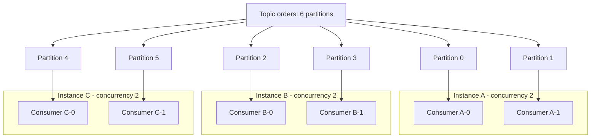

# Triển khai nhiều instance

Khi một ứng dụng Spring Kafka được triển khai thành nhiều instance, các instance có thể cùng tham gia một consumer group để chia nhau xử lý partition, đồng thời producer của mỗi instance có thể gửi sự kiện tới cùng các topic. Cách triển khai này giúp tăng năng lực tiêu thụ và khả năng chịu lỗi, nhưng chỉ hiệu quả khi số partition, concurrency, định danh producer, tài nguyên downstream và quy trình rollout được cấu hình nhất quán.

Một lỗi thường gặp là tăng số replica mà không tính số partition, hoặc để mọi replica dùng chung `transactionIdPrefix`. Trường hợp đầu làm một số consumer không có partition để xử lý; trường hợp sau có thể khiến producer transactional fencing lẫn nhau. Bài học này trình bày cách thiết kế deployment nhiều instance, cấu hình Spring Boot, scale consumer group và vận hành rolling update an toàn.

## 1. Nhiều instance tham gia cùng consumer group

Kafka phân phối partition của một subscription cho các consumer thuộc cùng consumer group. Trong cùng group, một partition chỉ được gán cho tối đa một consumer tại một thời điểm. Khi một instance mới tham gia hoặc một instance rời đi, group có thể rebalance để phân phối lại partition.

Giả sử có ba instance `order-service`, mỗi instance chạy một listener container với concurrency bằng hai. Tổng số consumer trong group là tối đa sáu:



Trong ví dụ, sáu partition có thể được phân phối cho sáu consumer. Nếu topic chỉ có bốn partition, tối đa bốn consumer nhận partition; hai consumer còn lại không có dữ liệu để tiêu thụ trong group đó. Vì vậy, số replica không tự động quyết định throughput. Giới hạn song song còn phụ thuộc số partition và năng lực xử lý mỗi partition.

| Số instance | Concurrency mỗi instance | Tổng consumer tối đa | Partition | Consumer có thể được gán partition |
|---:|---:|---:|---:|---:|
| 1 | 2 | 2 | 6 | 2 |
| 2 | 2 | 4 | 6 | 4 |
| 3 | 2 | 6 | 6 | 6 |
| 4 | 2 | 8 | 6 | 6 |

Khi nhiều instance cùng xử lý một subscription, phải dùng cùng `group.id` nếu mục tiêu là chia tải. Nếu mỗi instance dùng group ID khác nhau, mỗi group sẽ nhận toàn bộ luồng record độc lập; đó là fan-out, không phải scale-out một consumer group.

## 2. Chọn số instance và concurrency

Spring Kafka `ConcurrentMessageListenerContainer` tạo nhiều consumer con theo `concurrency`. Giá trị này áp dụng cho một listener container trên một instance. Tổng consumer trong group gần đúng bằng:

\[
C_{total} = N_{instances} \times C_{per\ instance}
\]

Số consumer có thể hoạt động trên subscription bị giới hạn bởi số partition:

\[
C_{active} \leq \min(C_{total}, P)
\]

Trong đó `P` là tổng số partition của các topic được subscription sử dụng. Nếu có nhiều listener container dùng cùng group và subscription, cần tính tất cả consumer của chúng, không chỉ một annotation `@KafkaListener`.

Ví dụ cấu hình concurrency qua Spring Boot:

```yaml
spring:
  kafka:
    consumer:
      group-id: order-service
    listener:
      concurrency: 2
```

Hoặc cấu hình riêng factory:

```java
@Bean
ConcurrentKafkaListenerContainerFactory<String, OrderEvent>
        orderListenerFactory(ConsumerFactory<String, OrderEvent> consumerFactory) {

    var factory = new ConcurrentKafkaListenerContainerFactory<String, OrderEvent>();
    factory.setConsumerFactory(consumerFactory);
    factory.setConcurrency(2);
    return factory;
}
```

Không tăng concurrency chỉ vì CPU còn dư. Hãy xác định nút thắt: số partition, thời gian xử lý listener, database connection pool, downstream rate limit, CPU, heap hoặc consumer lag. Nếu tất cả partition đã có consumer hoạt động và database đã bão hòa, thêm instance có thể làm tăng contention mà không tăng throughput.

## 3. Cấu hình dùng chung và cấu hình riêng theo instance

Các instance của cùng service thường cần dùng chung những cấu hình xác định logic nghiệp vụ và consumer group:

- `group.id` của listener cần giống nhau nếu các instance chia tải.
- Danh sách topic, deserializer, schema và quy tắc xử lý cần tương thích.
- Security principal có thể dùng chung nếu cùng workload và cùng phạm vi quyền, hoặc tách theo instance nếu chính sách vận hành yêu cầu.
- `concurrency` và các giới hạn tài nguyên có thể thay đổi theo loại workload hoặc kích thước instance, nhưng phải tính tổng consumer trong group.

Một số giá trị phải duy nhất theo instance hoặc theo producer factory:

- `transactionIdPrefix` của Spring Kafka transactional producer.
- `group.instance.id` nếu bật static membership; mỗi consumer member phải có identity duy nhất trong group.
- Port quản trị, local state directory hoặc file tạm nếu các instance dùng chung host/volume.

Ví dụ cấu hình dùng biến môi trường:

```yaml
spring:
  kafka:
    bootstrap-servers: ${KAFKA_BOOTSTRAP_SERVERS}
    consumer:
      group-id: order-service
      enable-auto-commit: false
    producer:
      transaction-id-prefix: ${INSTANCE_ID}-order-service-
    listener:
      concurrency: ${KAFKA_LISTENER_CONCURRENCY:2}
```

`INSTANCE_ID` phải khác nhau giữa các instance đang hoạt động đồng thời nếu dùng transactional producer. Trong Kubernetes có thể dùng tên pod làm instance ID, miễn là tên đó duy nhất trong phạm vi deployment. Không đặt prefix cố định như `order-service-` cho mọi replica.

Nếu service không sử dụng Kafka transaction, không cần cấu hình `transactionIdPrefix`. Nếu có transactional listener hoặc `KafkaTemplate` gửi trong transaction, phải bảo đảm producer factory được cấu hình đúng và prefix duy nhất.

## 4. Tránh producer fencing khi chạy nhiều replica

Kafka dùng `transactional.id` để nhận diện transactional producer. Spring Kafka tạo ID này từ `transactionIdPrefix` cộng suffix do producer factory quản lý. Nếu hai instance có thể tạo cùng transactional ID, producer mới có thể fencing producer cũ; transaction đang chạy có thể bị abort và gửi record thất bại.

Ví dụ ba pod nên có prefix riêng:

| Instance | `transactionIdPrefix` |
|---|---|
| `order-service-a` | `order-service-a-` |
| `order-service-b` | `order-service-b-` |
| `order-service-c` | `order-service-c-` |

Trong Kubernetes:

```yaml
spring:
  kafka:
    producer:
      transaction-id-prefix: ${HOSTNAME}-orders-
```

`HOSTNAME` thường được đặt thành tên pod. Trong rolling update, pod mới có tên khác pod cũ nên dải transactional ID không đụng nhau. Khi một logical instance được khởi động lại với cùng identity sau khi instance cũ đã dừng, Kafka có thể fencing producer cũ còn sót lại; đây là một phần của cơ chế bảo vệ transactional ID.

Nếu một service có nhiều producer factory transactional, thêm vai trò factory vào prefix, ví dụ `${HOSTNAME}-orders-outbound-` và `${HOSTNAME}-orders-audit-`. Kiểm tra producer factory mà `KafkaTemplate` và `KafkaTransactionManager` thực sự sử dụng.

## 5. Triển khai trên Kubernetes

Một Deployment Kubernetes thường quản lý số replica và cập nhật phiên bản ứng dụng. Mỗi pod chạy một Spring Boot instance và tham gia consumer group bằng cùng group ID.

Ví dụ cấu hình rút gọn:

```yaml
apiVersion: apps/v1
kind: Deployment
metadata:
  name: order-service
spec:
  replicas: 3
  strategy:
    type: RollingUpdate
    rollingUpdate:
      maxSurge: 1
      maxUnavailable: 0
  selector:
    matchLabels:
      app: order-service
  template:
    metadata:
      labels:
        app: order-service
    spec:
      terminationGracePeriodSeconds: 60
      containers:
        - name: app
          image: example/order-service:1.0.0
          env:
            - name: INSTANCE_ID
              valueFrom:
                fieldRef:
                  fieldPath: metadata.name
            - name: KAFKA_BOOTSTRAP_SERVERS
              value: kafka-bootstrap:9092
            - name: KAFKA_LISTENER_CONCURRENCY
              value: "2"
          readinessProbe:
            httpGet:
              path: /actuator/health/readiness
              port: 8080
            periodSeconds: 10
          livenessProbe:
            httpGet:
              path: /actuator/health/liveness
              port: 8080
            periodSeconds: 10
```

Đây là ví dụ cấu trúc, cần bổ sung image, service account, resource requests/limits, secret, network policy và cấu hình health group theo môi trường. `maxSurge: 1` cho phép tạo thêm một pod trong lúc rollout; `maxUnavailable: 0` yêu cầu duy trì số pod sẵn sàng theo chiến lược Deployment. Với Kafka consumer, pod mới tham gia group có thể gây rebalance ngay cả khi pod cũ vẫn chạy.

Không xem readiness probe là công cụ trực tiếp điều khiển Kafka partition assignment. Readiness chỉ quyết định pod có nhận traffic từ Service hay không; consumer container có thể đã chạy và tham gia group. Nếu cần trì hoãn nhận record tới khi ứng dụng sẵn sàng, phải điều khiển lifecycle listener container rõ ràng hoặc dùng cơ chế startup tương ứng.

## 6. Readiness, liveness và trạng thái consumer

Readiness và liveness có mục đích khác nhau:

- **Liveness:** ứng dụng còn sống và có thể tiếp tục chạy hay không. Không nên fail liveness chỉ vì Kafka tạm thời mất kết nối, nếu việc restart pod liên tục không giúp phục hồi.
- **Readiness:** ứng dụng có sẵn sàng nhận traffic đồng bộ hay không. Với service chủ yếu tiêu thụ Kafka, cần định nghĩa rõ readiness có phụ thuộc broker connectivity, listener container state hay dependency nghiệp vụ nào.
- **Consumer health:** trạng thái kết nối, group membership, partition assignment, lag và lỗi xử lý. Đây là tín hiệu vận hành riêng, không thể thay thế hoàn toàn bằng HTTP health endpoint.

Nếu readiness gắn cứng với khả năng kết nối Kafka, broker outage có thể làm tất cả pod không ready nhưng cũng không tự giải quyết lỗi broker. Nếu liveness gắn với consumer lag, pod có thể bị restart liên tục khi tải tăng, làm group rebalance thêm và khiến tình hình xấu hơn. Chọn health indicator theo mục tiêu khôi phục, không biến một dependency outage thành vòng lặp restart.

Với ứng dụng có cả HTTP API và Kafka listener, có thể quản lý hai readiness concern riêng: khả năng phục vụ request và khả năng tiêu thụ event. Điều này giúp hệ thống vẫn cung cấp API trạng thái hoặc quản trị khi consumer đang tạm dừng.

## 7. Rolling update và graceful shutdown

Khi pod bị dừng, Kafka consumer rời group và partition được phân phối lại. Nếu ứng dụng tắt đột ngột trong lúc listener đang xử lý, record chưa commit có thể được giao lại. Điều đó là bình thường trong mô hình at-least-once; listener nên idempotent để xử lý an toàn khi nhận lại record.

Quy trình shutdown nên:

1. Ngừng nhận traffic mới nếu service có HTTP endpoint cần drain.
2. Dừng listener container theo lifecycle của Spring để consumer ngừng nhận record mới và rời group có kiểm soát.
3. Cho các listener đang xử lý hoàn tất trong khoảng thời gian shutdown được cấp.
4. Chỉ commit/ack offset khi xử lý đã hoàn tất theo `AckMode` và transaction policy.
5. Đóng producer, consumer và các dependency theo lifecycle của Spring.

Spring Kafka container hỗ trợ dừng có kiểm soát và chờ xử lý theo cấu hình shutdown timeout. Spring Boot cũng có timeout cho từng phase của graceful shutdown qua `spring.lifecycle.timeout-per-shutdown-phase`. Kubernetes `terminationGracePeriodSeconds` phải lớn hơn thời gian ứng dụng cần để drain và shutdown, có thêm khoảng dự phòng cho JVM dừng hoàn toàn.

Ví dụ cấu hình Spring Boot:

```yaml
server:
  shutdown: graceful

spring:
  lifecycle:
    timeout-per-shutdown-phase: 40s
  kafka:
    listener:
      ack-mode: record
```

`server.shutdown: graceful` áp dụng cho web server; lifecycle timeout áp dụng cho Spring bean phase. Kafka listener container có lifecycle riêng, vì vậy cần xác minh shutdown behavior và timeout của container theo phiên bản Spring Kafka đang dùng. Không chỉ tăng `terminationGracePeriodSeconds` mà bỏ qua thời gian dừng thực tế của container.

Nếu pod bị kill trước khi xử lý hoàn tất, record chưa commit sẽ được giao lại sau rebalance. Nếu listener đã ghi database nhưng chưa commit offset, cùng record có thể chạy lại; dùng unique event ID, inbox table hoặc thao tác idempotent để tránh cập nhật trùng.

## 8. Rebalance trong quá trình scale và deploy

Khi thêm hoặc bớt consumer, Kafka phải phân phối lại partition. Rebalance có thể làm tiêu thụ tạm dừng hoặc thay đổi consumer đang sở hữu partition. Một số nguyên nhân thường gặp:

- Deployment scale số replica lên hoặc xuống.
- Rolling update tạo pod mới và dừng pod cũ.
- Consumer không gọi `poll()` trong giới hạn `max.poll.interval.ms`.
- Mất kết nối hoặc heartbeat khiến broker loại member khỏi group.
- Thay đổi subscription hoặc cấu hình group.

Để giảm tác động:

- Chọn số partition và concurrency phù hợp với quy mô replica dự kiến.
- Giữ listener xử lý trong giới hạn poll; batch quá lớn hoặc xử lý downstream chậm có thể làm consumer rời group.
- Cân nhắc cooperative sticky assignment khi toàn bộ client và broker hỗ trợ tương thích; cách assign này có thể giảm lượng partition bị thu hồi trong một lần rebalance.
- Tránh scale lên/xuống liên tục theo metric nhiễu; dùng stabilization window và ngưỡng autoscaling hợp lý.
- Theo dõi rebalance rate, thời gian rebalance và partition assignment sau rollout.
- Thiết kế listener idempotent vì rebalance có thể dẫn tới giao lại record chưa commit.

Static membership qua `group.instance.id` có thể giảm rebalance khi một member khởi động lại nhanh với cùng identity, nhưng mỗi member cần ID duy nhất trong group. Không cấu hình một `group.instance.id` tĩnh giống nhau trên tất cả replica. Static membership cũng cần timeout và quy trình rollout phù hợp; nếu instance cũ chưa rời group mà instance mới dùng cùng ID, member có thể bị fencing.

## 9. Scale theo partition và năng lực downstream

Trước khi tăng replica, ước lượng số consumer hữu ích và kiểm tra năng lực downstream. Ví dụ topic có 12 partition, mỗi pod concurrency 2:

| Replica | Consumer tổng | Consumer tối đa có partition | Consumer dư |
|---:|---:|---:|---:|
| 2 | 4 | 4 | 0 |
| 4 | 8 | 8 | 0 |
| 6 | 12 | 12 | 0 |
| 8 | 16 | 12 | 4 |

Nếu throughput vẫn thấp ở 12 consumer hoạt động, hãy kiểm tra thời gian xử lý mỗi record, partition nóng, database pool, downstream rate limit và broker fetch. Tăng replica lên tám không tạo thêm song song khi topic chỉ có 12 partition và concurrency đã dùng hết.

Số partition cũng không bảo đảm tải phân phối đều. Key nóng có thể khiến một partition lag cao trong khi các partition khác rảnh. Khi đó, kiểm tra partition-level lag, phân bố key và thời gian xử lý theo partition trước khi tăng replica hoặc partition count.

Autoscaling dựa trên consumer lag có thể hữu ích, nhưng cần giới hạn min/max replica theo partition và năng lực downstream. Dùng lag cùng throughput, CPU, processing latency và backlog age; không scale chỉ theo một giá trị lag tức thời. Khi replica tăng, group rebalance có chi phí nên cần thời gian ổn định trước khi đánh giá kết quả.

## 10. Tách consumer group theo mục đích xử lý

Các service độc lập cần nhận cùng sự kiện nên dùng group ID riêng. Các replica của cùng một service dùng chung group ID để chia tải.

Ví dụ:

| Service | Consumer group | Mục đích |
|---|---|---|
| `order-projection` | `order-projection` | Cập nhật read model. |
| `notification-service` | `notification-service` | Gửi email hoặc thông báo. |
| `analytics-service` | `analytics-service` | Xử lý dữ liệu phân tích. |

Mỗi group nhận luồng record độc lập theo offset riêng. Trong từng group, các replica chia partition với nhau. Không dùng cùng group ID cho những service cần xử lý cùng một event theo các nghiệp vụ độc lập, vì Kafka sẽ phân phối record giữa chúng thay vì broadcast cho từng service.

## 11. Quan sát deployment nhiều instance

Theo dõi các tín hiệu ở cả cấp instance và cấp consumer group:

| Nhóm | Chỉ số cần quan sát | Mục đích |
|---|---|---|
| Deployment | Replica desired/ready, restart count, rollout duration | Xác định pod thiếu, restart hoặc rollout kéo dài. |
| Consumer group | Member count, partition assignment, rebalance count/duration | Phát hiện group không ổn định hoặc consumer không được gán partition. |
| Throughput | Records consumed rate theo group/partition | Đánh giá scale có tăng năng lực thực tế không. |
| Backlog | Consumer lag và tuổi record cũ nhất | Phát hiện consumer không theo kịp producer. |
| Listener | Processing latency p95/p99, failure và retry rate | Phát hiện batch hoặc downstream chậm. |
| Producer | Send failure, transaction abort, producer fencing | Phát hiện lỗi identity hoặc broker authorization. |
| Runtime | CPU, heap, GC, thread và connection pool | Xác định giới hạn tài nguyên của từng instance. |
| Downstream | Database latency, pool saturation, HTTP rate limit | Tránh scale consumer vượt năng lực hệ thống phụ thuộc. |

Ghi log nên có service name, instance/pod ID, listener ID, group ID, topic, partition và offset. Khi có rebalance hoặc lỗi transactional producer, những trường này giúp xác định instance nào rời group hoặc dùng prefix không đúng.

## 12. Checklist trước và sau khi triển khai nhiều instance

**Trước triển khai:**

1. Xác định consumer group nào cần chia tải và group nào cần fan-out độc lập.
2. Kiểm tra số partition, concurrency mỗi instance và tổng consumer dự kiến.
3. Cấu hình `group.id` nhất quán giữa replica của cùng workload.
4. Tạo `transactionIdPrefix` duy nhất theo instance và producer factory nếu dùng transaction.
5. Xác minh security principal và ACL cho tất cả instance.
6. Tính CPU, heap, connection pool và năng lực downstream ở mức replica tối đa.
7. Thiết kế readiness/liveness, graceful shutdown và thời gian termination phù hợp.
8. Bảo đảm listener idempotent và retry/offset policy an toàn khi rebalance.

**Sau triển khai:**

1. Xác minh tất cả replica kết nối đúng cluster và tham gia đúng group.
2. Kiểm tra partition assignment, số consumer active và consumer dư.
3. Theo dõi rebalance trong rollout và xác nhận group ổn định sau deploy.
4. Đo throughput, lag, processing latency, CPU, heap và downstream saturation.
5. Kiểm tra producer fencing, transaction abort và lỗi authorization.
6. Thử scale lên/xuống và dừng một pod để xác minh partition được phân phối lại.
7. Đối soát record chưa commit và tác động duplicate sau restart.

Triển khai nhiều instance Spring Kafka hiệu quả khi group ID, partition, concurrency và tài nguyên downstream được tính như một hệ thống thống nhất. Mỗi replica cần identity riêng cho transactional producer, quy trình shutdown phải cho listener thời gian hoàn tất, và metric phải cho thấy scale có thực sự tăng throughput hay chỉ tạo thêm consumer và rebalance. Khi các điều kiện đó được kiểm soát, service có thể mở rộng ngang mà vẫn giữ được tính đúng đắn của luồng sự kiện.
