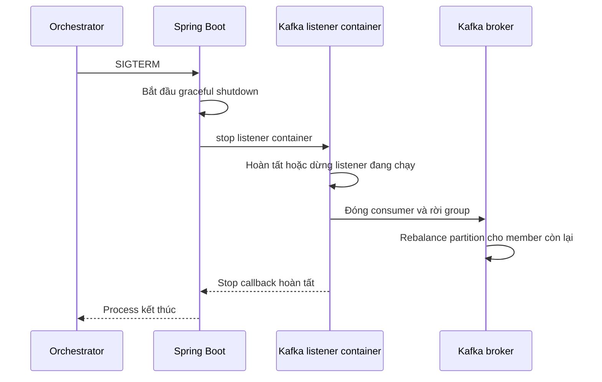

# Shutdown và rebalance an toàn

Một ứng dụng Spring Kafka cần dừng consumer có trật tự khi nhận tín hiệu kết thúc tiến trình, triển khai phiên bản mới hoặc thay đổi cấu hình. Nếu container dừng quá sớm, record đang xử lý có thể chưa được xác nhận và sẽ được giao lại. Nếu consumer rời group đột ngột, Kafka phải rebalance partition cho các member còn lại.

Shutdown an toàn vì thế cần phối hợp vòng đời Spring, listener container, acknowledgement/transaction và thời gian dừng của nền tảng triển khai. Mục tiêu là hoàn tất công việc đang chạy trong giới hạn thời gian, để record chưa commit có thể được xử lý lại an toàn và consumer group sớm ổn định.

## 1. Điều gì xảy ra khi ứng dụng nhận SIGTERM?

Trong môi trường như Kubernetes hoặc hệ thống quản lý process, ứng dụng thường nhận `SIGTERM` trước khi bị buộc kết thúc. Với Spring Boot, tín hiệu này dẫn đến đóng `ApplicationContext`; các listener container do Spring quản lý được dừng theo lifecycle của chúng.



Container được khai báo bằng `@KafkaListener` do `KafkaListenerEndpointRegistry` quản lý. Khi application context đóng, Spring Kafka dừng các container này. Không cần tự tạo thread gọi `KafkaConsumer.close()`; consumer thuộc quyền sở hữu của container và phải được quản lý qua lifecycle của container.

Nếu ứng dụng tự tạo container bằng `ConcurrentKafkaListenerContainerFactory.createContainer(...)`, ứng dụng phải giữ tham chiếu và chủ động stop/destroy container đó theo đúng vòng đời. Tránh để container tự tạo sống lâu hơn service đang quản lý nó.

## 2. Cấu hình thời gian chờ shutdown

`ContainerProperties` có thuộc tính `shutdownTimeout` để giới hạn thời gian container chờ consumer dừng. Đơn vị của API là mili giây. Hãy đặt giá trị dựa trên thời gian xử lý record dài nhất có thể chấp nhận và thời gian flush các tài nguyên liên quan:

```java
@Bean
public ConcurrentKafkaListenerContainerFactory<String, OrderEvent>
        kafkaListenerContainerFactory(
            ConsumerFactory<String, OrderEvent> consumerFactory) {
    var factory =
        new ConcurrentKafkaListenerContainerFactory<String, OrderEvent>();
    factory.setConsumerFactory(consumerFactory);
    factory.getContainerProperties().setShutdownTimeout(15_000L);
    return factory;
}
```

Spring Boot cũng có timeout cho mỗi lifecycle shutdown phase:

```properties
spring.lifecycle.timeout-per-shutdown-phase=30s
server.shutdown=graceful
```

`server.shutdown=graceful` điều khiển graceful shutdown của web server. `spring.lifecycle.timeout-per-shutdown-phase` giới hạn thời gian chờ một phase của Spring lifecycle. Hãy kiểm tra phiên bản Spring Boot và cấu hình server đang dùng; timeout của container Kafka và timeout của lifecycle phase có phạm vi khác nhau.

Trong Kubernetes, `terminationGracePeriodSeconds` phải đủ lớn cho ứng dụng hoàn tất các phase shutdown. Nếu orchestrator gửi SIGKILL trước khi container hoàn tất, cấu hình timeout bên trong ứng dụng không thể bảo đảm graceful shutdown.

Không đặt timeout rất dài để che listener bị treo. Hãy đặt giới hạn cho HTTP/database call trong listener, xử lý cancellation có chủ đích và cảnh báo khi shutdown vượt thời gian dự kiến.

## 3. Dừng container theo cách có thể chờ hoàn tất

Nếu cần dừng một listener cụ thể, lấy container từ registry và dùng `stop(Runnable callback)`. Callback được gọi khi container đã dừng, phù hợp để ghi nhận trạng thái hoặc thực hiện bước cleanup tiếp theo:

```java
@Service
public class ListenerLifecycleService {
    private final KafkaListenerEndpointRegistry registry;

    public ListenerLifecycleService(KafkaListenerEndpointRegistry registry) {
        this.registry = registry;
    }

    public void stopOrdersListener() {
        MessageListenerContainer container =
            registry.getListenerContainer("orders-listener");
        if (container == null || !container.isRunning()) {
            return;
        }

        container.stop(() ->
            log.info("orders-listener stopped"));
    }
}
```

Dùng `stop()` khi muốn kết thúc consumer; dùng `pause()` khi chỉ cần tạm dừng nhận record nhưng giữ consumer trong group. Không gọi `unregisterListenerContainer()` trước khi stop xong: unregister chỉ xóa tham chiếu khỏi registry, không tự dừng consumer.

Với container được Spring quản lý, thông thường hãy để application context điều phối shutdown. Chỉ dừng thủ công khi có yêu cầu vận hành cụ thể, chẳng hạn tắt một tenant hoặc drain một listener trước khi thay đổi cấu hình.

## 4. Record đang xử lý được xử lý thế nào?

Dừng container không tự động biến mọi record đang chạy thành công. Kết quả phụ thuộc vào thời điểm listener hoàn tất và acknowledgement mode:

- **`RECORD`:** container xác nhận tiến độ sau khi từng record được xử lý thành công theo cấu hình commit.
- **`BATCH`:** container xác nhận tiến độ của batch sau khi listener xử lý batch hoàn tất.
- **`MANUAL` / `MANUAL_IMMEDIATE`:** listener phải acknowledge sau khi nghiệp vụ đã hoàn tất theo hợp đồng của ứng dụng.
- **Kafka transaction:** nếu listener thất bại và transaction rollback, output Kafka cùng offset trong transaction đó không được commit.

Nếu process dừng trước khi offset được commit, record có thể được giao lại sau khi consumer khác nhận partition hoặc khi ứng dụng khởi động lại. Đây là hành vi bình thường của Kafka. Listener cần idempotent để lần giao lại không tạo side effect trùng.

Không acknowledge ở đầu listener chỉ để tránh redelivery khi shutdown. Hãy xác nhận sau khi thay đổi nghiệp vụ đã được lưu bền vững. Nếu nghiệp vụ ghi database rồi mới commit Kafka offset, cần inbox/dedup hoặc transaction coordination phù hợp để xử lý trường hợp process dừng giữa hai bước.

## 5. Phối hợp shutdown với producer và tài nguyên ngoài

Một listener có thể vừa xử lý record vừa gửi event tiếp theo bằng `KafkaTemplate`. Khi dùng Kafka transaction do container quản lý, hãy để transaction kết thúc theo listener: thành công thì commit; exception thì rollback. Không tự commit một offset hoặc đóng producer đang thuộc transaction của container.

Nếu ứng dụng có producer độc lập, cần bảo đảm các lệnh gửi quan trọng đã được xác nhận trước khi process kết thúc. Có thể dùng future của `KafkaTemplate.send()` để theo dõi kết quả và `flush()` trong một bước shutdown được kiểm soát nếu phù hợp. Tránh chặn vô hạn; đặt timeout và xử lý rõ các lệnh gửi chưa hoàn tất.

Với HTTP client, database connection pool hoặc executor do ứng dụng tự tạo, dừng nhận công việc mới trước, chờ công việc đang chạy trong giới hạn, sau đó đóng tài nguyên. Không giữ consumer thread chờ một executor đã bị shutdown trước đó.

## 6. Rebalance xảy ra khi nào?

Kafka rebalance phân phối lại partition giữa các consumer thuộc cùng group. Các nguyên nhân thường gặp:

- Một consumer khởi động, dừng hoặc mất kết nối.
- Consumer không gọi `poll()` trong thời gian cho phép và bị xem là không còn hoạt động.
- `max.poll.interval.ms` bị vượt quá do xử lý quá lâu.
- Subscription hoặc số partition của topic thay đổi.
- Ứng dụng triển khai rolling update làm nhiều member lần lượt rời và gia nhập group.

Khi một consumer rời group bình thường, các partition của nó được thu hồi và phân công cho member còn lại. Nếu consumer bị mất đột ngột, broker có thể phải đợi timeout trước khi phân phối lại. Rebalance có thể làm listener tạm ngừng xử lý và record chưa commit được giao lại.

## 7. Xử lý partition revoke và assigned

Khi partition sắp được thu hồi, ứng dụng có thể cần flush state cục bộ, hoàn tất tác vụ gắn với partition hoặc giải phóng tài nguyên. Spring Kafka hỗ trợ `ConsumerAwareRebalanceListener` để nhận callback trước/sau commit và khi partition được assign hoặc lost.

```java
factory.getContainerProperties().setConsumerRebalanceListener(
    new ConsumerAwareRebalanceListener() {
        @Override
        public void onPartitionsRevokedBeforeCommit(
                Consumer<?, ?> consumer,
                Collection<TopicPartition> partitions) {
            stateStore.flush(partitions);
        }

        @Override
        public void onPartitionsAssigned(
                Consumer<?, ?> consumer,
                Collection<TopicPartition> partitions) {
            stateStore.load(partitions);
        }

        @Override
        public void onPartitionsLost(
                Consumer<?, ?> consumer,
                Collection<TopicPartition> partitions) {
            stateStore.discardLocalOwnership(partitions);
        }
    });
```

`onPartitionsRevokedBeforeCommit` phù hợp để hoàn tất state cần thiết trước bước commit của container; không tự commit offset ở đây nếu container đã quản lý acknowledgement. `onPartitionsAssigned` dùng để nạp state cho partition mới. Khi partition đã lost, ownership không còn thuộc consumer; không cố commit offset hoặc thực hiện side effect dựa trên giả định vẫn sở hữu partition.

Callback rebalance chạy trên luồng consumer và cần hoàn tất nhanh. Tránh gọi dịch vụ từ xa chậm hoặc chờ lock không giới hạn trong callback, vì nó có thể kéo dài rebalance và làm group mất ổn định.

## 8. Giảm gián đoạn khi rolling deployment

Khi triển khai nhiều replica, hãy tránh dừng tất cả consumer cùng lúc. Rolling deployment thay từng instance giúp các member còn lại tiếp tục xử lý trong lúc một instance shutdown và member mới gia nhập.

Một quy trình triển khai thường gồm:

1. Đưa instance sắp dừng ra khỏi trạng thái sẵn sàng nhận request mới.
2. Ngừng nhận công việc mới từ các nguồn bên ngoài và để request đang chạy hoàn tất.
3. Dừng listener container một cách có kiểm soát.
4. Chờ listener, transaction và các lệnh gửi quan trọng kết thúc trong giới hạn shutdown.
5. Đóng consumer để rời group; các partition được rebalance cho member còn lại.
6. Khởi động instance mới và chờ listener tham gia group ổn định.

Với ứng dụng vừa phục vụ HTTP vừa consume Kafka, readiness của HTTP và trạng thái consumer là hai tín hiệu khác nhau. Không nên đánh dấu toàn bộ service unhealthy chỉ vì một listener đang pause có chủ đích; hãy thiết kế readiness/liveness theo mục tiêu vận hành.

Có thể cân nhắc cooperative sticky assignment để giảm số partition phải di chuyển trong một số lần rebalance. Static membership qua `group.instance.id` cũng có thể giảm rebalance khi instance khởi động lại nhanh, nhưng ID phải duy nhất trong group; cấu hình trùng ID hoặc instance chết lâu có thể khiến việc tái phân phối chậm hơn.

## 9. Tránh rebalance lặp do listener xử lý quá lâu

Nếu thời gian xử lý giữa hai lần `poll()` vượt `max.poll.interval.ms`, consumer có thể rời group và gây rebalance. Khi tăng batch size hoặc gọi dependency chậm, hãy tính tổng thời gian xử lý của batch, không chỉ thời gian trung bình của một record.

Các biện pháp thường dùng:

- Giới hạn timeout cho HTTP, database và các dependency.
- Điều chỉnh `max.poll.interval.ms` theo thời gian xử lý tối đa có kiểm soát.
- Giảm `max.poll.records` hoặc batch size nếu một poll chứa quá nhiều công việc.
- Dùng concurrency phù hợp với số partition và năng lực downstream.
- Dùng pause/backpressure có kiểm soát khi cần giảm lượng record mới.
- Đưa công việc dài sang executor hoặc workflow bền vững, nhưng phải thiết kế acknowledgement để không xác nhận record trước khi công việc thực sự hoàn tất.

Tăng `max.poll.interval.ms` quá cao có thể làm phát hiện consumer treo chậm hơn. Hãy theo dõi rebalance và thời gian xử lý để chọn giá trị dựa trên số liệu.

## 10. Quan sát shutdown và rebalance

Ghi log có cấu trúc cho các mốc bắt đầu shutdown, listener bắt đầu stop, stop callback hoàn tất, partition revoked/assigned/lost và thời điểm consumer group ổn định lại. Gắn các trường `application`, `listenerId`, `groupId`, `topic`, `partition` và lý do shutdown khi có thể.

Theo dõi các metric và tín hiệu sau:

- Thời gian từ SIGTERM đến khi process kết thúc.
- Thời gian dừng từng listener container.
- Số lần rebalance và thời gian hoàn tất rebalance.
- Số partition được revoke, assign hoặc lost.
- Consumer lag trước, trong và sau deployment.
- Số record retry hoặc redelivery sau shutdown.
- Lỗi commit offset, transaction rollback và lỗi đóng consumer.

Nếu rebalance tăng đột biến sau mỗi lần triển khai, kiểm tra thời gian shutdown, `max.poll.interval.ms`, timeout dependency, rolling update policy và việc instance mới có gia nhập group quá sớm hay không.

## 11. Kiểm thử shutdown và rebalance

Một kiểm thử tích hợp nên chạy ít nhất hai consumer trong cùng group và một topic có nhiều partition. Gửi record liên tục, yêu cầu một container dừng trong khi đang xử lý, rồi xác minh partition được chuyển cho member còn lại và record chưa commit được giao lại.

Kiểm thử thêm các tình huống:

- Listener hoàn tất và commit trước khi shutdown timeout hết.
- Listener xử lý lâu hơn timeout và process bị kết thúc.
- Listener ném exception trong lúc shutdown.
- Manual acknowledgement chỉ được gọi sau khi side effect hoàn tất.
- Partition revoke và lost xảy ra trong lúc xử lý.
- Rolling restart nhiều replica và consumer group ổn định trở lại.
- Producer có send đang chờ xác nhận khi application context đóng.

Dùng Embedded Kafka cho kiểm thử lifecycle, listener và offset cơ bản; dùng Testcontainers hoặc cluster nhiều broker khi cần kiểm tra hành vi group/rebalance gần môi trường triển khai. Không chỉ assert rằng `isRunning()` trả về `false`; hãy xác minh stop callback, committed offset, record redelivery và việc consumer khác nhận partition.

## 12. Checklist shutdown an toàn

- Dùng Spring lifecycle để dừng listener container; không tự đóng `KafkaConsumer` từ thread khác.
- Đặt `shutdownTimeout` và lifecycle timeout phù hợp với thời gian xử lý thực tế.
- Bảo đảm termination grace period của nền tảng dài hơn tổng thời gian shutdown cần thiết.
- Chỉ acknowledge sau khi nghiệp vụ đã hoàn tất bền vững.
- Thiết kế listener idempotent vì record chưa commit có thể được giao lại.
- Flush hoặc chờ các producer send quan trọng có giới hạn thời gian.
- Dùng rebalance callback ngắn để flush state và giải phóng ownership.
- Theo dõi rebalance, consumer lag, shutdown duration và lỗi commit.
- Kiểm thử rolling deployment và record đang in-flight trước khi phát hành.

Shutdown và rebalance an toàn là một phần của xử lý messaging tin cậy. Khi phối hợp lifecycle của Spring, timeout của listener container, acknowledgement đúng thời điểm và callback quản lý partition, ứng dụng có thể rời consumer group có trật tự. Những record chưa commit vẫn có thể được Kafka giao lại, vì vậy idempotency và khả năng quan sát là điều kiện cần để triển khai và vận hành ổn định.
