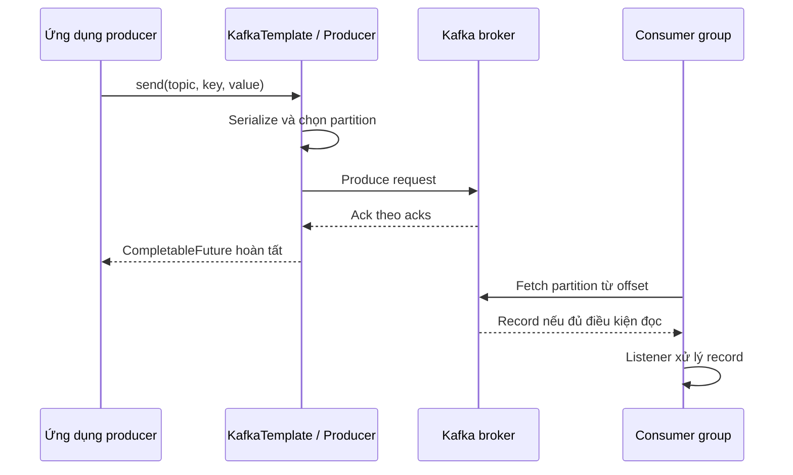
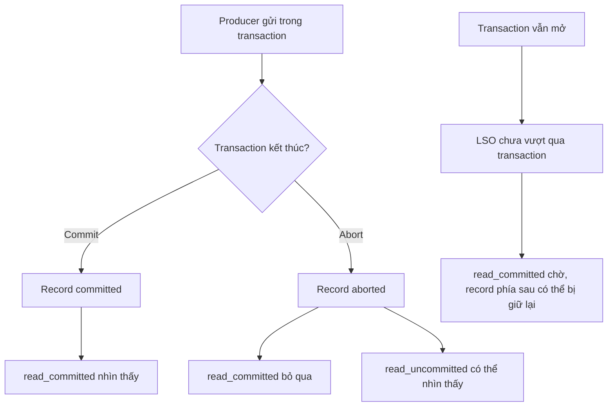

# Producer gửi nhưng không thấy dữ liệu

Khi ứng dụng gọi `KafkaTemplate.send()` nhưng consumer không thấy record, trước tiên cần xác định **producer đã nhận xác nhận từ broker hay mới chỉ xếp record vào luồng gửi bất đồng bộ**. Sau đó kiểm tra topic, cluster, partition, transaction và trạng thái consumer group. Một lần gửi thành công ở producer không đồng nghĩa listener đã xử lý record; ngược lại, consumer không thấy record cũng chưa chứng minh producer gửi thất bại.

Spring Kafka dùng `KafkaTemplate` bọc Kafka producer và trả về `CompletableFuture<SendResult<K, V>>`. Future cho biết kết quả gửi theo cấu hình `acks`; khi thành công, `SendResult` cung cấp `RecordMetadata` gồm topic, partition và offset. Đây là bằng chứng hữu ích để khoanh vùng record đã được broker ghi nhận ở đâu.

## 1. Phân biệt gửi thành công với xử lý thành công

Luồng cơ bản có hai giai đoạn độc lập:

1. Producer serialize key/value, chọn partition và gửi Produce request tới broker.
2. Broker xử lý request, trả acknowledgement theo `acks`; consumer sau đó mới fetch record theo partition và offset.



Nếu future thất bại, hãy điều tra producer, serializer, network, broker, topic hoặc quyền ghi. Nếu future thành công và có metadata hợp lệ, chuyển trọng tâm sang consumer: topic subscription, partition assignment, committed offset, transaction isolation, deserializer, filter và error handler.

Không dùng log kiểu `send() called` làm bằng chứng record đã được lưu. Dòng log đó thường chỉ cho biết ứng dụng đã gọi API; kết quả thực tế có thể đến sau khi callback/future hoàn tất.

## 2. Kiểm tra CompletableFuture và RecordMetadata

`KafkaTemplate.send()` là API bất đồng bộ. Trong Spring Kafka hiện đại, phương thức trả về `CompletableFuture<SendResult<K, V>>`. Nếu không quan sát future, lỗi gửi có thể chỉ xuất hiện trong callback hoặc log của producer.

Ví dụ ghi nhận kết quả gửi:

```java
@Service
class OrderEventPublisher {

    private static final Logger log = LoggerFactory.getLogger(OrderEventPublisher.class);

    private final KafkaTemplate<String, String> kafkaTemplate;

    OrderEventPublisher(KafkaTemplate<String, String> kafkaTemplate) {
        this.kafkaTemplate = kafkaTemplate;
    }

    void publish(String orderId, String payload) {
        CompletableFuture<SendResult<String, String>> future =
                kafkaTemplate.send("orders", orderId, payload);

        future.whenComplete((result, exception) -> {
            if (exception != null) {
                log.error("Kafka send failed: topic=orders, key={}", orderId, exception);
                return;
            }

            RecordMetadata metadata = result.getRecordMetadata();
            log.info("Kafka send acknowledged: topic={}, partition={}, offset={}, key={}",
                    metadata.topic(), metadata.partition(), metadata.offset(), orderId);
        });
    }
}
```

Khi callback thành công, lưu các thông tin `topic`, `partition`, `offset`, key và correlation ID vào log để đối chiếu với consumer. Khi thất bại, ghi đầy đủ exception và nguyên nhân gốc; không chỉ log một thông báo chung như `cannot send`.

Trong test hoặc khi chẩn đoán thủ công, có thể chờ future với timeout:

```java
SendResult<String, String> result = kafkaTemplate
        .send("orders", "order-42", "created")
        .get(10, TimeUnit.SECONDS);

RecordMetadata metadata = result.getRecordMetadata();
assertThat(metadata.topic()).isEqualTo("orders");
log.info("Written to {}-{} at offset {}",
        metadata.topic(), metadata.partition(), metadata.offset());
```

Đây là cách đồng bộ hữu ích cho test hoặc công cụ chẩn đoán. Không nên chặn thread nghiệp vụ bằng `get()` cho mọi lần gửi trong production nếu không có lý do rõ ràng; dùng callback/future để xử lý kết quả bất đồng bộ. Nếu `get()` ném `ExecutionException`, xem `getCause()` để tìm lỗi thực tế. `TimeoutException` nghĩa là chưa nhận được kết quả trong thời hạn chờ, không tự chứng minh broker chưa ghi record.

`KafkaTemplate` mặc định dùng `LoggingProducerListener`: lỗi gửi được ghi log, còn callback thành công mặc định không làm gì. Có thể cấu hình `ProducerListener` riêng nếu muốn ghi nhận metadata hoặc tích hợp metric.

Producer gom record thành batch. Nếu cấu hình `linger.ms` lớn hơn `0`, một batch chưa đầy có thể chờ đến khi hết thời gian linger mới được gửi. Trong test hoặc công cụ chẩn đoán cần gửi ngay, có thể gọi `kafkaTemplate.flush()` trước khi chờ kết quả hoặc dùng template cấu hình `autoFlush`. Chỉ cần flush khi muốn đẩy batch chưa đầy đi sớm; flush không sửa được sai topic, lỗi ACL hay transaction chưa commit.

## 3. Xác nhận đúng cluster và đúng topic

Một lỗi dễ bỏ qua là producer và consumer kết nối tới hai Kafka cluster khác nhau do profile, environment variable, ConfigMap hoặc secret khác nhau. Hãy đối chiếu `bootstrap.servers` của cả hai phía và kiểm tra cấu hình thực tế sau khi Spring Boot bind properties.

Các điểm cần xác nhận:

- Producer và consumer dùng đúng địa chỉ cluster của môi trường đang kiểm tra.
- Tên topic khớp tuyệt đối, bao gồm chữ hoa/chữ thường và tiền tố môi trường như `dev-`, `staging-`, `prod-`.
- Consumer subscribe đúng topic hoặc pattern; `@KafkaListener` không bị gắn nhầm `containerFactory`.
- Producer không gửi vào topic có tên được tạo từ biến cấu hình rỗng hoặc sai profile.
- Địa chỉ broker được quảng bá qua `advertised.listeners` có thể truy cập từ máy/container chạy client.

`bootstrap.servers` chỉ dùng để thiết lập kết nối ban đầu và lấy metadata cluster. Sau bootstrap, client kết nối tới các broker được metadata quảng bá. Vì vậy, có thể kết nối được bootstrap broker nhưng vẫn gửi thất bại nếu `advertised.listeners` trả về hostname/IP mà ứng dụng không truy cập được.

Kiểm tra topic và partition bằng Kafka CLI:

```bash
kafka-topics.sh --bootstrap-server broker1:9092 --describe --topic orders
```

Kết quả cần xác nhận topic tồn tại, có partition, leader hợp lệ và replica/ISR đúng trạng thái mong muốn. Nếu dùng Kafka chạy trong Docker, hãy kiểm tra listener nội bộ và listener host; `localhost:9092` bên trong container producer không nhất thiết trỏ tới broker container.

Trong Spring, có thể kiểm tra metadata topic bằng template:

```java
List<PartitionInfo> partitions = kafkaTemplate.partitionsFor("orders");
if (partitions.isEmpty()) {
    throw new IllegalStateException("Topic orders has no partition metadata");
}
```

Nếu ứng dụng gửi ngay khi khởi động và topic được tạo bằng `NewTopic` bean, tránh gửi trong `@PostConstruct`. Lúc đó Spring context có thể chưa hoàn tất `KafkaAdmin` tạo topic, dẫn đến `UnknownTopicOrPartitionException`. Hãy gửi sau khi context refresh, dùng `SmartLifecycle` phù hợp hoặc tạo topic trước bằng quy trình triển khai.

## 4. Kiểm tra kết quả theo acks và lỗi producer

Producer chỉ có thể báo mức xác nhận mà cấu hình `acks` yêu cầu:

| `acks` | Ý nghĩa | Cách diễn giải |
|---|---|---|
| `0` | Không đợi broker acknowledgement | Future không chứng minh broker đã nhận record; offset metadata có thể là `-1` |
| `1` | Chỉ leader xác nhận sau khi ghi vào log cục bộ | Leader có thể lỗi trước khi follower sao chép record |
| `all` (`-1`) | Leader đợi các replica đang in-sync xác nhận | Mức xác nhận mạnh nhất trong ba lựa chọn |

Ví dụ cấu hình producer cho độ bền cao hơn:

```yaml
spring:
  kafka:
    producer:
      acks: all
      properties:
        "[enable.idempotence]": true
```

`acks=all` kết hợp `min.insync.replicas` phù hợp giúp broker từ chối ghi khi không đủ ISR thay vì xác nhận một bản ghi có độ bền thấp hơn mong đợi. Idempotence giúp tránh duplicate do producer retry trong các điều kiện được hỗ trợ; nó không bảo đảm consumer sẽ tự động nhìn thấy hoặc xử lý record.

Một số lỗi producer thường gặp:

| Exception/triệu chứng | Hướng điều tra |
|---|---|
| `TimeoutException` | Kiểm tra network, broker quá tải, leader/ISR, request timeout và `delivery.timeout.ms` |
| `UnknownTopicOrPartitionException` | Sai tên topic, topic chưa tạo, metadata chưa cập nhật hoặc leader chưa sẵn sàng |
| `NotEnoughReplicasException` / `NotEnoughReplicasAfterAppendException` | Kiểm tra ISR và `min.insync.replicas` |
| `RecordTooLargeException` | Kiểm tra kích thước record và giới hạn producer, topic, broker |
| `SerializationException` | Serializer không xử lý được key/value hoặc schema/payload sai |
| `TopicAuthorizationException` | Principal của producer thiếu ACL ghi topic |
| `SaslAuthenticationException` / `SSLHandshakeException` | Kiểm tra credentials, SASL mechanism, truststore, hostname và TLS |
| `NotLeaderOrFollowerException` | Metadata/leader thay đổi; xem retry, broker health và trạng thái partition |

`delivery.timeout.ms` là giới hạn tổng thời gian producer chờ gửi thành công hoặc báo thất bại, bao gồm thời gian chờ batch, acknowledgement và retry lỗi tạm thời. Khi timeout xuất hiện, hãy xem producer log và metric để biết request đang chờ broker, retry hay gặp lỗi không thể retry.

## 5. Xác minh độc lập bằng consumer group mới

Nếu producer đã nhận acknowledgement, hãy đọc topic bằng một consumer group chẩn đoán mới. Việc dùng group mới giúp tách câu hỏi “record có tồn tại trong log không?” khỏi offset đã commit của ứng dụng đang chạy.

```bash
kafka-console-consumer.sh \
  --bootstrap-server broker1:9092 \
  --topic orders \
  --group diagnose-orders-001 \
  --from-beginning
```

Dùng một group ID chưa từng tồn tại và `--from-beginning` để đọc dữ liệu hiện có trong phạm vi retention. Nếu topic dùng key/value JSON hoặc định dạng nhị phân, console consumer có thể hiển thị byte/chuỗi khó đọc; điều đó không có nghĩa record không tồn tại. Hãy đối chiếu serializer và cách giải mã.

Nếu consumer chẩn đoán thấy record nhưng ứng dụng không thấy, producer và broker nhiều khả năng đã hoạt động. Chuyển sang kiểm tra consumer group, listener container, partition assignment, offset, isolation level và deserialization.

## 6. Kiểm tra committed offset của consumer group

Consumer group có thể đã đọc record trước đó và committed offset đã vượt qua offset producer vừa gửi. Trong trường hợp này, listener không gọi lại record cũ là hành vi bình thường.

Kiểm tra group:

```bash
kafka-consumer-groups.sh \
  --bootstrap-server broker1:9092 \
  --describe \
  --group order-service
```

Các cột quan trọng:

| Cột | Ý nghĩa |
|---|---|
| `CURRENT-OFFSET` | Offset tiếp theo group sẽ đọc trên partition |
| `LOG-END-OFFSET` | Offset kế tiếp sau record cuối hiện có trong log |
| `LAG` | Chênh lệch giữa log end và committed offset |
| `CONSUMER-ID` / `HOST` | Consumer member đang giữ partition |

Ví dụ record producer ghi vào offset `125`, nhưng group đã có `CURRENT-OFFSET=126`. Consumer group đã đi qua record đó; listener sẽ không nhận lại record chỉ vì producer gửi thêm lần nữa ở offset trước đó.

`auto.offset.reset` chỉ được dùng khi group chưa có committed offset hợp lệ hoặc offset hiện tại không còn tồn tại. Đặt `earliest` không reset một group đã có offset hợp lệ về đầu topic. Nếu cần replay, dùng group chẩn đoán mới hoặc chủ động reset offset theo quy trình vận hành đã kiểm soát; không reset group production chỉ để kiểm tra.

## 7. Kiểm tra transaction và isolation.level

Nếu producer gửi trong Kafka transaction, record chưa được công bố cho consumer `read_committed` cho đến khi transaction commit. Nếu transaction rollback/abort, record đó sẽ không được trả về cho consumer `read_committed`.



`isolation.level` có hai giá trị chính:

- `read_uncommitted`: đọc cả record transactional đã commit và đã abort; đây là mặc định Kafka consumer.
- `read_committed`: chỉ đọc record không transactional và record transactional đã commit, đến Last Stable Offset (LSO). Record sau một transaction đang mở có thể chưa được trả về cho đến khi transaction đó kết thúc.

Nếu ứng dụng dùng `read_committed`, kiểm tra producer đã commit transaction chưa. Với `KafkaTemplate.executeInTransaction()`, callback phải kết thúc bình thường để transaction commit; exception làm transaction abort. Với container transaction, listener phải hoàn tất và container commit thành công. Kiểm tra log transaction, `transactional.id` và lỗi fencing/timeout nếu record không xuất hiện.

## 8. Kiểm tra serializer, deserializer và ErrorHandlingDeserializer

Producer có thể gửi thành công một chuỗi byte mà consumer không giải mã được thành kiểu Java mong muốn. Hai phía phải thống nhất serializer/deserializer của key và value, schema, encoding và type mapping.

Ví dụ producer dùng JSON:

```yaml
spring:
  kafka:
    producer:
      key-serializer: org.apache.kafka.common.serialization.StringSerializer
      value-serializer: org.springframework.kafka.support.serializer.JacksonJsonSerializer
```

Consumer phải dùng deserializer tương thích với payload và target type. Nếu producer gửi JSON nhưng consumer dùng `StringDeserializer` rồi listener nhận một POJO, hoặc producer dùng serializer Java còn consumer mong JSON, lỗi có thể xuất hiện trước khi listener được gọi.

Deserialization xảy ra trong `poll()`, trước khi record được chuyển vào listener. `ErrorHandlingDeserializer` bọc deserializer thật để giữ exception và raw bytes trong header; container error handler có thể xử lý record lỗi hoặc gửi sang DLT. Nếu không cấu hình cơ chế này, lỗi deserialize có thể làm consumer poll thất bại và record không đi vào phương thức `@KafkaListener`.

Khi nghi ngờ lỗi deserialize:

1. Kiểm tra log consumer trước dòng log trong listener.
2. Xác nhận class serializer/deserializer và target type ở hai phía.
3. Kiểm tra JSON/schema, type headers, encoding và version payload.
4. Kiểm tra `ErrorHandlingDeserializer`, error handler và DLT.
5. Đọc raw record bằng công cụ phù hợp nếu payload không phải text.

## 9. Kiểm tra filter và trạng thái listener container

Record có thể đã tới consumer nhưng không đi vào business listener vì container chưa chạy, chưa được gán partition hoặc filter loại bỏ record.

Kiểm tra các điểm sau:

- Listener container có được start không? Xem log startup, `autoStartup`, `KafkaListenerEndpointRegistry` và lifecycle của container.
- Consumer group có member hoạt động và partition assignment không?
- `@KafkaListener` có đúng `topics`, `topicPattern`, `groupId` và `containerFactory` không?
- Có `RecordFilterStrategy` hoặc `RecordInterceptor` trả về `null`/loại record không?
- Listener có ném exception và error handler đang retry, recover hoặc chuyển record sang DLT không?
- Record có bị gửi sang retry topic hoặc DLT bởi error handler khác không?

Nếu filter trả về `true` để loại record, listener sẽ không nhận record đó. Hãy log lý do loại bỏ hoặc đo số record bị filter; tránh chỉ log ở business listener vì record bị loại không đi qua phương thức đó.

Với `@KafkaListener(autoStartup = "false")`, container không tự chạy lúc ứng dụng khởi động. Ứng dụng phải chủ động start container qua `KafkaListenerEndpointRegistry` khi điều kiện sẵn sàng. Kiểm tra trạng thái lifecycle trước khi kết luận consumer không thấy dữ liệu.

## 10. Kiểm tra retention, compaction và thời điểm đọc

Record có thể đã bị xóa khỏi log theo retention trước khi consumer mới bắt đầu đọc. Với topic compacted, Kafka giữ giá trị mới nhất theo key và có thể loại bỏ các bản ghi cũ khi quá trình compaction chạy; tombstone cũng có thể dẫn đến xóa key sau thời gian cấu hình.

Kiểm tra topic config và offset range nếu record được gửi từ lâu. Nếu committed offset nằm trước log start offset, consumer không thể đọc lại các record đã bị xóa; `auto.offset.reset` sẽ quyết định cách xử lý offset không còn hợp lệ.

Ngoài ra, nếu consumer bắt đầu với `latest` và chưa có committed offset, nó đặt vị trí đọc ở cuối log. Các record đã được gửi trước khi consumer subscribe có thể không được đọc bởi group mới đó. Với kịch bản cần đọc dữ liệu cũ, dùng `earliest` cho group mới hoặc tạo group chẩn đoán riêng.

## 11. Quy trình khoanh vùng theo kết quả

| Kết quả quan sát | Khu vực cần kiểm tra tiếp |
|---|---|
| Future thất bại hoặc timeout | Serializer, bootstrap/network, TLS/SASL, topic, leader/ISR, ACL, broker quota và producer config |
| Future thành công nhưng không có metadata hợp lệ (`acks=0`) | Không thể kết luận broker đã nhận; đổi sang cấu hình acknowledgement phù hợp để chẩn đoán |
| Future thành công, consumer chẩn đoán mới đọc thấy | Consumer group ứng dụng, offset, listener container, filter, transaction isolation hoặc deserializer |
| Consumer chẩn đoán mới cũng không đọc thấy | Xác nhận đúng cluster/topic, retention, transaction state, record format và broker log |
| `read_uncommitted` thấy nhưng `read_committed` không thấy | Transaction bị abort hoặc chưa commit/LSO chưa tiến qua transaction đang mở |
| Console consumer đọc được nhưng listener không gọi | Assignment, `autoStartup`, filter, deserializer, error handler hoặc retry/DLT |
| Listener log có xử lý nhưng người dùng không thấy dữ liệu | Kiểm tra nghiệp vụ sau listener, database transaction, cache, API hoặc hệ thống đích |

Thực hiện theo thứ tự sau để tránh đổi nhiều cấu hình cùng lúc:

1. Ghi nhận future kết thúc thế nào và lấy `RecordMetadata` nếu thành công.
2. Đối chiếu cluster, topic, partition và timestamp với cấu hình môi trường.
3. Đọc topic bằng group chẩn đoán mới từ đầu.
4. Kiểm tra committed offset, lag và partition assignment của group ứng dụng.
5. Kiểm tra transaction isolation và trạng thái commit.
6. Kiểm tra deserializer, filter, listener lifecycle, error handler và DLT.
7. Chỉ sau khi xác định nguyên nhân mới thay đổi cấu hình producer hoặc consumer.

## 12. Checklist xử lý sự cố

- [ ] Future từ `KafkaTemplate.send()` đã hoàn tất và không có exception.
- [ ] Nếu future thành công, đã ghi nhận topic, partition, offset từ `RecordMetadata`.
- [ ] Producer và consumer kết nối đúng Kafka cluster và listener được quảng bá có thể truy cập.
- [ ] Topic tồn tại, partition có leader và ISR hợp lệ.
- [ ] `acks` phù hợp với mức xác nhận cần kiểm tra; không dùng `acks=0` để xác nhận broker đã nhận.
- [ ] Producer có quyền `WRITE`; consumer có quyền `READ` trên topic và group.
- [ ] Consumer chẩn đoán với group mới và `earliest` có đọc thấy record không.
- [ ] Consumer group production có offset, lag và assignment đúng mong đợi.
- [ ] Transaction đã commit nếu consumer dùng `read_committed`.
- [ ] Serializer/deserializer tương thích; lỗi deserialize và DLT đã được kiểm tra.
- [ ] Không có filter hoặc listener container lifecycle khiến record bị bỏ qua.
- [ ] Retention, compaction và log start offset không loại bỏ record cần đọc.

## 13. Ghi nhớ

- `KafkaTemplate.send()` bất đồng bộ; phải quan sát `CompletableFuture` hoặc `ProducerListener` để biết kết quả.
- `SendResult.getRecordMetadata()` cho biết topic, partition và offset khi broker xác nhận theo `acks`.
- `acks=0` không có broker acknowledgement; `acks=1` chờ leader; `acks=all` chờ ISR.
- Future thành công không có nghĩa consumer đã xử lý record; hãy kiểm tra consumer group và offset.
- `auto.offset.reset=earliest` chỉ có tác dụng khi group chưa có committed offset hợp lệ hoặc offset không còn tồn tại.
- `read_committed` bỏ qua transaction abort và chỉ đọc đến LSO; record trong transaction chưa commit chưa được công bố.
- Deserialization lỗi xảy ra trước listener; `ErrorHandlingDeserializer` giúp error handler xử lý record lỗi.
- Filter, listener chưa start, retry/DLT, retention và compaction đều có thể khiến ứng dụng không nhìn thấy record theo cách mong đợi.
- Dùng một consumer group chẩn đoán mới để tách lỗi producer/broker khỏi lỗi offset hoặc cấu hình consumer production.

## Tài liệu tham khảo

- [Spring for Apache Kafka — Sending Messages with KafkaTemplate](https://docs.spring.io/spring-kafka/reference/kafka/sending-messages.html)
- [Spring for Apache Kafka — Serialization, Deserialization and Message Conversion](https://docs.spring.io/spring-kafka/reference/kafka/serdes.html)
- [Spring for Apache Kafka — Handling Exceptions](https://docs.spring.io/spring-kafka/reference/kafka/annotation-error-handling.html)
- [Apache Kafka — Producer Configurations](https://kafka.apache.org/41/configuration/producer-configs/)
- [Apache Kafka — Consumer Configurations](https://kafka.apache.org/41/configuration/consumer-configs/)
- [Apache Kafka — Basic Operations](https://kafka.apache.org/41/operations/basic-kafka-operations/)
