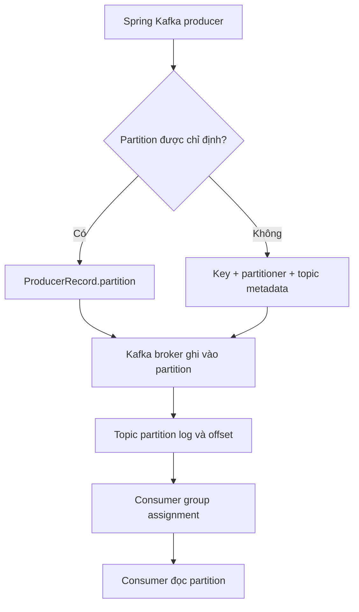

# Record sai partition

Khi record xuất hiện ở partition khác với dự kiến, cần xác định partition được chọn ở phía producer hay record chỉ đang được consumer xử lý bởi một instance khác. Kafka chọn partition khi producer gửi record dựa trên partition được chỉ định trực tiếp, key và partitioner. Consumer group chỉ phân phối các partition đã tồn tại cho consumer; nó không chuyển một record từ partition này sang partition khác.

Vấn đề thường gặp là producer gửi record không có key, key không ổn định, custom partitioner tính sai, topic đã tăng số partition hoặc ứng dụng đang nhầm consumer assignment với partition của record. Bài học này đưa ra quy trình kiểm tra từ metadata gửi, key, partitioner, topic configuration tới thứ tự xử lý trong Spring Kafka.

## 1. Phân biệt record partition và consumer assignment

Một record được ghi vào một partition cụ thể của topic. Metadata của record gồm topic, partition, offset và timestamp. Sau khi record được ghi, consumer group phân phối partition cho các consumer member. Assignment quyết định consumer nào đọc partition; nó không thay đổi vị trí record đã được lưu.



Ví dụ topic `orders` có ba partition. Producer chọn partition 2 và broker ghi record ở offset 145. Khi consumer group rebalance, partition 2 có thể được gán từ consumer A sang consumer B. Record vẫn ở partition 2, offset 145; chỉ consumer sở hữu partition thay đổi.

Để chẩn đoán, luôn ghi nhận riêng hai thông tin:

- **Record metadata:** `topic`, `partition`, `offset`, key và event ID của record thực tế.
- **Consumer assignment:** consumer member nào được gán partition nào tại thời điểm kiểm tra.

Nếu `ConsumerRecord.partition()` cho thấy record nằm ở partition 2, việc nó được consumer B nhận không có nghĩa record bị chuyển partition. Đừng thay đổi `concurrency` hoặc consumer group chỉ để sửa một vấn đề partition routing ở producer.

## 2. Kiểm tra metadata trả về sau khi gửi

Với Spring Kafka, `KafkaTemplate.send(...)` trả về future chứa `SendResult`. Khi broker xác nhận gửi thành công, `RecordMetadata` cho biết partition và offset thực tế.

```java
public RecordMetadata publish(OrderEvent event) throws Exception {
    SendResult<String, OrderEvent> result = kafkaTemplate
            .send("orders", event.orderId(), event)
            .get(10, TimeUnit.SECONDS);

    RecordMetadata metadata = result.getRecordMetadata();
    log.info("Published eventId={} key={} topic={} partition={} offset={}",
            event.eventId(), event.orderId(), metadata.topic(),
            metadata.partition(), metadata.offset());
    return metadata;
}
```

Trong ví dụ, `orderId` là key. Log partition và offset do broker trả về là bằng chứng chính xác record được ghi ở đâu. Không suy ra partition từ key bằng cách tự tính hash trong code ứng dụng; thuật toán và metadata topic của producer mới quyết định kết quả.

Với listener, có thể nhận `ConsumerRecord` để ghi lại metadata tương ứng:

```java
@KafkaListener(topics = "orders", groupId = "order-service")
public void consume(ConsumerRecord<String, OrderEvent> record) {
    log.info("Consumed eventId={} key={} topic={} partition={} offset={}",
            record.value().eventId(), record.key(), record.topic(),
            record.partition(), record.offset());

    orderService.process(record.value());
}
```

So sánh metadata tại producer và consumer theo `eventId`. Nếu cùng event ID nhưng partition khác, kiểm tra producer nào đã gửi record, lần gửi nào là replay và topic có thay đổi partition count hay không. Nếu producer và consumer ghi cùng partition nhưng log xử lý hoàn tất sai thứ tự, nguyên nhân có thể nằm ở xử lý song song phía listener.

## 3. Kiểm tra key của record

Với partitioner mặc định của Kafka, record có key thường được định tuyến dựa trên hash của key và số partition của topic. Vì vậy, các record cùng key thường vào cùng partition khi partition count và partitioner không đổi.

Ví dụ các sự kiện của cùng một đơn hàng nên dùng chung `orderId`:

```java
kafkaTemplate.send("orders", "order-42", new OrderCreated("order-42"));
kafkaTemplate.send("orders", "order-42", new OrderPaid("order-42"));
kafkaTemplate.send("orders", "order-42", new OrderShipped("order-42"));
```

Nếu một lần gửi dùng `orderId`, lần khác dùng `eventId`, hoặc key bị null ở một nhánh code, các sự kiện có thể vào partition khác nhau. Khi đó, Kafka không thể giữ thứ tự chung cho các sự kiện của cùng đơn hàng.

Kiểm tra key tại cả nơi tạo event và nơi gọi producer:

| Hiện tượng | Nguyên nhân thường gặp | Cách kiểm tra |
|---|---|---|
| Cùng order nhưng partition khác | Các producer dùng key khác nhau hoặc một record có key null | Log key, event ID và loại sự kiện ngay trước khi gửi. |
| Record phân bố không đều | Key có cardinality thấp hoặc một số key rất nóng | Thống kê record theo key/partition và xác định key skew. |
| Key có giá trị nhưng vẫn sai partition | Custom partitioner, explicit partition hoặc topic metadata khác nhau | Kiểm tra cấu hình producer và partition count tại thời điểm gửi. |
| Cùng key nhưng record đến partition khác sau thay đổi hạ tầng | Topic đã tăng partition count hoặc partitioner đã đổi | Đối chiếu thời điểm thay đổi topic và phiên bản producer. |

Record không có key không có cam kết cùng một entity sẽ luôn vào một partition. Partitioner mặc định có thể dùng cơ chế sticky để gom record không key vào partition trong một khoảng gửi; hành vi cụ thể phụ thuộc Kafka client và cấu hình. Không dựa vào phân phối round-robin cố định cho record không key.

## 4. Kiểm tra explicit partition và custom partitioner

Producer có thể chỉ định partition trực tiếp. Khi `ProducerRecord` đã có partition, lựa chọn này được ưu tiên thay vì để partitioner tự tính từ key.

Ví dụ gửi vào partition 1:

```java
ProducerRecord<String, OrderEvent> record = new ProducerRecord<>(
        "orders",
        1,
        event.orderId(),
        event);

SendResult<String, OrderEvent> result = kafkaTemplate.send(record)
        .get(10, TimeUnit.SECONDS);

assert result.getRecordMetadata().partition() == 1;
```

Explicit partition hữu ích cho một số luồng đặc biệt hoặc test xác định, nhưng tạo coupling giữa producer và topology topic. Nếu topic giảm partition hoặc môi trường có số partition khác, producer có thể gửi tới partition không hợp lệ. Chỉ dùng cách này khi ứng dụng thực sự sở hữu quy tắc phân phối đó.

Nếu cấu hình `partitioner.class` để dùng custom partitioner, hãy kiểm tra:

- Logic xử lý key null và key có định dạng bất thường.
- Số partition được đọc từ metadata topic.
- Phép tính có luôn trả partition trong khoảng hợp lệ `0` tới `partitionCount - 1`.
- Các producer instance có dùng cùng phiên bản và cùng cấu hình partitioner không.
- Thay đổi partition count có làm thay đổi kết quả định tuyến không.

Custom partitioner nên có unit test với nhiều key, null key, partition count khác nhau và các trường hợp biên. Sau đó dùng integration test để xác minh partition thực tế từ `RecordMetadata`, vì unit test chỉ xác minh thuật toán chứ không chứng minh producer đang nạp đúng cấu hình.

## 5. Kiểm tra partition count của topic

Partitioner chọn partition dựa trên metadata topic mà producer biết. Nếu topic đã được tăng partition count, cùng một key có thể được ánh xạ sang partition khác so với trước đó. Ví dụ một key từng được ánh xạ vào partition 1 trong topic có 3 partition có thể được ánh xạ sang partition khác khi topic có 6 partition.

Kiểm tra topology thực tế bằng công cụ Kafka:

```bash
bin/kafka-topics.sh \
  --bootstrap-server kafka.example.com:9092 \
  --describe \
  --topic orders
```

Đối chiếu số partition giữa các môi trường và thời điểm phát sinh sự cố. Đừng giả định cấu hình topic trong file YAML ứng dụng là nguồn sự thật; topic có thể đã được tạo hoặc thay đổi độc lập bởi quy trình quản trị Kafka.

Tăng partition count không di chuyển các record cũ sang partition mới. Record cũ vẫn nằm ở partition ban đầu; record mới có thể được định tuyến theo partition count mới. Do đó, cùng một key có thể có lịch sử nằm ở partition cũ và sự kiện mới nằm ở partition khác. Kafka không tạo global ordering giữa hai partition để nối lại lịch sử đó.

Nếu nghiệp vụ cần thứ tự liên tục theo aggregate, hãy có kế hoạch migration hoặc dùng sequence/version trong payload để consumer phát hiện sự kiện đến sai thứ tự. Không tăng partition count trong production mà không đánh giá ảnh hưởng đến key routing và ordering.

## 6. Phân biệt lỗi routing với lỗi consumer xử lý song song

Có trường hợp record được ghi đúng partition nhưng kết quả nghiệp vụ vẫn có vẻ sai thứ tự. Ví dụ `OrderCreated` và `OrderPaid` cùng partition, consumer nhận đúng thứ tự offset, nhưng listener gửi hai tác vụ vào executor khác nhau. Worker xử lý `OrderPaid` nhanh hơn và cập nhật database trước.

```java
@KafkaListener(topics = "orders")
public void consume(OrderEvent event) {
    workerPool.submit(() -> orderService.process(event));
}
```

Đoạn code trên trả về khỏi listener ngay sau khi submit. Kafka có thể tiếp tục giao record tiếp theo trong khi worker trước vẫn đang chạy. Nếu nghiệp vụ cần thứ tự theo key, hãy xử lý tuần tự trong listener hoặc phân phối worker theo key vào các lane tuần tự. Có thể dùng sequence/version để từ chối hoặc trì hoãn event đến sai thứ tự.

Kiểm tra theo từng tầng:

1. So sánh partition và offset của record ở producer với consumer.
2. Xác nhận listener nhận record theo thứ tự offset trong partition.
3. Ghi thời điểm bắt đầu và kết thúc xử lý của mỗi event.
4. Kiểm tra executor, reactive pipeline hoặc callback bất đồng bộ có làm đảo completion order không.
5. Đối chiếu thứ tự cập nhật database hoặc downstream side effect.

Nếu partition và offset đúng nhưng completion order sai, tăng concurrency hoặc đổi partitioner không giải quyết gốc rễ. Cần sửa cách xử lý bất đồng bộ hoặc thiết kế versioning/idempotency.

## 7. Kiểm tra metadata và assignment trong Spring Kafka

Để xem partition mà consumer group đang sở hữu, có thể truy vấn listener container hoặc log rebalance/assignment. Spring Kafka cung cấp `KafkaListenerEndpointRegistry` để truy cập container theo listener ID; các API chi tiết về assigned partitions phụ thuộc phiên bản. Có thể dùng listener callback hoặc consumer group tooling để quan sát assignment.

Lệnh mô tả consumer group:

```bash
bin/kafka-consumer-groups.sh \
  --bootstrap-server kafka.example.com:9092 \
  --describe \
  --group order-service
```

Kết quả cho biết partition nào đang được member trong group xử lý cùng offset và lag tương ứng. Đây là thông tin assignment và tiến độ, không phải quy tắc producer đã dùng để chọn partition cho record.

Nếu partition 2 đang được consumer B sở hữu, đó là trạng thái assignment hiện tại. Nếu record cụ thể có `ConsumerRecord.partition() == 1`, record đó vẫn nằm ở partition 1; consumer assignment cần được đọc theo đúng thời điểm và group.

## 8. Checklist chẩn đoán record sai partition

| Bước | Câu hỏi | Bằng chứng cần thu thập |
|---|---|---|
| 1. Xác định record | Event ID và key nào bị sai? | Payload, event ID, key, topic và timestamp. |
| 2. Kiểm tra kết quả gửi | Producer thực tế đã ghi vào partition nào? | `SendResult.getRecordMetadata()` gồm topic, partition, offset. |
| 3. Kiểm tra key | Các event cùng aggregate có dùng cùng key không? | Log key trước khi gọi `KafkaTemplate.send`. |
| 4. Kiểm tra explicit partition | Có code truyền partition trực tiếp không? | `ProducerRecord.partition()` và overload send được sử dụng. |
| 5. Kiểm tra partitioner | Có custom partitioner hoặc cấu hình khác nhau giữa instance không? | Producer properties, `partitioner.class` và phiên bản ứng dụng. |
| 6. Kiểm tra topic metadata | Partition count có thay đổi không? | Kết quả `kafka-topics.sh --describe` và lịch sử thay đổi topic. |
| 7. Kiểm tra consumer | Consumer đang được gán partition nào? | `kafka-consumer-groups.sh --describe` và log assignment. |
| 8. Kiểm tra xử lý | Listener có chuyển việc sang thread khác không? | Processing start/end time, executor và downstream log. |

## 9. Kiểm thử partition routing bằng Embedded Kafka

Integration test nên xác minh partition thực tế thay vì chỉ kiểm tra hàm tính partition. Tạo topic với số partition xác định, gửi các event cùng key và kiểm tra metadata broker trả về:

```java
@SpringBootTest
@EmbeddedKafka(
        partitions = 4,
        topics = "orders",
        bootstrapServersProperty = "spring.kafka.bootstrap-servers")
class OrderPartitionRoutingTest {

    @Autowired
    private KafkaTemplate<String, String> kafkaTemplate;

    @Test
    void sameKeyUsesSamePartition() throws Exception {
        var first = kafkaTemplate.send("orders", "order-42", "CREATED")
                .get(10, TimeUnit.SECONDS);
        var second = kafkaTemplate.send("orders", "order-42", "PAID")
                .get(10, TimeUnit.SECONDS);

        assertEquals(first.getRecordMetadata().partition(),
                second.getRecordMetadata().partition());
        assertTrue(second.getRecordMetadata().offset()
                > first.getRecordMetadata().offset());
    }
}
```

Test này kiểm tra hành vi với partitioner mặc định, cùng topic và partition count không đổi. Không hard-code partition cụ thể nếu test không kiểm tra một custom routing contract; mục tiêu là xác minh hai record cùng key có cùng partition và offset tăng trong partition đó.

Các trường hợp bổ sung nên có:

- Gửi record với key null và xác minh ứng dụng không dựa vào partition cố định.
- Gửi `ProducerRecord` với explicit partition và xác minh metadata đúng partition yêu cầu.
- Chạy custom partitioner với key hợp lệ, null key và partition count khác nhau.
- Xác minh các producer instance dùng cấu hình partitioner giống nhau.
- Tái tạo tình huống thay đổi partition count và xác minh ứng dụng không giả định key luôn giữ partition cũ.
- Gửi cùng aggregate với nhiều event và kiểm tra listener/worker giữ ordering nghiệp vụ cần thiết.

## 10. Cách khắc phục theo nguyên nhân

| Nguyên nhân xác định | Hướng khắc phục |
|---|---|
| Key null hoặc không nhất quán | Chuẩn hóa key từ business identifier và bắt buộc có key với loại event cần ordering. |
| Gửi explicit partition sai | Bỏ chỉ định partition để dùng key partitioning hoặc sửa mapping theo topology hiện tại. |
| Custom partitioner lỗi | Sửa thuật toán, thêm test biên và triển khai đồng nhất trên mọi producer instance. |
| Partition count thay đổi | Đánh giá lại key mapping, dùng sequence/version hoặc lập kế hoạch migration cho aggregate cần ordering. |
| Producer instance có config khác nhau | Đồng bộ serializer, partitioner và topic metadata; kiểm tra deployment version. |
| Listener xử lý song song làm đảo completion | Xử lý tuần tự theo key, dùng ordered worker lane hoặc kiểm tra aggregate version. |
| Nhầm consumer assignment với record partition | Log `ConsumerRecord.partition()` và metadata producer; dùng group describe chỉ để kiểm tra assignment. |

Không nên chuyển record thủ công sang partition khác chỉ để làm cho dashboard trông đúng. Việc replay sang partition mới tạo một record mới và có thể phá vỡ thứ tự theo key. Trước khi sửa dữ liệu, xác định record đã gây side effect nào, có cần idempotency hay sequence check không và quy trình replay có được kiểm soát không.

Record sai partition thường bắt nguồn từ key, partitioner, explicit partition hoặc thay đổi topic topology. Hãy bắt đầu bằng metadata thực tế mà producer nhận được, sau đó đối chiếu key, cấu hình partitioner, partition count và consumer assignment. Nếu record đã nằm đúng partition nhưng nghiệp vụ hoàn tất sai thứ tự, chuyển điều tra sang concurrency và side effect của listener. Cách phân tầng này giúp sửa đúng nguyên nhân mà không làm thay đổi consumer group hoặc topology một cách không cần thiết.
