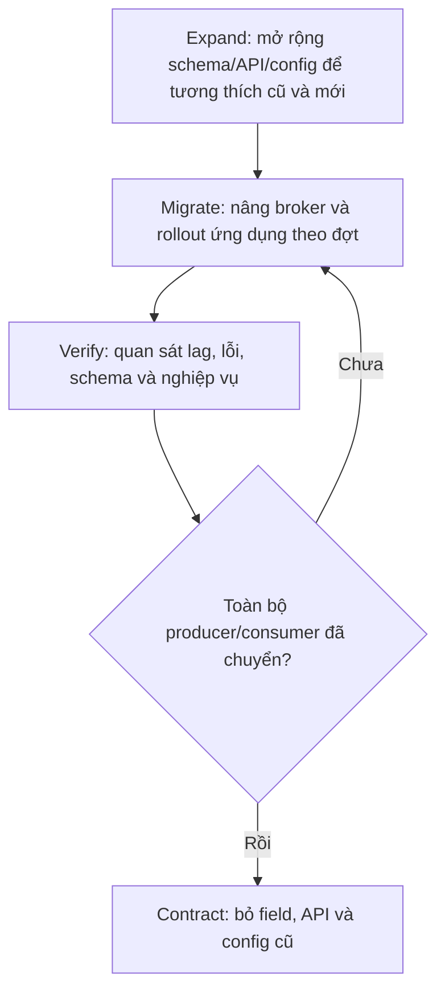

# Chiến lược nâng cấp không gián đoạn cho Kafka và Spring Kafka

Nâng cấp không gián đoạn là quá trình thay đổi phiên bản broker, Kafka client, Spring Kafka, Spring Boot hoặc schema mà hệ thống vẫn tiếp nhận và xử lý event trong suốt quá trình triển khai. Mục tiêu thực tế là duy trì khả năng phục vụ trong giới hạn đã thống nhất, giảm thời gian rebalance, tránh mất dữ liệu và kiểm soát duplicate/redelivery. Không nên hiểu “zero downtime” là bảo đảm tuyệt đối không có retry, rebalance hoặc xử lý lặp.

Một nâng cấp an toàn phải giữ tương thích giữa các thành phần chạy đồng thời. Trong một khoảng thời gian, producer mới có thể gửi tới broker đang nâng cấp; consumer cũ có thể đọc record do producer mới tạo; consumer mới có thể đọc record đã tồn tại từ schema cũ. Vì vậy, thứ tự triển khai quan trọng hơn việc chỉ nâng tất cả dependency lên phiên bản mới.

## 1. Xác định phạm vi của một lần nâng cấp

Một hệ thống Spring Kafka có nhiều lớp phiên bản:

| Lớp | Thành phần | Câu hỏi tương thích |
|---|---|---|
| Runtime | JDK/JVM | Phiên bản Java mới có được Spring Boot và Spring Kafka hỗ trợ không? |
| Framework | Spring Boot, Spring Framework | Boot version quản lý Spring Kafka version nào? |
| Messaging library | Spring Kafka | API, container lifecycle, error handler hoặc converter có thay đổi không? |
| Kafka client | kafka-clients | Client có tương thích broker và Java runtime không? |
| Broker | Apache Kafka hoặc distribution | Có upgrade path, protocol và metadata version phù hợp không? |
| Contract | JSON, Avro, Protobuf, Schema Registry | Producer và consumer cũ/mới có đọc được dữ liệu của nhau không? |
| Application | Producer, consumer, retry/DLT, connector | Side effect, offset, transaction và topic subscription có tương thích không? |
| Infrastructure | Kubernetes, storage, network, security | Readiness, graceful shutdown, certificate và ACL có còn hợp lệ không? |

Không gộp tất cả lớp vào một lần thay đổi lớn nếu không có lý do bắt buộc. Nếu nâng JDK, Spring Boot, Spring Kafka, Kafka client và broker cùng lúc, khi lỗi xuất hiện sẽ khó xác định lớp gây ra lỗi và khó rollback.

## 2. Phân biệt nâng cấp broker và nâng cấp ứng dụng

Nâng cấp broker thay đổi hạ tầng Kafka: binary, controller, protocol capability, metadata format hoặc cơ chế lưu trữ. Nâng cấp ứng dụng thay đổi producer/consumer client và logic xử lý. Hai hoạt động có thể có lịch khác nhau.

Một chiến lược thường dùng:

1. Kiểm tra broker hiện tại có hỗ trợ client version mục tiêu hay không.
2. Nâng cấp broker theo upgrade path được tài liệu đúng phiên bản hỗ trợ.
3. Giữ protocol/metadata compatibility ở mức cũ trong giai đoạn broker binary đang được nâng, nếu quy trình phiên bản đó yêu cầu.
4. Triển khai ứng dụng mới theo rolling hoặc blue-green.
5. Chỉ bật capability hoặc schema mới sau khi toàn bộ consumer cần thiết đã sẵn sàng.

Thứ tự cụ thể phụ thuộc phiên bản Kafka, KRaft hay ZooKeeper, distribution và upgrade guide của nhà cung cấp. Không suy ra một trình tự chung cho mọi cluster.

## 3. Lập compatibility matrix trước khi thay đổi

Trước khi tạo release, ghi rõ phiên bản hiện tại, mục tiêu và khoảng tương thích đã xác minh:

| Thành phần | Hiện tại | Mục tiêu | Bằng chứng cần có |
|---|---|---|---|
| Java | JDK đang chạy | JDK mục tiêu | Spring Boot support matrix và runtime test |
| Spring Boot | Version hiện tại | Version mục tiêu | Release notes, dependency management |
| Spring Kafka | Version được Boot quản lý | Version được Boot quản lý hoặc nâng có chủ đích | Spring Kafka compatibility/release notes |
| kafka-clients | Version thực tế trong dependency tree | Version đi cùng stack mục tiêu | Client/broker compatibility và dependency tree |
| Broker | Kafka version hiện tại | Kafka version mục tiêu | Upgrade guide theo từng bước |
| Schema | Subject/version hiện tại | Schema mới | Compatibility mode và consumer test |

Kiểm tra dependency thực tế trong build output thay vì chỉ đọc version khai báo. Spring Boot BOM có thể quản lý version của Spring Kafka và Kafka client. Override thủ công một dependency có thể tạo ra tổ hợp chưa được framework kiểm thử.

## 4. Dùng dependency management nhất quán

Với Spring Boot, ưu tiên để dependency management của Boot chọn Spring Kafka và Kafka client tương ứng. Ví dụ Gradle:

```groovy
dependencies {
    implementation("org.springframework.boot:spring-boot-starter")
    implementation("org.springframework.kafka:spring-kafka")

    testImplementation("org.springframework.kafka:spring-kafka-test")
}
```

Nếu dự án dùng Spring Boot plugin/BOM, không cần ghi version riêng cho dependency đã được BOM quản lý. Khi cần override, phải có lý do, kiểm tra compatibility matrix và test với broker thật hoặc test container tương ứng.

Kiểm tra dependency tree:

```bash
./gradlew dependencies --configuration runtimeClasspath
```

Tìm các phiên bản thực tế của:

- `org.springframework.boot` và `org.springframework`.
- `org.springframework.kafka:spring-kafka`.
- `org.apache.kafka:kafka-clients`.
- Serializer/deserializer và Schema Registry client.

Tránh để nhiều version Kafka client xuất hiện gián tiếp do connector hoặc thư viện khác. Xử lý dependency conflict trước khi triển khai.

## 5. Đọc release notes và migration guide theo thứ tự

Không dựa vào changelog rút gọn hoặc blog cũ để nâng cấp framework. Với mỗi bước, đọc:

1. Spring Boot release notes và migration guide.
2. Spring Kafka change history/release notes.
3. Apache Kafka client release notes.
4. Kafka broker upgrade guide đúng phiên bản nguồn và đích.
5. Release notes của serializer, Schema Registry, connector và observability agent.

Đánh dấu thay đổi thuộc nhóm:

- API compile-time: method đổi kiểu trả về, package/class đổi hoặc API bị loại bỏ.
- Runtime behavior: listener lifecycle, retry, acknowledgment, transaction hoặc default config đổi.
- Configuration: property đổi tên, đổi vị trí hoặc thay default.
- Protocol/data: schema, serialization, metadata version hoặc consumer group protocol.
- Operational: metric, log, command line, health check hoặc shutdown behavior.

Không chỉ sửa lỗi compile. Một ứng dụng có thể build thành công nhưng thay đổi semantics offset, retry hoặc transaction khi chạy.

Ví dụ migration API cụ thể: từ Spring Kafka 3.0, các phương thức `KafkaTemplate.send(...)` chuyển từ `ListenableFuture` sang `CompletableFuture`. Code đăng ký callback, ghép future và test publisher cần được cập nhật theo kiểu trả về mới. Khi nâng từ nhánh 2.x, tìm toàn bộ chỗ dùng `addCallback`, `ListenableFuture` hoặc API liên quan thay vì chỉ sửa dependency version.

## 6. Nguyên tắc expand–migrate–contract

Expand–migrate–contract giúp các phiên bản cũ và mới cùng tồn tại trong thời gian triển khai:



Ví dụ đổi event `OrderCreated`:

- Giai đoạn expand: thêm field optional `salesChannel`; consumer cũ bỏ qua field chưa biết hoặc deserialize theo schema compatibility đã chọn.
- Giai đoạn migrate: deploy consumer có thể đọc cả event cũ và mới.
- Giai đoạn producer: bắt đầu ghi `salesChannel` sau khi consumer cần field đã sẵn sàng.
- Giai đoạn contract: chỉ bỏ field cũ hoặc ngừng hỗ trợ schema cũ sau khi mọi producer, consumer, replay tool và backup workflow đã được xử lý.

Không xóa field hoặc đổi kiểu dữ liệu ngay trong cùng release với việc rollout consumer. Consumer cũ có thể vẫn đang chạy trong một instance chưa được thay thế.

## 7. Thiết kế schema tương thích ngược và xuôi

Schema compatibility quyết định phiên bản consumer nào đọc được dữ liệu do producer version nào tạo.

| Chế độ | Ý nghĩa khái quát | Câu hỏi khi nâng cấp |
|---|---|---|
| BACKWARD | Schema mới có thể đọc dữ liệu được ghi theo schema cũ | Consumer mới có đọc record cũ còn retention không? |
| FORWARD | Schema cũ có thể đọc dữ liệu được ghi theo schema mới | Consumer cũ còn chạy có đọc được record mới không? |
| FULL | Hỗ trợ cả backward và forward theo quy tắc registry | Hai thế hệ producer/consumer có thể cùng tồn tại không? |
| NONE | Không áp dụng kiểm tra compatibility | Phải tự chứng minh mọi consumer/producer tương thích |

Tên chế độ và cách kiểm tra phụ thuộc serializer/Schema Registry. Với JSON không có registry, compatibility còn phụ thuộc Jackson configuration, constructor, required field và logic domain.

Các quy tắc an toàn thường gồm:

- Thêm field mới dưới dạng optional hoặc có default mà consumer cũ/new có thể xử lý.
- Không đổi nghĩa của field hiện có dù kiểu dữ liệu không đổi.
- Không đổi key/partitioning semantics trong một bước nếu ordering theo key quan trọng.
- Không xóa enum value hoặc đổi tên field khi consumer cũ vẫn còn hoạt động.
- Test dữ liệu được ghi từ tất cả schema version còn nằm trong retention.

Schema Registry compatibility check hữu ích nhưng không thay integration test với consumer thực tế.

## 8. Triển khai consumer trước producer khi thêm dữ liệu mới

Khi producer chuẩn bị gửi field mới mà consumer cần để xử lý nghiệp vụ, thứ tự thường an toàn là:

1. Deploy consumer có thể đọc cả event cũ và event mới.
2. Xác minh mọi instance consumer đã cập nhật và lag không tăng bất thường.
3. Bật producer ghi field mới qua feature flag hoặc cấu hình rollout.
4. Quan sát lỗi deserialize, validation, business processing và DLT.
5. Sau thời gian ổn định mới xóa nhánh xử lý cũ trong consumer.

Nếu consumer cũ bỏ qua unknown JSON field, việc thêm field có thể tương thích. Nhưng nếu producer đổi type, rename field hoặc consumer bật strict unknown-property handling, consumer cũ có thể fail. Luôn kiểm tra cấu hình thực tế.

Khi cần đổi format không tương thích, cân nhắc topic version mới hoặc migration event có kiểm soát thay vì ghi hai format vào cùng topic mà không có discriminator rõ ràng.

## 9. Nâng cấp broker theo rolling upgrade

Rolling upgrade thay từng broker trong khi các broker còn lại tiếp tục phục vụ. Trước khi bắt đầu:

- Xác minh replication factor, ISR và `min.insync.replicas`.
- Đảm bảo cluster không có under-replicated partition kéo dài.
- Kiểm tra controller/quorum health, disk, network và capacity.
- Kiểm tra leader distribution và khả năng chịu mất một broker.
- Xác minh client retry/metadata refresh và timeout phù hợp.
- Chuẩn bị lịch nâng từng node, điểm dừng và điều kiện rollback.

Trong quá trình:

1. Nâng một broker theo quy trình chính thức.
2. Chờ broker online, replica bắt kịp và ISR ổn định.
3. Kiểm tra produce/consume, request latency và controller health.
4. Chỉ tiếp tục broker kế tiếp khi điều kiện ổn định đạt yêu cầu.

Không nâng đồng thời nhiều broker hơn mức cluster có thể chịu mất. Với replication factor thấp hoặc partition đang thiếu replica, rolling restart có thể làm partition unavailable hoặc giảm durability.

## 10. Protocol version và metadata version

Một số quy trình Kafka yêu cầu tách nâng binary broker với việc bật protocol/metadata capability mới. Trong giai đoạn rolling upgrade, broker version mới có thể chạy với compatibility level cũ để broker version cũ còn giao tiếp được.

Chỉ nâng `inter.broker.protocol.version` hoặc `metadata.version` theo hướng dẫn đúng release. Một số phiên bản Kafka hiện đại thay đổi cơ chế cấu hình/metadata version và không còn dùng property cũ theo cách trước đây.

Trước khi finalize capability mới:

- Toàn bộ broker/controller phải chạy version tương thích.
- Client và tool quản trị phải được xác minh.
- Không còn node cũ cần rollback theo đường downgrade đã hỗ trợ.
- Backup, metadata và quy trình khôi phục đã sẵn sàng.

Finalize metadata/protocol version có thể làm downgrade khó hoặc không còn được hỗ trợ. Không xem rollback broker là thao tác đơn giản như rollback một deployment ứng dụng.

## 11. Khác biệt giữa KRaft và ZooKeeper cluster

Kafka cluster có thể dùng ZooKeeper ở các phiên bản cũ hoặc KRaft ở các phiên bản mới. Quy trình upgrade, controller quorum và migration khác nhau.

- Với ZooKeeper mode, phải theo dõi cả broker và ZooKeeper ensemble; không nâng chúng theo trình tự tự suy đoán.
- Với KRaft, theo dõi controller quorum, voter membership và metadata log health.
- Migration từ ZooKeeper sang KRaft là một dự án riêng có prerequisite và quy trình chính thức; không gộp vào rolling upgrade thông thường.
- Kiểm tra version support của distribution, operator và tooling trước khi đổi mode.

Không áp dụng hướng dẫn controller của KRaft cho cluster ZooKeeper hoặc ngược lại. Luôn dùng upgrade guide chính thức cho đúng nguồn/đích và topology.

## 12. Rolling deployment cho Spring Kafka consumer

Rolling deployment thay dần các instance consumer. Trong thời gian rollout, consumer group có thể rebalance khi member rời hoặc tham gia.

Để giảm gián đoạn:

- Dùng readiness/liveness probe đúng mục đích; readiness chỉ báo instance sẵn sàng phục vụ theo thiết kế.
- Cấu hình graceful shutdown để listener container dừng có kiểm soát.
- Đặt termination grace period đủ cho thời gian xử lý và đóng container theo SLA.
- Tránh rollout quá nhiều instance cùng lúc.
- Theo dõi rebalance, assignment, lag và processing latency.
- Bảo đảm consumer idempotent vì record chưa commit có thể được giao lại.

Không giả định rolling deployment giữ nguyên assignment. Rebalance là hành vi bình thường khi membership thay đổi; mục tiêu là giảm tần suất và thời gian ảnh hưởng.

## 13. Graceful shutdown và xử lý record đang chạy

Khi ứng dụng nhận tín hiệu shutdown, listener container cần có cơ hội dừng consumer và xử lý lifecycle theo cấu hình. Cần xác định:

- Thời gian tối đa cho phép xử lý record hiện tại.
- AckMode và commit behavior.
- Error handler/retry đang chạy có thể kéo dài shutdown không.
- Downstream call có timeout hữu hạn không.
- Kubernetes/container runtime có kill process trước khi callback stop hoàn tất không.

Ví dụ cấu hình Spring Boot:

```yaml
spring:
  lifecycle:
    timeout-per-shutdown-phase: 30s
```

Giá trị trên chỉ minh họa. Chọn timeout theo thời gian stop thực tế của các lifecycle bean và thời gian xử lý nghiệp vụ. Nếu platform termination grace ngắn hơn timeout ứng dụng, process vẫn có thể bị kill trước khi dừng xong.

Không tăng shutdown timeout vô hạn. Một record bị block vì downstream không timeout có thể làm rollout treo; hãy sửa timeout của dependency và quan sát shutdown duration.

## 14. Consumer group protocol và rebalance

Khi nâng Kafka client, group protocol và assignor có thể ảnh hưởng tới cách consumer tham gia group và phân phối partition.

Các điểm cần kiểm tra:

- Consumer group protocol mà broker/client hỗ trợ.
- `partition.assignment.strategy` và cooperative/eager rebalance behavior.
- Static membership (`group.instance.id`) nếu ứng dụng sử dụng.
- Số consumer instance, concurrency và partition count.
- Thời gian revoke/assign và xử lý offset khi rebalance.

Cooperative assignor có thể giảm lượng partition phải revoke trong một số rebalance, nhưng không loại bỏ mọi lần rebalance hoặc mọi khoảng dừng. Thay assignor trong rollout cần bảo đảm toàn bộ member tương thích theo quy định của Kafka version.

Static membership có thể giảm rebalance do restart ngắn, nhưng mỗi member cần identity duy nhất. Nếu nhiều pod dùng trùng `group.instance.id`, member có thể bị fencing hoặc thay thế lẫn nhau. Với Spring Kafka concurrency, cần bảo đảm client instance IDs không bị trùng theo cách framework hỗ trợ.

## 15. Triển khai producer mới an toàn

Producer mới cần tương thích broker hiện tại và consumer đang chạy:

- Kiểm tra serializer và schema trước khi phát hành.
- Giữ key semantics ổn định nếu consumer dựa vào ordering theo key.
- Duy trì idempotence/acks/retry phù hợp với durability yêu cầu.
- Không bật transaction hoặc thay transactional ID strategy mà chưa test fencing/recovery.
- Theo dõi send latency, error rate, timeout và record size.

Producer idempotence bảo vệ retry của producer trong phạm vi semantics Kafka hỗ trợ; nó không loại bỏ duplicate do ứng dụng gửi lại cùng event như một request mới. Consumer vẫn cần idempotency ở tầng nghiệp vụ.

Nếu dùng transactional producer, transactional ID phải được quản lý đúng theo instance và lifecycle. Nhiều producer instance dùng cùng ID có thể fence nhau; ID mới mỗi lần restart không tự động bảo đảm transaction workflow đúng.

## 16. Blue-green deployment và consumer group

Blue-green có thể giảm rủi ro rollout, nhưng cách dùng consumer group phải được thiết kế rõ:

| Cách chạy blue/green | Hành vi |
|---|---|
| Blue và green dùng cùng group ID | Partition được chia giữa hai tập member; không phải hai bản sao độc lập cùng đọc toàn bộ topic |
| Blue và green dùng group ID khác nhau | Cả hai group có thể đọc toàn bộ topic; side effect có thể chạy hai lần |
| Green dùng group riêng nhưng side effect bị tắt/isolated | Phù hợp shadow validation và so sánh kết quả |
| Chuyển traffic producer sang green | Cần bảo đảm consumer/schema/side effect đã sẵn sàng trước khi bật event format mới |

Không chạy blue và green với group ID riêng cùng ghi database production trong lúc kiểm thử nếu chưa có cơ chế deduplication. Đó là hai consumer độc lập và mỗi bên sẽ xử lý toàn bộ event.

Khi chuyển group ID production, group mới có offset riêng. Xác định rõ `auto.offset.reset`, committed offset ban đầu và replay strategy; không coi group mới là thay thế trong suốt tự động.

## 17. Shadow consumer và kiểm chứng trước cutover

Shadow consumer dùng group ID riêng để đọc cùng dữ liệu nhưng không thực hiện side effect production. Nó hữu ích để kiểm tra serializer, schema, logic và hiệu năng phiên bản mới.

Quy trình:

1. Tạo group ID shadow riêng.
2. Tắt hoặc cô lập side effect; ghi kết quả vào môi trường kiểm thử.
3. Cho shadow consumer đọc dữ liệu đại diện, gồm cả record cũ trong retention.
4. So sánh kết quả xử lý với consumer hiện tại.
5. Đo throughput, lag, error rate, allocation và latency.
6. Chỉ cutover sau khi sai khác đã được giải thích.

Shadow consumer có thể tạo thêm tải broker và downstream. Đặt giới hạn concurrency, rate và thời gian chạy; không để shadow group trở thành nguồn gây quá tải.

## 18. Giữ ổn định topic, partition và key trong lúc nâng cấp

Thay đổi partition count có thể làm thay đổi partition được chọn cho cùng một key theo partitioner và số partition mới. Điều này có thể phá ordering theo key giữa các record cũ và mới.

Trong một đợt nâng cấp ứng dụng:

- Không tăng partition count đồng thời nếu chưa đánh giá key ordering.
- Không đổi key serialization hoặc partitioner mà không có migration plan.
- Không đổi topic name/subscription và group ID cùng lúc nếu không cần.
- Giữ retention đủ dài cho rollback và replay theo chính sách dữ liệu.
- Kiểm tra topic config, replication factor và ACL cho retry/DLT topics.

Nếu cần thay partitioning strategy, cân nhắc topic version mới và quy trình dual-read/cutover có đối soát thay vì đổi ngầm trên topic hiện tại.

## 19. Retry, DLT và offset trong quá trình rollout

Nâng cấp có thể làm thay đổi error handling hoặc retry behavior. Cần xác minh:

- Blocking retry có làm thời gian giữa poll vượt `max.poll.interval.ms` không.
- Non-blocking retry topic có được tạo và cấp ACL/retention đúng không.
- DLT recoverer có serialize được record từ cả schema cũ và mới không.
- Exception classification có thay đổi giữa phiên bản không.
- Offset commit có còn đúng với AckMode và transaction strategy không.
- Record đang nằm trong retry/DLT có thể được consumer version mới đọc không.

Không xóa retry topic hoặc DLT trong lúc nâng cấp để “làm sạch”. Những topic này có thể chứa record nghiệp vụ chưa được xử lý. Trước khi thay tên/cấu trúc retry topic, cần drain, replay hoặc migrate record theo kế hoạch.

## 20. Database migration đi cùng event migration

Consumer thường ghi database. Nếu schema database thay đổi không tương thích, consumer cũ và mới có thể không cùng hoạt động trong rolling deployment.

Dùng expand–migrate–contract cho database:

1. Expand: thêm column/table/index tương thích với ứng dụng cũ.
2. Deploy ứng dụng có thể đọc/ghi cấu trúc cũ và mới.
3. Backfill dữ liệu nếu cần, có theo dõi tiến độ.
4. Chuyển logic sang cấu trúc mới.
5. Xác minh không còn instance hoặc job dùng cấu trúc cũ.
6. Contract: xóa column/table cũ ở release sau.

Không drop column ngay khi deploy consumer mới. Pod cũ vẫn có thể đang chạy và tiếp tục query column đó.

Nếu consumer dùng transactional outbox/inbox, kiểm tra migration giữ unique constraint, trạng thái publish và deduplication key. Không truncate bảng outbox/inbox chỉ để triển khai phiên bản mới.

## 21. Feature flag cho thay đổi hành vi

Feature flag giúp tách deploy code khỏi thời điểm bật hành vi mới:

- Deploy consumer có logic đọc cả schema cũ và mới.
- Bật xử lý field mới cho một nhóm topic/tenant trước.
- Chuyển producer sang event version mới theo tỷ lệ hoặc nhóm nghiệp vụ.
- Theo dõi lỗi và có thể tắt flag nếu logic mới gây vấn đề.

Feature flag không thể làm consumer cũ hiểu schema không tương thích. Trước khi bật producer mới, tất cả consumer cần thiết vẫn phải đọc được record đó.

Flag liên quan tới event contract cần có owner, default an toàn, metric và ngày loại bỏ. Không để hai nhánh xử lý tồn tại vô thời hạn mà không ai chịu trách nhiệm.

## 22. Kiểm thử compatibility trước production

Test matrix cần kiểm tra các cặp producer/consumer:

| Producer | Consumer | Kết quả cần xác minh |
|---|---|---|
| Cũ | Cũ | Baseline không thay đổi |
| Cũ | Mới | Consumer mới đọc được record cũ |
| Mới | Cũ | Chỉ chấp nhận nếu contract bảo đảm forward compatibility |
| Mới | Mới | Luồng mục tiêu hoạt động đầy đủ |

Các test cần có:

- Deserialize dữ liệu lưu từ schema version cũ.
- Deserialize event mới bằng consumer cũ nếu rollout cần hỗ trợ.
- Publish/consume với broker version hiện tại và version mục tiêu.
- Retry, DLT, transaction, offset commit và rebalance.
- Restart consumer trong lúc xử lý và xác minh redelivery/idempotency.
- Rolling restart broker trong môi trường staging có topology gần production.
- Graceful shutdown, readiness và termination grace period.
- Load test với throughput, payload size và partition distribution thực tế.

Test đơn vị không thay thế integration test vì nhiều lỗi chỉ xuất hiện khi client, broker và group coordinator tương tác.

## 23. Triển khai theo canary và rollout từng đợt

Một rollout có thể chia thành:

1. Dev: kiểm tra compile, unit test và migration API.
2. Integration: chạy broker/client matrix và schema compatibility.
3. Staging: test rebalance, rolling restart, retry/DLT, failover và load.
4. Canary: nâng một instance hoặc một nhóm nhỏ, theo dõi trong cửa sổ đã định.
5. Progressive rollout: tăng tỷ lệ instance khi mọi chỉ số đạt ngưỡng.
6. Full rollout: hoàn tất khi không còn instance cũ và backlog ổn định.
7. Contract: chỉ xóa compatibility code/schema cũ sau thời gian an toàn.

Mỗi giai đoạn cần điều kiện go/no-go cụ thể. Không rollout tiếp chỉ vì pod mới đã Ready; phải kiểm tra consumer group và nghiệp vụ thực sự tiến triển.

## 24. Tiêu chí go/no-go và quan sát sau nâng cấp

Đặt baseline trước khi nâng và so sánh trong/sau rollout:

| Chỉ số | Điều kiện tiếp tục |
|---|---|
| Broker availability/controller quorum | Ổn định, không mất quorum |
| Under-replicated partitions | Trở về ngưỡng cho phép trước bước tiếp |
| Produce/consume error rate | Không tăng vượt ngưỡng |
| Consumer lag | Không tăng liên tục ngoài dự báo |
| Rebalance | Không có vòng lặp hoặc thời gian gián đoạn bất thường |
| Listener latency | p95/p99 trong SLA |
| Retry/DLT rate | Không tăng bất thường |
| Authentication/authorization | Không phát sinh lỗi diện rộng |
| Business correctness | Không mất event, sai thứ tự hoặc side effect trùng ngoài dự kiến |

Theo dõi cả số tuyệt đối và xu hướng. Một lag cao nhưng đang giảm có thể là backlog đang được xử lý; lag nhỏ nhưng tăng liên tục có thể là dấu hiệu capacity không đủ.

## 25. Rollback ứng dụng

Rollback ứng dụng thường khả thi nếu phiên bản mới vẫn giữ contract tương thích với phiên bản cũ:

- Consumer mới chưa ghi event schema mà consumer cũ không đọc được.
- Producer mới chưa xóa field hoặc đổi semantics mà consumer cũ cần.
- Database migration vẫn giữ cấu trúc cũ trong thời gian rollback.
- Topic, key, group ID và offset không bị thay đổi không thể đảo ngược.
- Retry/DLT record mới vẫn có thể được consumer cũ đọc.

Nếu producer mới đã phát record không tương thích, rollback consumer đơn thuần có thể khiến consumer cũ lỗi deserialize. Cần dừng producer mới, tiếp tục dùng consumer tương thích hoặc chuyển đổi dữ liệu bằng migration tool có kiểm soát.

Rollback deployment không đưa committed offset về trạng thái cũ. Offset là tiến độ consumer group đã ghi; muốn replay phải có kế hoạch reset/reprocess rõ ràng và đánh giá side effect.

## 26. Rollback broker và giới hạn downgrade

Rollback broker phức tạp hơn rollback ứng dụng:

- Metadata/protocol version có thể đã được nâng và không hỗ trợ downgrade.
- Log format hoặc feature mới có thể làm broker cũ không đọc được dữ liệu.
- KRaft metadata/quorum có yêu cầu riêng.
- Distribution có thể chỉ hỗ trợ downgrade theo một số bước cụ thể.
- Backup cluster metadata và dữ liệu phải phù hợp quy trình khôi phục.

Trước khi nâng broker, xác định rõ điểm không thể quay lại (point of no return) theo upgrade guide. Nếu không có đường downgrade được hỗ trợ, kế hoạch phục hồi có thể là forward-fix, restore cluster hoặc migrate sang cluster dự phòng thay vì hạ binary.

Không tự copy log segment hoặc chỉnh metadata để ép broker cũ chạy. Dùng quy trình backup/restore và công cụ được hỗ trợ.

## 27. Các lỗi thường gặp khi nâng cấp

**Nâng mọi dependency cùng lúc:** khó cô lập nguyên nhân. Tách runtime, framework, client, broker và schema thành các bước có kiểm chứng.

**Override kafka-clients ngoài BOM:** có thể tạo tổ hợp không được Spring Kafka/Boot kiểm thử. Chỉ override khi có ma trận tương thích và integration test.

**Deploy producer mới trước consumer:** consumer cũ có thể không deserialize được event mới. Nâng consumer tương thích trước rồi mới bật producer.

**Đổi schema và xóa field trong cùng release:** instance cũ vẫn chạy trong rollout. Dùng expand–migrate–contract.

**Blue và green dùng group ID riêng rồi cùng ghi database:** cả hai group đọc toàn bộ topic và tạo side effect lặp. Shadow consumer phải cô lập side effect.

**Tăng partition count trong cùng đợt đổi key:** mapping key-to-partition có thể thay đổi và ảnh hưởng ordering.

**Restart nhiều broker cùng lúc:** có thể mất quorum hoặc replica availability. Rolling upgrade theo topology và upgrade guide.

**Bật metadata/protocol version quá sớm:** có thể làm downgrade không còn được hỗ trợ. Chỉ finalize sau khi toàn bộ cluster và client đã sẵn sàng.

**Không chờ consumer lag ổn định:** rollout tiếp có thể làm backlog tăng và kéo dài thời gian phục hồi.

**Cho rằng rollback deployment sẽ rollback offset:** offset đã commit không tự quay lui. Replay cần quy trình riêng.

## 28. Runbook nâng cấp không gián đoạn

**Trước nâng cấp**

- Chốt mục tiêu, nguồn/đích và upgrade path chính thức.
- Lập compatibility matrix Java, Boot, Spring Kafka, kafka-clients, broker và schema.
- Kiểm tra dependency tree, API migration và configuration changes.
- Kiểm tra RF, ISR, controller/quorum, disk, network và ACL.
- Xác minh schema compatibility, retry/DLT và database migration.
- Chạy test matrix producer/consumer cũ-mới.
- Ghi baseline lag, throughput, latency, rebalance và error rate.
- Chuẩn bị canary, go/no-go, rollback và điểm không thể downgrade.

**Trong nâng cấp**

- Chỉ thay đổi một lớp chính mỗi giai đoạn.
- Nâng broker theo rolling procedure và chờ cluster ổn định giữa các node.
- Giữ protocol/metadata compatibility theo hướng dẫn.
- Rollout consumer tương thích trước khi bật producer/schema mới.
- Theo dõi group membership, assignment, lag, retry và DLT.
- Dừng rollout ngay khi chỉ số vượt ngưỡng hoặc business correctness sai.

**Sau nâng cấp**

- Xác minh broker/client version và effective configuration.
- Xác minh producer acknowledgment, consumer processing và offset progression.
- Kiểm tra lag, rebalance, error rate, latency và DLT.
- Đối soát event quan trọng và side effect nghiệp vụ.
- Giữ compatibility window đủ lâu trước khi contract.
- Cập nhật tài liệu vận hành, version inventory và kế hoạch loại bỏ cấu hình cũ.

Chiến lược nâng cấp không gián đoạn dựa trên tương thích trong giai đoạn chuyển tiếp. Hãy xác minh version matrix, mở rộng contract trước, nâng broker theo đúng upgrade path, triển khai consumer trước producer khi thay đổi schema, và chỉ loại bỏ phần cũ sau khi toàn hệ thống đã chuyển. Đặt rollback theo giới hạn thực tế của offset và metadata broker; dùng metric và đối soát nghiệp vụ làm điều kiện hoàn tất.

## Tài liệu tham khảo

- [Spring Boot – Upgrading](https://docs.spring.io/spring-boot/reference/upgrading.html)
- [Spring for Apache Kafka – Change History](https://docs.spring.io/spring-kafka/reference/appendix/change-history.html)
- [Apache Kafka – Upgrade Guide](https://kafka.apache.org/documentation/#upgrade)
- [Apache Kafka – Broker Configs](https://kafka.apache.org/documentation/#brokerconfigs)
- [Apache Kafka – Consumer Configs](https://kafka.apache.org/documentation/#consumerconfigs)
