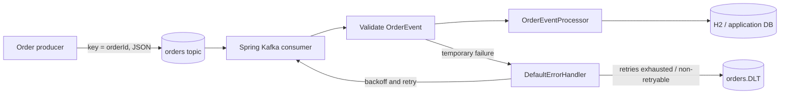

# Xây dựng consumer xử lý OrderEvent

Bài thực hành này xây dựng một Spring Kafka consumer nhận sự kiện `OrderEvent` từ topic `orders`, deserialize JSON thành Java object, kiểm tra dữ liệu, lưu kết quả vào database và xử lý lỗi bằng retry cùng dead-letter topic (DLT).

Kết quả cần đạt là một consumer có thể chạy độc lập, xử lý record theo key, chịu được việc cùng event được giao lại và có kiểm thử tích hợp để chứng minh hành vi đó. Đây là bài thực hành tổng hợp trong module Spring Kafka Messaging, kết hợp `KafkaTemplate`, `@KafkaListener`, topic, partition, consumer group, serialization, retry, DLT và idempotency.

## 1. Mục tiêu và yêu cầu nghiệp vụ

Xây dựng dịch vụ `order-consumer` với luồng:

1. Nhận `OrderEvent` từ topic `orders`.
2. Dùng `orderId` làm Kafka key để các event của cùng đơn hàng đi vào cùng partition.
3. Deserialize JSON thành DTO `OrderEvent`.
4. Kiểm tra `eventId`, `orderId`, `amount` và trạng thái đơn hàng.
5. Lưu event đã xử lý vào database.
6. Nếu cùng `eventId` được giao lại, không ghi nhận side effect lần thứ hai.
7. Với lỗi tạm thời, retry có giới hạn và backoff.
8. Với lỗi dữ liệu không thể phục hồi, chuyển record sang `orders.DLT`.
9. Có integration test xác minh consume, persist, duplicate handling và DLT behavior.

**Kết quả thực hành:** Sau bài này, bạn có một consumer có thể chạy với Kafka broker cục bộ, quan sát được consumer group, kiểm tra được dữ liệu đã lưu và xác minh được record lỗi đi vào DLT.

## 2. Kiến trúc tổng thể



Trong cùng một consumer group, Kafka phân phối partition cho các consumer member. Nếu topic có ba partition và dịch vụ chạy ba consumer member, mỗi member có thể nhận một partition. Kafka giữ thứ tự record trong từng partition; dùng `orderId` làm key giúp các event của một order thường được route tới cùng partition.

Bài này dùng blocking retry với `DefaultErrorHandler` để dễ quan sát retry ngay trên partition nguồn. Record lỗi sẽ được chuyển sang `orders.DLT` sau khi hết retry hoặc khi gặp exception được phân loại không retry.

## 3. Chuẩn bị môi trường và dependencies

Cần có:

- Java 17 trở lên.
- Maven hoặc Gradle.
- Spring Boot project có dependency management.
- Kafka broker có thể truy cập tại `localhost:9092`.
- H2 để chạy bài thực hành mà không cần cài database riêng.

Có thể khởi động Kafka local bằng Docker với image Apache Kafka:

```bash
docker run -d --name kafka \
  -p 9092:9092 \
  apache/kafka:4.1.1
```

Nếu máy đã có Kafka broker, dùng broker đó và thay `bootstrap-servers` tương ứng. Phiên bản image chỉ là ví dụ; trong dự án thực tế, hãy pin phiên bản broker tương thích với môi trường đang triển khai.

Thêm các dependencies sau vào `pom.xml`. Phiên bản được quản lý bởi Spring Boot parent/BOM của project:

```xml
<dependencies>
    <dependency>
        <groupId>org.springframework.boot</groupId>
        <artifactId>spring-boot-starter</artifactId>
    </dependency>

    <dependency>
        <groupId>org.springframework.kafka</groupId>
        <artifactId>spring-kafka</artifactId>
    </dependency>

    <dependency>
        <groupId>org.springframework.boot</groupId>
        <artifactId>spring-boot-starter-jdbc</artifactId>
    </dependency>

    <dependency>
        <groupId>org.springframework.boot</groupId>
        <artifactId>spring-boot-starter-json</artifactId>
    </dependency>

    <dependency>
        <groupId>com.h2database</groupId>
        <artifactId>h2</artifactId>
        <scope>runtime</scope>
    </dependency>

    <dependency>
        <groupId>org.springframework.boot</groupId>
        <artifactId>spring-boot-starter-test</artifactId>
        <scope>test</scope>
    </dependency>

    <dependency>
        <groupId>org.springframework.kafka</groupId>
        <artifactId>spring-kafka-test</artifactId>
        <scope>test</scope>
    </dependency>

    <dependency>
        <groupId>org.awaitility</groupId>
        <artifactId>awaitility</artifactId>
        <scope>test</scope>
    </dependency>
</dependencies>
```

Không khai báo một phiên bản `spring-kafka` độc lập nếu Spring Boot BOM đã quản lý dependency này. Giữ các thư viện Spring Kafka, Kafka client và Spring Boot ở bộ phiên bản tương thích.

## 4. Tạo cấu trúc project

Có thể tổ chức source như sau:

```text
src/
  main/
    java/com/example/orders/
      OrderConsumerApplication.java
      config/
        KafkaTopicConfiguration.java
        KafkaErrorHandlerConfiguration.java
      model/
        OrderEvent.java
        OrderStatus.java
      listener/
        OrderEventListener.java
      service/
        OrderEventProcessor.java
        InvalidOrderEventException.java
      repository/
        JdbcOrderEventRepository.java
    resources/
      application.yml
      schema.sql
  test/
    java/com/example/orders/
      OrderEventConsumerIntegrationTest.java
```

Tên package có thể thay theo project. Khi cấu hình JSON deserializer, phải dùng đúng fully qualified class name của `OrderEvent`.

## 5. Định nghĩa OrderEvent contract

Tạo enum trạng thái đơn hàng:

```java
package com.example.orders.model;

public enum OrderStatus {
    CREATED,
    PAID,
    CANCELLED
}
```

Tạo record làm payload contract:

```java
package com.example.orders.model;

import java.math.BigDecimal;
import java.time.Instant;

public record OrderEvent(
        String eventId,
        String orderId,
        String customerId,
        BigDecimal amount,
        OrderStatus status,
        Instant occurredAt
) {
}
```

Ý nghĩa các field:

| Field | Mục đích | Quy tắc |
|---|---|---|
| `eventId` | Nhận diện duy nhất một sự kiện nghiệp vụ | Giữ nguyên khi retry hoặc replay |
| `orderId` | Đơn hàng phát sinh sự kiện | Dùng làm Kafka key |
| `customerId` | Khách hàng liên quan | Không rỗng |
| `amount` | Giá trị đơn hàng | Lớn hơn 0 |
| `status` | Trạng thái đơn hàng | Thuộc enum đã định nghĩa |
| `occurredAt` | Thời điểm sự kiện phát sinh | ISO-8601 UTC |

Không dùng `double` cho tiền vì sai số dấu phẩy động có thể làm lệch giá trị. `BigDecimal` phù hợp hơn cho amount.

Một JSON hợp lệ:

```json
{
  "eventId": "evt-10001",
  "orderId": "order-10001",
  "customerId": "customer-88",
  "amount": 129000.00,
  "status": "CREATED",
  "occurredAt": "2026-11-17T08:30:00Z"
}
```

`eventId` là ID của sự kiện, không phải Kafka offset. Một event được publish lại có thể nhận offset khác nhưng vẫn phải giữ nguyên event ID nếu đó là cùng một sự kiện nghiệp vụ.

## 6. Cấu hình consumer, producer và database

Tạo `src/main/resources/application.yml`:

```yaml
spring:
  kafka:
    bootstrap-servers: localhost:9092

    consumer:
      group-id: order-consumer
      auto-offset-reset: earliest
      enable-auto-commit: false
      key-deserializer: org.apache.kafka.common.serialization.StringDeserializer
      value-deserializer: org.springframework.kafka.support.serializer.ErrorHandlingDeserializer
      properties:
        spring.deserializer.value.delegate.class: org.springframework.kafka.support.serializer.JsonDeserializer
        spring.json.value.default.type: com.example.orders.model.OrderEvent
        spring.json.trusted.packages: com.example.orders.model
        spring.json.use.type.headers: false

    producer:
      key-serializer: org.apache.kafka.common.serialization.StringSerializer
      value-serializer: org.springframework.kafka.support.serializer.JsonSerializer

    listener:
      ack-mode: record

  datasource:
    url: jdbc:h2:mem:orders;DB_CLOSE_DELAY=-1
    username: sa
    password: ""
    driver-class-name: org.h2.Driver

  sql:
    init:
      mode: always

app:
  kafka:
    topics:
      orders: orders
```

Các điểm cần hiểu:

- `group-id` xác định consumer group lưu committed offset.
- `auto-offset-reset: earliest` chỉ có tác dụng khi group chưa có offset hợp lệ.
- `enable-auto-commit: false` để listener container quản lý commit.
- `ErrorHandlingDeserializer` bọc JSON deserializer để lỗi deserialize có thể được error handling của Spring Kafka tiếp nhận.
- `spring.json.value.default.type` khai báo kiểu DTO mặc định cho value.
- `spring.json.use.type.headers: false` khiến ví dụ dùng contract `OrderEvent` cố định thay vì phụ thuộc type header từ producer.
- Producer dùng `JsonSerializer` để gửi DTO khi test hoặc publish từ ứng dụng.

Bài thực hành này kiểm tra retry/DLT cho exception phát sinh sau khi DTO đã deserialize thành công. Nếu muốn đưa cả payload JSON lỗi vào DLT, cần cấu hình DLT producer có serializer hỗ trợ raw `byte[]`; `JsonSerializer` đơn thuần không đủ cho mọi kiểu payload lỗi.

## 7. Tạo topic nguồn và DLT

Dùng `KafkaAdmin` của Spring Boot để tạo topic khi ứng dụng khởi động:

```java
package com.example.orders.config;

import org.apache.kafka.clients.admin.NewTopic;
import org.springframework.context.annotation.Bean;
import org.springframework.context.annotation.Configuration;
import org.springframework.kafka.config.TopicBuilder;

@Configuration
public class KafkaTopicConfiguration {

    @Bean
    NewTopic ordersTopic() {
        return TopicBuilder.name("orders")
                .partitions(3)
                .replicas(1)
                .build();
    }

    @Bean
    NewTopic ordersDltTopic() {
        return TopicBuilder.name("orders.DLT")
                .partitions(3)
                .replicas(1)
                .build();
    }
}
```

Bài lab dùng broker một node nên replication factor bằng 1. Production cần replication factor phù hợp với số broker, `min.insync.replicas`, retention và chính sách durability của cluster.

DLT được tạo cùng số partition với topic nguồn vì recoverer ở bước tiếp theo giữ nguyên partition. Nếu thay đổi partition routing, phải điều chỉnh cấu hình topic cho phù hợp.

Có thể xác minh topic:

```bash
kafka-topics.sh \
  --bootstrap-server localhost:9092 \
  --describe \
  --topic orders

kafka-topics.sh \
  --bootstrap-server localhost:9092 \
  --describe \
  --topic orders.DLT
```

Nếu dùng Docker image chính thức, có thể chạy CLI bên trong container bằng `docker exec` và đường dẫn script tương ứng của image.

## 8. Tạo schema để lưu event đã xử lý

Tạo `src/main/resources/schema.sql`:

```sql
CREATE TABLE IF NOT EXISTS processed_orders (
    event_id VARCHAR(100) PRIMARY KEY,
    order_id VARCHAR(100) NOT NULL,
    customer_id VARCHAR(100) NOT NULL,
    amount DECIMAL(19, 2) NOT NULL,
    status VARCHAR(30) NOT NULL,
    occurred_at TIMESTAMP NOT NULL,
    processed_at TIMESTAMP NOT NULL
);
```

Khóa chính trên `event_id` là hàng rào idempotency ở database. Nếu cùng event được xử lý lại, database từ chối insert trùng và ứng dụng bỏ qua duplicate đó.

Trong hệ thống thực tế, bảng inbox/processed event và thay đổi nghiệp vụ cần nằm trong cùng transaction database. Ví dụ này lưu trực tiếp event đã xử lý để minh họa tính nguyên tử của insert; khi mở rộng sang cập nhật bảng đơn hàng, hãy thực hiện cả hai trong cùng transaction.

## 9. Viết repository có transaction

Tạo repository lưu event:

```java
package com.example.orders.repository;

import java.sql.Timestamp;
import java.time.Instant;

import org.springframework.jdbc.core.JdbcTemplate;
import org.springframework.stereotype.Repository;
import org.springframework.transaction.annotation.Transactional;

import com.example.orders.model.OrderEvent;

@Repository
public class JdbcOrderEventRepository {

    private final JdbcTemplate jdbcTemplate;

    public JdbcOrderEventRepository(JdbcTemplate jdbcTemplate) {
        this.jdbcTemplate = jdbcTemplate;
    }

    @Transactional
    public void insert(OrderEvent event) {
        jdbcTemplate.update("""
                INSERT INTO processed_orders (
                    event_id,
                    order_id,
                    customer_id,
                    amount,
                    status,
                    occurred_at,
                    processed_at
                )
                VALUES (?, ?, ?, ?, ?, ?, ?)
                """,
                event.eventId(),
                event.orderId(),
                event.customerId(),
                event.amount(),
                event.status().name(),
                Timestamp.from(event.occurredAt()),
                Timestamp.from(Instant.now())
        );
    }
}
```

Mỗi lần insert chạy trong transaction riêng của repository. Nếu unique constraint báo duplicate, transaction đó rollback trước khi exception được xử lý ở service gọi repository. Những lỗi database khác tiếp tục được ném ra để Kafka error handler retry.

Không bắt `DuplicateKeyException` ngay bên trong method đang thực hiện transaction insert rồi tiếp tục chạy nghiệp vụ. Đưa phần bắt duplicate ra ngoài lời gọi repository giúp transaction insert kết thúc rollback đúng cách trước khi xử lý trường hợp duplicate.

## 10. Viết exception và service xử lý nghiệp vụ

Tạo exception cho dữ liệu không hợp lệ:

```java
package com.example.orders.service;

public class InvalidOrderEventException extends RuntimeException {

    public InvalidOrderEventException(String message) {
        super(message);
    }
}
```

Tạo processor:

```java
package com.example.orders.service;

import org.springframework.dao.DuplicateKeyException;
import org.springframework.stereotype.Service;

import com.example.orders.model.OrderEvent;
import com.example.orders.repository.JdbcOrderEventRepository;

@Service
public class OrderEventProcessor {

    private final JdbcOrderEventRepository repository;

    public OrderEventProcessor(JdbcOrderEventRepository repository) {
        this.repository = repository;
    }

    public void process(OrderEvent event) {
        validate(event);

        try {
            repository.insert(event);
        }
        catch (DuplicateKeyException duplicate) {
            // Event ID đã được xử lý trong transaction trước.
            // Bỏ qua duplicate để không lặp side effect.
        }
    }

    private void validate(OrderEvent event) {
        if (event == null
                || event.eventId() == null
                || event.eventId().isBlank()) {
            throw new InvalidOrderEventException(
                    "eventId is required"
            );
        }

        if (event.orderId() == null || event.orderId().isBlank()) {
            throw new InvalidOrderEventException(
                    "orderId is required"
            );
        }

        if (event.customerId() == null || event.customerId().isBlank()) {
            throw new InvalidOrderEventException(
                    "customerId is required"
            );
        }

        if (event.amount() == null || event.amount().signum() <= 0) {
            throw new InvalidOrderEventException(
                    "amount must be greater than zero"
            );
        }

        if (event.status() == null || event.occurredAt() == null) {
            throw new InvalidOrderEventException(
                    "status and occurredAt are required"
            );
        }
    }
}
```

`InvalidOrderEventException` là lỗi dữ liệu không thể tự phục hồi bằng cách thử lại. `DuplicateKeyException` được xử lý như một duplicate event đã hoàn tất trước đó. Lỗi kết nối database hoặc lỗi hạ tầng khác không bị bắt ở đây, nên tiếp tục đi lên listener để error handler retry.

Trong ví dụ thực tế, hãy ghi log có cấu trúc cho duplicate event và theo dõi số lượng duplicate. Không ghi payload nhạy cảm vào log.

## 11. Cấu hình retry và dead-letter recoverer

Tạo `KafkaErrorHandlerConfiguration`:

```java
package com.example.orders.config;

import org.apache.kafka.common.TopicPartition;
import org.springframework.context.annotation.Bean;
import org.springframework.context.annotation.Configuration;
import org.springframework.kafka.core.KafkaTemplate;
import org.springframework.kafka.listener.DefaultErrorHandler;
import org.springframework.kafka.listener.DeadLetterPublishingRecoverer;
import org.springframework.util.backoff.FixedBackOff;

import com.example.orders.service.InvalidOrderEventException;

@Configuration
public class KafkaErrorHandlerConfiguration {

    @Bean
    DefaultErrorHandler orderErrorHandler(
            KafkaTemplate<Object, Object> kafkaTemplate) {

        DeadLetterPublishingRecoverer recoverer =
                new DeadLetterPublishingRecoverer(
                        kafkaTemplate,
                        (record, exception) -> new TopicPartition(
                                record.topic() + ".DLT",
                                record.partition()
                        )
                );

        recoverer.setFailIfSendResultIsError(true);

        DefaultErrorHandler handler =
                new DefaultErrorHandler(
                        recoverer,
                        new FixedBackOff(1_000L, 2L)
                );

        handler.addNotRetryableExceptions(
                InvalidOrderEventException.class
        );

        handler.setDeliveryAttemptHeader(true);

        return handler;
    }
}
```

Giải thích cấu hình:

- `DeadLetterPublishingRecoverer` gửi record lỗi sang topic có hậu tố `.DLT`.
- Partition của DLT được giữ giống partition nguồn.
- `setFailIfSendResultIsError(true)` khiến lỗi gửi DLT được báo lại cho error handling thay vì âm thầm coi là recovery thành công.
- `FixedBackOff(1_000L, 2L)` chờ một giây giữa các lần retry và retry tối đa hai lần sau lần xử lý đầu tiên.
- `InvalidOrderEventException` không retry, đi thẳng tới recoverer.
- Delivery attempt header giúp quan sát số lần giao trong phạm vi error handler.

Với lỗi tạm thời, tối đa có ba lần gọi listener: một lần đầu và hai lần retry. Với lỗi dữ liệu không retryable, record được chuyển sang DLT mà không chờ hai lần retry.

Bean `CommonErrorHandler` duy nhất thường được Spring Boot gắn vào listener container factory mặc định. Nếu project tạo factory thủ công hoặc có nhiều factory, hãy gắn handler rõ ràng bằng `factory.setCommonErrorHandler(orderErrorHandler)` cho factory mà listener sử dụng.

Ví dụ này dùng `KafkaTemplate` có JSON serializer cho `OrderEvent` đã deserialize. Nếu cần DLT cả lỗi deserialize mà value còn là raw `byte[]`, hãy cấu hình producer serializer theo kiểu dữ liệu để hỗ trợ cả DTO lẫn byte array.

## 12. Viết @KafkaListener

Tạo listener:

```java
package com.example.orders.listener;

import org.slf4j.Logger;
import org.slf4j.LoggerFactory;
import org.springframework.kafka.annotation.KafkaListener;
import org.springframework.kafka.support.KafkaHeaders;
import org.springframework.messaging.handler.annotation.Header;
import org.springframework.stereotype.Component;

import com.example.orders.model.OrderEvent;
import com.example.orders.service.OrderEventProcessor;

@Component
public class OrderEventListener {

    private static final Logger log =
            LoggerFactory.getLogger(OrderEventListener.class);

    private final OrderEventProcessor processor;

    public OrderEventListener(OrderEventProcessor processor) {
        this.processor = processor;
    }

    @KafkaListener(
            id = "orderEventListener",
            topics = "${app.kafka.topics.orders}",
            groupId = "order-consumer"
    )
    public void consume(
            OrderEvent event,
            @Header(KafkaHeaders.RECEIVED_KEY) String key,
            @Header(KafkaHeaders.RECEIVED_PARTITION) int partition,
            @Header(KafkaHeaders.OFFSET) long offset,
            @Header(
                    name = KafkaHeaders.DELIVERY_ATTEMPT,
                    required = false
            ) Integer deliveryAttempt) {

        log.info(
                "Received order eventId={}, orderId={}, key={}, partition={}, offset={}, attempt={}",
                event.eventId(),
                event.orderId(),
                key,
                partition,
                offset,
                deliveryAttempt
        );

        processor.process(event);
    }
}
```

Listener chỉ điều phối việc nhận record và gọi processor. Logic validation/persistence nằm trong service để dễ unit test và không trộn transport concern với business logic.

`KafkaHeaders.RECEIVED_KEY` cho biết Kafka key, còn partition và offset giúp truy vết record ở transport layer. `DELIVERY_ATTEMPT` có thể không tồn tại ở lần giao bình thường; vì vậy header được đánh dấu `required = false`.

Nếu listener dùng group ID từ cấu hình Boot, có thể bỏ `groupId` trên annotation. Trong lab, khai báo rõ để người học thấy group ID mà listener tham gia.

## 13. Khởi động ứng dụng và gửi OrderEvent

Tạo lớp ứng dụng Spring Boot:

```java
package com.example.orders;

import org.springframework.boot.SpringApplication;
import org.springframework.boot.autoconfigure.SpringBootApplication;

@SpringBootApplication
public class OrderConsumerApplication {

    public static void main(String[] args) {
        SpringApplication.run(
                OrderConsumerApplication.class,
                args
        );
    }
}
```

Chạy ứng dụng:

```bash
./mvnw spring-boot:run
```

Nếu dùng Windows:

```powershell
.\mvnw.cmd spring-boot:run
```

Sau khi listener khởi động, gửi một record JSON vào topic `orders`. Dùng Kafka console producer có key parsing:

```bash
kafka-console-producer.sh \
  --bootstrap-server localhost:9092 \
  --topic orders \
  --property parse.key=true \
  --property key.separator=:
```

Nhập một dòng:

```text
order-10001:{"eventId":"evt-10001","orderId":"order-10001","customerId":"customer-88","amount":129000.00,"status":"CREATED","occurredAt":"2026-11-17T08:30:00Z"}
```

Producer CLI sẽ gửi `order-10001` làm key và phần JSON còn lại làm value. Trong log consumer, kiểm tra event ID, order ID, key, partition và offset.

Có thể gửi thêm event cho cùng order ID với event ID khác. Chúng phải được ghi vào cùng partition nếu key partitioning mặc định và metadata topic không thay đổi.

## 14. Quan sát dữ liệu và consumer group

Kiểm tra dữ liệu trong H2 bằng H2 Console nếu project đã expose console, hoặc truy vấn qua test/repository. Ví dụ SQL:

```sql
SELECT
    event_id,
    order_id,
    customer_id,
    amount,
    status,
    occurred_at,
    processed_at
FROM processed_orders
ORDER BY processed_at;
```

Xem trạng thái consumer group:

```bash
kafka-consumer-groups.sh \
  --bootstrap-server localhost:9092 \
  --describe \
  --group order-consumer
```

Kiểm tra member và partition assignment:

```bash
kafka-consumer-groups.sh \
  --bootstrap-server localhost:9092 \
  --describe \
  --group order-consumer \
  --members \
  --verbose
```

Kiểm tra DLT:

```bash
kafka-console-consumer.sh \
  --bootstrap-server localhost:9092 \
  --topic orders.DLT \
  --from-beginning \
  --property print.key=true \
  --property print.headers=true
```

Một group có thể ở trạng thái ổn định dù lag lớn; vì vậy hãy xem cả assignment, committed offset, lag và log listener. Nếu group chưa có committed offset, `auto-offset-reset` quyết định vị trí bắt đầu khi consumer cần khởi tạo offset.

## 15. Thử nghiệm retry và DLT

Gửi một event có amount âm:

```text
order-invalid-01:{"eventId":"evt-invalid-01","orderId":"order-invalid-01","customerId":"customer-88","amount":-10.00,"status":"CREATED","occurredAt":"2026-11-17T08:35:00Z"}
```

Processor ném `InvalidOrderEventException`. Vì exception này được đánh dấu non-retryable, record phải được chuyển tới `orders.DLT`. Kiểm tra DLT consumer để xác nhận key, payload và các header nguồn.

Tiếp theo, thử lỗi tạm thời bằng cách tạm thời làm repository ném một exception hạ tầng trong môi trường test, ví dụ `TransientDataAccessResourceException`. Không dùng lỗi dữ liệu cố định cho tình huống retryable vì retry không thể làm dữ liệu tự hợp lệ.

Quan sát:

- Log listener được gọi lại với cùng topic/partition/offset.
- Delivery attempt tăng trong phạm vi error handler.
- Backoff giữa các lần retry.
- Sau khi retry hết, record được publish sang DLT.
- Nếu DLT broker/topic không khả dụng, recoverer báo lỗi và recovery chưa được xem là thành công.

Không gây lỗi trên database production để thử retry. Chỉ fault-inject trong môi trường local hoặc integration test.

## 16. Kiểm thử idempotency khi cùng event được gửi hai lần

Gửi hai record có cùng `eventId` và cùng payload nhưng producer tạo hai Kafka record riêng biệt. Hai record có offset khác nhau, nhưng bảng `processed_orders` chỉ được có một hàng cho event ID đó.

Ví dụ integration test:

```java
package com.example.orders;

import static org.assertj.core.api.Assertions.assertThat;
import static org.awaitility.Awaitility.await;

import java.math.BigDecimal;
import java.time.Duration;
import java.time.Instant;
import java.util.Map;
import java.util.concurrent.TimeUnit;

import org.apache.kafka.clients.admin.AdminClient;
import org.apache.kafka.clients.admin.AdminClientConfig;
import org.apache.kafka.clients.consumer.OffsetAndMetadata;
import org.apache.kafka.clients.producer.RecordMetadata;
import org.apache.kafka.common.TopicPartition;
import org.junit.jupiter.api.Test;
import org.springframework.beans.factory.annotation.Autowired;
import org.springframework.beans.factory.annotation.Value;
import org.springframework.boot.test.context.SpringBootTest;
import org.springframework.jdbc.core.JdbcTemplate;
import org.springframework.kafka.core.KafkaTemplate;
import org.springframework.kafka.test.context.EmbeddedKafka;
import org.springframework.test.annotation.DirtiesContext;

import com.example.orders.model.OrderEvent;
import com.example.orders.model.OrderStatus;

@SpringBootTest
@EmbeddedKafka(
        partitions = 3,
        topics = {"orders", "orders.DLT"},
        bootstrapServersProperty = "spring.kafka.bootstrap-servers"
)
@DirtiesContext
class OrderEventConsumerIntegrationTest {

    @Autowired
    KafkaTemplate<Object, Object> kafkaTemplate;

    @Autowired
    JdbcTemplate jdbcTemplate;

    @Value("${spring.kafka.bootstrap-servers}")
    String bootstrapServers;

    @Test
    void duplicateEventIsPersistedOnlyOnce() throws Exception {
        OrderEvent event = new OrderEvent(
                "evt-test-100",
                "order-test-100",
                "customer-test-1",
                new BigDecimal("125000.00"),
                OrderStatus.CREATED,
                Instant.now()
        );

        kafkaTemplate.send("orders", event.orderId(), event)
                .get(10, TimeUnit.SECONDS);

        RecordMetadata secondRecord = kafkaTemplate
                .send("orders", event.orderId(), event)
                .get(10, TimeUnit.SECONDS)
                .getRecordMetadata();

        try (AdminClient admin = AdminClient.create(
                Map.of(
                        AdminClientConfig.BOOTSTRAP_SERVERS_CONFIG,
                        bootstrapServers
                )
        )) {
            await()
                    .atMost(Duration.ofSeconds(10))
                    .untilAsserted(() -> {
                        Map<TopicPartition, OffsetAndMetadata> committed =
                                admin.listConsumerGroupOffsets("order-consumer")
                                        .partitionsToOffsetAndMetadata()
                                        .get();

                        OffsetAndMetadata offset = committed.get(
                                new TopicPartition(
                                        "orders",
                                        secondRecord.partition()
                                )
                        );

                        assertThat(offset).isNotNull();
                        assertThat(offset.offset())
                                .isGreaterThan(secondRecord.offset());
                    });
        }

        Integer count = jdbcTemplate.queryForObject(
                """
                SELECT COUNT(*)
                FROM processed_orders
                WHERE event_id = ?
                """,
                Integer.class,
                event.eventId()
        );

        assertThat(count).isEqualTo(1);
    }
}
```

Test sử dụng `@EmbeddedKafka` để chạy broker cho integration test. `Awaitility` chờ điều kiện database thay vì dùng sleep cố định. Nếu test chạy song song, hãy bảo đảm mỗi test dùng event ID riêng và database/context không chia sẻ trạng thái ngoài dự kiến.

Test này chứng minh hai Kafka record cùng event ID không tạo hai hàng nghiệp vụ. Nó không chứng minh Kafka chỉ giao record một lần; thực tế cả hai record đều được consume, nhưng consumer idempotency loại bỏ side effect trùng.

## 17. Bổ sung test cho validation và DLT

Tạo thêm các test case:

| Test case | Dữ liệu/điều kiện | Kết quả mong đợi |
|---|---|---|
| Event hợp lệ | Amount dương, đủ field | Một hàng trong `processed_orders` |
| Event thiếu event ID | `eventId` rỗng | Chuyển DLT, không retry |
| Amount âm | `amount` nhỏ hơn hoặc bằng 0 | Chuyển DLT, không ghi DB |
| Lỗi DB tạm thời | Repository thất bại lần đầu rồi thành công | Listener retry và cuối cùng ghi một hàng |
| Lỗi DB liên tục | Repository luôn lỗi | Retry đủ số lần rồi chuyển DLT |
| Gửi trùng event ID | Hai Kafka record cùng ID | Chỉ một hàng nghiệp vụ |
| DLT publish thất bại | DLT broker/topic không khả dụng | Recovery thất bại, không giả định record đã được xử lý |
| JSON không hợp lệ | Payload không deserialize được | ErrorHandlingDeserializer chuyển lỗi tới error handling; cần DLT serializer hỗ trợ raw bytes nếu muốn lưu payload gốc |

Với test DLT, tạo một test consumer có group ID riêng để đọc `orders.DLT` và assert header nguồn như original topic, partition, offset và exception. Không dùng group ID của listener chính để đọc DLT vì sẽ làm thay đổi assignment và kết quả test.

## 18. Những lỗi thường gặp khi làm bài

| Triệu chứng | Nguyên nhân | Cách kiểm tra |
|---|---|---|
| Listener không nhận record | Broker sai địa chỉ, topic sai hoặc listener container chưa start | Kiểm tra bootstrap server, topic và log startup |
| JSON deserialize thất bại | Field/type không khớp DTO, enum sai hoặc timestamp sai định dạng | Kiểm tra JSON contract và deserializer |
| Không tạo được topic | KafkaAdmin không kết nối được hoặc broker không cho phép create | Kiểm tra broker và quyền tạo topic |
| Listener bị gọi lại liên tục | Exception luôn xảy ra hoặc retry chưa có giới hạn | Kiểm tra DefaultErrorHandler, backoff và exception |
| Không thấy record trong DLT | Recoverer chưa được gắn vào đúng factory hoặc DLT publish lỗi | Kiểm tra error handler và producer send result |
| DLT gửi lỗi serializer | Value là raw byte[] nhưng template chỉ hỗ trợ DTO | Cấu hình serializer theo kiểu hoặc template riêng |
| Consumer group không có member | Listener chưa chạy, group ID khác hoặc lỗi khởi tạo | Dùng `kafka-consumer-groups.sh` để describe group |
| Database có dữ liệu trùng | Không có unique constraint theo event ID hoặc side effect nằm ngoài transaction | Kiểm tra schema và transaction boundary |
| Event cùng order đi vào partition khác | Producer không dùng orderId làm key hoặc partitioner khác | Kiểm tra key ở producer và partition metadata |

Khi debug, ghi lại group ID, topic, partition, offset và event ID. Không log password, token hoặc toàn bộ payload có dữ liệu nhạy cảm.

## 19. Tiêu chí hoàn thành bài thực hành

Bài được xem là hoàn thành khi đáp ứng tất cả điều kiện:

- [ ] Kafka broker local chạy và ứng dụng kết nối được.
- [ ] Topic `orders` và `orders.DLT` có ba partition trong lab.
- [ ] JSON hợp lệ được deserialize thành `OrderEvent`.
- [ ] Listener log được event ID, key, partition và offset.
- [ ] Event hợp lệ được ghi vào database.
- [ ] Cùng event ID được gửi hai lần nhưng database chỉ có một hàng.
- [ ] Lỗi dữ liệu không retry và được chuyển sang DLT.
- [ ] Lỗi tạm thời được retry theo backoff đã cấu hình.
- [ ] Consumer group hiển thị member và assignment mong đợi.
- [ ] Integration test duplicate event chạy thành công.

Nếu một tiêu chí chưa đạt, ghi lại log và metadata record liên quan, xác định tầng lỗi rồi sửa trước khi chuyển sang phần mở rộng.

## 20. Bài mở rộng

Sau khi hoàn thành luồng cơ bản, thực hiện các phần sau:

1. **Tăng concurrency:** cấu hình listener concurrency bằng 2 hoặc 3, quan sát partition assignment và so sánh với số partition.
2. **Thêm retry topic:** chuyển sang `@RetryableTopic` và quan sát thứ tự xử lý khi record lỗi được đưa sang retry topic.
3. **Thêm event version:** bổ sung `schemaVersion` và xử lý tương thích DTO khi producer nâng version.
4. **Thêm metrics:** đo listener processing time, retry count, DLT count và consumer lag.
5. **Thêm tracing:** gắn correlation ID/trace ID vào Kafka headers và log.
6. **Thay H2 bằng PostgreSQL:** giữ unique constraint trên event ID và chạy integration test với Testcontainers.
7. **Thêm outbox:** tạo luồng producer ghi order và outbox event trong cùng database transaction.

Khi chuyển sang non-blocking retry, nhớ rằng record phía sau có thể được xử lý trước record đang chờ ở retry topic. Nếu nghiệp vụ cần thứ tự nghiêm ngặt theo order, hãy thiết kế state transition và idempotency theo version/sequence của đơn hàng.

Bài thực hành đã kết hợp consumer, DTO, JSON deserialization, partition key, group, persistence, retry, DLT và integration test thành một luồng OrderEvent hoàn chỉnh. Hãy giữ event ID ổn định và đặt side effect nghiệp vụ trong transaction idempotent để consumer có thể phục hồi an toàn khi Kafka giao lại record.
