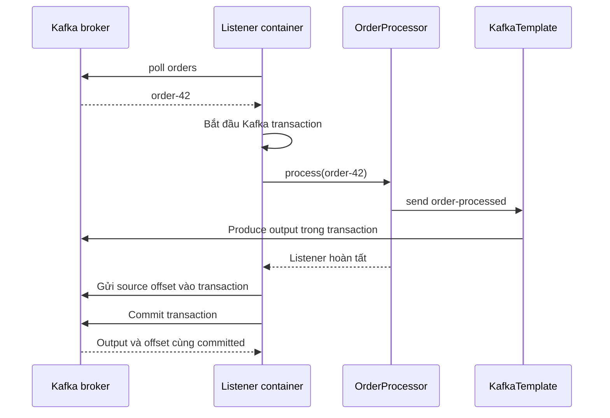
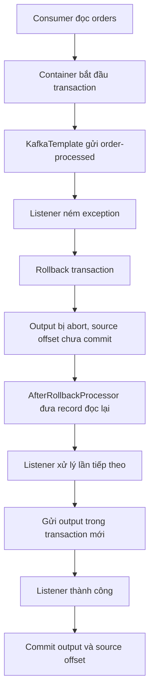

# Thêm transaction cho read-process-write

Trong bài thực hành này, ta xây dựng một luồng **read-process-write** bằng Spring Kafka: consumer đọc một sự kiện từ topic `orders`, xử lý dữ liệu rồi gửi kết quả sang topic `order-processed`. Toàn bộ thao tác gửi output và commit offset nguồn phải nằm trong cùng một Kafka transaction. Nếu listener thất bại sau khi gửi output, transaction rollback cả hai; khi record được giao lại và xử lý thành công, output cùng offset nguồn mới được commit.

Mục tiêu là kiểm chứng tính nguyên tử giữa Kafka input và Kafka output. Listener có thể được gọi nhiều lần; điều cần bảo đảm là consumer `read_committed` chỉ nhìn thấy output của transaction đã commit, và offset nguồn chỉ tiến lên cùng transaction đó.

## 1. Mô hình bài thực hành

Ta dùng hai topic:

| Topic | Vai trò | Ví dụ |
|---|---|---|
| `orders` | Topic đầu vào | `order-42` |
| `order-processed` | Topic đầu ra sau xử lý | `processed:order-42` |

Luồng thành công:



Luồng khi listener lỗi sau khi gửi output:



## 2. Chuẩn bị dependency và Kafka broker

Thêm dependency kiểm thử nếu dùng Maven. Phiên bản nên được quản lý bởi Spring Boot dependency management hoặc BOM Spring Kafka để tránh lệch phiên bản:

```xml
<dependency>
    <groupId>org.springframework.kafka</groupId>
    <artifactId>spring-kafka</artifactId>
</dependency>

<dependency>
    <groupId>org.springframework.kafka</groupId>
    <artifactId>spring-kafka-test</artifactId>
    <scope>test</scope>
</dependency>
```

Có thể chạy với Kafka broker cục bộ hoặc dùng `@EmbeddedKafka` trong test. Broker phải hỗ trợ transaction. Với Spring Kafka 3.x trở lên, EOS V2 là chế độ được hỗ trợ và yêu cầu Kafka broker từ 2.5 trở lên.

Trong bài thực hành, dùng một partition cho mỗi topic để dễ theo dõi offset. Trong môi trường thật, số partition cần phù hợp với mức song song và throughput mong muốn.

## 3. Bật Kafka transaction trong Spring Boot

Khai báo `transaction-id-prefix` cho producer. Khi thuộc tính này được cấu hình, Spring Boot có thể tạo `KafkaTransactionManager` và gắn transaction manager vào listener container factory mặc định.

```yaml
spring:
  kafka:
    bootstrap-servers: localhost:9092
    producer:
      transaction-id-prefix: order-service-${INSTANCE_ID:local}-
      key-serializer: org.apache.kafka.common.serialization.StringSerializer
      value-serializer: org.apache.kafka.common.serialization.StringSerializer
    consumer:
      group-id: order-processor
      auto-offset-reset: earliest
      key-deserializer: org.apache.kafka.common.serialization.StringDeserializer
      value-deserializer: org.apache.kafka.common.serialization.StringDeserializer
      properties:
        "[isolation.level]": read_committed
```

Giải thích:

- `transaction-id-prefix` khiến producer factory tạo transactional producer. Mỗi application instance chạy đồng thời cần prefix riêng để tránh trùng transactional ID và fencing lẫn nhau.
- `group-id` xác định consumer group xử lý topic `orders`.
- `auto-offset-reset: earliest` giúp group mới đọc record đã tồn tại khi chưa có committed offset hợp lệ. Thuộc tính này không reset group đã có offset hợp lệ.
- `isolation.level: read_committed` làm consumer chỉ nhận record transactional đã commit. Đây cũng là chế độ nên dùng khi ứng dụng downstream chỉ được xử lý output đã hoàn tất transaction.

Nếu tự cấu hình thay vì dùng auto-configuration của Boot, `KafkaTransactionManager` và `KafkaTemplate` phải dùng cùng một transaction-capable `ProducerFactory`. Listener container phải được cấu hình với transaction manager đó. Không tạo producer factory riêng cho template mà listener container không quản lý.

## 4. Tạo dữ liệu và listener xử lý

Để tập trung vào transaction, bài thực hành dùng payload String. Producer gửi mã đơn hàng; listener tạo chuỗi kết quả rồi ghi sang topic đầu ra.

```java
@Component
public class OrderProcessor {

    private final KafkaTemplate<String, String> kafkaTemplate;
    private final AtomicBoolean failFirstAttempt = new AtomicBoolean(true);
    private final AtomicInteger attempts = new AtomicInteger();

    public OrderProcessor(KafkaTemplate<String, String> kafkaTemplate) {
        this.kafkaTemplate = kafkaTemplate;
    }

    @KafkaListener(topics = "orders", groupId = "order-processor")
    public void process(String orderId) throws Exception {
        attempts.incrementAndGet();

        // Lệnh gửi tham gia transaction do listener container mở.
        kafkaTemplate.send(
                "order-processed",
                orderId,
                "processed:" + orderId
        ).get(10, TimeUnit.SECONDS);

        // Chỉ mô phỏng lỗi một lần, sau khi output đã được gửi.
        if ("order-fail-once".equals(orderId)
                && failFirstAttempt.compareAndSet(true, false)) {
            throw new IllegalStateException("Simulated failure after output send");
        }
    }

    public int getAttempts() {
        return attempts.get();
    }
}
```

Điểm quan trọng của ví dụ:

- Container bắt đầu Kafka transaction trước khi gọi `process()`.
- `KafkaTemplate` sử dụng producer factory có transaction nên lệnh `send()` tham gia transaction đang hoạt động.
- `send().get()` giúp ví dụ chờ kết quả gửi và làm cho lỗi gửi xuất hiện ngay trong listener. Đây là cách viết dễ quan sát trong bài thực hành; ứng dụng throughput cao có thể dùng API bất đồng bộ, miễn là kết quả gửi vẫn thuộc transaction và lỗi được xử lý trước khi transaction commit.
- Exception được ném ra ngoài listener. Không bắt rồi bỏ qua exception, vì container cần biết listener thất bại để rollback.
- `AtomicBoolean` khiến mã `order-fail-once` chỉ gây lỗi ở lần đầu. Khi record được giao lại, listener gửi output trong transaction mới và hoàn tất bình thường.

Trong ứng dụng thật, thay điều kiện mô phỏng bằng lỗi nghiệp vụ hoặc lỗi dependency có thể tái hiện. Không giữ cờ lỗi trong production; đây chỉ là fault injection phục vụ kiểm thử.

## 5. Gửi input trong một transaction riêng

Để chuẩn bị dữ liệu đầu vào trong test hoặc một producer khác, gửi record vào `orders` và commit transaction nguồn trước khi listener xử lý:

```java
kafkaTemplate.executeInTransaction(operations -> {
    operations.send("orders", "order-fail-once", "order-fail-once");
    return null;
});
```

`executeInTransaction()` tạo một transaction cục bộ cho callback. Khi callback kết thúc bình thường, transaction nguồn commit và consumer có thể đọc record. Nếu callback ném exception, transaction nguồn abort.

Transaction này là transaction của producer chuẩn bị dữ liệu. Nó tách biệt với transaction do listener container mở để xử lý record. Khi listener gọi `KafkaTemplate.send()`, template tham gia transaction của container chứ không mở transaction lồng nhau.

## 6. Hiểu chuyện gì xảy ra sau khi listener ném exception

Ở lần giao đầu tiên của `order-fail-once`:

1. Container mở transaction xử lý.
2. Listener gửi `processed:order-fail-once` vào `order-processed`.
3. Broker có thể đã nhận record output, nhưng record vẫn thuộc transaction chưa commit.
4. Listener ném `IllegalStateException`.
5. Container rollback transaction. Output bị đánh dấu aborted; offset nguồn không được commit.
6. `DefaultAfterRollbackProcessor` mặc định seek để record nguồn được giao lại.

Ở lần giao tiếp theo:

1. Container mở transaction mới.
2. Listener gửi output lần nữa.
3. Cờ `failFirstAttempt` đã được đặt thành `false`, listener kết thúc bình thường.
4. Container gửi source offset vào transaction bằng `sendOffsetsToTransaction()` và commit.
5. Output mới cùng offset nguồn trở thành committed.

Kết quả vật lý trong log output có thể có hai record: một record thuộc transaction abort và một record thuộc transaction commit. Consumer `read_committed` chỉ nhìn thấy record đã commit. Do đó, listener có thể chạy hai lần trong khi hiệu ứng Kafka đã commit chỉ xuất hiện một lần.

## 7. Viết integration test với Embedded Kafka

`@EmbeddedKafka` khởi động broker cho test. Với broker đơn, cần đặt replication factor của transaction state log và offsets topic bằng `1` để broker có thể khởi động transaction.

```java
@SpringBootTest(properties = {
        "spring.kafka.producer.transaction-id-prefix=orders-test-${random.uuid}-",
        "spring.kafka.consumer.group-id=order-processor",
        "spring.kafka.consumer.auto-offset-reset=earliest"
})
@EmbeddedKafka(
        partitions = 1,
        topics = {"orders", "order-processed"},
        brokerProperties = {
                "offsets.topic.replication.factor=1",
                "transaction.state.log.replication.factor=1",
                "transaction.state.log.min.isr=1"
        }
)
class ReadProcessWriteTransactionTest {

    @Autowired
    private EmbeddedKafkaBroker embeddedKafka;

    @Autowired
    private KafkaTemplate<String, String> kafkaTemplate;

    @Autowired
    private OrderProcessor orderProcessor;

    @Test
    void shouldCommitOutputAndSourceOffsetTogetherAfterRetry() throws Exception {
        Map<String, Object> consumerProps = KafkaTestUtils.consumerProps(
                embeddedKafka, "verify-order-processed", false);
        consumerProps.put(ConsumerConfig.ISOLATION_LEVEL_CONFIG, "read_committed");

        try (Consumer<String, String> consumer =
                     new DefaultKafkaConsumerFactory<String, String>(
                             consumerProps,
                             new StringDeserializer(),
                             new StringDeserializer()).createConsumer()) {

            embeddedKafka.consumeFromAnEmbeddedTopic(consumer, "order-processed");

            kafkaTemplate.executeInTransaction(operations -> {
                operations.send("orders", "order-fail-once", "order-fail-once");
                return null;
            });

            ConsumerRecord<String, String> output = KafkaTestUtils.getSingleRecord(
                    consumer, "order-processed", Duration.ofSeconds(20));

            assertThat(output.key()).isEqualTo("order-fail-once");
            assertThat(output.value()).isEqualTo("processed:order-fail-once");
            assertThat(orderProcessor.getAttempts()).isEqualTo(2);

            // Transaction đã commit; không còn output committed thứ hai.
            assertThat(consumer.poll(Duration.ofMillis(500)).count()).isZero();
        }
    }
}
```

Các import và cấu hình package được lược bớt để tập trung vào phần transaction. Test dùng `KafkaTestUtils.consumerProps()` với group kiểm chứng riêng và override `isolation.level=read_committed`. `consumeFromAnEmbeddedTopic()` gán consumer vào topic và seek về đầu để đọc output của bài test.

`getSingleRecord()` đợi tối đa 20 giây để listener hoàn thành retry và transaction commit. Nếu transaction đầu bị abort đúng cách, consumer `read_committed` chỉ nhận một output. Assertion `attempts == 2` xác nhận listener đã được gọi lại; poll tiếp theo không có output committed thứ hai.

## 8. Kiểm tra source offset đã commit

Để xác nhận offset nguồn được commit cùng output, có thể đọc committed offset của group `order-processor` qua `AdminClient`. Với một record đầu vào ở partition `orders-0` có offset `0`, offset tiếp theo sau khi xử lý thành công phải là `1`:

```java
try (AdminClient admin = AdminClient.create(Map.of(
        AdminClientConfig.BOOTSTRAP_SERVERS_CONFIG,
        embeddedKafka.getBrokersAsString()))) {

    Map<TopicPartition, OffsetAndMetadata> offsets = admin
            .listConsumerGroupOffsets("order-processor")
            .partitionsToOffsetAndMetadata()
            .get(10, TimeUnit.SECONDS);

    assertThat(offsets.get(new TopicPartition("orders", 0)).offset())
            .isEqualTo(1L);
}
```

Trong test đầy đủ, chỉ chạy assertion offset sau khi đã nhận output committed. Không suy luận committed offset từ offset của record output: hai topic có offset độc lập. Offset của `orders` và `order-processed` không cần bằng nhau.

Ba kết quả cần khớp:

| Quan sát | Kết quả mong đợi | Ý nghĩa |
|---|---|---|
| Số lần listener được gọi | 2 | Lần đầu rollback, lần sau thành công |
| Output với `read_committed` | 1 record | Chỉ output của transaction commit được công bố |
| Committed offset của `orders-0` | `1` | Source offset được commit sau lần xử lý thành công |

Có thể tạo thêm consumer `read_uncommitted` để quan sát record thuộc transaction abort trong môi trường kiểm thử. Consumer này có thể thấy cả output của lần đầu và lần retry; đó là hành vi đọc chưa committed, không phải hai output đều được công bố cho ứng dụng downstream tuân thủ `read_committed`.

## 9. Cấu hình retry và recovery khi lỗi kéo dài

Trong ví dụ, lỗi chỉ xảy ra một lần nên lần giao lại tiếp theo thành công. Trong production, lỗi có thể kéo dài do dữ liệu không hợp lệ hoặc dependency ngừng hoạt động. Khi đó cần cấu hình retry/backoff và recovery rõ ràng.

Với container transaction, exception phải được truyền ra ngoài listener để rollback. `DefaultAfterRollbackProcessor` quản lý việc seek và giao lại sau rollback. Có thể cấu hình số lần retry hữu hạn, backoff và recoverer để gửi record không thể xử lý sang DLT. Nếu recovery cần gửi DLT và commit offset nguồn trong một transaction mới, cấu hình processor với `commitRecovered=true` và transactional `KafkaTemplate` phù hợp.

Không dùng `@RetryableTopic` như một cách thay thế trực tiếp cho rollback của container transaction. Non-blocking retry chuyển record sang retry topic và không kết hợp với container transaction. Với bài toán cần atomic read-process-write trong Kafka, dùng retry sau rollback.

## 10. Điều kiện để transaction có ý nghĩa

- `KafkaTemplate` trong listener dùng cùng transaction-capable `ProducerFactory` với `KafkaTransactionManager` của container.
- `transaction-id-prefix` khác nhau giữa các application instance chạy đồng thời.
- Listener không nuốt exception nếu muốn container rollback.
- Consumer downstream dùng `read_committed` nếu chỉ được phép nhìn thấy output đã commit.
- Kafka broker đáp ứng yêu cầu transaction; với EOS V2 của Spring Kafka 3.x+, broker cần từ 2.5 trở lên.
- Output và source offset phải thuộc cùng Kafka transaction; không tự commit source offset bằng API độc lập trước khi transaction kết thúc.
- Database, REST API, file system hoặc hệ thống ngoài Kafka không tự động tham gia Kafka transaction. Dùng outbox/inbox, idempotency hoặc cơ chế phối hợp riêng cho side effect ngoài Kafka.

## 11. Các lỗi thường gặp trong bài thực hành

| Triệu chứng | Nguyên nhân có thể | Cách xử lý |
|---|---|---|
| `No transaction is in process` khi gửi | Template dùng producer factory không có transaction hoặc không tham gia transaction container | Kiểm tra `transaction-id-prefix`, ProducerFactory và transaction manager |
| `ProducerFencedException` | Hai instance dùng trùng transactional ID/prefix | Cấp prefix riêng cho từng instance |
| Consumer output không thấy record | Transaction abort hoặc consumer dùng `read_committed` khi transaction chưa commit | Kiểm tra listener exception, transaction log và retry |
| Consumer `read_uncommitted` thấy hai record | Một record thuộc transaction abort, một record commit | Dùng `read_committed` cho downstream cần dữ liệu đã commit |
| Listener không được gọi lại | Exception bị catch/swallow hoặc error handling không kích hoạt rollback | Để exception truyền ra container và kiểm tra AfterRollbackProcessor |
| Test không khởi động transaction | Embedded broker thiếu transaction state log replication config | Đặt replication factor và min ISR bằng `1` cho broker đơn |
| Offset nguồn tiến nhưng output không có | Offset bị commit độc lập hoặc output không tham gia cùng transaction | Kiểm tra template/producer factory và đường commit offset |
| Gửi output thành công nhưng test timeout | Test consumer subscribe quá muộn, sai topic/group hoặc transaction chưa kết thúc | Gán consumer trước khi gửi, dùng group mới và timeout hợp lý |

## 12. Mở rộng bài thực hành

Sau khi test cơ bản chạy đúng, có thể mở rộng theo các hướng:

1. Thay payload String bằng `OrderCreated` và `OrderProcessed`, dùng JSON serializer/deserializer tương thích.
2. Thêm header `correlation-id` và giữ nguyên giá trị đó ở output để truy vết một luồng xử lý.
3. Tiêm lỗi sau khi gửi output ở nhiều lần thử và xác nhận output committed vẫn chỉ xuất hiện một lần.
4. Cấu hình `DefaultAfterRollbackProcessor` với backoff hữu hạn và DLT; kiểm tra DLT publish cùng offset recovery.
5. Tạo hai output trong cùng listener và xác nhận cả hai cùng commit hoặc cùng abort.
6. Thử dừng ứng dụng khi transaction còn mở bằng integration test điều khiển tiến trình; sau khi khởi động lại, kiểm tra output và source offset không rơi vào trạng thái nửa commit.
7. Thêm database update để thấy rõ Kafka transaction không rollback database độc lập; sau đó thiết kế outbox/inbox hoặc idempotency cho phần side effect đó.

## 13. Ghi nhớ

- Container transaction bắt đầu trước khi listener được gọi.
- `KafkaTemplate` dùng cùng ProducerFactory sẽ tham gia transaction đang hoạt động.
- Khi listener thành công, container gửi source offset vào transaction rồi commit output và offset cùng nhau.
- Khi listener ném exception, transaction rollback; output bị abort và source offset chưa commit.
- `AfterRollbackProcessor` đưa record chưa hoàn tất trở lại để xử lý lại.
- Listener có thể chạy nhiều lần; consumer `read_committed` chỉ thấy output của transaction commit.
- `transaction-id-prefix` phải duy nhất giữa các application instance.
- Exactly-once Kafka không tự bao trùm database hoặc dịch vụ bên ngoài Kafka.

## Tài liệu tham khảo

- [Spring for Apache Kafka — Exactly Once Semantics](https://docs.spring.io/spring-kafka/reference/kafka/exactly-once.html)
- [Spring for Apache Kafka — Transactions](https://docs.spring.io/spring-kafka/reference/kafka/transactions.html)
- [Spring for Apache Kafka — After Rollback Processor](https://docs.spring.io/spring-kafka/reference/kafka/annotation-error-handling.html)
- [Spring for Apache Kafka — Testing Applications](https://docs.spring.io/spring-kafka/reference/testing.html)
- [Apache Kafka — Message Delivery Semantics](https://kafka.apache.org/documentation/#semantics)
