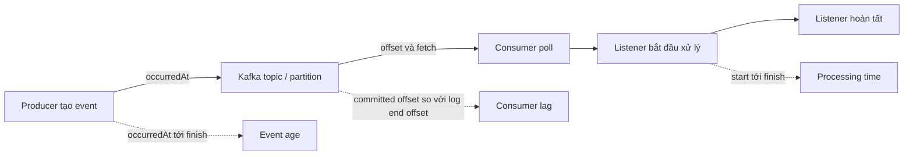

# Đo lag và thời gian xử lý

Consumer lag và thời gian xử lý là hai tín hiệu quan trọng để biết một ứng dụng Spring Kafka có theo kịp tốc độ phát sự kiện hay không. Lag cho biết consumer group còn cách cuối log bao nhiêu record; processing time cho biết ứng dụng mất bao lâu để xử lý một record hoặc một batch. Khi kết hợp hai tín hiệu này với tuổi của event, throughput và lỗi xử lý, đội vận hành có thể phân biệt consumer thiếu năng lực, downstream chậm hay producer tăng tải đột ngột.

Bài thực hành này xây dựng cách đo ba đại lượng: lag theo partition, thời gian xử lý listener và độ trễ từ lúc event được tạo tới lúc xử lý hoàn tất. Bạn sẽ dùng Kafka offset/metadata, Spring Kafka, Micrometer và Actuator để thu thập số liệu, sau đó thiết kế dashboard và cảnh báo có thể hành động.

## 1. Phân biệt lag, processing time và event age

Ba chỉ số thường bị gọi chung là “độ trễ”, nhưng chúng trả lời các câu hỏi khác nhau:

| Chỉ số | Câu hỏi | Đơn vị thường dùng |
|---|---|---|
| Consumer lag | Consumer group còn bao nhiêu record chưa đọc tới cuối log? | Record, theo partition hoặc tổng group |
| Processing time | Listener mất bao lâu để xử lý record/batch sau khi nhận? | Millisecond hoặc second |
| Event age / end-to-end latency | Event đã tồn tại bao lâu khi consumer xử lý xong? | Millisecond hoặc second |

Một consumer có thể có lag bằng 0 nhưng processing time vẫn cao nếu producer phát ít record. Ngược lại, lag có thể lớn trong lúc processing time thấp nếu producer đột ngột tăng throughput. Vì vậy, không dùng riêng một chỉ số để kết luận hệ thống đang khỏe hay nghẽn.



Event age gồm thời gian chờ trong Kafka, thời gian consumer fetch/dispatch và thời gian xử lý. Processing time chỉ đo phần listener hoặc worker thực hiện công việc. Consumer lag là số lượng record, không trực tiếp biểu diễn số giây bị chậm.

## 2. Hiểu cách tính consumer lag

Kafka lưu record trong từng partition với offset tăng dần. Consumer group commit một offset thể hiện vị trí tiếp theo cần đọc. Nếu log end offset của partition là `L` và committed offset là `C`, lag cơ bản được tính:

\[
Lag = \max(0, L - C)
\]

Ví dụ partition có log end offset 1.250 và group đã commit offset 1.200. Consumer còn khoảng 50 record để bắt kịp cuối log.

| Partition | Log end offset | Committed offset | Lag |
|---|---:|---:|---:|
| 0 | 1.250 | 1.200 | 50 |
| 1 | 980 | 980 | 0 |
| 2 | 2.400 | 2.250 | 150 |
| **Tổng** | — | — | **200** |

Offset commit là vị trí tiếp theo cần đọc, vì vậy không trừ thêm hoặc bớt một đơn vị theo cách đếm record bắt đầu từ 0. Nếu partition chưa có committed offset, lag cần được diễn giải theo chính sách reset/khởi tạo group; không tự coi giá trị thiếu là lag bằng 0.

Lag nên được theo dõi theo từng partition, ngoài tổng group. Tổng lag có thể che giấu một partition nóng: ví dụ 5 partition gần bằng 0 nhưng một partition có lag tăng liên tục do key skew hoặc consumer xử lý chậm.

## 3. Quan sát lag bằng Kafka client và công cụ vận hành

Kafka consumer client cung cấp các metric như `records-lag` và `records-lag-max` theo partition/client. Các metric này hữu ích để phát hiện consumer đang tụt lại phía sau. Tên và cách export sang Micrometer/JMX phụ thuộc phiên bản Kafka client, Spring Boot và cấu hình metrics.

Để có số lag ở cấp consumer group, có thể dùng `kafka-consumer-groups.sh`:

```bash
bin/kafka-consumer-groups.sh \
  --bootstrap-server localhost:9092 \
  --describe \
  --group order-projection
```

Kết quả hiển thị partition, current offset, log end offset và lag. Dùng lệnh này để kiểm tra thủ công khi điều tra; production nên thu thập số liệu tự động từ Kafka exporter, AdminClient hoặc hệ thống monitoring đang dùng.

Với `AdminClient`, có thể tính lag từ committed offset của group và latest offset của từng partition:

```java
public Map<TopicPartition, Long> calculateLag(
        AdminClient adminClient,
        String groupId) throws Exception {

    Map<TopicPartition, OffsetAndMetadata> committed = adminClient
            .listConsumerGroupOffsets(groupId)
            .partitionsToOffsetAndMetadata()
            .get(10, TimeUnit.SECONDS);

    Map<TopicPartition, OffsetSpec> requests = committed.keySet().stream()
            .collect(Collectors.toMap(
                    Function.identity(),
                    ignored -> OffsetSpec.latest()));

    Map<TopicPartition, ListOffsetsResult.ListOffsetsResultInfo> latest =
            adminClient.listOffsets(requests)
                    .all()
                    .get(10, TimeUnit.SECONDS);

    Map<TopicPartition, Long> lagByPartition = new HashMap<>();
    committed.forEach((partition, offset) -> {
        long endOffset = latest.get(partition).offset();
        lagByPartition.put(
                partition,
                Math.max(0L, endOffset - offset.offset()));
    });
    return lagByPartition;
}
```

Đoạn code minh họa các partition đã có committed offset. Trong công cụ production, cần lấy danh sách partition từ metadata topic để nhận diện cả partition chưa có committed offset, xử lý group đang rebalance và retry khi AdminClient timeout. Không chạy truy vấn AdminClient quá dày trong mỗi lần xử lý record; hãy lấy theo chu kỳ giám sát và giới hạn thời gian gọi.

Với topic dùng transaction, consumer `read_committed` có thể chưa đọc được record sau một transaction đang mở dù log end offset đã tăng. Khi điều tra lag, cần xem xét transaction duration và last stable offset; lag so với log end offset có thể phản ánh cả dữ liệu đang bị transaction giữ lại.

## 4. Đo processing time của listener

Processing time nên đo quanh phần công việc thực tế mà listener thực hiện. Có thể dùng Micrometer `Timer` để thu thập count, total time và phân phối latency.

Ví dụ listener đo thời gian xử lý từng record:

```java
@Component
public class OrderListener {

    private final OrderService orderService;
    private final MeterRegistry meterRegistry;

    public OrderListener(
            OrderService orderService,
            MeterRegistry meterRegistry) {
        this.orderService = orderService;
        this.meterRegistry = meterRegistry;
    }

    @KafkaListener(topics = "orders.events", groupId = "order-projection")
    public void consume(ConsumerRecord<String, OrderEvent> record) {
        Timer.Sample sample = Timer.start(meterRegistry);
        String result = "success";

        try {
            orderService.apply(record.value());
        }
        catch (RuntimeException ex) {
            result = "failure";
            throw ex;
        }
        finally {
            sample.stop(Timer.builder("orders.listener.processing")
                    .description("Time spent processing an order event")
                    .tag("listener", "orders")
                    .tag("result", result)
                    .register(meterRegistry));
        }
    }
}
```

Exception vẫn được ném lại để Spring Kafka error handler thực hiện retry/recovery. Timer ghi nhận cả lần xử lý thất bại; tag `result` giúp phân biệt thành công và thất bại. Không đưa `orderId`, `eventId`, key hoặc exception message vào metric tag vì chúng tạo cardinality rất cao. Dùng log hoặc trace để truy vết từng event.

Nếu listener là batch listener, đo thời gian toàn batch và ghi thêm số record trong batch bằng counter/distribution phù hợp. Không so sánh trực tiếp timer một record với timer một batch mà không xét kích thước batch.

## 5. Phân biệt listener time và worker time

Nếu listener chỉ đưa record vào queue rồi trả về, timer quanh listener đo thời gian enqueue, không đo thời gian worker xử lý nghiệp vụ. Khi đó cần đo riêng:

- Queue wait time: từ lúc record được enqueue tới lúc worker bắt đầu lấy.
- Worker processing time: từ lúc worker bắt đầu tới khi hoàn tất công việc.
- In-flight count: số event worker đang xử lý.
- Queue depth: số event đang chờ trong bộ đệm.

Ví dụ đo worker time:

```java
public void processQueued(OrderEvent event) {
    Timer.Sample sample = Timer.start(meterRegistry);
    String result = "success";
    try {
        orderService.apply(event);
    }
    catch (RuntimeException ex) {
        result = "failure";
        throw ex;
    }
    finally {
        sample.stop(Timer.builder("orders.worker.processing")
                .tag("result", result)
                .register(meterRegistry));
    }
}
```

Nếu không đo worker riêng, dashboard có thể báo listener latency thấp trong khi queue tăng và công việc thực tế hoàn tất rất chậm. Khi handoff bất đồng bộ, cũng phải kiểm tra offset chỉ được xác nhận sau khi công việc đã được lưu bền vững hoặc hoàn tất theo cam kết của hệ thống.

## 6. Đo event age và end-to-end latency

Consumer lag là số record, còn event age cho biết record cũ nhất hoặc từng event đã chờ bao lâu. Để đo end-to-end, event nên có trường timestamp nghiệp vụ như `occurredAt`:

```java
public record OrderEvent(
        String eventId,
        String orderId,
        Instant occurredAt,
        String eventType) {
}
```

Consumer tính tuổi event tại thời điểm xử lý hoàn tất:

```java
long ageMillis = Duration.between(
        record.value().occurredAt(),
        Instant.now()).toMillis();

Timer.builder("orders.event.age")
        .tag("event_type", record.value().eventType())
        .register(meterRegistry)
        .record(Math.max(0L, ageMillis), TimeUnit.MILLISECONDS);
```

Trong production, chỉ dùng tag `event_type` nếu tập giá trị hữu hạn và được kiểm soát. Nếu event type đến từ dữ liệu tùy ý, hãy chuẩn hóa thành nhóm nhỏ. Không ghi event ID hoặc order ID vào tag.

Có thể dùng `ConsumerRecord.timestamp()` thay cho timestamp trong payload, nhưng phải hiểu timestamp type:

- `CREATE_TIME`: timestamp do producer gắn vào record; sai lệch đồng hồ producer có thể làm event age âm hoặc lớn bất thường.
- `LOG_APPEND_TIME`: broker gắn timestamp khi append; đo được thời gian kể từ khi broker ghi record, không bao gồm thời gian event nằm trước đó trong producer.

Đồng bộ đồng hồ giữa các node bằng NTP và chọn một định nghĩa timestamp thống nhất. Event age là số đo theo thời gian; nó không thay thế offset hoặc sequence để xác định ordering nghiệp vụ.

## 7. Cấu hình Micrometer và Spring Boot Actuator

Spring Kafka hỗ trợ timer cho listener container khi Micrometer có mặt. Các phiên bản Spring Kafka hiện đại thường cung cấp timer `spring.kafka.listener` với tag nhận diện listener, kết quả và exception; `KafkaTemplate` cũng có thể cung cấp observation/metric gửi. Tên metric và tag cụ thể phụ thuộc phiên bản Spring Kafka và cấu hình observation.

Thêm Actuator và registry phù hợp, ví dụ Prometheus:

```groovy
dependencies {
    implementation 'org.springframework.boot:spring-boot-starter-actuator'
    runtimeOnly 'io.micrometer:micrometer-registry-prometheus'
}
```

Cấu hình endpoint và histogram:

```yaml
management:
  endpoints:
    web:
      exposure:
        include: health,info,metrics,prometheus
  metrics:
    distribution:
      percentiles-histogram:
        "spring.kafka.listener": true
        "orders.listener.processing": true
        "orders.worker.processing": true
        "orders.event.age": true
```

Không expose endpoint metrics/prometheus ra Internet công khai. Giới hạn truy cập bằng network policy, authentication hoặc hạ tầng monitoring nội bộ. Nếu dùng phiên bản Spring Kafka có cấu hình observation riêng, bật theo hướng dẫn đúng phiên bản và xác minh metric thực tế tại `/actuator/metrics` hoặc `/actuator/prometheus`.

## 8. Dashboard nên hiển thị gì?

Một dashboard hữu ích nên cho thấy cả backlog và năng lực xử lý:

| Panel | Metric/biểu diễn | Câu hỏi vận hành |
|---|---|---|
| Lag tổng theo group | Tổng lag của các partition | Backlog tổng đang tăng hay giảm? |
| Lag lớn nhất theo partition | Max lag và top partition | Có partition nóng hoặc consumer bị kẹt riêng lẻ không? |
| Lag trend | Lag theo thời gian | Consumer có bắt kịp producer sau khi tăng tải không? |
| Records consumed rate | Record/second theo group | Consumer đang xử lý được bao nhiêu record? |
| Listener processing p50/p95/p99 | Timer histogram | Thời gian xử lý bình thường và tail latency là bao nhiêu? |
| Worker/queue metrics | Queue depth, wait time, worker time | Backlog nằm trong Kafka hay đã chuyển vào RAM? |
| Event age p95/p99 | Thời gian từ `occurredAt` tới xử lý | Sự kiện cũ nhất đang chờ bao lâu? |
| Error/retry/DLT rate | Counter theo loại lỗi | Lag tăng do lỗi lặp lại hay do tải cao? |

Luôn hiển thị partition cùng group và topic. Tổng lag có thể tăng do producer tăng tải bình thường; nếu processing rate vẫn cao hơn incoming rate, backlog sẽ giảm. Ngược lại, lag tăng liên tục và processing rate thấp hơn incoming rate là dấu hiệu năng lực consumer không đủ hoặc downstream đang nghẽn.

## 9. Thiết kế cảnh báo có thể hành động

Không nên cảnh báo chỉ vì lag vượt một con số cố định trong một lần scrape. Hãy kết hợp ngưỡng, thời gian kéo dài và processing latency:

- **Lag tăng liên tục:** tổng lag hoặc lag partition tăng trong một khoảng thời gian, đồng thời consumer throughput thấp hơn producer throughput.
- **Partition bị nóng:** một partition có lag cao hơn đáng kể so với các partition còn lại.
- **Processing chậm:** p95/p99 listener time vượt SLA trong nhiều chu kỳ.
- **Event age vượt SLA:** event cũ nhất hoặc p99 age vượt thời gian chấp nhận của nghiệp vụ.
- **Retry/DLT tăng:** tỷ lệ failure tăng cùng lag cho thấy record lỗi có thể đang làm consumer không tiến triển.
- **Consumer không hoạt động:** assigned partition có lag nhưng records consumed rate bằng 0 trong khi producer vẫn phát dữ liệu.

Ví dụ, nếu SLA yêu cầu event được xử lý trong 30 giây, có thể cảnh báo khi p95 event age vượt 30 giây liên tục vài phút. Ngưỡng lag theo record cần dựa trên throughput: 10.000 record có thể chỉ tương đương vài giây ở luồng rất lớn, nhưng có thể là hàng giờ ở luồng ít lưu lượng.

## 10. Bài thực hành đo lag và processing time

Thực hiện trên topic `orders.events` với một consumer group `order-projection`:

1. Gửi một lượng event ổn định, ví dụ 100 record/giây, có `eventId`, `orderId` và `occurredAt`.
2. Ghi nhận partition và offset từ `SendResult.getRecordMetadata()`.
3. Tạo consumer listener và instrument processing time bằng Micrometer Timer.
4. Đo event age từ `occurredAt` tới lúc listener xử lý hoàn tất.
5. Thu thập committed offset và log end offset để tính lag theo partition.
6. Hiển thị lag tổng, lag max, listener p95/p99 và event age p95/p99.
7. Tăng tải producer lên 300 record/giây và quan sát lag trend.
8. Thêm độ trễ giả lập vào `OrderService.apply()` để xem processing time và lag thay đổi.
9. Khôi phục tốc độ xử lý và đo thời gian consumer bắt kịp backlog.
10. Tạo một partition nóng bằng cách dùng một key lặp lại, sau đó so sánh lag giữa các partition.

### Ví dụ tạo độ trễ có kiểm soát trong môi trường test

```java
public void apply(OrderEvent event) {
    try {
        Thread.sleep(100);
    }
    catch (InterruptedException ex) {
        Thread.currentThread().interrupt();
        throw new IllegalStateException("Processing interrupted", ex);
    }

    repository.save(event);
}
```

Chỉ dùng độ trễ giả lập trong môi trường test hoặc profile chuyên dụng; không để `Thread.sleep()` trong xử lý production. So sánh throughput trước/sau và xác định khi nào consumer không còn theo kịp tốc độ producer.

### Kết quả cần ghi lại

| Kịch bản | Producer rate | Consumer rate | Lag trend | Processing p95 | Event age p95 |
|---|---:|---:|---|---:|---:|
| Tải cơ sở | 100 records/s | Đo thực tế | Đo thực tế | Đo thực tế | Đo thực tế |
| Tăng tải | 300 records/s | Đo thực tế | Đo thực tế | Đo thực tế | Đo thực tế |
| Worker chậm | 100 records/s | Đo thực tế | Đo thực tế | Đo thực tế | Đo thực tế |
| Partition nóng | 100 records/s | Đo theo partition | Đo theo partition | Đo thực tế | Đo thực tế |

Không điền số liệu dự kiến vào kết quả như thể đã đo. Ghi rõ môi trường, partition count, concurrency, thời lượng chạy, kích thước payload và cấu hình producer/consumer để người khác có thể lặp lại thí nghiệm.

## 11. Cách đọc kết quả và tìm nút thắt

| Quan sát | Nguyên nhân có thể | Hướng điều tra |
|---|---|---|
| Lag tăng, processing p95 tăng | Listener hoặc downstream chậm | Kiểm tra DB latency, connection pool, CPU, GC và thời gian gọi service. |
| Lag tăng, processing time ổn định thấp | Producer rate vượt năng lực tổng hoặc thiếu consumer/partition | So sánh incoming/consumed rate, partition assignment và concurrency. |
| Tổng lag vừa phải nhưng một partition rất cao | Key skew hoặc partition-specific failure | Kiểm tra key distribution, lỗi record và consumer assignment theo partition. |
| Lag bằng 0 nhưng event age cao | Timestamp/event age không được đo đúng hoặc event đến thưa theo lô | Kiểm tra `occurredAt`, clock skew, batch arrival và timestamp type. |
| Listener time thấp nhưng event age cao | Queue nội bộ hoặc thời gian chờ trước listener lớn | Đo queue depth, queue wait và worker processing riêng. |
| Lag dao động mạnh sau deploy | Rebalance, restart hoặc rollout | Kiểm tra rebalance duration, pod restart và graceful shutdown. |
| Lag tăng cùng retry/DLT | Một nhóm record lỗi làm giảm tiến triển | Kiểm tra exception, retry backoff, recoverer và DLT throughput. |

Khi lag tăng, đừng mặc định tăng concurrency. Nếu partition count không đủ, thêm consumer không tạo thêm song song. Nếu database đã bão hòa, tăng concurrency làm downstream chậm hơn. Chọn biện pháp theo bằng chứng từ lag theo partition, processing timer và tài nguyên phụ thuộc.

## 12. Checklist nghiệm thu

- Lag được tính theo từng partition từ log end offset và committed offset.
- Group chưa có committed offset được xử lý riêng, không coi thiếu dữ liệu là lag bằng 0.
- Có dashboard lag tổng, lag max và lag trend.
- Có timer processing cho listener; worker được đo riêng nếu xử lý bất đồng bộ.
- Event age dùng timestamp có định nghĩa rõ và đồng hồ được đồng bộ.
- Metric tag có cardinality giới hạn; không dùng event ID hoặc business key làm tag.
- Có p50/p95/p99 hoặc histogram để quan sát tail latency.
- Cảnh báo kết hợp lag, processing rate, event age và lỗi retry/DLT.
- Có thử nghiệm tăng tải, làm chậm worker và tạo partition nóng.
- Kết quả test ghi rõ cấu hình và số liệu thực đo.

Đo lag và thời gian xử lý đúng cách giúp phân biệt backlog ở Kafka với thời gian xử lý chậm trong ứng dụng. Lag theo partition cho biết consumer còn cách cuối log bao xa; Micrometer Timer đo thời gian listener/worker; event age cho biết nghiệp vụ đang nhận kết quả muộn tới mức nào. Khi đặt ba tín hiệu cạnh throughput, retry và tài nguyên downstream, đội vận hành có thể xác định nút thắt và scale đúng thành phần thay vì tăng consumer một cách mù quáng.
