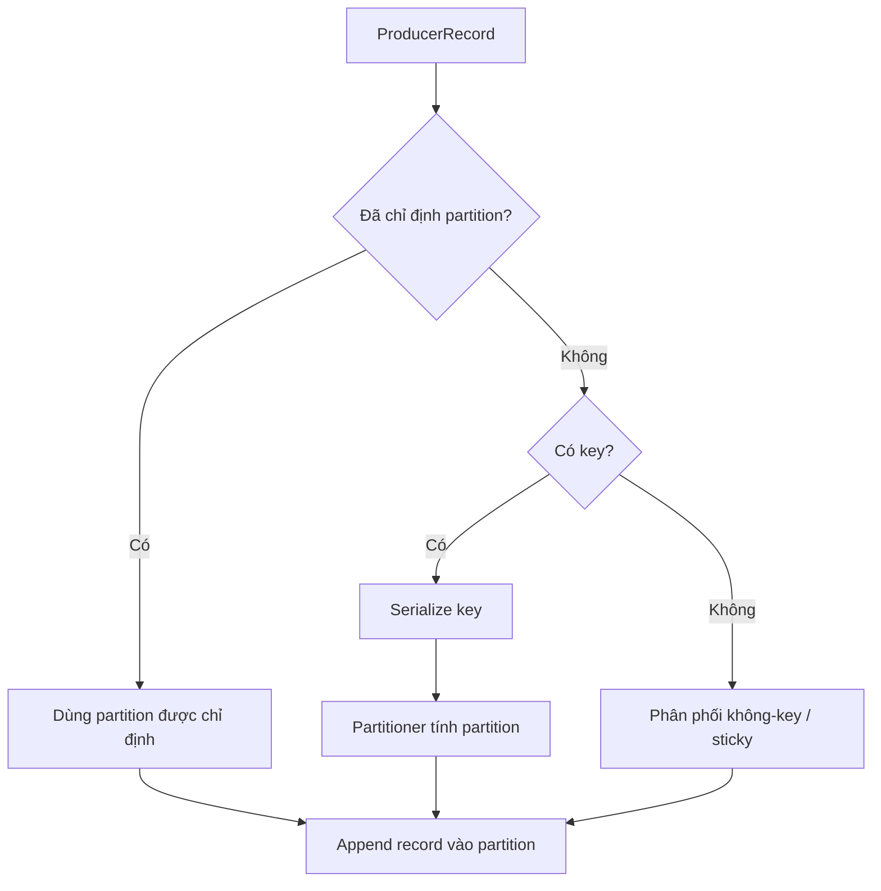

# Checklist chọn partition key

Partition key quyết định record được đưa vào partition nào và vì thế ảnh hưởng trực tiếp đến thứ tự xử lý, khả năng song song và mức cân bằng tải của Kafka. Chọn key tốt bắt đầu từ yêu cầu nghiệp vụ: những record nào bắt buộc phải được xử lý theo thứ tự? Sau đó mới đánh giá phân bố dữ liệu, hot key, cách serialize key và kế hoạch thay đổi số partition.

Không có một key tối ưu cho mọi topic. Key phù hợp với topic lưu trạng thái đơn hàng có thể khác key phù hợp với topic telemetry. Một key duy nhất cho mọi record tạo ra một partition nóng; key ngẫu nhiên giúp phân tán nhưng có thể phá vỡ thứ tự theo thực thể. Checklist dưới đây giúp đưa ra quyết định có chủ đích.

## 1. Hiểu partition key ảnh hưởng điều gì

Khi producer gửi record, Kafka cần chọn partition đích. Nếu ứng dụng chỉ định partition trực tiếp, partition đó được dùng. Nếu không chỉ định partition nhưng có key, partitioner mặc định dùng byte đã serialize của key để xác định partition. Cùng một key được serialize ổn định thường đi vào cùng partition khi số partition và partitioner không đổi.

Nếu record không có key, producer dùng cơ chế phân phối không-key (mặc định hiện đại dùng sticky partitioning) để gom record vào partition trong một khoảng gửi nhằm tận dụng batching; record null-key không có bảo đảm affinity theo thực thể.



Partition key ảnh hưởng bốn yếu tố:

- **Ordering:** record cùng key thường vào cùng partition và được đọc theo thứ tự offset của partition đó.
- **Parallelism:** consumer group xử lý song song giữa các partition. Một key nóng bị giới hạn bởi năng lực xử lý của partition chứa key đó.
- **Load distribution:** key phân bố lệch có thể tạo partition nóng dù tổng số partition lớn.
- **Compaction:** với topic compacted, key là định danh để Kafka giữ bản ghi mới nhất cho mỗi key; tombstone dùng key cùng value null để biểu thị xóa.

Kafka chỉ bảo đảm thứ tự trong một partition. Cùng key trên hai topic khác nhau không tạo ra một thứ tự toàn cục giữa hai topic.

## 2. Checklist đầu tiên: xác định phạm vi cần giữ thứ tự

Trước khi chọn key, hãy trả lời rõ câu hỏi: **những sự kiện nào không được xử lý đảo thứ tự?** Chọn định danh của thực thể mà thứ tự thay đổi trạng thái cần được giữ.

| Yêu cầu nghiệp vụ | Key thường phù hợp | Lý do |
|---|---|---|
| Các sự kiện của cùng đơn hàng phải theo thứ tự | `orderId` | Mọi thay đổi của một đơn hàng đi vào cùng partition |
| Giao dịch của cùng tài khoản phải theo thứ tự | `accountId` | Tránh hai cập nhật cùng tài khoản chạy song song ở hai partition |
| Sự kiện của cùng thiết bị cần giữ thứ tự | `deviceId` | Tách luồng theo thiết bị |
| Mọi sự kiện của một khách hàng phải theo thứ tự | `customerId` | Gom các sự kiện của khách hàng vào cùng partition |
| Chỉ cần phân tán đều, không có thứ tự theo thực thể | Key phân bố đều hoặc null key | Ưu tiên tận dụng partition và batching |

Ví dụ một đơn hàng phát sinh `OrderCreated`, `PaymentAuthorized` và `OrderShipped`. Nếu thứ tự của các sự kiện đó quan trọng, dùng cùng `orderId` làm key:

```java
kafkaTemplate.send("order-events", event.orderId(), event);
```

Không chọn `eventId` ngẫu nhiên làm partition key trong trường hợp này: mỗi sự kiện có event ID khác nhau nên chúng có thể đi vào các partition khác nhau, khiến consumer xử lý `OrderShipped` trước `PaymentAuthorized`.

Nếu thứ tự chỉ cần giữ theo tài khoản nhưng một tài khoản có nhiều đơn hàng, key `accountId` phù hợp hơn `orderId`. Đổi lại, tài khoản có lưu lượng rất lớn có thể trở thành hot key. Hãy chọn đúng ranh giới ordering mà nghiệp vụ thực sự cần, tránh gom nhiều thực thể không liên quan vào cùng key.

Partition key chỉ gom record vào cùng partition; nó không tự sắp xếp theo timestamp nghiệp vụ và không giải quyết thứ tự giữa nhiều producer cùng ghi. Nếu nhiều thread hoặc nhiều service đồng thời phát sự kiện cho cùng entity, thứ tự append tại broker có thể khác thứ tự nghiệp vụ mong muốn. Khi cần thứ tự chặt chẽ, hãy tuần tự hóa việc phát theo entity hoặc mang sequence/version trong event để consumer phát hiện sự kiện đến sai thứ tự. Bật producer idempotence để bảo vệ thứ tự gửi khi producer retry theo các điều kiện Kafka hỗ trợ, nhưng idempotence không sắp xếp lại các sự kiện do nhiều producer độc lập tạo ra.

## 3. Checklist về tính ổn định và cách tạo key

- [ ] Key có giá trị ổn định trong toàn bộ vòng đời của thực thể.
- [ ] Cùng một thực thể luôn tạo ra cùng chuỗi key ở mọi service phát sự kiện.
- [ ] Key không phụ thuộc thời điểm gửi, số thứ tự cục bộ của process hoặc giá trị random.
- [ ] Chuẩn hóa chữ hoa/thường, khoảng trắng, Unicode và định dạng ID trước khi serialize.
- [ ] Nếu dùng composite key, các thành phần được mã hóa không nhập nhằng.
- [ ] Key không chứa dữ liệu bí mật hoặc thông tin cá nhân không cần thiết.

Ví dụ composite key cho hệ thống multi-tenant:

```java
String key = tenantId + ":" + orderId;
kafkaTemplate.send("order-events", key, event);
```

Chỉ dùng dấu phân cách đơn giản nếu các thành phần không thể chứa dấu đó hoặc đã có quy tắc escape. Nếu không, hai cặp thành phần khác nhau có thể tạo cùng chuỗi. Một định dạng có cấu trúc rõ ràng như length-prefix hoặc encoding chuẩn hóa sẽ an toàn hơn khi thành phần có thể chứa ký tự phân cách.

Ví dụ không nên dùng:

```java
// Mỗi lần phát sự kiện tạo key khác nhau, không giữ thứ tự theo order.
kafkaTemplate.send("order-events", UUID.randomUUID().toString(), event);

// Timestamp làm các sự kiện của cùng order tách khỏi nhau.
kafkaTemplate.send("order-events", Instant.now().toString(), event);
```

## 4. Checklist về phân bố key và hot partition

Key có tính ổn định vẫn có thể gây mất cân bằng nếu một số key xuất hiện nhiều hơn hẳn phần còn lại. Đừng chỉ nhìn số lượng key khác nhau (cardinality); hãy nhìn cả tần suất record của từng key.

- [ ] Có đủ số lượng key khác nhau để phân phối tải trên các partition.
- [ ] Tần suất của các key không bị tập trung quá mức vào một vài thực thể.
- [ ] Không có một tenant, account, device hoặc customer tạo phần lớn lưu lượng.
- [ ] Đã đo phân bố record/byte theo partition khi chạy tải gần thực tế.
- [ ] Đã kiểm tra consumer lag riêng từng partition để phát hiện partition nóng.
- [ ] Đã đánh giá key skew theo cả số record và kích thước payload; một key gửi payload lớn có thể làm lệch byte throughput dù số record cân bằng.

Ví dụ, topic có 24 partition nhưng một khách hàng tạo 60% lưu lượng và key là `customerId`. Phần lớn record của khách hàng đó luôn vào một partition. Tăng concurrency lên 24 không chia được key này ra 24 consumer vì điều đó sẽ phá vỡ thứ tự theo customer.

Nếu hot key là vấn đề, có thể cân nhắc:

1. Chọn phạm vi ordering hẹp hơn, ví dụ `orderId` thay vì `customerId`, nếu nghiệp vụ không cần thứ tự toàn khách hàng.
2. Tách workload hoặc tenant lớn sang topic riêng để cô lập lưu lượng.
3. Chia key nóng thành nhiều shard chỉ khi chấp nhận xử lý song song và có cách phối hợp thứ tự ở tầng nghiệp vụ.
4. Giảm kích thước payload hoặc tối ưu consumer xử lý partition nóng.

Không thêm suffix random vào key nóng nếu vẫn cần thứ tự theo thực thể. Cách đó phân tán tải bằng cách đánh đổi chính bảo đảm ordering mà key đang cung cấp.

## 5. Checklist về null key và key ngẫu nhiên

Null key có thể phù hợp khi:

- [ ] Các record không cần thứ tự theo entity.
- [ ] Consumer chỉ cần xử lý các sự kiện độc lập.
- [ ] Ưu tiên batching và phân phối tải của producer hơn affinity theo key.
- [ ] Topic không cần compaction theo định danh thực thể.

Với null key, producer không thể giữ các sự kiện của cùng thực thể ở cùng partition. Sticky partitioning có thể gom các record không-key vào cùng partition trong một khoảng thời gian để tạo batch hiệu quả, sau đó chuyển sang partition khác. Không giả định null key sẽ luân phiên chính xác từng record giữa các partition.

Key ngẫu nhiên hoặc event ID duy nhất phù hợp khi mỗi record độc lập và muốn phân phối tải. Nhưng nếu cần thứ tự theo `orderId`, `accountId` hoặc `deviceId`, hãy giữ entity ID làm key và lưu event ID ở payload/header để deduplicate.

## 6. Checklist về serializer và tính nhất quán giữa service

Partitioner dựa trên key đã serialize. Vì thế, hai service dùng cùng giá trị nghiệp vụ nhưng serialize ra byte khác nhau có thể chọn partition khác nhau.

- [ ] Producer của mọi service dùng cùng quy ước key.
- [ ] Key serializer được thống nhất, ví dụ `StringSerializer` cho ID dạng chuỗi.
- [ ] Nếu dùng Avro/Protobuf hoặc binary key, schema và encoding ổn định giữa producer.
- [ ] Không thay đổi cách viết key (ví dụ `ORD-42` thành `ord-42`) giữa các phiên bản service nếu vẫn muốn giữ cùng partition.
- [ ] Không đổi serializer hoặc canonicalization mà chưa đánh giá ảnh hưởng đến routing.

Ví dụ cấu hình String key:

```yaml
spring:
  kafka:
    producer:
      key-serializer: org.apache.kafka.common.serialization.StringSerializer
      value-serializer: org.springframework.kafka.support.serializer.JacksonJsonSerializer
```

Gửi record:

```java
ProducerRecord<String, OrderEvent> record =
        new ProducerRecord<>("order-events", event.orderId(), event);
kafkaTemplate.send(record);
```

Không chỉ kiểm tra `event.orderId()` trong Java. Khi producer thay serializer, byte key có thể thay đổi dù object String nhìn giống nhau ở log. Nếu có nhiều ngôn ngữ hoặc nhiều team cùng ghi topic, hãy công bố hợp đồng key rõ ràng.

## 7. Checklist về số partition và thay đổi topology

Với partitioner mặc định, partition cho key thường được tính dựa trên hash của serialized key và số partition hiện có. Khi tăng số partition, kết quả modulo có thể thay đổi; các record mới của cùng key có thể đi vào partition khác với record cũ.

- [ ] Số partition ban đầu được tính theo throughput, consumer concurrency và mức tăng trưởng dự kiến.
- [ ] Có kế hoạch scale partition trước khi topic trở thành bottleneck.
- [ ] Đánh giá việc tăng partition có làm một key chuyển sang partition mới không.
- [ ] Nếu cần ordering xuyên suốt vòng đời key, không tăng partition tùy tiện mà chưa có chiến lược migration/routing.
- [ ] Không giả định giảm partition là thao tác tương đương; Kafka không hỗ trợ giảm số partition của topic theo cách thông thường.

Ví dụ topic tăng từ 12 lên 24 partition. Một key trước đó được hash vào partition 3 có thể được tính sang partition khác khi số partition đổi. Record cũ vẫn nằm ở partition 3, record mới có thể nằm ở partition mới; consumer có thể xử lý hai luồng đó song song và làm đảo thứ tự nghiệp vụ.

Nếu cần mở rộng mà vẫn giữ thứ tự theo key, cần lập kế hoạch riêng như tạo topic phiên bản mới và chuyển traffic theo từng entity, hoặc dùng routing ổn định với virtual shard/custom partitioner. Các cách này đòi hỏi quản lý migration và offset; không có một thay đổi cấu hình partition đơn giản nào tự bảo toàn thứ tự qua mọi lần mở rộng.

## 8. Checklist cho topic compacted

Nếu topic dùng `cleanup.policy=compact`, key còn đóng vai trò định danh bản ghi cần giữ lại. Kafka compaction giữ bản ghi mới nhất theo key trong log compacted; record có key và value null là tombstone để biểu thị xóa key sau thời gian phù hợp.

- [ ] Key xác định đúng entity cần giữ trạng thái mới nhất.
- [ ] Mọi lần cập nhật cùng entity dùng đúng cùng key và cùng cách serialize.
- [ ] Tombstone dùng key của entity và value null.
- [ ] Không dùng null key nếu cần compaction theo entity.
- [ ] Consumer hiểu rằng compaction là quá trình nền; không giả định bản ghi cũ biến mất ngay sau khi gửi update.

Ví dụ topic `account-state` lưu trạng thái mới nhất theo tài khoản:

```java
kafkaTemplate.send("account-state", accountId, accountSnapshot);

// Xóa trạng thái của account bằng tombstone:
kafkaTemplate.send("account-state", accountId, null);
```

Không nhầm tombstone với record có payload JSON `{"deleted": true}`. Tombstone là record có key và value null; payload marker chỉ là một sự kiện nghiệp vụ thông thường nếu không có quy ước khác.

## 9. Kiểm tra key bằng test trước khi triển khai

Một bài test cơ bản nên xác nhận các sự kiện cùng key đi vào cùng partition trong điều kiện topic có số partition cố định, cùng serializer và cùng partitioner:

```java
Map<String, Integer> partitionByOrder = new HashMap<>();

for (OrderEvent event : events) {
    SendResult<String, OrderEvent> result = kafkaTemplate
            .send("order-events", event.orderId(), event)
            .get(10, TimeUnit.SECONDS);

    int partition = result.getRecordMetadata().partition();
    Integer previous = partitionByOrder.putIfAbsent(event.orderId(), partition);

    if (previous != null) {
        assertThat(partition).isEqualTo(previous);
    }
}
```

Test này kiểm tra affinity của cùng key; không nên assert hai key khác nhau chắc chắn nằm ở hai partition khác nhau vì hash collision là có thể xảy ra. Cũng không hard-code partition số 0, 1 hay 2: kết quả phụ thuộc số partition và partitioner.

Ngoài test đơn vị/integration, cần chạy test tải với phân bố key gần thực tế. Tạo dữ liệu có cả key phổ biến và key hiếm để quan sát skew; một bộ dữ liệu test chỉ có key ngẫu nhiên đồng đều có thể che mất hot key production.

## 10. Checklist vận hành sau khi chọn key

- [ ] Theo dõi record rate và byte rate theo partition.
- [ ] Theo dõi consumer lag riêng từng partition, không chỉ tổng lag của group.
- [ ] Xác định top key theo tần suất hoặc dung lượng bằng log/metric có kiểm soát; không đưa mọi key vào metric label.
- [ ] Kiểm tra partition có leader và ISR ổn định.
- [ ] Theo dõi thời gian xử lý listener theo partition hoặc nhóm workload nếu có thể.
- [ ] Đánh giá lại key khi nghiệp vụ thay đổi phạm vi ordering.
- [ ] Đánh giá lại partition count và serializer trước mỗi thay đổi topology lớn.
- [ ] Có quy trình replay/recovery nếu migration key hoặc partition làm thay đổi routing.

## 11. Ma trận quyết định nhanh

| Câu hỏi | Nếu có | Nếu không |
|---|---|---|
| Có cần giữ thứ tự theo một entity? | Dùng entity ID ổn định làm key | Có thể dùng key phân tán hoặc null key |
| Một entity có thể tạo phần lớn traffic? | Chọn phạm vi key hẹp hơn hoặc cô lập workload nếu nghiệp vụ cho phép | Tiếp tục đánh giá phân bố tải |
| Topic cần log compacted theo entity? | Dùng entity ID làm key và giữ encoding ổn định | Chọn key theo ordering/throughput |
| Nhiều service cùng ghi một topic? | Chuẩn hóa key serialization và canonicalization thành hợp đồng | Vẫn cần giữ key ổn định trong service |
| Có kế hoạch tăng partition? | Đánh giá remapping và migration trước khi đổi | Ghi lại partition count như một phần hợp đồng vận hành |
| Consumer cần song song nhiều? | Bảo đảm đủ partition và key phân bố đủ đều | Ưu tiên ordering/đơn giản nếu tải thấp |

## 12. Ghi nhớ

- Chọn partition key theo phạm vi ordering nghiệp vụ trước, rồi mới tối ưu phân bố tải.
- Cùng serialized key thường vào cùng partition khi partition count và partitioner không đổi.
- Key theo entity ID giữ thứ tự cho entity đó; key ngẫu nhiên/null không cung cấp affinity này.
- Đánh giá tần suất key và hot partition, không chỉ đếm số lượng key khác nhau.
- Key serializer và canonicalization phải nhất quán giữa mọi producer.
- Tăng số partition có thể làm key được route sang partition khác và ảnh hưởng thứ tự giữa record cũ/mới.
- Với topic compacted, key là định danh trạng thái; tombstone là record có key và value null.
- Kiểm thử bằng RecordMetadata, test tải phân bố key và theo dõi lag/throughput theo partition trước khi triển khai.

## Tài liệu tham khảo

- [Apache Kafka — Producer Configurations](https://kafka.apache.org/documentation/#producerconfigs)
- [Apache Kafka — Design: Message Delivery Semantics and Ordering](https://kafka.apache.org/documentation/#semantics)
- [Apache Kafka — Log Compaction](https://kafka.apache.org/documentation/#compaction)
- [Spring for Apache Kafka — Sending Messages with KafkaTemplate](https://docs.spring.io/spring-kafka/reference/kafka/sending-messages.html)
- [Spring for Apache Kafka — Producer and Consumer Interceptors](https://docs.spring.io/spring-kafka/reference/kafka/interceptors.html)
