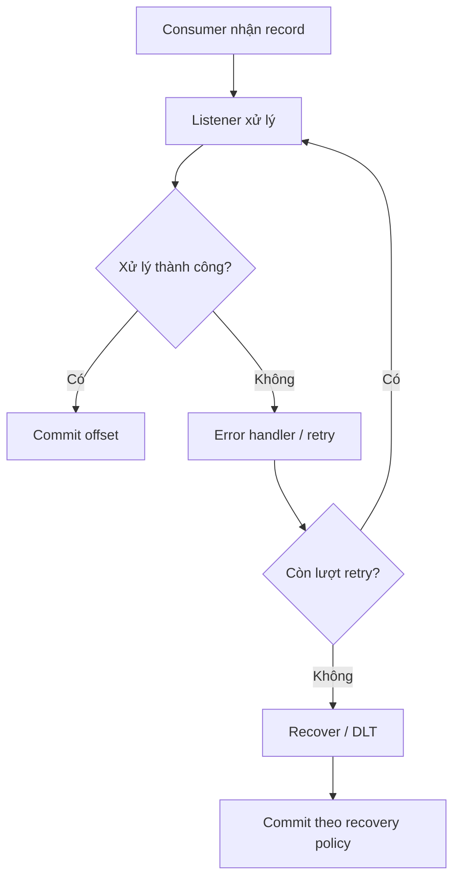

# Checklist commit và retry

Commit offset và retry quyết định một record được xem là đã xử lý ở thời điểm nào và ứng dụng phản ứng ra sao khi listener thất bại. Nếu commit quá sớm, record có thể bị mất khỏi luồng xử lý dù nghiệp vụ chưa hoàn tất. Nếu retry không giới hạn hoặc không có idempotency, một record có thể tạo side effect nhiều lần và làm consumer group bị kẹt.

Trong Spring Kafka, cần thiết kế đồng thời `AckMode`, error handler, backoff, dead-letter topic (DLT), transaction và cách listener thực hiện side effect. Checklist này giúp rà soát cấu hình trước khi triển khai, chọn chiến lược retry theo loại lỗi và kiểm tra các tình huống restart, rebalance, gửi DLT thất bại hoặc xử lý trùng.

## 1. Hiểu chính xác offset được commit khi nào

Consumer đọc record tại một offset trong partition. Consumer group lưu committed offset để lần đọc tiếp theo biết vị trí cần tiếp tục. Commit offset không có nghĩa broker đã xác nhận nghiệp vụ; đó là tín hiệu consumer group cho biết vị trí đã xử lý theo cam kết của ứng dụng.

Luồng at-least-once thường có thứ tự:

1. Consumer nhận record.
2. Listener thực hiện xử lý nghiệp vụ.
3. Xử lý thành công.
4. Container commit offset.

Nếu ứng dụng chết sau bước 3 nhưng trước bước 4, record có thể được giao lại. Đây là duplicate có thể xảy ra trong at-least-once; listener cần idempotent hoặc có cơ chế chống áp dụng side effect hai lần.

Nếu commit trước bước 2, ứng dụng có thể chết sau commit nhưng trước khi xử lý xong. Kafka sẽ không giao lại record đã commit, dẫn tới mất xử lý. Vì vậy, với luồng nghiệp vụ cần độ tin cậy, không commit offset trước khi công việc đã hoàn tất hoặc đã được lưu bền vững theo thiết kế.



## 2. Tắt auto commit và để container quản lý offset

Với Spring Kafka listener container, nên để container quản lý commit theo `AckMode`. Cấu hình rõ `enable.auto.commit=false` để Kafka client không tự commit theo timer độc lập với kết quả listener:

```yaml
spring:
  kafka:
    consumer:
      enable-auto-commit: false
      group-id: order-service
    listener:
      ack-mode: record
```

Spring Kafka container ở các phiên bản hiện đại mặc định tắt auto commit nếu ứng dụng không ghi đè, nhưng khai báo rõ trong cấu hình giúp ý định vận hành dễ kiểm tra. Nếu bật auto commit, offset có thể được commit theo chu kỳ poll mà không gắn với việc xử lý nghiệp vụ đã hoàn tất hay chưa.

## 3. Chọn `AckMode` theo đơn vị xử lý

`AckMode` quyết định container commit offset ở thời điểm nào. Các chế độ thường dùng:

| Ack mode | Thời điểm commit | Phù hợp khi |
|---|---|---|
| `RECORD` | Sau khi từng record listener xử lý thành công | Listener xử lý từng record và muốn ranh giới commit rõ ràng. |
| `BATCH` | Sau khi tất cả record từ một lần poll được xử lý thành công | Batch listener hoặc muốn commit theo poll batch. Đây là chế độ mặc định phổ biến của container. |
| `TIME` | Khi đạt khoảng thời gian commit đã cấu hình, sau khi record xử lý | Muốn gom commit theo thời gian. |
| `COUNT` | Khi đạt số record đã xử lý | Muốn giới hạn tần suất commit theo số lượng. |
| `COUNT_TIME` | Khi đạt ngưỡng count hoặc time | Cân bằng số lần commit và độ trễ commit. |
| `MANUAL` | Listener gọi `acknowledge()`; container commit theo semantics batch | Ứng dụng cần quyết định thời điểm xác nhận sau xử lý. |
| `MANUAL_IMMEDIATE` | Commit ngay khi acknowledgment được gọi trên consumer thread | Cần kiểm soát commit ngay tại thời điểm listener xác nhận. |

Ví dụ cấu hình `RECORD`:

```java
factory.getContainerProperties()
        .setAckMode(ContainerProperties.AckMode.RECORD);
```

Với `RECORD`, nếu record thứ ba trong một poll thất bại, các record trước đó đã xử lý thành công có thể được commit theo tiến trình container; record lỗi được error handler xử lý theo retry/recovery. Với `BATCH`, commit gắn với việc hoàn tất cả batch từ poll, nên cần hiểu hành vi seek và commit khi chỉ một record trong batch lỗi.

Không chọn `MANUAL_IMMEDIATE` chỉ vì tên có chữ “immediate”. Nếu acknowledgment được gọi từ thread khác, hành vi commit được điều phối về consumer thread và không tương đương gọi trực tiếp trên listener thread. Hãy chọn chế độ phù hợp với cách listener thực sự chạy.

## 4. Checklist cho manual acknowledgment

Khi dùng `MANUAL` hoặc `MANUAL_IMMEDIATE`, listener nhận `Acknowledgment` và chỉ gọi `acknowledge()` sau khi công việc hoàn tất:

```java
@KafkaListener(topics = "orders", groupId = "order-service")
public void consume(OrderEvent event, Acknowledgment acknowledgment) {
    orderService.process(event);
    acknowledgment.acknowledge();
}
```

Factory phải được cấu hình manual ack mode:

```java
factory.getContainerProperties()
        .setAckMode(ContainerProperties.AckMode.MANUAL);
```

Trước khi dùng manual acknowledgment, xác minh:

- [ ] `enable.auto.commit=false`.
- [ ] Listener chỉ acknowledge sau khi nghiệp vụ thành công hoặc công việc đã được lưu bền vững theo cam kết.
- [ ] Nếu xử lý ném exception, đường lỗi không gọi acknowledgment như thành công.
- [ ] Với batch listener, xác định rõ acknowledgment áp dụng cho cả batch hay record theo API đang dùng.
- [ ] Không giữ `Acknowledgment` quá lâu hoặc dùng sau khi partition đã bị revoke mà không có thiết kế phù hợp.
- [ ] Nếu acknowledge từ worker thread, kiểm tra `asyncAcks`, thứ tự acknowledgment và giới hạn phiên bản Spring Kafka.
- [ ] Kiểm thử restart/rebalance khi có acknowledgment đang chờ.

Spring Kafka có hỗ trợ out-of-order acknowledgment qua `asyncAcks` trong một số chế độ manual. Khi bật, container có thể tạm pause việc nhận thêm record cho tới khi đủ acknowledgment của poll trước. Cơ chế này thay đổi tiến trình commit và có thể làm record được giao lại sau failure; không bật chỉ để né thiết kế thứ tự worker.

## 5. Commit đồng bộ và bất đồng bộ

Container có thể commit offset đồng bộ hoặc bất đồng bộ. Commit đồng bộ chờ broker phản hồi và giúp phát hiện lỗi commit ngay trong luồng thực hiện, nhưng có thể tăng thời gian xử lý. Commit bất đồng bộ giảm thời gian chờ nhưng lỗi callback có thể xuất hiện sau khi listener đã tiếp tục.

Trong Spring Kafka, `ContainerProperties.setSyncCommits(...)` điều khiển lựa chọn này cho container. Trước khi đổi sang async commit, cần xác định:

- [ ] Có metric hoặc log cho commit failure callback.
- [ ] Hiểu khả năng offset commit bị lỗi và record được giao lại.
- [ ] Không xem listener return là bằng chứng offset đã được broker xác nhận trong mọi cấu hình.
- [ ] Đã đo ảnh hưởng của sync commit latency tới throughput và poll interval.
- [ ] Timeout commit phù hợp với độ trễ broker và yêu cầu shutdown.

Đừng tối ưu số lần commit trước khi xác định rủi ro duplicate và khả năng xử lý lại. Commit ít hơn có thể tăng throughput nhưng cũng làm nhiều record được giao lại sau crash.

## 6. Phân loại lỗi trước khi cấu hình retry

Retry chỉ hữu ích khi lỗi có khả năng biến mất sau một khoảng thời gian hoặc sau khi điều kiện phụ thuộc được phục hồi. Retry lỗi không thể khắc phục sẽ làm tăng tải, kéo dài thời gian xử lý và giữ partition không tiến triển.

| Nhóm lỗi | Ví dụ | Hướng xử lý |
|---|---|---|
| Transient | Database timeout, HTTP 503, broker/network tạm gián đoạn | Retry có giới hạn và backoff. |
| Rate limit | HTTP 429 hoặc downstream yêu cầu giảm tốc | Backoff theo chính sách `Retry-After` nếu có; giới hạn concurrency. |
| Lỗi dữ liệu vĩnh viễn | Payload thiếu field bắt buộc, giá trị enum không hợp lệ | Không retry vô hạn; đưa DLT hoặc quarantine để điều tra. |
| Lỗi schema/deserialize | Không đọc được payload hoặc schema không tương thích | Xử lý ở tầng deserialization/error handler; giữ raw payload/header nếu cần điều tra. |
| Lỗi cấu hình/quyền | ACL thiếu, topic sai, credential hết hạn | Cảnh báo và sửa cấu hình; retry ngắn hạn chỉ khi có cơ sở lỗi tạm thời. |
| Lỗi lập trình | Null handling sai, invariant bị vi phạm | Dừng retry lặp vô hạn; sửa code và replay có kiểm soát. |

Nguyên tắc: retry transient; phân loại permanent; không che giấu lỗi bằng cách catch exception rồi return bình thường. Nếu listener nuốt exception, container có thể coi record đã xử lý thành công và commit offset.

## 7. Retry blocking bằng `DefaultErrorHandler`

`DefaultErrorHandler` xử lý exception từ listener và có thể retry record với backoff trước khi gọi recoverer. Ví dụ dùng `FixedBackOff` và gửi record không xử lý được tới DLT:

```java
@Bean
DefaultErrorHandler orderErrorHandler(KafkaTemplate<Object, Object> template) {
    DeadLetterPublishingRecoverer recoverer =
            new DeadLetterPublishingRecoverer(template);

    // 2 lần retry sau lần xử lý ban đầu, cách nhau 1 giây.
    FixedBackOff backOff = new FixedBackOff(1_000L, 2L);
    DefaultErrorHandler handler = new DefaultErrorHandler(recoverer, backOff);

    handler.addNotRetryableExceptions(
            IllegalArgumentException.class,
            UnsupportedOperationException.class);
    return handler;
}
```

Gắn handler vào listener container factory:

```java
factory.setCommonErrorHandler(orderErrorHandler);
```

Trong ví dụ, record được xử lý lần đầu, sau đó có tối đa hai lần retry. Khi hết retry, recoverer được gọi để publish record sang DLT theo cấu hình. Số retry trong `FixedBackOff` là số lần thử lại sau lần đầu, không phải tổng số lần xử lý.

Blocking retry giữ luồng xử lý partition trong thời gian chờ backoff. Cách này phù hợp với lỗi transient ngắn và khi cần giữ thứ tự partition. Backoff quá dài hoặc retry nhiều có thể làm consumer không tiến triển và chạm `max.poll.interval.ms`; tính tổng thời gian xử lý, backoff và các record trong poll trước khi chọn giá trị.

Trong production, phân loại exception cụ thể và chỉ đánh dấu lỗi không thể khắc phục là non-retryable. Không thêm mọi exception vào danh sách non-retryable chỉ để giảm lag; cũng không retry mọi lỗi với số lần lớn mà không phân tích nguyên nhân.

## 8. Chọn backoff và giới hạn tổng thời gian retry

Backoff cố định đơn giản nhưng có thể khiến nhiều consumer retry cùng lúc. Exponential backoff tăng khoảng cách giữa các lần thử, giúp downstream có thời gian phục hồi. Có thể thêm jitter ở tầng chính sách retry nếu hệ thống dùng nhiều worker đồng thời.

Ví dụ thời gian retry tăng dần:

```java
ExponentialBackOffWithMaxRetries backOff =
        new ExponentialBackOffWithMaxRetries(4);
backOff.setInitialInterval(500L);
backOff.setMultiplier(2.0);
backOff.setMaxInterval(5_000L);

DefaultErrorHandler handler =
        new DefaultErrorHandler(recoverer, backOff);
```

Khi chọn backoff, tính cả:

- [ ] Thời gian listener xử lý lần đầu.
- [ ] Tổng thời gian chờ giữa các lần retry.
- [ ] Thời gian xử lý lại record sau backoff.
- [ ] `max.poll.interval.ms` và khả năng container tiếp tục poll.
- [ ] SLA nghiệp vụ và thời gian downstream dự kiến phục hồi.
- [ ] Lượng record khác cùng partition phải chờ phía sau record lỗi.

Nếu record lỗi chặn một partition trong thời gian dài, cân nhắc retry topic hoặc đưa record sang DLT sau số lần thử hữu hạn. Không dùng retry như hàng đợi chờ vô thời hạn.

## 9. DLT và recovery sau khi hết retry

DLT giữ record không xử lý được để điều tra và replay. `DeadLetterPublishingRecoverer` mặc định thường tạo tên topic đích bằng cách nối `.DLT` với topic nguồn và giữ partition nguồn; vì vậy DLT cần đủ số partition tương ứng. Nếu dùng resolver tùy chỉnh, phải kiểm tra topic và partition đích tồn tại.

Checklist DLT:

- [ ] DLT có retention đủ cho thời gian điều tra.
- [ ] Số partition DLT đáp ứng cách resolver định tuyến từ topic nguồn.
- [ ] Producer gửi DLT có serializer phù hợp cả payload bình thường và raw bytes khi lỗi deserialize.
- [ ] Record giữ key, event ID và metadata nguồn cần cho truy vết.
- [ ] Header lỗi có thông tin exception, topic/partition/offset nguồn và thời điểm recovery theo cấu hình framework.
- [ ] Có metric số record vào DLT và cảnh báo khi tăng bất thường.
- [ ] Có owner, quy trình phân loại, sửa dữ liệu và replay.
- [ ] Nếu publish DLT thất bại, record không bị coi là recovered thành công; có cảnh báo và kiểm thử đường lỗi này.

Không replay trực tiếp toàn bộ DLT về topic nguồn mà không lọc và kiểm soát. Một record lỗi vĩnh viễn có thể quay lại, lặp retry rồi vào DLT lần nữa. Replay cần ghi nhận ai thực hiện, lý do, số lần và kết quả.

## 10. Blocking retry và non-blocking retry topics

Spring Kafka hỗ trợ retry theo hai cách thường gặp:

| Cách | Cơ chế | Đặc điểm |
|---|---|---|
| Blocking retry | Error handler chờ backoff rồi thử lại trên luồng xử lý partition | Dễ giữ thứ tự partition hơn, nhưng record lỗi chặn record phía sau trong thời gian retry. |
| Non-blocking retry | Chuyển record sang retry topic có delay rồi consumer khác xử lý sau | Partition nguồn có thể tiếp tục; thứ tự giữa record gốc và record retry có thể thay đổi. |

Ví dụ annotation retry topic:

```java
@RetryableTopic(
        attempts = "4",
        backoff = @Backoff(delay = 1_000, multiplier = 2.0, maxDelay = 10_000),
        dltTopicSuffix = ".dlt")
@KafkaListener(topics = "orders", groupId = "order-service")
public void consume(OrderEvent event) {
    orderService.process(event);
}
```

Trong ví dụ, `attempts` là tổng số lần thử bao gồm lần đầu; retry topic được dùng cho các lần thử sau và record cuối cùng có thể được chuyển tới DLT. Cấu hình topic tự tạo, suffix và số partition cần được kiểm tra theo phiên bản Spring Kafka và topology môi trường.

Non-blocking retry phù hợp khi lỗi có thể cần chờ lâu và ứng dụng chấp nhận xử lý record khác trước record đang retry. Nó không phù hợp nếu nghiệp vụ bắt buộc giữ strict ordering theo partition. Spring Kafka cũng có giới hạn tương thích theo phiên bản; đặc biệt cần xác minh khi dùng batch listener hoặc container transaction trước khi chọn retry topic.

## 11. Transaction và commit offset nguyên tử

Nếu listener vừa đọc input vừa publish output Kafka, transactional listener container có thể đưa output record và offset input vào cùng một Kafka transaction. Khi transaction commit, cả hai cùng được xác nhận; khi abort, output không hiển thị với consumer `read_committed` và input có thể được giao lại.

Với transactional listener, exception làm transaction rollback. Cơ chế retry/recovery thường được điều khiển bởi `DefaultAfterRollbackProcessor`, không phải chỉ thay `DefaultErrorHandler` như luồng non-transactional. Có thể cấu hình recoverer để đưa record sang DLT sau số lần retry:

```java
DefaultAfterRollbackProcessor<String, OrderEvent> processor =
        new DefaultAfterRollbackProcessor<>(
                new DeadLetterPublishingRecoverer(kafkaTemplate),
                new FixedBackOff(1_000L, 2L));

factory.setAfterRollbackProcessor(processor);
```

Container phải dùng `KafkaTransactionManager` và `KafkaTemplate` phải dùng cùng transactional producer factory. Consumer downstream cần `isolation.level=read_committed` nếu chỉ được đọc output đã commit.

Kafka transaction không tự rollback database update, email hoặc HTTP call. Nếu listener cập nhật database rồi transaction Kafka abort, database side effect vẫn có thể tồn tại. Dùng idempotency, inbox/outbox hoặc cơ chế phối hợp phù hợp khi nghiệp vụ đi qua nhiều hệ thống.

## 12. Bảo đảm idempotency khi retry hoặc giao lại

At-least-once có thể giao lại record sau crash, rebalance, commit failure hoặc retry. Vì vậy, consumer cần xử lý lặp an toàn.

Một số cách phổ biến:

- Dùng `eventId` duy nhất và lưu vào inbox table với unique constraint.
- Dùng aggregate version để chỉ áp dụng version kế tiếp hợp lệ.
- Dùng upsert hoặc thao tác đặt trạng thái theo giá trị đích thay vì cộng dồn không kiểm soát.
- Dùng idempotency key khi gọi HTTP downstream.
- Ghi nhận kết quả xử lý cùng transaction database với thay đổi nghiệp vụ.

Ví dụ kiểm tra duplicate ở tầng service:

```java
@Transactional
public void process(OrderEvent event) {
    if (inboxRepository.existsByEventId(event.eventId())) {
        return;
    }

    orderRepository.apply(event);
    inboxRepository.save(new InboxEntry(event.eventId()));
}
```

Ví dụ minh họa ý tưởng; để tránh race condition, database cần unique constraint trên `event_id` và xử lý duplicate key theo transaction. Chỉ kiểm tra `exists` rồi insert mà không có unique constraint có thể để hai consumer/process cùng áp dụng một event đồng thời.

## 13. Xử lý bất đồng bộ và acknowledgment

Nếu listener chỉ enqueue record vào queue trong RAM rồi return, container có thể commit offset trước khi worker hoàn tất. Khi ứng dụng restart, record đã commit nhưng công việc trong queue chưa bền vững có thể bị mất.

Trước khi dùng asynchronous handoff, xác minh:

- [ ] Queue có giới hạn và có overflow policy.
- [ ] Offset chỉ được xác nhận sau khi công việc hoàn tất hoặc đã được ghi vào durable store.
- [ ] Worker acknowledgment không bị gọi sai thread hoặc sai thứ tự.
- [ ] `asyncAcks` được hiểu rõ nếu dùng manual ack out-of-order.
- [ ] Restart/rebalance khi còn task in-flight không làm mất dữ liệu.
- [ ] Duplicate sau crash được xử lý idempotent.

Nếu không có nhu cầu đặc biệt, xử lý đồng bộ trong listener thường đơn giản hơn về commit semantics. Khi cần tách worker, cân nhắc dùng topic công việc riêng hoặc durable handoff thay vì queue RAM làm nguồn dữ liệu duy nhất.

## 14. Ma trận lỗi và hành vi mong đợi

| Tình huống | Offset mong đợi | Retry/recovery |
|---|---|---|
| Listener thành công | Commit theo AckMode | Không retry. |
| Listener ném transient exception | Chưa xác nhận record thành công | Retry theo backoff đã cấu hình. |
| Hết retry và DLT publish thành công | Recovery được xác nhận theo error handler/transaction policy | Record vào DLT và consumer tiếp tục theo cấu hình. |
| DLT publish thất bại | Không coi record đã recover thành công | Ghi lỗi, cảnh báo và giữ khả năng xử lý lại. |
| Ứng dụng chết sau side effect nhưng trước commit | Offset chưa commit | Record có thể được giao lại; idempotency ngăn side effect trùng. |
| Ứng dụng chết sau commit nhưng trước side effect | Có thể mất xử lý nếu commit quá sớm | Sửa thứ tự commit và xử lý; không chấp nhận với luồng cần độ tin cậy. |
| Transaction Kafka abort | Output và offset trong transaction không commit | Retry/rollback processor xử lý lại input. |
| Rebalance khi record chưa commit | Record có thể được giao cho member mới | Listener idempotent và xử lý giao lại. |

## 15. Checklist kiểm thử trước khi phát hành

**Commit và acknowledgment**

- [ ] `enable.auto.commit=false` và AckMode phù hợp với record/batch listener.
- [ ] Offset chỉ commit sau khi listener hoàn tất hoặc durable handoff thành công.
- [ ] Manual acknowledgment chỉ gọi sau xử lý thành công.
- [ ] Commit failure và restart trước/sau commit đã được kiểm thử.

**Retry và DLT**

- [ ] Lỗi transient và permanent được phân loại.
- [ ] Số retry, backoff và tổng thời gian retry có giới hạn.
- [ ] DLT có partition, serializer, retention và ACL phù hợp.
- [ ] DLT publish failure có đường cảnh báo và không bị coi là recovery thành công.
- [ ] Replay có kiểm soát và không tạo vòng lặp vô hạn.

**Transaction và idempotency**

- [ ] Producer transactional dùng prefix duy nhất theo instance.
- [ ] Listener container và KafkaTemplate dùng cùng producer factory/transaction manager.
- [ ] Consumer downstream dùng `read_committed` khi cần transactional visibility.
- [ ] Database/HTTP side effect có idempotency hoặc outbox/inbox phù hợp.

**Vận hành**

- [ ] Có metric retry, recovery, DLT, commit failure và consumer lag.
- [ ] Có log topic, partition, offset, event ID và exception class.
- [ ] Rebalance, shutdown và restart trong lúc xử lý đã được kiểm thử.
- [ ] Batch size, concurrency và backoff không làm vượt `max.poll.interval.ms`.

## 16. Bài tập thực hành

1. Tạo listener `orders` với `AckMode.RECORD` và `enable.auto.commit=false`.
2. Viết test listener thành công và xác minh offset group tiến lên.
3. Cho listener ném exception transient hai lần rồi thành công; xác minh retry count.
4. Cho listener ném permanent exception; xác minh không retry và record vào DLT.
5. Làm DLT producer gặp lỗi; xác minh record không bị đánh dấu recovered thành công.
6. Dừng ứng dụng sau khi xử lý side effect nhưng trước commit; xác minh record được giao lại và idempotency ngăn duplicate nghiệp vụ.
7. Thử manual acknowledgment và xác minh exception trước ack không commit record như thành công.
8. Nếu dùng transaction, buộc listener rollback sau khi gửi output và xác minh consumer `read_committed` không nhìn thấy output bị abort.
9. Thử rebalance khi record đang retry và xác minh không mất record.
10. Ghi lại lag, processing time, retry count, DLT count và tổng thời gian phục hồi.

## 17. Tiêu chí nghiệm thu

| Tiêu chí | Điều kiện đạt |
|---|---|
| Commit | Offset chỉ được xác nhận theo đúng thời điểm xử lý/durable handoff. |
| Retry | Có phân loại lỗi, số lần thử và backoff hữu hạn. |
| DLT | Record lỗi được giữ lại cùng metadata đủ để điều tra và replay. |
| Duplicate | Side effect an toàn khi record được giao lại. |
| Transaction | Output và input offset cùng commit/abort nếu luồng yêu cầu EOS trong Kafka. |
| Observability | Có metric và log để giải thích retry, commit, recovery và lag. |
| Recovery | Restart, rebalance và DLT failure không gây mất record âm thầm. |

Commit và retry phải được thiết kế như một chính sách thống nhất: listener xác định khi nào công việc hoàn tất, container quản lý offset, error handler quyết định retry/recover và idempotency bảo vệ side effect khi record được giao lại. Khi mỗi nhánh lỗi đều có hành vi được kiểm thử và quan sát, luồng Spring Kafka có thể phục hồi sau lỗi mà không âm thầm bỏ mất sự kiện hoặc lặp nghiệp vụ ngoài ý muốn.
